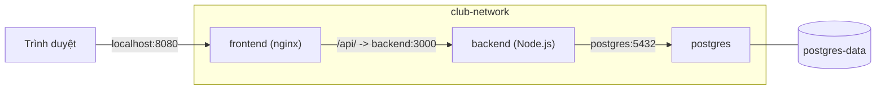

# Buổi 13 – Docker Compose

Tuần 7/16 · Giai đoạn 2 – Containerization · Buổi 13/32

[Slide buổi 13](../../slides/03-compose/session-13.md) · [Bài tập tuần 7](../../assignments/weekly/week-07.md) · [Hub tuần 7](README.md)

> **Tóm tắt:** Dùng Docker Compose để mô tả và chạy cả Frontend, API và PostgreSQL của starter-project bằng một file compose.yaml và một lệnh duy nhất.

::: tip Buổi này bạn làm gì
- **Bạn sẽ tạo ra:** một thư mục `lab-13/` chạy được cả ba service (frontend, backend, postgres) bằng một lệnh `docker compose up -d --build`, kèm bằng chứng về dữ liệu còn hay mất sau `down` và `down -v`.
- **Thời gian thật:** đọc 15 phút, lab bắt buộc 60 phút, thử thách L2 làm ở nhà (tùy chọn, khoảng 30 phút).
- **Cần chuẩn bị:**
  - [ ] Đã làm xong [Buổi 12 – Persistent Storage](../week-06/session-12.md) (Dockerfile, network, volume).
  - [ ] Docker Desktop đang chạy, terminal WSL mở trong `~` (xem [Hướng dẫn cài đặt](../../resources/setup-guide.md)).
  - [ ] Có repo cá nhân `devops-labs` (public) và đã clone giáo trình vào `~/devops-course` (xem [Tài khoản GitHub và repo](../../resources/setup-github.md)).
  - [ ] Chạy `bash ~/devops-course/resources/check-env.sh 13` để biết mình thiếu gì.
- **Sản phẩm phải nộp:** `README.md`, `evidence/command-output.txt`, `report.md` trong `lab-13/`, kèm `source/` (có `compose.yaml` và `.env.example`, không có `.env`) và ảnh giao diện trong `screenshots/`.
- **Đi tới:** Đọc (bên dưới) > [Làm lab](#hands-on-lab) > [Gặp lỗi?](#gap-loi) > [Tự kiểm tra](#tu-kiem-tra) > [Nộp bài](#nop-bai). Kẹt? Nhảy tới [Gặp lỗi?](#gap-loi).

**Từ mới trong buổi:**
- [Compose](../../resources/glossary.md): công cụ chạy nhiều container từ một file YAML.
- [Service](../../resources/glossary.md): một thành phần của ứng dụng, ví dụ `backend`.
- [Healthcheck](../../resources/glossary.md): lệnh Docker chạy định kỳ để biết service đã khỏe chưa.
- [Named volume](../../resources/glossary.md): nơi Docker giữ dữ liệu bên ngoài container.
- [Biến môi trường](../../resources/glossary.md): giá trị cấu hình truyền vào container, ví dụ mật khẩu.
:::

Trên lớp, mentor demo trước; tự học thì làm thẳng phần [Làm lab](#hands-on-lab).

## Vấn đề thực tế

Ở buổi 9-12 bạn chạy ứng dụng CLB bằng nhiều lệnh `docker run`: tạo network, tạo volume, chạy postgres với một chuỗi biến môi trường, chạy backend, rồi chạy frontend. Thành viên mới phải chép lại cả chục dòng lệnh, và quên một cờ `-e` hay sai thứ tự là hệ thống không lên. Lệnh nằm trong lịch sử terminal của một người, không ai review được.

Docker Compose gom toàn bộ hệ thống vào một file `compose.yaml` được commit cùng mã nguồn. Người mới chỉ cần clone repo, tạo `.env`, chạy `docker compose up -d --build`. File này cũng là tài liệu sống: muốn biết backend nối vào database nào, cổng nào mở ra máy, dữ liệu lưu ở đâu, chỉ cần đọc một file.

## Khái niệm cốt lõi

1. **`compose.yaml` là bản khai báo cả hệ thống.** Bạn mô tả trạng thái mong muốn, Compose tạo hoặc cập nhật container, network, volume cho khớp. Ví von: công thức nấu ăn, ai làm theo cũng ra đúng món. Tên project mặc định lấy theo tên thư mục chứa file.
2. **Service gọi nhau bằng tên.** Trong network của project, backend gọi `postgres:5432`, nginx gọi `backend:3000`. Ví von: danh bạ nội bộ, gọi theo tên chứ không cần nhớ số. Vì vậy `DB_HOST: postgres`; `localhost` trong container backend là chính backend.
3. **`depends_on` chỉ lo thứ tự, không lo sẵn sàng.** Container postgres "đang chạy" chưa chắc đã nhận kết nối vì còn khởi tạo và chạy `init.sql`. Ví von: nhà hàng đã mở cửa nhưng bếp chưa nhóm lửa. Muốn chờ thật, dùng `healthcheck` (postgres) cùng `condition: service_healthy` (backend).
4. **`.env` giữ bí mật ngoài Git.** Compose đọc file `.env` cạnh `compose.yaml` để thay các biến `${...}`. Ví von: `.env.example` là mẫu đơn trống, `.env` là bản bạn đã điền và cất riêng. Chỉ commit `.env.example`.
5. **Named volume giữ dữ liệu.** `postgres-data` gắn vào `/var/lib/postgresql/data`; container xóa đi, dữ liệu còn. Ví von: ổ cứng ngoài, `down` chỉ rút ổ ra khỏi máy, `down -v` vứt luôn ổ. File `init.sql` chỉ chạy khi ổ còn trống.



Các lệnh vòng đời bạn sẽ dùng trong lab:

| Lệnh | Tác dụng |
| --- | --- |
| `docker compose up -d --build` | Build (nếu cần), tạo và chạy mọi service ở nền |
| `docker compose ps` | Xem trạng thái các service |
| `docker compose logs -f backend` | Theo dõi log một service |
| `docker compose exec backend sh` | Mở shell trong container đang chạy |
| `docker compose config` | In cấu hình sau khi thay biến, dùng để kiểm tra |
| `docker compose down` / `down -v` | Xóa container và network, giữ volume / xóa luôn volume (mất dữ liệu) |

Dùng `docker compose` (có dấu cách), không dùng `docker-compose` (bản v1 cũ).

::: details Tìm hiểu thêm (đọc sau)
**Network, volume.** Mỗi project có một network bridge riêng (ở đây tên `club-network`). File `./database/init.sql` được mount (chỉ đọc) vào `/docker-entrypoint-initdb.d/`; image postgres chỉ chạy các script trong thư mục này khi data directory còn trống, tức lần khởi tạo đầu tiên.

Bảng các khóa chính của `compose.yaml`, các dạng `depends_on`, cú pháp thay biến và chuỗi khởi động chi tiết nằm ở [trang thử thách buổi 13](session-13-challenge.md).
:::

## Hands-on lab

Bắt buộc (mức L1), khoảng 60 phút: Chuẩn bị 5', Phần 1 8', Phần 2 12', Phần 3 15', Phần 4 20'. Phần nào bị lỗi, xem [Gặp lỗi?](#gap-loi).

### Chuẩn bị (5 phút)

Kiểm tra môi trường; kết quả mong đợi là `Docker version 27.x.x` (hoặc mới hơn) và `Docker Compose version v2.x.x` (Compose phải là v2):

```bash
docker --version
docker compose version
```

Tạo thư mục nộp bài trong repo cá nhân `devops-labs` và sao chép starter-project vào:

```bash
mkdir -p ~/devops-labs/lab-13/source ~/devops-labs/lab-13/evidence ~/devops-labs/lab-13/screenshots
cp -r ~/devops-course/starter-project/. ~/devops-labs/lab-13/source/
cd ~/devops-labs/lab-13/source
ls
echo "## Lab 13 evidence" > ../evidence/command-output.txt
date >> ../evidence/command-output.txt
```

Kết quả mong đợi: thấy `backend`, `frontend`, `database`, `k8s`, `compose.yaml` (file ẩn như `.env.example` chỉ hiện khi dùng `ls -a`). Nếu bạn clone giáo trình ở đường dẫn khác, sửa lại phần `~/devops-course`. Nếu có thư mục `node_modules` trong `backend`, bạn có thể xóa nó trong bản sao cho gọn; Dockerfile tự cài dependency khi build.

Nếu cổng 8080 đang bị chiếm, bạn sẽ đặt `WEB_PORT=8081` trong `.env` ở Phần 1. Kiểm tra nhanh trong PowerShell trên Windows (cổng do Docker Desktop mở nằm ở phía Windows, `ss` trong WSL có thể không thấy): `netstat -ano | findstr :8080`; không có dòng LISTENING nào là cổng đang rảnh.

::: warning Cổng 3000 của backend
Backend cũng publish cổng 3000 ra máy. Chỉ dùng trên máy cá nhân trong mạng tin cậy, đừng mở cổng này ra Internet.
:::

### Phần 1 – Tạo .env và kiểm tra cấu hình (8 phút)

Bước 1.1: tạo `.env` từ mẫu.

```bash
cp .env.example .env
cat .env
```

```text
DB_PASSWORD=change-me-locally
# Host port for the web UI (change if 8080 is busy)
WEB_PORT=8080
```

Vì sao: `.env.example` được commit làm mẫu, `.env` là bản thật của riêng bạn và phải nằm trong `.gitignore`. Hãy đổi `DB_PASSWORD` thành một chuỗi riêng của bạn (không dùng mật khẩu thật của dịch vụ nào khác).

Bước 1.2: xác nhận `.env` được git bỏ qua.

```bash
cd ~/devops-labs && git check-ignore -v lab-13/source/.env; cd lab-13/source
```

Kết quả mong đợi: in ra dòng chỉ tới quy tắc trong `.gitignore`. Nếu không in gì, thêm dòng `.env` vào `.gitignore` của repo trước khi làm tiếp (xem [Gặp lỗi?](#gap-loi) nếu lỡ commit `.env`).

Bước 1.3: xem cấu hình sau khi thay biến.

```bash
docker compose config | head -40
```

Vì sao: `config` kiểm tra cú pháp YAML và cho thấy giá trị cuối cùng của mọi biến. Đây là bước đầu tiên khi nghi ngờ Compose "không nhận biến".

::: tip Kiểm tra: bạn đúng khi
- `git check-ignore -v` in ra một dòng chứa `.env`.
- `docker compose config` in ra YAML, `DB_PASSWORD` có giá trị bạn đã đặt, không có chữ `error`.
:::

### Phần 2 – Khởi chạy hệ thống (12 phút)

Bước 2.1: build và chạy (lần đầu mất 1-3 phút để tải image).

```bash
docker compose up -d --build 2>&1 | tee -a ../evidence/command-output.txt
```

Kết quả mong đợi (cuối output, rút gọn):

```text
 Network starter-project_club-network   Created
 Volume "starter-project_postgres-data" Created
 Container starter-project-postgres-1   Healthy
 Container starter-project-backend-1    Started
 Container starter-project-frontend-1   Started
```

Tên project và container phụ thuộc tên thư mục chứa `compose.yaml`; thư mục của bạn là `source` nên tiền tố có thể là `source-`, không phải `starter-project-`. Dùng tên service (`backend`) trong lệnh thay vì tên container.

Bước 2.2: xem trạng thái.

```bash
docker compose ps | tee -a ../evidence/command-output.txt
```

Kết quả mong đợi: postgres `Up ... (healthy)`, backend và frontend `Up`. Nếu postgres chưa healthy, đợi 10-15 giây rồi chạy lại.

Bước 2.3: đọc log để biết hệ thống đang làm gì.

```bash
docker compose logs --tail=20 backend
docker compose logs --tail=20 postgres
```

Vì sao: log postgres cho thấy nó đã chạy `init.sql` ở lần khởi tạo đầu (dòng `running /docker-entrypoint-initdb.d/init.sql`), log backend cho thấy API đang lắng nghe (`API listening on port 3000`).

::: tip Kiểm tra: bạn đúng khi
- `docker compose ps` có đủ ba service; postgres ghi `(healthy)`.
- Log backend có dòng `API listening on port 3000`.
:::

### Phần 3 – Kiểm thử qua mạng (15 phút)

Bước 3.1: gọi API và giao diện.

```bash
curl -s http://localhost:8080/api/members | tee -a ../evidence/command-output.txt
curl -s http://localhost:3000/health
curl -s http://localhost:3000/ready
```

```text
[{"id":1,"name":"Alice","email":"alice@example.com"},{"id":2,"name":"Bob","email":"bob@example.com"}]
{"status":"healthy","service":"club-api"}
{"status":"ready"}
```

Mở trình duyệt trên Windows tại `http://localhost:8080` và chụp màn hình vào `screenshots/` (nếu bạn đổi `WEB_PORT`, dùng cổng đó).

Bước 3.2: kiểm tra DNS nội bộ giữa các container.

```bash
docker compose exec backend wget -qO- http://127.0.0.1:3000/health
docker compose exec frontend wget -qO- http://backend:3000/health
```

Kết quả mong đợi: cả hai trả về `{"status":"healthy","service":"club-api"}`. Image alpine dùng `wget` của busybox nên có sẵn, không cần `curl`. Vì sao: lệnh thứ hai chạy trong container frontend và gọi `backend` bằng tên service, chứng minh DNS của `club-network` hoạt động.

Bước 3.3: truy vấn database trực tiếp.

```bash
docker compose exec postgres psql -U club -d clubdb -c "SELECT id, name FROM members;"
```

```text
 id | name
----+-------
  1 | Alice
  2 | Bob
(2 rows)
```

::: tip Kiểm tra: bạn đúng khi
- `/api/members` trả JSON có Alice và Bob; trình duyệt hiện giao diện.
- Lệnh `exec frontend ... http://backend:3000/health` thành công (gọi theo tên service, không dùng IP).
- `psql` in ra 2 dòng.
:::

### Phần 4 – Dữ liệu và vòng đời (20 phút)

Bước 4.1: thêm một dòng dữ liệu (API chưa có POST nên thêm bằng SQL).

```bash
docker compose exec postgres psql -U club -d clubdb \
  -c "INSERT INTO members (name, email) VALUES ('Carol', 'carol@example.com');"
curl -s http://localhost:8080/api/members | tee -a ../evidence/command-output.txt
```

Bước 4.2: xóa container nhưng giữ volume, rồi chạy lại.

```bash
docker compose down
docker compose up -d
sleep 5
curl -s http://localhost:8080/api/members | tee -a ../evidence/command-output.txt
```

Kết quả mong đợi: vẫn có Carol (3 phần tử). Vì sao: `down` xóa container và network nhưng không xóa named volume. Init script không chạy lại vì data directory đã có dữ liệu.

Bước 4.3: xóa cả volume.

::: warning down -v xóa dữ liệu
`docker compose down -v` xóa volume của project này, tức mọi dữ liệu postgres trong lab. Chỉ chạy trong `lab-13/source`, và chỉ khi đã xong bước 4.2.
:::

```bash
docker compose down -v
docker compose up -d
sleep 15
curl -s http://localhost:8080/api/members | tee -a ../evidence/command-output.txt
```

Kết quả mong đợi: chỉ còn Alice và Bob; Carol đã mất, vì volume bị xóa và `init.sql` chạy lại từ đầu. Nếu kết quả rỗng hoặc lỗi, chờ thêm vài giây rồi gọi lại.

::: tip Kiểm tra: bạn đúng khi
- Lần gọi thứ 2 (sau `down`) có Carol; lần gọi thứ 3 (sau `down -v`) không còn Carol.
- File `evidence/command-output.txt` có ba lần gọi `/api/members` theo đúng thứ tự.
:::

### Checklist L1 và tự kiểm tra một dòng

- [ ] `.env` được tạo từ `.env.example` và không bị git theo dõi.
- [ ] `docker compose ps` cho thấy cả ba service chạy, postgres `healthy`.
- [ ] `curl http://localhost:8080/api/members` trả về danh sách thành viên.
- [ ] Đã thực hiện được lệnh `exec` vào container và gọi `backend` bằng tên service.
- [ ] Đã chứng minh được sự khác nhau giữa `down` và `down -v` bằng dữ liệu Carol.
- [ ] Có file `evidence/command-output.txt` chứa output các lệnh trên.

```bash
docker compose ps --format '{{.Service}} {{.Status}}' && curl -s http://localhost:8080/api/members | head -c 120 && git -C ~/devops-labs check-ignore lab-13/source/.env
```

## Gặp lỗi?

| Triệu chứng | Nguyên nhân | Cách sửa |
| --- | --- | --- |
| `required variable DB_PASSWORD is missing a value` | Chưa có file `.env` hoặc biến trống | `cp .env.example .env`, điền `DB_PASSWORD`, chạy `docker compose config` để kiểm tra |
| `Bind for 0.0.0.0:8080 failed: port is already allocated` (hoặc `ports are not available ... bind` trên Docker Desktop Windows) | Cổng 8080 đã bị chương trình khác chiếm | Đổi `WEB_PORT` trong `.env` hoặc tắt chương trình đang chiếm cổng |
| `yaml: line N: mapping values are not allowed in this context` hoặc lỗi tương tự | Thụt lề sai, dùng Tab thay vì dấu cách | Dùng 2 dấu cách, không dùng Tab; chạy `docker compose config` để xem dòng lỗi |
| Backend lỗi `ECONNREFUSED` hoặc `getaddrinfo ENOTFOUND` tới DB | Sai `DB_HOST` (ví dụ `localhost`) hoặc service không cùng network | Đặt `DB_HOST: postgres`, kiểm tra `networks` của cả hai service |
| Bảng `members` không tồn tại, `/api/members` trả 500 | `init.sql` không chạy vì volume cũ đã có dữ liệu hoặc quên mount | Mount đúng file; với môi trường học, `docker compose down -v` rồi `up -d` |
| Backend lỗi ngẫu nhiên lúc mới khởi động | `depends_on` không có `condition: service_healthy` nên backend chạy khi DB chưa sẵn sàng | Thêm `healthcheck` cho postgres và `condition: service_healthy` |
| Sửa code nhưng container vẫn chạy bản cũ | Image cũ chưa được build lại | `docker compose up -d --build` |
| Vô tình commit `.env` | `.env` không có trong `.gitignore` | Thêm vào `.gitignore`, gỡ khỏi git, và đổi mật khẩu đã lộ |
| Đổi `DB_PASSWORD` trong `.env`, mọi container `Up` nhưng API trả 500 (hoặc 502) | Volume `postgres-data` vẫn giữ mật khẩu cũ; `POSTGRES_PASSWORD` chỉ dùng khi khởi tạo lần đầu | Trả lại mật khẩu cũ, hoặc `ALTER USER` trong database; xem "Phá lỗi nâng cao" ở cuối trang |

## Tự kiểm tra

1. `depends_on` mặc định đảm bảo điều gì và không đảm bảo điều gì?
2. Vì sao backend dùng `DB_HOST: postgres` mà không phải `localhost`?
3. Khác biệt giữa `docker compose down` và `docker compose down -v`?
4. Ý nghĩa của `${DB_PASSWORD:?Set DB_PASSWORD in .env}`?
5. Vì sao postgres không cần `ports` mà backend vẫn kết nối được?

::: details Đáp án gợi ý
1. Chỉ đảm bảo thứ tự start container (service phụ thuộc được start trước). Không đảm bảo ứng dụng bên trong đã sẵn sàng nhận kết nối; cần `condition: service_healthy` cùng `healthcheck`.
2. Mỗi container có network namespace riêng; `localhost` trỏ về chính container backend. Tên service `postgres` được DNS của network Compose phân giải sang IP container postgres.
3. `down` xóa container và network, giữ named volume nên dữ liệu còn. `down -v` xóa cả volume nên mất dữ liệu.
4. Bắt buộc biến `DB_PASSWORD` phải có giá trị; nếu thiếu hoặc rỗng, Compose dừng và in thông báo sau dấu `?`. Cách này ngăn chạy hệ thống với mật khẩu rỗng.
5. Các container trong cùng network nói chuyện với nhau qua cổng container (5432) trực tiếp. `ports` chỉ dùng để publish ra máy; không publish cũng giúp giảm bề mặt tấn công.
:::

## Nộp bài

Nộp vào `lab-13/` trong repo cá nhân `devops-labs` theo [mẫu nộp bài lab](../../templates/lab-template.md); đề và thang điểm ở [Bài tập tuần 7](../../assignments/weekly/week-07.md).

- [ ] `README.md` trả lời đủ 7 câu của template (bài lab giải quyết vấn đề gì, kiến thức đã dùng, các bước, kết quả mong đợi, lỗi đã gặp, cách khắc phục, cải thiện) và đánh dấu level đã làm (L1/L2).
- [ ] `source/` chứa `compose.yaml`, `.env.example`, code ứng dụng; có `compose.mine.yaml` nếu làm L2.
- [ ] `evidence/command-output.txt` có output của `docker compose ps`, `curl`, `psql` và thí nghiệm `down` so với `down -v`.
- [ ] `screenshots/` có ảnh giao diện tại `localhost:8080` (hoặc `WEB_PORT` của bạn).
- [ ] `report.md` giải thích vì sao dữ liệu còn sau `down` nhưng mất sau `down -v` (3-5 câu, nhắc tới volume `postgres-data` và `init.sql`); nếu làm phần Phá lỗi nâng cao, thêm triệu chứng, bước điều tra, nguyên nhân gốc, cách phòng tránh.
- [ ] Đã kiểm tra: không có file `.env` hay mật khẩu thật trong commit (`git status`, `git log -p` nếu cần).

## Recap

- Compose mô tả cả hệ thống trong một file `compose.yaml`, quản lý bằng `up`, `ps`, `logs`, `exec`, `down`; service gọi nhau bằng tên, `localhost` trong container là chính nó.
- `depends_on` chỉ lo thứ tự start; muốn chờ sẵn sàng phải dùng `healthcheck` với `condition: service_healthy`. Secret nằm trong `.env` (không commit).
- Named volume giữ dữ liệu qua `down`; `down -v` xóa dữ liệu, và `init.sql` chỉ chạy khi volume trống. Khi lỗi: `ps`, rồi `logs`, rồi `config` và `exec`.

Buổi tiếp theo: [Buổi 14 – Production-minded Compose](session-14.md).


::: details Thử thách thêm (L2, tùy chọn, làm ở nhà)
Ba thử thách (viết lại `compose.yaml` từ đầu, đổi cổng, restart policy) cùng gợi ý từng bậc nằm ở [Buổi 13 – thử thách L2 và phá lỗi nâng cao](session-13-challenge.md). Hãy tự thử 15 phút trước khi mở gợi ý.
:::

::: details Phá lỗi nâng cao và tài liệu tham khảo
Tình huống "đổi mật khẩu trong `.env` nhưng API vẫn lỗi kết nối DB" (triệu chứng, bước điều tra, nguyên nhân gốc, cách sửa) và danh sách tài liệu tham khảo nằm ở [trang thử thách buổi 13](session-13-challenge.md).
:::
