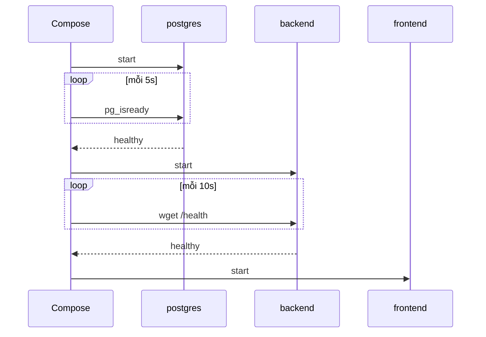

# Buổi 14 – Production-minded Compose

Tuần 7/16 · Giai đoạn 2 – Containerization · Buổi 14/32

[Slide buổi 14](../../slides/03-compose/session-14.md) · [Bài tập tuần 7](../../assignments/weekly/week-07.md) · [Hub tuần 7](README.md)

> **Tóm tắt:** Nâng compose.yaml từ mức chạy được lên mức đáng tin cậy: healthcheck, thứ tự khởi động, restart và cách điều tra khi healthcheck sai. Giới hạn tài nguyên, secrets, backup nằm ở bài thử thách.

::: tip Buổi này bạn làm gì
- **Bạn sẽ tạo ra:** một `compose.yaml` mà cả ba service đều có healthcheck (`healthy`), backend tự dựng lại khi sập, và một báo cáo Break -> Debug về healthcheck bị đặt sai.
- **Thời gian thật:** đọc 15 phút, lab bắt buộc 60 phút, thử thách L2 (giới hạn tài nguyên, secrets, backup, restore) làm ở nhà, khoảng 45 phút.
- **Cần chuẩn bị:**
  - [ ] Đã chạy được starter-project ở [Buổi 13 – Docker Compose](session-13.md); đã chạy `docker compose down` trong `lab-13/source`.
  - [ ] Docker Desktop đang chạy, terminal WSL mở trong filesystem của WSL, không dùng `/mnt/c` (xem [Hướng dẫn cài đặt](../../resources/setup-guide.md)).
  - [ ] Repo cá nhân `devops-labs` (public) và giáo trình ở `~/devops-course` (xem [Tài khoản GitHub và repo](../../resources/setup-github.md)).
- **Sản phẩm phải nộp:**
  - `lab-14/source/compose.yaml` đã có healthcheck cho cả ba service.
  - `evidence/command-output.txt` (`ps` healthy, Health Log, thí nghiệm restart, mã `/health` và `/ready`).
  - `report.md` mô tả tình huống Break -> Debug và giải thích `/health` so với `/ready`.
  - `README.md` theo mẫu nộp bài.
- **Đi tới:** Đọc (bên dưới) > [Làm lab](#hands-on-lab) > [Gặp lỗi?](#gap-loi) > [Tự kiểm tra](#tu-kiem-tra) > [Nộp bài](#nop-bai). Kẹt? Nhảy tới [Gặp lỗi?](#gap-loi).

**Từ mới trong buổi:**
- [Healthcheck](../../resources/glossary.md): lệnh Docker chạy định kỳ trong container; thoát mã 0 là healthy.
- [Liveness và readiness](../../resources/glossary.md): "còn sống" khác "sẵn sàng phục vụ".
- [Restart policy](../../resources/glossary.md): quy tắc Docker tự chạy lại container khi nó thoát.
- [Resource limit](../../resources/glossary.md): mức CPU và bộ nhớ tối đa của một container (bài thử thách).
- [pg_dump](../../resources/glossary.md): lệnh xuất database PostgreSQL ra file SQL (bài thử thách).
:::

Trên lớp, mentor demo trước; tự học thì làm thẳng phần [Làm lab](#hands-on-lab).

## Vấn đề thực tế

Một buổi sinh hoạt CLB, bạn demo hệ thống quản lý thành viên trên laptop. Bạn chạy `docker compose up -d`, mở trình duyệt ngay và thấy lỗi 500 vì Postgres còn đang khởi tạo; chạy lại lần hai thì được. Đến tối máy khởi động lại, container API chết và không tự dậy. Vài tuần sau, thư mục log của Docker chiếm hàng GB. Không lỗi nào nằm ở code ứng dụng; chúng nằm ở cách vận hành.

Production-minded Compose không có nghĩa là đưa Compose lên production lớn. Nó là tập thói quen: hệ thống tự cho biết khi nào sẵn sàng, tự hồi phục khi lỗi vặt, không ăn hết tài nguyên máy, không lộ mật khẩu và có đường quay lại khi mất dữ liệu. Những thói quen này chuyển nguyên sang Kubernetes ở Tuần 11 (probe, resource requests/limits, Secret, PVC).

## Khái niệm cốt lõi

1. **Container "started" khác service "ready".** Docker chỉ biết tiến trình chính (PID 1) có đang chạy; postgres có thể đã chạy nhưng chưa nhận kết nối. Healthcheck là lệnh Docker chạy định kỳ trong container: thoát mã 0 là `healthy`, mã 1 là `unhealthy`. Ví von: đèn "đang mở cửa" khác với việc bếp đã sẵn sàng nấu.
2. **`/health` và `/ready`.** `/health` trả lời "tiến trình còn sống"; `/ready` trả lời "đã phục vụ được chưa" (truy vấn DB thành công). Khi DB dừng, `/health` vẫn 200 còn `/ready` thành 503. Đây là nền tảng của liveness và readiness probe ở Kubernetes.
3. **`depends_on` với `condition: service_healthy`.** Compose chờ healthcheck của service kia báo healthy rồi mới start service này. Lưu ý: chỉ tác động lúc `docker compose up`; postgres restart giữa chừng thì Compose không restart API, nên ứng dụng vẫn phải chịu được mất kết nối tạm thời.
4. **Restart policy chỉ phản ứng khi tiến trình thoát.** `restart: unless-stopped` dựng lại container sập, nhưng không đụng tới container đang `unhealthy` (nó vẫn chạy) và không dựng lại container bạn chủ động dừng. Ví von: người gác cổng chỉ mở lại cửa khi cửa tự đóng, không sửa được cái bếp hỏng.
5. **Vận hành an toàn.** Đặt giới hạn tài nguyên (kẻo một container rò bộ nhớ kéo sập WSL2), xoay vòng log, để mật khẩu ngoài Git, và tập backup rồi restore thật: volume không phải là backup. Các phần này làm ở bài [thử thách L2](session-14-challenge.md).



::: details Tìm hiểu thêm (đọc sau)
**Trạng thái và tham số của healthcheck**

| Trạng thái | Ý nghĩa |
| --- | --- |
| `starting` | Đang trong `start_period` hoặc chưa có lần check thành công đầu tiên |
| `healthy` | Lệnh check gần nhất thành công |
| `unhealthy` | Lệnh check thất bại liên tiếp đủ `retries` lần |

| Khóa | Ý nghĩa | Gợi ý cho lab |
| --- | --- | --- |
| `test` | Lệnh kiểm tra; dạng `["CMD", ...]` hoặc `["CMD-SHELL", "..."]` | xem Phần 2 |
| `interval` | Khoảng cách giữa hai lần check | 5s đến 10s |
| `timeout` | Quá thời gian này thì tính là một lần thất bại | 3s |
| `retries` | Số lần thất bại liên tiếp trước khi `unhealthy` | 3 đến 5 |
| `start_period` | Lỗi trong khoảng này chưa bị tính vào `retries` | 10s đến 30s |

Bảng các dạng `depends_on` và các policy `restart` nằm ở mục "Tra cứu thêm" của [trang thử thách buổi 14](session-14-challenge.md).

**Chuỗi khởi động.** Compose tạo network và volume, start `postgres` trước vì các service kia phụ thuộc vào nó. Docker chạy `pg_isready` mỗi 5 giây. Lưu ý: `pg_isready` có thể báo sẵn sàng sớm khi server tạm thời của bước khởi tạo đã nhận kết nối, nên sau `down -v` hãy chờ vài giây trước khi truy vấn. Khi postgres healthy, backend start và có healthcheck riêng gọi `/health`; khi backend healthy, frontend mới start, nên người dùng không thấy trang web trỏ vào API chưa chạy. Nếu một container thoát bất thường, restart policy dựng lại nó; Compose không chạy lại các service phụ thuộc.
:::

## Hands-on lab

Bắt buộc (mức L1), khoảng 60 phút: Chuẩn bị 5', Phần 1 10', Phần 2 15', Phần 3 15', Phần 4 15'. Bước nào lỗi, xem [Gặp lỗi?](#gap-loi).

### Chuẩn bị (5 phút)

```bash
mkdir -p ~/devops-labs/lab-14 && cd ~/devops-labs/lab-14
cp -r ~/devops-course/starter-project source
mkdir -p evidence
cd source
cp .env.example .env
docker compose down -v
grep -n "DB_PASSWORD" .env
```

Kết quả mong đợi: `.env` có dòng `DB_PASSWORD=...`. Nếu bạn clone giáo trình ở đường dẫn khác, sửa lại `~/devops-course`. File `.env` không được commit. Từ đây, ghi lệnh quan trọng vào `../evidence/command-output.txt`, ví dụ `docker compose ps | tee -a ../evidence/command-output.txt`.

`lab-13/source` và `lab-14/source` cùng tên thư mục `source` nên cùng tên project Compose. Hãy chắc bạn đã chạy `docker compose down` trong `lab-13/source` để hai lab không dẫm lên container và volume của nhau.

### Phần 1 – Quan sát healthcheck của postgres (10 phút)

Bước 1.1: mở terminal thứ hai, chạy `watch -n 1 docker compose ps` trong `~/devops-labs/lab-14/source`. Ở terminal chính, chạy hệ thống:

```bash
docker compose up -d --build
```

Nhấn `Ctrl+C` ở terminal thứ hai khi `postgres` thành `healthy` và `backend` đã `Up`. Vì sao: bạn thấy trực tiếp khoảng chênh giữa container chạy và service sẵn sàng. `up -d` tự chờ postgres healthy rồi mới start backend, nên nếu chỉ chạy `watch` sau khi `up -d` kết thúc thì bạn bỏ lỡ khoảng đó.

Bước 1.2: đọc lịch sử check.

```bash
docker inspect --format '{{range .State.Health.Log}}{{.ExitCode}} {{.Output}}{{end}}' $(docker compose ps -q postgres) | tee -a ../evidence/command-output.txt
```

Kết quả mong đợi: các dòng dạng `0 /var/run/postgresql:5432 - accepting connections`.

Bước 1.3: kiểm tra API đọc được dữ liệu.

```bash
curl -s http://localhost:3000/api/members
```

::: tip Kiểm tra: bạn đúng khi
- Ở terminal thứ hai, postgres đi từ `(health: starting)` sang `(healthy)` trước khi backend chạy.
- Health Log có dòng `accepting connections` với mã `0`; API trả JSON có Alice và Bob.
:::

### Phần 2 – Thêm healthcheck cho backend và frontend (15 phút)

Image backend (`node:22-alpine`) và frontend (`nginx:alpine`) đều có `wget` của BusyBox, nên không cần cài thêm gì. Dùng `127.0.0.1` thay vì `localhost` để tránh `localhost` phân giải sang IPv6 trong khi ứng dụng chỉ lắng nghe IPv4.

Sửa `compose.yaml`, thêm vào service `backend` (thụt lề 4 dấu cách, không dùng Tab):

```yaml
    healthcheck:
      test: ["CMD-SHELL", "wget -q -O /dev/null http://127.0.0.1:3000/health || exit 1"]
      interval: 10s
      timeout: 3s
      retries: 3
      start_period: 10s
```

Thêm vào service `frontend`, đồng thời đổi `depends_on` của nó:

```yaml
    depends_on:
      backend:
        condition: service_healthy
    healthcheck:
      test: ["CMD-SHELL", "wget -q -O /dev/null http://127.0.0.1:80/ || exit 1"]
      interval: 10s
      timeout: 3s
      retries: 3
      start_period: 5s
```

Áp dụng và kiểm tra:

```bash
docker compose config --quiet && echo "YAML OK"
docker compose up -d
docker compose ps | tee -a ../evidence/command-output.txt
```

Kết quả mong đợi: `YAML OK`; sau khoảng 15 đến 25 giây cả ba service `(healthy)`. Vì sao `config --quiet`: bắt lỗi thụt lề và khóa sai trước khi chạy.

::: tip Kiểm tra: bạn đúng khi
- `docker compose config --quiet` in `YAML OK`.
- `docker compose ps` cho thấy `postgres`, `backend`, `frontend` đều `(healthy)`.
- Bạn giải thích được (bằng lời của mình) vì sao backend chờ postgres và frontend chờ backend.
:::

### Phần 3 – Restart policy, `/health` và `/ready` (15 phút)

Bước 3.1: làm backend thoát bất thường và xem nó tự dậy.

```bash
curl -s http://localhost:3000/api/members > /dev/null
docker compose stop postgres
sleep 5
docker compose ps -a backend
docker inspect --format '{{.RestartCount}} {{.HostConfig.RestartPolicy.Name}}' $(docker compose ps -q backend)
docker compose start postgres
```

Kết quả mong đợi: backend `Up` với thời gian chạy vài giây, đầu ra `1 unless-stopped` (hoặc số lần restart tương ứng). Lệnh `curl` đầu tiên tạo một kết nối nhàn rỗi trong pool; khi postgres dừng, kết nối đó bị ngắt, backend chưa bắt sự kiện `error` của pool nên Node thoát với mã khác 0 và policy dựng lại container.

Docker Engine bản mới (đã kiểm chứng với 29.x) coi `docker compose kill` do bạn gõ là dừng thủ công: container nằm ở `Exited (137)` và `RestartCount` vẫn là 0. Vì vậy bài này không dùng `kill`. Sau đó thử `docker compose stop backend`, xác nhận nó nằm yên ở `Exited`, rồi `docker compose start backend`.

Bước 3.2: so sánh `/health` và `/ready` khi postgres dừng (chờ postgres `healthy` trở lại trước khi làm).

```bash
docker compose stop postgres
curl -s -o /dev/null -w "%{http_code}\n" http://localhost:3000/health
curl -s -o /dev/null -w "%{http_code}\n" http://localhost:3000/ready
docker compose start postgres
sleep 10
curl -s -o /dev/null -w "%{http_code}\n" http://localhost:3000/ready
```

Kết quả mong đợi: `200`, rồi `503`, và sau khi postgres healthy lại là `200`. Nếu pool đang giữ kết nối nhàn rỗi, backend có thể crash và được dựng lại ngay, nên `/health` có thể lỗi ngắn rồi trả `200`; gọi lại sau vài giây. Ghi các mã này vào `../evidence/test-results.txt`.

::: tip Kiểm tra: bạn đúng khi
- Backend thoát bất thường tự chạy lại và `RestartCount` tăng; `docker compose stop backend` thì nằm yên ở `Exited`.
- Khi postgres dừng: `/health` trả `200`, `/ready` trả `503`; sau khi chạy lại postgres, `/ready` trở về `200`.
:::

### Phần 4 – Phá lỗi có kiểm soát: healthcheck quá ngặt (15 phút)

Mục tiêu: tự gây lỗi rồi điều tra như một sự cố thật. Đây là nội dung của `report.md`.

Cách phá: lưu cấu hình cũ (`cp compose.yaml compose.yaml.bak`), rồi sửa healthcheck của backend thành `interval: 2s`, `timeout: 1s`, `retries: 1`, bỏ `start_period`, và trỏ vào đường dẫn sai `http://127.0.0.1:3000/healthz`.

```bash
docker compose up -d
docker compose ps
```

Triệu chứng: `backend` ở `(health: starting)` rồi `(unhealthy)`; `frontend` không bao giờ được tạo (vì chờ `service_healthy`), lệnh `up` báo `dependency failed to start: container ... is unhealthy`.

Hướng điều tra:

1. `docker compose ps` để xác định service nào unhealthy.
2. Xem log của healthcheck:

   ```bash
   docker inspect --format '{{range .State.Health.Log}}{{.ExitCode}} {{.Output}}{{end}}' $(docker compose ps -q backend)
   ```

   Output có dạng `wget: server returned error: HTTP/1.1 404 Not Found` (nội dung chính xác phụ thuộc phiên bản BusyBox).
3. Chạy tay lệnh check trong container để tái hiện: `docker compose exec backend wget -S -O /dev/null http://127.0.0.1:3000/health`.
4. Đối chiếu đường dẫn trong `app.js` (`/health`, `/ready`).

Nguyên nhân gốc: lệnh check sai đường dẫn, cộng với thông số quá ngặt (`retries: 1`, không `start_period`) khiến một lần chậm cũng bị coi là chết. Sửa: khôi phục từ `compose.yaml.bak`, `docker compose up -d`, thấy lại `(healthy)`. Phòng tránh: chạy tay lệnh check trước khi đưa vào YAML; để `start_period` bao trùm thời gian khởi động thật; `timeout` lớn hơn thời gian phản hồi bình thường vài lần.

Ghi `git diff` (hoặc `diff compose.yaml.bak compose.yaml`) của thay đổi gây lỗi và log trước/sau khi sửa vào `evidence/`. Trả cấu hình về đúng trước khi nộp.

::: tip Kiểm tra: bạn đúng khi
- Bạn đã thấy `unhealthy` và `dependency failed to start`, rồi tìm ra mã 404 trong Health Log.
- Sau khi khôi phục, `docker compose ps` lại cho cả ba service `(healthy)`.
:::

### Checklist L1 và tự kiểm tra một dòng

- [ ] `docker compose ps` cho thấy `postgres`, `backend`, `frontend` đều `(healthy)`.
- [ ] Giải thích được (bằng lời của bạn) vì sao `backend` chờ `postgres`.
- [ ] Làm backend thoát bất thường (dừng postgres khi pool có kết nối nhàn rỗi) và thấy nó tự khởi động lại với `RestartCount` tăng; `docker compose stop backend` thì không.
- [ ] `/health` trả 200 và `/ready` trả 503 khi bạn tạm dừng `postgres`.
- [ ] Đã làm Phần 4 và trả cấu hình về đúng.
- [ ] Đã lưu đầu ra các lệnh chính vào `evidence/command-output.txt`.

```bash
docker compose ps --format '{{.Service}} {{.Status}}' && curl -s -o /dev/null -w "%{http_code}\n" http://localhost:3000/ready
```

## Gặp lỗi?

| Triệu chứng | Nguyên nhân | Cách sửa |
| --- | --- | --- |
| Backend báo lỗi 500 ngay sau `up` | Dùng `depends_on` dạng ngắn, không chờ Postgres ready | Thêm healthcheck cho `postgres` và `condition: service_healthy` |
| Healthcheck luôn `unhealthy` dù ứng dụng chạy | Thiếu `wget`/`curl` trong image, hoặc check vào `localhost` bị phân giải sang IPv6 | Chạy tay lệnh check bằng `docker compose exec`; dùng `127.0.0.1`; chọn công cụ có sẵn trong image |
| `dependency failed to start` khi `up` | Dependency chuyển `unhealthy` (ví dụ đường dẫn check sai, `retries: 1`, thiếu `start_period`) | `docker compose ps`, đọc `.State.Health.Log`, chạy tay lệnh check, sửa lệnh hoặc tăng `start_period` |
| Sau `kill` container nằm ở `Exited (137)`, `RestartCount` là 0 | Docker 29.x coi `kill` do người dùng gõ là dừng thủ công | Tạo thoát bất thường thật: dừng postgres khi pool có kết nối nhàn rỗi (Phần 3) |
| Lỗi YAML khi `config` hoặc `up` | Thụt lề sai, dùng Tab, dán khối vào sai service | Dùng dấu cách, thụt lề 4 dấu cách trong `services`; chạy `docker compose config --quiet` |
| Cổng database lộ ra mạng | Publish `5432:5432` không cần thiết | Bỏ `ports` của postgres; backend truy cập qua network nội bộ |
| Container thoát với exit code 137 (khi làm L2) | Vượt giới hạn memory (OOM kill) hoặc bị kill | `docker inspect` xem `OOMKilled`; tăng limit hoặc sửa rò rỉ bộ nhớ |
| Thay đổi `deploy.resources` không thấy hiệu lực (khi làm L2) | Chưa recreate container | Chạy lại `docker compose up -d` rồi kiểm tra bằng `docker inspect` |
| Lỗi liên quan secret, backup, restore (`POSTGRES_PASSWORD_FILE`, `relation already exists`, file dump rỗng) | Xem bảng lỗi ở trang thử thách | Xem [Buổi 14 – thử thách L2](session-14-challenge.md) |

## Tự kiểm tra

1. `depends_on: [postgres]` đảm bảo điều gì và không đảm bảo điều gì?
2. Khác biệt giữa `restart: always` và `restart: unless-stopped`?
3. Vì sao container `unhealthy` không tự được Docker restart, và bạn có thể xử lý thế nào?
4. Tình huống: sau `docker compose up -d`, API trả 503 ở `/ready` trong 20 giây rồi tự ổn. Bạn kết luận gì và có cần sửa không?
5. Tình huống: dịch vụ đang chạy tốt thì Postgres bị restart. Frontend và backend có bị Compose khởi động lại không? Hệ thống phục hồi thế nào?

::: details Đáp án gợi ý
1. Đảm bảo container dependency đã được khởi động trước; không đảm bảo ứng dụng bên trong đã sẵn sàng nhận kết nối.
2. Cả hai tự khởi động lại khi thoát; `unless-stopped` không khởi động lại container mà bạn đã chủ động dừng khi daemon Docker khởi động lại, còn `always` thì có.
3. Restart chỉ kích hoạt khi tiến trình thoát; `unhealthy` chỉ là trạng thái. Có thể để ứng dụng tự thoát khi lỗi nặng, dùng công cụ giám sát bên ngoài, hoặc dùng Kubernetes (liveness probe) ở các tuần sau.
4. Đó là thời gian Postgres khởi tạo; hành vi bình thường. Không cần sửa code, nhưng nên có healthcheck và `depends_on` để người dùng không nhìn thấy khoảng đó.
5. Không; `depends_on` chỉ tác động lúc `up`. Pool kết nối của backend sẽ lỗi trong lúc DB tắt (`/ready` 503) rồi tạo kết nối mới khi DB lên, nên API tự phục hồi mà không cần restart.
:::

## Nộp bài

Nộp vào `lab-14/` trong repo cá nhân `devops-labs` theo [mẫu nộp bài lab](../../templates/lab-template.md); đề và thang điểm ở [Bài tập tuần 7](../../assignments/weekly/week-07.md).

- [ ] `README.md` trả lời đủ 7 câu hỏi của template (giải quyết vấn đề gì, kiến thức, các bước, kết quả mong đợi, lỗi đã gặp, cách khắc phục, cải thiện) và đánh dấu level đã làm (L1/L2).
- [ ] `source/` chứa `compose.yaml` đã sửa (healthcheck cho cả 3 service, `restart`), `.env.example`; thêm `backup.sh` hoặc limits, logging, secrets nếu làm L2.
- [ ] `evidence/command-output.txt` gồm `docker compose ps` (healthy), `docker inspect` Health Log, thí nghiệm restart (`RestartCount`); `evidence/test-results.txt` có mã `/health` và `/ready`.
- [ ] `report.md` mô tả tình huống Break -> Debug (healthcheck quá ngặt): triệu chứng, cách điều tra, nguyên nhân gốc, cách phòng tránh; kèm 3-5 câu giải thích nên chọn `/health` hay `/ready` cho healthcheck của Compose.
- [ ] `screenshots/` (nếu có) chỉ bổ trợ; không thay cho log và source.
- [ ] Đã kiểm tra: không commit `.env`, `secrets/`, hay file backup chứa dữ liệu nhạy cảm (`git status` sạch các mục đó).

## Recap

- Container chạy chưa có nghĩa là service sẵn sàng: dùng healthcheck và `condition: service_healthy`; `depends_on` chỉ tác động lúc khởi động.
- `/health` (còn sống) khác `/ready` (sẵn sàng phục vụ); đây là nền tảng của liveness và readiness probe trong Kubernetes.
- `restart: unless-stopped` hồi phục khi tiến trình thoát nhưng không xử lý `unhealthy`; khi healthcheck sai, chạy tay lệnh check và đọc Health Log.

Buổi tiếp theo: [Buổi 15 – CI/CD Fundamentals](../week-08/session-15.md).

::: details Thử thách thêm (L2, tùy chọn, làm ở nhà)
Giới hạn tài nguyên và log rotation, secret cho Postgres, backup và restore bằng `pg_dump`, cùng bốn thử thách (healthcheck có chủ đích, OOM có kiểm soát, backup tự động, secret cho backend) nằm ở [Buổi 14 – thử thách L2](session-14-challenge.md). Hãy tự thử 15 phút trước khi mở gợi ý.
:::

::: details Phá lỗi nâng cao
Hãy làm thêm tình huống "API không kết nối được DB" (scenario-03) và "database mất dữ liệu sau recreate" (scenario-04) trong `examples/troubleshooting/`: chỉ đọc triệu chứng, tự tìm nguyên nhân gốc. Ví dụ hoàn chỉnh nằm trong `examples/compose/healthcheck-restart/`; hãy tự làm trước khi so sánh.
:::

::: details Tài liệu tham khảo
- [Compose file: services (healthcheck, depends_on, restart, deploy)](https://docs.docker.com/reference/compose-file/services/)
- [Control startup and shutdown order in Compose](https://docs.docker.com/compose/how-tos/startup-order/)
- Danh sách đầy đủ ở [trang thử thách buổi 14](session-14-challenge.md).
:::
