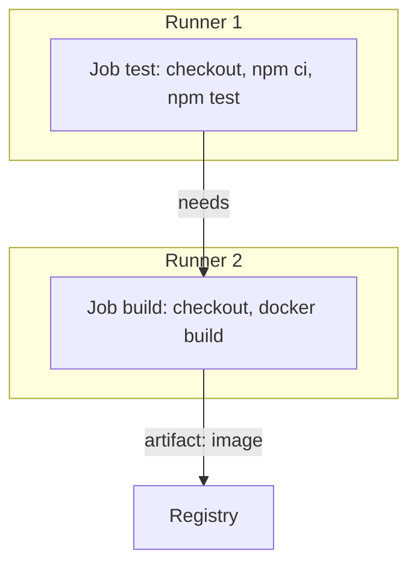

# Buổi 15 – Thử thách và tìm hiểu thêm

[Quay lại Buổi 15 – CI/CD Fundamentals](session-15.md) · [Hub Tuần 8](README.md)

> **Tóm tắt:** Phần đọc thêm, thử thách L2 và phá lỗi nâng cao của Buổi 15. Tùy chọn, làm ở nhà sau khi đã xong lab bắt buộc.

## Tìm hiểu thêm (đọc sau)

**Các thành phần của pipeline**

| Thành phần | Ý nghĩa | Ví dụ trong Club API |
| --- | --- | --- |
| Trigger | Sự kiện khởi động pipeline | push lên nhánh chính, mở pull request, tạo tag `v1.0.0`, chạy theo lịch |
| Runner | Máy (VM hoặc container) thực thi pipeline, sạch ở mỗi lần chạy | Máy `ubuntu-latest` do GitHub cung cấp |
| Pipeline | Chuỗi stage chạy theo thứ tự, mỗi stage có điều kiện qua hoặc dừng | Test, Build, Publish, Deploy |
| Job | Nhóm step chạy trên một runner; các job có thể chạy song song hoặc nối tiếp | Job `test`, job `build` |
| Step | Một lệnh hoặc một action trong job | `npm ci`, `npm test` |
| Artifact | Kết quả sinh ra và được lưu để dùng lại hoặc kiểm tra | Image `club-api`, báo cáo test, file build |
| Gate | Điều kiện phải đạt mới được đi tiếp | Test pass, approval của mentor, image scan sạch |
| Environment | Nơi ứng dụng chạy, mỗi nơi có cấu hình và mức rủi ro riêng | dev, staging, production |

**Năm nguyên tắc thiết kế pipeline**

1. Fail fast: stage rẻ và nhanh đứng trước stage đắt và chậm.
2. Build once, deploy many: không build lại cho từng môi trường, vì như vậy thứ chạy ở production không còn là thứ đã được test.
3. Mỗi artifact truy vết được về commit: tag image bằng commit SHA hoặc phiên bản, không dùng `latest` làm định danh duy nhất.
4. Secret không nằm trong code: pipeline lấy secret từ kho secret của nền tảng, không từ file trong repo.
5. Pipeline là code: định nghĩa pipeline nằm trong repo, được review như code khác.

**Giải thích từng bước của sơ đồ**

1. Trigger: developer push commit hoặc mở pull request. Nền tảng CI nhận sự kiện và tạo một lần chạy (run).
2. Test: runner mới tinh tải mã nguồn, cài dependency bằng `npm ci` (đúng theo `package-lock.json`), rồi chạy `npm test`. Fail ở đây thì dừng toàn bộ, không tốn thời gian build.
3. Build: đóng gói backend thành image bằng Dockerfile multi-stage, gắn tag theo commit.
4. Publish: đẩy image lên registry (GHCR). Từ lúc này image là artifact bất biến mà mọi môi trường dùng chung.
5. Deploy dev: tự động cập nhật môi trường dev bằng đúng image vừa publish.
6. Approval và Deploy production: nếu là Continuous Delivery, một người duyệt rồi mới deploy. Nếu là Continuous Deployment, bỏ bước này và chấp nhận mọi rủi ro dồn vào chất lượng test.

**Job chạy trên runner riêng**



Mỗi job chạy trên một runner riêng, không chia sẻ file hệ thống. Cái gì job sau cần từ job trước phải đi qua artifact, cache hoặc registry. Đây là lý do "không rõ artifact là gì" là lỗi thiết kế phổ biến.

## Thử thách thêm (L2, tùy chọn, làm ở nhà)

Tiêu chí hoàn thành: nộp thêm `source/environments.md` và cập nhật sơ đồ. Tự thử 15 phút trước khi mở gợi ý.

1. Mở rộng pipeline cho 3 môi trường dev, staging, production. Với mỗi môi trường ghi rõ: trigger deploy, gate (test nào, ai duyệt), và cách quay lui (rollback) khi lỗi.
2. Quyết định Club API dùng Continuous Delivery hay Continuous Deployment cho production, giải thích bằng ít nhất 3 lý do dựa trên rủi ro và độ tin cậy của test hiện có (Club API mới chỉ có test cho `/health`).
3. Sửa `run-pipeline.sh` để image chỉ được build một lần và được dùng lại cho mọi môi trường. Chứng minh bằng log có đúng một lệnh `docker build` (script phải in lệnh ra log, ví dụ `echo "+ docker build ..."` hoặc `set -x`, vì `docker build` không tự in dòng lệnh).
4. Đề xuất 2 gate bổ sung mà hiện pipeline chưa có (ví dụ kiểm tra `docker compose config`, quét lỗ hổng image, kiểm tra endpoint `/ready` sau deploy) và nói gate đó chặn loại lỗi nào.

::: details Gợi ý bậc 1
- Dev: tự động deploy sau mỗi lần merge, gate là test pass. Staging: tự động sau dev, thêm kiểm tra `/health` và `/ready`. Production: cần approval, chỉ nhận image đã chạy ổn ở staging.
- Rollback đơn giản nhất: deploy lại tag image trước đó. Điều này chỉ làm được nếu mọi image có tag bất biến (SHA hoặc phiên bản), không phải `latest`.
:::

::: details Gợi ý bậc 2
Cách đảm bảo build một lần: stage `build` sinh ra tag SHA; các bước sau chỉ tham chiếu tag đó, không gọi `docker build` nữa. Đếm số lần build trong log bằng `grep -c "^+ docker build" evidence/command-output.txt` (kết quả mong đợi là `1`). Lời giải đầy đủ có ở [trang tuần 8](README.md); chỉ mở sau khi nộp bài.
:::

Hai câu thảo luận thêm:

- Tình huống: pipeline hiển thị xanh, nhưng sau deploy `/api/members` trả 500. Bạn kiểm tra theo thứ tự nào?
- Tình huống: bạn muốn production chỉ nhận image đã chạy ổn ở staging. Cần cơ chế gì?

::: details Đáp án gợi ý hai câu thảo luận
Câu 1: xem pipeline có test endpoint đó không (có thể không có test); xem tag image được deploy có đúng commit không; xem biến môi trường và kết nối DB ở môi trường đích; xem log container. Kết luận thường là thiếu gate, ví dụ không có smoke test sau deploy. Câu 2: tag bất biến cho image, deploy production tham chiếu đúng tag đã qua staging, và một gate approval hoặc điều kiện "staging healthy" trước khi deploy production.
:::

## Phá lỗi nâng cao: pipeline xanh nhưng bản deploy lỗi

Cách phá: sửa `run-pipeline.sh` để đảo thứ tự, đặt stage `build` trước stage `test`, đồng thời làm test fail như phần 4 nhưng thêm `|| true` sau `npm test`:

```bash
npm test || true
```

Chạy lại script. Triệu chứng: toàn bộ script in `PIPELINE OK` và image được tạo ra, dù test fail ở trên. Nếu đây là CI thật thì bản lỗi đã được publish.

Hướng điều tra:

1. Đọc log từ trên xuống, tìm dòng `# fail` lớn hơn 0 trong stage test.
2. Tự hỏi: vì sao script không dừng? Tìm lệnh kết thúc bằng `|| true` hoặc `set +e`.
3. Kiểm tra exit code thực của `npm test` bằng cách chạy riêng nó rồi `echo $?`.
4. Kiểm tra thứ tự stage: build có nằm trước test không?

Nguyên nhân gốc: gate bị vô hiệu hóa vì mã thoát của test bị nuốt, nên pipeline không phân biệt được pass và fail. Cách phòng tránh: không nuốt mã thoát của lệnh kiểm tra; đặt stage rẻ trước stage đắt; trong CI thật, bật bảo vệ nhánh (branch protection) yêu cầu check phải xanh mới được merge; review mọi thay đổi vào file định nghĩa pipeline. Nhớ gỡ `|| true` sau khi thử.
