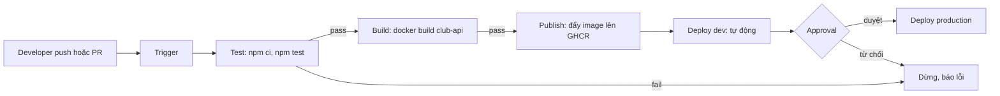
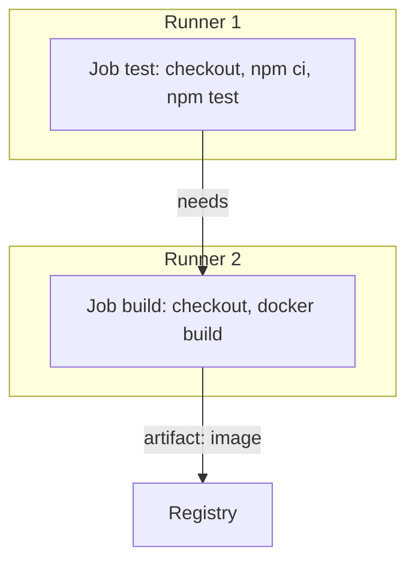
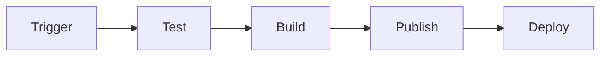

# Buổi 15 – CI/CD Fundamentals

Tuần 8 · Giai đoạn 3 – CI/CD & Automation · Slide: [Slide buổi 15](../../slides/04-cicd/session-15.md)

> **Tóm tắt:** Hiểu CI, Continuous Delivery và Continuous Deployment, các thành phần của pipeline, rồi thiết kế và chạy thử pipeline Test, Build, Publish, Deploy cho Club API.

## Mục tiêu học tập

- Phân biệt được Continuous Integration, Continuous Delivery và Continuous Deployment bằng một ví dụ cụ thể của Club API.
- Giải thích được vai trò của trigger, runner, job, step, artifact và gate trong một pipeline.
- Vẽ được pipeline Test, Build, Publish, Deploy cho Club API, ghi rõ input, output và điều kiện dừng của từng stage.
- Chạy được pipeline giả lập bằng một shell script trên máy, quan sát stage nào làm hỏng pipeline và vì sao.
- Chẩn đoán được một pipeline "xanh nhưng vẫn deploy lỗi" do thiếu gate hoặc sai thứ tự stage.
- Đề xuất được gate (test, approval) phù hợp cho từng môi trường dev, staging và production.

## Điều kiện cần

- Đã học tuần 1 đến 7: Git cơ bản, Docker image, Docker Compose, Kubernetes cơ bản (Pod, Deployment, Service).
- Có repo cá nhân (ví dụ `devops-labs`) trên GitHub, đã clone vào filesystem của WSL (ví dụ `~/devops-labs`), không làm việc trong `/mnt/c`.
- Có bản sao `starter-project/` trong repo cá nhân (thư mục `~/devops-labs/lab-15/source/starter-project`).
- Công cụ: Node.js 22 trong WSL, Docker Desktop (đang chạy), draw.io (diagrams.net, bản web không cần tài khoản) hoặc một trình soạn thảo hỗ trợ Mermaid.

Kiểm tra nhanh:

```bash
node --version
docker --version
git --version
docker info --format '{{.ServerVersion}}'
```

Kết quả mong đợi: Node bắt đầu bằng `v22`, Docker và Git in ra phiên bản, lệnh cuối in ra số phiên bản Docker Engine (ví dụ `27.x.x`). Nếu `docker info` báo không kết nối được, hãy mở Docker Desktop và chờ trạng thái Running.

## Vấn đề thực tế

CLB có 4 bạn cùng sửa Club API. Bạn A sửa endpoint `/api/members`, chạy thử trên máy mình thấy ổn rồi đẩy lên nhánh chính. Bạn B build image trên laptop của mình, gắn tag `latest` rồi gửi cho mentor deploy. Sáng hôm sau API trả lỗi 500 vì bản build của B không chứa thay đổi của A, còn test của A chưa ai chạy lại sau khi merge. Không ai biết image đang chạy được build từ commit nào.

Các vấn đề đó có chung nguyên nhân: các bước kiểm tra, build và deploy phụ thuộc vào con người và máy cá nhân. CI/CD thay những bước thủ công đó bằng một quy trình tự động, lặp lại được, chạy trên môi trường sạch và để lại bằng chứng (log, artifact) cho mọi lần chạy. Buổi này bạn chưa viết workflow thật (buổi 16 mới làm); bạn học cách nghĩ và thiết kế pipeline trước, rồi giả lập nó bằng script để thấy rõ từng stage.

## Khái niệm cốt lõi

### Ba thuật ngữ dễ nhầm

| Thuật ngữ | Viết tắt | Làm gì | Ai bấm nút cuối cùng |
| --- | --- | --- | --- |
| Continuous Integration | CI | Mỗi lần push hoặc mở pull request, tự động build và test để phát hiện lỗi tích hợp sớm | Không cần, tự chạy |
| Continuous Delivery | CD | Mọi thay đổi qua CI đều được đóng gói và luôn sẵn sàng deploy, nhưng deploy production cần con người duyệt | Con người (approval) |
| Continuous Deployment | CD | Mọi thay đổi qua toàn bộ test tự động được deploy lên production, không cần duyệt | Không cần, tự chạy |

Điểm khác nhau nằm ở một chỗ duy nhất: có một cổng duyệt bằng tay trước production hay không. Một nhóm nhỏ như CLB nên bắt đầu với Continuous Delivery: CI tự động, deploy có người xác nhận.

### Các thành phần của pipeline

| Thành phần | Ý nghĩa | Ví dụ trong Club API |
| --- | --- | --- |
| Trigger | Sự kiện khởi động pipeline | push lên nhánh chính, mở pull request, tạo tag `v1.0.0`, chạy theo lịch |
| Runner | Máy (VM hoặc container) thực thi pipeline, sạch ở mỗi lần chạy | Máy `ubuntu-latest` do GitHub cung cấp |
| Pipeline | Chuỗi stage chạy theo thứ tự, mỗi stage có điều kiện qua hoặc dừng | Test, Build, Publish, Deploy |
| Job | Nhóm step chạy trên một runner; các job có thể chạy song song hoặc nối tiếp | Job `test`, job `build` |
| Step | Một lệnh hoặc một action trong job | `npm ci`, `npm test` |
| Artifact | Kết quả sinh ra và được lưu để dùng lại hoặc kiểm tra | Image `club-api`, báo cáo test, file build |
| Gate | Điều kiện phải đạt mới được đi tiếp | Test pass, approval của mentor, image scan sạch |
| Environment | Nơi ứng dụng chạy, mỗi nơi có cấu hình và mức rủi ro riêng | dev, staging, production |

### Nguyên tắc thiết kế pipeline

1. **Fail fast:** stage rẻ và nhanh (lint, unit test) đứng trước stage đắt và chậm (build image, deploy).
2. **Build once, deploy many:** build image một lần, rồi đưa chính image đó đi qua các môi trường. Không build lại cho từng môi trường, vì như vậy thứ chạy ở production không còn là thứ đã được test.
3. **Mỗi artifact truy vết được về commit:** tag image bằng commit SHA hoặc phiên bản, không dùng `latest` làm định danh duy nhất.
4. **Secret không nằm trong code:** pipeline lấy secret từ kho secret của nền tảng, không từ file trong repo.
5. **Pipeline là code:** định nghĩa pipeline nằm trong repo, được review như code khác.

Artifact và cache hay bị nhầm. Artifact là kết quả bạn muốn giữ và truyền cho stage sau hoặc cho con người. Cache chỉ là cách tăng tốc (ví dụ thư mục `node_modules`), có thể mất bất cứ lúc nào mà kết quả pipeline vẫn đúng.

## Kiến trúc và cách hoạt động

Pipeline mục tiêu cho Club API:



Giải thích từng bước:

1. **Trigger:** developer push commit hoặc mở pull request. Nền tảng CI nhận sự kiện và tạo một lần chạy (run).
2. **Test:** runner mới tinh tải mã nguồn, cài dependency bằng `npm ci` (cài đúng theo `package-lock.json`), rồi chạy `npm test`. Fail ở đây thì dừng toàn bộ, không tốn thời gian build.
3. **Build:** đóng gói backend thành image bằng Dockerfile multi-stage. Output là image gắn tag theo commit.
4. **Publish:** đẩy image lên registry (GHCR). Từ lúc này image là artifact bất biến mà mọi môi trường dùng chung.
5. **Deploy dev:** tự động cập nhật môi trường dev bằng đúng image vừa publish.
6. **Approval và Deploy production:** nếu là Continuous Delivery, một người duyệt rồi mới deploy. Nếu là Continuous Deployment, bỏ bước này và chấp nhận mọi rủi ro dồn vào chất lượng test.

Quan hệ giữa pipeline, job và runner:



Mỗi job chạy trên một runner riêng, không chia sẻ file hệ thống. Vì vậy cái gì job sau cần từ job trước phải đi qua artifact, cache hoặc registry. Đây là lý do "không rõ artifact là gì" là lỗi thiết kế phổ biến.

## Demo của mentor

Mục tiêu: cho lớp thấy một pipeline thực tế đang chạy trước khi tự thiết kế. Thời lượng khoảng 10 phút.

1. Mở repo giáo trình trên GitHub, vào tab Actions, chọn một lần chạy của workflow `CI` (file `.github/workflows/ci.yml`).
2. Chỉ vào phần trigger của file đó và hỏi lớp: "Những sự kiện nào làm workflow này chạy?" (Đáp án: push lên `main` hoặc `master`, và mọi pull request.)
3. Mở sơ đồ job của run: chỉ ra hai job `test` và `validate-compose` chạy song song. Hỏi: "Vì sao hai job này không cần chờ nhau?" (Chúng độc lập, không dùng output của nhau.)
4. Mở log của step `Run tests`, chỉ cho lớp thấy output của `npm test` giống hệt lệnh họ chạy trên máy, chỉ khác là chạy trên runner sạch.
5. Mở workflow `Publish images` (file `.github/workflows/publish.yml`). Hỏi: "Artifact của workflow này là gì và nằm ở đâu?" (Hai image `club-api` và `club-web` trên GHCR, gắn tag theo SHA hoặc tag Git.)
6. Làm một thí nghiệm nhỏ trên máy để thấy "máy tôi chạy được" chưa đủ:

```bash
cd ~/devops-labs/lab-15/source/starter-project/backend
npm ci
npm test
```

Kết quả mong đợi (rút gọn, số test có thể khác):

```text
added NN packages
...
# tests 1
# pass 1
# fail 0
```

Câu hỏi cho lớp: "Test pass trên máy mentor. Có đủ để kết luận bản này an toàn để deploy không? Thiếu gì?" Gợi ý đáp án: chưa chắc cùng phiên bản Node, chưa build image, chưa ai review, chưa có bản ghi lại ai chạy cái gì lúc nào.

## Hands-on lab

Bài lab gồm hai nửa: thiết kế (vẽ sơ đồ, viết đặc tả stage) và kiểm chứng (chạy pipeline giả lập bằng script). Thời gian gợi ý: chuẩn bị 5 phút, phần 1 và 2 mỗi phần 15 phút, phần 3 và 4 mỗi phần 12 phút.

### Chuẩn bị

```bash
mkdir -p ~/devops-labs/lab-15/{source,screenshots,evidence}
cd ~/devops-labs/lab-15
ls source/starter-project/backend
```

Kết quả mong đợi: liệt kê được `Dockerfile`, `app.js`, `server.js`, `package.json`, `tests`. Nếu thư mục `source/starter-project` chưa có, sao chép `starter-project/` từ repo giáo trình vào đó trước (bỏ `node_modules` nếu có). Tạo thêm `.gitignore` ở gốc repo cá nhân để không lỡ commit thư mục cài đặt:

```bash
cd ~/devops-labs
printf 'node_modules/\n.env\n' > .gitignore
```

### Phần 1: Vẽ pipeline (15 phút)

1. Mở draw.io (app.diagrams.net), tạo sơ đồ mới. Nếu thích viết bằng chữ, tạo file `source/pipeline.mmd` với Mermaid thay thế.
2. Vẽ 4 stage nối tiếp: Test, Build, Publish, Deploy. Ở mỗi stage ghi 3 thứ: lệnh chính, output (artifact), điều kiện để qua.
3. Vẽ thêm trigger ở đầu và một nhánh "dừng, báo lỗi" khi stage fail.
4. Xuất sơ đồ ra `screenshots/pipeline.png` và lưu file nguồn (`.drawio` hoặc `.mmd`) vào `source/`.

Ví dụ khung bằng Mermaid để bắt đầu (bạn phải bổ sung lệnh, artifact và điều kiện):



Vì sao: buộc bản thân viết rõ input và output của từng stage là cách nhanh nhất để phát hiện stage nào thiếu artifact hoặc thiếu điều kiện dừng.

### Phần 2: Đặc tả stage (15 phút)

Tạo file `source/pipeline-spec.md` theo bảng sau, điền cho đủ 4 stage:

```markdown
| Stage | Lệnh chính | Runner cần | Input | Output (artifact) | Điều kiện qua |
| --- | --- | --- | --- | --- | --- |
| Test | npm ci; npm test | Node 22 | mã nguồn backend | log test | exit code 0 |
| Build | docker build | Docker | mã nguồn + Dockerfile | image club-api | build thành công |
| Publish | docker push | Docker + đăng nhập registry | image club-api | image trên registry | push thành công |
| Deploy | cập nhật Deployment | truy cập cluster | tên image + tag | Pod mới Ready | rollout xong |
```

Bảng trên chỉ là mẫu mở đầu. Bạn cần bổ sung: tag image dùng gì (gợi ý: commit SHA ngắn), secret nào cần (gợi ý: token đăng nhập registry, không bao giờ ghi giá trị thật), và stage nào có thể chạy song song với stage nào.

Vì sao: bảng này chính là bản thiết kế mà buổi 16 sẽ chuyển thành file workflow YAML.

### Phần 3: Chạy pipeline giả lập trên máy (12 phút)

Tạo file `source/run-pipeline.sh` mô phỏng 3 stage đầu (Test, Build, Publish ở dạng "kiểm tra sẵn sàng") trên máy:

```bash
#!/usr/bin/env bash
set -euo pipefail

ROOT="$(cd "$(dirname "$0")" && pwd)/starter-project"
# Tag mô phỏng bằng thời gian; trên CI thật sẽ dùng commit SHA (github.sha)
SHA="$(date +%Y%m%d%H%M%S)"
IMAGE="club-api"

stage() { echo; echo "=== STAGE: $1 ==="; }

stage "test"
cd "$ROOT/backend"
npm ci
npm test

stage "build"
docker build -t "$IMAGE:$SHA" -t "$IMAGE:1.0.0" .

stage "verify-artifact"
docker image inspect "$IMAGE:$SHA" --format 'image={{.RepoTags}} size={{.Size}}'

stage "publish (mô phỏng)"
echo "Sẽ đẩy $IMAGE:$SHA lên registry ở buổi 16; tại đây chỉ kiểm tra artifact tồn tại."

echo
echo "PIPELINE OK: $IMAGE:$SHA"
```

Chạy và lưu bằng chứng:

```bash
cd ~/devops-labs/lab-15
chmod +x source/run-pipeline.sh
./source/run-pipeline.sh 2>&1 | tee evidence/command-output.txt
```

Kết quả mong đợi (rút gọn):

```text
=== STAGE: test ===
...
# pass 1
# fail 0

=== STAGE: build ===
...
=== STAGE: verify-artifact ===
image=[club-api:1.0.0 club-api:2026...] size=NNNNNNNN   (thứ tự tag có thể khác)
=== STAGE: publish (mô phỏng) ===
...
PIPELINE OK: club-api:2026...
```

Vì sao dùng `set -euo pipefail`: lệnh nào trả mã khác 0 sẽ dừng script ngay, giống cách một CI runner dừng pipeline khi một step fail. Vì sao `npm ci` thay cho `npm install`: `npm ci` cài đúng theo `package-lock.json` và báo lỗi nếu lock file lệch với `package.json`, nên kết quả tái lập được.

### Phần 4: Kiểm chứng gate "dừng khi fail" (12 phút)

Cố tình làm test fail rồi xác nhận pipeline dừng trước khi build:

Sao lưu file test trước khi phá (không phụ thuộc vào việc bạn đã commit hay chưa):

```bash
cd ~/devops-labs/lab-15/source/starter-project/backend
cp tests/health.test.js /tmp/health.test.js.bak
```

Mở `tests/health.test.js`, đổi `"healthy"` thành `"unhealthy"` trong phép so sánh `assert.deepEqual`, lưu lại rồi chạy:

```bash
cd ~/devops-labs/lab-15
./source/run-pipeline.sh 2>&1 | tee -a evidence/command-output.txt
echo "exit code: ${PIPESTATUS[0]}"
```

Kết quả mong đợi: stage `test` báo fail, script dừng, không có dòng `=== STAGE: build ===`, và `exit code` khác 0. Sau đó hoàn tác thay đổi để test pass lại:

```bash
cd ~/devops-labs/lab-15/source/starter-project/backend
cp /tmp/health.test.js.bak tests/health.test.js
npm test
```

Kết quả mong đợi: `# pass 1` và `# fail 0` trở lại.

Vì sao: đây là bằng chứng gate hoạt động. Không có nó, stage Build sẽ đóng gói cả mã đang hỏng.

### L1 – Foundation: checklist hoàn thành

- [ ] Có sơ đồ pipeline Test, Build, Publish, Deploy trong `screenshots/pipeline.png` và file nguồn trong `source/`.
- [ ] Mỗi stage trong sơ đồ ghi rõ lệnh chính, output và điều kiện qua.
- [ ] Có `source/pipeline-spec.md` điền đủ 4 stage.
- [ ] Chạy được `run-pipeline.sh` thành công và lưu log vào `evidence/command-output.txt`.
- [ ] Chứng minh được pipeline dừng khi test fail (log có stage `test` fail và không có stage `build`).
- [ ] Giải thích bằng 2 đến 3 câu sự khác nhau giữa Delivery và Deployment trong `report.md`.

### L2 – Engineering: thử thách tự làm

Tiêu chí hoàn thành: nộp thêm `source/environments.md` và cập nhật sơ đồ.

1. Mở rộng pipeline cho 3 môi trường dev, staging, production. Với mỗi môi trường ghi rõ: trigger deploy, gate (test nào, ai duyệt), và cách quay lui (rollback) khi lỗi.
2. Quyết định Club API dùng Continuous Delivery hay Continuous Deployment cho production, giải thích bằng ít nhất 3 lý do dựa trên rủi ro và độ tin cậy của test hiện có (Club API mới chỉ có test cho `/health`).
3. Sửa `run-pipeline.sh` để image chỉ được build một lần và được dùng lại cho mọi môi trường (nguyên tắc build once, deploy many). Chứng minh bằng log có đúng một lệnh `docker build` (script phải in lệnh ra log, ví dụ `echo "+ docker build ..."` hoặc `set -x`, vì `docker build` không tự in dòng lệnh).
4. Đề xuất 2 gate bổ sung mà hiện pipeline chưa có (ví dụ kiểm tra `docker compose config`, quét lỗ hổng image, kiểm tra endpoint `/ready` sau deploy) và nói gate đó chặn loại lỗi nào.

<details>
<summary>Gợi ý</summary>

- Dev: tự động deploy sau mỗi lần merge, gate là test pass. Staging: tự động sau dev, thêm kiểm tra `/health` và `/ready`. Production: cần approval, chỉ nhận image đã chạy ổn ở staging.
- Rollback đơn giản nhất: deploy lại tag image trước đó. Điều này chỉ làm được nếu mọi image đều có tag bất biến (SHA hoặc phiên bản), không phải `latest`.
- Cách đảm bảo build một lần: stage `build` sinh ra tag SHA; các bước sau chỉ tham chiếu tag đó, không gọi `docker build` nữa.

</details>

<details>
<summary>Lời giải tham khảo (mẫu)</summary>

Bảng môi trường:

```markdown
| Môi trường | Trigger deploy | Gate | Rollback |
| --- | --- | --- | --- |
| dev | merge vào nhánh chính | npm test pass, build thành công | deploy lại tag cũ |
| staging | dev deploy xong | health và ready trả 200 trong 60 giây | deploy lại tag cũ |
| production | tag phiên bản vX.Y.Z | approval của mentor + staging ổn định | deploy lại tag phiên bản trước |
```

Khuyến nghị: Continuous Delivery cho production vì test mới phủ ít (chỉ `/health`), dữ liệu thành viên là thật, và CLB nhỏ nên một lần duyệt bằng tay rẻ hơn một lần sự cố.

Rút gọn script build một lần:

```bash
IMAGE_TAG="$IMAGE:$SHA"
echo "+ docker build -t $IMAGE_TAG ."
docker build -t "$IMAGE_TAG" .
for env in dev staging production; do
  echo "deploy $IMAGE_TAG to $env"
done
```

Log chỉ có một dòng `+ docker build` dù có 3 lượt deploy; kiểm tra bằng `grep -c "^+ docker build" evidence/command-output.txt` (kết quả `1`).

</details>

## Phá lỗi và debug

### Tình huống: pipeline xanh nhưng bản deploy lỗi

Cách phá: sửa `run-pipeline.sh` để đảo thứ tự, đặt stage `build` trước stage `test`, đồng thời làm test fail như phần 4 nhưng thêm `|| true` sau `npm test`:

```bash
npm test || true
```

Chạy lại script.

Triệu chứng: toàn bộ script in `PIPELINE OK` và image được tạo ra, dù test fail ở trên. Nếu đây là CI thật thì bản lỗi đã được publish.

Hướng điều tra:

1. Đọc log từ trên xuống, tìm dòng `# fail` lớn hơn 0 trong stage test.
2. Tự hỏi: vì sao script không dừng? Tìm lệnh kết thúc bằng `|| true` hoặc `set +e`.
3. Kiểm tra exit code thực của `npm test` bằng cách chạy riêng nó rồi `echo $?`.
4. Kiểm tra thứ tự stage: build có nằm trước test không?

Nguyên nhân gốc: gate bị vô hiệu hóa vì mã thoát của test bị nuốt, nên pipeline không phân biệt được pass và fail.

Cách phòng tránh: không nuốt mã thoát của lệnh kiểm tra; đặt stage rẻ trước stage đắt; trong CI thật, bật bảo vệ nhánh (branch protection) yêu cầu check phải xanh mới được merge; review mọi thay đổi vào file định nghĩa pipeline.

## Lỗi thường gặp

| Triệu chứng | Nguyên nhân | Cách xử lý |
| --- | --- | --- |
| Pipeline gộp mọi thứ trong một job rất dài, khó biết lỗi ở đâu | Không tách stage | Tách theo trách nhiệm: test, build, publish, deploy; mỗi stage có tên và điều kiện riêng |
| Không ai biết image đang chạy từ commit nào | Chỉ dùng tag `latest` | Tag theo commit SHA hoặc phiên bản, ghi tag vào log |
| Stage sau không thấy file của stage trước | Mỗi job chạy trên runner riêng | Truyền qua artifact hoặc registry, không dựa vào thư mục chung |
| `npm ci` báo lock file không khớp với package.json | Sửa dependency mà không cập nhật `package-lock.json` | Chạy `npm install` cục bộ, commit lại `package-lock.json` |
| `docker build` báo không kết nối được Docker daemon | Docker Desktop chưa chạy hoặc WSL integration chưa bật | Mở Docker Desktop, bật WSL integration cho distro Ubuntu |
| Pipeline xanh dù test fail | Nuốt mã thoát bằng toán tử OR với true hoặc thiếu `set -e` | Bỏ đoạn nuốt mã thoát, dùng `set -euo pipefail` |
| Script chạy chậm bất thường trong `/mnt/c` | Làm việc trên filesystem Windows | Chuyển repo vào filesystem WSL (`~/devops-labs`) |
| Sơ đồ có mũi tên nhưng không ghi gì chảy qua mũi tên | Không xác định artifact | Ghi tên artifact trên từng mũi tên |

## Tự kiểm tra

1. Continuous Delivery khác Continuous Deployment ở điểm nào?

<details>
<summary>Đáp án</summary>

Delivery luôn sẵn sàng deploy nhưng production cần con người duyệt. Deployment tự động deploy mọi thay đổi qua test, không cần duyệt.

</details>

2. Vì sao stage test nên đứng trước stage build?

<details>
<summary>Đáp án</summary>

Fail fast: test rẻ và nhanh hơn build image; nếu test fail thì dừng ngay, không tốn tài nguyên và không tạo artifact từ mã lỗi.

</details>

3. Artifact khác cache ở điểm nào? Cho ví dụ của Club API.

<details>
<summary>Đáp án</summary>

Artifact là kết quả cần giữ và dùng lại (image `club-api`, báo cáo test). Cache chỉ tăng tốc (thư mục `node_modules`) và mất đi thì pipeline vẫn đúng.

</details>

4. Hai job chạy trên hai runner khác nhau. Job build cần mã đã biên dịch từ job test. Làm sao truyền?

<details>
<summary>Đáp án</summary>

Qua artifact (upload ở job trước, download ở job sau) hoặc qua registry. Hệ thống file của runner không được chia sẻ.

</details>

5. Vì sao nên build một lần rồi deploy cùng một image lên mọi môi trường?

<details>
<summary>Đáp án</summary>

Để thứ chạy ở production chính là thứ đã được test ở staging. Build lại cho mỗi môi trường có thể cho ra kết quả khác (dependency, thời điểm build).

</details>

6. Tình huống: pipeline hiển thị xanh, nhưng sau deploy `/api/members` trả 500. Bạn kiểm tra theo thứ tự nào?

<details>
<summary>Đáp án</summary>

Xem pipeline có test endpoint đó không (có thể không có test); xem tag image được deploy có đúng commit không; xem biến môi trường và kết nối DB ở môi trường đích; xem log Pod hoặc container. Kết luận thường là thiếu gate, ví dụ không có smoke test sau deploy.

</details>

7. Tình huống: bạn muốn production chỉ nhận image đã chạy ổn ở staging. Cần cơ chế gì?

<details>
<summary>Đáp án</summary>

Tag bất biến cho image, deploy production tham chiếu đúng tag đã qua staging, và một gate approval hoặc điều kiện "staging healthy" trước khi deploy production.

</details>

## Nộp bài

Nộp vào thư mục `lab-15/` trong repo cá nhân theo `templates/lab-template.md`:

- [ ] `README.md` trả lời đủ 7 câu theo template (bài lab giải quyết gì, kiến thức dùng, các bước, kết quả mong đợi, lỗi đã gặp, cách khắc phục, cải thiện được gì) và đánh dấu level đã làm (L1 hoặc L2).
- [ ] `evidence/command-output.txt` chứa log chạy `run-pipeline.sh` thành công và log lần chạy khi test fail.
- [ ] `report.md` giải thích Delivery và Deployment, nêu pipeline có những gate nào và vì sao.
- [ ] `source/` có `pipeline-spec.md`, `run-pipeline.sh` và file nguồn sơ đồ (`.drawio` hoặc `.mmd`); nếu làm L2 thì thêm `environments.md`.
- [ ] `screenshots/pipeline.png` là ảnh sơ đồ pipeline.
- [ ] Không commit secret, token, password hay file `.env` thật. Chỉ dùng placeholder.
- [ ] Screenshot không thay cho bằng chứng: phải có source, lệnh và log.

## Recap

- CI tự động build và test mỗi thay đổi; Delivery giữ cổng duyệt trước production; Deployment bỏ cổng đó.
- Pipeline gồm trigger, runner, job, step, artifact và gate; mỗi stage cần input, output và điều kiện qua rõ ràng.
- Fail fast: đặt kiểm tra rẻ, nhanh ở đầu pipeline.
- Build once, deploy many: một image bất biến, truy vết được về commit, đi qua mọi môi trường.
- Mỗi job chạy trên runner riêng, dữ liệu giữa các job đi qua artifact hoặc registry.
- Một gate bị vô hiệu hóa (nuốt mã thoát, sai thứ tự stage) còn nguy hiểm hơn không có gate, vì tạo cảm giác an toàn giả.
- Buổi 16 sẽ chuyển bản thiết kế hôm nay thành workflow GitHub Actions thật.

## Tài liệu tham khảo

- [GitHub Docs – Understanding GitHub Actions](https://docs.github.com/en/actions/get-started/understanding-github-actions)
- [GitHub Docs – Using environments for deployment](https://docs.github.com/en/actions/how-tos/deploy/configure-and-manage-deployments/control-deployments)
- [Docker Docs – Build best practices](https://docs.docker.com/build/building/best-practices/)
- [npm Docs – npm ci](https://docs.npmjs.com/cli/commands/npm-ci)
- [Node.js – Test runner](https://nodejs.org/api/test.html)
