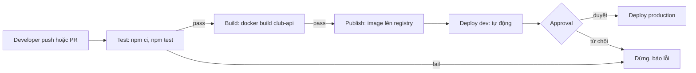
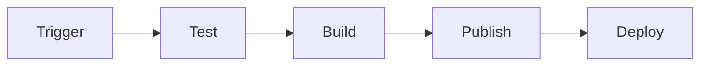

# Buổi 15 – CI/CD Fundamentals

Tuần 8/16 · Giai đoạn 3 – CI/CD & Automation · Buổi 15/32

[Slide buổi 15](../../slides/04-cicd/session-15.md) · [Bài tập tuần 8](../../assignments/weekly/week-08.md) · [Hub Tuần 8](README.md)

> **Tóm tắt:** Hiểu CI, Continuous Delivery và Continuous Deployment, các thành phần của pipeline, rồi thiết kế và chạy thử pipeline Test, Build, Publish, Deploy cho Club API bằng một shell script.

::: tip Buổi này bạn làm gì
**Bạn sẽ tạo ra:** một bản thiết kế pipeline Test, Build, Publish, Deploy cho Club API (sơ đồ và bảng đặc tả), cùng một script `run-pipeline.sh` chạy được và dừng đúng lúc khi test đỏ.

**Thời gian thật:** đọc 15 phút, lab bắt buộc 60 phút, phần tùy chọn làm ở nhà.

**Cần chuẩn bị:**

- [ ] Docker Desktop đang chạy, Node.js 22 trong WSL (xem [Hướng dẫn cài đặt](../../resources/setup-guide.md)).
- [ ] Tài khoản GitHub và repo `devops-labs` đã clone vào `~/devops-labs` (xem [Tài khoản GitHub và repo](../../resources/setup-github.md)); repo giáo trình đã clone vào `~/devops-course`.
- [ ] Đã xong [Buổi 14 – Production-minded Compose](../week-07/session-14.md). Buổi này không cần Kubernetes.

**Sản phẩm phải nộp** (thư mục `lab-15/`):

- `source/pipeline-spec.md` và file nguồn sơ đồ (`.mmd` hoặc `.drawio`), kèm `screenshots/pipeline.png`.
- `source/run-pipeline.sh` và `evidence/command-output.txt` (có cả lần chạy xanh và lần chạy đỏ).
- `README.md` và `report.md` theo mẫu.

**Đi nhanh:** [Đọc](#doc) > [Làm lab](#hands-on-lab) > [Gặp lỗi?](#gap-loi) > [Tự kiểm tra](#tu-kiem-tra) > [Nộp bài](#nop-bai). Kẹt? Nhảy tới [Gặp lỗi?](#gap-loi).

**Từ mới trong buổi** (giải thích ở [Thuật ngữ](../../resources/glossary.md)):

- CI: tự động build và test mỗi lần có thay đổi.
- Pipeline: chuỗi bước chạy theo thứ tự, mỗi bước có điều kiện qua hoặc dừng.
- Stage: một chặng của pipeline (test, build, publish, deploy).
- Runner: máy sạch chạy pipeline.
- Artifact: kết quả được giữ lại (ví dụ image).
- Gate: cổng điều kiện, không đạt thì không đi tiếp.
:::

## Vấn đề thực tế {#doc}

CLB có 4 bạn cùng sửa Club API. Bạn A sửa endpoint `/api/members`, chạy thử trên máy mình thấy ổn rồi đẩy lên nhánh chính. Bạn B build image trên laptop của mình, gắn tag `latest` rồi gửi cho mentor deploy. Sáng hôm sau API trả lỗi 500 vì bản build của B không chứa thay đổi của A, còn test của A chưa ai chạy lại sau khi merge. Không ai biết image đang chạy được build từ commit nào.

Các vấn đề đó có chung nguyên nhân: các bước kiểm tra, build và deploy phụ thuộc vào con người và máy cá nhân. CI/CD thay những bước thủ công đó bằng một quy trình tự động, lặp lại được, chạy trên môi trường sạch và để lại bằng chứng (log, artifact) cho mọi lần chạy. Buổi này bạn chưa viết workflow thật (buổi 16 mới làm); bạn học cách nghĩ và thiết kế pipeline trước, rồi giả lập nó bằng script để thấy rõ từng stage.

## Khái niệm cốt lõi

**1. Ba thuật ngữ dễ nhầm.** CI tự build và test mỗi lần push hoặc mở pull request, không cần ai bấm. Continuous Delivery: mọi thay đổi qua CI đều sẵn sàng deploy, nhưng production cần con người duyệt. Continuous Deployment: qua test là tự deploy production, không cần duyệt. Ba cái khác nhau ở đúng một chỗ: có cổng duyệt bằng tay trước production hay không. Ví von: Delivery là xe đã sẵn sàng trước cửa, chờ bạn bấm khởi động; Deployment là xe tự chạy. CLB nhỏ nên bắt đầu với Delivery.

**2. Stage và gate.** Pipeline là chuỗi stage nối tiếp: mỗi stage có input, output và điều kiện qua (gate). Gate không đạt thì pipeline dừng. Ví von: dây chuyền nhà máy có trạm kiểm tra chất lượng, hàng lỗi bị loại trước khi đóng hộp. Nguyên tắc fail fast: stage rẻ và nhanh (test) đứng trước stage đắt và chậm (build).

**3. Artifact.** Kết quả sinh ra và được giữ lại để dùng tiếp hoặc kiểm tra, ví dụ image `club-api`. Khác cache: cache chỉ để tăng tốc (ví dụ thư mục `node_modules`), mất đi thì pipeline vẫn đúng. Ví von: artifact là món hàng thành phẩm, cache là dụng cụ để làm nhanh hơn.

**4. Build once, deploy many.** Build image một lần, rồi đưa chính image đó đi qua mọi môi trường và gắn tag theo commit SHA hoặc phiên bản, không chỉ `latest`. Nhờ vậy thứ chạy ở production chính là thứ đã được test, và truy vết được về commit. Ví von: đóng gói một lần, niêm phong số seri, rồi chuyển đi các kho.



::: details Tìm hiểu thêm (đọc sau)
Năm nguyên tắc thiết kế pipeline:

1. Fail fast: stage rẻ và nhanh đứng trước stage đắt và chậm.
2. Build once, deploy many: không build lại cho từng môi trường.
3. Mỗi artifact truy vết được về commit: tag image bằng commit SHA hoặc phiên bản.
4. Secret không nằm trong code: lấy từ kho secret của nền tảng.
5. Pipeline là code: nằm trong repo, được review như code khác.

Bảng đầy đủ các thành phần (trigger, runner, job, step, environment), giải thích từng bước của sơ đồ và sơ đồ job-runner nằm ở [Thử thách và tìm hiểu thêm](session-15-challenge.md).
:::

## Hands-on lab (60 phút, bắt buộc) {#hands-on-lab}

Bài lab gồm hai nửa: thiết kế (vẽ sơ đồ, viết đặc tả stage) và kiểm chứng (chạy pipeline giả lập bằng script). Trên lớp, mentor demo trước; tự học thì làm thẳng phần Làm lab.

### Chuẩn bị (5 phút)

Kiểm tra môi trường:

```bash
node --version
docker --version
git --version
docker info --format '{{.ServerVersion}}'
```

Kết quả mong đợi: Node bắt đầu bằng `v22`, Docker và Git in ra phiên bản, lệnh cuối in ra số phiên bản Docker Engine. Nếu `docker info` báo không kết nối được, mở Docker Desktop và chờ trạng thái Running (xem [Gặp lỗi?](#gap-loi)).

Tạo thư mục nộp bài và chép `starter-project/` từ repo giáo trình vào:

```bash
mkdir -p ~/devops-labs/lab-15/{source,screenshots,evidence}
cp -r ~/devops-course/starter-project ~/devops-labs/lab-15/source/
rm -rf ~/devops-labs/lab-15/source/starter-project/*/node_modules
cd ~/devops-labs/lab-15
ls source/starter-project/backend
printf 'node_modules/\n.env\n' > ~/devops-labs/.gitignore
```

Kết quả mong đợi: liệt kê được `Dockerfile`, `app.js`, `server.js`, `package.json`, `tests`. Tệp `.gitignore` giúp bạn không lỡ commit thư mục cài đặt.

::: tip Kiểm tra: bạn đúng khi
`ls source/starter-project/backend` có `package.json` và thư mục `tests`.
:::

### Phần 1: Vẽ pipeline (15 phút)

1. Mở draw.io (app.diagrams.net, bản web không cần tài khoản), tạo sơ đồ mới. Nếu thích viết bằng chữ, tạo `source/pipeline.mmd` với Mermaid.
2. Vẽ 4 stage nối tiếp: Test, Build, Publish, Deploy. Ở mỗi stage ghi 3 thứ: lệnh chính, output (artifact), điều kiện để qua.
3. Vẽ thêm trigger ở đầu và một nhánh "dừng, báo lỗi" khi stage fail. Ghi tên artifact lên từng mũi tên.
4. Xuất sơ đồ ra `screenshots/pipeline.png` và lưu file nguồn vào `source/`.

Khung Mermaid để bắt đầu (bạn phải bổ sung lệnh, artifact và điều kiện):



Vì sao: buộc bản thân viết rõ input và output của từng stage là cách nhanh nhất để phát hiện stage nào thiếu artifact hoặc thiếu điều kiện dừng.

::: tip Kiểm tra: bạn đúng khi
Mỗi mũi tên trong sơ đồ ghi cái gì chảy qua nó, và có ít nhất một nhánh "dừng, báo lỗi".
:::

### Phần 2: Đặc tả stage (15 phút)

Tạo `source/pipeline-spec.md` theo bảng sau, điền cho đủ 4 stage:

```markdown
| Stage | Lệnh chính | Runner cần | Input | Output (artifact) | Điều kiện qua |
| --- | --- | --- | --- | --- | --- |
| Test | npm ci; npm test | Node 22 | mã nguồn backend | log test | exit code 0 |
| Build | docker build | Docker | mã nguồn + Dockerfile | image club-api | build thành công |
| Publish | docker push | Docker + đăng nhập registry | image club-api | image trên registry | push thành công |
| Deploy | cập nhật môi trường chạy | quyền truy cập môi trường | tên image + tag | bản mới chạy ổn | kiểm tra sức khỏe qua |
```

Bảng trên chỉ là mẫu mở đầu. Bạn cần bổ sung: tag image dùng gì (gợi ý: commit SHA ngắn), secret nào cần (gợi ý: token đăng nhập registry, chỉ ghi tên, không bao giờ ghi giá trị thật), và stage nào có thể chạy song song với stage nào.

Vì sao: bảng này chính là bản thiết kế mà buổi 16 sẽ chuyển thành file workflow YAML.

::: tip Kiểm tra: bạn đúng khi
Không ô nào trong bảng để trống, và có ghi thêm tag, tên secret, stage chạy song song.
:::

### Phần 3: Chạy pipeline giả lập trên máy (12 phút)

Tạo `source/run-pipeline.sh` mô phỏng 3 stage đầu (Test, Build, Publish ở dạng "kiểm tra sẵn sàng"):

```bash
#!/usr/bin/env bash
set -euo pipefail

ROOT="$(cd "$(dirname "$0")" && pwd)/starter-project"
# Tag mô phỏng bằng thời gian; trên CI thật sẽ dùng commit SHA (github.sha)
SHA="$(date +%Y%m%d%H%M%S)"
IMAGE="club-api"

stage() { echo; echo "=== STAGE: $1 ==="; }

stage "test"
cd "$ROOT/backend"
npm ci
npm test

stage "build"
docker build -t "$IMAGE:$SHA" -t "$IMAGE:1.0.0" .

stage "verify-artifact"
docker image inspect "$IMAGE:$SHA" --format 'image={{.RepoTags}} size={{.Size}}'

stage "publish (mô phỏng)"
echo "Sẽ đẩy $IMAGE:$SHA lên registry ở buổi 16; tại đây chỉ kiểm tra artifact tồn tại."

echo
echo "PIPELINE OK: $IMAGE:$SHA"
```

Chạy và lưu bằng chứng:

```bash
cd ~/devops-labs/lab-15
chmod +x source/run-pipeline.sh
./source/run-pipeline.sh 2>&1 | tee evidence/command-output.txt
```

Kết quả mong đợi (rút gọn):

```text
=== STAGE: test ===
...
# pass 1
# fail 0

=== STAGE: build ===
...
=== STAGE: verify-artifact ===
image=[club-api:1.0.0 club-api:2026...] size=NNNNNNNN   (thứ tự tag có thể khác)
=== STAGE: publish (mô phỏng) ===
...
PIPELINE OK: club-api:2026...
```

Vì sao dùng `set -euo pipefail`: lệnh nào trả mã khác 0 sẽ dừng script ngay, giống cách một CI runner dừng pipeline khi một step fail. Vì sao `npm ci` thay cho `npm install`: `npm ci` cài đúng theo `package-lock.json` và báo lỗi nếu lock file lệch với `package.json`, nên kết quả tái lập được.

::: tip Kiểm tra: bạn đúng khi
Log có `# fail 0`, dòng `image=[...]` với tag cụ thể (không chỉ `latest`) và dòng cuối `PIPELINE OK`.
:::

### Phần 4: Kiểm chứng gate "dừng khi fail" (12 phút)

Cố tình làm test fail rồi xác nhận pipeline dừng trước khi build. Sao lưu file test trước khi phá:

```bash
cd ~/devops-labs/lab-15/source/starter-project/backend
cp tests/health.test.js /tmp/health.test.js.bak
```

Mở `tests/health.test.js`, đổi `"healthy"` thành `"unhealthy"` trong phép so sánh `assert.deepEqual` (không sửa tên test), lưu lại rồi chạy:

```bash
cd ~/devops-labs/lab-15
./source/run-pipeline.sh 2>&1 | tee -a evidence/command-output.txt
echo "exit code: ${PIPESTATUS[0]}"
```

Kết quả mong đợi: stage `test` báo fail, script dừng, không có dòng `=== STAGE: build ===`, và `exit code` khác 0. Sau đó hoàn tác để test pass lại:

```bash
cd ~/devops-labs/lab-15/source/starter-project/backend
cp /tmp/health.test.js.bak tests/health.test.js
npm test
```

Kết quả mong đợi: `# pass 1` và `# fail 0` trở lại.

Vì sao: đây là bằng chứng gate hoạt động. Không có nó, stage Build sẽ đóng gói cả mã đang hỏng. Lưu ý lấy exit code bằng `PIPESTATUS[0]`, vì `$?` sau `tee` là mã của `tee` và luôn là 0.

::: tip Kiểm tra: bạn đúng khi
Lần chạy đỏ không có dòng `=== STAGE: build ===` và `exit code` khác 0; sau khi hoàn tác `npm test` in `# fail 0`.
:::

### Checklist L1

- [ ] Có sơ đồ pipeline Test, Build, Publish, Deploy trong `screenshots/pipeline.png` và file nguồn trong `source/`.
- [ ] Mỗi stage trong sơ đồ ghi rõ lệnh chính, output và điều kiện qua.
- [ ] Có `source/pipeline-spec.md` điền đủ 4 stage.
- [ ] Chạy được `run-pipeline.sh` thành công và lưu log vào `evidence/command-output.txt`.
- [ ] Chứng minh được pipeline dừng khi test fail (log có stage `test` fail và không có stage `build`).
- [ ] Giải thích bằng 2 đến 3 câu sự khác nhau giữa Delivery và Deployment trong `report.md`.

Lệnh tự kiểm tra một dòng:

```bash
cd ~/devops-labs/lab-15 && grep -E "STAGE: build|PIPELINE OK|# fail" evidence/command-output.txt
```

## Gặp lỗi? {#gap-loi}

| Triệu chứng | Nguyên nhân | Cách sửa |
| --- | --- | --- |
| `docker build` hoặc `docker info` báo không kết nối được Docker daemon | Docker Desktop chưa chạy hoặc WSL integration chưa bật | Mở Docker Desktop, bật WSL integration cho distro Ubuntu |
| `ls source/starter-project/backend` báo không có thư mục | Chưa chép `starter-project/` vào `source/` | Chạy lại lệnh `cp -r ~/devops-course/starter-project ...` ở phần Chuẩn bị |
| `npm ci` báo lock file không khớp với `package.json` | Sửa dependency mà không cập nhật `package-lock.json` | Chạy `npm install` cục bộ, commit lại `package-lock.json` |
| Script chạy chậm bất thường | Làm việc trong `/mnt/c` (filesystem Windows) | Chuyển repo vào filesystem WSL (`~/devops-labs`) |
| Pipeline xanh dù test fail, in `PIPELINE OK` | Nuốt mã thoát bằng `\|\| true` hoặc thiếu `set -e` | Bỏ đoạn nuốt mã thoát, dùng `set -euo pipefail` (xem [Phá lỗi nâng cao](session-15-challenge.md)) |
| Phần 4 test vẫn xanh sau khi sửa | Chỉ đổi tên test, chưa đổi `"healthy"` trong `assert.deepEqual` | Sửa đúng giá trị trong phép so sánh |
| `exit code` luôn bằng 0 dù test đỏ | Lấy bằng `$?` sau `tee` | Dùng `${PIPESTATUS[0]}` |
| Pipeline gộp mọi thứ trong một job rất dài, khó biết lỗi ở đâu | Không tách stage | Tách theo trách nhiệm: test, build, publish, deploy; mỗi stage có tên và điều kiện riêng |
| Không ai biết image đang chạy từ commit nào | Chỉ dùng tag `latest` | Tag theo commit SHA hoặc phiên bản, ghi tag vào log |
| Stage sau không thấy file của stage trước | Mỗi job chạy trên runner riêng | Truyền qua artifact hoặc registry, không dựa vào thư mục chung |
| Sơ đồ có mũi tên nhưng không ghi gì chảy qua mũi tên | Không xác định artifact | Ghi tên artifact trên từng mũi tên |

## Tự kiểm tra {#tu-kiem-tra}

1. Continuous Delivery khác Continuous Deployment ở điểm nào?
2. Vì sao stage test nên đứng trước stage build?
3. Artifact khác cache ở điểm nào? Cho ví dụ của Club API.
4. Hai job chạy trên hai runner khác nhau. Job build cần mã đã biên dịch từ job test. Làm sao truyền?
5. Vì sao nên build một lần rồi deploy cùng một image lên mọi môi trường?

::: details Đáp án gợi ý
1. Delivery luôn sẵn sàng deploy nhưng production cần con người duyệt. Deployment tự động deploy mọi thay đổi qua test, không cần duyệt.
2. Fail fast: test rẻ và nhanh hơn build image; nếu test fail thì dừng ngay, không tốn tài nguyên và không tạo artifact từ mã lỗi.
3. Artifact là kết quả cần giữ và dùng lại (image `club-api`, báo cáo test). Cache chỉ tăng tốc (thư mục `node_modules`) và mất đi thì pipeline vẫn đúng.
4. Qua artifact (upload ở job trước, download ở job sau) hoặc qua registry. Hệ thống file của runner không được chia sẻ.
5. Để thứ chạy ở production chính là thứ đã được test ở staging. Build lại cho mỗi môi trường có thể cho ra kết quả khác (dependency, thời điểm build).
:::

## Nộp bài {#nop-bai}

Nộp vào thư mục `lab-15/` trong repo cá nhân theo [mẫu lab](../../templates/lab-template.md); đề và tiêu chí xem [Bài tập tuần 8](../../assignments/weekly/week-08.md).

- [ ] `README.md` trả lời đủ 7 câu theo template (bài lab giải quyết gì, kiến thức dùng, các bước, kết quả mong đợi, lỗi đã gặp, cách khắc phục, cải thiện được gì) và đánh dấu level đã làm (L1 hoặc L2).
- [ ] `evidence/command-output.txt` chứa log chạy `run-pipeline.sh` thành công và log lần chạy khi test fail.
- [ ] `report.md` giải thích Delivery và Deployment, nêu pipeline có những gate nào và vì sao.
- [ ] `source/` có `pipeline-spec.md`, `run-pipeline.sh` và file nguồn sơ đồ (`.drawio` hoặc `.mmd`); nếu làm L2 thì thêm `environments.md`.
- [ ] `screenshots/pipeline.png` là ảnh sơ đồ pipeline. Screenshot không thay cho bằng chứng: phải có source, lệnh và log.
- [ ] Không commit secret, token, password hay file `.env` thật. Chỉ dùng placeholder.

## Recap

- CI tự động build và test mỗi thay đổi; Delivery giữ cổng duyệt trước production; Deployment bỏ cổng đó.
- Pipeline gồm các stage có input, output và gate; fail fast và build once, deploy many.
- Một gate bị vô hiệu hóa còn nguy hiểm hơn không có gate, vì tạo cảm giác an toàn giả.

Buổi tiếp theo: [Buổi 16 – GitHub Actions Basics](session-16.md) chuyển bản thiết kế hôm nay thành workflow GitHub Actions thật (cần repo `devops-labs` để public).

::: details Thử thách thêm (L2, tùy chọn, làm ở nhà)
Thiết kế pipeline cho 3 môi trường (dev, staging, production) với trigger, gate và rollback; chọn Continuous Delivery hay Deployment cho production; sửa script để chỉ có đúng một lệnh `docker build`; đề xuất 2 gate bổ sung. Đề đầy đủ, gợi ý từng bậc (tự thử 15 phút trước khi mở) và câu thảo luận ở [Thử thách và tìm hiểu thêm](session-15-challenge.md).
:::

::: details Phá lỗi nâng cao
Thử làm pipeline xanh giả: đặt `|| true` sau `npm test` rồi đảo thứ tự stage, quan sát `PIPELINE OK` dù test đỏ. Cách điều tra và phòng tránh ở [Thử thách và tìm hiểu thêm](session-15-challenge.md).
:::

::: details Tài liệu tham khảo
- [GitHub Docs – Understanding GitHub Actions](https://docs.github.com/en/actions/get-started/understanding-github-actions)
- [GitHub Docs – Using environments for deployment](https://docs.github.com/en/actions/how-tos/deploy/configure-and-manage-deployments/control-deployments)
- [Docker Docs – Build best practices](https://docs.docker.com/build/building/best-practices/)
- [npm Docs – npm ci](https://docs.npmjs.com/cli/commands/npm-ci)
- [Node.js – Test runner](https://nodejs.org/api/test.html)
:::
