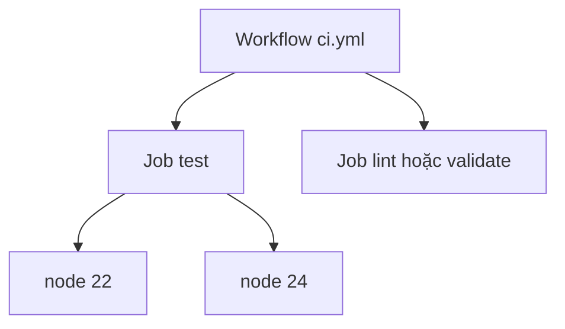

# Buổi 16 – Thử thách và tìm hiểu thêm

[Quay lại Buổi 16 – GitHub Actions Basics](session-16.md) · [Hub Tuần 8](README.md)

> **Tóm tắt:** Phần đọc thêm, thử thách L2 (matrix, pull request đỏ, build-image) và phá lỗi nâng cao Tình huống 06 của Buổi 16. Tùy chọn, làm ở nhà sau khi xong lab bắt buộc.

## Tìm hiểu thêm (đọc sau)

### Events thường dùng

| Event | Khi nào chạy | Dùng cho |
| --- | --- | --- |
| `push` | Có commit được đẩy lên (lọc được theo nhánh) | CI trên nhánh chính |
| `pull_request` | Mở, cập nhật pull request | Kiểm tra trước khi merge |
| `workflow_dispatch` | Bấm chạy thủ công trên giao diện | Chạy lại, thử nghiệm |
| `schedule` | Theo lịch cron | Kiểm tra định kỳ |

### Cú pháp YAML cần nhớ

YAML dùng thụt lề bằng dấu cách (không dùng tab) để thể hiện cấu trúc. Ba kiểu giá trị bạn sẽ gặp:

- Map (cặp khóa: giá trị), ví dụ `runs-on: ubuntu-latest`.
- List (mỗi phần tử bắt đầu bằng `- `), ví dụ danh sách step.
- Chuỗi nhiều dòng với `run: |`, mỗi dòng là một lệnh shell.

Sai thụt lề một cấp là nguyên nhân phổ biến nhất khiến workflow không được nhận hoặc chạy sai.

### Runner và action

GitHub-hosted runner phổ biến: `ubuntu-latest`, `ubuntu-24.04`, `windows-latest`, `macos-latest`. Với CI backend Node.js, Ubuntu là lựa chọn mặc định vì giống môi trường container sau này. Dùng nhãn cụ thể như `ubuntu-24.04` nếu bạn cần môi trường không đổi khi GitHub nâng `latest`.

Quy tắc dùng action từ Marketplace:

- Pin theo major version (`@v4`) tối thiểu; môi trường cần bảo mật cao hơn pin theo commit SHA.
- Chỉ dùng action của nhà phát hành đáng tin (ví dụ tổ chức `actions`, `docker`) và đọc README của action.
- Khai báo `permissions` tối thiểu. CI chỉ đọc code thì `contents: read` là đủ.

### Cache và matrix

- **Cache:** với `actions/setup-node@v4`, chỉ cần `cache: npm` và chỉ ra file lock bằng `cache-dependency-path`. Cache key được tính từ nội dung `package-lock.json`, nên đổi dependency thì cache tự làm mới.
- **Matrix:** chạy cùng job với nhiều giá trị tham số. Ví dụ `node-version: [22, 24]` tạo hai job song song. Hữu ích khi bạn cần chắc code chạy trên nhiều phiên bản runtime.

### `npm install` và `npm ci`

| | `npm install` | `npm ci` |
| --- | --- | --- |
| Dùng lock file | Có thể cập nhật lock file | Cài đúng theo lock file, không sửa nó |
| Khi thiếu lock file | Tự tạo | Báo lỗi và dừng |
| Thư mục `node_modules` có sẵn | Giữ lại | Xóa rồi cài mới |
| Phù hợp | Máy dev | CI, build image |

### Cách hoạt động từng bước

1. Developer push commit hoặc mở pull request. GitHub đối chiếu event với khóa `on` của mọi file trong `.github/workflows/` ở commit đó.
2. Workflow khớp được xếp hàng; GitHub cấp một runner mới, sạch, cho mỗi job.
3. Runner chạy các step theo thứ tự. Step đầu tiên gần như luôn là `actions/checkout@v4`, vì runner ban đầu không có source.
4. `actions/setup-node@v4` cài Node.js đúng phiên bản và khôi phục cache npm nếu có.
5. `npm ci` cài dependency theo lock file, `npm test` chạy test runner có sẵn của Node.js (`node --test`).
6. Step nào trả exit code khác 0 sẽ làm job thất bại và các step sau bị bỏ qua. Kết quả hiện thành check trên commit hoặc pull request.

Quan hệ giữa workflow, job và biến thể matrix:



Hai job độc lập chạy song song; thêm `needs` nếu muốn job này đợi job kia.

## Thử thách thêm (L2, tùy chọn, làm ở nhà)

Thử thách: hoàn thiện pipeline và chứng minh bạn hiểu nó. Tự thử 15 phút trước khi mở gợi ý.

1. Workflow có cache npm và job `test` dùng matrix tối thiểu hai phiên bản Node.js; có ít nhất hai job độc lập.
2. Tạo nhánh `feature/break-test`, cố ý làm một test đỏ, mở pull request và chụp màn hình check đỏ trên PR. Sau đó sửa cho xanh.
3. Xử lý Tình huống 06 (xem phần Phá lỗi nâng cao bên dưới) và ghi nguyên nhân gốc vào `report.md`.
4. Tiêu chí hoàn thành: run xanh với matrix, một run đỏ có giải thích, `report.md` nêu rõ log nào chỉ ra nguyên nhân.

Bài dùng Node 22 và 24 (cả hai đang được hỗ trợ; Node 20 đã hết vòng đời hỗ trợ từ 2026-04). Backend của starter-project nhắm Node 22, biến thể 24 chỉ để học cách dùng matrix. Kiểm tra lịch hỗ trợ tại [nodejs.org/en/about/previous-releases](https://nodejs.org/en/about/previous-releases).

::: details Gợi ý bậc 1: thêm matrix
Thay job `test` bằng bản có `strategy`:

```yaml
jobs:
  test:
    runs-on: ubuntu-latest
    strategy:
      fail-fast: false
      matrix:
        node-version: [22, 24]
    steps:
      - uses: actions/checkout@v4
      - uses: actions/setup-node@v4
        with:
          node-version: ${{ matrix.node-version }}
          cache: npm
          cache-dependency-path: lab-16/source/package-lock.json
      - name: Install dependencies
        working-directory: lab-16/source
        run: npm ci
      - name: Run tests
        working-directory: lab-16/source
        run: npm test
```

Giao diện hiển thị `test (22)`, `test (24)` và `validate`, chạy song song. Nếu một biến thể đỏ trong khi biến thể kia xanh, bạn vừa tìm được vấn đề tương thích phiên bản, đúng là mục đích của matrix. `fail-fast: false` để một biến thể fail không hủy các biến thể còn lại.
:::

::: details Gợi ý bậc 2: làm test đỏ trên pull request
Sửa assertion trong `lab-16/source/tests/health.test.js`, ví dụ đổi `"healthy"` thành `"unhealthy"`, commit lên nhánh `feature/break-test`, push rồi mở pull request vào nhánh chính. Sau khi chụp check đỏ, sửa lại cho xanh trên cùng PR.
:::

::: details Gợi ý bậc 3: job phụ thuộc nhau
Dùng khóa `needs` trong job muốn chạy sau; khi `test` đỏ thì job đó bị bỏ qua (skipped). Ví dụ thêm job build image sau test:

```yaml
  build-image:
    runs-on: ubuntu-latest
    needs: [test, validate]
    steps:
      - uses: actions/checkout@v4
      - name: Build Docker image
        working-directory: lab-16/source
        run: docker build -t club-api:ci .
```

Job này chỉ chạy khi `test` (cả hai biến thể matrix) và `validate` đều xanh. Docker có sẵn trên `ubuntu-latest`. Lời giải đầy đủ ở [trang tuần 8](README.md); chỉ mở sau khi nộp bài.
:::

Ví dụ tham khảo trong repo giáo trình: `examples/github-actions/ci-basic.yml` và `examples/github-actions/ci-matrix.yml` (khác cấu trúc thư mục và danh sách phiên bản Node với bài này).

Hai câu tự kiểm tra thêm:

6. Matrix với `node-version: [22, 24]` tạo ra bao nhiêu job và chúng chạy thế nào?
7. Vì sao nên đặt `permissions: contents: read` cho workflow CI?

::: details Đáp án gợi ý hai câu thêm
6. Hai job, mặc định chạy song song. Nếu một biến thể fail và `fail-fast` là true (mặc định) thì các biến thể đang chạy khác bị hủy.
7. Theo nguyên tắc quyền tối thiểu: nếu một step hoặc action bên thứ ba bị lợi dụng, token của workflow không có quyền ghi vào repo.
:::

## Phá lỗi nâng cao: Tình huống 06 – workflow fail

Bạn chỉ nhận triệu chứng: sau một lần push, check CI đỏ ở step cài dependency hoặc chạy test, dù trên máy bạn `npm test` vẫn xanh. Tài nguyên: `examples/troubleshooting/scenario-06/`.

Cách tự phá để luyện (chọn một):

1. Đổi `working-directory: lab-16/source` thành `lab-16/src` ở step `npm ci`.
2. Thêm `lab-16/source/package-lock.json` vào `.gitignore`, xóa khỏi git (`git rm --cached`), commit và push.

Triệu chứng thường thấy:

- Với cách 1, step bị đỏ ngay và log báo thư mục không tồn tại (dạng `No such file or directory`) trước khi chạy `npm`.
- Với cách 2, nếu đã bật `cache: npm` thì step Setup Node.js đỏ trước, log báo không tìm thấy file lock theo `cache-dependency-path`. Nếu chưa bật cache thì step `npm ci` đỏ, log báo `npm ci` cần `package-lock.json` hiện có (nội dung chính xác tùy phiên bản npm).

Hướng điều tra theo bước:

1. Mở run đỏ, tìm step có dấu X đỏ đầu tiên. Đọc từ dòng lỗi đầu tiên, không đọc từ cuối.
2. Xác định lỗi xảy ra ở đâu: trước khi chạy `npm` (đường dẫn, checkout) hay trong `npm` (lock file, test).
3. Đối chiếu với thực tế repo: chạy `git ls-files lab-16/source | head` để xem file nào thực sự được commit.
4. Tái hiện cục bộ trên bản clone sạch: `git clone` repo vào thư mục mới, `cd` đúng thư mục và chạy `npm ci`. Nếu lỗi lặp lại, nguyên nhân nằm ở dữ liệu repo chứ không phải GitHub.
5. Sửa, push, xác nhận run xanh.

Nguyên nhân gốc: runner chỉ có những gì đã commit và những gì workflow khai báo. Đường dẫn sai hoặc file bị bỏ qua bởi `.gitignore` làm môi trường CI khác máy bạn.

Cách phòng tránh:

- Luôn commit `package-lock.json`.
- Dùng một biến chung hoặc `defaults.run.working-directory` để không lặp đường dẫn.
- Kiểm tra bằng bản clone sạch trước khi đổ lỗi cho CI.
- Nhớ hoàn tác chỗ bạn đã cố ý phá sau khi luyện xong.

## Tài liệu tham khảo

- [Understanding GitHub Actions](https://docs.github.com/en/actions/get-started/understanding-github-actions)
- [Workflow syntax for GitHub Actions](https://docs.github.com/en/actions/reference/workflows-and-actions/workflow-syntax)
- [Building and testing Node.js](https://docs.github.com/en/actions/tutorials/build-and-test-code/nodejs)
- [Dependency caching](https://docs.github.com/en/actions/reference/workflows-and-actions/dependency-caching)
- [actions/setup-node](https://github.com/actions/setup-node)
- [Running variations of jobs in a workflow](https://docs.github.com/en/actions/how-tos/write-workflows/choose-what-workflows-do/run-job-variations)
