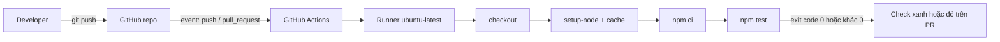

# Buổi 16 – GitHub Actions Basics

Tuần 8/16 · Giai đoạn 3 – CI/CD & Automation · Buổi 16/32

[Slide buổi 16](../../slides/04-cicd/session-16.md) · [Bài tập tuần 8](../../assignments/weekly/week-08.md) · [Hub Tuần 8](README.md)

> **Tóm tắt:** Viết workflow GitHub Actions tự chạy npm ci và npm test mỗi lần push hoặc mở pull request, rồi bật cache, tách job và đọc log khi workflow bị đỏ.

::: tip Buổi này bạn làm gì
**Bạn sẽ tạo ra:** một workflow `.github/workflows/ci.yml` trong repo `devops-labs` của bạn, tự chạy `npm ci` và `npm test` trên máy sạch của GitHub mỗi lần push hoặc mở pull request, hiện check xanh hoặc đỏ.

**Thời gian thật:** đọc 15 phút, lab bắt buộc 60 phút, phần tùy chọn làm ở nhà.

**Cần chuẩn bị:**

- [ ] Tài khoản GitHub và repo `devops-labs` để chế độ **public** (cần để dùng Actions và GHCR miễn phí), `git push` được. Xem [Tài khoản GitHub và repo](../../resources/setup-github.md).
- [ ] Git và Node.js 22 trong WSL, làm việc trong `~/devops-labs` (không dùng `/mnt/c`). Xem [Hướng dẫn cài đặt](../../resources/setup-guide.md).
- [ ] Đã xong [Buổi 15 – CI/CD Fundamentals](session-15.md); repo giáo trình đã clone vào `~/devops-course`.

**Sản phẩm phải nộp** (thư mục `lab-16/`):

- `.github/workflows/ci.yml` chạy xanh trên GitHub, kèm bản sao `lab-16/source/ci.yml.copy`.
- `evidence/command-output.txt`, ảnh run xanh, `README.md` và `report.md` (link run xanh, đoạn log step `Run tests`).

**Đi nhanh:** [Đọc](#doc) > [Làm lab](#hands-on-lab) > [Gặp lỗi?](#gap-loi) > [Tự kiểm tra](#tu-kiem-tra) > [Nộp bài](#nop-bai). Kẹt? Nhảy tới [Gặp lỗi?](#gap-loi).

**Từ mới trong buổi** (giải thích ở [Thuật ngữ](../../resources/glossary.md)):

- Workflow: một quy trình tự động, viết bằng một file YAML.
- Event: sự kiện kích hoạt workflow (push, pull request).
- Job và step: nhóm bước chạy trên một runner, và từng bước trong nhóm.
- Runner: máy ảo sạch do GitHub cấp để chạy job.
- Action: đơn vị dùng lại, ví dụ `actions/checkout`.
- Cache: lưu thư mục tải về để lần sau chạy nhanh hơn.
:::

## Vấn đề thực tế {#doc}

Nhóm CLB có 4 người cùng sửa backend Club Management. Hôm thứ sáu, một bạn push code đã sửa endpoint `/health` nhưng quên chạy test. Tối đó cả nhóm kéo code về, `npm test` đỏ, và mất một buổi tối để tìm ai làm hỏng. Cách xử lý thủ công "nhớ chạy test trước khi push" không bền vững vì nó phụ thuộc vào trí nhớ của từng người.

GitHub Actions giải quyết điều này bằng cách để GitHub tự chạy test trên một máy sạch mỗi khi có push hoặc pull request. Máy sạch còn lộ ra lỗi kiểu "chạy được trên máy tôi": thiếu file chưa commit, phụ thuộc vào biến môi trường cục bộ, hoặc khác phiên bản Node.js. Kết quả xanh hoặc đỏ hiện ngay trên pull request, nên reviewer biết có nên đọc code hay không.

## Khái niệm cốt lõi

**1. Workflow và event.** Workflow là một quy trình tự động, định nghĩa bằng một file YAML trong `.github/workflows/`. Event là sự kiện kích hoạt nó, khai báo ở khóa `on` (`push`, `pull_request`, `workflow_dispatch`). Ví von: workflow là công thức, event là tiếng chuông báo bắt đầu nấu.

**2. Job, step và runner.** Job là nhóm step chạy trên cùng một runner (các job mặc định chạy song song); step là một lệnh shell (`run`) hoặc một action (`uses`); runner là máy ảo mới tinh, sạch cho mỗi job (ví dụ `ubuntu-latest`). Ví von: runner là căn bếp trống mới thuê, bạn phải mang nguyên liệu (checkout) và dụng cụ (setup-node) vào trước khi nấu.

**3. Action và quyền tối thiểu.** Action là bước làm sẵn dùng lại được, ví dụ `actions/checkout@v4` lấy source về runner. Ghim phiên bản action (`@v4`) và khai báo `permissions` tối thiểu: CI chỉ đọc code thì `contents: read` là đủ. Ví von: chỉ đưa chìa khóa đúng phòng, không đưa chìa vạn năng.

**4. `npm ci` thay `npm install`.** `npm ci` cài đúng theo `package-lock.json`, báo lỗi nếu thiếu hoặc lệch lock file, xóa `node_modules` rồi cài mới nên kết quả tái lập được. Vì vậy phải commit `package-lock.json`.

**5. Cache.** Lưu thư mục npm cache giữa các lần chạy để `npm ci` nhanh hơn; key tính từ nội dung `package-lock.json` nên đổi dependency thì cache tự làm mới. Cache khác artifact: cache chỉ để tăng tốc.



Step trả exit code khác 0 thì job thất bại.

::: details Tìm hiểu thêm (đọc sau)
Bảng events thường dùng, cú pháp YAML cần nhớ, quy tắc dùng action từ Marketplace, matrix, so sánh `npm install` với `npm ci` và sơ đồ nhiều job nằm ở [Thử thách và tìm hiểu thêm](session-16-challenge.md). Ba điều nhớ nhanh:

- YAML thụt lề bằng dấu cách (không dùng tab); sai một cấp là workflow lỗi hoặc chạy sai.
- Chỉ dùng action của nhà phát hành đáng tin (ví dụ tổ chức `actions`, `docker`).
:::

## Hands-on lab (60 phút, bắt buộc) {#hands-on-lab}

Trên lớp, mentor demo trước; tự học thì làm thẳng phần Làm lab. Nếu hết giờ, ưu tiên hoàn thành L1 (đến hết Phần 2).

### Chuẩn bị (5 phút)

Kiểm tra môi trường (chạy trong thư mục repo):

```bash
git --version
node --version
npm --version
git remote -v
```

Kết quả mong đợi (rút gọn): Git 2.x, Node `v22.x`, npm 10.x, và `git remote -v` trỏ tới repo `devops-labs` của bạn. Nếu chưa có remote, xem [Tài khoản GitHub và repo](../../resources/setup-github.md).

Bài lab dùng backend của dự án xuyên suốt làm source. Tạo cấu trúc nộp bài và copy backend từ repo giáo trình (không copy `node_modules`):

```bash
cd ~/devops-labs
mkdir -p lab-16/source lab-16/evidence lab-16/screenshots .github/workflows
cp -r ~/devops-course/starter-project/backend/. lab-16/source/
rm -rf lab-16/source/node_modules
printf 'node_modules/\n.env\n' > .gitignore
ls -A lab-16/source
```

Kết quả mong đợi (thứ tự có thể khác):

```text
.dockerignore  Dockerfile  app.js  db.js  package-lock.json  package.json  server.js  tests
```

Tệp `.gitignore` ở gốc repo giúp bạn không lỡ commit `node_modules` sau khi chạy `npm ci` local. Tuyệt đối không ignore `package-lock.json`. Chạy test cục bộ trước để biết trạng thái "đúng":

```bash
cd lab-16/source
npm ci 2>&1 | tee ../evidence/command-output.txt
npm test 2>&1 | tee -a ../evidence/command-output.txt
cd ../..
```

Kết quả mong đợi (rút gọn): `npm ci` cài xong, `npm test` báo `# pass 1` và `# fail 0`. Nếu local đã đỏ thì CI chắc chắn đỏ; sửa local trước (xem [Gặp lỗi?](#gap-loi)).

Vì sao: luôn chứng minh lệnh chạy được ở local trước khi đưa vào CI, để khi CI đỏ bạn biết lỗi nằm ở cấu hình workflow chứ không phải ở code.

::: tip Kiểm tra: bạn đúng khi
`ls -A lab-16/source` có `package-lock.json` và `tests`, và `npm test` local in `# fail 0`.
:::

### Phần 1: Workflow đầu tiên "hello" (10 phút)

Tạo `.github/workflows/hello.yml`:

```yaml
name: Hello
on: workflow_dispatch
jobs:
  hello:
    runs-on: ubuntu-latest
    steps:
      - name: In thông tin runner
        run: |
          echo "Repo: $GITHUB_REPOSITORY"
          echo "OS: $RUNNER_OS"
          echo "Thư mục hiện tại:"
          pwd
          ls
```

Commit và push lên nhánh mặc định (nút Run workflow chỉ xuất hiện khi file nằm trên nhánh đó):

```bash
git add .github/workflows/hello.yml
git commit -m "ci: add hello workflow"
git push
```

Trên GitHub, vào tab Actions, chọn workflow Hello, bấm Run workflow (do dùng `workflow_dispatch`), rồi mở run vừa tạo. Nếu không thấy workflow, xem [Gặp lỗi?](#gap-loi).

Kết quả mong đợi: job `hello` xanh; log in ra tên repo, `OS: Linux`, và `ls` không liệt kê gì (chưa checkout).

Vì sao: bạn thấy rằng runner là máy trống. Mọi thứ cần dùng phải được khai báo trong workflow.

::: tip Kiểm tra: bạn đúng khi
Job `hello` có dấu tích xanh và log có dòng `OS: Linux`.
:::

### Phần 2: CI chạy test (L1, 15 phút)

Tạo `.github/workflows/ci.yml`:

```yaml
name: CI

on:
  push:
    branches: [main, master]
  pull_request:

permissions:
  contents: read

jobs:
  test:
    runs-on: ubuntu-latest
    steps:
      - name: Checkout
        uses: actions/checkout@v4

      - name: Setup Node.js
        uses: actions/setup-node@v4
        with:
          node-version: 22

      - name: Install dependencies
        working-directory: lab-16/source
        run: npm ci

      - name: Run tests
        working-directory: lab-16/source
        run: npm test
```

Đẩy lên và quan sát:

```bash
git add .github/workflows/ci.yml lab-16
git commit -m "ci: run backend tests on push and pull request"
git push
```

Mở tab Actions, chọn run mới nhất của workflow CI, bung từng step. Kết quả mong đợi (rút gọn): các step Checkout, Setup Node.js, Install dependencies, Run tests đều có dấu tích xanh; log step Run tests có `# pass` và `# fail 0`. Step đỏ thì xem [Gặp lỗi?](#gap-loi).

Vì sao `working-directory`: `package.json` nằm ở `lab-16/source`, không phải gốc repo. Không đặt thì lệnh chạy ở gốc repo và `npm` không tìm thấy `package.json`.

Lưu bằng chứng cho phần nộp bài rồi chụp màn hình trang run xanh vào `lab-16/screenshots/`:

```bash
git log --oneline -n 3 | tee -a lab-16/evidence/command-output.txt
cp .github/workflows/ci.yml lab-16/source/ci.yml.copy
```

::: tip Kiểm tra: bạn đúng khi
Trang run của workflow CI xanh, step Run tests có `# fail 0`, và bạn nói được vì sao `working-directory` là `lab-16/source`.
:::

### Phần 3: Bật cache (12 phút)

Sửa step Setup Node.js trong `ci.yml`:

```yaml
      - name: Setup Node.js
        uses: actions/setup-node@v4
        with:
          node-version: 22
          cache: npm
          cache-dependency-path: lab-16/source/package-lock.json
```

Push, đợi run xong, rồi bấm Re-run all jobs để chạy lần hai.

Kết quả mong đợi: lần đầu step Setup Node.js ghi nhận không có cache (cache được lưu ở cuối job); lần hai log báo khôi phục cache npm, thời gian step `npm ci` thường giảm. Với dự án nhỏ, chênh lệch có thể chỉ vài giây; điều quan trọng là bạn thấy cache hoạt động. Chép log Setup Node.js hai lần và thời gian `npm ci` vào `report.md`.

Vì sao `cache-dependency-path`: lock file không nằm ở gốc repo, nên phải chỉ đường dẫn để action tính cache key.

::: tip Kiểm tra: bạn đúng khi
Log Setup Node.js của lần chạy thứ hai có dòng khôi phục cache (nếu không, xem [Gặp lỗi?](#gap-loi), hàng về `cache-dependency-path`).
:::

### Phần 4: Tách job `validate` (18 phút)

Thêm job thứ hai `validate` vào cuối khóa `jobs` của `ci.yml`, ngang hàng với `test` và không có `needs` (nên chạy song song):

```yaml
  validate:
    runs-on: ubuntu-latest
    steps:
      - uses: actions/checkout@v4
      - name: Kiểm tra package.json hợp lệ
        run: node -e "JSON.parse(require('fs').readFileSync('lab-16/source/package.json','utf8')); console.log('package.json OK')"
```

Push và mở run. Kết quả mong đợi: giao diện hiển thị hai job `test` và `validate`, chạy song song, đều xanh, không có mũi tên phụ thuộc giữa chúng.

Vì sao tách job: mỗi job có runner riêng nên chạy song song được, và nhìn vào trang run biết ngay phần nào đỏ. Matrix nhiều phiên bản Node.js là thử thách L2, xem [Thử thách và tìm hiểu thêm](session-16-challenge.md).

::: tip Kiểm tra: bạn đúng khi
Trang run có đúng hai job `test` và `validate`, cả hai xanh, và `ci.yml.copy` trùng workflow thật (`diff .github/workflows/ci.yml lab-16/source/ci.yml.copy` không in gì sau khi bạn chép lại).
:::

### Checklist L1

- [ ] Có file `.github/workflows/ci.yml` chạy khi push và pull request.
- [ ] Workflow có step checkout, setup-node (Node 22), `npm ci`, `npm test`.
- [ ] Có ít nhất một run xanh trên GitHub và đã chụp màn hình; bật cache và có job `validate` song song với `test`.
- [ ] Giải thích được vì sao step `working-directory` là `lab-16/source`.
- [ ] Đã lưu `evidence/command-output.txt` (log lệnh local và git log).

Lệnh tự kiểm tra một dòng (nếu đã cài GitHub CLI và đăng nhập):

```bash
gh run list --workflow CI --limit 3
```

Chưa có `gh` thì mở tab Actions, run mới nhất của CI phải có dấu tích xanh.

## Gặp lỗi? {#gap-loi}

| Triệu chứng | Nguyên nhân | Cách sửa |
| --- | --- | --- |
| Workflow không xuất hiện trong tab Actions | File không nằm trong `.github/workflows/` hoặc đuôi không phải `.yml` / `.yaml`, hoặc chưa push lên nhánh mặc định | Kiểm tra đường dẫn và tên file, đẩy lên nhánh mặc định |
| Workflow không chạy khi push | Khóa `on.push.branches` không khớp nhánh bạn push | Thêm nhánh vào danh sách hoặc bỏ lọc |
| Báo lỗi cú pháp YAML ngay khi mở run | Sai thụt lề, dùng tab, thiếu dấu hai chấm | Dùng editor có kiểm tra YAML, thụt lề 2 dấu cách |
| `npm ci` báo thiếu lock file | `package-lock.json` chưa commit hoặc sai `working-directory` | Commit lock file, kiểm tra đường dẫn |
| Lỗi không tìm thấy `package.json` hoặc `No such file or directory` trước khi chạy `npm` | Chạy lệnh ở gốc repo, hoặc `working-directory` trỏ sai thư mục | Thêm hoặc sửa `working-directory`, hoặc dùng `defaults.run` |
| Step Setup Node.js đỏ, báo không tìm thấy lock file | `cache: npm` bật nhưng `cache-dependency-path` sai, hoặc lock file bị `.gitignore` | Chỉ đúng đường dẫn tới `package-lock.json`, bỏ lock file khỏi `.gitignore`, commit lại |
| Cache không bao giờ được khôi phục | `cache-dependency-path` sai nên không tính được key | Chỉ đúng đường dẫn tới `package-lock.json` |
| Test pass local, fail trên CI | Phụ thuộc file chưa commit, biến môi trường cục bộ hoặc khác phiên bản Node | Kiểm tra bằng clone sạch (`git clone` vào thư mục mới rồi `npm ci`), cố định `node-version` |
| Local `npm test` đỏ ngay từ đầu | Sao chép thiếu file hoặc sửa nhầm test | Chép lại backend từ `~/devops-course/starter-project/backend`, sửa local trước khi đẩy lên |
| Check đỏ do quyền (403) khi push hoặc ghi | `permissions` quá hẹp so với nhu cầu của step | Chỉ nâng đúng quyền cần thiết, không dùng `write-all` |
| `git push` bị từ chối hoặc hỏi mật khẩu | Chưa đăng nhập GitHub hoặc chưa cấu hình SSH key | Làm theo [Tài khoản GitHub và repo](../../resources/setup-github.md) |

Mẹo đọc log: tìm step có dấu X đầu tiên, đọc từ dòng lỗi đầu tiên, rồi xác định lỗi xảy ra trước hay trong `npm`.

## Tự kiểm tra {#tu-kiem-tra}

1. Workflow, job và step khác nhau thế nào?
2. Vì sao hầu hết workflow bắt đầu bằng `actions/checkout@v4`?
3. Khác biệt giữa `npm install` và `npm ci`? Dùng cái nào trong CI và vì sao?
4. Cache của `setup-node` dùng cái gì làm key và điều gì xảy ra khi bạn thêm một dependency?
5. Tình huống: PR của bạn đỏ ở step `npm ci`, nhưng local chạy tốt. Bạn kiểm tra gì đầu tiên?

::: details Đáp án gợi ý
1. Workflow là cả file YAML. Job là nhóm step chạy trên cùng một runner. Step là một lệnh `run` hoặc một action `uses`. Các job mặc định chạy song song, step trong job chạy tuần tự.
2. Runner là máy mới, không có source code. Checkout lấy code của commit đang chạy về runner.
3. `npm ci` cài đúng theo lock file, báo lỗi nếu thiếu hoặc lệch lock file, và xóa `node_modules` trước khi cài. Điều đó cho kết quả tái lập, nên dùng trong CI.
4. Key tính từ hash của file lock. Thêm dependency làm đổi lock file, hash đổi, nên lần chạy đó không khớp cache cũ và cache mới được tạo.
5. Đọc dòng lỗi đầu tiên của step. Kiểm tra `working-directory`, kiểm tra `package-lock.json` có được commit (`git ls-files`), và thử `npm ci` trên bản clone sạch.
:::

## Nộp bài {#nop-bai}

Nộp vào thư mục `lab-16/` trong repo cá nhân theo [mẫu lab](../../templates/lab-template.md); đề và tiêu chí xem [Bài tập tuần 8](../../assignments/weekly/week-08.md).

- [ ] `lab-16/README.md` trả lời đủ 7 câu hỏi của template (giải quyết vấn đề gì, kiến thức dùng, các bước, kết quả mong đợi, lỗi đã gặp, cách khắc phục, cải thiện) và đánh dấu level đã làm (L1, L2).
- [ ] `lab-16/source/` chứa backend đã copy, kèm `package-lock.json`, và bản sao `ci.yml.copy` (vì workflow thật nằm ở `.github/workflows/`).
- [ ] `lab-16/evidence/command-output.txt` chứa log `npm ci`, `npm test` local và `git log`.
- [ ] `lab-16/screenshots/` có ảnh run xanh (và ảnh check đỏ trên PR nếu làm L2).
- [ ] `lab-16/report.md` ghi link run xanh, đoạn log step Run tests, log Setup Node.js hai lần chạy, nguyên nhân gốc và cách sửa khi có lỗi.
- [ ] Không commit secret, token, mật khẩu thật; không đưa file `.env` vào repo.

## Recap

- Workflow là file YAML trong `.github/workflows/`; event kích hoạt, job chạy trên runner sạch, step là lệnh hoặc action, nên luôn phải checkout và cài mọi thứ.
- Dùng `npm ci`, commit `package-lock.json`, đặt đúng `working-directory`; cache tăng tốc, tách job cho chạy song song.
- Khi workflow đỏ: đọc dòng lỗi đầu tiên, xác định step, tái hiện trên bản clone sạch.

Buổi tiếp theo: [Buổi 17 – Automated Testing](../week-09/session-17.md) thêm kiểm thử tự động vào chính pipeline này.

::: details Thử thách thêm (L2, tùy chọn, làm ở nhà)
Thêm matrix Node 22 và 24 với `fail-fast: false`, tạo nhánh `feature/break-test` để thấy check đỏ trên pull request, thêm job `build-image` dùng `needs`, và xử lý Tình huống 06. Đề đầy đủ và gợi ý từng bậc (tự thử 15 phút trước khi mở) ở [Thử thách và tìm hiểu thêm](session-16-challenge.md).
:::

::: details Phá lỗi nâng cao: Tình huống 06 – workflow fail
Tự phá để luyện: đổi `working-directory` thành `lab-16/src`, hoặc ignore `package-lock.json` rồi `git rm --cached`. Quy trình điều tra và cách phòng tránh ở [Thử thách và tìm hiểu thêm](session-16-challenge.md).
:::

::: details Tài liệu tham khảo
Danh sách tài liệu chính thức của GitHub Actions ở [Thử thách và tìm hiểu thêm](session-16-challenge.md).
:::
