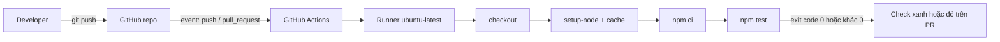
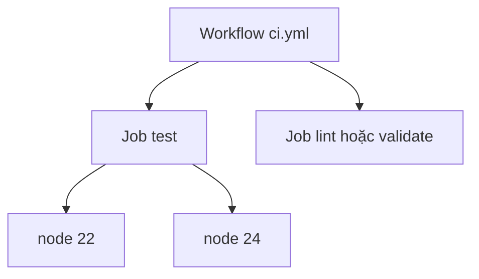

# Buổi 16 – GitHub Actions Basics

Tuần 8 · Giai đoạn 3 – CI/CD & Automation · Slide: [Slide buổi 16](../../slides/04-cicd/session-16.md)

> **Tóm tắt:** Viết workflow GitHub Actions tự chạy npm ci và npm test mỗi lần push hoặc mở pull request, rồi tách job, bật cache, dùng matrix và chẩn đoán workflow bị đỏ.

## Mục tiêu học tập

- Giải thích được workflow, event, job, step, runner và action là gì và chúng lồng vào nhau thế nào.
- Viết được file `.github/workflows/ci.yml` chạy `npm ci` và `npm test` cho backend Node.js khi push và pull request.
- Chạy được workflow trên GitHub, đọc log từng step và xác định step nào làm job thất bại.
- Cấu hình được cache dependency và `strategy.matrix` để chạy test trên nhiều phiên bản Node.js.
- Chẩn đoán được workflow fail do sai `working-directory` hoặc thiếu `package-lock.json` (Tình huống 06).
- Giải thích được vì sao nên pin phiên bản action và đặt `permissions` tối thiểu.

## Điều kiện cần

- Đã học buổi 15 (CI/CD Fundamentals): hiểu CI khác CD ở đâu và vì sao cần pipeline.
- Có tài khoản GitHub, đã tạo repo cá nhân `devops-labs` (public hoặc private) và đã cấu hình SSH key hoặc đăng nhập `git push` được.
- Làm việc trong WSL2 Ubuntu, trong filesystem của WSL (ví dụ `~/devops-labs`), không dùng `/mnt/c`.
- Có Node.js 22 và Git trong WSL.

Kiểm tra nhanh:

```bash
git --version
node --version
npm --version
git remote -v
```

Kết quả mong đợi (rút gọn): Git 2.x, Node `v22.x`, npm 10.x, và `git remote -v` trỏ tới repo `devops-labs` của bạn (chạy trong thư mục repo).

## Vấn đề thực tế

Nhóm CLB có 4 người cùng sửa backend Club Management. Hôm thứ sáu, một bạn push code đã sửa endpoint `/health` nhưng quên chạy test. Tối đó cả nhóm kéo code về, `npm test` đỏ, và mất một buổi tối để tìm ai làm hỏng. Cách xử lý thủ công "nhớ chạy test trước khi push" không bền vững vì nó phụ thuộc vào trí nhớ của từng người.

GitHub Actions giải quyết điều này bằng cách để GitHub tự chạy test trên một máy sạch mỗi khi có push hoặc pull request. Máy sạch còn lộ ra lỗi kiểu "chạy được trên máy tôi": thiếu file chưa commit, phụ thuộc vào biến môi trường cục bộ, hoặc khác phiên bản Node.js. Kết quả xanh hoặc đỏ hiện ngay trên pull request, nên reviewer biết có nên đọc code hay không.

## Khái niệm cốt lõi

### Năm khái niệm nền tảng

| Khái niệm | Là gì | Ví dụ trong bài |
| --- | --- | --- |
| Workflow | Một quy trình tự động, định nghĩa bằng một file YAML trong `.github/workflows/` | `ci.yml` |
| Event | Sự kiện kích hoạt workflow, khai báo ở khóa `on` | `push`, `pull_request`, `workflow_dispatch` |
| Job | Một nhóm step chạy trên cùng một runner; các job mặc định chạy song song | `test` |
| Step | Một bước trong job: chạy lệnh shell (`run`) hoặc dùng một action (`uses`) | `npm ci` |
| Runner | Máy ảo thực thi job; GitHub-hosted runner được tạo mới cho mỗi job | `ubuntu-latest` |

Action là một đơn vị tái sử dụng, ví dụ `actions/checkout@v4` để lấy source về runner. Marketplace là nơi tìm action của cộng đồng và của GitHub.

### Cú pháp YAML cần nhớ

YAML dùng thụt lề bằng dấu cách (không dùng tab) để thể hiện cấu trúc. Ba kiểu giá trị bạn sẽ gặp:

- Map (cặp khóa: giá trị), ví dụ `runs-on: ubuntu-latest`.
- List (mỗi phần tử bắt đầu bằng `- `), ví dụ danh sách step.
- Chuỗi nhiều dòng với `run: |`, mỗi dòng là một lệnh shell.

Sai thụt lề một cấp là nguyên nhân phổ biến nhất khiến workflow không được nhận hoặc chạy sai.

### Events thường dùng

| Event | Khi nào chạy | Dùng cho |
| --- | --- | --- |
| `push` | Có commit được đẩy lên (lọc được theo nhánh) | CI trên nhánh chính |
| `pull_request` | Mở, cập nhật pull request | Kiểm tra trước khi merge |
| `workflow_dispatch` | Bấm chạy thủ công trên giao diện | Chạy lại, thử nghiệm |
| `schedule` | Theo lịch cron | Kiểm tra định kỳ |

### Runner và action

GitHub-hosted runner phổ biến: `ubuntu-latest`, `ubuntu-24.04`, `windows-latest`, `macos-latest`. Với CI backend Node.js, Ubuntu là lựa chọn mặc định vì giống môi trường container sau này. Dùng nhãn cụ thể như `ubuntu-24.04` nếu bạn cần môi trường không đổi khi GitHub nâng `latest`.

Quy tắc dùng action từ Marketplace:

- Pin theo major version (`@v4`) tối thiểu; môi trường cần bảo mật cao hơn pin theo commit SHA.
- Chỉ dùng action của nhà phát hành đáng tin (ví dụ tổ chức `actions`, `docker`) và đọc README của action.
- Khai báo `permissions` tối thiểu. CI chỉ đọc code thì `contents: read` là đủ.

### Cache và matrix

- **Cache:** lưu thư mục npm cache giữa các lần chạy để `npm ci` nhanh hơn. Với `actions/setup-node@v4`, chỉ cần `cache: npm` và chỉ ra file lock bằng `cache-dependency-path`. Cache key được tính từ nội dung `package-lock.json`, nên đổi dependency thì cache tự làm mới.
- **Matrix:** chạy cùng job với nhiều giá trị tham số. Ví dụ `node-version: [22, 24]` tạo hai job song song. Hữu ích khi bạn cần chắc code chạy trên nhiều phiên bản runtime.

### Vì sao dùng npm ci thay vì npm install

| | `npm install` | `npm ci` |
| --- | --- | --- |
| Dùng lock file | Có thể cập nhật lock file | Cài đúng theo lock file, không sửa nó |
| Khi thiếu lock file | Tự tạo | Báo lỗi và dừng |
| Thư mục `node_modules` có sẵn | Giữ lại | Xóa rồi cài mới |
| Phù hợp | Máy dev | CI, build image |

## Kiến trúc và cách hoạt động



Từng bước:

1. Developer push commit hoặc mở pull request. GitHub đối chiếu event với khóa `on` của mọi file trong `.github/workflows/` ở commit đó.
2. Workflow khớp được xếp hàng; GitHub cấp một runner mới, sạch, cho mỗi job.
3. Runner chạy các step theo thứ tự. Step đầu tiên gần như luôn là `actions/checkout@v4`, vì runner ban đầu không có source.
4. `actions/setup-node@v4` cài Node.js đúng phiên bản và khôi phục cache npm nếu có.
5. `npm ci` cài dependency theo lock file, `npm test` chạy test runner có sẵn của Node.js (`node --test`).
6. Step nào trả exit code khác 0 sẽ làm job thất bại và các step sau bị bỏ qua. Kết quả hiện thành check trên commit hoặc pull request.



Hai job độc lập chạy song song; thêm `needs` nếu muốn job này đợi job kia.

## Demo của mentor

Mục tiêu demo (khoảng 10 phút): đi từ repo trống tới check xanh, rồi cố ý làm đỏ.

1. Mở repo demo trên GitHub, vào tab Actions: chỉ ra rằng chưa có workflow nào. Hỏi lớp: "Theo bạn GitHub biết chạy gì bằng cách nào?" (đáp: tìm file YAML trong `.github/workflows/`).
2. Tạo file tối thiểu và push:

```yaml
name: CI
on: push
jobs:
  hello:
    runs-on: ubuntu-latest
    steps:
      - run: echo "Hello from $GITHUB_REPOSITORY on $RUNNER_OS"
```

3. Mở run vừa chạy, bung step `Run echo`. Kết quả mong đợi: log in ra tên repo và `Linux`. Hỏi lớp: "Source code của chúng ta có trên runner không?" (đáp: chưa, vì chưa có checkout). Thêm `ls` sau echo để chứng minh thư mục trống.
4. Thêm `actions/checkout@v4`, chạy lại, thấy `ls` có file. Giải thích `uses` khác `run`.
5. Thay bằng CI thật (xem Phần 2 của lab), đẩy lên, chỉ ra thời gian chạy và dòng "Cache restored" ở lần chạy thứ hai.
6. Cố ý sửa `working-directory` sai, push, cho lớp đọc log. Hỏi: "Dòng nào trong log cho biết nguyên nhân?" Sau đó sửa lại.

Câu hỏi nên hỏi lớp: vì sao cần checkout; vì sao job fail khi `npm test` trả exit code 1; cache khác artifact ở điểm nào.

## Hands-on lab

Thời lượng 60 phút: Chuẩn bị 5', Phần 1 và 2 khoảng 25', Phần 3 và 4 khoảng 20', L2 phần còn lại. Nếu hết giờ, ưu tiên hoàn thành L1.

### Chuẩn bị

Bài lab dùng backend của dự án xuyên suốt làm source. Bạn copy `starter-project/backend` vào repo cá nhân (không copy `node_modules`).

1. Vào repo cá nhân và tạo cấu trúc nộp bài:

```bash
cd ~/devops-labs
mkdir -p lab-16/source lab-16/evidence lab-16/screenshots .github/workflows
```

2. Copy backend từ repo giáo trình (đường dẫn dưới đây là ví dụ, hãy thay bằng nơi bạn clone giáo trình):

```bash
cp -r ~/devops-course/starter-project/backend/. lab-16/source/
rm -rf lab-16/source/node_modules
printf 'node_modules/\n.env\n' > .gitignore
ls -A lab-16/source
```

Kết quả mong đợi (thứ tự có thể khác):

```text
.dockerignore  Dockerfile  app.js  db.js  package-lock.json  package.json  server.js  tests
```

Tệp `.gitignore` ở gốc repo giúp bạn không lỡ commit `node_modules` sau khi chạy `npm ci` local. Tuyệt đối không ignore `package-lock.json`.

3. Chạy test cục bộ trước để biết trạng thái "đúng":

```bash
cd lab-16/source
npm ci
npm test
cd ../..
```

Kết quả mong đợi (rút gọn): `npm ci` cài xong, `npm test` báo các test pass (ví dụ dòng `# pass 1` và `# fail 0`). Nếu local đã đỏ thì CI chắc chắn đỏ; sửa local trước.

Vì sao: luôn chứng minh lệnh chạy được ở local trước khi đưa vào CI, để khi CI đỏ bạn biết lỗi nằm ở cấu hình workflow chứ không phải ở code.

### Phần 1 – Workflow đầu tiên: "hello"

1. Tạo `.github/workflows/hello.yml`:

```yaml
name: Hello
on: workflow_dispatch
jobs:
  hello:
    runs-on: ubuntu-latest
    steps:
      - name: In thông tin runner
        run: |
          echo "Repo: $GITHUB_REPOSITORY"
          echo "OS: $RUNNER_OS"
          echo "Thư mục hiện tại:"
          pwd
          ls
```

2. Commit và push:

```bash
git add .github/workflows/hello.yml
git commit -m "ci: add hello workflow"
git push
```

3. Trên GitHub, vào tab Actions, chọn workflow Hello, bấm Run workflow (do dùng `workflow_dispatch`), rồi mở run vừa tạo. Nút Run workflow chỉ xuất hiện khi file đã nằm trên nhánh mặc định của repo, nên hãy push lên nhánh đó.

Kết quả mong đợi: job `hello` xanh; log in ra tên repo, `OS: Linux`, và `ls` không liệt kê gì (chưa checkout).

Vì sao: bạn thấy rằng runner là máy trống. Mọi thứ cần dùng phải được khai báo trong workflow.

### Phần 2 – CI chạy test (L1)

1. Tạo `.github/workflows/ci.yml`:

```yaml
name: CI

on:
  push:
    branches: [main, master]
  pull_request:

permissions:
  contents: read

jobs:
  test:
    runs-on: ubuntu-latest
    steps:
      - name: Checkout
        uses: actions/checkout@v4

      - name: Setup Node.js
        uses: actions/setup-node@v4
        with:
          node-version: 22

      - name: Install dependencies
        working-directory: lab-16/source
        run: npm ci

      - name: Run tests
        working-directory: lab-16/source
        run: npm test
```

2. Đẩy lên và quan sát:

```bash
git add .github/workflows/ci.yml
git commit -m "ci: run backend tests on push and pull request"
git push
```

3. Mở tab Actions, chọn run mới nhất của workflow CI, bung từng step.

Kết quả mong đợi (rút gọn): các step Checkout, Setup Node.js, Install dependencies, Run tests đều có dấu tích xanh; log step Run tests có `# pass` và `# fail 0`.

Vì sao `working-directory`: `package.json` nằm ở `lab-16/source`, không phải gốc repo. Không đặt thì lệnh chạy ở gốc repo và `npm` không tìm thấy `package.json`.

4. Lưu bằng chứng cho phần nộp bài:

```bash
git log --oneline -n 3 | tee -a lab-16/evidence/command-output.txt
```

Sau đó chụp màn hình trang run xanh vào `lab-16/screenshots/`.

### Phần 3 – Bật cache

1. Sửa step Setup Node.js trong `ci.yml`:

```yaml
      - name: Setup Node.js
        uses: actions/setup-node@v4
        with:
          node-version: 22
          cache: npm
          cache-dependency-path: lab-16/source/package-lock.json
```

2. Push, đợi run xong. Bấm Re-run all jobs để chạy lần hai.

Kết quả mong đợi: lần đầu step Setup Node.js ghi nhận không có cache (cache được lưu ở cuối job); lần hai log báo khôi phục cache npm, thời gian step `npm ci` thường giảm. Với dự án nhỏ, chênh lệch có thể chỉ vài giây; điều quan trọng là bạn thấy cache hoạt động.

Vì sao `cache-dependency-path`: lock file không nằm ở gốc repo, nên phải chỉ đường dẫn để action tính cache key.

### Phần 4 – Tách job và dùng matrix (L2 chuẩn bị)

1. Thay nội dung `jobs` thành hai job: `test` chạy matrix, `validate` kiểm tra nhanh cú pháp JSON của `package.json`:

```yaml
jobs:
  test:
    runs-on: ubuntu-latest
    strategy:
      fail-fast: false
      matrix:
        node-version: [22, 24]
    steps:
      - uses: actions/checkout@v4
      - uses: actions/setup-node@v4
        with:
          node-version: ${{ matrix.node-version }}
          cache: npm
          cache-dependency-path: lab-16/source/package-lock.json
      - name: Install dependencies
        working-directory: lab-16/source
        run: npm ci
      - name: Run tests
        working-directory: lab-16/source
        run: npm test

  validate:
    runs-on: ubuntu-latest
    steps:
      - uses: actions/checkout@v4
      - name: Kiểm tra package.json hợp lệ
        run: node -e "JSON.parse(require('fs').readFileSync('lab-16/source/package.json','utf8')); console.log('package.json OK')"
```

2. Push và mở run.

Kết quả mong đợi: giao diện hiển thị ba job: `test (22)`, `test (24)` và `validate`, chạy song song, đều xanh. Nếu một biến thể đỏ trong khi biến thể kia xanh, bạn vừa tìm được vấn đề tương thích phiên bản, đây đúng là mục đích của matrix.

Vì sao `fail-fast: false`: để một biến thể fail không hủy các biến thể còn lại, giúp thấy đầy đủ kết quả.

Bài dùng Node 22 và 24 (cả hai đang được hỗ trợ; Node 20 đã hết vòng đời hỗ trợ từ 2026-04). Backend của starter-project nhắm Node 22, biến thể 24 chỉ để học cách dùng matrix. Kiểm tra lịch hỗ trợ tại [nodejs.org/en/about/previous-releases](https://nodejs.org/en/about/previous-releases).

Tham khảo thêm: `examples/github-actions/ci-basic.yml` và `examples/github-actions/ci-matrix.yml` (khác cấu trúc thư mục và danh sách phiên bản Node với bài này).

### L1 – Foundation

- [ ] Có file `.github/workflows/ci.yml` chạy khi push và pull request.
- [ ] Workflow có step checkout, setup-node (Node 22), `npm ci`, `npm test`.
- [ ] Có ít nhất một run xanh trên GitHub và đã chụp màn hình.
- [ ] Giải thích được vì sao step `working-directory` là `lab-16/source`.
- [ ] Đã lưu `evidence/command-output.txt` (log lệnh local và git log).

### L2 – Engineering

Thử thách: hoàn thiện pipeline và chứng minh bạn hiểu nó.

1. Workflow có cache npm và job `test` dùng matrix tối thiểu hai phiên bản Node.js; có ít nhất hai job độc lập.
2. Tạo nhánh `feature/break-test`, cố ý làm một test đỏ, mở pull request và chụp màn hình check đỏ trên PR. Sau đó sửa cho xanh.
3. Xử lý Tình huống 06 (xem phần Phá lỗi và debug) và ghi nguyên nhân gốc vào `report.md`.
4. Tiêu chí hoàn thành: run xanh với matrix, một run đỏ có giải thích, `report.md` nêu rõ log nào chỉ ra nguyên nhân.

<details>
<summary>Gợi ý 1: làm test đỏ</summary>

Sửa assertion trong `lab-16/source/tests/health.test.js`, ví dụ đổi `"healthy"` thành `"unhealthy"`, commit lên nhánh `feature/break-test`, push rồi mở pull request vào nhánh chính.

</details>

<details>
<summary>Gợi ý 2: job phụ thuộc nhau</summary>

Dùng khóa `needs: test` trong job muốn chạy sau. Khi `test` đỏ thì job đó bị bỏ qua.

</details>

<details>
<summary>Lời giải tham khảo: thêm job build sau test</summary>

```yaml
  build-image:
    runs-on: ubuntu-latest
    needs: [test, validate]
    steps:
      - uses: actions/checkout@v4
      - name: Build Docker image
        working-directory: lab-16/source
        run: docker build -t club-api:ci .
```

Job này chỉ chạy khi `test` (cả hai biến thể matrix) và `validate` đều xanh. Docker có sẵn trên `ubuntu-latest`.

</details>

## Phá lỗi và debug

### Tình huống 06 – Workflow fail

Bạn chỉ nhận triệu chứng: sau một lần push, check CI đỏ ở step cài dependency hoặc chạy test, dù trên máy bạn `npm test` vẫn xanh. Tài nguyên: `examples/troubleshooting/scenario-06/`.

Cách tự phá để luyện (chọn một):

1. Đổi `working-directory: lab-16/source` thành `lab-16/src` ở step `npm ci`.
2. Thêm `lab-16/source/package-lock.json` vào `.gitignore`, xóa khỏi git (`git rm --cached`), commit và push.

Triệu chứng thường thấy:

- Với cách 1, step bị đỏ ngay và log báo thư mục không tồn tại (dạng `No such file or directory`) trước khi chạy `npm`.
- Với cách 2, nếu đã bật `cache: npm` (Phần 3) thì step Setup Node.js đỏ trước, log báo không tìm thấy file lock theo `cache-dependency-path`. Nếu chưa bật cache thì step `npm ci` đỏ, log báo `npm ci` cần `package-lock.json` hiện có (nội dung chính xác tùy phiên bản npm).

Hướng điều tra theo bước:

1. Mở run đỏ, tìm step có dấu X đỏ đầu tiên. Đọc từ dòng lỗi đầu tiên, không đọc từ cuối.
2. Xác định lỗi xảy ra ở đâu: trước khi chạy `npm` (đường dẫn, checkout) hay trong `npm` (lock file, test).
3. Đối chiếu với thực tế repo: chạy `git ls-files lab-16/source | head` để xem file nào thực sự được commit.
4. Tái hiện cục bộ trên bản clone sạch: `git clone` repo vào thư mục mới, `cd` đúng thư mục và chạy `npm ci`. Nếu lỗi lặp lại, nguyên nhân nằm ở dữ liệu repo chứ không phải GitHub.
5. Sửa, push, xác nhận run xanh.

Nguyên nhân gốc: runner chỉ có những gì đã commit và những gì workflow khai báo. Đường dẫn sai hoặc file bị bỏ qua bởi `.gitignore` làm môi trường CI khác máy bạn.

Cách phòng tránh:

- Luôn commit `package-lock.json`.
- Dùng một biến chung hoặc `defaults.run.working-directory` để không lặp đường dẫn.
- Kiểm tra bằng bản clone sạch trước khi đổ lỗi cho CI.

## Lỗi thường gặp

| Triệu chứng | Nguyên nhân | Cách xử lý |
| --- | --- | --- |
| Workflow không xuất hiện trong tab Actions | File không nằm trong `.github/workflows/` hoặc đuôi không phải `.yml` / `.yaml` | Kiểm tra đường dẫn và tên file, đẩy lên nhánh mặc định |
| Workflow không chạy khi push | Khóa `on.push.branches` không khớp nhánh bạn push | Thêm nhánh vào danh sách hoặc bỏ lọc |
| Báo lỗi cú pháp YAML ngay khi mở run | Sai thụt lề, dùng tab, thiếu dấu hai chấm | Dùng editor có kiểm tra YAML, thụt lề 2 dấu cách |
| `npm ci` báo thiếu lock file | `package-lock.json` chưa commit hoặc sai `working-directory` | Commit lock file, kiểm tra đường dẫn |
| Lỗi không tìm thấy `package.json` | Chạy lệnh ở gốc repo thay vì thư mục source | Thêm `working-directory` hoặc `defaults.run` |
| Cache không bao giờ được khôi phục | `cache-dependency-path` sai nên không tính được key | Chỉ đúng đường dẫn tới `package-lock.json` |
| Test pass local, fail trên CI | Phụ thuộc file chưa commit, biến môi trường cục bộ hoặc khác phiên bản Node | Kiểm tra bằng clone sạch, cố định `node-version` |
| Check đỏ do quyền (403) khi push hoặc ghi | `permissions` quá hẹp so với nhu cầu của step | Chỉ nâng đúng quyền cần thiết, không dùng `write-all` |

## Tự kiểm tra

1. Workflow, job và step khác nhau thế nào?

<details>
<summary>Đáp án</summary>

Workflow là cả file YAML. Job là nhóm step chạy trên cùng một runner. Step là một lệnh `run` hoặc một action `uses`. Các job mặc định chạy song song, step trong job chạy tuần tự.

</details>

2. Vì sao hầu hết workflow bắt đầu bằng `actions/checkout@v4`?

<details>
<summary>Đáp án</summary>

Runner là máy mới, không có source code. Checkout lấy code của commit đang chạy về runner.

</details>

3. Khác biệt giữa `npm install` và `npm ci`? Dùng cái nào trong CI và vì sao?

<details>
<summary>Đáp án</summary>

`npm ci` cài đúng theo lock file, báo lỗi nếu thiếu hoặc lệch lock file, và xóa `node_modules` trước khi cài. Điều đó cho kết quả tái lập, nên dùng trong CI.

</details>

4. Matrix với `node-version: [22, 24]` tạo ra bao nhiêu job và chúng chạy thế nào?

<details>
<summary>Đáp án</summary>

Hai job, mặc định chạy song song. Nếu một biến thể fail và `fail-fast` là true (mặc định) thì các biến thể đang chạy khác bị hủy.

</details>

5. Cache của `setup-node` dùng cái gì làm key và điều gì xảy ra khi bạn thêm một dependency?

<details>
<summary>Đáp án</summary>

Key tính từ hash của file lock. Thêm dependency làm đổi lock file, hash đổi, nên lần chạy đó không khớp cache cũ và cache mới được tạo.

</details>

6. Tình huống: PR của bạn đỏ ở step `npm ci`, nhưng local chạy tốt. Bạn kiểm tra gì đầu tiên?

<details>
<summary>Đáp án</summary>

Đọc dòng lỗi đầu tiên của step. Kiểm tra `working-directory`, kiểm tra `package-lock.json` có được commit (`git ls-files`), và thử `npm ci` trên bản clone sạch.

</details>

7. Vì sao nên đặt `permissions: contents: read` cho workflow CI?

<details>
<summary>Đáp án</summary>

Theo nguyên tắc quyền tối thiểu: nếu một step hoặc action bên thứ ba bị lợi dụng, token của workflow không có quyền ghi vào repo.

</details>

## Nộp bài

Nộp vào thư mục `lab-16/` trong repo cá nhân theo `templates/lab-template.md`:

- [ ] `lab-16/README.md` trả lời đủ 7 câu hỏi của template (giải quyết vấn đề gì, kiến thức dùng, các bước, kết quả mong đợi, lỗi đã gặp, cách khắc phục, cải thiện).
- [ ] `lab-16/source/` chứa backend đã copy, kèm `package-lock.json`, và bản sao `ci.yml` (ví dụ `lab-16/source/ci.yml.copy`) vì workflow thật nằm ở `.github/workflows/`.
- [ ] `lab-16/evidence/command-output.txt` chứa log `npm ci`, `npm test` local và `git log`.
- [ ] `lab-16/screenshots/` có ảnh run xanh và (nếu làm L2) ảnh check đỏ trên PR.
- [ ] `lab-16/report.md` ghi link tới run xanh, run đỏ, nguyên nhân gốc và cách sửa.
- [ ] Đánh dấu level đã làm (L1, L2) ở cuối README.
- [ ] Không commit secret, token, mật khẩu thật; không đưa file `.env` vào repo.

## Recap

- Workflow là file YAML trong `.github/workflows/`; event kích hoạt, job chạy trên runner, step là lệnh hoặc action.
- Runner là máy mới cho mỗi job, nên phải checkout và cài mọi thứ trong workflow.
- Dùng `npm ci`, commit `package-lock.json`, và cố định phiên bản Node.js để CI tái lập được.
- `working-directory` quyết định nơi lệnh chạy; sai đường dẫn là lỗi phổ biến nhất.
- Cache tăng tốc cài dependency; matrix kiểm tra nhiều phiên bản song song.
- Khi workflow đỏ: đọc dòng lỗi đầu tiên, xác định step, tái hiện trên bản clone sạch.
- Pin action theo phiên bản và đặt `permissions` tối thiểu.

## Tài liệu tham khảo

- [Understanding GitHub Actions](https://docs.github.com/en/actions/get-started/understanding-github-actions)
- [Workflow syntax for GitHub Actions](https://docs.github.com/en/actions/reference/workflows-and-actions/workflow-syntax)
- [Building and testing Node.js](https://docs.github.com/en/actions/tutorials/build-and-test-code/nodejs)
- [Dependency caching](https://docs.github.com/en/actions/reference/workflows-and-actions/dependency-caching)
- [actions/setup-node](https://github.com/actions/setup-node)
- [Running variations of jobs in a workflow](https://docs.github.com/en/actions/how-tos/write-workflows/choose-what-workflows-do/run-job-variations)
