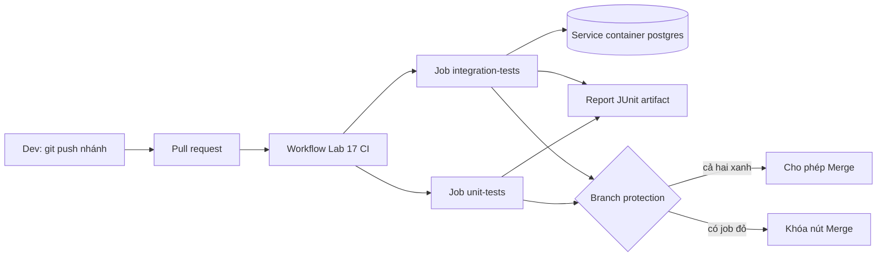

# Buổi 17 – Automated Testing

Tuần 9 · Giai đoạn 3 – CI/CD & Automation · Slide: [Slide buổi 17](../../slides/04-cicd/session-17.md)

> **Tóm tắt:** Viết unit test (mock pool) và integration test (Postgres service container) bằng node:test, chạy trong GitHub Actions và chặn merge khi CI đỏ.

## Mục tiêu học tập

- Phân biệt được unit test, integration test và nêu khi nào dùng loại nào cho API Club Management.
- Viết được test cho endpoint `/ready` và `/api/members` bằng `node:test` với `mock.method` thay cho PostgreSQL thật.
- Chạy được integration test với PostgreSQL service container trong GitHub Actions và trên máy cục bộ.
- Xuất và upload được test report (JUnit XML) làm artifact của workflow.
- Cấu hình được branch protection để pull request chỉ merge khi các check bắt buộc đã pass.
- Chẩn đoán được hai lỗi điển hình: test phụ thuộc thứ tự/dữ liệu và job không kết nối được service container.

## Điều kiện cần

- Đã học buổi 15 (CI/CD Fundamentals) và buổi 16 (GitHub Actions Basics): biết workflow, job, step, event `pull_request`.
- Đã có repository cá nhân `devops-labs` trên GitHub. Để dùng branch protection, repository nên ở chế độ **public** (xem phần Lỗi thường gặp).
- WSL2 Ubuntu, Node.js 22, npm, Git, Docker Desktop đang chạy. Làm việc trong filesystem của WSL (ví dụ `~/devops-labs`), không dùng `/mnt/c`.

Kiểm tra nhanh:

```bash
node --version && npm --version && git --version && docker --version
```

Kết quả mong đợi (rút gọn):

```text
v22.x.x
10.x.x
git version 2.x.x
Docker version 27.x.x, build ...
```

## Vấn đề thực tế

CLB có 5 bạn cùng sửa API quản lý thành viên. Một bạn đổi câu SQL trong `/api/members`, chạy thử trên máy mình thấy ổn rồi merge. Tối đó cả nhóm kéo code về và `docker compose up` báo lỗi 500. Không ai biết thay đổi nào gây ra lỗi, vì không có gì kiểm tra tự động trước khi code vào nhánh chính.

Automated testing giải quyết điều này: mỗi pull request tự động chạy bộ test trên một máy sạch (runner), và nếu test đỏ thì GitHub không cho merge. Test không chứng minh code đúng tuyệt đối, nhưng nó biến câu hỏi "có ai làm hỏng gì không?" thành một tín hiệu xanh/đỏ mà cả nhóm tin được.

## Khái niệm cốt lõi

### Unit test và integration test

| Tiêu chí | Unit test | Integration test |
| --- | --- | --- |
| Kiểm tra | Một đơn vị logic (route handler, hàm) | Nhiều thành phần chạy cùng nhau (API + PostgreSQL thật) |
| Phụ thuộc ngoài | Thay bằng mock/stub | Dùng dịch vụ thật (container) |
| Tốc độ | Mili giây | Giây (phải khởi động DB) |
| Ổn định | Rất cao | Phụ thuộc môi trường, dễ flaky nếu dữ liệu không được dọn |
| Bắt được lỗi | Logic sai, nhánh lỗi chưa xử lý | SQL sai, schema lệch, cấu hình kết nối sai |
| Ví dụ trong lab | `/ready` trả 503 khi `pool.query` ném lỗi | `/api/members` trả đúng 2 thành viên từ bảng `members` thật |

Quy tắc thực dụng: nhiều unit test nhanh làm nền, vài integration test cho những đường đi quan trọng (kết nối DB, truy vấn chính).

### node:test

Node.js 22 có sẵn test runner, không cần cài Jest hay Mocha. Những thứ dùng trong lab:

| Thành phần | Công dụng |
| --- | --- |
| `test(name, fn)` | Khai báo một test case |
| `describe`, `before`, `after`, `beforeEach` | Gom nhóm và chuẩn bị/dọn dữ liệu |
| `t.mock.method(obj, "name", impl)` | Thay một method bằng bản giả; tự khôi phục khi test kết thúc |
| `node --test` | Tự tìm và chạy các file `*.test.js` |
| `--test-reporter`, `--test-reporter-destination` | Chọn định dạng báo cáo (`spec`, `junit`, `tap`, `lcov`) và nơi ghi |

`node:assert/strict` cung cấp `assert.equal`, `assert.deepEqual`. Một test pass khi hàm kết thúc không ném lỗi.

### Test report

Log trên màn hình chỉ đọc được khi bạn đang nhìn. Test report dạng JUnit XML là file có cấu trúc: công cụ khác (GitHub, Jenkins, IDE) đọc được số test pass/fail, thời gian từng test. Trong lab này report được upload làm artifact để tải về sau khi workflow kết thúc, kể cả khi test fail.

### Build validation và branch protection

CI chạy mà không chặn thì chỉ là thông báo. Branch protection (hoặc ruleset) với tùy chọn **Require status checks to pass before merging** biến CI thành cổng kiểm soát: nút Merge bị khóa cho đến khi các check được chọn có kết quả thành công. Check được chọn theo tên job (trường `name`).

## Kiến trúc và cách hoạt động



Từng bước:

1. Dev push nhánh `add-api-tests` và mở pull request vào `main`. Event `pull_request` kích hoạt workflow.
2. GitHub tạo hai runner độc lập cho hai job. Hai job chạy song song.
3. Job `unit-tests` cài dependency bằng `npm ci`, chạy test với mock pool. Không cần database.
4. Job `integration-tests` khai báo `services.postgres`. Runner khởi động container `postgres:17-alpine`, chờ health check pass, rồi mới chạy các step. Vì job chạy trực tiếp trên runner, ứng dụng kết nối qua `localhost:5432` (cổng được map).
5. Mỗi job ghi `test-results.xml` và upload artifact, kể cả khi test fail (`if: always()`).
6. Branch protection đọc kết quả của hai check. Thiếu một check xanh thì nút Merge bị khóa.

Workflow đầy đủ có sẵn để đối chiếu ở `examples/github-actions/ci-integration-postgres.yml`.

## Demo của mentor

Mục tiêu demo (khoảng 10 phút): cho lớp thấy vòng lặp "đỏ -> sửa -> xanh" và nút Merge bị khóa.

1. Mở `starter-project/backend/tests/health.test.js`, đọc to cấu trúc: `before` mở server cổng ngẫu nhiên, `after` đóng server và `pool.end()`, một test gọi `/health`.
2. Chạy test hiện có:

   ```bash
   cd ~/devops-labs/lab-17/source/backend
   npm test
   ```

   Kết quả mong đợi (rút gọn):

   ```text
   ✔ GET /health returns healthy (15.2ms)
   ℹ tests 1
   ℹ pass 1
   ℹ fail 0
   ```

   Hỏi lớp: test này có cần PostgreSQL đang chạy không? Vì sao? (Vì `/health` không chạm DB và `Pool` chỉ kết nối khi có query.)
3. Cố ý sửa `assert.equal(res.status, 200)` thành `201`, chạy lại, đọc thông báo `AssertionError` (actual và expected). Hỏi: dòng nào cho biết test hỏng ở đâu? Sửa lại cho xanh.
4. Mở trang Settings > Branches của repository demo, cho xem rule đã bật. Mở một pull request có check đỏ và chỉ nút Merge bị khóa với thông báo "Required statuses must pass".
5. Câu hỏi thảo luận: "Nếu mock luôn trả về dữ liệu đúng thì unit test có phát hiện được SQL sai không?" (Không. Đó là lý do cần integration test.)

## Hands-on lab

Đề bài: thiết lập test trước khi merge cho API của dự án Club Management. Thời gian gợi ý: chuẩn bị 5', phần 1-4 (L1) 30', phần 5-6 (L2) 25'.

### Chuẩn bị

1. Trong repository cá nhân, tạo thư mục nộp bài và chép backend từ starter-project (đường dẫn dưới đây giả định bạn đã clone repo giáo trình ở `~/devops-course`):

   ```bash
   cd ~/devops-labs
   mkdir -p lab-17/source lab-17/evidence lab-17/screenshots
   cp -r ~/devops-course/starter-project/backend lab-17/source/backend
   cp -r ~/devops-course/starter-project/database lab-17/source/database
   rm -rf lab-17/source/backend/node_modules
   ls lab-17/source lab-17/source/backend
   ```

   Kết quả mong đợi:

   ```text
   lab-17/source:
   backend  database

   lab-17/source/backend:
   Dockerfile  app.js  db.js  package-lock.json  package.json  server.js  tests
   ```

   Vì sao xóa `node_modules`: thư mục này sinh ra bởi `npm ci`, không bao giờ commit.

2. Tạo `.gitignore` ở gốc repository (nếu chưa có) và nhánh làm việc:

   ```bash
   printf "node_modules/\ntest-results.xml\n.env\n" >> .gitignore
   git switch -c add-api-tests
   cd lab-17/source/backend && npm ci
   ```

### Phần 1 – Chạy test có sẵn

```bash
npm test
```

Kết quả mong đợi: `pass 1`, `fail 0` như trong demo. Đây là mốc xuất phát: mọi thay đổi sau này phải giữ nguyên trạng thái xanh.

### Phần 2 – Unit test cho `/ready` và `/api/members` (mock pool)

Ý tưởng: `app.js` gọi `pool.query(...)` mỗi khi có request. Vì `pool` là một object dùng chung, ta thay `pool.query` bằng hàm giả để kiểm soát kết quả mà không cần DB.

1. Tạo file `tests/api.test.js`:

   ```js
   import { test } from "node:test";
   import assert from "node:assert/strict";
   import { app } from "../app.js";
   import { pool } from "../db.js";

   let server;
   let baseUrl;

   test.before(async () => {
     await new Promise((resolve) => {
       server = app.listen(0, "127.0.0.1", resolve);
     });
     baseUrl = `http://127.0.0.1:${server.address().port}`;
   });

   test.after(async () => {
     await new Promise((resolve) => server.close(resolve));
     await pool.end();
   });

   test("GET /ready returns 200 when database answers", async (t) => {
     t.mock.method(pool, "query", async () => ({ rows: [{ "?column?": 1 }] }));
     const res = await fetch(`${baseUrl}/ready`);
     assert.equal(res.status, 200);
     assert.deepEqual(await res.json(), { status: "ready" });
   });

   test("GET /ready returns 503 when database fails", async (t) => {
     t.mock.method(pool, "query", async () => {
       throw new Error("connection refused");
     });
     const res = await fetch(`${baseUrl}/ready`);
     assert.equal(res.status, 503);
     assert.deepEqual(await res.json(), { status: "not-ready" });
   });

   test("GET /api/members returns rows from the pool", async (t) => {
     const rows = [{ id: 1, name: "Alice", email: "alice@example.com" }];
     t.mock.method(pool, "query", async () => ({ rows }));
     const res = await fetch(`${baseUrl}/api/members`);
     assert.equal(res.status, 200);
     assert.deepEqual(await res.json(), rows);
   });

   test("GET /api/members returns 500 when query fails", async (t) => {
     t.mock.method(console, "error", () => {});
     t.mock.method(pool, "query", async () => {
       throw new Error("syntax error");
     });
     const res = await fetch(`${baseUrl}/api/members`);
     assert.equal(res.status, 500);
     assert.deepEqual(await res.json(), { message: "Internal server error" });
   });
   ```

2. Chạy:

   ```bash
   npm test -- --test-reporter=spec
   ```

   Kết quả mong đợi (rút gọn):

   ```text
   ✔ GET /health returns healthy (14ms)
   ✔ GET /ready returns 200 when database answers (6ms)
   ✔ GET /ready returns 503 when database fails (3ms)
   ✔ GET /api/members returns rows from the pool (3ms)
   ✔ GET /api/members returns 500 when query fails (3ms)
   ℹ tests 5
   ℹ pass 5
   ℹ fail 0
   ```

Vì sao dùng `t.mock.method` thay vì `mock.method` toàn cục: mock gắn với test context sẽ tự khôi phục khi test kết thúc, nên test này không làm bẩn test khác. Vì sao mock `console.error`: handler `/api/members` ghi lỗi ra console, ta không muốn log nhiễu làm báo cáo khó đọc.

### Phần 3 – Workflow chạy test và xuất report

1. Tạo `.github/workflows/lab17-ci.yml` ở gốc repository `devops-labs` (workflow chỉ có hiệu lực khi nằm ở đây):

   ```yaml
   name: Lab 17 CI

   on:
     push:
       branches: [main]
     pull_request:

   permissions:
     contents: read

   jobs:
     unit-tests:
       name: unit-tests
       runs-on: ubuntu-latest
       defaults:
         run:
           working-directory: lab-17/source/backend
       steps:
         - uses: actions/checkout@v4

         - uses: actions/setup-node@v4
           with:
             node-version: 22
             cache: npm
             cache-dependency-path: lab-17/source/backend/package-lock.json

         - name: Install dependencies
           run: npm ci

         - name: Run unit tests
           run: >
             npm test --
             --test-reporter=spec --test-reporter-destination=stdout
             --test-reporter=junit --test-reporter-destination=test-results.xml

         - name: Upload test report
           if: always()
           uses: actions/upload-artifact@v4
           with:
             name: test-results-unit
             path: lab-17/source/backend/test-results.xml
             if-no-files-found: warn
   ```

2. Commit và push nhánh:

   ```bash
   cd ~/devops-labs
   git add .gitignore lab-17 .github/workflows/lab17-ci.yml
   git commit -m "Add API unit tests and CI workflow"
   git push -u origin add-api-tests
   ```

3. Mở pull request từ `add-api-tests` vào `main` trên GitHub. Vào tab Actions, chờ job `unit-tests` xanh, kéo xuống cuối trang run để thấy artifact `test-results-unit`.

Vì sao `if: always()`: mặc định step sau một step fail sẽ bị bỏ qua. Khi test đỏ, đó chính là lúc cần report nhất.

### Phần 4 – Bắt buộc CI pass trước khi merge

1. Merge pull request lần đầu (hoặc push thẳng workflow lên `main`) để workflow tồn tại trên nhánh chính, sau đó tạo một nhánh/PR mới để thử. GitHub chỉ liệt kê check trong ô tìm kiếm của branch protection nếu nó đã chạy trong 7 ngày gần đây.
2. Vào **Settings > Branches**, chọn **Add classic branch protection rule** (hoặc **Settings > Rules > Rulesets** nếu bạn thích giao diện mới; tên nút có thể thay đổi theo giao diện GitHub, xem tài liệu trong phần tham khảo). Branch name pattern: `main` (đổi thành `master` nếu nhánh mặc định của bạn tên vậy; sửa luôn `branches: [main]` trong workflow).
3. Bật **Require a pull request before merging** và **Require status checks to pass before merging**. Trong ô tìm kiếm, chọn `unit-tests`. Bật thêm **Require branches to be up to date before merging** nếu muốn check chạy trên code đã cập nhật mới nhất.
4. Kiểm chứng: tạo nhánh `break-test`, sửa một assert cho sai, push, mở pull request. Kết quả mong đợi: check `unit-tests` đỏ, phần Merge hiện "Required statuses must pass before merging" và nút Merge bị khóa. Chụp màn hình lưu vào `screenshots/`. Sau đó sửa lại cho xanh và xác nhận nút Merge mở.

Vì sao cần bước kiểm chứng: rule cấu hình sai (chọn nhầm tên check, rule áp dụng sai nhánh) trông giống hệt rule đúng cho đến khi có người merge code hỏng.

### L1 – Foundation: checklist hoàn thành

- [ ] `tests/api.test.js` có 4 test mới, `npm test` báo `pass 5`, `fail 0`.
- [ ] Workflow `lab17-ci.yml` chạy xanh trên pull request, artifact `test-results-unit` tải về được.
- [ ] Branch protection yêu cầu check `unit-tests` trên nhánh `main`.
- [ ] Có screenshot nút Merge bị khóa khi test đỏ, và screenshot sau khi sửa xanh.
- [ ] Đã lưu output lệnh vào `evidence/command-output.txt`.

### Phần 5 – Integration test với PostgreSQL thật (L2)

1. Chạy PostgreSQL cục bộ ở cổng 5433 (tránh đụng cổng 5432 của compose nếu bạn đang chạy):

   ```bash
   docker run -d --name lab17-pg \
     -e POSTGRES_USER=club -e POSTGRES_PASSWORD=ci-only-password -e POSTGRES_DB=clubdb \
     -p 5433:5432 postgres:17-alpine
   docker exec lab17-pg pg_isready -U club -d clubdb
   ```

   Kết quả mong đợi: `/var/run/postgresql:5432 - accepting connections` (nếu chưa sẵn sàng, chờ vài giây rồi chạy lại).

2. Tạo `tests/members.integration.test.js`:

   ```js
   import { describe, test, before, after, beforeEach } from "node:test";
   import assert from "node:assert/strict";
   import { readFile } from "node:fs/promises";
   import { app } from "../app.js";
   import { pool } from "../db.js";

   const enabled = process.env.RUN_INTEGRATION === "1";

   describe("members API with real PostgreSQL", { skip: !enabled }, () => {
     let server;
     let baseUrl;

     before(async () => {
       const schema = await readFile(
         new URL("../../database/init.sql", import.meta.url),
         "utf8"
       );
       await pool.query(schema);
       await new Promise((resolve) => {
         server = app.listen(0, "127.0.0.1", resolve);
       });
       baseUrl = `http://127.0.0.1:${server.address().port}`;
     });

     beforeEach(async () => {
       await pool.query("TRUNCATE members RESTART IDENTITY");
       await pool.query(
         "INSERT INTO members (name, email) VALUES ($1, $2), ($3, $4)",
         ["Alice", "alice@example.com", "Bob", "bob@example.com"]
       );
     });

     after(async () => {
       await new Promise((resolve) => server.close(resolve));
       await pool.end();
     });

     test("GET /ready returns 200 with a live database", async () => {
       const res = await fetch(`${baseUrl}/ready`);
       assert.equal(res.status, 200);
     });

     test("GET /api/members returns seeded members in id order", async () => {
       const res = await fetch(`${baseUrl}/api/members`);
       assert.equal(res.status, 200);
       const body = await res.json();
       assert.deepEqual(
         body.map((m) => m.name),
         ["Alice", "Bob"]
       );
     });
   });
   ```

3. Chạy:

   ```bash
   RUN_INTEGRATION=1 DB_PORT=5433 DB_PASSWORD=ci-only-password npm test -- --test-reporter=spec
   ```

   Kết quả mong đợi (rút gọn): `tests 7`, `pass 7`, `fail 0`. Nếu bỏ `RUN_INTEGRATION=1`, cả nhóm `members API with real PostgreSQL` hiển thị `skipped` (con số tổng có thể khác chút tùy phiên bản Node): nhờ vậy `npm test` vẫn chạy được trên máy không có DB.

4. Dọn container khi làm xong phần này (hoặc sau khi làm xong Phá lỗi tình huống A):

   ```bash
   docker rm -f lab17-pg
   ```

Vì sao `TRUNCATE ... RESTART IDENTITY` trong `beforeEach`: mỗi test tự dựng dữ liệu mình cần, nên kết quả không phụ thuộc test nào chạy trước. Đây là cách phòng lỗi "phụ thuộc thứ tự" nêu ở phần Phá lỗi.

### Phần 6 – Service container trong Actions và upload report (L2)

Thêm job thứ hai vào cùng file `lab17-ci.yml` (cùng cấp với `unit-tests`):

```yaml
  integration-tests:
    name: integration-tests
    runs-on: ubuntu-latest
    defaults:
      run:
        working-directory: lab-17/source/backend
    services:
      postgres:
        image: postgres:17-alpine
        env:
          POSTGRES_USER: club
          POSTGRES_PASSWORD: ci-only-password
          POSTGRES_DB: clubdb
        ports:
          - 5432:5432
        options: >-
          --health-cmd "pg_isready -U club -d clubdb"
          --health-interval 5s
          --health-timeout 5s
          --health-retries 10
    env:
      RUN_INTEGRATION: "1"
      DB_HOST: localhost
      DB_PORT: "5432"
      DB_NAME: clubdb
      DB_USER: club
      DB_PASSWORD: ci-only-password
    steps:
      - uses: actions/checkout@v4

      - uses: actions/setup-node@v4
        with:
          node-version: 22
          cache: npm
          cache-dependency-path: lab-17/source/backend/package-lock.json

      - run: npm ci

      - name: Run integration tests
        run: >
          npm test --
          --test-reporter=spec --test-reporter-destination=stdout
          --test-reporter=junit --test-reporter-destination=test-results.xml

      - name: Upload test report
        if: always()
        uses: actions/upload-artifact@v4
        with:
          name: test-results-integration
          path: lab-17/source/backend/test-results.xml
```

Các điểm cần giải thích được:

- `ports: 5432:5432` map cổng container ra runner, nên `DB_HOST` là `localhost`.
- `--health-cmd` làm runner chờ Postgres sẵn sàng trước khi chạy step đầu tiên; thiếu nó, test có thể chạy khi DB chưa nhận kết nối.
- Mật khẩu `ci-only-password` chỉ tồn tại trong service container tạm thời của CI. Với DB thật hoặc môi trường khác, dùng GitHub Secrets, không ghi vào file.

Job này chạy toàn bộ test (cả unit lẫn integration) vì `RUN_INTEGRATION=1` chỉ bật thêm nhóm test dùng DB. Push, đợi cả hai job xanh, rồi vào **Settings > Branches** và thêm `integration-tests` vào danh sách required checks.

### L2 – Engineering: thử thách tự làm

Thử thách 1 – Coverage nhánh lỗi. Viết thêm một integration test chứng minh API trả 500 khi bảng `members` không tồn tại (ví dụ `DROP TABLE members` trong test rồi tạo lại ở `after`/`beforeEach`).

- Tiêu chí hoàn thành: test pass cả cục bộ lẫn trong Actions, các test khác không bị ảnh hưởng, không có test phụ thuộc thứ tự.

<details><summary>Gợi ý</summary>

`beforeEach` hiện chạy `TRUNCATE members`, sẽ lỗi nếu bảng đã bị xóa. Hãy chạy lại schema (`init.sql` dùng `CREATE TABLE IF NOT EXISTS`) ở đầu `beforeEach` trước khi `TRUNCATE`, và nhớ mock `console.error` để log không nhiễu.

</details>

<details><summary>Lời giải</summary>

```js
beforeEach(async () => {
  await pool.query(schema);
  await pool.query("TRUNCATE members RESTART IDENTITY");
  // ...insert dữ liệu mẫu như cũ
});

test("GET /api/members returns 500 when table is missing", async (t) => {
  t.mock.method(console, "error", () => {});
  await pool.query("DROP TABLE members");
  const res = await fetch(`${baseUrl}/api/members`);
  assert.equal(res.status, 500);
});
```

Biến `schema` được đọc một lần ở đầu file bằng top-level await (ESM cho phép), ví dụ `const schema = await readFile(new URL("../../database/init.sql", import.meta.url), "utf8");`, để cả `before` lẫn `beforeEach` dùng lại.

</details>

Thử thách 2 – Job summary. Thêm step in số test pass/fail vào trang tóm tắt của workflow run.

- Tiêu chí hoàn thành: trang run hiển thị một đoạn tóm tắt kết quả test, kể cả khi test fail.

<details><summary>Gợi ý</summary>

Ghi nội dung Markdown vào file có đường dẫn trong biến môi trường `GITHUB_STEP_SUMMARY`. Với `node --test`, dòng `ℹ pass` và `ℹ fail` có trong output của reporter `spec`; hoặc `grep` trong `test-results.xml`.

</details>

<details><summary>Lời giải</summary>

```yaml
      - name: Summarize results
        if: always()
        run: |
          {
            echo "### Test results"
            echo "- Số test case: $(grep -c '<testcase' test-results.xml)"
            echo "- Số test thất bại: $(grep -c '<failure' test-results.xml)"
          } >> "$GITHUB_STEP_SUMMARY"
```

Đặt step này sau step chạy test. Trong JUnit XML của Node 22, mỗi test là một thẻ `testcase` nằm trên một dòng riêng và test hỏng có thẻ con `failure`; thẻ gốc `testsuites` không có thuộc tính đếm nên không dùng nó để lấy số liệu.

</details>

Thử thách 3 – Giải thích. Trong `README.md` (câu 3 và 7), giải thích vì sao cần cả unit test lẫn integration test, và đề xuất một test nữa nên thêm khi capstone có `POST /api/members`.

## Phá lỗi và debug

### Tình huống A – Test pass khi chạy riêng, fail khi chạy chung (phụ thuộc dữ liệu/thứ tự)

Cách phá: trong file integration, xóa dòng `TRUNCATE` khỏi `beforeEach` (giữ INSERT nhưng thêm `ON CONFLICT (email) DO NOTHING` vào câu lệnh để không đụng ràng buộc UNIQUE), rồi thêm trước test danh sách một test chèn thêm thành viên:

```js
test("inserts Carol", async () => {
  await pool.query(
    "INSERT INTO members (name, email) VALUES ('Carol', 'carol@example.com') ON CONFLICT (email) DO NOTHING"
  );
});
```

Triệu chứng: chạy cả file, test `returns seeded members in id order` fail với `AssertionError` (expected `['Alice','Bob']`, actual có thêm `Carol`). Nếu bạn tạo lại container DB mới (`docker rm -f lab17-pg` rồi chạy lại lệnh ở Phần 5) và chạy riêng bằng `--test-name-pattern="seeded members"` thì test lại pass. Nhưng chạy riêng lần nữa sau một lần chạy cả file thì lại fail, vì Carol đã nằm lại trong DB: kết quả phụ thuộc lịch sử của DB.

Hướng điều tra:

1. Chạy lại cả file nhiều lần và chạy trên DB mới: kết quả đổi theo trạng thái DB thì nghi dữ liệu bẩn.
2. So sánh chạy riêng và chạy chung: nếu khác nhau, có test khác để lại trạng thái.
3. Vào DB xem dữ liệu thật:

   ```bash
   docker exec lab17-pg psql -U club -d clubdb -c "SELECT id, name FROM members ORDER BY id"
   ```

4. Tìm test ghi dữ liệu mà không dọn.

Nguyên nhân gốc: các test dùng chung một database và không có bước đưa DB về trạng thái đã biết. Cách phòng: mỗi test tự dựng dữ liệu (`TRUNCATE ... RESTART IDENTITY` trong `beforeEach`), không giả định test khác đã chạy, và nếu có nhiều file cùng dùng DB thì chạy tuần tự bằng `--test-concurrency=1`.

### Tình huống B – Job không kết nối được service container

Cách phá: trong job `integration-tests`, đổi `DB_HOST: localhost` thành `DB_HOST: postgres` (tên service), push.

Triệu chứng: job đỏ, log có lỗi dạng `getaddrinfo ENOTFOUND postgres` ở bước chạy test, container Postgres vẫn khởi động bình thường ở bước "Initialize containers".

Hướng điều tra:

1. Mở step "Initialize containers" (hoặc "Set up job"): Postgres có healthy không? Nếu có, vấn đề nằm ở phía kết nối.
2. Đọc `ENOTFOUND`: đây là lỗi phân giải tên, không phải lỗi mật khẩu hay timeout.
3. Tự hỏi: job chạy trực tiếp trên runner hay trong container (`container:`)? Tên `postgres` chỉ phân giải được từ job chạy trong container cùng network.

Nguyên nhân gốc: khi job chạy trực tiếp trên runner, service được truy cập qua `localhost` và cổng đã map trong `ports`. Cách phòng: ghi rõ trong workflow cách kết nối, đặt host/port qua biến `env` ở một chỗ, và dùng health check để loại trừ nguyên nhân DB chưa sẵn sàng.

Mở rộng: so sánh với `examples/troubleshooting/scenario-06` (GitHub Actions fail) về cách đọc log từ step lỗi đầu tiên.

## Lỗi thường gặp

| Triệu chứng | Nguyên nhân | Cách xử lý |
| --- | --- | --- |
| Không thấy check `unit-tests` trong ô tìm kiếm branch protection | Workflow chưa từng chạy trên repo trong 7 ngày gần đây, hoặc workflow không nằm ở `.github/workflows/` | Chạy workflow ít nhất một lần, kiểm tra đường dẫn file |
| Branch protection báo không dùng được cho repo private | Gói Free không hỗ trợ branch protection cho private repository | Dùng repository public cho lab, hoặc nâng gói |
| Check bắt buộc đứng ở "Expected - Waiting for status" mãi | Workflow có path filter hoặc điều kiện nên không chạy trên PR đó | Bỏ path filter cho workflow có check bắt buộc |
| Test lỗi lạ hoặc `git diff` hiện toàn dòng thay đổi sau khi chép file | File có line ending CRLF do clone repo bằng Git trên Windows | Clone và làm việc trong WSL; kiểm tra `git config core.autocrlf` |
| `Cannot find package 'express'` | Quên `npm ci` hoặc chạy sai `working-directory` | Kiểm tra `working-directory` và `cache-dependency-path` |
| `ECONNREFUSED 127.0.0.1:5432` khi test cục bộ | Chưa chạy DB, hoặc DB ở cổng 5433 nhưng quên `DB_PORT=5433` | Chạy `docker ps`, đặt đúng `DB_PORT` |
| `password authentication failed for user "club"` | `DB_PASSWORD` không khớp `POSTGRES_PASSWORD` | Đồng bộ biến ở workflow và container |
| Test treo, process không thoát | Quên `server.close` hoặc `pool.end()` trong `after` | Luôn đóng server và pool trong `after` |
| Artifact không xuất hiện khi test fail | Thiếu `if: always()` ở step upload | Thêm `if: always()` |
| Hai job upload artifact báo trùng tên | Artifact v4 yêu cầu tên duy nhất trong một run | Đặt tên khác nhau (`test-results-unit`, `test-results-integration`) |

## Tự kiểm tra

1. Vì sao unit test `/ready` với mock pool vẫn chưa đủ để tin rằng API kết nối được DB thật?

   <details><summary>Đáp án</summary>

   Mock chỉ kiểm tra logic của handler (200 khi query thành công, 503 khi lỗi). Nó không kiểm tra host, port, mật khẩu, schema hay cú pháp SQL. Cần integration test với DB thật.

   </details>

2. `t.mock.method` khác gì việc tự gán `pool.query = ...`?

   <details><summary>Đáp án</summary>

   `t.mock.method` tự khôi phục method gốc khi test kết thúc và ghi lại số lần gọi. Gán trực tiếp phải tự khôi phục, dễ làm rò rỉ sang test khác.

   </details>

3. Vì sao cần `--health-cmd` cho service container Postgres?

   <details><summary>Đáp án</summary>

   Container "chạy" không có nghĩa Postgres đã nhận kết nối. Health check làm runner chờ tới khi `pg_isready` thành công, tránh test fail ngẫu nhiên vì kết nối quá sớm.

   </details>

4. Bạn đã bật CI nhưng PR có test đỏ vẫn merge được. Liệt kê các nguyên nhân có thể.

   <details><summary>Đáp án</summary>

   Chưa bật Require status checks, chưa chọn đúng tên check, rule áp dụng sai nhánh, hoặc người có quyền admin được phép bỏ qua rule. Kiểm tra từng mục trong Settings > Branches.

   </details>

5. Vì sao dùng `if: always()` cho step upload report?

   <details><summary>Đáp án</summary>

   Step mặc định bị bỏ qua khi step trước fail. Report quan trọng nhất khi test fail, nên step upload phải chạy bất kể kết quả.

   </details>

6. Tình huống: test `list members` pass trên máy bạn nhưng đỏ trong CI, trên CI DB luôn mới. Bạn nghi điều gì?

   <details><summary>Đáp án</summary>

   Test phụ thuộc dữ liệu cục bộ còn sót lại (hoặc thứ tự chạy) thay vì tự dựng dữ liệu. Trên CI DB trống nên thiếu dữ liệu mà test giả định có sẵn. Sửa bằng cách seed dữ liệu trong `beforeEach`.

   </details>

7. Trong job chạy trực tiếp trên runner, vì sao `DB_HOST` là `localhost` mà không phải `postgres`?

   <details><summary>Đáp án</summary>

   Service được publish qua `ports` ra máy runner. Tên `postgres` chỉ phân giải được trong network Docker của job chạy bằng `container:`.

   </details>

## Nộp bài

Nộp vào `lab-17/` trong repository cá nhân theo `templates/lab-template.md`:

- [ ] `README.md` trả lời đủ 7 câu của template (vấn đề, kiến thức, các bước, kết quả mong đợi, lỗi đã gặp, cách khắc phục, cải thiện) và ghi rõ level đã làm (L1/L2).
- [ ] `source/` chứa `backend/` (có `tests/api.test.js`, và `tests/members.integration.test.js` nếu làm L2), `database/init.sql`; không có `node_modules`.
- [ ] `.github/workflows/lab17-ci.yml` ở gốc repository (ghi đường dẫn trong README) và link tới một workflow run xanh.
- [ ] `evidence/test-results.txt` chứa kết quả `npm test` (hoặc nội dung tóm tắt `test-results.xml`) và `evidence/command-output.txt` chứa output `npm test -- --test-reporter=spec` (và lần chạy integration nếu có), cùng output lệnh `docker exec ... pg_isready` hoặc `git log --oneline -5`.
- [ ] `screenshots/` có ảnh nút Merge bị khóa khi CI đỏ, ảnh sau khi xanh, và ảnh danh sách required checks.
- [ ] `report.md` mô tả một lỗi bạn thực sự gặp (hoặc tình huống A/B), cách điều tra từng bước, nguyên nhân gốc, cách phòng tránh.
- [ ] Không commit secret: chỉ dùng mật khẩu giả `ci-only-password` cho DB tạm của CI; không có token, `.env` thật.

## Recap

- Unit test nhanh và ổn định nhưng dùng mock; integration test chậm hơn nhưng bắt được lỗi SQL, schema và cấu hình kết nối.
- `node --test` là đủ để bắt đầu: `describe`, `before`, `beforeEach`, `t.mock.method` đã có sẵn trong Node 22.
- Mỗi test phải tự dựng dữ liệu của mình; không dựa vào thứ tự chạy hay dữ liệu còn sót.
- Service container cần health check, và host kết nối là `localhost` khi job chạy trực tiếp trên runner.
- Report JUnit upload với `if: always()` giúp điều tra ngay cả khi test đỏ.
- CI chỉ có giá trị khi branch protection chặn merge; luôn kiểm chứng rule bằng một PR cố ý đỏ.

## Tài liệu tham khảo

- [Node.js test runner](https://nodejs.org/docs/latest-v22.x/api/test.html)
- [GitHub Actions: Creating PostgreSQL service containers](https://docs.github.com/en/actions/using-containerized-services/creating-postgresql-service-containers)
- [GitHub Docs: Managing a branch protection rule](https://docs.github.com/en/repositories/configuring-branches-and-merges-in-your-repository/managing-protected-branches/managing-a-branch-protection-rule)
- [actions/upload-artifact](https://github.com/actions/upload-artifact)
- [GitHub Docs: Workflow commands, job summaries](https://docs.github.com/en/actions/using-workflows/workflow-commands-for-github-actions#adding-a-job-summary)
