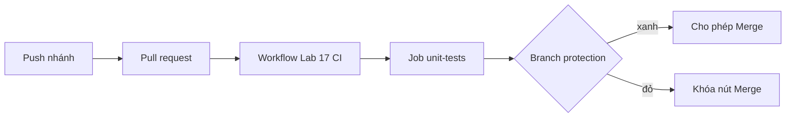

# Buổi 17 – Automated Testing

Tuần 9/16 · Giai đoạn 3 – CI/CD & Automation · Buổi 17/32

[Slide buổi 17](../../slides/04-cicd/session-17.md) · [Bài tập tuần 9](../../assignments/weekly/week-09.md) · [Hub tuần 9](README.md)

> **Tóm tắt:** Viết unit test cho API Club Management bằng node:test, chạy tự động trong GitHub Actions và khóa nút Merge khi CI đỏ. Phần integration test với Postgres là thử thách tùy chọn.

::: tip Buổi này bạn làm gì
**Bạn sẽ tạo ra:** 4 unit test cho API, một workflow GitHub Actions chạy test trên mỗi pull request, và một quy tắc khiến nút Merge bị khóa khi test đỏ.
**Thời gian thật:** đọc 15 phút, lab bắt buộc 60 phút, thử thách tùy chọn làm ở nhà.
**Cần chuẩn bị:**

- [ ] Đã xong [Buổi 16 – GitHub Actions Basics](../week-08/session-16.md) và có repo cá nhân `devops-labs` để **public** (branch protection của gói Free cần repo public).
- [ ] Môi trường theo [Hướng dẫn cài môi trường](../../resources/setup-guide.md), tài khoản và repo theo [Tài khoản GitHub và repo devops-labs](../../resources/setup-github.md); repo giáo trình đã clone ở `~/devops-course` trong WSL.
- [ ] Docker Desktop đang chạy; làm việc trong thư mục WSL (`~/devops-labs`), không dùng `/mnt/c`.

**Sản phẩm phải nộp:**

- `lab-17/` có `README.md`, `evidence/` (output `npm test`), `report.md` và `source/` (có `tests/api.test.js`).
- File `.github/workflows/lab17-ci.yml` ở gốc repo và link một run xanh.
- Ảnh nút Merge bị khóa khi CI đỏ, ảnh sau khi sửa xanh.

**Lộ trình:** [Đọc](#doc) > [Làm lab](#hands-on-lab) > [Gặp lỗi?](#gap-loi) > [Tự kiểm tra](#tu-kiem-tra) > [Nộp bài](#nop-bai). Kẹt giữa chừng? Nhảy tới [Gặp lỗi?](#gap-loi).

**Từ mới trong buổi** (xem [Thuật ngữ](../../resources/glossary.md)):

- Unit test: kiểm tra một đoạn logic nhỏ, thay phần phụ thuộc bằng bản giả.
- Integration test: kiểm tra nhiều thành phần chạy cùng nhau, ví dụ API cộng database thật.
- Mock: bản giả của một hàm để kiểm soát kết quả trả về trong test.
- Runner: máy ảo sạch của GitHub dùng để chạy workflow.
- Artifact: file mà workflow lưu lại để tải về sau khi chạy xong.
- Branch protection: quy tắc của GitHub chặn merge nếu chưa đủ điều kiện.
:::

## Vấn đề thực tế {#doc}

CLB có 5 bạn cùng sửa API quản lý thành viên. Một bạn đổi câu SQL trong `/api/members`, chạy thử trên máy mình thấy ổn rồi merge. Tối đó cả nhóm kéo code về và `docker compose up` báo lỗi 500. Không ai biết thay đổi nào gây ra lỗi, vì không có gì kiểm tra tự động trước khi code vào nhánh chính.

Automated testing giải quyết điều này: mỗi pull request tự động chạy bộ test trên một máy sạch (runner), và nếu test đỏ thì GitHub không cho merge. Test không chứng minh code đúng tuyệt đối, nhưng nó biến câu hỏi "có ai làm hỏng gì không?" thành một tín hiệu xanh/đỏ mà cả nhóm tin được.

## Khái niệm cốt lõi

**Unit test và integration test.** Unit test kiểm tra một đoạn logic nhỏ, thay database bằng bản giả nên chạy trong mili giây. Integration test chạy API cùng PostgreSQL thật nên chậm hơn (vài giây) nhưng bắt được SQL sai hoặc cấu hình kết nối sai. Ví von: unit test như thử từng bóng đèn, integration test như bật cả hệ thống điện. Làm nhiều unit test làm nền, thêm vài integration test cho đường đi quan trọng.

**Mock.** Mock là hàm giả thay cho hàm thật trong lúc test. Trong lab này ta thay `pool.query` (hàm hỏi database) để API "tưởng" database trả lời mà không cần chạy PostgreSQL. Ví von: diễn viên đóng thế thay người thật trong cảnh nguy hiểm. Hạn chế: nếu mock luôn trả dữ liệu đúng thì SQL sai vẫn không bị phát hiện.

**Test report và artifact.** Log trên màn hình chỉ đọc được khi bạn đang nhìn. Report dạng JUnit XML là file có cấu trúc (số test pass/fail, thời gian từng test); workflow upload nó làm artifact để tải về sau, kể cả khi test đỏ.

**Branch protection.** Quy tắc của GitHub: nút Merge bị khóa cho đến khi các check được chọn (theo tên job) có kết quả xanh. CI chạy mà không chặn thì chỉ là thông báo. Ví von: chốt kiểm vé trước cửa, không có vé xanh thì không vào.



Trên lớp, mentor demo trước; tự học thì làm thẳng phần Làm lab.

::: details Tìm hiểu thêm (đọc sau)
`node:test` có sẵn trong Node.js 22 (không cần cài Jest hay Mocha). Một test pass khi hàm kết thúc mà không ném lỗi; `node:assert/strict` cung cấp `assert.equal`, `assert.deepEqual`.

| Thành phần | Công dụng |
| --- | --- |
| `test(name, fn)`, `describe`, `before`, `after`, `beforeEach` | Khai báo, gom nhóm, chuẩn bị và dọn dữ liệu |
| `t.mock.method(obj, "name", impl)` | Thay method bằng bản giả; tự khôi phục khi test kết thúc |
| `node --test` | Tự tìm và chạy các file `*.test.js` |

Bảng so sánh unit và integration test, luồng chạy đầy đủ khi có job `integration-tests` và hai câu hỏi thêm nằm ở [Buổi 17 – Thử thách thêm](session-17-challenge.md#tim-hieu-them).
:::

## Hands-on lab (60 phút, bắt buộc) {#hands-on-lab}

Đề bài: thiết lập test trước khi merge cho API của dự án Club Management. Gồm chuẩn bị 5 phút và 4 phần (L1).

### Chuẩn bị (5 phút)

Kiểm tra môi trường:

```bash
node --version && npm --version && git --version && docker --version
```

Kết quả mong đợi (rút gọn): `v22.x.x`, `10.x.x`, `git version 2.x.x`, `Docker version 27.x.x`. Thiếu lệnh nào thì quay lại [Hướng dẫn cài môi trường](../../resources/setup-guide.md).

Trong repo cá nhân, tạo thư mục nộp bài và chép backend từ starter-project:

::: danger Cẩn thận với rm -rf
Lệnh `rm -rf` xóa vĩnh viễn, không có thùng rác. Ở đây chỉ xóa bản copy `lab-17/source/backend/node_modules` bạn vừa chép. Chạy `pwd` trước để chắc bạn đang ở `~/devops-labs`, và không sửa đường dẫn.
:::

```bash
cd ~/devops-labs
mkdir -p lab-17/source lab-17/evidence lab-17/screenshots
cp -r ~/devops-course/starter-project/backend lab-17/source/backend
cp -r ~/devops-course/starter-project/database lab-17/source/database
rm -rf lab-17/source/backend/node_modules
ls lab-17/source lab-17/source/backend
printf "node_modules/\ntest-results.xml\n.env\n" >> .gitignore
git switch -c add-api-tests
cd lab-17/source/backend && npm ci
```

Kết quả mong đợi: `ls` cho thấy `backend` và `database`; `backend` có `Dockerfile app.js db.js package-lock.json package.json server.js tests`. Vì sao xóa `node_modules`: thư mục này sinh ra bởi `npm ci`, không bao giờ commit.

### Phần 1 – Chạy test có sẵn (3 phút)

```bash
npm test
```

::: tip Kiểm tra: bạn đúng khi
`npm test` in `pass 1`, `fail 0` rồi tự thoát; đây là mốc xanh để giữ nguyên sau mỗi thay đổi. Lỗi `Cannot find package 'express'`: xem [Gặp lỗi?](#gap-loi).
:::

### Phần 2 – Unit test cho `/ready` và `/api/members` (17 phút)

Ý tưởng: `app.js` gọi `pool.query(...)` mỗi khi có request. Vì `pool` là một object dùng chung, ta thay `pool.query` bằng hàm giả để kiểm soát kết quả mà không cần DB.

Tạo file `tests/api.test.js`:

```js
import { test } from "node:test";
import assert from "node:assert/strict";
import { app } from "../app.js";
import { pool } from "../db.js";

let server;
let baseUrl;

test.before(async () => {
  await new Promise((resolve) => {
    server = app.listen(0, "127.0.0.1", resolve);
  });
  baseUrl = `http://127.0.0.1:${server.address().port}`;
});

test.after(async () => {
  await new Promise((resolve) => server.close(resolve));
  await pool.end();
});

test("GET /ready returns 200 when database answers", async (t) => {
  t.mock.method(pool, "query", async () => ({ rows: [{ "?column?": 1 }] }));
  const res = await fetch(`${baseUrl}/ready`);
  assert.equal(res.status, 200);
  assert.deepEqual(await res.json(), { status: "ready" });
});

test("GET /ready returns 503 when database fails", async (t) => {
  t.mock.method(pool, "query", async () => {
    throw new Error("connection refused");
  });
  const res = await fetch(`${baseUrl}/ready`);
  assert.equal(res.status, 503);
  assert.deepEqual(await res.json(), { status: "not-ready" });
});

test("GET /api/members returns rows from the pool", async (t) => {
  const rows = [{ id: 1, name: "Alice", email: "alice@example.com" }];
  t.mock.method(pool, "query", async () => ({ rows }));
  const res = await fetch(`${baseUrl}/api/members`);
  assert.equal(res.status, 200);
  assert.deepEqual(await res.json(), rows);
});

test("GET /api/members returns 500 when query fails", async (t) => {
  t.mock.method(console, "error", () => {});
  t.mock.method(pool, "query", async () => {
    throw new Error("syntax error");
  });
  const res = await fetch(`${baseUrl}/api/members`);
  assert.equal(res.status, 500);
  assert.deepEqual(await res.json(), { message: "Internal server error" });
});
```

Chạy:

```bash
npm test -- --test-reporter=spec
```

Kết quả mong đợi: 5 dòng `✔` (1 test `/health` có sẵn và 4 test mới), rồi `ℹ tests 5`, `ℹ pass 5`, `ℹ fail 0`.

Vì sao dùng `t.mock.method` thay vì `mock.method` toàn cục: mock gắn với test context sẽ tự khôi phục khi test kết thúc, nên test này không làm bẩn test khác. Vì sao mock `console.error`: handler `/api/members` ghi lỗi ra console, ta không muốn log nhiễu làm báo cáo khó đọc. Lưu output vào evidence:

```bash
npm test -- --test-reporter=spec 2>&1 | tee ../../evidence/command-output.txt
```

::: tip Kiểm tra: bạn đúng khi
Có đúng 5 dòng `✔`, `tests 5`, `pass 5`, `fail 0`, và lệnh tự kết thúc. Nếu test treo: bạn thiếu `server.close` hoặc `pool.end()` trong `test.after` (xem [Gặp lỗi?](#gap-loi)).
:::

### Phần 3 – Workflow chạy test và xuất report (15 phút)

Tạo `.github/workflows/lab17-ci.yml` ở gốc repository `devops-labs` (workflow chỉ có hiệu lực khi nằm ở đây, không nằm trong `lab-17/`):

```yaml
name: Lab 17 CI

on:
  push:
    branches: [main]
  pull_request:

permissions:
  contents: read

jobs:
  unit-tests:
    name: unit-tests
    runs-on: ubuntu-latest
    defaults:
      run:
        working-directory: lab-17/source/backend
    steps:
      - uses: actions/checkout@v4
      - uses: actions/setup-node@v4
        with:
          node-version: 22
          cache: npm
          cache-dependency-path: lab-17/source/backend/package-lock.json
      - run: npm ci
      - name: Run unit tests
        run: >
          npm test --
          --test-reporter=spec --test-reporter-destination=stdout
          --test-reporter=junit --test-reporter-destination=test-results.xml
      - name: Upload test report
        if: always()
        uses: actions/upload-artifact@v4
        with:
          name: test-results-unit
          path: lab-17/source/backend/test-results.xml
```

Commit, push nhánh rồi mở pull request từ `add-api-tests` vào `main` trên GitHub:

```bash
cd ~/devops-labs && git add .gitignore lab-17 .github/workflows/lab17-ci.yml
git commit -m "Add API unit tests and CI workflow" && git push -u origin add-api-tests
```

Vào tab Actions, chờ job `unit-tests` xanh, kéo xuống cuối trang run để thấy artifact `test-results-unit`. Vì sao `if: always()`: mặc định step sau một step fail sẽ bị bỏ qua; khi test đỏ, đó chính là lúc cần report nhất.

::: tip Kiểm tra: bạn đúng khi
Tab Actions có run xanh tên "Lab 17 CI", job `unit-tests` có dấu tích, và mục Artifacts có `test-results-unit`. Không thấy workflow chạy: xem [Gặp lỗi?](#gap-loi).
:::

### Phần 4 – Bắt buộc CI pass trước khi merge (20 phút)

1. Merge pull request lần đầu (hoặc push thẳng workflow lên `main`) để workflow tồn tại trên nhánh chính, sau đó tạo một nhánh/PR mới để thử. GitHub chỉ liệt kê check trong ô tìm kiếm của branch protection nếu nó đã chạy trong 7 ngày gần đây.
2. Vào **Settings > Branches**, chọn **Add classic branch protection rule** (hoặc **Settings > Rules > Rulesets** nếu bạn thích giao diện mới; tên nút có thể thay đổi theo giao diện GitHub). Branch name pattern: `main` (đổi thành `master` nếu nhánh mặc định của bạn tên vậy; sửa luôn `branches: [main]` trong workflow).
3. Bật **Require a pull request before merging** và **Require status checks to pass before merging**. Trong ô tìm kiếm, chọn `unit-tests`. Bật thêm **Require branches to be up to date before merging** nếu muốn check chạy trên code đã cập nhật mới nhất.
4. Kiểm chứng (rule cấu hình sai trông giống hệt rule đúng cho đến khi có người merge code hỏng): tạo nhánh `break-test`, sửa một assert cho sai, push, mở pull request. Kết quả mong đợi: check `unit-tests` đỏ, phần Merge hiện "Required statuses must pass before merging" và nút Merge bị khóa. Chụp màn hình lưu vào `screenshots/`. Sau đó sửa lại cho xanh và xác nhận nút Merge mở.

::: tip Kiểm tra: bạn đúng khi
PR đỏ có nút Merge bị khóa kèm dòng "Required statuses must pass before merging", và PR đã sửa xanh thì nút Merge mở. Không thấy check `unit-tests` để chọn, hoặc repo báo không dùng được branch protection: xem [Gặp lỗi?](#gap-loi).
:::

### Hoàn thành L1

- [ ] `tests/api.test.js` có 4 test mới, `npm test` báo `pass 5`, `fail 0`.
- [ ] Workflow `lab17-ci.yml` chạy xanh trên pull request, artifact `test-results-unit` tải về được.
- [ ] Branch protection yêu cầu check `unit-tests` trên nhánh `main`.
- [ ] Có screenshot nút Merge bị khóa khi test đỏ, và screenshot sau khi sửa xanh.
- [ ] Đã lưu output lệnh vào `evidence/command-output.txt`.

Tự kiểm tra một dòng (mong đợi `ℹ pass 5` và `ℹ fail 0`):

```bash
npm test 2>&1 | grep -E "^ℹ (pass|fail)"
```

## Gặp lỗi? {#gap-loi}

Đọc thông báo lỗi ở bước đỏ đầu tiên, tìm triệu chứng giống nhất trong bảng. Lỗi riêng của phần thử thách (Postgres, service container) nằm ở [Buổi 17 – Thử thách thêm](session-17-challenge.md).

| Triệu chứng | Nguyên nhân | Cách sửa |
| --- | --- | --- |
| Không thấy check `unit-tests` trong ô tìm kiếm branch protection | Workflow chưa từng chạy trong 7 ngày gần đây, hoặc không nằm ở `.github/workflows/` | Chạy workflow ít nhất một lần, kiểm tra đường dẫn file |
| Branch protection báo không dùng được cho repo private | Gói Free không hỗ trợ branch protection cho private repository | Đổi repo sang public cho lab (xem [Tài khoản GitHub và repo devops-labs](../../resources/setup-github.md)) |
| Check bắt buộc đứng ở "Expected - Waiting for status" mãi | Workflow có path filter hoặc điều kiện nên không chạy trên PR đó | Bỏ path filter cho workflow có check bắt buộc |
| Push xong mà Actions không chạy gì | File workflow nằm trong `lab-17/`, hoặc nhánh khác `branches` trong `on` | Đưa file về `.github/workflows/` ở gốc repo, sửa tên nhánh |
| Test lỗi lạ hoặc `git diff` hiện toàn dòng thay đổi sau khi chép file | File có line ending CRLF do clone repo bằng Git trên Windows | Clone và làm việc trong WSL; kiểm tra `git config core.autocrlf` |
| `Cannot find package 'express'` | Quên `npm ci` hoặc chạy sai thư mục / `working-directory` | `cd lab-17/source/backend && npm ci`; kiểm tra `working-directory` và `cache-dependency-path` |
| Test treo, process không thoát | Quên `server.close` hoặc `pool.end()` trong `after` | Luôn đóng server và pool trong `after` |
| Artifact không xuất hiện khi test fail | Thiếu `if: always()` ở step upload | Thêm `if: always()` |
| PR có test đỏ mà vẫn merge được | Chưa bật Require status checks, chọn nhầm tên check, rule áp sai nhánh, hoặc admin được bỏ qua rule | Kiểm tra từng mục trong Settings > Branches |

## Tự kiểm tra {#tu-kiem-tra}

1. Vì sao unit test `/ready` với mock pool vẫn chưa đủ để tin rằng API kết nối được DB thật?
   ::: details Đáp án gợi ý
   Mock chỉ kiểm tra logic của handler (200 khi query thành công, 503 khi lỗi). Nó không kiểm tra host, port, mật khẩu, schema hay cú pháp SQL. Cần integration test với DB thật.
   :::
2. Vì sao dùng `if: always()` cho step upload report?
   ::: details Đáp án gợi ý
   Step mặc định bị bỏ qua khi step trước fail. Report quan trọng nhất khi test fail, nên step upload phải chạy bất kể kết quả.
   :::
3. Bạn đã bật CI nhưng PR có test đỏ vẫn merge được. Liệt kê các nguyên nhân có thể.
   ::: details Đáp án gợi ý
   Chưa bật Require status checks, chưa chọn đúng tên check, rule áp dụng sai nhánh, hoặc người có quyền admin được phép bỏ qua rule. Kiểm tra từng mục trong Settings > Branches.
   :::

## Nộp bài {#nop-bai}

Nộp vào `lab-17/` trong repository cá nhân theo [mẫu lab](../../templates/lab-template.md) và đối chiếu [Bài tập tuần 9](../../assignments/weekly/week-09.md):

- [ ] `README.md` trả lời đủ 7 câu của template (vấn đề, kiến thức, các bước, kết quả mong đợi, lỗi đã gặp, cách khắc phục, cải thiện) và ghi rõ level đã làm (L1/L2).
- [ ] `source/` chứa `backend/` (có `tests/api.test.js`) và `database/init.sql`; không có `node_modules`.
- [ ] `.github/workflows/lab17-ci.yml` ở gốc repository (ghi đường dẫn trong README) và link tới một workflow run xanh.
- [ ] `evidence/test-results.txt` chứa kết quả `npm test` và `evidence/command-output.txt` chứa output `npm test -- --test-reporter=spec` cùng output `git log --oneline -5`.
- [ ] `screenshots/` có ảnh nút Merge bị khóa khi CI đỏ, ảnh sau khi xanh, và ảnh danh sách required checks.
- [ ] `report.md` mô tả một lỗi bạn thực sự gặp (hoặc tình huống trong thử thách), cách điều tra từng bước, nguyên nhân gốc, cách phòng tránh.
- [ ] Không commit secret: không có token hay `.env` thật.

## Recap

- Unit test nhanh, ổn định nhưng dùng mock; integration test chậm hơn nhưng bắt được lỗi SQL, schema và kết nối.
- Workflow chạy `npm test` trên mỗi PR, upload report với `if: always()`, và branch protection biến CI thành cổng chặn merge.
- Luôn kiểm chứng rule bằng một PR cố ý đỏ; mỗi test phải tự dựng dữ liệu của mình.

Buổi tiếp theo: [Buổi 18 – Docker CI Pipeline](session-18.md).

::: details Thử thách thêm (L2, tùy chọn, làm ở nhà)
Trang riêng: [Buổi 17 – Thử thách thêm](session-17-challenge.md). Gồm integration test với PostgreSQL thật, service container trong Actions, ba thử thách tự làm có gợi ý từng bậc. Cần xong L1 trước. Đối chiếu đáp án sau khi nộp bài: [trang tuần 9](README.md).
:::

::: details Phá lỗi nâng cao
Hai tình huống luyện đọc lỗi (test phụ thuộc thứ tự, job không kết nối được service container): [Buổi 17 – Thử thách thêm](session-17-challenge.md#pha-loi-nang-cao).
:::

::: details Tài liệu tham khảo
- [Node.js test runner](https://nodejs.org/docs/latest-v22.x/api/test.html)
- [GitHub Docs: Managing a branch protection rule](https://docs.github.com/en/repositories/configuring-branches-and-merges-in-your-repository/managing-protected-branches/managing-a-branch-protection-rule)
- [actions/upload-artifact](https://github.com/actions/upload-artifact)
- Thêm tài liệu về service container và job summary: [Buổi 17 – Thử thách thêm](session-17-challenge.md#tai-lieu)
:::
