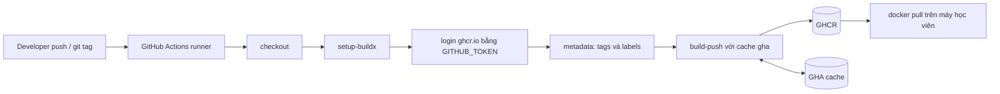

# Buổi 18 – Docker CI Pipeline

Tuần 9 · Giai đoạn 3 – CI/CD & Automation · Slide: [Slide buổi 18](../../slides/04-cicd/session-18.md)

> **Tóm tắt:** Dùng GitHub Actions với Buildx để tự động build image club-api và club-web, gắn tag theo SHA và git tag, bật cache và publish lên GHCR bằng GITHUB_TOKEN.

## Mục tiêu học tập

- Giải thích được image tag, digest và registry khác nhau thế nào, và vì sao không nên tag `latest` cho bản phát hành.
- Viết được workflow build và push image lên GHCR bằng `docker/login-action`, `docker/metadata-action` và `docker/build-push-action`.
- Giải thích được vai trò của `GITHUB_TOKEN` và quyền `packages: write` theo nguyên tắc least privilege.
- Cấu hình được cache `type=gha` và đo được lợi ích của cache qua thời gian build.
- Chạy được image vừa publish từ máy cá nhân (`docker pull`, `docker run`) và kiểm tra `/health`.
- Chẩn đoán được hai lỗi điển hình: thiếu quyền `packages: write` và package private nên pull bị từ chối.

## Điều kiện cần

- Đã hoàn thành buổi 16 (GitHub Actions cơ bản) và buổi 17 (test tự động), biết đọc một workflow YAML gồm `on`, `jobs`, `steps`.
- Đã viết được Dockerfile cho `starter-project/backend` và `starter-project/frontend` (tuần 3-4).
- Có tài khoản GitHub và một repo cá nhân (ví dụ `devops-labs`) để thực hành. Repo có thể public hoặc private.
- Docker Desktop đang chạy, làm việc trong WSL2 Ubuntu (thư mục dưới `~`, không dùng `/mnt/c`).

Kiểm tra nhanh:

```bash
docker version --format '{{.Server.Version}}'
docker buildx version
git --version
```

Kết quả mong đợi: Docker Engine 27 trở lên, `buildx` hiển thị phiên bản, `git` hiển thị phiên bản. Nếu `docker buildx version` báo lỗi, cập nhật Docker Desktop.

## Vấn đề thực tế

Một thành viên CLB build image `club-api` trên laptop, gõ `docker push` rồi báo "mình đã đẩy bản mới". Tuần sau ban chủ nhiệm hỏi: bản đang chạy được build từ commit nào, ai build, test có chạy chưa? Không ai trả lời được, vì image build tay không để lại dấu vết. Thêm nữa, laptop của từng người dùng Node, cache và biến môi trường khác nhau nên cùng một commit có thể cho ra hai image khác nhau.

Pipeline Docker CI giải quyết việc này: mỗi lần merge vào nhánh chính, một runner sạch trên GitHub build image từ đúng commit đó, gắn tag truy vết được về commit (SHA), rồi đẩy lên registry. Từ đó, bước deploy (buổi 19) chỉ cần nói "chạy image có tag này" thay vì "chạy bản mới nhất trên máy bạn Nam".

## Khái niệm cốt lõi

### Image, tag, digest, registry

| Khái niệm | Ý nghĩa | Ví dụ |
| --- | --- | --- |
| Registry | Nơi lưu trữ image | `ghcr.io`, Docker Hub |
| Repository | Tập hợp các phiên bản của một image | `ghcr.io/ten-ban/club-api` |
| Tag | Nhãn có thể trỏ lại sang image khác (mutable) | `v1.0.0`, `sha-3f2a1bc` |
| Digest | Mã băm nội dung, không đổi (immutable) | `sha256:` kèm chuỗi hex |

Tag chỉ là con trỏ: `latest` hôm nay và `latest` tuần sau có thể là hai image khác nhau. Digest mới là định danh tuyệt đối. Vì vậy chiến lược tag thường kết hợp:

| Loại tag | Khi nào tạo | Mục đích |
| --- | --- | --- |
| `sha-xxxxxxx` | Mọi lần push vào nhánh chính | Truy vết image về đúng commit |
| `v1.2.0` | Khi đẩy git tag `v1.2.0` | Bản phát hành có tên cho con người |
| `latest` hoặc tên nhánh | Tùy chọn | Tiện cho thử nghiệm, không dùng để deploy |

### GHCR là gì

GHCR (GitHub Container Registry, `ghcr.io`) là registry tích hợp với GitHub. Ưu điểm cho CLB: miễn phí cho package public, xác thực bằng chính `GITHUB_TOKEN` của workflow nên không cần tạo secret thủ công. Tên image phải viết thường (lowercase). Package có thể public hoặc private; package mới tạo từ workflow thường mặc định private, nên người khác pull sẽ bị từ chối cho tới khi bạn đổi visibility.

### GITHUB_TOKEN và permissions

`GITHUB_TOKEN` là token tạm do GitHub cấp cho mỗi lần chạy workflow, hết hạn khi job kết thúc. Quyền của nó được điều khiển bằng khóa `permissions`. Để push image cần `packages: write`; để checkout code cần `contents: read`. Nguyên tắc least privilege: đặt quyền tối thiểu ở cấp workflow (`contents: read`) và chỉ nâng quyền ở job thực sự cần.

### Buildx, BuildKit và cache

Buildx là giao diện CLI của BuildKit, bộ máy build hiện đại của Docker. Trong CI, `docker/setup-buildx-action` cài đặt builder để dùng được các tính năng như cache export. Runner GitHub là máy mới cho mỗi lần chạy nên cache layer cục bộ bị mất; ta lưu cache ở dịch vụ cache của GitHub Actions bằng `cache-from: type=gha` và `cache-to: type=gha,mode=max` (`mode=max` lưu cả layer trung gian của multi-stage build, như stage `dependencies` trong Dockerfile của club-api).

### Ba action Docker chính thức

| Action | Việc làm |
| --- | --- |
| `docker/login-action@v3` | Đăng nhập registry |
| `docker/metadata-action@v5` | Sinh danh sách tag và label từ ngữ cảnh Git |
| `docker/build-push-action@v6` | Build (và push) image bằng Buildx |

`metadata-action` đặc biệt hữu ích: bạn khai báo quy tắc (`type=sha`, `type=ref,event=tag`) và nó tự tính ra tag. Nó cũng sinh label OCI như `org.opencontainers.image.source` để GHCR liên kết package với repo.

## Kiến trúc và cách hoạt động



Giải thích từng bước:

1. Sự kiện `push` lên nhánh chính hoặc `push` một tag `v*` kích hoạt workflow.
2. Runner `ubuntu-latest` checkout code đúng commit đó.
3. `setup-buildx-action` chuẩn bị builder.
4. `login-action` đăng nhập `ghcr.io` bằng `github.actor` và `GITHUB_TOKEN`. Token chỉ có quyền ghi package nhờ khối `permissions`.
5. `metadata-action` đọc ngữ cảnh (SHA, tag) và xuất `tags` và `labels`.
6. `build-push-action` build từ `context`, đọc cache từ GHA cache, push các tag lên GHCR và ghi cache mới.
7. Học viên pull image về, chạy thử, so sánh digest.

Workflow mẫu của giáo trình nằm ở `.github/workflows/publish.yml` (matrix 2 image) và một phiên bản có chú thích ở `examples/github-actions/docker-publish.yml`. Hãy mở cả hai để đối chiếu khi làm lab.

## Demo của mentor

Mục tiêu: cho lớp thấy một lần push tạo ra image truy vết được. Thời lượng khoảng 15 phút trong phần 30 phút kiến thức.

1. Mở `.github/workflows/publish.yml`, đọc to các khối `permissions`, `login-action`, `metadata-action`. Hỏi lớp: "Nếu xóa dòng `packages: write` thì bước nào sẽ fail?"
2. Tạo một commit nhỏ (sửa chữ trong `starter-project/frontend/index.html`) và push:

   ```bash
   git commit -am "demo: doi tieu de trang chu"
   git push origin main
   ```

3. Mở tab Actions, chỉ vào hai job matrix `club-api` và `club-web` chạy song song. Mở log bước `Build and push`, chỉ ra dòng nói về cache (lần đầu là cache miss).
4. Mở trang Packages của repo/tài khoản, chỉ ra tag `sha-xxxxxxx` khớp với 7 ký tự đầu của commit.
5. Pull và chạy image trên máy mentor:

   ```bash
   docker pull ghcr.io/OWNER/club-api:sha-3f2a1bc
   docker run --rm -d --name demo-api -p 3100:3000 ghcr.io/OWNER/club-api:sha-3f2a1bc
   sleep 2
   curl -s http://localhost:3100/health
   docker rm -f demo-api
   ```

   Thay `OWNER` bằng tên tài khoản viết thường và tag bằng tag thật. Kết quả mong đợi của `curl`:

   ```json
   {"status":"healthy","service":"club-api"}
   ```

6. Push lần hai (đổi một dòng trong `app.js`), cho lớp so sánh thời gian build: lần hai nhanh hơn vì layer `npm ci` được lấy từ cache.

Câu hỏi cho lớp:

- Hai lần push cho ra hai tag khác nhau, vậy tag nào là "mới nhất"? Dựa vào đâu để biết?
- Nếu ai đó force-push làm đổi nội dung của tag `v1.0.0`, điều gì xảy ra với các máy đã pull trước đó? (Gợi ý: tag là mutable, digest thì không.)
- Vì sao runner không cần mật khẩu của bạn mà vẫn push được?

## Hands-on lab

Thời gian: 60 phút. Phần 1-4 thuộc L1 (khoảng 40 phút), L2 làm tiếp trong phần còn lại hoặc về nhà.

### Chuẩn bị

Giả sử repo cá nhân là `devops-labs` và tài khoản GitHub của bạn là `OWNER` (viết thường khi dùng trong tên image).

```bash
cd ~
git clone https://github.com/OWNER/devops-labs.git   # bỏ qua nếu đã clone
cd devops-labs
mkdir -p lab-18/source lab-18/evidence lab-18/screenshots
cp -r ~/devops-course/starter-project/backend  lab-18/source/backend
cp -r ~/devops-course/starter-project/frontend lab-18/source/frontend
rm -rf lab-18/source/backend/node_modules
ls lab-18/source
```

Lệnh giả định bạn đã clone repo giáo trình ở `~/devops-course` (trong filesystem WSL); nếu để chỗ khác, sửa đường dẫn cho khớp. Kết quả mong đợi:

```text
backend  frontend
```

Vì sao xóa `node_modules`: image tự cài dependency bằng `npm ci` trong Dockerfile, copy thư mục này chỉ làm repo nặng và dễ lẫn phiên bản. Kiểm tra build tay trước khi lên CI:

```bash
docker build -t club-api:1.0.0 lab-18/source/backend
docker build -t club-web:1.0.0 lab-18/source/frontend
docker images | grep club-
```

Kết quả mong đợi: hai dòng `club-api` và `club-web` với tag `1.0.0`. Nếu build tay đã lỗi thì CI chắc chắn lỗi; sửa ở đây trước.

### Phần 1 – Viết workflow publish club-api (L1)

Bước 1. Tạo file `.github/workflows/publish.yml` ở gốc repo `devops-labs` (workflow phải nằm ở gốc repo, không nằm trong `lab-18/`):

```bash
mkdir -p .github/workflows
```

Bước 2. Nội dung workflow, lúc này chỉ publish `club-api` và gắn tag theo SHA:

```yaml
name: Publish club-api

on:
  push:
    branches: [main]

permissions:
  contents: read

jobs:
  publish:
    runs-on: ubuntu-latest
    permissions:
      contents: read
      packages: write
    steps:
      - uses: actions/checkout@v4

      - uses: docker/setup-buildx-action@v3

      - uses: docker/login-action@v3
        with:
          registry: ghcr.io
          username: ${{ github.actor }}
          password: ${{ secrets.GITHUB_TOKEN }}

      - id: meta
        uses: docker/metadata-action@v5
        with:
          images: ghcr.io/${{ github.repository_owner }}/club-api
          tags: |
            type=sha

      - uses: docker/build-push-action@v6
        with:
          context: lab-18/source/backend
          push: true
          tags: ${{ steps.meta.outputs.tags }}
          labels: ${{ steps.meta.outputs.labels }}
```

Vì sao như vậy: `permissions` cấp workflow chỉ cho đọc; riêng job `publish` được nâng lên `packages: write`. Không dùng secret tự tạo vì `GITHUB_TOKEN` đã đủ. Nếu nhánh chính của bạn tên `master`, đổi `main` thành `master`.

### Phần 2 – Chạy pipeline và đọc log (L1)

Bước 1. Commit và push:

```bash
git add .github lab-18
git commit -m "lab-18: workflow publish club-api len GHCR"
git push origin main
```

Bước 2. Mở tab Actions của repo, chọn run mới nhất, mở job `publish`. Kết quả mong đợi: tất cả bước có dấu tích xanh. Trong bước `Build and push` có log kiểu `pushing manifest for ghcr.io/owner/club-api:sha-xxxxxxx`.

Bước 3. Lưu bằng chứng: chép các dòng quan trọng của log (tên workflow, bước push, tag) vào `lab-18/evidence/command-output.txt`.

Nếu run đỏ, đọc log bước lỗi đầu tiên (bước đỏ đầu tiên, không phải bước cuối) rồi xem mục "Phá lỗi và debug".

### Phần 3 – Kiểm tra package trên GHCR (L1)

Bước 1. Mở trang repo, cột bên phải mục Packages, chọn `club-api`. Ghi lại tag `sha-xxxxxxx` và so với 7 ký tự đầu của commit:

```bash
git rev-parse --short=7 HEAD
```

Kết quả mong đợi: chuỗi 7 ký tự trùng phần sau `sha-`.

Bước 2. Mở **Package settings** của `club-api` (nút ở cột bên phải trang package), tìm mục đổi visibility (phần Danger Zone). Với repo cá nhân, package mới thường là private. Để máy khác pull không cần đăng nhập, đổi sang Public (chỉ làm khi image không chứa bí mật; image của lab này không có).

### Phần 4 – Pull và chạy image đã publish (L1)

Bước 1. Xóa image local để chắc chắn bạn pull từ registry:

```bash
docker rmi club-api:1.0.0
docker pull ghcr.io/OWNER/club-api:sha-3f2a1bc
```

Kết quả mong đợi: Docker tải các layer rồi in `Status: Downloaded newer image for ghcr.io/owner/club-api:sha-3f2a1bc`. Nếu báo `denied` hoặc `unauthorized`, xem mục Lỗi thường gặp.

Bước 2. Chạy và kiểm tra (lệnh `docker inspect` chỉ có kết quả khi image được lấy bằng `docker pull` từ registry):

```bash
docker run --rm -d --name lab18-api -p 3100:3000 ghcr.io/OWNER/club-api:sha-3f2a1bc
sleep 2
curl -s http://localhost:3100/health
docker inspect --format '{{index .RepoDigests 0}}' ghcr.io/OWNER/club-api:sha-3f2a1bc
docker rm -f lab18-api
```

Kết quả mong đợi: `curl` trả về `{"status":"healthy","service":"club-api"}`; `docker inspect` in tên image kèm `@sha256:` và chuỗi digest. Ghi digest vào evidence. Chọn cổng 3100 để không đụng cổng 3000 của stack khác đang chạy trên máy.

Vì sao `/health` chạy được mà không cần database: endpoint này chỉ trả JSON, không truy vấn DB (khác với `/ready`).

### L1 – Foundation: checklist hoàn thành

- [ ] Workflow `.github/workflows/publish.yml` có `permissions` với `packages: write` ở cấp job.
- [ ] Run trên tab Actions thành công, có tag `sha-xxxxxxx` trên GHCR.
- [ ] Tag `sha-` khớp 7 ký tự đầu của commit.
- [ ] Pull được image từ `ghcr.io` và `curl /health` trả về `healthy`.
- [ ] Ghi được digest của image vào `evidence/command-output.txt`.

### L2 – Engineering: thử thách tự làm

Yêu cầu, làm lần lượt:

1. Publish thêm `club-web` bằng matrix (một job, hai image) giống `.github/workflows/publish.yml` của giáo trình, nhưng bạn phải tự giải thích từng dòng.
2. Thêm tag theo git tag `v*`: khi đẩy tag `v1.0.0` phải có image `club-api:v1.0.0` và `club-web:v1.0.0`.
3. Bật cache `type=gha`. Chạy hai lần liên tiếp (lần hai chỉ đổi một dòng code) và ghi lại thời gian build của hai lần.
4. Với pull request: workflow vẫn build để kiểm tra nhưng không push.
5. Giải thích bằng văn bản (trong `report.md`): vì sao `GITHUB_TOKEN` an toàn hơn Personal Access Token lưu trong secret? Vì sao `packages: write` đặt ở cấp job?

Tiêu chí hoàn thành:

- [ ] Sau khi đẩy tag `v1.0.0`, GHCR có đủ 2 image, mỗi image có tag `v1.0.0` và một tag `sha-`.
- [ ] Log lần chạy thứ hai cho thấy layer được lấy từ cache (dòng có `CACHED` hoặc import cache) và thời gian ngắn hơn lần đầu.
- [ ] PR chỉ build, không tạo package mới.
- [ ] `report.md` có số liệu thời gian trước/sau cache và trả lời câu 5.

<details>
<summary>Gợi ý</summary>

- Matrix: dùng `strategy.matrix.include` với hai phần tử có `name` và `context`; dùng `${{ matrix.name }}` trong `images` của `metadata-action` và `${{ matrix.context }}` trong `context`.
- Tag theo git tag: thêm `tags: ["v*"]` vào `on.push` và dòng `type=ref,event=tag` vào `tags` của `metadata-action`.
- Cache: hai dòng `cache-from: type=gha` và `cache-to: type=gha,mode=max` trong `build-push-action` (với matrix, thêm `scope` riêng cho từng image). Đã có `setup-buildx-action` thì đủ điều kiện.
- Không push trên PR: dùng biểu thức điều kiện cho `push`, và bỏ qua `login-action` bằng `if: github.event_name != 'pull_request'`. Nhớ thêm `pull_request` vào `on`.
- Đẩy git tag: `git tag v1.0.0` rồi `git push origin v1.0.0`.

</details>

<details>
<summary>Lời giải tham khảo</summary>

```yaml
name: Publish images

on:
  push:
    branches: [main]
    tags: ["v*"]
  pull_request:

permissions:
  contents: read

jobs:
  publish:
    runs-on: ubuntu-latest
    permissions:
      contents: read
      packages: write
    strategy:
      matrix:
        include:
          - name: club-api
            context: lab-18/source/backend
          - name: club-web
            context: lab-18/source/frontend
    steps:
      - uses: actions/checkout@v4

      - uses: docker/setup-buildx-action@v3

      - uses: docker/login-action@v3
        if: github.event_name != 'pull_request'
        with:
          registry: ghcr.io
          username: ${{ github.actor }}
          password: ${{ secrets.GITHUB_TOKEN }}

      - id: meta
        uses: docker/metadata-action@v5
        with:
          images: ghcr.io/${{ github.repository_owner }}/${{ matrix.name }}
          tags: |
            type=sha
            type=ref,event=tag

      - uses: docker/build-push-action@v6
        with:
          context: ${{ matrix.context }}
          push: ${{ github.event_name != 'pull_request' }}
          tags: ${{ steps.meta.outputs.tags }}
          labels: ${{ steps.meta.outputs.labels }}
          cache-from: type=gha,scope=${{ matrix.name }}
          cache-to: type=gha,scope=${{ matrix.name }},mode=max
```

Giải thích: trên sự kiện `pull_request`, GITHUB_TOKEN của PR từ fork không có quyền ghi nên không push và không login; build vẫn chạy để bắt lỗi Dockerfile sớm. Cache `mode=max` lưu cả stage `dependencies` nên lần sau bỏ qua `npm ci` nếu `package-lock.json` không đổi. Mỗi image có `scope` cache riêng; nếu bỏ `scope`, hai job matrix dùng chung scope mặc định và có thể ghi đè cache của nhau.

</details>

## Phá lỗi và debug

### Tình huống A – Thiếu quyền packages: write

Cách phá: xóa (hoặc đổi thành `read`) dòng `packages: write` trong job `publish`, commit, push.

Triệu chứng: run đỏ ở bước `Build and push`, log có dòng kiểu `denied: installation not allowed to Create organization package` hoặc `permission_denied: write_package` hoặc `403 Forbidden`. Bước `login` vẫn xanh vì đăng nhập chỉ xác thực danh tính, chưa kiểm tra quyền ghi.

Hướng điều tra:

1. Tìm bước đỏ đầu tiên, đọc dòng lỗi cuối cùng của bước đó.
2. Thấy `denied` hoặc `403` khi push: nghi ngờ quyền token, không phải Dockerfile (vì bước build đã chạy xong).
3. Mở tab Actions, run lỗi, mục Set up job, phần `GITHUB_TOKEN Permissions` để xem token thực sự có quyền gì.
4. Kiểm tra khối `permissions` ở cả cấp workflow và cấp job; khai báo ở cấp job ghi đè cấp workflow.
5. Với repo thuộc tổ chức, kiểm tra thêm Settings, Actions, General, Workflow permissions.

Nguyên nhân gốc: token không có quyền `packages: write`, hoặc package đã tồn tại và được gán cho repo khác nên repo này không được ghi.

Cách phòng tránh: luôn khai báo `permissions` tường minh; dùng một workflow mẫu đã chạy tốt; đọc mục `GITHUB_TOKEN Permissions` khi lỗi quyền.

### Tình huống B – Pull bị từ chối do package private

Cách phá: để package ở chế độ private, đăng xuất rồi pull:

```bash
docker logout ghcr.io
docker pull ghcr.io/OWNER/club-api:sha-3f2a1bc
```

Triệu chứng: `Error response from daemon: denied` hoặc `unauthorized` (có thể giống lỗi khi gõ sai tên image).

Hướng điều tra: (1) kiểm tra tên image có viết thường và đúng tag không; (2) mở trang package xem visibility; (3) nếu private, đăng nhập bằng PAT có quyền `read:packages` hoặc đổi sang public.

Nguyên nhân gốc: package private chỉ cho người có quyền pull sau khi xác thực.

Cách phòng tránh: quyết định visibility có chủ đích; không bao giờ dán PAT vào lệnh hay commit. Đăng nhập bằng PAT classic có quyền `read:packages` (GHCR chưa hỗ trợ fine-grained PAT cho việc này), đưa token qua stdin từ biến môi trường để không nằm trong lịch sử lệnh:

```bash
read -rs GHCR_TOKEN && export GHCR_TOKEN
echo "$GHCR_TOKEN" | docker login ghcr.io -u OWNER --password-stdin
```

Liên quan tới buổi này còn có kịch bản `examples/troubleshooting/scenario-06` (GitHub Actions fail) và `scenario-07` (ImagePullBackOff) để luyện thêm.

## Lỗi thường gặp

| Triệu chứng | Nguyên nhân | Cách xử lý |
| --- | --- | --- |
| `denied` hoặc `403` khi push | Thiếu `permissions: packages: write` | Thêm quyền ở cấp job, chạy lại |
| `invalid reference format` | Tên image có chữ hoa (ví dụ tên tài khoản có chữ hoa) khi tự ghép tag | Dùng `metadata-action` hoặc chuyển tên về chữ thường |
| `docker pull` báo `denied`/`unauthorized` | Package private hoặc gõ sai tên | Đổi visibility sang Public hoặc `docker login ghcr.io` với PAT `read:packages` |
| Không thấy tag `v1.0.0` | Workflow thiếu `tags: ["v*"]` ở `on.push` hoặc thiếu `type=ref,event=tag` | Bổ sung cả hai, đẩy lại git tag |
| Mỗi lần build đều chậm, không có cache | Thiếu `setup-buildx-action` hoặc thiếu `cache-from`/`cache-to` | Thêm Buildx và hai dòng cache `type=gha` |
| `failed to read dockerfile` / `no such file` | `context` sai đường dẫn | Kiểm tra `context` trỏ tới thư mục chứa Dockerfile |
| Workflow không chạy khi push | File không nằm ở `.github/workflows/` ở gốc repo, hoặc nhánh khác `on.push.branches` | Đưa file về đúng chỗ, sửa tên nhánh |
| Cache của club-api và club-web ghi đè nhau | Dùng chung scope cache | Thêm `scope` riêng cho mỗi image |

## Tự kiểm tra

1. Khác nhau giữa tag và digest là gì? Khi deploy production nên tham chiếu cái nào để tái lập chính xác?

   <details>
   <summary>Đáp án</summary>

   Tag là nhãn có thể trỏ sang image khác; digest là mã băm nội dung, bất biến. Để tái lập chính xác nên dùng digest (hoặc tag SHA không bao giờ bị ghi đè). Tag `latest` không phù hợp.

   </details>

2. Vì sao cần `docker/login-action` trước `build-push-action` khi `push: true`?

   <details>
   <summary>Đáp án</summary>

   Registry chỉ nhận push từ danh tính đã xác thực. Login lưu thông tin xác thực để Buildx push lên `ghcr.io`.

   </details>

3. `GITHUB_TOKEN` khác Personal Access Token ở điểm nào? Vì sao ưu tiên dùng nó trong CI?

   <details>
   <summary>Đáp án</summary>

   Token tự cấp theo từng lần chạy, hết hạn khi job xong, quyền giới hạn qua `permissions`, không cần lưu secret dài hạn. PAT gắn với người dùng, sống lâu, nếu lộ thì hậu quả lớn.

   </details>

4. `cache-to: type=gha,mode=max` khác `mode=min` thế nào, và vì sao chọn `max` cho Dockerfile multi-stage?

   <details>
   <summary>Đáp án</summary>

   `min` chỉ lưu layer của stage cuối; `max` lưu cả layer của các stage trung gian. Stage `dependencies` (chạy `npm ci`) là phần tốn thời gian nhất nên cần được cache.

   </details>

5. Tình huống: workflow xanh ở bước login nhưng đỏ ở bước push với lỗi `denied`. Bạn kiểm tra gì đầu tiên?

   <details>
   <summary>Đáp án</summary>

   Quyền của token: xem khối `permissions` (cấp job và cấp workflow) và mục `GITHUB_TOKEN Permissions` trong log Set up job. Login thành công không đảm bảo có quyền ghi.

   </details>

6. Tình huống: đồng đội pull image bị `unauthorized` dù image tồn tại. Hai nguyên nhân có thể và cách xác minh?

   <details>
   <summary>Đáp án</summary>

   Package đang private (kiểm tra visibility trên trang package) hoặc tên image/tag sai (kiểm tra danh sách tag, chữ thường). Xử lý: đổi Public hoặc đăng nhập bằng PAT `read:packages`.

   </details>

7. Vì sao nên có tag theo SHA ngay cả khi đã có tag `v1.0.0`?

   <details>
   <summary>Đáp án</summary>

   Tag SHA cho phép truy vết image về đúng commit, kể cả các build không phải bản phát hành; tag phiên bản chỉ có khi ta chủ động phát hành.

   </details>

## Nộp bài

Nộp vào `lab-18/` trong repo cá nhân theo `templates/lab-template.md`:

- [ ] `README.md` trả lời đủ 7 câu của mẫu (vấn đề, kiến thức, các bước, kết quả mong đợi, lỗi đã gặp, cách khắc phục, cải thiện) và đánh dấu level đã làm (L1, L2).
- [ ] `source/` chứa `backend/` và `frontend/` (không có `node_modules`); file workflow có thể chép thêm vào `source/publish.yml` để chấm, bản thật nằm ở `.github/workflows/`.
- [ ] `evidence/command-output.txt` gồm: log bước push, tag trên GHCR, kết quả `docker pull`, `curl /health`, digest.
- [ ] `screenshots/` có ảnh tab Actions xanh và trang package (ảnh chỉ để minh họa, không thay thế log).
- [ ] `report.md` ghi thời gian build trước/sau cache (nếu làm L2), mô tả một lỗi bạn đã gặp hoặc cố tình phá và cách bạn tìm ra nguyên nhân.
- [ ] Không commit token, PAT, mật khẩu hay file `.env`. Kiểm tra bằng `git diff --cached` trước khi commit.

## Recap

- Image build trong CI từ commit sạch thì truy vết và tái lập được; build tay trên laptop thì không.
- Tag là con trỏ thay đổi được, digest là định danh bất biến; luôn có tag SHA cho mọi build.
- Pipeline chuẩn: checkout, setup-buildx, login, metadata, build-push.
- `GITHUB_TOKEN` cùng `permissions` theo least privilege: `contents: read` toàn cục, `packages: write` chỉ ở job publish.
- Cache `type=gha` với `mode=max` rút ngắn đáng kể thời gian build của Dockerfile multi-stage.
- Lỗi `denied`: kiểm tra quyền token trước; lỗi pull `unauthorized`: kiểm tra visibility và tên image.

## Tài liệu tham khảo

- [Working with the Container registry (GitHub Docs)](https://docs.github.com/en/packages/working-with-a-github-packages-registry/working-with-the-container-registry)
- [Publishing Docker images (GitHub Docs)](https://docs.github.com/en/actions/use-cases-and-examples/publishing-packages/publishing-docker-images)
- [Docker Build GitHub Actions](https://docs.docker.com/build/ci/github-actions/)
- [GitHub Actions cache backend (Docker Docs)](https://docs.docker.com/build/cache/backends/gha/)
- [docker/metadata-action](https://github.com/docker/metadata-action)
- [Automatic token authentication (GitHub Docs)](https://docs.github.com/en/actions/security-for-github-actions/security-guides/automatic-token-authentication)
