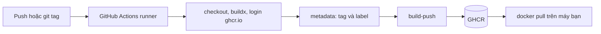

# Buổi 18 – Docker CI Pipeline

Tuần 9/16 · Giai đoạn 3 – CI/CD & Automation · Buổi 18/32

[Slide buổi 18](../../slides/04-cicd/session-18.md) · [Bài tập tuần 9](../../assignments/weekly/week-09.md) · [Hub tuần 9](README.md)

> **Tóm tắt:** Dùng GitHub Actions với Buildx để tự động build image club-api, gắn tag theo SHA và đẩy lên GHCR bằng GITHUB_TOKEN. Matrix hai image, git tag và cache là thử thách tùy chọn.

::: tip Buổi này bạn làm gì
**Bạn sẽ tạo ra:** một workflow tự build image `club-api` mỗi lần push, đẩy lên GHCR với tag `sha-xxxxxxx`, rồi bạn pull image đó về máy và chạy thử.
**Thời gian thật:** đọc 15 phút, lab bắt buộc 60 phút, thử thách tùy chọn làm ở nhà.

**Cần chuẩn bị:**

- [ ] Đã xong [Buổi 17 – Automated Testing](session-17.md) và biết đọc một workflow YAML (`on`, `jobs`, `steps`).
- [ ] Docker Desktop đang chạy; môi trường theo [Hướng dẫn cài môi trường](../../resources/setup-guide.md); repo giáo trình ở `~/devops-course`.
- [ ] Repo cá nhân `devops-labs` để **PUBLIC** (xem [Tài khoản GitHub và repo devops-labs](../../resources/setup-github.md)); GHCR miễn phí cho package public.

**Sản phẩm phải nộp:**

- `lab-18/` có `README.md`, `source/` (backend, frontend), `evidence/command-output.txt`, `report.md`.
- File `.github/workflows/publish.yml` ở gốc repo, và một run xanh trên tab Actions.
- Trong evidence: dòng push manifest, tag `sha-` khớp commit, kết quả `docker pull`, `curl /health`, digest.

**Báo trước hai điều hay làm kẹt:** workflow cần quyền `packages: write` ở cấp job, và package mới tạo thường mặc định private nên bạn phải đổi sang Public (Phần 3) trước khi pull.

**Lộ trình:** [Đọc](#doc) > [Làm lab](#hands-on-lab) > [Gặp lỗi?](#gap-loi) > [Tự kiểm tra](#tu-kiem-tra) > [Nộp bài](#nop-bai). Kẹt giữa chừng? Nhảy tới [Gặp lỗi?](#gap-loi).

**Từ mới trong buổi** (xem [Thuật ngữ](../../resources/glossary.md)):

- Registry: kho lưu image, ví dụ `ghcr.io`.
- Tag: nhãn gắn vào image, có thể bị đổi sang image khác.
- Digest: mã băm nội dung image, không bao giờ đổi.
- GHCR: kho image của GitHub (GitHub Container Registry).
- `GITHUB_TOKEN`: chìa khóa tạm GitHub cấp cho mỗi lần chạy workflow.
- Buildx: công cụ build image hiện đại của Docker, hỗ trợ cache.
:::

## Vấn đề thực tế {#doc}

Một thành viên CLB build image `club-api` trên laptop, gõ `docker push` rồi báo "mình đã đẩy bản mới". Tuần sau ban chủ nhiệm hỏi: bản đang chạy được build từ commit nào, ai build, test có chạy chưa? Không ai trả lời được, vì image build tay không để lại dấu vết. Thêm nữa, laptop của từng người dùng Node, cache và biến môi trường khác nhau nên cùng một commit có thể cho ra hai image khác nhau.

Pipeline Docker CI giải quyết việc này: mỗi lần merge vào nhánh chính, một runner sạch trên GitHub build image từ đúng commit đó, gắn tag truy vết được về commit (SHA), rồi đẩy lên registry. Từ đó, bước deploy (buổi 19) chỉ cần nói "chạy image có tag này" thay vì "chạy bản mới nhất trên máy bạn Nam".

## Khái niệm cốt lõi

**Registry, tag và digest.** Registry là kho chứa image (`ghcr.io`). Tag là nhãn như `v1.0.0` hay `sha-3f2a1bc`, nhưng tag có thể bị trỏ sang image khác; digest (`sha256:...`) là mã băm nội dung nên không đổi. Ví von: tag như tên gọi ở nhà, digest như số căn cước. Vì vậy mọi build đều có tag `sha-` để truy vết về commit, và không dùng `latest` để deploy.

**GHCR.** Registry tích hợp với GitHub, xác thực bằng chính `GITHUB_TOKEN` nên không cần tạo secret thủ công. Tên image phải viết thường. Package mới tạo thường là private nên người khác pull sẽ bị từ chối cho tới khi bạn đổi sang Public.

**`GITHUB_TOKEN` và `permissions`.** Token tạm do GitHub cấp cho mỗi lần chạy, hết hạn khi job xong. Quyền của nó điều khiển bằng khóa `permissions`: `contents: read` để checkout, `packages: write` để push image. Ví von: thẻ ra vào khách chỉ mở đúng cửa cần dùng, hết ngày là vô hiệu. Nguyên tắc least privilege: quyền chặt ở cấp workflow, chỉ nâng ở job cần.

**Buildx và cache.** Runner là máy mới mỗi lần nên cache layer cục bộ mất; `cache-from: type=gha` và `cache-to: type=gha,mode=max` lưu cache ở dịch vụ của GitHub Actions để lần build sau bỏ qua `npm ci` nếu `package-lock.json` không đổi.



Trên lớp, mentor demo trước; tự học thì làm thẳng phần Làm lab.

::: details Tìm hiểu thêm (đọc sau)
**Chiến lược tag:**

| Loại tag | Khi nào tạo | Mục đích |
| --- | --- | --- |
| `sha-xxxxxxx` | Mọi lần push vào nhánh chính | Truy vết image về đúng commit |
| `v1.2.0` | Khi đẩy git tag `v1.2.0` | Bản phát hành có tên cho con người |
| `latest` hoặc tên nhánh | Tùy chọn | Tiện cho thử nghiệm, không dùng để deploy |

**Ba action Docker chính thức:** `docker/login-action@v3` đăng nhập registry; `docker/metadata-action@v5` sinh danh sách tag và label OCI từ ngữ cảnh Git (quy tắc `type=sha`, `type=ref,event=tag`); `docker/build-push-action@v6` build và push bằng Buildx. `mode=max` lưu cả layer trung gian của multi-stage build, như stage `dependencies` trong Dockerfile của club-api.

Workflow mẫu của giáo trình: `.github/workflows/publish.yml` (matrix 2 image) và bản có chú thích `examples/github-actions/docker-publish.yml`. Mở cả hai để đối chiếu.
:::

## Hands-on lab (60 phút, bắt buộc) {#hands-on-lab}

Đề bài: tự động build và publish image `club-api` lên GHCR rồi pull về chạy thử. Tài khoản GitHub của bạn là `OWNER` (viết thường khi dùng trong tên image).

### Chuẩn bị (10 phút)

Kiểm tra môi trường:

```bash
docker version --format '{{.Server.Version}}'
docker buildx version
git --version
```

Kết quả mong đợi: Docker Engine 27 trở lên, `buildx` và `git` hiển thị phiên bản. Nếu `docker buildx version` báo lỗi, cập nhật Docker Desktop.

Chép source vào repo cá nhân (giả định repo giáo trình ở `~/devops-course` trong WSL):

::: danger Cẩn thận với rm -rf
Lệnh `rm -rf` xóa vĩnh viễn. Ở đây chỉ xóa bản copy `lab-18/source/backend/node_modules` bạn vừa chép. Chạy `pwd` để chắc bạn đang ở `~/devops-labs` trước khi chạy.
:::

```bash
cd ~
git clone https://github.com/OWNER/devops-labs.git   # bỏ qua nếu đã clone
cd devops-labs
mkdir -p lab-18/source lab-18/evidence lab-18/screenshots
cp -r ~/devops-course/starter-project/backend  lab-18/source/backend
cp -r ~/devops-course/starter-project/frontend lab-18/source/frontend
rm -rf lab-18/source/backend/node_modules
ls lab-18/source
```

Kết quả mong đợi: `backend  frontend`. Vì sao xóa `node_modules`: image tự cài dependency bằng `npm ci` trong Dockerfile. Kiểm tra build tay trước khi lên CI (nếu build tay đã lỗi thì CI chắc chắn lỗi):

```bash
docker build -t club-api:1.0.0 lab-18/source/backend
docker build -t club-web:1.0.0 lab-18/source/frontend
docker images | grep club-
```

Kết quả mong đợi: hai dòng `club-api` và `club-web` với tag `1.0.0`.

::: tip Kiểm tra: bạn đúng khi
Hai image `club-api:1.0.0` và `club-web:1.0.0` xuất hiện trong `docker images`. Build lỗi `failed to read dockerfile`: xem [Gặp lỗi?](#gap-loi).
:::

### Phần 1 – Viết workflow publish club-api (12 phút)

Workflow phải nằm ở gốc repo, không nằm trong `lab-18/`. Tạo file `.github/workflows/publish.yml`:

```bash
mkdir -p .github/workflows
```

```yaml
name: Publish club-api

on:
  push:
    branches: [main]

permissions:
  contents: read

jobs:
  publish:
    runs-on: ubuntu-latest
    permissions:
      contents: read
      packages: write
    steps:
      - uses: actions/checkout@v4
      - uses: docker/setup-buildx-action@v3
      - uses: docker/login-action@v3
        with:
          registry: ghcr.io
          username: ${{ github.actor }}
          password: ${{ secrets.GITHUB_TOKEN }}
      - id: meta
        uses: docker/metadata-action@v5
        with:
          images: ghcr.io/${{ github.repository_owner }}/club-api
          tags: |
            type=sha
      - uses: docker/build-push-action@v6
        with:
          context: lab-18/source/backend
          push: true
          tags: ${{ steps.meta.outputs.tags }}
          labels: ${{ steps.meta.outputs.labels }}
```

Vì sao như vậy: `permissions` cấp workflow chỉ cho đọc; riêng job `publish` được nâng lên `packages: write`. Không dùng secret tự tạo vì `GITHUB_TOKEN` đã đủ. Nếu nhánh chính của bạn tên `master`, đổi `main` thành `master`.

::: tip Kiểm tra: bạn đúng khi
File nằm ở `.github/workflows/publish.yml` (gốc repo), `packages: write` chỉ xuất hiện trong job `publish`, và không có token hay mật khẩu nào viết thẳng trong file.
:::

### Phần 2 – Chạy pipeline và đọc log (10 phút)

```bash
git add .github lab-18
git commit -m "lab-18: workflow publish club-api len GHCR"
git push origin main
```

Mở tab Actions của repo, chọn run mới nhất, mở job `publish`. Kết quả mong đợi: tất cả bước có dấu tích xanh, và bước `Build and push` có log kiểu `pushing manifest for ghcr.io/owner/club-api:sha-xxxxxxx`. Chép các dòng quan trọng (tên workflow, bước push, tag) vào `lab-18/evidence/command-output.txt`.

Nếu run đỏ, đọc log bước đỏ đầu tiên (không phải bước cuối) rồi tra bảng [Gặp lỗi?](#gap-loi).

::: tip Kiểm tra: bạn đúng khi
Run xanh và log có dòng push manifest với tên image chữ thường. Run đỏ với `denied` hoặc `403`: xem [Gặp lỗi?](#gap-loi).
:::

### Phần 3 – Kiểm tra package và đổi sang Public (8 phút)

Mở trang repo, cột bên phải mục Packages, chọn `club-api`. So tag `sha-xxxxxxx` với 7 ký tự đầu của commit:

```bash
git rev-parse --short=7 HEAD
```

Kết quả mong đợi: chuỗi 7 ký tự trùng phần sau `sha-`. Tiếp theo, mở **Package settings** (cột bên phải trang package), kéo xuống Danger Zone, đổi visibility sang **Public** (chỉ làm khi image không chứa bí mật; image của lab này không có). Package private sẽ khiến `docker pull` bị `denied`.

::: tip Kiểm tra: bạn đúng khi
Tag `sha-` khớp 7 ký tự của `git rev-parse --short=7 HEAD`, và trang package hiện nhãn Public.
:::

### Phần 4 – Pull và chạy image đã publish (20 phút)

Xóa image local để chắc bạn pull từ registry (thay `OWNER` và tag bằng giá trị thật, chữ thường):

```bash
docker rmi club-api:1.0.0
docker pull ghcr.io/OWNER/club-api:sha-3f2a1bc
```

Kết quả mong đợi: Docker tải các layer rồi in `Status: Downloaded newer image for ghcr.io/owner/club-api:sha-3f2a1bc`. Nếu báo `denied` hoặc `unauthorized`, xem [Gặp lỗi?](#gap-loi). Chạy và kiểm tra:

```bash
docker run --rm -d --name lab18-api -p 3100:3000 ghcr.io/OWNER/club-api:sha-3f2a1bc
sleep 2
curl -s http://localhost:3100/health
docker inspect --format '{{index .RepoDigests 0}}' ghcr.io/OWNER/club-api:sha-3f2a1bc
docker rm -f lab18-api
```

Kết quả mong đợi: `curl` trả về `{"status":"healthy","service":"club-api"}`; `docker inspect` in tên image kèm `@sha256:` và chuỗi digest (chỉ có khi image lấy bằng `docker pull`). Ghi digest vào evidence. Cổng 3100 để không đụng cổng 3000 của stack khác. `/health` chạy được mà không cần database vì endpoint chỉ trả JSON, không truy vấn DB (khác với `/ready`).

::: tip Kiểm tra: bạn đúng khi
`curl` trả `"status":"healthy"` và `docker inspect` in một dòng có `@sha256:`. Container tạm đã bị xóa bởi `docker rm -f lab18-api`.
:::

### Hoàn thành L1

- [ ] Workflow `.github/workflows/publish.yml` có `packages: write` ở cấp job.
- [ ] Run trên tab Actions thành công, có tag `sha-xxxxxxx` trên GHCR và khớp 7 ký tự đầu của commit.
- [ ] Pull được image từ `ghcr.io`, `curl /health` trả về `healthy`.
- [ ] Ghi được digest của image vào `evidence/command-output.txt`.

Tự kiểm tra một dòng (mong đợi in `healthy` khi container đang chạy): `curl -s http://localhost:3100/health | grep -o healthy`.

## Gặp lỗi? {#gap-loi}

Đọc dòng lỗi cuối cùng của bước đỏ đầu tiên, rồi tìm triệu chứng giống nhất.

| Triệu chứng | Nguyên nhân | Cách sửa |
| --- | --- | --- |
| `denied`, `permission_denied: write_package` hoặc `403` ở bước `Build and push` (bước login vẫn xanh) | Thiếu `permissions: packages: write` ở job, hoặc package đã tồn tại và thuộc repo khác | Thêm quyền ở cấp job, chạy lại; mở Set up job, mục `GITHUB_TOKEN Permissions` để xem token có quyền gì |
| `docker pull` báo `denied` hoặc `unauthorized` | Package đang private, hoặc gõ sai tên/tag (thông báo giống hệt nhau) | Kiểm tra tên chữ thường và tag; đổi package sang Public (Phần 3) |
| `invalid reference format` | Tên image có chữ hoa (ví dụ tên tài khoản có chữ hoa) khi tự ghép tag | Dùng `metadata-action` hoặc chuyển tên về chữ thường |
| `failed to read dockerfile` / `no such file` | `context` sai đường dẫn | Kiểm tra `context` trỏ tới thư mục chứa Dockerfile |
| Workflow không chạy khi push | File không nằm ở `.github/workflows/` ở gốc repo, hoặc nhánh khác `on.push.branches` | Đưa file về đúng chỗ, sửa tên nhánh |
| `docker buildx version` báo lỗi | Docker Desktop quá cũ | Cập nhật Docker Desktop |
| `docker inspect` báo lỗi hoặc rỗng ở `RepoDigests` | Đang dùng image build local, chưa `docker pull` từ registry | `docker rmi club-api:1.0.0` rồi pull lại |
| Cổng 3100 đã bị chiếm | Container `lab18-api` cũ còn chạy | `docker rm -f lab18-api` rồi chạy lại |
| Lỗi liên quan matrix, tag `v1.0.0` hoặc cache (thử thách) | Thiếu `tags: ["v*"]`, `type=ref,event=tag`, `setup-buildx-action` hoặc `scope` cache | Xem bảng cuối [Buổi 18 – Thử thách thêm](session-18-challenge.md) |

## Tự kiểm tra {#tu-kiem-tra}

1. Khác nhau giữa tag và digest là gì? Khi deploy production nên tham chiếu cái nào để tái lập chính xác?
   ::: details Đáp án gợi ý
   Tag là nhãn có thể trỏ sang image khác; digest là mã băm nội dung, bất biến. Để tái lập chính xác nên dùng digest (hoặc tag SHA không bao giờ bị ghi đè). Tag `latest` không phù hợp.
   :::
2. `GITHUB_TOKEN` khác Personal Access Token ở điểm nào? Vì sao ưu tiên dùng nó trong CI?
   ::: details Đáp án gợi ý
   Token tự cấp theo từng lần chạy, hết hạn khi job xong, quyền giới hạn qua `permissions`, không cần lưu secret dài hạn. PAT gắn với người dùng, sống lâu, nếu lộ thì hậu quả lớn.
   :::
3. Tình huống: workflow xanh ở bước login nhưng đỏ ở bước push với lỗi `denied`. Bạn kiểm tra gì đầu tiên?
   ::: details Đáp án gợi ý
   Quyền của token: xem khối `permissions` (cấp job và cấp workflow) và mục `GITHUB_TOKEN Permissions` trong log Set up job. Login thành công không đảm bảo có quyền ghi.
   :::
4. Tình huống: đồng đội pull image bị `unauthorized` dù image tồn tại. Hai nguyên nhân có thể và cách xác minh?
   ::: details Đáp án gợi ý
   Package đang private (kiểm tra visibility trên trang package) hoặc tên image/tag sai (kiểm tra danh sách tag, chữ thường). Xử lý: đổi Public hoặc đăng nhập bằng PAT `read:packages`.
   :::
5. Vì sao nên có tag theo SHA ngay cả khi đã có tag `v1.0.0`?
   ::: details Đáp án gợi ý
   Tag SHA cho phép truy vết image về đúng commit, kể cả các build không phải bản phát hành; tag phiên bản chỉ có khi ta chủ động phát hành.
   :::

## Nộp bài {#nop-bai}

Nộp vào `lab-18/` trong repo cá nhân theo [mẫu lab](../../templates/lab-template.md) và đối chiếu [Bài tập tuần 9](../../assignments/weekly/week-09.md):

- [ ] `README.md` trả lời đủ 7 câu của mẫu (vấn đề, kiến thức, các bước, kết quả mong đợi, lỗi đã gặp, cách khắc phục, cải thiện) và đánh dấu level đã làm (L1, L2).
- [ ] `source/` chứa `backend/` và `frontend/` (không có `node_modules`); có thể chép thêm `source/publish.yml` để chấm, bản thật nằm ở `.github/workflows/`.
- [ ] `evidence/command-output.txt` gồm: log bước push, tag trên GHCR, kết quả `docker pull`, `curl /health`, digest.
- [ ] `screenshots/` có ảnh tab Actions xanh và trang package (ảnh chỉ minh họa, không thay thế log).
- [ ] `report.md` mô tả một lỗi bạn đã gặp hoặc cố tình phá và cách tìm ra nguyên nhân (thêm thời gian build trước/sau cache nếu làm L2).
- [ ] Không commit token, PAT, mật khẩu hay file `.env`. Kiểm tra bằng `git diff --cached` trước khi commit.

## Recap

- Image build trong CI từ commit sạch thì truy vết và tái lập được; luôn có tag `sha-` cho mọi build, vì tag đổi được còn digest thì không.
- Pipeline chuẩn: checkout, setup-buildx, login, metadata, build-push, với `contents: read` toàn cục và `packages: write` chỉ ở job publish.
- Lỗi `denied` khi push: kiểm tra quyền token; `unauthorized` khi pull: kiểm tra visibility Public và tên image.

Buổi tiếp theo: [Buổi 19 – CD & Deployment Strategies](../week-10/session-19.md).

::: details Thử thách thêm (L2, tùy chọn, làm ở nhà)
Trang riêng: [Buổi 18 – Thử thách thêm](session-18-challenge.md). Gồm publish thêm `club-web` bằng matrix, tag theo git tag `v*`, cache `type=gha` và PR chỉ build; có gợi ý từng bậc (tự thử 15 phút trước khi mở). Đối chiếu đáp án sau khi nộp bài: [Walkthrough tuần 9](../../mentors/walkthroughs/week-09.md).
:::

::: details Phá lỗi nâng cao
Hai tình huống luyện đọc lỗi (thiếu `packages: write`, pull bị từ chối do package private, kèm cách đăng nhập GHCR an toàn bằng PAT qua stdin): [Buổi 18 – Thử thách thêm](session-18-challenge.md#pha-loi-nang-cao).
:::

::: details Tài liệu tham khảo
- [Working with the Container registry (GitHub Docs)](https://docs.github.com/en/packages/working-with-a-github-packages-registry/working-with-the-container-registry)
- [Docker Build GitHub Actions](https://docs.docker.com/build/ci/github-actions/)
- [docker/metadata-action](https://github.com/docker/metadata-action)
- Thêm tài liệu về cache và token: [Buổi 18 – Thử thách thêm](session-18-challenge.md#tai-lieu)
:::
