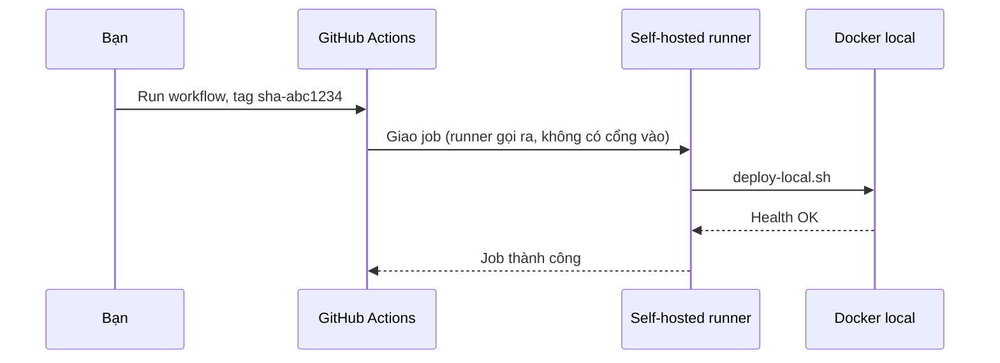

# Buổi 19 – Thử thách L2 và Phá lỗi nâng cao

Tuần 10/16 · Giai đoạn 3 – CI/CD & Automation · Buổi 19/32 (tùy chọn, làm ở nhà)

[Bài học Buổi 19 – CD & Deployment Strategies](session-19.md) · [Bài tập tuần 10](../../assignments/weekly/week-10.md) · [Hub tuần 10](README.md)

> **Tóm tắt:** Phần tùy chọn của buổi 19: chặn tag không tồn tại, nối script vào workflow_dispatch với runner an toàn, tài liệu bổ sung và bài phá lỗi mật khẩu database.

::: tip Chỉ làm khi đã xong L1
Trang này không bắt buộc. Làm khi bạn đã hoàn thành checklist L1 của [Buổi 19](session-19.md). Đối chiếu đáp án mở sau khi nộp bài ở [Walkthrough tuần 10](../../mentors/walkthroughs/week-10.md).
:::

## Thử thách L2: deploy an toàn

Yêu cầu:

1. Workflow `workflow_dispatch` chạy được (runner self-hosted an toàn, hoặc phương án thay thế bên dưới), với input `tag`, environment `local` và `concurrency` chặn hai deploy chạy chồng nhau.
2. Script từ chối tag không tồn tại trên registry trước khi động vào stack đang chạy.
3. Viết `report.md` mô tả quy trình rollback từng bước, giới hạn của nó (database) và rủi ro của self-hosted runner.
4. Tiêu chí hoàn thành: một lần chạy workflow (hoặc script) thành công, một lần cố ý deploy tag sai bị chặn mà stack cũ vẫn chạy, log đính kèm.

Tự thử 15 phút trước khi mở gợi ý.

::::: details Gợi ý bậc 1: kiểm tra tag có tồn tại
`docker manifest inspect ghcr.io/OWNER/club-api:TAG` trả mã khác 0 nếu tag không tồn tại hoặc không có quyền. Hãy kiểm tra cho cả hai image `club-api` và `club-web`.
:::::

::::: details Gợi ý bậc 2: đặt kiểm tra ở đâu
Đặt kiểm tra ngay sau khi đọc biến (sau `export OWNER TAG`), trước `compose pull`, và thoát với mã khác 0 kèm thông báo rõ. Kiểm thử bằng `TAG=sha-khongtontai` rồi chạy `docker compose ps`: các service cũ phải còn `Up`.
:::::

::::: details Gợi ý bậc 3: workflow
In `inputs.tag` qua biến môi trường (`env`) thay vì nhúng trực tiếp vào `run`, để tránh injection từ input. Mẫu workflow ở mục dưới.
:::::

## Nối vào workflow_dispatch

Mục tiêu: bấm nút trong tab Actions, nhập tag, runner trên máy bạn chạy `deploy-local.sh`. File mẫu của giáo trình: `examples/github-actions/deploy-local-dispatch.yml`. Bạn tự viết lại theo ý hiểu, đặt vào `.github/workflows/deploy-local.yml` của repo cá nhân:

```yaml
name: Deploy local

on:
  workflow_dispatch:
    inputs:
      tag:
        description: "Image tag, ví dụ sha-abc1234"
        required: true
        type: string

permissions:
  contents: read

concurrency:
  group: deploy-local
  cancel-in-progress: false

jobs:
  deploy:
    runs-on: [self-hosted, linux, club-local]
    environment: local
    steps:
      - uses: actions/checkout@v4
      - name: Deploy
        working-directory: lab-19/source
        env:
          OWNER: ${{ github.repository_owner }}
          TAG: ${{ inputs.tag }}
          DB_PASSWORD: ${{ secrets.DB_PASSWORD }}
          COMPOSE_PROJECT_NAME: club-lab19
        run: |
          export STATE_DIR="$HOME/.club-deploy"
          bash ./deploy-local.sh
```

::: danger Self-hosted runner chạy code trên máy của bạn
Chỉ dùng cho repo cá nhân hoặc repo nhóm **private**. Không bao giờ đăng ký runner cho repo public: người lạ có thể mở pull request và chạy code trên máy bạn. Đây chính là điểm khác với hướng local-only của buổi này: máy bạn vẫn không mở cổng nào, nhưng runner là cửa duy nhất cho code từ GitHub chạy vào máy.

- Chạy runner bằng user thường trong WSL, không dùng root, không để user đó có sudo không mật khẩu.
- Không đặt secret cá nhân (SSH key, token) trên máy runner ngoài những gì deploy cần.
- Chỉ chạy runner khi cần deploy, tắt khi xong.
- Không mở cổng nào trên router hay Windows Firewall cho runner.
:::

Cài runner trong WSL2 theo hướng dẫn chính thức của GitHub (Settings, Actions, Runners, New self-hosted runner); khi đăng ký, đặt thêm label `club-local`. Nếu bạn không muốn cài runner, phương án thay thế vẫn đạt L2: giữ workflow `workflow_dispatch` trên hosted runner chỉ để kiểm tra (validate compose, kiểm tra tag có tồn tại bằng `docker manifest inspect`), và chạy `deploy-local.sh` thủ công trên máy; nêu rõ lý do và rủi ro trong report.

Vì sao workflow khác lần chạy tay: `actions/checkout` dọn sạch thư mục làm việc (kể cả file bị ignore) nên `.env` và `.deploy/` không còn. Vì vậy mật khẩu được lấy từ secret `DB_PASSWORD` (giá trị phải trùng mật khẩu đã dùng khi tạo volume) và file trạng thái được đặt ngoài workspace, ở `$HOME/.club-deploy`. Nếu image trên GHCR là private, user chạy runner phải đã `docker login ghcr.io` ở bước Chuẩn bị của bài chính.

Thêm environment `local` ở Settings, Environments, rồi thêm secret `DB_PASSWORD` vào environment này (không ghi vào file nào trong repo). Nếu repo hỗ trợ, bật Required reviewers và chọn chính bạn hoặc bạn cùng nhóm.

::: details Tìm hiểu thêm: environment, secrets, approval, tag
- Environment: tên gọi cho nơi deploy (ví dụ `local`). Job khai báo `environment: local` để gắn secrets và quy tắc bảo vệ riêng.
- Secrets: token, mật khẩu DB. Lưu ở GitHub Secrets hoặc file `.env` trên máy đích, không bao giờ nằm trong repo, script hay log.
- Approval: environment có thể yêu cầu reviewer duyệt trước khi job chạy. Required reviewers có sẵn cho repo public, còn repo private cần gói trả phí; nếu không có, `workflow_dispatch` (đã là thao tác chủ động) cộng quy ước review của nhóm là đủ.

| Cách đặt tag | Ví dụ | Dùng cho deploy? | Lý do |
| --- | --- | --- | --- |
| Tag theo commit | `sha-abc1234` | Nên dùng | Trỏ đúng một bản build, truy ngược được commit |
| Tag phiên bản | `v1.2.0` | Nên dùng | Dễ đọc, gắn với release |
| Tag trôi nổi | `latest`, `main` | Không | Nội dung đổi theo thời gian, không rollback được |

Digest (`sha256:...`) còn chắc chắn hơn tag, nhưng tag theo commit là đủ cho khóa này.

Bảng đầy đủ các chiến lược deploy:

| Chiến lược | Cách làm | Downtime | Rollback | Chi phí |
| --- | --- | --- | --- | --- |
| Recreate | Dừng bản cũ, chạy bản mới | Có, ngắn | Chạy lại bản cũ | Thấp nhất |
| Rolling | Thay dần từng instance | Gần như không | Rolling ngược | Trung bình, cần nhiều replica |
| Blue/Green | Dựng song song bản mới, chuyển traffic một lần | Không | Chuyển traffic lại | Gấp đôi tài nguyên |
| Canary | Cho một phần nhỏ traffic dùng bản mới, theo dõi rồi mở rộng | Không | Rút phần canary | Cần metrics, router thông minh |

Luồng khi dùng workflow_dispatch và self-hosted runner. Runner luôn chủ động kết nối ra GitHub qua HTTPS (long polling), nên máy bạn không cần mở cổng nào từ Internet:


:::

## Phá lỗi nâng cao: deploy xong nhưng stack không lên

Cách phá: đổi `DB_PASSWORD` trong `.env` rồi deploy lại mà không xóa volume.

```bash
sed -i 's/DB_PASSWORD=.*/DB_PASSWORD=mat-khau-moi/' .env
OWNER=your-github-user TAG=sha-abc1234 ./deploy-local.sh
```

Triệu chứng: script in `health FAIL` (vì `/ready` trả 503 `not-ready`), trong khi `/health` vẫn trả `healthy`. Vì `TAG` trùng bản đang chạy nên script không có gì để rollback và thoát với mã 1.

Hướng điều tra:

1. Xem trạng thái: `docker compose ps`. Backend `Up` nhưng `curl -s localhost:3000/ready` trả `not-ready`?
2. Đọc log: `docker compose logs --tail 50 postgres` tìm `password authentication failed for user "club"` (backend không in lỗi của `/ready` ra log, nên log postgres mới là nơi thấy). Với `ECONNREFUSED`, kiểm tra thêm `docker compose logs backend`.
3. So sánh cấu hình: `docker compose exec backend env | grep DB_` và xem postgres đã được khởi tạo với mật khẩu nào (biến `POSTGRES_PASSWORD` chỉ có tác dụng ở lần khởi tạo volume đầu tiên).
4. Kiểm tra volume: `docker volume ls | grep postgres-data`.

Nguyên nhân gốc: mật khẩu trong database đã được cố định lúc tạo volume; đổi `.env` sau đó làm backend gửi mật khẩu khác với mật khẩu thật trong database. Đây là cùng họ lỗi với scenario-03 và scenario-04 trong `examples/troubleshooting/`.

Cách phòng tránh: coi secret là cấu hình của môi trường, đổi theo quy trình (đổi trong database trước, rồi mới đổi `.env`), health check bắt buộc trước khi ghi `current-tag`, và đừng xóa volume để "sửa cho nhanh" vì sẽ mất dữ liệu.

Khôi phục: đặt lại mật khẩu cũ trong `.env` rồi chạy lại `deploy-local.sh` với cùng tag. Lưu ý `ROLLBACK=1` không giúp ở đây vì lỗi nằm ở cấu hình, không phải ở image.

## Tài liệu tham khảo

- [GitHub Actions: Manually running a workflow (workflow_dispatch)](https://docs.github.com/en/actions/managing-workflow-runs-and-deployments/managing-workflow-runs/manually-running-a-workflow)
- [GitHub Actions: Managing environments for deployment](https://docs.github.com/en/actions/managing-workflow-runs-and-deployments/managing-deployments/managing-environments-for-deployment)
- [GitHub Docs: About self-hosted runners (và lưu ý bảo mật)](https://docs.github.com/en/actions/hosting-your-own-runners/managing-self-hosted-runners/about-self-hosted-runners)
- [GitHub Docs: Working with the Container registry](https://docs.github.com/en/packages/working-with-a-github-packages-registry/working-with-the-container-registry)
- [Docker Docs: Merge Compose files](https://docs.docker.com/compose/how-tos/multiple-compose-files/merge/)
- [Kubernetes: Performing a rolling update](https://kubernetes.io/docs/tutorials/kubernetes-basics/update/update-intro/)
