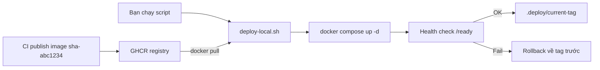

# Buổi 19 – CD & Deployment Strategies

Tuần 10/16 · Giai đoạn 3 – CI/CD & Automation · Buổi 19/32

[Slide buổi 19](../../slides/04-cicd/session-19.md) · [Bài tập tuần 10](../../assignments/weekly/week-10.md) · [Hub tuần 10](README.md)

> **Tóm tắt:** Viết script deploy image từ GHCR lên máy local, có kiểm tra sức khỏe và tự rollback. Chỉ chạy trên máy bạn, không expose máy ra Internet.

::: tip Buổi này bạn làm gì
**Bạn sẽ tạo ra:** một script `deploy-local.sh` deploy đúng một tag image từ GHCR lên máy bạn, chờ health check, và quay về bản trước chỉ bằng một lệnh.

**Thời gian thật:** đọc 15 phút, lab bắt buộc 60 phút, tùy chọn ở nhà (workflow `workflow_dispatch`, thử thách L2).

**Cần chuẩn bị:**
- [ ] Có ít nhất một image `club-api` và `club-web` với tag dạng `sha-abc1234` trên GHCR (làm ở [Buổi 18 – Docker CI Pipeline](../week-09/session-18.md))
- [ ] Môi trường đã cài theo [Hướng dẫn cài đặt](../../resources/setup-guide.md), Docker Desktop đang chạy, Compose v2
- [ ] Tài khoản và repo `devops-labs` (public) theo [Tài khoản GitHub và repo devops-labs](../../resources/setup-github.md)

**Sản phẩm phải nộp:**
- `compose.deploy.yaml` và `deploy-local.sh` trong `lab-19/source/`
- `evidence/command-output.txt` có log deploy lần một, lần hai và rollback
- `README.md` theo mẫu và `report.md` mô tả rollback cùng giới hạn của nó

**Đi nhanh:** Đọc ([Khái niệm](#khai-niem-cot-loi)) > [Làm lab](#hands-on-lab) > [Gặp lỗi?](#gap-loi) > [Tự kiểm tra](#tu-kiem-tra) > [Nộp bài](#nop-bai). Kẹt thì nhảy tới [Gặp lỗi?](#gap-loi).

**Từ mới trong buổi** (xem [Thuật ngữ](../../resources/glossary.md)):
- Continuous Delivery: mọi bản qua CI đều sẵn sàng deploy, người bấm nút.
- Tag bất biến: tên image trỏ đúng một bản build, ví dụ `sha-abc1234`.
- Health check: lệnh hỏi ứng dụng "bạn khỏe chưa" sau khi deploy.
- Rollback: quay về bản đã biết là tốt.
- Self-hosted runner: máy của bạn nhận job từ GitHub Actions (chỉ dùng ở phần tùy chọn).
:::

## Vấn đề thực tế

CLB có một API quản lý thành viên. Mỗi lần có bản sửa lỗi, một bạn SSH vào máy demo, `git pull`, `docker compose up --build`, rồi cầu nguyện. Một lần bạn Nam build trên máy mình với Node khác phiên bản, bản "chạy được trên máy tôi" lên demo và API chết đúng lúc ban chủ nhiệm xem. Không ai nhớ bản trước là commit nào để quay lại, vì image được build lại tại chỗ và không có tên cố định.

Cách khắc phục: build một lần ở CI với tên bất biến (tag theo commit), deploy chỉ là "chạy đúng image đó", và luôn biết bản trước để quay lại trong vài giây. Buổi này bạn dựng quy trình đó ở quy mô máy local.

## Khái niệm cốt lõi

**1. Delivery và Deployment.** Continuous Delivery nghĩa là mọi bản qua CI đều sẵn sàng deploy và con người quyết định lúc đưa lên; Continuous Deployment là pipeline tự đưa lên, không cần ai bấm. Ví von: Delivery là hàng đã đóng gói đặt ở cửa, bạn quyết định lúc mang vào nhà; Deployment là hàng tự vào nhà. Khóa này dùng Delivery vì máy bạn không có địa chỉ công khai nên GitHub không "đẩy" vào được, deploy là hành động bạn chủ động.

**2. Artifact bất biến và tag.** Artifact là thứ được build một lần rồi chạy ở mọi nơi, với container là image; tag theo commit (`sha-abc1234`) trỏ đúng một bản build. Ví von: tag `sha-...` như số sê-ri trên hộp hàng, còn `latest` như nhãn "hàng mới nhất" bị dán đè mỗi ngày. Không deploy bằng `latest` vì không rollback chính xác được.

**3. Chiến lược deploy.** Là cách thay bản cũ bằng bản mới: Recreate (dừng cũ, chạy mới, có downtime ngắn), Rolling (thay dần), Blue/Green (dựng song song rồi chuyển traffic), Canary (cho một phần nhỏ người dùng thử bản mới). Ví von: Recreate như đóng cửa quán để thay thực đơn, Rolling như thay từng bàn một. Docker Compose trên một máy là Recreate; bạn chỉ cần hiểu khái niệm ba loại còn lại.

**4. Health check.** Là một địa chỉ (ở đây `/ready`) mà script gọi sau khi chạy để biết app đã dùng được chưa, rồi mới ghi nhận deploy thành công. Ví von: bật máy xong phải thấy màn hình sáng mới coi là máy đã khởi động. `/ready` chạy `SELECT 1` nên bắt được lỗi database, còn `/health` chỉ trả JSON tĩnh.

**5. Rollback.** Là deploy lại tag trước đó bằng đúng cơ chế đã dùng để deploy. Điều kiện: biết tag đang chạy và tag trước (ghi vào file trạng thái), image cũ còn trên registry, và dữ liệu tương thích (rollback code không rollback database).



Máy local chủ động "kéo" (pull) image về, nên không cần mở cổng nào vào máy bạn.

::: details Tìm hiểu thêm (đọc sau)
- Recreate: dừng bản cũ, chạy bản mới; có downtime ngắn, chi phí thấp nhất, rollback bằng cách chạy lại bản cũ.
- Rolling: thay dần từng instance; gần như không downtime, cần nhiều replica. Kubernetes Deployment mặc định là Rolling (`strategy.rollingUpdate`), cách `kubectl set image` ở `examples/kubernetes/deploy-local.sh` hoạt động.
- Blue/Green: dựng song song bản mới rồi chuyển traffic một lần; không downtime, gấp đôi tài nguyên, rollback bằng cách chuyển traffic lại.
- Canary: cho một phần nhỏ traffic dùng bản mới, theo dõi rồi mở rộng; cần metrics và router thông minh, rollback bằng cách rút phần canary.
:::

## Hands-on lab

Trên lớp, mentor demo trước; tự học thì làm thẳng phần này. Thời gian: chuẩn bị 5', Phần 1 5', Phần 2 25', Phần 3 25'.

### Chuẩn bị (5 phút)

Kiểm tra môi trường trong terminal WSL (thư mục nằm trong `~`, không dùng `/mnt/c`). Thay `your-github-user` bằng tên GitHub viết thường và `sha-abc1234` bằng tag thật trong tab Packages:

```bash
docker --version && docker compose version && curl --version | head -1 && pwd
export OWNER=your-github-user
docker manifest inspect ghcr.io/${OWNER}/club-api:sha-abc1234 > /dev/null && echo "image ton tai"
```

Kết quả mong đợi: Docker 27 trở lên, `Docker Compose version v2.x`, `pwd` bắt đầu bằng `/home/`, và dòng `image ton tai`. Nếu báo `unauthorized` hoặc `no such manifest`, xem [Gặp lỗi?](#gap-loi). Chuẩn bị thư mục nộp bài và nguồn:

```bash
cd ~/devops-labs
mkdir -p lab-19/source lab-19/evidence lab-19/screenshots
cp -r ~/devops-course/starter-project/{compose.yaml,backend,frontend,database} lab-19/source/
cd lab-19/source
ls
```

Kết quả mong đợi: `backend  compose.yaml  database  frontend`. Tạo `.env` (không commit):

```bash
cat > .env <<'EOF'
DB_PASSWORD=change-me-local-only
WEB_PORT=8080
COMPOSE_PROJECT_NAME=club-lab19
EOF
printf '.env\n.deploy/\n' >> .gitignore
```

`COMPOSE_PROJECT_NAME` làm các lệnh `docker compose` thủ công trỏ đúng stack mà script tạo; `.gitignore` giữ mật khẩu và file trạng thái khỏi GitHub. Nếu image đang để private, đổi package sang Public (image khóa học không chứa secret) hoặc đăng nhập bằng token có scope `read:packages`, nhập token khi được hỏi, không viết vào file:

```bash
docker login ghcr.io -u your-github-user
```

Kết quả mong đợi: `Login Succeeded`.

::: tip Kiểm tra: bạn đúng khi
`ls` thấy đủ 4 mục, `cat .gitignore` có `.env` và `.deploy/`, và lệnh `docker manifest inspect` in `image ton tai`.
:::

### Phần 1: Compose override chạy image từ registry (5 phút)

Compose gốc dùng `build`. Thêm file override để chạy image đã publish, không build lại. Tạo `compose.deploy.yaml`:

```yaml
services:
  backend:
    image: ghcr.io/${OWNER:?Set OWNER}/club-api:${TAG:?Set TAG}
  frontend:
    image: ghcr.io/${OWNER:?Set OWNER}/club-web:${TAG:?Set TAG}
```

```bash
OWNER=your-github-user TAG=sha-abc1234 docker compose -f compose.yaml -f compose.deploy.yaml config | grep "image:"
```

Kết quả mong đợi:

```text
    image: ghcr.io/your-github-user/club-api:sha-abc1234
    image: ghcr.io/your-github-user/club-web:sha-abc1234
    image: postgres:17-alpine
```

::: tip Kiểm tra: bạn đúng khi
Thấy hai image GHCR kèm đúng tag của bạn và `postgres:17-alpine`. Nếu báo `Set OWNER` hoặc `Set TAG` là bạn quên đặt biến trước lệnh.
:::

### Phần 2: Viết deploy-local.sh (25 phút)

Tạo `deploy-local.sh`:

```bash
#!/usr/bin/env bash
# Deploy local: pull image theo tag, chay Compose, health check, rollback khi that bai.
# Cach dung: OWNER=your-github-user TAG=sha-abc1234 ./deploy-local.sh
#            ROLLBACK=1 ./deploy-local.sh   (quay lai tag truoc do)
set -euo pipefail

STATE_DIR=${STATE_DIR:-.deploy}
HEALTH_URL=${HEALTH_URL:-http://localhost:3000/ready}
mkdir -p "$STATE_DIR"

log() { echo "[deploy] $*"; }

current=$(cat "$STATE_DIR/current-tag" 2>/dev/null || true)
previous=$(cat "$STATE_DIR/previous-tag" 2>/dev/null || true)

if [ "${ROLLBACK:-0}" = "1" ]; then
  : "${previous:?khong co previous-tag de rollback}"
  TAG=$previous
fi
: "${OWNER:?Set OWNER}" "${TAG:?Set TAG}"
OWNER=$(echo "$OWNER" | tr '[:upper:]' '[:lower:]')

case "$TAG" in
  latest|"") log "tu choi tag 'latest'"; exit 2 ;;
esac

export OWNER TAG
export COMPOSE_PROJECT_NAME=${COMPOSE_PROJECT_NAME:-club-lab19}
COMPOSE="docker compose -f compose.yaml -f compose.deploy.yaml"

log "pull image tag $TAG"
$COMPOSE pull backend frontend

log "compose up"
$COMPOSE up -d --no-build

healthy=0
for i in $(seq 1 20); do
  if curl -fsS "$HEALTH_URL" > /dev/null 2>&1; then healthy=1; break; fi
  sleep 3
done

if [ "$healthy" -eq 1 ]; then
  log "health OK"
  if [ "$TAG" != "$current" ]; then
    [ -n "$current" ] && echo "$current" > "$STATE_DIR/previous-tag"
    echo "$TAG" > "$STATE_DIR/current-tag"
  fi
  log "ghi trang thai: current=$(cat "$STATE_DIR/current-tag") previous=$(cat "$STATE_DIR/previous-tag" 2>/dev/null || echo none)"
  exit 0
fi

log "health FAIL, in log backend"
$COMPOSE logs --tail 30 backend || true
if [ -n "$current" ] && [ "$TAG" != "$current" ]; then
  log "rollback ve $current"
  TAG=$current $COMPOSE up -d --no-build
fi
exit 1
```

```bash
chmod +x deploy-local.sh
OWNER=your-github-user TAG=sha-abc1234 ./deploy-local.sh | tee ../evidence/command-output.txt
```

Kết quả mong đợi (rút gọn):

```text
[deploy] pull image tag sha-abc1234
[deploy] compose up
[deploy] health OK
[deploy] ghi trang thai: current=sha-abc1234 previous=none
```

Nếu `pull` báo `unauthorized` hoặc `manifest unknown`, xem [Gặp lỗi?](#gap-loi). Kiểm tra stack:
```bash
docker compose ps
curl -s http://localhost:3000/health
curl -s http://localhost:3000/api/members
```

Kết quả mong đợi: ba service `Up` (postgres `healthy`), `/health` trả `{"status":"healthy","service":"club-api"}`, `/api/members` trả mảng JSON (dữ liệu mẫu từ `init.sql`, hoặc `[]` nếu bảng rỗng).

Vì sao các chi tiết trong script:

- `set -euo pipefail` dừng ngay khi có lỗi hoặc biến chưa đặt; từ chối `latest` để ép dùng artifact bất biến.
- Health check dùng `/ready` vì nó chạy `SELECT 1`, bắt được lỗi kết nối DB; `/health` thì không.
- Ghi trạng thái sau health check để `current-tag` luôn là bản đã xác nhận chạy được.
- Chạy lại script với cùng tag là an toàn: Compose không tạo lại container nếu không có thay đổi.

::: tip Kiểm tra: bạn đúng khi
Log có dòng `health OK`, `cat .deploy/current-tag` in tag bạn vừa deploy, và hai lệnh `curl` trả JSON như trên.
:::

### Phần 3: Deploy bản thứ hai và rollback (25 phút)

1. Publish một bản mới: đổi một dòng nhỏ, vô hại trong backend, push, chờ workflow publish xong, rồi lấy tag mới (ví dụ `sha-def5678`) ở tab Packages.
2. Deploy bản mới:

```bash
OWNER=your-github-user TAG=sha-def5678 ./deploy-local.sh | tee -a ../evidence/command-output.txt
cat .deploy/current-tag .deploy/previous-tag
```

Kết quả mong đợi: `sha-def5678` rồi `sha-abc1234`.

3. Rollback:

```bash
ROLLBACK=1 OWNER=your-github-user ./deploy-local.sh | tee -a ../evidence/command-output.txt
docker compose ps --format '{{.Service}} {{.Image}}'
```

Kết quả mong đợi: các dòng `backend ghcr.io/your-github-user/club-api:sha-abc1234` và tương tự cho frontend.

Lưu ý: sau rollback, `current-tag` đổi sang `sha-abc1234` và `previous-tag` thành `sha-def5678`, nên chạy rollback lần nữa sẽ "tiến" lại. Hãy mô tả hành vi này trong `report.md`. Rollback chỉ là deploy với tag cũ: một cơ chế duy nhất, được thử mỗi lần deploy, thay vì một script riêng ít ai chạy.

::: tip Kiểm tra: bạn đúng khi
Sau rollback, `docker compose ps --format` hiện tag đầu tiên (`sha-abc1234`) cho cả `backend` và `frontend`, và log rollback đã nằm trong `evidence/command-output.txt`.
:::

### Checklist L1 (bắt buộc)

- [ ] `compose.deploy.yaml` chạy được và `docker compose config` hiển thị đúng tên image GHCR.
- [ ] `deploy-local.sh` deploy thành công một tag, log lưu trong `evidence/command-output.txt`.
- [ ] `/health` và `/api/members` trả kết quả đúng sau deploy.
- [ ] Deploy tag thứ hai, rồi rollback về tag đầu bằng `ROLLBACK=1`, có log chứng minh.
- [ ] `.env` và `.deploy/` đã nằm trong `.gitignore`, không có secret trong repo.

Tự kiểm tra bằng một dòng:

```bash
cat .deploy/current-tag && git check-ignore -v .env .deploy && docker compose ps --format '{{.Service}} {{.Image}}'
```

## Gặp lỗi?

| Triệu chứng | Nguyên nhân | Cách sửa |
| --- | --- | --- |
| `unauthorized` hoặc `denied` khi pull | Package private, chưa login, hoặc token thiếu `read:packages` | Đổi package sang Public hoặc `docker login ghcr.io` với token đúng scope |
| `manifest unknown` hoặc `no such manifest` | Tag sai, workflow publish chưa chạy xong, owner viết hoa | Kiểm tra tab Packages, dùng owner viết thường, chờ publish xong |
| `Set DB_PASSWORD in .env` | Thiếu `.env` trong thư mục chạy Compose | Tạo `.env` cạnh `compose.yaml`, chạy script từ đúng thư mục |
| Deploy "thành công" nhưng vẫn chạy bản cũ | Tag không đổi hoặc dùng `latest` đã được cache | Dùng tag sha bất biến, kiểm tra bằng `docker compose ps --format` |
| `health FAIL` dù container `Up`; `/health` vẫn `healthy` nhưng `/ready` trả 503 | Backend không vào được database, thường do đổi `DB_PASSWORD` trong `.env` sau khi volume đã tạo; hoặc `HEALTH_URL` sai cổng | `docker compose logs --tail 50 postgres` tìm `password authentication failed`; đặt lại mật khẩu cũ trong `.env` rồi chạy lại cùng tag (`ROLLBACK=1` không giúp vì lỗi ở cấu hình, không ở image). Xem mục Phá lỗi nâng cao |
| `ROLLBACK=1` báo `khong co previous-tag` | Mới deploy một lần, chưa có bản trước | Deploy một tag khác trước, rồi mới rollback |

## Tự kiểm tra

1. Khác biệt giữa Continuous Delivery và Continuous Deployment là gì? Khóa học này dùng loại nào?
2. Vì sao không deploy bằng tag `latest`?
3. Vì sao script chỉ ghi `current-tag` sau khi health check đạt?
4. Bạn deploy bản mới, API chạy nhưng `/api/members` lỗi vì bản mới đã chạy migration xóa một cột. Rollback code có đủ không?

::: details Đáp án gợi ý
1. Delivery: bản qua CI luôn sẵn sàng, con người quyết định deploy. Deployment: tự động deploy. Khóa này dùng Delivery vì deploy vào máy local phải có chủ đích.
2. `latest` trôi nổi: cùng tên nhưng nội dung đổi, không biết đang chạy bản nào và không thể rollback chính xác.
3. Để file trạng thái chỉ chứa bản đã xác nhận chạy được; nếu ghi trước, rollback có thể trỏ vào bản hỏng.
4. Không. Rollback code không hoàn tác dữ liệu hoặc schema. Cần migration tương thích ngược (thêm trước, xóa sau) hoặc khôi phục từ backup.
:::

## Nộp bài

Nộp vào `lab-19/` trong repo cá nhân theo [mẫu bài lab](../../templates/lab-template.md). Đề và bảng điểm: [Bài tập tuần 10](../../assignments/weekly/week-10.md).

- [ ] `README.md` trả lời đủ 7 câu của mẫu (bài lab giải quyết gì, kiến thức dùng, các bước, kết quả mong đợi, lỗi đã gặp, cách khắc phục, cải thiện được gì), đánh dấu level đã làm.
- [ ] `source/` có `compose.deploy.yaml`, `deploy-local.sh`, `.gitignore` (không có `.env`).
- [ ] `evidence/command-output.txt` có log deploy thành công, deploy tag thứ hai và rollback.
- [ ] `report.md` mô tả quy trình rollback, hành vi khi rollback lần hai và giới hạn với database.
- [ ] Đã chạy `git grep -i password` và không commit secret, token hay `.env`.

## Recap

- Build một lần, deploy artifact bất biến theo tag commit; không dùng `latest`.
- Deploy local theo mô hình pull: không cần expose máy ra Internet.
- Health check là cổng chặn; rollback là deploy lại tag trước, và rollback code không hoàn tác database.

Buổi tiếp theo: [Buổi 20 – Pipeline Security](session-20.md).

::: details Thử thách thêm (L2, tùy chọn, làm ở nhà)
Chỉ làm khi đã xong L1 (self-hosted runner chỉ dành cho repo private, xem cảnh báo ở trang thử thách): chặn tag không tồn tại trước khi động vào stack, nối `deploy-local.sh` vào workflow `workflow_dispatch`, và viết `report.md` về rollback cùng rủi ro của self-hosted runner. Gợi ý từng bậc, mẫu workflow và quy tắc an toàn nằm ở [Buổi 19 – Thử thách L2 và Phá lỗi nâng cao](session-19-challenge.md). Tự thử 15 phút trước khi mở gợi ý.
:::

::: details Phá lỗi nâng cao
Đổi `DB_PASSWORD` trong `.env` rồi deploy lại: script báo `health FAIL` dù `/health` vẫn `healthy`. Cách điều tra và khôi phục đầy đủ ở [Buổi 19 – Thử thách L2 và Phá lỗi nâng cao](session-19-challenge.md#pha-loi-nang-cao-deploy-xong-nhung-stack-khong-len).
:::

::: details Tài liệu tham khảo
- [GitHub Docs: Working with the Container registry](https://docs.github.com/en/packages/working-with-a-github-packages-registry/working-with-the-container-registry)
- [Docker Docs: Merge Compose files](https://docs.docker.com/compose/how-tos/multiple-compose-files/merge/)
:::
