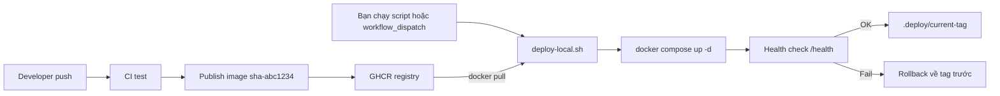
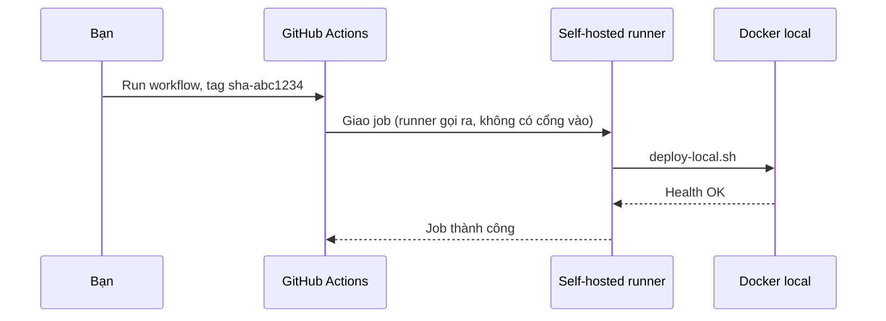

# Buổi 19 – CD & Deployment Strategies

Tuần 10 · Giai đoạn 3 – CI/CD & Automation · Slide: [Slide buổi 19](../../slides/04-cicd/session-19.md)

> **Tóm tắt:** Viết script deploy image từ GHCR lên môi trường local có kiểm tra sức khỏe và rollback, rồi nối vào workflow_dispatch, không expose máy ra Internet.

## Mục tiêu học tập

- Phân biệt được Continuous Delivery và Continuous Deployment, và nói được vì sao khóa học này dừng ở "deploy có chủ đích, có người bấm nút".
- Giải thích được các chiến lược Recreate, Rolling, Blue/Green và Canary, kèm đánh đổi của từng chiến lược.
- Viết và chạy được script `deploy-local.sh` pull image theo tag bất biến từ GHCR, chạy lại Docker Compose và chờ health check.
- Thực hiện được rollback về tag trước đó chỉ bằng một lệnh, và chứng minh bằng log.
- Thiết lập được workflow `workflow_dispatch` có input `tag`, dùng environment và approval, chạy trên runner an toàn.
- Chẩn đoán được lỗi deploy phổ biến (ImagePullBackOff, unauthorized, tag sai, health check fail) và nêu cách phòng tránh.

## Điều kiện cần

- Đã hoàn thành các buổi Docker/Compose (buổi 5-8), Kubernetes cơ bản (buổi 11-13) và CI/Publish image (buổi 15-18). Bạn phải có workflow publish đẩy image `club-api` và `club-web` lên GHCR với tag dạng `sha-abc1234` (xem `.github/workflows/publish.yml` của repo giáo trình).
- Windows 11 + WSL2 Ubuntu, làm việc trong filesystem của WSL (ví dụ `~/devops-labs`), không dùng `/mnt/c`.
- Docker Desktop đang chạy, Compose v2.
- Repo cá nhân (ví dụ `devops-labs`) có thư mục `lab-19/` và bản sao `starter-project/`.

Kiểm tra nhanh:

```bash
docker --version
docker compose version
git --version
curl --version | head -1
pwd
```

Kết quả mong đợi (rút gọn): Docker 27 trở lên, `Docker Compose version v2.x`, và `pwd` bắt đầu bằng `/home/`, không phải `/mnt/c`.

Kiểm tra image đã có trên GHCR (thay `OWNER` bằng tên GitHub của bạn, viết thường):

```bash
export OWNER=your-github-user
docker manifest inspect ghcr.io/${OWNER}/club-api:sha-abc1234 > /dev/null && echo "image ton tai"
```

Nếu báo `unauthorized` hoặc `no such manifest`, xem phần "Chuẩn bị" bên dưới. Thay `sha-abc1234` bằng tag thật trong tab Packages của repo bạn.

## Vấn đề thực tế

CLB có một API quản lý thành viên. Mỗi lần có bản sửa lỗi, một bạn SSH vào máy demo, `git pull`, `docker compose up --build`, rồi cầu nguyện. Một lần bạn Nam build trên máy mình với Node khác phiên bản, bản "chạy được trên máy tôi" lên demo và API chết đúng lúc ban chủ nhiệm xem. Không ai nhớ bản trước là commit nào để quay lại, vì image được build lại tại chỗ và không có tên cố định.

Continuous Deployment giải quyết bằng ba nguyên tắc: build một lần ở CI và đặt tên bất biến (tag theo commit), deploy chỉ là "chạy đúng image đó" bằng một quy trình lặp lại được, và luôn biết bản đang chạy cùng bản trước đó để rollback trong vài giây. Buổi này bạn tự dựng quy trình đó ở quy mô local.

## Khái niệm cốt lõi

### Delivery và Deployment

| Thuật ngữ | Ý nghĩa | Ai quyết định đưa lên môi trường |
| --- | --- | --- |
| Continuous Integration | Mỗi thay đổi được build và test tự động | Không liên quan |
| Continuous Delivery | Mọi bản qua CI đều sẵn sàng deploy | Con người bấm nút (hoặc duyệt) |
| Continuous Deployment | Bản qua CI tự động lên môi trường | Pipeline, không cần con người |

Khóa học này dùng Continuous Delivery: pipeline tự build và publish image, còn deploy lên máy local là hành động chủ động (chạy script hoặc `workflow_dispatch`). Lý do: máy học viên không được expose ra Internet nên hosted runner của GitHub không thể "đẩy" vào máy bạn.

### Artifact bất biến và tag

Một deploy tốt dùng cùng một artifact từ staging đến production. Với container, artifact là image.

| Cách đặt tag | Ví dụ | Dùng cho deploy? | Lý do |
| --- | --- | --- | --- |
| Tag theo commit | `sha-abc1234` | Nên dùng | Trỏ đúng một bản build, truy ngược được commit |
| Tag phiên bản | `v1.2.0` | Nên dùng | Dễ đọc, gắn với release |
| Tag trôi nổi | `latest`, `main` | Không | Cùng tên nhưng nội dung đổi theo thời gian, không rollback được |

Digest (`sha256:...`) còn chắc chắn hơn tag, nhưng tag theo commit là đủ cho khóa này.

### Environment, secrets, approval

- **Environment**: tên gọi cho nơi deploy (ví dụ `local`). Trong GitHub Actions, job khai báo `environment: local` để gắn secrets và quy tắc bảo vệ riêng.
- **Secrets**: giá trị nhạy cảm (token, mật khẩu DB). Lưu ở GitHub Secrets hoặc file `.env` trên máy đích, không bao giờ nằm trong repo, script hay log.
- **Approval**: environment có thể yêu cầu reviewer duyệt trước khi job chạy. Lưu ý: required reviewers có sẵn cho repo public, còn repo private cần gói trả phí; nếu không có, hãy kiểm tra tại trang tài liệu GitHub về environments. Khi không có, hãy dùng `workflow_dispatch` (đã là một thao tác chủ động) cộng quy ước review của nhóm.

### Chiến lược deploy

| Chiến lược | Cách làm | Downtime | Rollback | Chi phí |
| --- | --- | --- | --- | --- |
| Recreate | Dừng bản cũ, chạy bản mới | Có, ngắn | Chạy lại bản cũ | Thấp nhất |
| Rolling | Thay dần từng instance | Gần như không | Rolling ngược | Trung bình, cần nhiều replica |
| Blue/Green | Dựng song song bản mới, chuyển traffic một lần | Không | Chuyển traffic lại | Gấp đôi tài nguyên |
| Canary | Cho một phần nhỏ traffic dùng bản mới, theo dõi rồi mở rộng | Không | Rút phần canary | Cần metrics, router thông minh |

Docker Compose trên một máy thực chất là Recreate (container được tạo lại khi image đổi). Kubernetes Deployment mặc định là Rolling (xem `strategy.rollingUpdate`), đó là cách `kubectl set image` ở `examples/kubernetes/deploy-local.sh` hoạt động. Blue/Green và Canary cần thêm router hoặc ingress controller; bạn chỉ cần hiểu khái niệm ở buổi này.

### Rollback

Rollback tốt là hành động nhàm chán: chạy lại bản đã biết là tốt. Điều kiện:

1. Biết tag bản đang chạy và bản trước đó (ghi vào một file trạng thái).
2. Image bản cũ vẫn còn trên registry (đừng xóa tag cũ).
3. Dữ liệu tương thích: rollback code không rollback database. Migration phá vỡ tương thích là rủi ro lớn nhất; hãy làm migration theo kiểu thêm trước, xóa sau.

## Kiến trúc và cách hoạt động



Giải thích từng bước:

1. Push code kích hoạt CI (test) và workflow publish tạo image với tag `sha-...`, đẩy lên GHCR bằng `GITHUB_TOKEN`.
2. Việc deploy do bạn khởi động: chạy trực tiếp `deploy-local.sh` hoặc bấm `workflow_dispatch` để một runner trên máy bạn chạy script đó.
3. Script `docker pull` hai image theo tag chỉ định. Đây là chiều "kéo" (pull): máy local chủ động lấy về, nên không cần mở cổng vào máy.
4. Script chạy `docker compose` với file override trỏ tới image GHCR, thay vì `build`.
5. Script gọi health check. Nếu đạt, ghi tag mới vào `.deploy/current-tag` (và tag cũ vào `.deploy/previous-tag`). Nếu không, tự rollback.



Điểm an toàn then chốt: self-hosted runner luôn chủ động kết nối ra GitHub (long polling qua HTTPS), nên máy bạn không cần cổng nào mở từ Internet.

## Demo của mentor

Mục tiêu demo: một lần deploy thành công, một lần deploy hỏng tự rollback. Mentor chuẩn bị sẵn hai tag trên GHCR: `TAG_GOOD` (bản khỏe) và `TAG_BAD` (bản cố ý hỏng nhưng vẫn build được, ví dụ đổi dòng cuối Dockerfile thành `CMD ["node", "-e", "process.exit(1)"]` để container thoát ngay nên `/ready` không bao giờ trả lời).

1. Hiển thị trạng thái ban đầu:

```bash
cd ~/devops-labs/lab-19/source
docker compose ps 2>/dev/null || echo "chua co stack"
```

Kết quả mong đợi: chưa có stack hoặc danh sách rỗng.

2. Deploy bản tốt:

```bash
OWNER=your-github-user TAG=TAG_GOOD ./deploy-local.sh
```

Kết quả mong đợi (rút gọn):

```text
[deploy] pull image tag TAG_GOOD
[deploy] compose up
[deploy] health OK
[deploy] ghi trang thai: current=TAG_GOOD previous=none
```

3. Deploy bản hỏng, quan sát tự rollback:

```bash
OWNER=your-github-user TAG=TAG_BAD ./deploy-local.sh
cat .deploy/current-tag
```

Kết quả mong đợi (sau tối đa khoảng 60 giây chờ): log có dòng `health FAIL, in log backend`, rồi `rollback ve TAG_GOOD`; `current-tag` vẫn là `TAG_GOOD`. Chạy `curl -s http://localhost:3000/ready` để xác nhận bản tốt đã quay lại (có thể cần vài giây).

Câu hỏi mentor nên hỏi lớp:

- Nếu mentor dùng tag `latest`, bước rollback sẽ đưa chúng ta về đâu?
- Vì sao script ghi tag mới vào file trạng thái chỉ sau khi health check đạt?
- Rollback code có đưa dữ liệu trong database về như cũ không?
- Máy này không có IP public. Làm sao GitHub vẫn "ra lệnh" được cho deploy?

## Hands-on lab

Thời gian gợi ý: chuẩn bị 10', Phần 1-3 khoảng 30', Phần 4 khoảng 20' (L2 có thể làm tiếp ở nhà).

### Chuẩn bị

1. Chuẩn bị thư mục nộp bài và nguồn:

```bash
cd ~/devops-labs
mkdir -p lab-19/source lab-19/evidence lab-19/screenshots
cp -r starter-project/compose.yaml starter-project/backend starter-project/frontend starter-project/database lab-19/source/
cd lab-19/source
ls
```

Kết quả mong đợi: thấy `backend  compose.yaml  database  frontend`.

2. Tạo `.env` (không commit):

```bash
cat > .env <<'EOF'
DB_PASSWORD=change-me-local-only
WEB_PORT=8080
COMPOSE_PROJECT_NAME=club-lab19
EOF
printf '.env\n.deploy/\n' >> .gitignore
```

Vì sao: `compose.yaml` bắt buộc `DB_PASSWORD`; `COMPOSE_PROJECT_NAME` làm các lệnh `docker compose` thủ công (`ps`, `logs`) trỏ đúng stack mà script tạo; `.gitignore` đảm bảo mật khẩu và file trạng thái không lên GitHub.

3. Cho phép pull image từ GHCR. Cách đơn giản: vào trang package trên GitHub, mục Package settings, đổi visibility của `club-api` và `club-web` thành Public (image của khóa học không chứa secret). Nếu giữ private, đăng nhập bằng Personal Access Token có scope `read:packages`, nhập token khi được hỏi, không viết vào file:

```bash
docker login ghcr.io -u your-github-user
```

Kết quả mong đợi: `Login Succeeded`.

### Phần 1: Compose override chạy image từ registry

Compose gốc dùng `build`. Ta thêm file override để chạy image đã publish, không build lại.

Tạo `compose.deploy.yaml`:

```yaml
services:
  backend:
    image: ghcr.io/${OWNER:?Set OWNER}/club-api:${TAG:?Set TAG}
  frontend:
    image: ghcr.io/${OWNER:?Set OWNER}/club-web:${TAG:?Set TAG}
```

Kiểm tra cấu hình hợp nhất:

```bash
OWNER=your-github-user TAG=sha-abc1234 docker compose -f compose.yaml -f compose.deploy.yaml config | grep "image:"
```

Kết quả mong đợi:

```text
    image: ghcr.io/your-github-user/club-api:sha-abc1234
    image: ghcr.io/your-github-user/club-web:sha-abc1234
    image: postgres:17-alpine
```

Vì sao: Compose gộp hai file, `image` của override thêm vào service cũ. Khi chạy với `--no-build`, Compose dùng image thay vì build.

### Phần 2: Viết deploy-local.sh (L1)

Tạo `deploy-local.sh`:

```bash
#!/usr/bin/env bash
# Deploy local: pull image theo tag, chay Compose, health check, rollback khi that bai.
# Cach dung: OWNER=your-github-user TAG=sha-abc1234 ./deploy-local.sh
#            ROLLBACK=1 ./deploy-local.sh   (quay lai tag truoc do)
set -euo pipefail

STATE_DIR=${STATE_DIR:-.deploy}
HEALTH_URL=${HEALTH_URL:-http://localhost:3000/ready}
mkdir -p "$STATE_DIR"

log() { echo "[deploy] $*"; }

current=$(cat "$STATE_DIR/current-tag" 2>/dev/null || true)
previous=$(cat "$STATE_DIR/previous-tag" 2>/dev/null || true)

if [ "${ROLLBACK:-0}" = "1" ]; then
  : "${previous:?khong co previous-tag de rollback}"
  TAG=$previous
fi
: "${OWNER:?Set OWNER}" "${TAG:?Set TAG}"
OWNER=$(echo "$OWNER" | tr '[:upper:]' '[:lower:]')

case "$TAG" in
  latest|"") log "tu choi tag 'latest'"; exit 2 ;;
esac

export OWNER TAG
export COMPOSE_PROJECT_NAME=${COMPOSE_PROJECT_NAME:-club-lab19}
COMPOSE="docker compose -f compose.yaml -f compose.deploy.yaml"

log "pull image tag $TAG"
$COMPOSE pull backend frontend

log "compose up"
$COMPOSE up -d --no-build

healthy=0
for i in $(seq 1 20); do
  if curl -fsS "$HEALTH_URL" > /dev/null 2>&1; then healthy=1; break; fi
  sleep 3
done

if [ "$healthy" -eq 1 ]; then
  log "health OK"
  if [ "$TAG" != "$current" ]; then
    [ -n "$current" ] && echo "$current" > "$STATE_DIR/previous-tag"
    echo "$TAG" > "$STATE_DIR/current-tag"
  fi
  log "ghi trang thai: current=$(cat "$STATE_DIR/current-tag") previous=$(cat "$STATE_DIR/previous-tag" 2>/dev/null || echo none)"
  exit 0
fi

log "health FAIL, in log backend"
$COMPOSE logs --tail 30 backend || true
if [ -n "$current" ] && [ "$TAG" != "$current" ]; then
  log "rollback ve $current"
  TAG=$current $COMPOSE up -d --no-build
fi
exit 1
```

```bash
chmod +x deploy-local.sh
OWNER=your-github-user TAG=sha-abc1234 ./deploy-local.sh | tee ../evidence/command-output.txt
```

Kết quả mong đợi (rút gọn):

```text
[deploy] pull image tag sha-abc1234
[deploy] compose up
[deploy] health OK
[deploy] ghi trang thai: current=sha-abc1234 previous=none
```

Kiểm tra bằng:

```bash
docker compose ps
curl -s http://localhost:3000/health
curl -s http://localhost:3000/api/members
```

Kết quả mong đợi: ba service `Up` (postgres `healthy`), `/health` trả `{"status":"healthy","service":"club-api"}`, `/api/members` trả mảng JSON (dữ liệu mẫu từ `init.sql`, hoặc `[]` nếu bảng rỗng).

Vì sao các chi tiết trong script:

- `set -euo pipefail`: dừng ngay khi có lệnh lỗi hoặc biến chưa đặt, tránh deploy dở dang.
- Từ chối `latest`: ép dùng artifact bất biến.
- Health check dùng `/ready` thay vì `/health`: trong `starter-project`, `/health` chỉ trả JSON tĩnh (không chạm database), còn `/ready` chạy `SELECT 1` nên bắt được lỗi kết nối DB.
- `COMPOSE_PROJECT_NAME` cố định để lần deploy thủ công và lần deploy từ workflow dùng chung một stack (nếu không, tên project phụ thuộc tên thư mục).
- Ghi trạng thái sau health check: file `current-tag` luôn phản ánh bản đã được xác nhận chạy được.
- Chạy lại script với cùng tag là an toàn (idempotent): Compose không tạo lại container nếu không có thay đổi.

### Phần 3: Deploy bản thứ hai và rollback

1. Publish một bản mới (đổi một dòng nhỏ trong backend, push, chờ workflow publish xong), lấy tag mới `sha-def5678` ở tab Packages.
2. Deploy bản mới:

```bash
OWNER=your-github-user TAG=sha-def5678 ./deploy-local.sh | tee -a ../evidence/command-output.txt
cat .deploy/current-tag .deploy/previous-tag
```

Kết quả mong đợi: `sha-def5678` rồi `sha-abc1234`.

3. Rollback:

```bash
ROLLBACK=1 OWNER=your-github-user ./deploy-local.sh | tee -a ../evidence/command-output.txt
docker compose ps --format '{{.Service}} {{.Image}}'
```

Kết quả mong đợi: các dòng `backend ghcr.io/your-github-user/club-api:sha-abc1234` và tương tự cho frontend.

Lưu ý: sau rollback, `current-tag` đổi sang `sha-abc1234` và `previous-tag` thành `sha-def5678`, nên chạy rollback lần nữa sẽ "tiến" lại. Hãy mô tả hành vi này trong report.

Vì sao rollback chỉ là deploy với tag cũ: một cơ chế duy nhất, được kiểm thử mỗi lần deploy, thay vì một script riêng ít ai chạy.

### Phần 4: Nối vào workflow_dispatch (L2)

Mục tiêu: bấm nút trong tab Actions, nhập tag, runner trên máy bạn chạy `deploy-local.sh`. File mẫu của giáo trình: `examples/github-actions/deploy-local-dispatch.yml`. Bạn tự viết lại theo ý hiểu, đặt vào `.github/workflows/deploy-local.yml` của repo cá nhân:

```yaml
name: Deploy local

on:
  workflow_dispatch:
    inputs:
      tag:
        description: "Image tag, ví dụ sha-abc1234"
        required: true
        type: string

permissions:
  contents: read

concurrency:
  group: deploy-local
  cancel-in-progress: false

jobs:
  deploy:
    runs-on: [self-hosted, linux, club-local]
    environment: local
    steps:
      - uses: actions/checkout@v4
      - name: Deploy
        working-directory: lab-19/source
        env:
          OWNER: ${{ github.repository_owner }}
          TAG: ${{ inputs.tag }}
          DB_PASSWORD: ${{ secrets.DB_PASSWORD }}
          COMPOSE_PROJECT_NAME: club-lab19
        run: |
          export STATE_DIR="$HOME/.club-deploy"
          bash ./deploy-local.sh
```

Cài self-hosted runner trong WSL2 theo hướng dẫn chính thức (Settings, Actions, Runners, New self-hosted runner; xem link ở cuối bài). Khi đăng ký, đặt thêm label `club-local`. Quy tắc an toàn bắt buộc:

- Chỉ đăng ký runner cho repo cá nhân hoặc repo nhóm **private**. Không bao giờ cho repo public: người lạ có thể mở pull request và chạy code trên máy bạn.
- Chạy runner bằng user thường trong WSL, không dùng root, không để user đó có quyền sudo không mật khẩu.
- Không đặt secret cá nhân (SSH key, token) trên máy runner ngoài những gì deploy cần.
- Chỉ chạy runner khi cần deploy, tắt khi xong.
- Không mở cổng nào trên router hay Windows Firewall cho runner.

Nếu bạn không muốn cài runner, phương án thay thế vẫn đạt L2: giữ workflow `workflow_dispatch` trên hosted runner chỉ để kiểm tra (validate compose, kiểm tra tag có tồn tại bằng `docker manifest inspect`), và chạy `deploy-local.sh` thủ công trên máy; nêu rõ lý do và rủi ro trong report.

Vì sao workflow khác lần chạy tay: `actions/checkout` dọn sạch thư mục làm việc (kể cả file bị ignore) nên `.env` và `.deploy/` không còn. Vì vậy mật khẩu được lấy từ secret `DB_PASSWORD` (Compose đọc biến môi trường của shell, giá trị phải trùng mật khẩu đã dùng khi tạo volume) và file trạng thái được đặt ngoài workspace, ở `$HOME/.club-deploy`. Nếu image trên GHCR là private, user chạy runner phải đã `docker login ghcr.io` ở Chuẩn bị bước 3 (runner dùng chung Docker của user đó).

Thêm environment `local` ở Settings, Environments, rồi thêm secret `DB_PASSWORD` vào environment này (không ghi vào file nào trong repo). Nếu repo hỗ trợ, bật Required reviewers và chọn chính bạn hoặc bạn cùng nhóm.

### L1 – Foundation: checklist hoàn thành

- [ ] `compose.deploy.yaml` chạy được và `docker compose config` hiển thị đúng tên image GHCR.
- [ ] `deploy-local.sh` deploy thành công một tag, log lưu trong `evidence/command-output.txt`.
- [ ] `/health` và `/api/members` trả kết quả đúng sau deploy.
- [ ] Deploy tag thứ hai, rồi rollback về tag đầu bằng `ROLLBACK=1`, có log chứng minh.
- [ ] `.env` và `.deploy/` đã nằm trong `.gitignore`, không có secret trong repo.

### L2 – Engineering: thử thách tự làm

Yêu cầu:

1. Workflow `workflow_dispatch` chạy được (runner self-hosted an toàn, hoặc phương án thay thế đã nêu), với input `tag`, environment `local` và `concurrency` chặn hai deploy chạy chồng nhau.
2. Script từ chối tag không tồn tại trên registry trước khi động vào stack đang chạy.
3. Viết `report.md` mô tả quy trình rollback từng bước, giới hạn của nó (database) và rủi ro của self-hosted runner.
4. Tiêu chí hoàn thành: một lần chạy workflow (hoặc script) thành công, một lần cố ý deploy tag sai bị chặn mà stack cũ vẫn chạy, log đính kèm.

<details>
<summary>Gợi ý</summary>

- `docker manifest inspect ghcr.io/OWNER/club-api:TAG` trả mã khác 0 nếu tag không tồn tại hoặc không có quyền.
- Đặt kiểm tra ngay sau khi đọc biến, trước `compose pull`.
- Với workflow, in `inputs.tag` qua biến môi trường (`env`) thay vì nhúng trực tiếp vào `run`, để tránh injection từ input.

</details>

<details>
<summary>Lời giải</summary>

Thêm đoạn sau vào `deploy-local.sh`, ngay sau khi `export OWNER TAG`:

```bash
for img in club-api club-web; do
  if ! docker manifest inspect "ghcr.io/${OWNER}/${img}:${TAG}" > /dev/null 2>&1; then
    log "KHONG tim thay ghcr.io/${OWNER}/${img}:${TAG}, huy deploy (stack hien tai khong bi dong vao)"
    exit 3
  fi
done
```

Kiểm thử:

```bash
OWNER=your-github-user TAG=sha-khongtontai ./deploy-local.sh; echo "exit=$?"
docker compose ps
```

Kết quả mong đợi: `exit=3` và các service cũ vẫn `Up`.

Trong workflow, biến `TAG` được truyền qua `env` nên giá trị người dùng nhập chỉ là chuỗi dữ liệu trong shell. Script đã đặt trong dấu nháy nên không bị tách lệnh.

</details>

## Phá lỗi và debug

### Tình huống: deploy xong nhưng stack không lên

Cách phá: đổi `DB_PASSWORD` trong `.env` rồi deploy lại mà không xóa volume.

```bash
sed -i 's/DB_PASSWORD=.*/DB_PASSWORD=mat-khau-moi/' .env
OWNER=your-github-user TAG=sha-abc1234 ./deploy-local.sh
```

Triệu chứng: script in `health FAIL` (vì `/ready` trả 503 `not-ready`), trong khi `/health` vẫn trả `healthy`. Vì `TAG` trùng bản đang chạy nên script không có gì để rollback và thoát với mã 1.

Hướng điều tra:

1. Xem trạng thái: `docker compose ps`. Backend `Up` nhưng `curl -s localhost:3000/ready` trả `not-ready`?
2. Đọc log: `docker compose logs --tail 50 postgres` tìm `password authentication failed for user "club"` (backend không in lỗi của `/ready` ra log, nên log postgres mới là nơi thấy). Với `ECONNREFUSED`, kiểm tra thêm `docker compose logs backend`.
3. So sánh cấu hình: `docker compose exec backend env | grep DB_` và xem postgres đã được khởi tạo với mật khẩu nào (biến `POSTGRES_PASSWORD` chỉ có tác dụng ở lần khởi tạo volume đầu tiên).
4. Kiểm tra volume: `docker volume ls | grep postgres-data`.

Nguyên nhân gốc: mật khẩu trong database đã được cố định lúc tạo volume; đổi `.env` sau đó làm backend gửi mật khẩu khác với mật khẩu thật trong database. Đây là cùng họ lỗi với scenario-03 và scenario-04 trong `examples/troubleshooting/`.

Cách phòng tránh: coi secret là cấu hình của môi trường, đổi theo quy trình (đổi trong database trước, rồi mới đổi `.env`), health check bắt buộc trước khi ghi `current-tag`, và đừng xóa volume để "sửa cho nhanh" vì sẽ mất dữ liệu.

Khôi phục: đặt lại mật khẩu cũ trong `.env` rồi chạy lại `deploy-local.sh` với cùng tag. Lưu ý `ROLLBACK=1` không giúp ở đây vì lỗi nằm ở cấu hình, không phải ở image.

## Lỗi thường gặp

| Triệu chứng | Nguyên nhân | Cách xử lý |
| --- | --- | --- |
| `unauthorized` hoặc `denied` khi pull | Package private, chưa login, hoặc token thiếu `read:packages` | Đổi package sang Public hoặc `docker login ghcr.io` với token đúng scope |
| `manifest unknown` | Tag sai, workflow publish chưa chạy xong, owner viết hoa | Kiểm tra tab Packages, dùng owner viết thường, chờ publish xong |
| `Set DB_PASSWORD in .env` | Thiếu `.env` trong thư mục chạy Compose | Tạo `.env` cạnh `compose.yaml`, chạy script từ đúng thư mục |
| Deploy "thành công" nhưng vẫn chạy bản cũ | Tag không đổi hoặc dùng `latest` đã được cache | Dùng tag sha bất biến, kiểm tra bằng `docker compose ps --format` |
| Health check luôn fail dù container Up | `/ready` trả 503 do backend không vào được DB, hoặc `HEALTH_URL` sai cổng | Kiểm tra `docker compose ps`, `curl -v` thủ công |
| Workflow nằm ở Queued mãi | Không có runner online khớp label | Chạy `./run.sh` của runner, kiểm tra label `club-local` |
| Mở cổng máy cá nhân ra Internet để GitHub "đẩy" vào | Hiểu nhầm mô hình pull và runner | Dùng runner kết nối ra, không mở cổng nào |
| Runner gắn với repo public | Thiết lập sai | Gỡ runner ngay, chỉ dùng cho repo private |

## Tự kiểm tra

1. Khác biệt giữa Continuous Delivery và Continuous Deployment là gì? Khóa học này dùng loại nào?
2. Vì sao không deploy bằng tag `latest`?
3. Docker Compose trên một máy tương ứng chiến lược deploy nào, và downtime xuất hiện ở đâu?
4. Vì sao script chỉ ghi `current-tag` sau khi health check đạt?
5. Tình huống: bạn deploy bản mới, API chạy nhưng `/api/members` lỗi vì bản mới đã chạy migration xóa một cột. Rollback code có đủ không?
6. Tình huống: một bạn mở pull request từ fork vào repo public có self-hosted runner của bạn. Rủi ro là gì và xử lý ra sao?
7. Vì sao runner cài trên máy local vẫn nhận được job mà không cần mở cổng?

<details>
<summary>Đáp án</summary>

1. Delivery: bản qua CI luôn sẵn sàng, con người quyết định deploy. Deployment: tự động deploy. Khóa này dùng Delivery vì deploy vào máy local phải có chủ đích.
2. `latest` trôi nổi: cùng tên nhưng nội dung đổi, không biết đang chạy bản nào và không thể rollback chính xác.
3. Recreate: container bị tạo lại khi image đổi nên có khoảng downtime ngắn khi dừng bản cũ và chờ bản mới khỏe.
4. Để file trạng thái chỉ chứa bản đã xác nhận chạy được; nếu ghi trước, rollback có thể trỏ vào bản hỏng.
5. Không. Rollback code không hoàn tác dữ liệu hoặc schema. Cần migration tương thích ngược (thêm trước, xóa sau) hoặc khôi phục từ backup.
6. Code của người lạ có thể chạy trên máy bạn (đánh cắp file, cài mã độc). Gỡ runner khỏi repo public, chỉ dùng runner cho repo private hoặc dùng hosted runner cho mã không tin cậy.
7. Runner chủ động kết nối ra GitHub qua HTTPS và hỏi có job không; không có kết nối đi vào.

</details>

## Nộp bài

Nộp vào `lab-19/` trong repository cá nhân theo `templates/lab-template.md`.

- [ ] `README.md` trả lời đủ 7 câu của template (bài lab giải quyết gì, kiến thức dùng, các bước, kết quả mong đợi, lỗi đã gặp, cách khắc phục, cải thiện được gì), đánh dấu level đã làm.
- [ ] `source/` có `compose.deploy.yaml`, `deploy-local.sh`, `.gitignore`, và workflow `deploy-local.yml` nếu làm L2 (không có `.env`).
- [ ] `evidence/command-output.txt` chứa log deploy thành công, deploy tag thứ hai và rollback (có thể thêm `docker compose ps`).
- [ ] `screenshots/` có ảnh tab Actions chạy workflow (L2) hoặc ảnh `docker compose ps` sau deploy.
- [ ] `report.md` mô tả quy trình rollback, giới hạn với database, và rủi ro self-hosted runner.
- [ ] Đã kiểm tra bằng `git grep -i password` và không commit secret, token hay `.env`.

## Recap

- Build một lần, deploy artifact bất biến theo tag commit; không dùng `latest`.
- Deploy local theo mô hình pull và runner kết nối ra: không cần expose máy ra Internet.
- Health check là cổng chặn: chỉ ghi nhận bản mới khi nó thật sự khỏe.
- Rollback là deploy lại tag trước, chạy bằng cùng một cơ chế và được thử thường xuyên.
- Rollback code không hoàn tác database; hãy thiết kế migration tương thích ngược.
- Self-hosted runner chỉ dành cho repo private, user thường, bật khi cần.
- Environment, secrets và approval tách quyền "build" khỏi quyền "đưa lên môi trường".

## Tài liệu tham khảo

- [GitHub Actions: Manually running a workflow (workflow_dispatch)](https://docs.github.com/en/actions/managing-workflow-runs-and-deployments/managing-workflow-runs/manually-running-a-workflow)
- [GitHub Actions: Managing environments for deployment](https://docs.github.com/en/actions/managing-workflow-runs-and-deployments/managing-deployments/managing-environments-for-deployment)
- [GitHub Docs: About self-hosted runners (và lưu ý bảo mật)](https://docs.github.com/en/actions/hosting-your-own-runners/managing-self-hosted-runners/about-self-hosted-runners)
- [GitHub Docs: Working with the Container registry](https://docs.github.com/en/packages/working-with-a-github-packages-registry/working-with-the-container-registry)
- [Docker Docs: Merge Compose files](https://docs.docker.com/compose/how-tos/multiple-compose-files/merge/)
- [Kubernetes: Performing a rolling update](https://kubernetes.io/docs/tutorials/kubernetes-basics/update/update-intro/)
