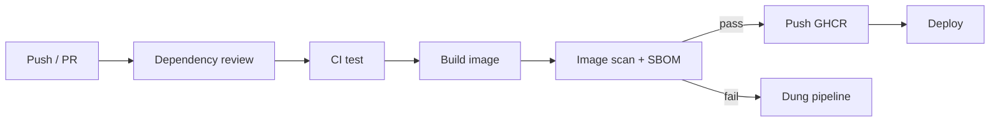

# Buổi 20 – Phần nâng cao: SBOM, pin SHA, security.yml

Tuần 10/16 · Giai đoạn 3 – CI/CD & Automation · Buổi 20/32 (tùy chọn, làm ở nhà)

[Bài học Buổi 20 – Pipeline Security](session-20.md) · [Bài tập tuần 10](../../assignments/weekly/week-10.md) · [Hub tuần 10](README.md)

> **Tóm tắt:** Phần nâng cao của buổi 20: quét có lọc, quét cấu hình, sinh SBOM, pin action theo SHA, workflow security.yml và bài phá lỗi security gate.

::: tip Chỉ làm khi đã xong L1
Trang này không bắt buộc để qua buổi. Làm khi bạn đã hoàn thành checklist L1 của [Buổi 20](session-20.md) (vẫn dùng hàm `trivy` và file `club-api.tar` đã tạo ở bước Chuẩn bị). Đối chiếu đáp án mở sau khi nộp bài ở [trang tuần 10](README.md). Thời gian ước lượng: Phần A 15 phút, Phần B 10 phút, Phần C 10 phút.
:::

## Phần A. Quét sâu hơn (15 phút)

**A.1. Chỉ hiện lỗ hổng có bản vá** (thứ bạn xử lý được ngay):

```bash
trivy image --input /work/scan-tmp/club-api.tar --severity HIGH,CRITICAL --ignore-unfixed \
  | tee -a lab-20/evidence/command-output.txt
```

Vì sao: lỗ hổng chưa có bản vá không sửa được bằng cách nâng phiên bản; chúng cần được theo dõi chứ không nên làm pipeline thất bại vĩnh viễn. So sánh số `Total` với lần quét ở bài chính.

**A.2. Phương án Docker Scout** (cần đăng nhập Docker, không dán token vào bằng chứng):

```bash
docker scout cves club-api:1.0.0 --only-severity critical,high
docker scout quickview club-api:1.0.0
```

**A.3. Quét cấu hình Kubernetes** để tìm cấu hình sai:

```bash
trivy config /project/k8s
```

Kết quả mong đợi: danh sách cảnh báo cấu hình (ví dụ container chạy không có `securityContext`), kèm severity. Chọn 2 cảnh báo, ghi vào `report.md`: nội dung, có đáng sửa không, sửa thế nào, và một câu giải thích vì sao severity không phải thước đo rủi ro duy nhất.

## Phần B. Sinh SBOM (10 phút)

SBOM (Software Bill of Materials) là danh sách thành phần của một sản phẩm: gói nào, phiên bản nào, từ đâu. Khi có CVE mới, SBOM giúp trả lời trong vài phút "chúng ta có dùng gói đó không, ở image nào". Hai định dạng phổ biến: CycloneDX và SPDX.

```bash
trivy image --input /work/scan-tmp/club-api.tar \
  --format cyclonedx --output /work/evidence/club-api-sbom.cdx.json
ls -lh lab-20/evidence/club-api-sbom.cdx.json
python3 -m json.tool lab-20/evidence/club-api-sbom.cdx.json > /dev/null && echo "json hop le"
grep -c '"type": "library"' lab-20/evidence/club-api-sbom.cdx.json
grep -m5 '"name": "express"\|"name": "pg"' lab-20/evidence/club-api-sbom.cdx.json
```

Kết quả mong đợi: file JSON vài chục đến vài trăm KB, `json hop le`, số thành phần lớn hơn 0 và thấy tên gói `express`, `pg`. Nếu `grep` không khớp do cách định dạng JSON, mở file bằng trình soạn thảo và tìm `express`. Vì sao: SBOM cho thấy cả dependency gián tiếp mà bạn không khai báo trong `package.json`. Ghi các lệnh trên vào `evidence/command-output.txt` bằng `tee -a`.

## Phần C. Pin action theo SHA (10 phút)

Tag như `v4` là con trỏ có thể bị di chuyển; commit SHA 40 ký tự là bất biến. Với action bên thứ ba nên pin theo SHA và ghi chú phiên bản trong comment; Dependabot có thể tự cập nhật SHA đã pin.

| Cách tham chiếu | Bất biến | Dễ đọc | Khuyến nghị |
| --- | --- | --- | --- |
| `@main` | Không | Có | Không dùng |
| `@v4` | Không (tag di chuyển được) | Có | Chấp nhận với action chính thức của GitHub, Docker |
| `@` + SHA đầy đủ | Có | Không (cần comment) | Dùng cho action bên thứ ba |

**C.1.** Tìm SHA của một tag:

```bash
git ls-remote https://github.com/actions/checkout 'refs/tags/v4.2.2*' | tee -a lab-20/evidence/command-output.txt
```

Kết quả mong đợi: một hoặc hai dòng gồm SHA 40 ký tự hex, một dấu tab, rồi `refs/tags/v4.2.2`. Nếu có dòng kết thúc `^{}` (tag annotated), dùng SHA của dòng đó vì nó trỏ tới commit. Kiểm tra lại SHA trên trang Releases của repo action trước khi dùng.

**C.2.** Pin trong `demo-wide.yml` (thay dòng `actions/checkout@v4`), giữ comment phiên bản:

```yaml
- uses: actions/checkout@SHA_DAY_DU_40_KY_TU # v4.2.2
```

Thay `SHA_DAY_DU_40_KY_TU` bằng giá trị thật bạn vừa tra; để nguyên placeholder thì workflow không chạy được. Push và chạy workflow, lưu mã run xanh vào `README.md`.

::: details Tự kiểm tra phần nâng cao
1. Vì sao pin action theo SHA an toàn hơn theo tag? Nhược điểm là gì và khắc phục thế nào?
2. SBOM giải quyết vấn đề gì khi một CVE mới được công bố?

Đáp án: (1) Tag có thể bị trỏ sang commit khác, SHA thì bất biến. Nhược điểm là khó đọc và khó cập nhật; khắc phục bằng comment phiên bản và Dependabot tự cập nhật SHA. (2) SBOM cho biết image chứa gói nào, phiên bản nào, nên bạn trả lời nhanh "có bị ảnh hưởng không" và biết cần vá image nào.
:::

## Thử thách L2: workflow security.yml

Tạo `.github/workflows/security.yml` chạy trên PR và push vào nhánh chính, gồm ba việc. Tiêu chí hoàn thành:

- [ ] Quyền cấp workflow là `contents: read`; không job nào có quyền ghi không cần thiết.
- [ ] Job dependency review chỉ chạy với sự kiện `pull_request`, thất bại khi có dependency mới mức HIGH trở lên.
- [ ] Job build image `club-api` rồi quét; thất bại khi có CRITICAL đã có bản vá (`--ignore-unfixed`, `--exit-code 1`).
- [ ] Job sinh SBOM và tải lên làm artifact, giữ 30 ngày.
- [ ] Mọi action bên thứ ba được pin theo SHA; không có `${{ }}` chứa dữ liệu người dùng bên trong `run:`.
- [ ] Giải thích trong `report.md`: ngưỡng bạn chọn là gì và vì sao.

Tự thử 15 phút trước khi mở gợi ý.

::::: details Gợi ý bậc 1: dependency review
`actions/dependency-review-action@v4` nhận đầu vào `fail-on-severity: high`. Dependency review dùng dependency graph của GitHub: repo public bật sẵn, repo private có thể cần bật hoặc cần tính năng trả phí (kiểm tra tài liệu GitHub). Nếu không dùng được, thay bằng `npm audit --omit=dev` ở `starter-project/backend` và ghi nhận trong `report.md`.
:::::

::::: details Gợi ý bậc 2: build và quét
Build image vào Docker daemon của runner bằng `docker build -t club-api:ci starter-project/backend`, rồi `docker save` ra tar và quét tag `club-api:ci`. Dùng `aquasecurity/trivy-action` hoặc chạy trực tiếp container `aquasec/trivy` với `--input` như ở bài chính. Chạy container trực tiếp tránh phụ thuộc thêm action bên thứ ba và không cần mount `docker.sock`.
:::::

::::: details Gợi ý bậc 3: SBOM và artifact
Đặt bước SBOM trước bước scan, upload bằng `actions/upload-artifact@v4` với `retention-days: 30` và `if: always()` để luôn có SBOM kể cả khi scan thất bại. Đối chiếu với `examples/github-actions/security-scan.yml` sau khi làm xong.
:::::

Tham khảo thêm: sơ đồ một pipeline an toàn (dependency review chặn dependency xấu trước khi merge, CI test với quyền chỉ đọc, build rồi quét và sinh SBOM, chỉ job publish có `packages: write`):



## Phá lỗi nâng cao: security gate chặn pipeline

Cách phá: sửa dòng `FROM` của `starter-project/backend/Dockerfile` (cả hai stage) thành `node:18-alpine`, rồi push lên nhánh thử nghiệm và mở PR (cần workflow `security.yml` ở trên).

Triệu chứng: job `image-scan` đỏ, log kết thúc bằng bảng CVE và bước thất bại với exit code 1. Code không đổi, test vẫn xanh.

Hướng điều tra:

1. Mở log của bước Scan image, đọc dòng `Total:` và các dòng CRITICAL đầu tiên.
2. Xác định lỗ hổng thuộc gói hệ điều hành hay gói `node-pkg` (cột Library và Target).
3. Xem cột Fixed Version: có bản vá không? Nếu có, vá bằng cách nào (nâng base image, nâng dependency)?
4. Chạy lại cục bộ với cùng lệnh để tái lập, sau đó thử `--ignore-unfixed` để biết phần nào xử lý được.
5. Thử đổi về `node:22-alpine` và quét lại; so sánh số lượng.

Nếu job vẫn xanh (image Node 18 mới nhất có thể chưa có CRITICAL đã vá), hạ ngưỡng tạm thời xuống `--severity HIGH,CRITICAL` hoặc bỏ `--ignore-unfixed` để quan sát cơ chế chặn; ghi nhận trong report rằng kết quả phụ thuộc thời điểm quét.

Nguyên nhân gốc: base image cũ, không còn được bảo trì (Node 18 đã hết vòng đời hỗ trợ), nên chứa các gói có CVE đã biết. Pipeline đã làm đúng việc của nó.

Cách phòng tránh: dùng base image còn được hỗ trợ và pin theo phiên bản; bật Dependabot cho `docker` và `npm`; quét định kỳ (schedule) chứ không chỉ khi có commit; với trường hợp phải chấp nhận rủi ro, dùng file `.trivyignore` kèm lý do và ngày hết hạn xem xét, không tắt gate. Có thể tham khảo cách điều tra từng bước ở `examples/troubleshooting/scenario-05` cho lỗi build image.

Tình huống phụ (tùy chọn): trong workflow thử nghiệm, nhúng `${{ github.head_ref }}` trực tiếp vào `run:` và mở PR từ nhánh đặt tên chứa dấu nháy và `;`. Quan sát lệnh bị phá, rồi sửa bằng biến môi trường.

## Gặp lỗi?

| Triệu chứng | Nguyên nhân | Cách sửa |
| --- | --- | --- |
| Dependency review báo dependency graph chưa bật | Repo private chưa bật tính năng này | Bật trong Settings, Code security (nếu được phép) hoặc dùng `npm audit --omit=dev` |
| Workflow lỗi `Unable to resolve action` sau khi pin | SHA sai hoặc sao chép thiếu | Tra lại bằng `git ls-remote`, SHA phải đủ 40 ký tự và thuộc repo action đó |
| `grep` không thấy `express` trong SBOM | Sai đường dẫn file hoặc JSON định dạng khác | Mở file bằng trình soạn thảo và tìm `express`; kiểm tra lệnh `ls -lh` |
| `docker scout` yêu cầu đăng nhập | Docker Scout cần tài khoản Docker | Chạy `docker login` (nhập mật khẩu khi được hỏi) hoặc dùng Trivy |

## Tìm hiểu thêm: secret và công cụ quét

**Secret: làm và không làm**

| Làm | Không làm |
| --- | --- |
| Lưu giá trị nhạy cảm trong Secrets, dùng ở cấp nhỏ nhất (environment secret nếu có) | Ghi secret vào YAML, Dockerfile, `compose.yaml` |
| Truyền secret qua biến môi trường của đúng bước cần dùng | Truyền secret qua tham số dòng lệnh dễ lộ trong log |
| Xoay ngay khi nghi ngờ lộ | Tin vào việc "xóa commit là xong" |

Với repo local, dùng `.env` và đảm bảo `.env` nằm trong `.gitignore`.

**Trivy và Docker Scout**

| Tiêu chí | Trivy | Docker Scout |
| --- | --- | --- |
| Cài đặt | Chạy bằng container, không cần cài | Có sẵn trong Docker Desktop (`docker scout`) |
| Đăng nhập | Không cần | Cần đăng nhập Docker Hub |
| Dùng trong CI | Rất phổ biến | Cần cấu hình đăng nhập |

## Tài liệu tham khảo

- [GitHub Docs – Security hardening for GitHub Actions](https://docs.github.com/en/actions/security-for-github-actions/security-guides/security-hardening-for-github-actions)
- [GitHub Docs – Controlling permissions for GITHUB_TOKEN](https://docs.github.com/en/actions/writing-workflows/choosing-what-your-workflow-does/controlling-permissions-for-github_token)
- [GitHub Docs – Dependency review](https://docs.github.com/en/code-security/supply-chain-security/understanding-your-software-supply-chain/about-dependency-review)
- [Trivy documentation](https://trivy.dev/latest/docs/)
- [Docker Scout documentation](https://docs.docker.com/scout/)
- [CycloneDX specification overview](https://cyclonedx.org/specification/overview/)
