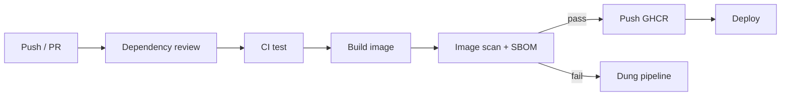
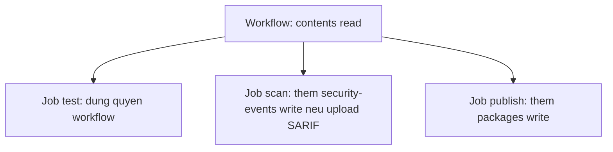

# Buổi 20 – Pipeline Security

Tuần 10 · Giai đoạn 3 – CI/CD & Automation · Slide: [Slide buổi 20](../../slides/04-cicd/session-20.md)

> **Tóm tắt:** Rà soát quyền của GitHub Actions theo least privilege, quản lý secret an toàn, quét image bằng Trivy hoặc Docker Scout, sinh SBOM và pin action theo SHA.

## Mục tiêu học tập

- Giải thích nguyên tắc least privilege và tác động của `permissions:` lên `GITHUB_TOKEN` trong workflow.
- Rà soát một workflow và đưa quyền về mức tối thiểu cho từng job.
- Chạy được Trivy (hoặc Docker Scout) để quét image `club-api:1.0.0`, đọc và phân loại kết quả theo severity.
- Sinh được SBOM định dạng CycloneDX cho image và giải thích SBOM dùng để làm gì.
- Pin một action theo commit SHA và giải thích rủi ro của tag có thể bị di chuyển.
- Chẩn đoán pipeline bị chặn bởi security gate và đề xuất cách xử lý có kiểm soát.

## Điều kiện cần

- Đã hoàn thành buổi 17-19: biết viết workflow GitHub Actions cơ bản, đã thấy `ci.yml` và `publish.yml` của repo giáo trình, hiểu image tag và GHCR.
- Đã build được image `club-api:1.0.0` từ `starter-project/backend` (buổi Dockerfile).
- Có repo cá nhân `devops-labs` trên GitHub, đã clone vào filesystem của WSL (ví dụ `~/devops-labs`, không dùng `/mnt/c`).
- Docker Desktop đang chạy, tích hợp WSL2 bật cho distro Ubuntu.

Kiểm tra nhanh:

```bash
docker version --format '{{.Server.Version}}'
docker image inspect club-api:1.0.0 --format '{{.Id}}'
git -C ~/devops-labs remote -v
```

Kết quả mong đợi: in ra phiên bản Docker Engine (27 trở lên), một chuỗi `sha256:...` và URL repo `devops-labs` của bạn. Nếu thiếu image, build lại:

```bash
cd ~/devops-labs/starter-project/backend
docker build -t club-api:1.0.0 .
```

## Vấn đề thực tế

CLB vừa có pipeline chạy tốt: push code, CI chạy test, publish đẩy image lên GHCR. Một thành viên mới copy một action lạ từ blog về để "gửi thông báo", và để cho nhanh bạn đặt `permissions: write-all`. Vài tuần sau tác giả action bị mất tài khoản, tag `v1` bị trỏ sang mã độc. Lần chạy kế tiếp, mã đó chạy trong runner của bạn, đọc được `GITHUB_TOKEN` có quyền ghi vào repo và package. Chuyện này là có thật ở quy mô lớn: các sự cố supply chain trên GitHub Actions những năm gần đây đều xoay quanh việc action bên thứ ba bị sửa và token có quyền quá rộng.

Pipeline là nơi có quyền cao nhất trong dự án: nó đọc source, giữ secret, ghi vào registry và triển khai. Bảo mật pipeline không phải là việc "làm sau": mỗi dòng cấu hình quyền và mỗi dependency bạn thêm vào đều mở rộng bề mặt tấn công. Buổi này học cách thu hẹp quyền, kiểm tra thứ ta đưa vào image và chứng minh được thứ đó là gì.

## Khái niệm cốt lõi

### Least privilege

Mỗi thành phần (workflow, job, token, người dùng) chỉ nên có quyền đủ để làm việc của nó, trong thời gian đủ để làm việc đó. Nếu một bước bị chiếm quyền, thiệt hại bị giới hạn bởi quyền được cấp.

### Permissions của GITHUB_TOKEN

Mỗi lần workflow chạy, GitHub tạo một token `GITHUB_TOKEN` tự hết hạn khi job kết thúc. Quyền mặc định của token phụ thuộc cài đặt của repo/organization (permissive hoặc restricted). Bạn không nên phụ thuộc vào mặc định mà phải khai báo `permissions:` tường minh. Khi bạn khai báo khóa `permissions`, mọi quyền không liệt kê sẽ bị đặt là `none`.

| Quyền | Khi nào cần | Ví dụ trong khóa học |
| --- | --- | --- |
| `contents: read` | checkout code | `ci.yml` |
| `packages: write` | đẩy image lên GHCR | job publish trong `publish.yml` |
| `pull-requests: write` | bot comment lên PR | không cần ở khóa học này |
| `id-token: write` | OIDC tới cloud, ký artifact | không dùng (local-only) |
| `security-events: write` | upload kết quả SARIF vào tab Security | quét image (tùy chọn) |

Nguyên tắc: đặt `permissions: contents: read` ở cấp workflow, job nào cần thêm thì khai báo thêm ở cấp job.

### Secret management

| Làm | Không làm |
| --- | --- |
| Lưu giá trị nhạy cảm trong Settings, Secrets and variables, Actions | Ghi secret vào YAML, Dockerfile, `compose.yaml` |
| Dùng secret ở cấp nhỏ nhất (environment secret nếu có) | `echo` secret ra log, in `env` |
| Truyền secret qua biến môi trường của đúng bước cần dùng | Truyền secret qua tham số dòng lệnh dễ lộ trong log |
| Xoay (rotate) ngay khi nghi ngờ lộ | Tin vào việc "xóa commit là xong" (lịch sử vẫn còn) |

GitHub tự che (mask) giá trị secret trong log, nhưng che theo kiểu khớp chuỗi: giá trị bị biến đổi (base64, cắt, đảo) sẽ không bị che. Với repo local, dùng `.env` và đảm bảo `.env` nằm trong `.gitignore`.

### Script injection

Biểu thức `${{ ... }}` được thay thế bằng chuỗi trước khi shell chạy. Nếu bạn nhúng dữ liệu do người dùng kiểm soát (tiêu đề PR, tên nhánh, nội dung issue) trực tiếp vào `run:`, kẻ tấn công có thể chèn lệnh. Cách an toàn là gán vào biến môi trường rồi dùng `"$BIEN"` trong shell:

```yaml
# Nguy hiểm: tiêu đề PR trở thành một phần của lệnh shell
- run: echo "PR title is ${{ github.event.pull_request.title }}"

# An toàn: giá trị đi qua biến môi trường, shell không diễn giải nó như lệnh
- env:
    PR_TITLE: ${{ github.event.pull_request.title }}
  run: echo "PR title is $PR_TITLE"
```

### Pin action theo SHA

Tag như `v4` là con trỏ có thể bị di chuyển. Commit SHA 40 ký tự là bất biến. Với action bên thứ ba (không phải của `actions/` hay `docker/`), nên pin theo SHA và ghi chú phiên bản trong comment. Công cụ như Dependabot có thể tự cập nhật SHA đã pin.

| Cách tham chiếu | Bất biến | Dễ đọc | Khuyến nghị |
| --- | --- | --- | --- |
| `@main` | Không | Có | Không dùng |
| `@v4` | Không (tag di chuyển được) | Có | Chấp nhận với action của GitHub/Docker chính thức |
| `@` + SHA đầy đủ | Có | Không (cần comment) | Dùng cho action bên thứ ba |

### Dependency review và dependency scanning

Phần lớn code chạy trong ứng dụng không phải do bạn viết mà đến từ `npm`. Dependency review (action `actions/dependency-review-action`) so sánh dependency trước và sau một PR, báo cáo gói mới thêm có lỗ hổng đã biết hoặc giấy phép không mong muốn. Nó dùng dependency graph của GitHub: với repo public thì bật sẵn; với repo private có thể cần tính năng trả phí (kiểm tra tài liệu của GitHub). Tại local, `npm audit` cho góc nhìn tương tự.

### SBOM

SBOM (Software Bill of Materials) là danh sách thành phần của một sản phẩm: gói nào, phiên bản nào, từ đâu. Khi có lỗ hổng mới như một CVE nghiêm trọng trong một thư viện, SBOM giúp trả lời trong vài phút "chúng ta có dùng gói đó không, ở image nào". Hai định dạng phổ biến: CycloneDX và SPDX.

### Image scanning

Công cụ quét so khớp các gói trong image (gói hệ điều hành như `apk` của Alpine và gói ngôn ngữ như `npm`) với cơ sở dữ liệu lỗ hổng (CVE).

| Tiêu chí | Trivy | Docker Scout |
| --- | --- | --- |
| Cài đặt | Chạy bằng container, không cần cài | Có sẵn trong Docker Desktop (`docker scout`) |
| Đăng nhập | Không cần | Cần đăng nhập Docker Hub |
| Sinh SBOM | Có (`--format cyclonedx`) | Có (`docker scout sbom`) |
| Dùng trong CI | Rất phổ biến | Cần cấu hình đăng nhập |

Severity (LOW, MEDIUM, HIGH, CRITICAL) chỉ là điểm khởi đầu: một lỗ hổng CRITICAL trong gói không bao giờ được gọi tới thì rủi ro thực tế thấp hơn một lỗ hổng HIGH nằm trên đường xử lý request. Mục tiêu không phải "0 lỗ hổng" mà là hiểu, ưu tiên và xử lý có chủ đích.

## Kiến trúc và cách hoạt động



1. Khi có PR, dependency review chặn dependency mới mang lỗ hổng nghiêm trọng trước khi merge.
2. CI chạy test với quyền `contents: read`, không có quyền ghi.
3. Image được build, sau đó quét. SBOM được sinh ra và lưu như artifact để truy vết.
4. Nếu scan phát hiện lỗ hổng vượt ngưỡng đã thỏa thuận (ví dụ CRITICAL có bản vá), job thất bại và image không được đẩy lên registry.
5. Chỉ job publish mới có `packages: write`, các job khác không có.

Quyền của token theo từng tầng:



Quyền ở cấp workflow là mức sàn cho mọi job; job chỉ nâng quyền khi thật sự cần. File mẫu gom các bước quét và SBOM nằm ở `examples/github-actions/security-scan.yml` (đọc sau khi làm xong lab để so sánh với bản của bạn).

## Demo của mentor

Mục tiêu demo: cho lớp thấy một workflow "chạy được nhưng nguy hiểm" và một công cụ tìm ra vấn đề trong image.

1. Mở `.github/workflows/publish.yml` của repo giáo trình. Hỏi lớp: "Job nào cần `packages: write`, job nào không?" Chỉ ra quyền được khai báo ở hai cấp.
2. Thêm tạm một dòng vào bước cuối của workflow thử nghiệm để lộ cách che secret hoạt động:

```yaml
- name: Demo masking
  env:
    DEMO_SECRET: ${{ secrets.DEMO_SECRET }}
  run: |
    echo "raw: $DEMO_SECRET"
    echo "base64: $(echo -n "$DEMO_SECRET" | base64)"
```

Kết quả mong đợi trong log: dòng `raw:` hiện `***`, dòng `base64:` hiện chuỗi base64 thật vì giá trị đã bị biến đổi (không khớp chuỗi bị che). Câu hỏi cho lớp: "Che log có thay thế được việc không in secret không?" (Không.) Xóa bước demo và xoay secret demo sau buổi học.

3. Quét image trước lớp. Ta không mount `docker.sock` vào container quét (mount socket cho container quyền điều khiển Docker daemon, tương đương root trên máy). Thay vào đó xuất image ra file tar rồi cho Trivy đọc file:

```bash
mkdir -p /tmp/scan
docker save club-api:1.0.0 -o /tmp/scan/club-api.tar
docker run --rm \
  -v trivy-cache:/root/.cache/ \
  -v /tmp/scan:/work:ro \
  aquasec/trivy:0.57.1 image --input /work/club-api.tar --severity HIGH,CRITICAL
```

Kết quả mong đợi (rút gọn; số lượng thay đổi theo thời điểm). Trivy 0.57.1 in một khối cho mỗi loại thành phần (gói hệ điều hành `apk`, gói ngôn ngữ `node-pkg`), mỗi khối có dòng `Total`:

```text
/work/club-api.tar (alpine 3.xx)
===============================
Total: 0 (HIGH: 0, CRITICAL: 0)

Node.js (node-pkg)
==================
Total: 3 (HIGH: 3, CRITICAL: 0)
```

Bên dưới dòng `Total` của khối có lỗ hổng là bảng CVE (thư viện, mã CVE, mức độ, phiên bản đã cài, phiên bản vá). Gói `node-pkg` có thể nằm trong `/usr/local/lib/node_modules/npm` (npm đi kèm base image), không phải `express` hay `pg` của ứng dụng: xem cột Library và đường dẫn khi điều tra.

Câu hỏi: "Có thể ra 0 hôm nay và khác 0 ngày mai không? Vì sao?" (Cơ sở dữ liệu CVE cập nhật liên tục; image không đổi nhưng kiến thức về lỗ hổng thì đổi.)

4. Quét một image cũ để thấy sự khác biệt:

```bash
docker pull node:18-alpine
docker save node:18-alpine -o /tmp/scan/node18.tar
docker run --rm \
  -v trivy-cache:/root/.cache/ \
  -v /tmp/scan:/work:ro \
  aquasec/trivy:0.57.1 image --input /work/node18.tar --severity HIGH,CRITICAL
```

Kết quả mong đợi: thường có danh sách CVE (số lượng phụ thuộc thời điểm quét; nếu ra 0 thì bỏ `--severity` để thấy cả mức thấp hơn). Hỏi lớp: "Nên làm gì: bỏ qua, nâng base image, hay vá từng gói?"

## Hands-on lab

### Chuẩn bị

Làm việc trong repo cá nhân, trên filesystem của WSL.

```bash
cd ~/devops-labs
mkdir -p lab-20/source lab-20/evidence lab-20/screenshots
mkdir -p .github/workflows
ls lab-20
```

Các lệnh dưới đây giả định `starter-project/` nằm ở gốc repo cá nhân của bạn (copy từ repo giáo trình nếu chưa có); log đặt trong `lab-20/evidence/`. Kết quả mong đợi của `ls`: các thư mục `evidence`, `screenshots`, `source`.

Để khỏi lặp lại lệnh dài, định nghĩa hàm `trivy` cho phiên shell hiện tại. Hàm chỉ mount thư mục `lab-20` và `starter-project` (không mount `docker.sock`); image được đưa vào bằng file tar:

```bash
trivy() {
  docker run --rm \
    -v trivy-cache:/root/.cache/ \
    -v "$PWD/lab-20:/work" \
    -v "$PWD/starter-project:/project:ro" \
    aquasec/trivy:0.57.1 "$@"
}
mkdir -p lab-20/scan-tmp
printf 'lab-20/scan-tmp/\n' >> .gitignore
docker save club-api:1.0.0 -o lab-20/scan-tmp/club-api.tar
ls -lh lab-20/scan-tmp
```

Kết quả mong đợi: file `club-api.tar` kích thước vài chục đến vài trăm MB. Thư mục này chỉ là tệp tạm và đã được đưa vào `.gitignore`.

Ghi lại toàn bộ lệnh và kết quả quan trọng vào file bằng `tee` để dùng làm bằng chứng:

```bash
echo "== Lab 20 evidence ==" | tee lab-20/evidence/command-output.txt
date | tee -a lab-20/evidence/command-output.txt
```

### Phần 1. Rà soát permissions (15 phút)

**Bước 1.1.** Liệt kê mọi `permissions` hiện có trong các workflow:

```bash
grep -n -A3 "permissions" .github/workflows/*.yml | tee -a lab-20/evidence/command-output.txt
```

Kết quả mong đợi: với repo giáo trình, `ci.yml` có `permissions: contents: read` ở cấp workflow; `publish.yml` có `contents: read` ở cấp workflow và `contents: read` kèm `packages: write` ở cấp job `publish`. Nếu workflow của bạn không có khối `permissions`, quyền token đang phụ thuộc cài đặt mặc định của repo, và đó là điều cần sửa.

**Bước 1.2.** Kiểm tra cài đặt mặc định của repo: vào GitHub, Settings, Actions, General, mục Workflow permissions. Chọn "Read repository contents and packages permissions". Chụp ảnh lưu vào `lab-20/screenshots/`.

Vì sao: dù đã khai báo trong từng workflow, đặt mặc định ở mức đọc giúp workflow mới (viết quên khai báo) không vô tình có quyền ghi.

**Bước 1.3.** Lập bảng rà soát trong `lab-20/report.md`. Với mỗi workflow và job, ghi: quyền hiện có, quyền thật sự cần, lý do.

```text
| Workflow | Job | Hien co | Can | Ly do |
| ci.yml | test | contents read | contents read | chi checkout va chay test |
| publish.yml | publish | contents read, packages write | giu nguyen | day image len GHCR |
```

**Bước 1.4.** Sửa một workflow thử nghiệm quyền rộng. Tạo `.github/workflows/demo-wide.yml`:

```yaml
name: Demo wide permissions
on: workflow_dispatch
permissions: write-all
jobs:
  hello:
    runs-on: ubuntu-latest
    steps:
      - uses: actions/checkout@v4
      - run: echo "hello"
```

Sửa lại cho đúng: thay `permissions: write-all` bằng `permissions: contents: read`. Commit cả hai trạng thái ở hai commit riêng để diff thể hiện được thay đổi.

### Phần 2. Quét image và đọc kết quả (15 phút)

**Bước 2.1.** Quét bằng Trivy (chọn một trong hai, Trivy là mặc định):

```bash
trivy image --input /work/scan-tmp/club-api.tar --severity HIGH,CRITICAL \
  | tee -a lab-20/evidence/command-output.txt
```

Kết quả mong đợi: một khối theo từng loại (hệ điều hành, `node-pkg`) với dòng `Total: N (HIGH: x, CRITICAL: y)`; nếu có lỗ hổng thì kèm bảng CVE. Lần chạy đầu tải cơ sở dữ liệu nên chậm hơn; lần sau dùng volume `trivy-cache`.

Phương án Docker Scout (cần đăng nhập Docker):

```bash
docker scout cves club-api:1.0.0 --only-severity critical,high
docker scout quickview club-api:1.0.0
```

Kết quả mong đợi: danh sách CVE theo gói và bản vá nếu có. Không dán token hay thông tin đăng nhập vào bằng chứng.

**Bước 2.2.** Chỉ hiển thị lỗ hổng có bản vá (đây là thứ bạn xử lý được ngay):

```bash
trivy image --input /work/scan-tmp/club-api.tar --severity HIGH,CRITICAL --ignore-unfixed
```

Vì sao: lỗ hổng chưa có bản vá thì bạn không thể sửa bằng cách nâng phiên bản; chúng cần được theo dõi chứ không nên làm pipeline thất bại vĩnh viễn.

**Bước 2.3.** Quét cả file cấu hình (Dockerfile, Kubernetes YAML) để tìm cấu hình sai:

```bash
trivy config /project/k8s
```

Kết quả mong đợi: danh sách các cảnh báo cấu hình (ví dụ container chạy không có `securityContext`), kèm severity. Chọn 2 cảnh báo, ghi vào `report.md`: có đáng sửa không, sửa thế nào.

### Phần 3. Sinh SBOM (10 phút)

**Bước 3.1.** Sinh SBOM CycloneDX cho image:

```bash
trivy image --input /work/scan-tmp/club-api.tar \
  --format cyclonedx --output /work/evidence/club-api-sbom.cdx.json
ls -lh lab-20/evidence/club-api-sbom.cdx.json
```

Kết quả mong đợi: file JSON có kích thước vài chục đến vài trăm KB.

**Bước 3.2.** Xem SBOM chứa gì:

```bash
grep -c '"type": "library"' lab-20/evidence/club-api-sbom.cdx.json
grep -m5 '"name": "express"\|"name": "pg"' lab-20/evidence/club-api-sbom.cdx.json
```

Kết quả mong đợi: số lượng thành phần lớn hơn 0 và thấy tên gói `express`, `pg`. Nếu `grep` không khớp do cách định dạng JSON, mở file bằng trình soạn thảo và tìm `express`.

Vì sao: SBOM cho thấy cả dependency gián tiếp mà bạn không tự khai báo trong `package.json`.

### Phần 4. Pin action theo SHA và rà soát secret (10 phút)

**Bước 4.1.** Tìm SHA của một tag:

```bash
git ls-remote https://github.com/actions/checkout 'refs/tags/v4.2.2*'
```

Kết quả mong đợi: một hoặc hai dòng gồm SHA 40 ký tự hex, một dấu tab, rồi `refs/tags/v4.2.2`. Nếu có dòng kết thúc `^{}` (tag annotated), dùng SHA của dòng đó vì nó trỏ tới commit. Kiểm tra lại SHA trên trang Releases của repo action trước khi dùng.

**Bước 4.2.** Pin trong `demo-wide.yml` (thay dòng `actions/checkout@v4`), giữ comment phiên bản:

```yaml
- uses: actions/checkout@SHA_DAY_DU_40_KY_TU # v4.2.2
```

Thay `SHA_DAY_DU_40_KY_TU` bằng giá trị thật bạn tra ở bước trước. Placeholder này không chạy được nếu để nguyên.

**Bước 4.3.** Tìm secret lỡ commit trong repo:

```bash
git grep -n -i -E "password|secret|token|api[_-]?key" -- . ':!*.md' ':!package-lock.json' \
  | tee -a lab-20/evidence/command-output.txt
```

Kết quả mong đợi: chỉ thấy tên biến (ví dụ `DB_PASSWORD`, `secrets.GITHUB_TOKEN`), không có giá trị thật. Nếu thấy giá trị thật: coi như đã lộ, xoay ngay và xóa khỏi code.

### L1 – Foundation: checklist hoàn thành

- [ ] Đã liệt kê `permissions` của mọi workflow và lập bảng rà soát trong `report.md`.
- [ ] Workflow `demo-wide.yml` đã được sửa từ `write-all` về `contents: read` (hai commit riêng).
- [ ] Cài đặt Workflow permissions của repo đặt ở mức chỉ đọc (có ảnh chụp).
- [ ] Đã quét `club-api:1.0.0` bằng Trivy hoặc Docker Scout, log lưu trong `evidence/command-output.txt`.
- [ ] Đã sinh `club-api-sbom.cdx.json` và tìm thấy gói `express` trong đó.
- [ ] Đã pin ít nhất một action theo SHA kèm comment phiên bản.

### L2 – Engineering: thử thách tự làm

Thử thách: tạo workflow `.github/workflows/security.yml` chạy trên PR và push vào nhánh chính, gồm ba việc.

Tiêu chí hoàn thành:

- [ ] Quyền cấp workflow là `contents: read`; không job nào có quyền ghi không cần thiết.
- [ ] Job dependency review chỉ chạy với sự kiện `pull_request`, thất bại khi có dependency mới mức HIGH trở lên.
- [ ] Job build image `club-api` rồi quét; thất bại khi có CRITICAL đã có bản vá (`--ignore-unfixed`, `--exit-code 1`).
- [ ] Job sinh SBOM và tải lên làm artifact, giữ 30 ngày.
- [ ] Mọi action bên thứ ba được pin theo SHA; không có `${{ }}` chứa dữ liệu người dùng bên trong `run:`.
- [ ] Giải thích trong `report.md`: ngưỡng bạn chọn là gì và vì sao.

<details>
<summary>Gợi ý</summary>

- `actions/dependency-review-action@v4` nhận đầu vào `fail-on-severity: high`.
- Build image vào Docker daemon của runner bằng `docker build -t club-api:ci starter-project/backend`, sau đó quét tag `club-api:ci`.
- Dùng `aquasecurity/trivy-action` hoặc chạy trực tiếp container `aquasec/trivy` với `--input` như ở phần 2. Chạy container trực tiếp tránh phụ thuộc thêm action bên thứ ba và không cần mount `docker.sock`.
- Upload SBOM bằng `actions/upload-artifact@v4` với `retention-days: 30`.
- Đối chiếu với `examples/github-actions/security-scan.yml` sau khi làm xong.

</details>

<details>
<summary>Lời giải tham khảo</summary>

```yaml
name: Security

on:
  pull_request:
  push:
    branches: [main, master]

permissions:
  contents: read

jobs:
  dependency-review:
    if: github.event_name == 'pull_request'
    runs-on: ubuntu-latest
    steps:
      - uses: actions/checkout@v4
      - uses: actions/dependency-review-action@v4
        with:
          fail-on-severity: high

  image-scan:
    runs-on: ubuntu-latest
    steps:
      - uses: actions/checkout@v4

      - name: Build image
        run: docker build -t club-api:ci starter-project/backend

      - name: Export image to tar
        run: |
          mkdir -p scan sbom
          docker save club-api:ci -o scan/club-api.tar

      - name: Generate SBOM
        run: |
          docker run --rm \
            -v "$PWD/scan:/scan:ro" \
            -v "$PWD/sbom:/out" \
            aquasec/trivy:0.57.1 image --input /scan/club-api.tar \
            --format cyclonedx --output /out/club-api.cdx.json

      - name: Scan image
        run: |
          docker run --rm \
            -v "$PWD/scan:/scan:ro" \
            aquasec/trivy:0.57.1 image --input /scan/club-api.tar \
            --severity CRITICAL --ignore-unfixed --exit-code 1

      - uses: actions/upload-artifact@v4
        if: always()
        with:
          name: club-api-sbom
          path: sbom/club-api.cdx.json
          retention-days: 30
```

Lưu ý: nếu repo private và không bật dependency graph, job `dependency-review` sẽ lỗi; ghi nhận trong `report.md` và thay bằng `npm audit --omit=dev` ở thư mục `starter-project/backend`. Bước SBOM đặt trước bước scan và `upload-artifact` có `if: always()` để luôn có SBOM kể cả khi scan thất bại. Lời giải không mount `docker.sock`: image được xuất ra tar rồi Trivy đọc file. Với action bên thứ ba bạn thêm vào, đổi `@v...` thành SHA.

</details>

## Phá lỗi và debug

**Tình huống: Security gate chặn pipeline.**

Cách phá: sửa dòng đầu của `starter-project/backend/Dockerfile` (cả hai stage) thành `FROM node:18-alpine`, rồi push lên nhánh thử nghiệm và mở PR.

Triệu chứng: job `image-scan` đỏ, log kết thúc bằng bảng CVE và bước thất bại với exit code 1. Code không đổi, test vẫn xanh.

Hướng điều tra:

1. Mở log của bước Scan image, đọc dòng `Total:` và các dòng CRITICAL đầu tiên.
2. Xác định lỗ hổng thuộc gói hệ điều hành hay gói `node-pkg` (cột Library và Target).
3. Xem cột Fixed Version: có bản vá không? Nếu có, vá bằng cách nào (nâng base image, nâng dependency)?
4. Chạy lại cục bộ với cùng lệnh để tái lập, sau đó thử `--ignore-unfixed` để biết phần nào xử lý được.
5. Thử đổi về `node:22-alpine` và quét lại; so sánh số lượng.

Nếu job vẫn xanh (image Node 18 mới nhất có thể chưa có CRITICAL đã vá), hạ ngưỡng tạm thời xuống `--severity HIGH,CRITICAL` hoặc bỏ `--ignore-unfixed` để quan sát cơ chế chặn; ghi nhận trong report rằng kết quả phụ thuộc thời điểm quét.

Nguyên nhân gốc: base image cũ, không còn được bảo trì (Node 18 đã hết vòng đời hỗ trợ), nên chứa các gói có CVE đã biết. Pipeline đã làm đúng việc của nó.

Cách phòng tránh: dùng base image còn được hỗ trợ và pin theo phiên bản; bật Dependabot cho `docker` và `npm`; quét định kỳ (schedule) chứ không chỉ khi có commit; với trường hợp phải chấp nhận rủi ro, dùng file `.trivyignore` kèm lý do và ngày hết hạn xem xét, không tắt gate. Có thể tham khảo thêm cách điều tra từng bước ở `examples/troubleshooting/scenario-05` cho lỗi build image.

Tình huống phụ (tùy chọn): trong workflow thử nghiệm, nhúng `${{ github.head_ref }}` trực tiếp vào `run:` và mở PR từ nhánh đặt tên chứa dấu nháy và `;`. Quan sát lệnh bị phá, rồi sửa bằng biến môi trường.

## Lỗi thường gặp

| Triệu chứng | Nguyên nhân | Cách xử lý |
| --- | --- | --- |
| Bước push image báo `denied: permission_denied` | Job không có `packages: write` | Thêm `packages: write` vào đúng job publish |
| `Resource not accessible by integration` | Workflow thiếu quyền (ví dụ `security-events: write`, `pull-requests: write`) | Thêm đúng một quyền thiếu ở cấp job, không dùng `write-all` |
| Trivy báo lỗi tải DB hoặc timeout | Mạng hoặc giới hạn tải từ registry cơ sở dữ liệu | Chạy lại, giữ volume `trivy-cache`; kiểm tra kết nối mạng |
| Trivy báo không mở được file khi dùng `--input` | Chưa chạy `docker save`, hoặc sai đường dẫn mount (`/work`, `/scan`) | Chạy lại `docker save`, kiểm tra `ls` thư mục chứa tar và các tùy chọn `-v` |
| Dependency review báo dependency graph chưa bật | Repo private chưa bật tính năng này | Bật trong Settings, Code security (nếu được phép) hoặc dùng `npm audit` |
| Secret hiện rõ trong log | Giá trị bị biến đổi nên không bị che, hoặc in qua `env`/`set -x` | Không in secret; xoay secret ngay; bỏ `set -x` ở bước dùng secret |
| Workflow lỗi `Unable to resolve action` sau khi pin | SHA sai hoặc sao chép thiếu | Tra lại bằng `git ls-remote`, SHA phải đủ 40 ký tự và thuộc repo action đó |
| Scan luôn đỏ dù đã nâng base image | CVE chưa có bản vá được tính vào ngưỡng | Thêm `--ignore-unfixed`, theo dõi riêng các CVE chưa có bản vá |

## Tự kiểm tra

1. Khi khai báo `permissions:` chỉ có `contents: read`, các quyền khác như `packages` có giá trị gì?
2. Vì sao pin action theo SHA an toàn hơn theo tag? Nhược điểm là gì và khắc phục thế nào?
3. GitHub che secret trong log. Vì sao vẫn không được `echo` secret?
4. SBOM giải quyết vấn đề gì khi một CVE mới được công bố?
5. Scan báo một lỗ hổng CRITICAL trong gói chưa có bản vá. Pipeline nên làm gì?
6. Tình huống: PR của một người ngoài repo thay đổi workflow và dùng `${{ github.event.pull_request.title }}` trong `run:`. Rủi ro là gì và sửa thế nào?
7. Tình huống: image mới build hôm qua quét sạch, hôm nay scan lại thấy HIGH. Không ai đổi code. Giải thích.

<details>
<summary>Đáp án</summary>

1. Là `none`: khi khai báo `permissions`, mọi quyền không liệt kê đều bị tắt.
2. Tag có thể bị trỏ sang commit khác, SHA thì bất biến. Nhược điểm là khó đọc và khó cập nhật; khắc phục bằng comment phiên bản và Dependabot tự cập nhật SHA.
3. Việc che chỉ khớp đúng chuỗi. Giá trị bị biến đổi (base64, cắt, nối) không bị che; ngoài ra log còn có thể bị đọc ở nơi khác. Nguyên tắc là không bao giờ in secret.
4. SBOM cho biết image chứa gói nào, phiên bản nào nên bạn trả lời nhanh "có bị ảnh hưởng không" và biết cần vá image nào.
5. Không nên chặn vĩnh viễn: ghi nhận, theo dõi, giảm bề mặt (đổi base image nhỏ hơn, bỏ gói không cần), cân nhắc chấp nhận rủi ro có thời hạn bằng `.trivyignore` kèm lý do.
6. Kẻ tấn công đặt tiêu đề chứa lệnh shell để chạy trong runner và truy cập token. Sửa bằng cách gán qua biến `env` rồi dùng `"$PR_TITLE"`, đồng thời giữ quyền tối thiểu.
7. Cơ sở dữ liệu CVE cập nhật liên tục; lỗ hổng mới được công bố cho gói đã có sẵn trong image. Vì vậy cần quét định kỳ và cập nhật base image.

</details>

## Nộp bài

Nộp vào thư mục `lab-20/` trong repo cá nhân, theo `templates/lab-template.md`:

- [ ] `README.md` trả lời đủ 7 câu: giải quyết vấn đề gì, kiến thức đã dùng, các bước thực hiện, kết quả mong đợi, lỗi đã gặp, cách khắc phục, có thể cải thiện gì.
- [ ] `evidence/command-output.txt` chứa kết quả `grep permissions`, kết quả quét image và kết quả tìm secret.
- [ ] `evidence/club-api-sbom.cdx.json` (hoặc ghi rõ lý do nếu không sinh được).
- [ ] `report.md` có bảng rà soát permissions, 2 cảnh báo cấu hình đã phân tích và phần giải thích ngưỡng scan (nếu làm L2).
- [ ] `source/` chứa các workflow đã sửa (`demo-wide.yml` sau khi sửa, `security.yml` nếu làm L2).
- [ ] `screenshots/` có ảnh cài đặt Workflow permissions và log lần chạy workflow.
- [ ] Dòng cuối README ghi rõ level đã làm: L1 hoặc L2.
- [ ] Đã kiểm tra không commit secret, token hay file `.env` (chạy lại `git grep` ở bước 4.3).

## Recap

- Khai báo `permissions` tường minh, mức sàn là `contents: read`, chỉ nâng quyền ở cấp job khi cần.
- Secret không bao giờ được in ra log; che log chỉ là lớp bảo vệ phụ.
- Dữ liệu do người dùng kiểm soát phải đi qua biến môi trường, không nhúng trực tiếp vào `run:`.
- Pin action bên thứ ba theo SHA, ghi comment phiên bản, để Dependabot cập nhật.
- Quét image và dependency ở mỗi lần build và định kỳ; ưu tiên lỗ hổng có bản vá và nằm trên đường chạy thật.
- SBOM biến câu hỏi "ta có dùng gói này không" thành việc tra cứu mất vài phút.
- Security gate chặn pipeline là tính năng; xử lý nguyên nhân thay vì tắt gate.

## Tài liệu tham khảo

- [GitHub Docs – Security hardening for GitHub Actions](https://docs.github.com/en/actions/security-for-github-actions/security-guides/security-hardening-for-github-actions)
- [GitHub Docs – Controlling permissions for GITHUB_TOKEN](https://docs.github.com/en/actions/writing-workflows/choosing-what-your-workflow-does/controlling-permissions-for-github_token)
- [GitHub Docs – Dependency review](https://docs.github.com/en/code-security/supply-chain-security/understanding-your-software-supply-chain/about-dependency-review)
- [Trivy documentation](https://trivy.dev/latest/docs/)
- [Docker Scout documentation](https://docs.docker.com/scout/)
- [CycloneDX specification overview](https://cyclonedx.org/specification/overview/)
