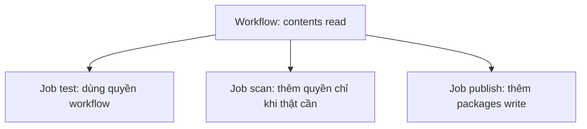

# Buổi 20 – Pipeline Security

Tuần 10/16 · Giai đoạn 3 – CI/CD & Automation · Buổi 20/32

[Slide buổi 20](../../slides/04-cicd/session-20.md) · [Bài tập tuần 10](../../assignments/weekly/week-10.md) · [Hub tuần 10](README.md)

> **Tóm tắt:** Rà soát quyền GITHUB_TOKEN theo least privilege, quản lý secret an toàn và quét image club-api bằng Trivy một lần. SBOM và pin SHA là phần nâng cao.

::: tip Buổi này bạn làm gì
**Bạn sẽ tạo ra:** một bảng rà soát quyền cho mọi workflow của bạn, một workflow đã thu hẹp quyền về `contents: read`, và log một lần quét lỗ hổng image `club-api:1.0.0`.

**Thời gian thật:** đọc 15 phút, lab bắt buộc 60 phút, tùy chọn ở nhà (SBOM, pin SHA, workflow `security.yml`).

**Cần chuẩn bị:**

- [ ] Đã làm xong [Buổi 19 – CD & Deployment Strategies](session-19.md) và biết viết workflow GitHub Actions cơ bản
- [ ] Có image `club-api:1.0.0` trên máy (nếu thiếu, lệnh build nằm ở bước Chuẩn bị) theo [Hướng dẫn cài đặt](../../resources/setup-guide.md)
- [ ] Repo `devops-labs` (public) đã clone trong `~` của WSL, xem [Tài khoản GitHub và repo devops-labs](../../resources/setup-github.md)

**Sản phẩm phải nộp:**

- `report.md` có bảng rà soát permissions
- `source/demo-wide.yml` đã sửa từ `write-all` về `contents: read` (hai commit riêng)
- `evidence/command-output.txt` có `grep permissions`, kết quả quét image và kết quả tìm secret
- Ảnh chụp cài đặt Workflow permissions của repo

**Đi nhanh:** Đọc ([Khái niệm](#khai-niem-cot-loi)) > [Làm lab](#hands-on-lab) > [Gặp lỗi?](#gap-loi) > [Tự kiểm tra](#tu-kiem-tra) > [Nộp bài](#nop-bai). Kẹt thì nhảy tới [Gặp lỗi?](#gap-loi).

**Từ mới trong buổi** (xem [Thuật ngữ](../../resources/glossary.md)):

- Least privilege: chỉ cấp quyền vừa đủ để làm việc.
- GITHUB_TOKEN: chìa khóa tạm GitHub tự cấp cho mỗi lần chạy workflow.
- Secret: giá trị nhạy cảm như mật khẩu, token.
- CVE: mã số một lỗ hổng bảo mật đã được công bố.
- Trivy: công cụ quét lỗ hổng trong image.
- Severity: mức độ nghiêm trọng (LOW, MEDIUM, HIGH, CRITICAL).
:::

## Vấn đề thực tế

CLB vừa có pipeline chạy tốt: push code, CI chạy test, publish đẩy image lên GHCR. Một thành viên mới copy một action lạ từ blog về để "gửi thông báo", và để cho nhanh bạn đặt `permissions: write-all`. Vài tuần sau tác giả action bị mất tài khoản, tag `v1` bị trỏ sang mã độc. Lần chạy kế tiếp, mã đó chạy trong runner của bạn, đọc được `GITHUB_TOKEN` có quyền ghi vào repo và package. Các sự cố supply chain trên GitHub Actions những năm gần đây đều xoay quanh action bên thứ ba bị sửa và token có quyền quá rộng.

Pipeline là nơi có quyền cao nhất trong dự án: nó đọc source, giữ secret, ghi vào registry và triển khai. Buổi này học cách thu hẹp quyền, giữ secret khỏi log và kiểm tra thứ ta đưa vào image.

## Khái niệm cốt lõi

**1. Least privilege.** Mỗi thành phần (workflow, job, token) chỉ có quyền đủ để làm việc của nó. Ví von: chìa khóa phòng họp không mở được két sắt. Nếu một bước bị chiếm quyền, thiệt hại bị giới hạn bởi quyền được cấp.

**2. Permissions của GITHUB_TOKEN.** Mỗi lần workflow chạy, GitHub tạo một token tự hết hạn khi job kết thúc; bạn khai báo khóa `permissions:` để nói token được làm gì. Khi đã khai báo `permissions`, mọi quyền không liệt kê bị đặt là `none`. Nguyên tắc: đặt `contents: read` ở cấp workflow, job nào cần thêm thì khai báo ở cấp job (ví dụ `packages: write` cho job đẩy image lên GHCR).

**3. Secret và log.** Secret lưu ở Settings, Secrets and variables, Actions, không ghi vào YAML, Dockerfile hay `compose.yaml`, và không `echo` ra log. Ví von: GitHub che secret trong log như dán băng keo lên chữ, chỉ che đúng chuỗi gốc; giá trị bị biến đổi (base64, cắt, đảo) vẫn lộ. Xóa commit không xóa lịch sử, nên secret đã lỡ commit phải xoay (đổi giá trị mới) ngay.

**4. Script injection.** Biểu thức `${{ ... }}` được thay bằng chuỗi trước khi shell chạy, nên dữ liệu người dùng kiểm soát (tiêu đề PR, tên nhánh) nhúng thẳng vào `run:` có thể chèn lệnh. Ví von: như để người lạ tự điền vào ô "lệnh" trên phiếu giao việc. Cách an toàn là gán vào biến môi trường rồi dùng `"$BIEN"`:

```yaml
# Nguy hiểm: tiêu đề PR trở thành một phần của lệnh shell
- run: echo "PR title is ${{ github.event.pull_request.title }}"

# An toàn: giá trị đi qua biến môi trường, shell không diễn giải nó như lệnh
- env:
    PR_TITLE: ${{ github.event.pull_request.title }}
  run: echo "PR title is $PR_TITLE"
```

**5. Quét image.** Công cụ quét so khớp gói trong image (gói hệ điều hành và gói `npm`) với cơ sở dữ liệu CVE. Severity chỉ là điểm khởi đầu: một lỗ hổng CRITICAL trong gói không bao giờ được gọi tới thì rủi ro thật thấp hơn một HIGH nằm trên đường xử lý request. Mục tiêu không phải "0 lỗ hổng" mà là hiểu và ưu tiên.



Quyền ở cấp workflow là mức sàn cho mọi job; job chỉ nâng quyền khi thật sự cần.

::: details Tìm hiểu thêm (đọc sau)
**Quyền hay gặp của GITHUB_TOKEN**

| Quyền | Khi nào cần | Ví dụ trong khóa học |
| --- | --- | --- |
| `contents: read` | checkout code | `ci.yml` |
| `packages: write` | đẩy image lên GHCR | job publish trong `publish.yml` |
| `pull-requests: write` | bot comment lên PR | không cần ở khóa học này |
| `id-token: write` | OIDC tới cloud, ký artifact | không dùng (local-only) |
| `security-events: write` | upload kết quả SARIF vào tab Security | quét image (tùy chọn) |

Quyền mặc định của token phụ thuộc cài đặt repo (permissive hoặc restricted), nên đừng dựa vào mặc định.

Khóa học dùng Trivy làm mặc định (so sánh với Docker Scout và bảng secret nằm ở phần nâng cao). Sơ đồ pipeline an toàn đầy đủ (dependency review, quét, SBOM, push) và file mẫu `examples/github-actions/security-scan.yml` có ở [Buổi 20 – Phần nâng cao](session-20-challenge.md).
:::

## Hands-on lab

Trên lớp, mentor demo trước; tự học thì làm thẳng phần này. Thời gian: chuẩn bị 5', Phần 1 25', Phần 2 20', Phần 3 10'.

### Chuẩn bị (5 phút)

Làm việc trong repo cá nhân, trên filesystem của WSL. Kiểm tra môi trường:

```bash
docker version --format '{{.Server.Version}}'
docker image inspect club-api:1.0.0 --format '{{.Id}}'
git -C ~/devops-labs remote -v
```

Kết quả mong đợi: phiên bản Docker Engine (27 trở lên), một chuỗi `sha256:...` và URL repo `devops-labs` của bạn. Nếu thiếu image, build lại rồi quay về bước này:

```bash
cd ~/devops-course/starter-project/backend
docker build -t club-api:1.0.0 .
```

Tạo thư mục nộp bài và hàm `trivy` cho phiên shell hiện tại:

```bash
cd ~/devops-labs
mkdir -p lab-20/source lab-20/evidence lab-20/screenshots lab-20/scan-tmp .github/workflows
[ -d starter-project ] || cp -r ~/devops-course/starter-project .
printf 'lab-20/scan-tmp/\n' >> .gitignore
trivy() {
  docker run --rm \
    -v trivy-cache:/root/.cache/ \
    -v "$PWD/lab-20:/work" \
    -v "$PWD/starter-project:/project:ro" \
    aquasec/trivy:0.57.1 "$@"
}
docker save club-api:1.0.0 -o lab-20/scan-tmp/club-api.tar
echo "== Lab 20 evidence ==" | tee lab-20/evidence/command-output.txt
date | tee -a lab-20/evidence/command-output.txt
```

::: danger Không mount docker.sock vào container quét
Mount `/var/run/docker.sock` cho container quyền điều khiển Docker daemon, tương đương root trên máy bạn. Vì vậy ta xuất image ra file `.tar` rồi cho Trivy đọc file, chỉ mount thư mục `lab-20` và `starter-project`.
:::

::: tip Kiểm tra: bạn đúng khi
`ls -lh lab-20/scan-tmp` thấy `club-api.tar` vài chục đến vài trăm MB, và `command-output.txt` có dòng ngày giờ. Thư mục `scan-tmp` đã nằm trong `.gitignore`.
:::

### Phần 1. Rà soát permissions (25 phút)

**Bước 1.1 (3 phút).** Liệt kê mọi `permissions` hiện có trong các workflow:

```bash
grep -n -A3 "permissions" .github/workflows/*.yml | tee -a lab-20/evidence/command-output.txt
```

Kết quả mong đợi: với repo giáo trình, `ci.yml` có `permissions: contents: read` ở cấp workflow; `publish.yml` có `contents: read` ở cấp workflow và `contents: read` kèm `packages: write` ở cấp job `publish`. Workflow nào không có khối `permissions` thì quyền token đang phụ thuộc cài đặt mặc định của repo, đó là điều cần sửa.

**Bước 1.2 (5 phút).** Trên GitHub, vào Settings, Actions, General, mục Workflow permissions, chọn "Read repository contents and packages permissions". Chụp ảnh lưu vào `lab-20/screenshots/`. Vì sao: dù đã khai báo trong từng workflow, đặt mặc định ở mức đọc giúp workflow mới (viết quên khai báo) không vô tình có quyền ghi.

**Bước 1.3 (7 phút).** Lập bảng rà soát trong `lab-20/report.md`. Với mỗi workflow và job, ghi quyền hiện có, quyền thật sự cần và lý do cụ thể (không ghi chung chung):

```text
| Workflow | Job | Hien co | Can | Ly do |
| ci.yml | test | contents read | contents read | chi checkout va chay test |
| publish.yml | publish | contents read, packages write | giu nguyen | day image len GHCR |
```

**Bước 1.4 (10 phút).** Tạo workflow cố ý quyền rộng `.github/workflows/demo-wide.yml`:

```yaml
name: Demo wide permissions
on: workflow_dispatch
permissions: write-all
jobs:
  hello:
    runs-on: ubuntu-latest
    steps:
      - uses: actions/checkout@v4
      - run: echo "hello"
```

Commit trạng thái rộng quyền, rồi sửa thành `contents: read` và commit lần hai (hai commit riêng để diff chứng minh việc thu hẹp quyền):

```bash
git add .github/workflows/demo-wide.yml
git commit -m "Add demo-wide workflow with write-all"
sed -i 's/^permissions: write-all$/permissions:\n  contents: read/' .github/workflows/demo-wide.yml
git commit -am "Narrow demo-wide permissions to contents read"
git log --oneline -- .github/workflows/demo-wide.yml | tee -a lab-20/evidence/command-output.txt
```

Kết quả mong đợi: ít nhất hai dòng commit; `git diff HEAD~1 -- .github/workflows/demo-wide.yml` cho thấy dòng `write-all` bị thay.

::: tip Kiểm tra: bạn đúng khi
`grep -n permissions .github/workflows/demo-wide.yml` không còn `write-all`, `git log` có hai commit cho file này, và bảng trong `report.md` phủ mọi workflow và job của bạn.
:::

### Phần 2. Quét image một lần và đọc kết quả (20 phút)

Quét bằng Trivy (Docker Scout là phương án thay thế, xem phần nâng cao):

```bash
trivy image --input /work/scan-tmp/club-api.tar --severity HIGH,CRITICAL \
  | tee -a lab-20/evidence/command-output.txt
```

Kết quả mong đợi (rút gọn; số lượng đổi theo ngày). Trivy 0.57.1 in một khối cho mỗi loại thành phần (gói hệ điều hành, `node-pkg`), mỗi khối có dòng `Total`:

```text
/work/scan-tmp/club-api.tar (alpine 3.xx)
=========================================
Total: 0 (HIGH: 0, CRITICAL: 0)

Node.js (node-pkg)
==================
Total: 3 (HIGH: 3, CRITICAL: 0)
```

Lần chạy đầu tải cơ sở dữ liệu nên chậm, lần sau dùng volume `trivy-cache`; nếu lỗi, xem [Gặp lỗi?](#gap-loi). Bên dưới dòng `Total` có bảng CVE (thư viện, mã CVE, mức độ, phiên bản đã cài, phiên bản vá). Hãy đọc như một kỹ sư và ghi 3 ý vào `report.md`:

1. Lỗ hổng thuộc gói hệ điều hành hay `node-pkg`? Xem cột Library và đường dẫn: gói trong `usr/local/lib/node_modules/npm` là npm đi kèm base image, không phải `express` hay `pg` của ứng dụng.
2. Cột Fixed Version có bản vá không?
3. Gói đó có nằm trên đường xử lý request không? (severity chưa phải rủi ro thật.)

Ghi lại thời điểm quét (đã có dòng `date` trong evidence), vì kết quả đổi theo cơ sở dữ liệu CVE.

::: tip Kiểm tra: bạn đúng khi
`command-output.txt` có ít nhất một khối `Total:` kèm ngày giờ, và `report.md` có 3 ý trên cho ít nhất một lỗ hổng (hoặc ghi "không có lỗ hổng" kèm thời điểm quét).
:::

### Phần 3. Tìm secret lỡ commit (10 phút)

```bash
git grep -n -i -E "password|secret|token|api[_-]?key" -- . ':!*.md' ':!package-lock.json' \
  | tee -a lab-20/evidence/command-output.txt
```

Kết quả mong đợi: chỉ thấy tên biến (ví dụ `DB_PASSWORD`, `secrets.GITHUB_TOKEN`) hoặc giá trị giả như `change-me`, không có giá trị thật. Trong `report.md`, phân loại từng dòng: tên biến, giá trị giả hay giá trị thật. Nếu thấy giá trị thật: coi như đã lộ, xoay ngay và xóa khỏi code (xóa commit không xóa lịch sử).

::: tip Kiểm tra: bạn đúng khi
Mỗi dòng `git grep` đã được phân loại trong `report.md` và không còn giá trị thật nào trong repo.
:::

### Checklist L1 (bắt buộc)

- [ ] Đã liệt kê `permissions` của mọi workflow và lập bảng rà soát trong `report.md`.
- [ ] `demo-wide.yml` đã sửa từ `write-all` về `contents: read` (hai commit riêng).
- [ ] Cài đặt Workflow permissions của repo ở mức chỉ đọc (có ảnh chụp).
- [ ] Đã quét `club-api:1.0.0` một lần, log và thời điểm quét lưu trong `evidence/command-output.txt`.
- [ ] Đã chạy `git grep` tìm secret và phân loại từng dòng.

Tự kiểm tra bằng một dòng:

```bash
git log --oneline -- .github/workflows/demo-wide.yml | wc -l && grep -c "write-all" .github/workflows/demo-wide.yml
```

Kết quả mong đợi: số commit từ 2 trở lên, rồi `0`.

## Gặp lỗi?

| Triệu chứng | Nguyên nhân | Cách sửa |
| --- | --- | --- |
| Bước push image báo `denied: permission_denied` | Job không có `packages: write` | Thêm `packages: write` vào đúng job publish |
| `Resource not accessible by integration` | Workflow thiếu quyền (ví dụ `security-events: write`, `pull-requests: write`) | Thêm đúng một quyền thiếu ở cấp job, không dùng `write-all` |
| Trivy báo lỗi tải DB hoặc timeout | Mạng hoặc giới hạn tải từ registry cơ sở dữ liệu | Chạy lại, giữ volume `trivy-cache`; kiểm tra kết nối mạng |
| Trivy báo không mở được file khi dùng `--input` | Chưa chạy `docker save`, hoặc sai đường dẫn mount (`/work`) | Chạy lại `docker save`, kiểm tra `ls lab-20/scan-tmp` và các tùy chọn `-v` |
| `trivy: command not found` | Hàm `trivy` chỉ có trong phiên shell đã định nghĩa nó | Định nghĩa lại hàm ở bước Chuẩn bị trong terminal hiện tại |
| Secret hiện rõ trong log | Giá trị bị biến đổi nên không bị che, hoặc in qua `env`/`set -x` | Không in secret; xoay secret ngay; bỏ `set -x` ở bước dùng secret |
| Scan luôn đỏ dù đã nâng base image | CVE chưa có bản vá được tính vào ngưỡng | Thêm `--ignore-unfixed`, theo dõi riêng các CVE chưa có bản vá |
| Job `image-scan` đỏ sau khi đổi base image cũ (ví dụ `node:18-alpine`) | Base image hết hỗ trợ nên chứa gói có CVE đã biết; pipeline làm đúng việc | Đọc dòng `Total`, cột Library và Fixed Version; nâng base image (ví dụ `node:22-alpine`), không tắt gate. Xem Phá lỗi nâng cao |

## Tự kiểm tra

1. Khi khai báo `permissions:` chỉ có `contents: read`, các quyền khác như `packages` có giá trị gì?
2. GitHub che secret trong log. Vì sao vẫn không được `echo` secret?
3. Scan báo một lỗ hổng CRITICAL trong gói chưa có bản vá. Pipeline nên làm gì?
4. Một PR của người ngoài dùng `${{ github.event.pull_request.title }}` trong `run:`. Rủi ro là gì và sửa thế nào?
5. Image build hôm qua quét sạch, hôm nay scan lại thấy HIGH. Không ai đổi code. Giải thích.

::: details Đáp án gợi ý
1. Là `none`: khi khai báo `permissions`, mọi quyền không liệt kê đều bị tắt.
2. Việc che chỉ khớp đúng chuỗi. Giá trị bị biến đổi (base64, cắt, nối) không bị che; ngoài ra log còn có thể bị đọc ở nơi khác. Nguyên tắc là không bao giờ in secret.
3. Không nên chặn vĩnh viễn: ghi nhận, theo dõi, giảm bề mặt (đổi base image nhỏ hơn, bỏ gói không cần), cân nhắc chấp nhận rủi ro có thời hạn bằng `.trivyignore` kèm lý do.
4. Kẻ tấn công đặt tiêu đề chứa lệnh shell để chạy trong runner và truy cập token. Sửa bằng cách gán qua biến `env` rồi dùng `"$PR_TITLE"`, đồng thời giữ quyền tối thiểu.
5. Cơ sở dữ liệu CVE cập nhật liên tục; lỗ hổng mới được công bố cho gói đã có sẵn trong image. Vì vậy cần quét định kỳ và cập nhật base image.
:::

## Nộp bài

Nộp vào `lab-20/` trong repo cá nhân theo [mẫu bài lab](../../templates/lab-template.md). Đề và bảng điểm: [Bài tập tuần 10](../../assignments/weekly/week-10.md).

- [ ] `README.md` trả lời đủ 7 câu của mẫu (giải quyết vấn đề gì, kiến thức đã dùng, các bước, kết quả mong đợi, lỗi đã gặp, cách khắc phục, cải thiện được gì), dòng cuối ghi level đã làm (L1 hoặc L2).
- [ ] `evidence/command-output.txt` có kết quả `grep permissions`, kết quả quét image và kết quả tìm secret.
- [ ] `report.md` có bảng rà soát permissions, phân tích kết quả quét và phân loại dòng `git grep`.
- [ ] `source/` chứa `demo-wide.yml` sau khi sửa; `screenshots/` có ảnh cài đặt Workflow permissions.
- [ ] Đã kiểm tra không commit secret, token, file `.env` hay file `.tar` (`scan-tmp` đã được ignore).

## Recap

- Khai báo `permissions` tường minh, mức sàn là `contents: read`, chỉ nâng quyền ở cấp job khi cần.
- Secret không bao giờ được in ra log; dữ liệu người dùng đi qua biến môi trường, không nhúng vào `run:`.
- Quét image giúp hiểu và ưu tiên lỗ hổng; kết quả đổi theo ngày, nên quét định kỳ.

Buổi tiếp theo: [Buổi 21 – Kubernetes Introduction](../week-11/session-21.md).

::: details Thử thách thêm (L2, tùy chọn, làm ở nhà)
SBOM, quét với `--ignore-unfixed`, `trivy config`, pin action theo SHA và workflow `security.yml` (dependency review, quét image, SBOM giữ 30 ngày) nằm ở [Buổi 20 – Phần nâng cao](session-20-challenge.md), kèm gợi ý từng bậc. Tự thử 15 phút trước khi mở gợi ý. Đáp án đối chiếu mở sau khi nộp bài ở [Walkthrough tuần 10](../../mentors/walkthroughs/week-10.md).
:::

::: details Phá lỗi nâng cao
Đổi base image của backend sang `node:18-alpine`, push và mở PR để xem security gate chặn pipeline, rồi điều tra theo triệu chứng. Hướng dẫn đầy đủ ở [Buổi 20 – Phần nâng cao](session-20-challenge.md#pha-loi-nang-cao-security-gate-chan-pipeline).
:::

::: details Tài liệu tham khảo
- [GitHub Docs – Security hardening for GitHub Actions](https://docs.github.com/en/actions/security-for-github-actions/security-guides/security-hardening-for-github-actions)
- [GitHub Docs – Controlling permissions for GITHUB_TOKEN](https://docs.github.com/en/actions/writing-workflows/choosing-what-your-workflow-does/controlling-permissions-for-github_token)
- [Trivy documentation](https://trivy.dev/latest/docs/)
:::
