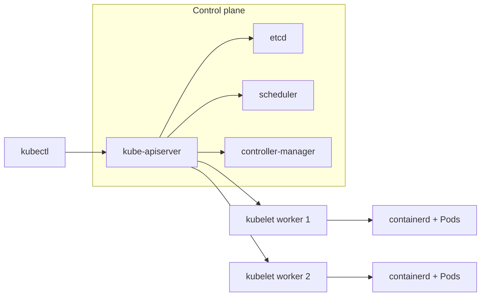
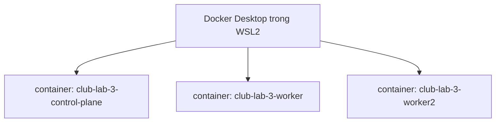

# Buổi 21 – Kubernetes Introduction

Tuần 11 · Giai đoạn 4 – Kubernetes Engineering · Slide: [Slide buổi 21](../../slides/05-kubernetes/session-21.md)

> **Tóm tắt:** Hiểu vì sao cần orchestration, nắm các thành phần của Kubernetes và tự dựng cluster local 1 node và 3 node bằng kind + kubectl.

## Mục tiêu học tập

- Giải thích được vì sao Docker Compose không đủ khi chạy nhiều container trên nhiều máy, và Kubernetes giải quyết điều gì.
- Phân biệt được control plane và worker node, kể tên vai trò của API Server, etcd, Scheduler, Controller Manager, kubelet, kube-proxy.
- Mô tả được đường đi của một yêu cầu từ lệnh `kubectl` tới khi container chạy trên node.
- Cài và kiểm tra được kubectl và kind trong WSL2 Ubuntu.
- Tạo, xem và xóa được cluster kind 1 node và 3 node bằng file cấu hình.
- Chẩn đoán được lỗi kubectl không kết nối được cluster do node (container) bị dừng hoặc sai context.

## Điều kiện cần

- Đã hoàn thành phần Docker (buổi 1-20): biết image, container, network, volume, Compose.
- Windows 11 + WSL2 Ubuntu, Docker Desktop bật tích hợp WSL2 và đang chạy.
- Docker Desktop được cấp tối thiểu khoảng 4 GB RAM cho WSL2 (cluster 3 node nên có 6 GB trở lên).
- Làm việc trong filesystem của WSL (ví dụ `~/devops-labs`), không dùng `/mnt/c`.

Kiểm tra nhanh trong terminal WSL:

```bash
docker version --format '{{.Server.Version}}'
docker info --format '{{.MemTotal}}'
```

Kết quả mong đợi: in ra phiên bản Docker Engine (ví dụ `27.x.x`) và tổng RAM (bytes) mà Docker được dùng. Nếu lệnh báo không kết nối được daemon, hãy mở Docker Desktop trước.

## Vấn đề thực tế

Dự án Club Management của CLB đang chạy bằng `compose.yaml` trên một máy: frontend, backend, postgres. Khi CLB có thêm người dùng, bạn muốn chạy 3 bản sao backend, tự khởi động lại bản nào chết, cập nhật phiên bản mới mà không làm gián đoạn, và dàn các bản sao ra nhiều máy. Compose làm tốt việc mô tả một stack trên một host, nhưng không tự lên lịch container sang máy khác, không tự thay thế khi máy hỏng và không có cơ chế rolling update chuẩn.

Kubernetes (K8s) là hệ thống orchestration: bạn khai báo trạng thái mong muốn ("luôn có 2 bản sao `club-api`"), Kubernetes liên tục so sánh với thực tế và sửa cho khớp. Trong bài này bạn chưa deploy ứng dụng, mục tiêu là dựng được một cluster local an toàn để thực hành cho cả tuần 11-14. Ta dùng kind (Kubernetes IN Docker): mỗi node của cluster là một container Docker, chạy hoàn toàn trên máy bạn và không expose ra Internet.

## Khái niệm cốt lõi

### Orchestration là gì

Orchestration là việc tự động hóa vòng đời container ở quy mô nhiều bản sao và nhiều máy: lên lịch (đặt container vào máy nào), tự phục hồi, scale, cập nhật, cấu hình và kết nối mạng.

| Nhu cầu | Docker Compose (1 host) | Kubernetes (cluster) |
| --- | --- | --- |
| Chạy nhiều bản sao | `deploy.replicas` hạn chế, thủ công | Khai báo `replicas`, tự duy trì |
| Container chết | `restart: unless-stopped` trên cùng máy | Tự tạo lại, có thể sang node khác |
| Cập nhật không downtime | Phải tự làm | Rolling update, rollback có sẵn |
| Nhiều máy | Không hỗ trợ | Là mục đích thiết kế |
| Cân bằng tải, DNS nội bộ | Network + tên service | Service, DNS của cluster |
| Cách dùng | Một file, đơn giản | Nhiều thành phần, đường cong học tập cao hơn |

Kubernetes không thay thế Compose trong mọi trường hợp. Với một stack nhỏ trên một máy, Compose vẫn là lựa chọn gọn nhẹ.

### Các thành phần của cluster

Một cluster gồm control plane (bộ não) và các worker node (nơi chạy workload).

| Thành phần | Nằm ở | Vai trò |
| --- | --- | --- |
| kube-apiserver | Control plane | Cổng duy nhất của cluster. Mọi thành phần và `kubectl` đều nói chuyện qua API này (xác thực, phân quyền, kiểm tra hợp lệ). |
| etcd | Control plane | Kho key-value lưu toàn bộ trạng thái cluster. Chỉ API Server truy cập trực tiếp. Mất etcd là mất trạng thái cluster. |
| kube-scheduler | Control plane | Chọn node cho các Pod chưa có node, dựa trên tài nguyên và ràng buộc. |
| kube-controller-manager | Control plane | Chạy các controller (ví dụ Deployment, ReplicaSet, Node) để đưa trạng thái thực tế về trạng thái mong muốn. |
| kubelet | Mỗi node | Agent trên node: nhận danh sách Pod cần chạy, bảo container runtime chạy, báo trạng thái về API Server. |
| kube-proxy | Mỗi node | Cài luật mạng để traffic tới Service được chuyển tới đúng Pod. |
| Container runtime | Mỗi node | Thực sự chạy container (kind dùng containerd). |

Hai khái niệm cần nhớ:

- Declarative: bạn mô tả "cái gì" (YAML), không mô tả "làm thế nào".
- Reconciliation loop: controller liên tục lặp lại "đọc trạng thái mong muốn, đọc trạng thái thực tế, sửa chênh lệch".

### kubectl, context và kind

- `kubectl` là CLI gọi API Server. Thông tin cluster nằm ở file kubeconfig (mặc định `~/.kube/config`).
- Context là bộ ba cluster + user + namespace. kubectl chỉ thao tác trên context hiện tại (`kubectl config current-context`).
- kind tạo mỗi node là một container Docker, tên dạng `<tên-cluster>-control-plane` và `<tên-cluster>-worker`. Context tạo ra có tên `kind-<tên-cluster>`.
- kind phù hợp học tập và CI, không phải cluster production.

## Kiến trúc và cách hoạt động



Luồng khi bạn tạo một Deployment (sẽ làm ở buổi 22):

1. `kubectl apply` gửi manifest tới API Server; API Server xác thực rồi ghi trạng thái mong muốn vào etcd.
2. Controller trong controller-manager thấy Deployment mới, tạo ReplicaSet, rồi tạo các object Pod (lúc này chưa gán node).
3. Scheduler thấy Pod chưa có node, chọn node phù hợp và ghi lựa chọn đó qua API Server.
4. kubelet trên node được chọn thấy Pod được giao cho mình, bảo containerd kéo image và chạy container.
5. kubelet báo trạng thái (Running, Ready) ngược về API Server; `kubectl get pods` đọc lại trạng thái này.

Điểm mấu chốt: các thành phần không gọi trực tiếp nhau, tất cả đi qua API Server và etcd.

Sơ đồ cluster kind 3 node trên máy bạn:



Mỗi "máy" của cluster thực ra là một container Docker. Vì vậy `docker ps` thấy các node, còn `kubectl get nodes` thấy cùng các node đó từ góc nhìn của Kubernetes.

## Demo của mentor

Mentor demo trên máy chiếu, lớp quan sát. Giả sử đã cài sẵn kubectl và kind.

1. Tạo cluster mặc định:

   ```bash
   kind create cluster --name club-demo
   ```

   Kết quả mong đợi (rút gọn):

   ```text
   Creating cluster "club-demo" ...
    ✓ Ensuring node image (kindest/node:v1.30.x)
    ✓ Preparing nodes
    ✓ Writing configuration
    ✓ Starting control-plane
    ✓ Installing CNI
    ✓ Installing StorageClass
   Set kubectl context to "kind-club-demo"
   ```

2. Cho lớp thấy node là container:

   ```bash
   docker ps --format 'table {{.Names}}\t{{.Image}}'
   kubectl get nodes -o wide
   ```

   Kết quả mong đợi: `docker ps` có container `club-demo-control-plane` (image `kindest/node`); `kubectl get nodes` có một node `Ready` với vai trò `control-plane`.

3. Chỉ các thành phần control plane:

   ```bash
   kubectl get pods -n kube-system
   ```

   Kết quả mong đợi (rút gọn): các Pod `etcd-club-demo-control-plane`, `kube-apiserver-club-demo-control-plane`, `kube-controller-manager-club-demo-control-plane`, `kube-scheduler-club-demo-control-plane`, cùng `coredns-...`, `kube-proxy-...`, `kindnet-...` đều `Running`.

4. Cho lớp thấy kubectl chỉ là client gọi API:

   ```bash
   kubectl get --raw /readyz
   kubectl cluster-info
   ```

   Kết quả mong đợi: `/readyz` trả `ok`; `cluster-info` in địa chỉ control plane dạng `https://127.0.0.1:<port>`.

5. Dọn dẹp: `kind delete cluster --name club-demo`.

Câu hỏi mentor nên hỏi lớp:

- Tại sao ta thấy etcd và scheduler dưới dạng Pod trong `kube-system`? (kubeadm chạy chúng như static Pod do kubelet quản lý.)
- Nếu scheduler ngừng hoạt động, điều gì xảy ra với Pod đang chạy? Với Pod mới? (Pod đang chạy vẫn chạy; Pod mới ở Pending tới khi scheduler quay lại. Lưu ý: xóa Pod `kube-scheduler` bằng kubectl không làm nó dừng, vì đó chỉ là bản phản chiếu của static Pod do kubelet quản lý.)
- Vì sao chỉ API Server được nói chuyện với etcd?

## Hands-on lab

Thời lượng gợi ý: 60 phút (Chuẩn bị 15', Phần 1-2 25', Phần 3-4 20').

### Chuẩn bị

```bash
mkdir -p ~/devops-labs/lab-21/{source,screenshots,evidence}
cd ~/devops-labs/lab-21
docker info --format '{{.ServerVersion}}'
```

Kết quả mong đợi: in phiên bản Docker server, không có lỗi. Từ đây ghi lại lệnh và output quan trọng vào `evidence/command-output.txt` (ví dụ `kubectl get nodes | tee -a evidence/command-output.txt`).

### Phần 1. Cài kubectl và kind

1. Cài kubectl (bản stable, đúng kiến trúc amd64):

   ```bash
   curl -LO "https://dl.k8s.io/release/$(curl -L -s https://dl.k8s.io/release/stable.txt)/bin/linux/amd64/kubectl"
   sudo install -o root -g root -m 0755 kubectl /usr/local/bin/kubectl
   rm kubectl
   kubectl version --client
   ```

   Kết quả mong đợi: dòng `Client Version: v1.3x.x`. Vì sao cài vào `/usr/local/bin`: thư mục này nằm sẵn trong `PATH`.

   Nếu máy bạn dùng ARM, thay `amd64` bằng `arm64`. Chi tiết xem trang cài đặt chính thức ở phần Tài liệu tham khảo.

2. Cài kind (phiên bản pin để tái lập):

   ```bash
   curl -Lo ./kind https://kind.sigs.k8s.io/dl/v0.23.0/kind-linux-amd64
   chmod +x ./kind
   sudo mv ./kind /usr/local/bin/kind
   kind version
   ```

   Kết quả mong đợi: `kind v0.23.0 go1.x linux/amd64`. Pin phiên bản để cả lớp dùng cùng một bản, tránh khác biệt hành vi.

3. Ghi lại phiên bản vào evidence:

   ```bash
   { kubectl version --client; kind version; } | tee evidence/command-output.txt
   ```

### Phần 2. Tạo cluster 1 node (L1)

1. Tạo cluster:

   ```bash
   kind create cluster --name club-lab
   ```

   Kết quả mong đợi: các dòng `Ensuring node image`, `Starting control-plane`, kết thúc bằng `Set kubectl context to "kind-club-lab"`. Lần đầu mất 1-3 phút vì phải tải image node.

2. Kiểm tra context và node:

   ```bash
   kubectl config current-context
   kubectl get nodes
   ```

   Kết quả mong đợi:

   ```text
   kind-club-lab
   NAME                     STATUS   ROLES           AGE   VERSION
   club-lab-control-plane   Ready    control-plane   1m    v1.30.x
   ```

   Vì sao quan trọng: `STATUS Ready` nghĩa là kubelet của node báo khỏe với API Server.

3. Xem node thật sự là container:

   ```bash
   docker ps --filter name=club-lab --format 'table {{.Names}}\t{{.Status}}'
   ```

   Kết quả mong đợi: một container `club-lab-control-plane` trạng thái `Up`.

4. Liệt kê thành phần hệ thống:

   ```bash
   kubectl get pods -n kube-system
   kubectl get namespaces
   ```

   Kết quả mong đợi: các Pod hệ thống `Running`; namespace có `default`, `kube-system`, `kube-public`, `kube-node-lease`, `local-path-storage`.

5. Xóa cluster 1 node để giải phóng RAM trước khi tạo cluster mới:

   ```bash
   kind delete cluster --name club-lab
   ```

### Phần 3. Tạo cluster 3 node bằng file cấu hình (L2)

1. Tạo file cấu hình `source/kind-3-nodes.yaml` (bản trong `examples/kubernetes/kind-3-nodes.yaml` có thêm `extraPortMappings` cho cổng 80 và 443 để dùng Ingress; bài này chưa cần nên bản dưới đây bỏ phần đó, tránh lỗi trùng cổng):

   ```yaml
   kind: Cluster
   apiVersion: kind.x-k8s.io/v1alpha4
   nodes:
     - role: control-plane
     - role: worker
     - role: worker
   ```

   Vì sao: `role: worker` lặp 2 lần cho 2 worker node; không khai báo `image` nên kind dùng node image mặc định của phiên bản kind.

2. Tạo cluster:

   ```bash
   kind create cluster --name club-lab-3 --config source/kind-3-nodes.yaml
   ```

   Kết quả mong đợi: thêm bước `Joining worker nodes`, cuối cùng đặt context `kind-club-lab-3`.

3. Kiểm tra:

   ```bash
   kubectl get nodes -o wide
   docker ps --filter name=club-lab-3 --format 'table {{.Names}}\t{{.Status}}'
   ```

   Kết quả mong đợi: 3 node `Ready` (`club-lab-3-control-plane`, `club-lab-3-worker`, `club-lab-3-worker2`), ba container tương ứng đang `Up`.

4. Tìm các thành phần control plane và gán chúng vào node nào:

   ```bash
   kubectl get pods -n kube-system -o wide
   ```

   Kết quả mong đợi: `etcd-`, `kube-apiserver-`, `kube-scheduler-`, `kube-controller-manager-` chỉ chạy trên node `club-lab-3-control-plane`; `kube-proxy-` và `kindnet-` có một Pod trên mỗi node (DaemonSet).

5. Quan sát taint của control plane (lý do workload thường không chạy ở đó):

   ```bash
   kubectl describe node club-lab-3-control-plane | grep -i taints
   kubectl describe node club-lab-3-worker | grep -i taints
   ```

   Kết quả mong đợi: control plane có `node-role.kubernetes.io/control-plane:NoSchedule`; worker là `<none>`.

### Phần 4. Khám phá API và ghi bằng chứng

1. Xem tài nguyên mà API hỗ trợ và giải thích một object:

   ```bash
   kubectl api-resources | head -15
   kubectl explain pod.spec.containers.image
   ```

   Kết quả mong đợi: danh sách như `pods`, `services`, `deployments`; `explain` mô tả trường `image`.

2. Xem trạng thái thô của node dưới dạng YAML (đây là dữ liệu lưu trong etcd):

   ```bash
   kubectl get node club-lab-3-worker -o yaml | head -30
   ```

3. Lưu bằng chứng:

   ```bash
   { kubectl get nodes -o wide; kubectl get pods -n kube-system -o wide; docker ps --filter name=club-lab-3; } | tee -a evidence/command-output.txt
   ```

### L1 – Foundation: checklist hoàn thành

- [ ] `kubectl version --client` và `kind version` chạy được.
- [ ] Tạo được cluster `club-lab` và `kubectl get nodes` hiển thị `Ready`.
- [ ] `docker ps` cho thấy node là container.
- [ ] Liệt kê được Pod trong `kube-system` và nói được vai trò của `etcd`, `kube-apiserver`.
- [ ] Xóa được cluster bằng `kind delete cluster`.

### L2 – Engineering: thử thách tự làm

Thử thách 1. Tạo cluster 3 node `club-lab-3` bằng file cấu hình của riêng bạn. Tiêu chí hoàn thành: 3 node `Ready`; bạn chỉ ra được Pod nào chạy trên node nào và giải thích vì sao control plane không nhận Pod ứng dụng.

<details><summary>Gợi ý</summary>

Dùng `kubectl get pods -A -o wide` để xem cột NODE. Taint `NoSchedule` trên control plane ngăn Pod thường được lên lịch ở đó.

</details>

Thử thách 2. Dùng `kubectl` (không dùng `docker`) để chứng minh cluster chạy Kubernetes phiên bản nào và API Server đang khỏe. Tiêu chí: có output của hai lệnh, giải thích mỗi lệnh đọc từ thành phần nào.

<details><summary>Lời giải</summary>

```bash
kubectl version
kubectl get --raw '/readyz?verbose' | head -20
```

`kubectl version` hỏi API Server về phiên bản server. `/readyz?verbose` liệt kê các kiểm tra sức khỏe của API Server, trong đó có kiểm tra kết nối etcd.

</details>

Thử thách 3. Đối chiếu `starter-project/k8s/kind-config.yaml` với file 3 node của bạn: nêu sự khác nhau và giải thích mục đích của `extraPortMappings` và nhãn `ingress-ready=true`. Tiêu chí: viết 3-5 câu trong `report.md`.

<details><summary>Lời giải</summary>

File của starter-project có 1 node control-plane, gắn nhãn `ingress-ready=true` (để Ingress controller chọn đúng node) và map cổng 80, 443 của container ra máy host để truy cập `club.localhost` ở buổi về Ingress. File 3 node của bài này không map cổng vì chưa cần. Lưu ý: map cổng 80 và 443 sẽ lỗi nếu máy đã có tiến trình dùng các cổng đó.

</details>

## Phá lỗi và debug

Tình huống: kubectl "đột nhiên" không kết nối được cluster.

Cách phá (giữ cluster `club-lab-3` đang chạy):

```bash
docker stop club-lab-3-control-plane
kubectl get nodes
```

Triệu chứng: kubectl báo không kết nối được, dạng `The connection to the server 127.0.0.1:xxxxx was refused` hoặc timeout.

Hướng điều tra, từng bước:

1. Kiểm tra context đang dùng: `kubectl config current-context`. Đúng là `kind-club-lab-3`, vậy không phải lỗi context.
2. Địa chỉ trong lỗi là `127.0.0.1:<port>`: API Server của kind được publish ra cổng local của Docker. Kiểm tra Docker: `docker ps -a --filter name=club-lab-3`.
3. Thấy container `club-lab-3-control-plane` ở trạng thái `Exited`. Nghĩa là control plane (chứa API Server) đã tắt nên kubectl không có ai để nói chuyện.
4. Khôi phục: `docker start club-lab-3-control-plane`, đợi 30-60 giây rồi `kubectl get nodes`. Nếu vẫn lỗi vì cổng API đã đổi, chạy `kind export kubeconfig --name club-lab-3` để ghi lại kubeconfig.

Nguyên nhân gốc: node của kind là container; dừng container (hoặc Docker Desktop khởi động lại) tương đương tắt máy chủ control plane. Worker vẫn còn nhưng không có API Server để điều phối.

Cách phòng tránh: kiểm tra `docker ps` trước khi nghi ngờ Kubernetes; sau khi khởi động lại máy, bật Docker Desktop và chờ node `Ready` trước khi làm lab; luôn xem `kubectl config current-context` để chắc đang nói chuyện đúng cluster.

Dọn dẹp để giải phóng RAM trước buổi 22 (buổi sau dùng cluster `club` riêng, tạo từ `starter-project/k8s/kind-config.yaml`): `kind delete cluster --name club-lab-3`.

Biến thể tự thử: tạo hai cluster rồi chạy `kubectl config use-context kind-club-lab` (cluster đã xóa) và đọc lỗi. Liên hệ thêm: lỗi trùng cổng khi tạo cluster theo `starter-project/k8s/kind-config.yaml` giống tình huống `examples/troubleshooting/scenario-01`.

## Lỗi thường gặp

| Triệu chứng | Nguyên nhân | Cách xử lý |
| --- | --- | --- |
| `Cannot connect to the Docker daemon` khi `kind create cluster` | Docker Desktop chưa chạy hoặc chưa bật tích hợp WSL | Mở Docker Desktop, bật WSL integration cho distro Ubuntu, thử lại |
| `kind create cluster` treo hoặc node không `Ready` | Docker thiếu RAM/CPU | Tăng bộ nhớ cho WSL2 (`.wslconfig`), xóa cluster dư, thử lại |
| `node(s) already exist for a cluster with the name` | Đã có cluster cùng tên | `kind get clusters`, rồi `kind delete cluster --name <tên>` hoặc đặt tên khác |
| `command not found: kind` hoặc `kubectl` | Chưa nằm trong PATH | Kiểm tra `ls /usr/local/bin`, chạy lại bước `sudo mv` hoặc `install` |
| `bind: address already in use` khi dùng `extraPortMappings` | Cổng 80/443 đang được tiến trình khác dùng | Tìm tiến trình đang giữ cổng, tắt nó hoặc đổi `hostPort` |
| `kubectl` báo `connection refused` | Container control plane đã dừng | `docker ps -a`, `docker start` container node |
| `kubectl get nodes` cho kết quả của cluster lạ | Sai context | `kubectl config get-contexts`, `kubectl config use-context kind-club-lab-3` |
| Tải image node chậm hoặc timeout | Mạng chậm | Thử lại; image `kindest/node` khá lớn, chỉ tải lần đầu |

## Tự kiểm tra

1. Hai thành phần nào của control plane đứng giữa quyết định "Pod chạy ở đâu" và "ghi nhớ trạng thái"?

   <details><summary>Đáp án</summary>

   Scheduler quyết định node cho Pod; etcd lưu trạng thái, được truy cập qua API Server.

   </details>

2. Vì sao `kubectl` không trực tiếp nói chuyện với kubelet hay etcd?

   <details><summary>Đáp án</summary>

   Mọi tương tác đi qua API Server, nơi tập trung xác thực, phân quyền và kiểm tra hợp lệ. Các thành phần khác cũng chỉ làm việc qua API Server.

   </details>

3. Reconciliation loop là gì? Cho ví dụ.

   <details><summary>Đáp án</summary>

   Controller liên tục so sánh trạng thái mong muốn với thực tế và sửa. Ví dụ: Deployment muốn 2 replicas, một Pod chết, ReplicaSet controller tạo Pod mới.

   </details>

4. kind khác cluster thật ở điểm nào? Khi nào không nên dùng kind?

   <details><summary>Đáp án</summary>

   Node của kind là container Docker trên một máy, không có tính sẵn sàng cao hay phần cứng riêng. Không dùng cho production hay đo hiệu năng thực.

   </details>

5. Tình huống: sáng nay mở máy, `kubectl get nodes` báo connection refused. Bạn làm gì đầu tiên?

   <details><summary>Đáp án</summary>

   Kiểm tra Docker Desktop đang chạy, `docker ps -a` xem container node có `Exited` không rồi `docker start`; sau đó kiểm tra context hiện tại.

   </details>

6. Vì sao control plane của kind không nhận Pod ứng dụng mặc định?

   <details><summary>Đáp án</summary>

   Node control plane có taint `NoSchedule`, Pod không khai báo toleration tương ứng sẽ không được lên lịch ở đó.

   </details>

7. Vai trò của kubelet và kube-proxy khác nhau thế nào?

   <details><summary>Đáp án</summary>

   kubelet chạy và theo dõi Pod trên node, báo trạng thái về API Server. kube-proxy cài luật mạng để traffic tới Service đến đúng Pod.

   </details>

## Nộp bài

Nộp vào thư mục `lab-21/` trong repository cá nhân (ví dụ `devops-labs`) theo `templates/lab-template.md`:

- [ ] `README.md` trả lời đủ 7 câu: lab giải quyết gì, kiến thức dùng, các bước, kết quả mong đợi, lỗi đã gặp, cách khắc phục, có thể cải thiện gì; ghi rõ đã làm L1 hay L2.
- [ ] `source/kind-3-nodes.yaml` (file cấu hình cluster 3 node của bạn).
- [ ] `evidence/command-output.txt` chứa: `kubectl version --client`, `kind version`, `kubectl get nodes -o wide`, `kubectl get pods -n kube-system -o wide`, `docker ps` của cluster.
- [ ] `report.md` ngắn: sơ đồ hoặc đoạn mô tả đường đi của một yêu cầu qua các thành phần, kèm kết quả tình huống "Phá lỗi và debug" (nguyên nhân gốc, cách khôi phục).
- [ ] `screenshots/` chứa ảnh minh họa (không thay thế cho evidence).
- [ ] Không commit secret, token, hay file kubeconfig (`~/.kube/config`) vào repo.

## Recap

- Kubernetes là hệ thống orchestration theo mô hình khai báo: bạn nêu trạng thái mong muốn, controller liên tục đưa thực tế về đúng như vậy.
- Control plane gồm kube-apiserver, etcd, scheduler, controller-manager; mỗi worker có kubelet, kube-proxy và container runtime.
- Mọi thứ đi qua API Server; chỉ API Server nói chuyện với etcd.
- kind chạy node như container Docker, nên `docker ps` và `kubectl get nodes` nhìn cùng một hệ thống từ hai phía.
- kubectl dùng kubeconfig và context; luôn kiểm tra đang ở context nào.
- Khi kubectl không kết nối được: kiểm tra Docker, trạng thái container node rồi mới tới context.

## Tài liệu tham khảo

- [Kubernetes Components](https://kubernetes.io/docs/concepts/overview/components/)
- [Kubernetes Overview](https://kubernetes.io/docs/concepts/overview/)
- [Install and Set Up kubectl on Linux](https://kubernetes.io/docs/tasks/tools/install-kubectl-linux/)
- [kind Quick Start](https://kind.sigs.k8s.io/docs/user/quick-start/)
- [kind Configuration](https://kind.sigs.k8s.io/docs/user/configuration/)
