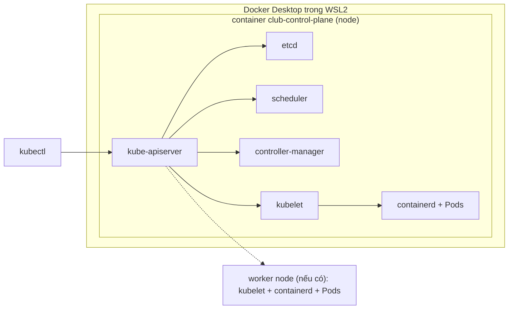

# Buổi 21 – Kubernetes Introduction

Tuần 11/16 · Giai đoạn 4 – Kubernetes Engineering · Buổi 21/32

[Slide Buổi 21 – Kubernetes Introduction](../../slides/05-kubernetes/session-21.md) · [Bài tập Tuần 11](../../assignments/weekly/week-11.md) · [Hub Tuần 11](README.md)

> **Tóm tắt:** Hiểu vì sao cần Kubernetes, gọi tên các thành phần của cluster, rồi tự dựng cluster kind tên club trên máy và dùng kubectl để xem bên trong nó.

::: tip Buổi này bạn làm gì
**Bạn sẽ tạo ra:** một cluster Kubernetes thật chạy trên laptop (kind, tên `club`, context `kind-club`), cùng bảng ghi lại từng thành phần của nó nằm ở đâu.

**Thời gian thật:** đọc khoảng 15 phút, lab bắt buộc 60 phút, thử thách tùy chọn ở nhà khoảng 40 phút.

**Cần chuẩn bị:**

- [ ] Docker Desktop đang chạy và bật tích hợp WSL2 (xem [Hướng dẫn cài đặt môi trường](../../resources/setup-guide.md)); đã cài `kubectl` và `kind` (mục 7 và 8 của hướng dẫn đó)
- [ ] Đã clone repo giáo trình vào `~/devops-course` trong WSL và có repo `devops-labs` (xem [Tài khoản GitHub và repo devops-labs](../../resources/setup-github.md))
- [ ] Đã xong [Buổi 20 – Pipeline Security](../week-10/session-20.md); máy 8 GB thì tắt Compose trước (`docker compose down`)

**Sản phẩm phải nộp** (thư mục `lab-21/` trong `devops-labs`):

- `README.md` trả lời 7 câu theo [mẫu bài lab](../../templates/lab-template.md)
- `evidence/command-output.txt` chứa phiên bản công cụ, `kubectl get nodes -o wide`, `kubectl get pods -n kube-system -o wide`, `docker ps`
- `report.md` có bảng thành phần cluster, sơ đồ đường đi của một yêu cầu và kết quả phần "phá lỗi"

**Mục lục nhảy:** Đọc ([Vấn đề thực tế](#van-de) và [Khái niệm cốt lõi](#khai-niem)) > [Làm lab](#hands-on-lab) > [Gặp lỗi?](#gap-loi) > [Tự kiểm tra](#tu-kiem-tra) > [Nộp bài](#nop-bai). Kẹt giữa chừng? Nhảy tới [Gặp lỗi?](#gap-loi).

**Từ mới trong buổi** (tra nhanh ở [Bảng thuật ngữ](../../resources/glossary.md)):

- **Orchestration**: tự động chạy, thay thế và cập nhật nhiều container trên nhiều máy.
- **Cluster**: một nhóm máy (node) được Kubernetes quản lý như một hệ thống.
- **Node**: một máy trong cluster; với kind, mỗi node là một container Docker.
- **Control plane**: nhóm thành phần "bộ não" ra quyết định cho cluster.
- **kubectl**: công cụ dòng lệnh để nói chuyện với cluster.
- **Context**: thông tin cho kubectl biết đang nói chuyện với cluster nào.
:::

Trên lớp, mentor demo trước; tự học thì làm thẳng phần [Làm lab](#hands-on-lab).

## Vấn đề thực tế {#van-de}

Dự án Club Management của CLB đang chạy bằng `compose.yaml` trên một máy: frontend, backend, postgres. Khi có thêm người dùng, bạn muốn chạy 3 bản sao backend, tự khởi động lại bản nào chết, cập nhật phiên bản mới mà không làm gián đoạn, và dàn các bản sao ra nhiều máy. Compose mô tả tốt một stack trên một máy, nhưng không tự đưa container sang máy khác, không tự thay thế khi máy hỏng và không có rolling update chuẩn. Kubernetes (K8s) giải quyết đúng những việc đó. Hôm nay bạn chưa deploy ứng dụng, chỉ dựng một cluster local an toàn (không expose ra Internet) để dùng cho cả tuần 11 đến 14.

## Khái niệm cốt lõi {#khai-niem}

**1. Orchestration.** Là việc tự động hóa vòng đời container ở quy mô nhiều bản sao và nhiều máy: đặt container vào máy nào, tự phục hồi, scale, cập nhật. Ví von: Compose giống người quản lý một quán nhỏ tự làm hết; Kubernetes giống bộ máy điều hành cả chuỗi quán.

**2. Declarative và reconciliation loop.** Bạn khai báo trạng thái mong muốn ("luôn có 2 bản `club-api`"), controller liên tục so sánh với thực tế rồi sửa chênh lệch. Ví von: điều hòa giữ 25 độ, đo nhiệt độ liên tục rồi bật tắt máy nén.

**3. Control plane và worker node.** Control plane là bộ não, worker là nơi chạy ứng dụng. Ví von: control plane là văn phòng điều hành, worker là các quầy phục vụ.

| Thành phần | Nằm ở | Vai trò (một câu) |
| --- | --- | --- |
| kube-apiserver | Control plane | Cổng duy nhất của cluster; kubectl và mọi thành phần đều đi qua nó |
| etcd | Control plane | Kho lưu toàn bộ trạng thái cluster; chỉ API Server được truy cập |
| kube-scheduler | Control plane | Chọn node cho Pod chưa có node |
| kube-controller-manager | Control plane | Chạy các controller đưa thực tế về mong muốn |
| kubelet | Mỗi node | Agent trên node: chạy Pod được giao, báo trạng thái về API Server |
| kube-proxy | Mỗi node | Cài luật mạng để traffic tới Service đến đúng Pod |
| containerd | Mỗi node | Thực sự chạy container (kind dùng containerd) |

**4. kubectl, context và kind.** `kubectl` chỉ là client gọi API Server, thông tin cluster nằm ở `~/.kube/config`. Context là bộ ba cluster + user + namespace; kubectl chỉ làm việc với context hiện tại. kind (Kubernetes IN Docker) chạy mỗi node là một container Docker, context tạo ra có tên `kind-<tên cluster>`. Ví von: context như biển chỉ đường "đang gọi vào tòa nhà nào"; gọi nhầm tòa nhà là lỗi tốn kém nhất ngoài đời thật.



Cluster `club` của bạn chỉ có 1 node nên control plane và Pod ứng dụng cùng nằm trong một container; cluster thật có thêm nhiều worker. Điểm mấu chốt: các thành phần không gọi nhau trực tiếp, tất cả đi qua API Server và etcd.

::: details Tìm hiểu thêm (đọc sau)
**Compose và Kubernetes khác nhau thế nào?**

| Nhu cầu | Docker Compose (1 host) | Kubernetes (cluster) |
| --- | --- | --- |
| Chạy nhiều bản sao | `deploy.replicas` hạn chế, thủ công | Khai báo `replicas`, tự duy trì |
| Container chết | `restart: unless-stopped` trên cùng máy | Tự tạo lại, có thể sang node khác |
| Cập nhật không downtime | Phải tự làm | Rolling update, rollback có sẵn |
| Nhiều máy | Không hỗ trợ | Là mục đích thiết kế |
| Cân bằng tải, DNS nội bộ | Network + tên service | Service, DNS của cluster |
| Cách dùng | Một file, đơn giản | Nhiều thành phần, học khó hơn |

Kubernetes không thay Compose trong mọi trường hợp: stack nhỏ trên một máy vẫn nên dùng Compose.

**Luồng khi bạn tạo một Deployment (làm ở buổi 22):**

1. `kubectl apply` gửi manifest tới API Server; API Server xác thực rồi ghi trạng thái mong muốn vào etcd.
2. Controller thấy Deployment mới, tạo ReplicaSet, rồi tạo các object Pod (chưa gán node).
3. Scheduler thấy Pod chưa có node, chọn node và ghi lựa chọn qua API Server.
4. kubelet trên node được chọn bảo containerd kéo image và chạy container.
5. kubelet báo `Running`, `Ready` ngược về API Server; `kubectl get pods` đọc lại trạng thái này.

**Vì sao Pod của etcd, scheduler lại thấy được trong `kube-system`?** kubeadm chạy chúng như static Pod do kubelet quản lý; xóa bản phản chiếu bằng kubectl không làm chúng dừng.

**kind khác cluster thật ở đâu?** Node là container Docker trên một máy, không có tính sẵn sàng cao hay phần cứng riêng. Không dùng kind cho production hay đo hiệu năng thực.
:::

## Hands-on lab {#hands-on-lab}

Lab bắt buộc (mức L1) khoảng 60 phút. Mọi lệnh chạy trong terminal WSL Ubuntu, không dùng `/mnt/c`.

### Chuẩn bị (5 phút)

```bash
mkdir -p ~/devops-labs/lab-21/{source,screenshots,evidence}
cd ~/devops-labs/lab-21
docker version --format '{{.Server.Version}}'
kubectl version --client
kind version
```

Kết quả mong đợi: in ra phiên bản Docker Engine (ví dụ `27.x.x`), dòng `Client Version: v1.3x.x` và `kind v0.23.0` trở lên. Lỗi `Cannot connect to the Docker daemon` hoặc `command not found`: nhảy tới [Gặp lỗi?](#gap-loi). Ghi phiên bản vào bằng chứng:

```bash
{ kubectl version --client; kind version; } | tee evidence/command-output.txt
```

### Phần 1. Tạo cluster club (15 phút)

Cluster này sẽ dùng tiếp ở buổi 22 và tuần 12 đến 14, nên bạn không xóa nó cuối buổi.

1. Máy 8 GB: tắt Compose trước khi dựng kind. Kiểm tra chưa có cluster trùng tên:

   ```bash
   docker compose down 2>/dev/null; kind get clusters
   ```

   Kết quả mong đợi: không có dòng `club`. Nếu đã có cluster `club` từ trước, bỏ qua bước 2 và sang bước 3.

2. Tạo cluster từ file cấu hình của repo giáo trình (file này map cổng 80 và 443 cho Ingress ở tuần 12, nên hai cổng đó của máy phải đang rảnh; xem [Gặp lỗi?](#gap-loi) nếu báo `address already in use`):

   ```bash
   kind create cluster --name club --config ~/devops-course/starter-project/k8s/kind-config.yaml
   ```

   Kết quả mong đợi: các dòng `Ensuring node image`, `Starting control-plane`, kết thúc bằng `Set kubectl context to "kind-club"`. Lần đầu mất 1-3 phút vì phải tải image node.

3. Kiểm tra context và node:

   ```bash
   kubectl config current-context
   kubectl get nodes -o wide | tee -a evidence/command-output.txt
   ```

   Kết quả mong đợi:

   ```text
   kind-club
   NAME                 STATUS   ROLES           AGE   VERSION   ...
   club-control-plane   Ready    control-plane   1m    v1.30.x   ...
   ```

   `Ready` nghĩa là kubelet của node báo khỏe với API Server.

::: tip Kiểm tra: bạn đúng khi
Context là `kind-club` và `kubectl get nodes` có đúng một node `club-control-plane` ở trạng thái `Ready`. Nếu sai: [Gặp lỗi?](#gap-loi).
:::

### Phần 2. Xem bên trong cluster (15 phút)

1. Node thật sự là container Docker:

   ```bash
   docker ps --filter name=club --format 'table {{.Names}}\t{{.Image}}\t{{.Status}}' | tee -a evidence/command-output.txt
   ```

   Kết quả mong đợi: một container `club-control-plane`, image `kindest/node`, trạng thái `Up`. Vì sao: `docker ps` và `kubectl get nodes` nhìn cùng một hệ thống từ hai phía.

2. Tìm các thành phần control plane (chúng chạy dưới dạng Pod trong namespace `kube-system`):

   ```bash
   kubectl get pods -n kube-system -o wide | tee -a evidence/command-output.txt
   kubectl get namespaces
   ```

   Kết quả mong đợi: các Pod `etcd-`, `kube-apiserver-`, `kube-scheduler-`, `kube-controller-manager-`, `coredns-`, `kube-proxy-`, `kindnet-` đều `Running` trên node `club-control-plane`; namespace có `default`, `kube-system`, `kube-public`, `kube-node-lease`, `local-path-storage`. Không có Pod `kubelet` vì kubelet chạy như tiến trình trên node chứ không phải Pod.

3. Cho thấy kubectl chỉ là client gọi API:

   ```bash
   kubectl get --raw /readyz; echo
   kubectl cluster-info
   ```

   Kết quả mong đợi: `/readyz` trả `ok`; `cluster-info` in địa chỉ dạng `https://127.0.0.1:<port>`.

4. Lập bảng thành phần trong `report.md`: với mỗi thành phần ở bảng Khái niệm cốt lõi, ghi tên Pod thật (hoặc "tiến trình trên node" với kubelet và containerd) và node nó chạy, lấy từ output bước 2.

::: tip Kiểm tra: bạn đúng khi
Bạn chỉ được đúng Pod `etcd-...` và `kube-apiserver-...` trong output và nói được vì sao `kubectl` không nói chuyện thẳng với etcd (mọi thứ đi qua API Server).
:::

### Phần 3. Tự phá rồi tự sửa (10 phút)

Tình huống: kubectl "đột nhiên" không kết nối được cluster. Bạn tự tạo lại lỗi này để lần sau nhận ra ngay. Chỉ dừng đúng container của cluster `club`, không đụng container khác.

```bash
docker stop club-control-plane
kubectl get nodes
```

Triệu chứng: `The connection to the server 127.0.0.1:xxxxx was refused` hoặc timeout. Điều tra theo thứ tự: (1) `kubectl config current-context` vẫn là `kind-club`, vậy không phải lỗi context; (2) `docker ps -a --filter name=club` thấy `club-control-plane` ở trạng thái `Exited`: control plane (chứa API Server) đã tắt nên kubectl không có ai để nói chuyện. Khôi phục:

```bash
docker start club-control-plane
sleep 45
kubectl get nodes
```

Kết quả mong đợi: node quay lại `Ready` sau 30-60 giây. Nếu vẫn lỗi vì cổng API đã đổi, chạy `kind export kubeconfig --name club`. Ghi nguyên nhân gốc và cách khôi phục vào `report.md`: node của kind là container, dừng container (hoặc Docker Desktop khởi động lại) tương đương tắt máy chủ control plane. Phòng tránh: kiểm tra `docker ps` trước khi nghi ngờ Kubernetes; sau khi khởi động lại máy, bật Docker Desktop và chờ node `Ready` rồi mới làm lab.

::: tip Kiểm tra: bạn đúng khi
`kubectl get nodes` lại thấy `club-control-plane` `Ready`, và `report.md` có đủ ba ý: triệu chứng, nguyên nhân gốc, cách khôi phục.
:::

### Checklist L1 và lệnh tự kiểm tra

- [ ] `kubectl version --client` và `kind version` chạy được, đã ghi vào evidence.
- [ ] Cluster `club` có node `Ready`, context là `kind-club`.
- [ ] `docker ps` cho thấy node là container; liệt kê được Pod trong `kube-system`.
- [ ] Nói được vai trò của `etcd` và `kube-apiserver`.
- [ ] Đã tự phá và khôi phục control plane, có ghi trong `report.md`.

Lệnh tự kiểm tra một dòng (kết quả đúng là `kind-club` rồi `1`):

```bash
kubectl config current-context; kubectl get nodes --no-headers | awk '$2=="Ready"' | wc -l
```

## Gặp lỗi? {#gap-loi}

| Triệu chứng | Nguyên nhân | Cách sửa |
| --- | --- | --- |
| `Cannot connect to the Docker daemon` | Docker Desktop chưa chạy hoặc chưa bật tích hợp WSL | Mở Docker Desktop, bật WSL integration cho Ubuntu, thử lại |
| `command not found: kind` hoặc `kubectl` | Chưa cài hoặc chưa nằm trong `PATH` | Làm lại mục 7 và 8 của [Hướng dẫn cài đặt môi trường](../../resources/setup-guide.md); kiểm tra `ls /usr/local/bin` |
| `kind create cluster` treo hoặc node không `Ready` | Docker thiếu RAM hoặc CPU | Tắt Compose, tăng bộ nhớ WSL2 trong `.wslconfig`, xóa cluster dư rồi thử lại; xem [Xử lý sự cố cài đặt](../../resources/troubleshooting-setup.md) |
| `node(s) already exist for a cluster with the name` | Đã có cluster cùng tên | `kind get clusters`; dùng luôn cluster đó hoặc `kind delete cluster --name <tên>` rồi tạo lại |
| `bind: address already in use` khi tạo cluster | Cổng 80 hoặc 443 đang bị tiến trình khác giữ (thường là web server hoặc Docker khác) | Tìm và tắt tiến trình giữ cổng (xem scenario-01 trong `examples/troubleshooting`), rồi tạo lại cluster |
| `kubectl` báo `connection refused` hoặc timeout | Container control plane đã dừng | `docker ps -a --filter name=club`, `docker start club-control-plane`, đợi 30-60 giây; nếu cổng đổi: `kind export kubeconfig --name club` |
| `kubectl get nodes` ra node của cluster lạ | Sai context | `kubectl config get-contexts`, rồi `kubectl config use-context kind-club` |
| Tải image node chậm hoặc timeout | Mạng chậm; image `kindest/node` khá lớn | Thử lại; chỉ tải lần đầu |

## Tự kiểm tra {#tu-kiem-tra}

1. Hai thành phần nào của control plane đứng giữa quyết định "Pod chạy ở đâu" và "ghi nhớ trạng thái"?

   ::: details Đáp án gợi ý
   Scheduler quyết định node cho Pod; etcd lưu trạng thái, chỉ truy cập qua API Server.
   :::

2. Vì sao `kubectl` không trực tiếp nói chuyện với kubelet hay etcd?

   ::: details Đáp án gợi ý
   Mọi tương tác đi qua API Server, nơi tập trung xác thực, phân quyền và kiểm tra hợp lệ. Các thành phần khác cũng chỉ làm việc qua API Server.
   :::

3. Reconciliation loop là gì? Cho ví dụ.

   ::: details Đáp án gợi ý
   Controller liên tục so sánh trạng thái mong muốn với thực tế và sửa. Ví dụ: Deployment muốn 2 bản, một Pod chết, controller tạo Pod mới.
   :::

4. Vai trò của kubelet và kube-proxy khác nhau thế nào?

   ::: details Đáp án gợi ý
   kubelet chạy và theo dõi Pod trên node, báo trạng thái về API Server. kube-proxy cài luật mạng để traffic tới Service đến đúng Pod.
   :::

5. Sáng nay mở máy, `kubectl get nodes` báo connection refused. Bạn làm gì đầu tiên?

   ::: details Đáp án gợi ý
   Kiểm tra Docker Desktop đang chạy, `docker ps -a` xem container node có `Exited` không rồi `docker start`; sau đó kiểm tra context hiện tại.
   :::

## Nộp bài {#nop-bai}

Nộp vào thư mục `lab-21/` trong repo `devops-labs` theo [mẫu bài lab](../../templates/lab-template.md). Đây cũng là phần bằng chứng của [Bài tập Tuần 11](../../assignments/weekly/week-11.md).

- [ ] `README.md` trả lời đủ 7 câu: lab giải quyết gì, kiến thức dùng, các bước, kết quả mong đợi, lỗi đã gặp, cách khắc phục, có thể cải thiện gì; ghi rõ đã làm L1 hay L2.
- [ ] `evidence/command-output.txt` có `kubectl version --client`, `kind version`, `kubectl get nodes -o wide`, `kubectl get pods -n kube-system -o wide`, `docker ps` của cluster.
- [ ] `report.md` có bảng thành phần, sơ đồ hoặc đoạn mô tả đường đi của một yêu cầu, và kết quả phần "Tự phá rồi tự sửa".
- [ ] `source/` (file cấu hình nếu bạn làm thử thách) và `screenshots/` (ảnh minh họa, không thay cho evidence).
- [ ] Không commit secret, token hay file kubeconfig (`~/.kube/config`).

## Recap

- Kubernetes là orchestration khai báo: bạn nêu trạng thái mong muốn, controller đưa thực tế về đúng như vậy.
- Mọi thứ đi qua API Server; chỉ API Server nói chuyện với etcd; kind chạy mỗi node như một container Docker.
- Khi kubectl không kết nối được: kiểm tra Docker, rồi container node, rồi context.

Buổi tiếp theo: [Buổi 22 – Pods & Deployments](session-22.md). Giữ nguyên cluster `club`, không xóa.

::: details Thử thách thêm (L2, tùy chọn, làm ở nhà)
Ba thử thách: dựng cluster 3 node `club-3` bằng file tự viết, chứng minh cluster khỏe chỉ bằng kubectl, và đối chiếu cấu hình kind. Gợi ý và lời giải đều gập sẵn trong trang riêng: [Buổi 21 – Thử thách thêm](session-21-challenge.md). Tự thử khoảng 15 phút trước khi mở gợi ý.
:::

::: details Phá lỗi nâng cao
- Biến thể 1: tạo thêm một cluster tạm, xóa nó rồi chạy `kubectl config use-context` sang context của cluster đã xóa và đọc thông báo lỗi; sau đó `kubectl config use-context kind-club` để quay lại.
- Biến thể 2: tình huống lỗi trùng cổng khi tạo cluster theo `starter-project/k8s/kind-config.yaml` giống `examples/troubleshooting/scenario-01`.
- Câu hỏi ôn thêm: kind khác cluster thật ở điểm nào và khi nào không nên dùng kind? Vì sao control plane của cluster nhiều node không nhận Pod ứng dụng mặc định? (Đáp án trong phần Tìm hiểu thêm và Thử thách 1.)
:::

::: details Tài liệu tham khảo
- [Kubernetes Components](https://kubernetes.io/docs/concepts/overview/components/)
- [Kubernetes Overview](https://kubernetes.io/docs/concepts/overview/)
- [Install and Set Up kubectl on Linux](https://kubernetes.io/docs/tasks/tools/install-kubectl-linux/)
- [kind Quick Start](https://kind.sigs.k8s.io/docs/user/quick-start/)
- [kind Configuration](https://kind.sigs.k8s.io/docs/user/configuration/)
:::
