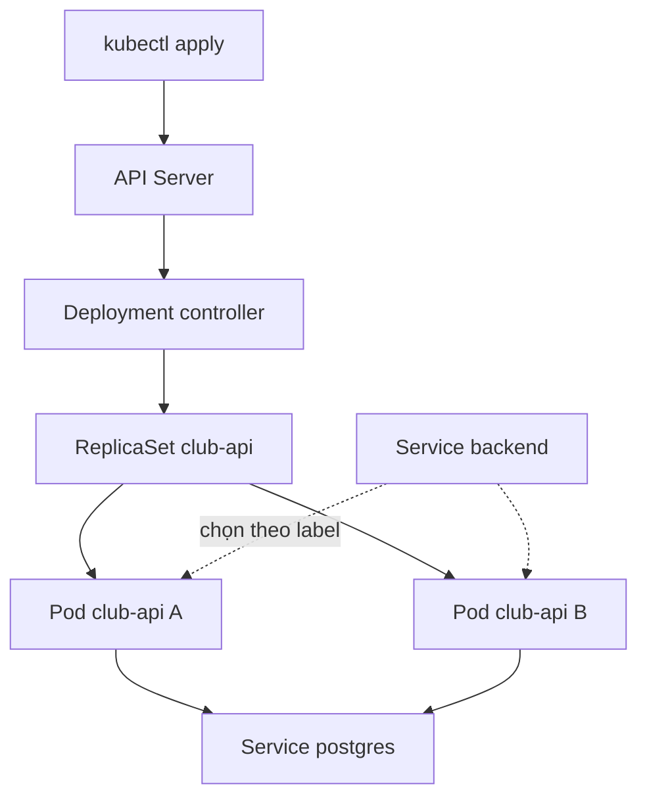

# Buổi 22 – Pods & Deployments

Tuần 11/16 · Giai đoạn 4 – Kubernetes Engineering · Buổi 22/32

[Slide Buổi 22 – Pods & Deployments](../../slides/05-kubernetes/session-22.md) · [Bài tập Tuần 11](../../assignments/weekly/week-11.md) · [Hub Tuần 11](README.md)

> **Tóm tắt:** Hiểu Pod, ReplicaSet và Deployment, rồi deploy Club API lên cluster kind club, cập nhật phiên bản không gián đoạn, quay lại bản cũ và tự chẩn đoán lỗi ImagePullBackOff.

::: tip Buổi này bạn làm gì
**Bạn sẽ tạo ra:** Club API chạy thành 2 bản (Deployment) trên cluster `club`, gọi được bằng `curl`, đã được cập nhật lên 1.0.1 rồi quay lại 1.0.0.

**Thời gian thật:** đọc khoảng 15 phút, lab bắt buộc 60 phút, thử thách tùy chọn ở nhà khoảng 45 phút.

**Cần chuẩn bị:**

- [ ] Cluster `club` đang chạy từ [Buổi 21 – Kubernetes Introduction](session-21.md) (`kubectl config current-context` ra `kind-club`)
- [ ] Repo giáo trình ở `~/devops-course` trong WSL, repo `devops-labs` của bạn ([Tài khoản GitHub và repo devops-labs](../../resources/setup-github.md)); công cụ theo [Hướng dẫn cài đặt môi trường](../../resources/setup-guide.md)
- [ ] Máy 8 GB: tắt Compose (`docker compose down`) trước khi làm; Docker Desktop đang chạy

**Sản phẩm phải nộp** (thư mục `lab-22/` trong `devops-labs`):

- `README.md` trả lời 7 câu theo [mẫu bài lab](../../templates/lab-template.md)
- `evidence/command-output.txt` có `get pods`, `rollout status`, `rollout history`, `get replicaset`, `describe pod` của lỗi ImagePullBackOff
- `screenshots/` có ảnh hai ReplicaSet (mới và cũ); `report.md` ghi lỗi ImagePullBackOff: triệu chứng, nguyên nhân gốc, cách sửa

**Mục lục nhảy:** Đọc ([Vấn đề thực tế](#van-de) và [Khái niệm cốt lõi](#khai-niem)) > [Làm lab](#hands-on-lab) > [Gặp lỗi?](#gap-loi) > [Tự kiểm tra](#tu-kiem-tra) > [Nộp bài](#nop-bai). Kẹt giữa chừng? Nhảy tới [Gặp lỗi?](#gap-loi).

**Từ mới trong buổi** (tra nhanh ở [Bảng thuật ngữ](../../resources/glossary.md)):

- **Pod**: đơn vị nhỏ nhất chạy trong Kubernetes, gói một hoặc vài container.
- **ReplicaSet**: giữ đúng N Pod giống nhau luôn chạy.
- **Deployment**: quản lý ReplicaSet và cho phép cập nhật, quay lui có kiểm soát.
- **Label và selector**: nhãn gắn lên object và bộ lọc chọn object theo nhãn.
- **Rolling update**: thay Pod cũ bằng Pod mới từng bước, không gián đoạn.
- **Readiness probe**: phép kiểm tra "Pod đã sẵn sàng nhận traffic chưa".
:::

Trên lớp, mentor demo trước; tự học thì làm thẳng phần [Làm lab](#hands-on-lab).

## Vấn đề thực tế {#van-de}

CLB đang chạy Club API bằng `docker compose` trên laptop của một bạn. Khi container backend chết vì lỗi bộ nhớ, không ai biết cho tới khi có người mở web và thấy lỗi. Muốn chạy 2 bản API để chia tải, bạn phải tự sửa file compose và tự mở thêm cổng; cập nhật phiên bản mới thì API sập vài giây. Mỗi việc đó đều do con người làm bằng tay. Kubernetes cho bạn khai báo: "luôn có 2 bản `club-api:1.0.0` chạy, mỗi bản phải qua readiness probe mới nhận traffic". Pod chết thì có Pod mới, đổi image thì thay dần từng Pod. Buổi này bạn học đơn vị nhỏ nhất (Pod) và đối tượng dùng hằng ngày (Deployment).

## Khái niệm cốt lõi {#khai-niem}

**1. Pod.** Đơn vị nhỏ nhất bạn triển khai: một hoặc vài container chung một IP (gọi nhau qua `localhost`). Pod là tạm thời: bị xóa thì không tự quay lại, Pod mới có IP khác. Ví von: một nhân viên ca làm việc, nghỉ là hết ca.

**2. ReplicaSet và Deployment.** ReplicaSet đếm Pod khớp một selector và tạo bù hoặc xóa bớt cho đủ N. Deployment quản lý ReplicaSet và thêm rolling update, rollback; mỗi lần đổi Pod template (image, biến môi trường) nó tạo ReplicaSet mới và giữ ReplicaSet cũ (0 Pod) để quay lui. Ví von: ReplicaSet là tổ trưởng luôn giữ đủ người; Deployment là quản lý ca, lo đổi ca mà quán không bao giờ vắng người. Ứng dụng stateless như Club API luôn dùng Deployment, không chạy Pod trần.

**3. Labels và selectors.** Label là cặp `key=value` gắn lên object; selector chọn object theo label. Đây là cách duy nhất Kubernetes nối object với nhau: Deployment tìm Pod của mình, Service `backend` chọn Pod bằng `app: club-api`. `spec.selector.matchLabels` phải khớp `spec.template.metadata.labels` và không sửa được sau khi tạo. Ví von: nhãn tên trên áo đồng phục.

**4. Rolling update và readiness probe.** Mặc định `maxSurge: 25%` và `maxUnavailable: 25%`. Với 2 replicas: tạo thêm 1 Pod mới (làm tròn lên), chờ Ready, mới xóa 1 Pod cũ (maxUnavailable làm tròn xuống 0), rồi lặp lại, nên luôn có 2 Pod sẵn sàng. Readiness probe quyết định "Ready"; không có probe thì Pod bị coi là Ready ngay khi container khởi động. Ví von: đổi từng người gác cổng, chỉ cho người cũ nghỉ khi người mới đã đứng vào vị trí.

**5. Image trong kind.** Node của kind là container có runtime riêng, không thấy image trong Docker Desktop, nên phải nạp bằng `kind load docker-image`. Dùng tag cố định (như `1.0.0`) với `imagePullPolicy: IfNotPresent`; tránh `latest` vì mặc định là `Always`, kubelet luôn cố pull từ registry. Ví von: nguyên liệu phải chuyển vào bếp, để ngoài kho nhà hàng thì đầu bếp không thấy.



::: details Tìm hiểu thêm (đọc sau)
**Vòng đời Pod (`status.phase`):**

| Phase | Ý nghĩa |
| --- | --- |
| Pending | Đã nhận Pod nhưng chưa có container chạy (chờ scheduler hoặc đang pull image) |
| Running | Đã gán node, ít nhất một container đang chạy hoặc khởi động lại |
| Succeeded | Mọi container kết thúc exit code 0, không khởi động lại (thường là Job) |
| Failed | Mọi container kết thúc, ít nhất một container thất bại |
| Unknown | Không lấy được trạng thái, thường do mất liên lạc với node |

Cột STATUS của `kubectl get pods` còn có `ContainerCreating`, `ErrImagePull`, `ImagePullBackOff`, `CrashLoopBackOff`, `Terminating`: đó là trạng thái container hoặc quá trình, không phải phase.

**Luồng khi `kubectl apply -f k8s/backend.yaml`:** (1) API Server lưu manifest vào etcd; (2) Deployment controller tạo ReplicaSet; (3) ReplicaSet controller tạo 2 object Pod (phase Pending); (4) Scheduler chọn node; (5) kubelet lấy image `club-api:1.0.0` (đã nạp), chạy container và probe; (6) khi `/ready` trả 200, Pod được thêm vào endpoint của Service `backend`. Rolling update chỉ khác ở bước 2: có thêm ReplicaSet mới.

Sơ đồ tuần tự rolling update và bảng so sánh Pod trần, ReplicaSet, Deployment nằm trong [slide buổi 22](../../slides/05-kubernetes/session-22.md).
:::

## Hands-on lab {#hands-on-lab}

Lab bắt buộc (mức L1) khoảng 60 phút. Chạy trong terminal WSL, trong thư mục `~/devops-course/starter-project`. Bằng chứng ghi vào `~/devops-labs/lab-22/evidence/` bằng `tee -a`.

### Chuẩn bị (5 phút)

```bash
mkdir -p ~/devops-labs/lab-22/{source,evidence,screenshots}
export EV=~/devops-labs/lab-22/evidence/command-output.txt
cd ~/devops-course/starter-project
kubectl config current-context
kubectl get nodes
docker info --format '{{.ServerVersion}}'
```

Kết quả mong đợi: `kind-club`, node `club-control-plane` `Ready`, và phiên bản Docker. Sai context: `kubectl config use-context kind-club`. Chưa có cluster `club`: làm Phần 1 của [Buổi 21 – Kubernetes Introduction](session-21.md). Biến `EV` chỉ có tác dụng trong terminal này; mở terminal mới thì `export` lại.

### Phần 1. Build image và nạp vào kind (8 phút)

Build image với tag cố định (giúp manifest tái lập được), rồi nạp vào node của kind (node không thấy image trong Docker Desktop):

```bash
docker build -t club-api:1.0.0 ./backend
kind load docker-image club-api:1.0.0 --name club
docker exec club-control-plane crictl images | grep club-api | tee -a $EV
```

Kết quả mong đợi: dòng cuối của build có `naming to docker.io/library/club-api:1.0.0`; `crictl` in một dòng `docker.io/library/club-api   1.0.0   ...`. Quên `--name club` thì image vào nhầm cluster: xem [Gặp lỗi?](#gap-loi).

::: tip Kiểm tra: bạn đúng khi
`crictl images` trong node `club-control-plane` có `club-api` tag `1.0.0`.
:::

### Phần 2. Dựng nền: namespace, config, secret, Postgres (8 phút)

Backend cần ConfigMap, Secret và Postgres, thiếu một thứ thì Pod không Ready (Secret học kỹ ở buổi 25, ở đây tạo tối thiểu).

```bash
kubectl apply -f k8s/namespace.yaml
kubectl apply -f k8s/configmap.yaml
read -rsp "DB password (local): " DB_PASS; echo
kubectl create secret generic club-secrets -n club --from-literal=db-password="$DB_PASS"
unset DB_PASS
kubectl apply -f k8s/postgres.yaml
kubectl rollout status statefulset/postgres -n club --timeout=120s
kubectl exec -i -n club postgres-0 -- psql -U club -d clubdb < database/init.sql
```

Kết quả mong đợi: `secret/club-secrets created`, `statefulset rolling update complete 1 pods ...`, rồi `CREATE TABLE` và `INSERT 0 2`. Dùng mật khẩu cục bộ của riêng bạn và không ghi nó vào file nào (`secret.example.yaml` chỉ là ví dụ). Bước `init.sql` bắt buộc vì manifest Postgres không tự chạy nó: thiếu bảng `members` thì `/api/members` trả 500 ([Gặp lỗi?](#gap-loi)).

::: tip Kiểm tra: bạn đúng khi
`kubectl get pods -n club` có `postgres-0` ở trạng thái `1/1 Running`.
:::

### Phần 3. Deploy Club API (10 phút)

1. Đọc manifest trước khi apply và ghi 3 câu trả lời vào `report.md`: label nào nối Deployment với Pod? Probe nào chặn Pod nhận traffic? Biến `DB_HOST` đến từ đâu?

   ```bash
   sed -n 1,52p k8s/backend.yaml
   ```

2. Apply và theo dõi:

   ```bash
   kubectl apply -f k8s/backend.yaml
   kubectl rollout status deployment/club-api -n club --timeout=120s | tee -a $EV
   kubectl get deployment,replicaset,pod -n club -l app=club-api | tee -a $EV
   ```

   Kết quả mong đợi: `deployment "club-api" successfully rolled out`; 1 Deployment READY 2/2, 1 ReplicaSet (DESIRED 2, READY 2), 2 Pod `1/1 Running` (hậu tố hash của bạn sẽ khác). Pod chỉ Ready sau khi `/ready` trả 200, tức là kết nối được DB. Nếu Pod không lên: [Gặp lỗi?](#gap-loi).

3. Gọi API qua port-forward. Terminal thứ hai, giữ chạy (chỉ mở cổng trên 127.0.0.1, không phải cách expose ra ngoài):

   ```bash
   kubectl port-forward -n club svc/backend 3000:3000
   ```

   Ở terminal đầu:

   ```bash
   { curl -s localhost:3000/health; echo; curl -s localhost:3000/ready; echo; curl -s localhost:3000/api/members; echo; } | tee ~/devops-labs/lab-22/evidence/test-results.txt
   ```

   Kết quả mong đợi: `{"status":"healthy","service":"club-api"}`, `{"status":"ready"}` và danh sách `[{"id":1,"name":"Alice",...},{"id":2,"name":"Bob",...}]`.

::: tip Kiểm tra: bạn đúng khi
Deployment `club-api` READY 2/2 và cả ba lệnh `curl` trả đúng như trên. Cổng 3000 bận thì đổi thành `3001:3000` và gọi `localhost:3001`.
:::

### Phần 4. Rolling update và rollback (15 phút)

1. Tạo phiên bản 1.0.1. Nên đổi nhẹ code để thấy khác biệt (ví dụ trong `backend/app.js` đổi `service: "club-api"` thành `service: "club-api-v2"` ở endpoint `/health`); chưa muốn sửa thì thay lệnh build bằng `docker tag club-api:1.0.0 club-api:1.0.1`. Nếu đã sửa `app.js`, hoàn tác sau buổi bằng `git checkout backend/app.js` (bài test của backend kiểm tra đúng tên `club-api`).

   ```bash
   docker build -t club-api:1.0.1 ./backend
   kind load docker-image club-api:1.0.1 --name club
   ```

2. Mở terminal thứ hai (dừng port-forward bằng Ctrl+C nếu dùng lại cửa sổ đó) và chạy `kubectl get pods -n club -l app=club-api -w` để theo dõi Pod.

3. Terminal đầu, cập nhật image và ghi lý do thay đổi:

   ```bash
   kubectl set image deployment/club-api api=club-api:1.0.1 -n club
   kubectl annotate deployment/club-api -n club kubernetes.io/change-cause="update api to 1.0.1" --overwrite
   kubectl rollout status deployment/club-api -n club | tee -a $EV
   ```

   Kết quả mong đợi: `Waiting for deployment "club-api" rollout to finish: 1 out of 2 new replicas have been updated...` rồi `deployment "club-api" successfully rolled out`. Ở terminal theo dõi, Pod mới `ContainerCreating` rồi `Running`, sau đó Pod cũ `Terminating`; không lúc nào số Pod Ready thấp hơn 2.

4. Xem hai ReplicaSet và lịch sử (chụp màn hình lệnh đầu cho `screenshots/`):

   ```bash
   kubectl get replicaset -n club -l app=club-api | tee -a $EV
   kubectl rollout history deployment/club-api -n club | tee -a $EV
   ```

   Kết quả mong đợi: hai ReplicaSet (bản 1.0.1 có 2 Pod, bản 1.0.0 có 0 Pod); history có REVISION 1 và 2.

5. Rollback:

   ```bash
   kubectl rollout undo deployment/club-api -n club
   kubectl rollout status deployment/club-api -n club
   kubectl get deployment club-api -n club -o jsonpath='{.spec.template.spec.containers[0].image}'; echo
   ```

   Kết quả mong đợi: dòng cuối in `club-api:1.0.0`. `undo` dùng lại ReplicaSet cũ chứ không tạo cái mới.

::: tip Kiểm tra: bạn đúng khi
`rollout history` có ít nhất 2 revision và image sau `undo` là `club-api:1.0.0`. Nếu `curl` vẫn thấy bản cũ hoặc mới sai: chạy lại `port-forward` rồi `curl` (port-forward gắn chặt vào một Pod cụ thể).
:::

### Phần 5. Phá lỗi: ImagePullBackOff (10 phút)

Tình huống: bản cập nhật "không lên" mà chưa ai báo lỗi (tương ứng `examples/troubleshooting/scenario-07`). Bạn tự gây lỗi, điều tra rồi sửa.

1. Phá: trỏ Deployment tới tag chưa từng nạp vào kind.

   ```bash
   kubectl set image deployment/club-api api=club-api:1.0.9 -n club
   kubectl rollout status deployment/club-api -n club --timeout=30s
   kubectl get pods -n club -l app=club-api | tee -a $EV
   ```

   Triệu chứng mong đợi: `error: timed out waiting for the condition`; một Pod mới `ImagePullBackOff` (có thể thấy `ErrImagePull` trước), hai Pod cũ vẫn `1/1 Running` (dịch vụ không sập nhờ `maxUnavailable` bằng 0 và readiness probe). Coi `timed out` là tín hiệu phải điều tra.

2. Điều tra, chưa sửa vội, lưu Events làm bằng chứng:

   ```bash
   kubectl describe pod -n club -l app=club-api | sed -n '/Events:/,$p' | tee -a $EV
   kubectl get events -n club --sort-by=.lastTimestamp | tail -8
   docker exec club-control-plane crictl images | grep club-api
   ```

   Tìm dòng `Failed to pull image "club-api:1.0.9"` kèm lý do (ví dụ `pull access denied, repository does not exist`) và `Back-off pulling image`. `crictl` chỉ thấy `1.0.0` và `1.0.1`, không có `1.0.9`. Nguyên nhân gốc: tag `1.0.9` chưa được build và nạp vào node, cũng không có trên registry công khai nên kubelet pull thất bại.

3. Sửa: quay lại bản tốt, rồi kiểm tra về 2/2:

   ```bash
   kubectl rollout undo deployment/club-api -n club
   kubectl rollout status deployment/club-api -n club
   kubectl get pods -n club -l app=club-api | tee -a $EV
   ```

   Nếu tag đúng mà bạn chỉ quên nạp: `kind load docker-image club-api:1.0.9 --name club` rồi `kubectl rollout restart deployment/club-api -n club`. Phòng tránh: nạp ngay sau `docker build`, dùng tag cố định, luôn chạy `rollout status`.

::: tip Kiểm tra: bạn đúng khi
`get pods` sau khi sửa cho thấy 2 Pod `1/1 Running` và evidence có đoạn Events với dòng `Failed to pull image`.
:::

### Checklist L1 và lệnh tự kiểm tra

- [ ] 2 Pod `club-api` ở trạng thái `1/1 Running`; `curl localhost:3000/api/members` trả danh sách thành viên.
- [ ] Đã rolling update lên 1.0.1, có output `kubectl rollout status` trong evidence.
- [ ] Đã rollback bằng `kubectl rollout undo`, image trở về `club-api:1.0.0`.
- [ ] Đã chụp hai ReplicaSet (mới và cũ) bằng `kubectl get replicaset -n club`.
- [ ] Đã tái hiện và sửa ImagePullBackOff, ghi lại output `kubectl describe pod`.

Lệnh tự kiểm tra một dòng (kết quả đúng là `club-api:1.0.0 2`):

```bash
kubectl get deployment club-api -n club -o jsonpath='{.spec.template.spec.containers[0].image} {.status.readyReplicas}{"\n"}'
```

## Gặp lỗi? {#gap-loi}

| Triệu chứng | Nguyên nhân | Cách sửa |
| --- | --- | --- |
| `ErrImagePull` hoặc `ImagePullBackOff` | Image chưa nạp vào kind, sai tên hoặc tag, hoặc nạp nhầm cluster (quên `--name club`) | `kubectl describe pod` xem Events; `docker exec club-control-plane crictl images`; `kind load docker-image tên:tag --name club`; sửa tag; hoặc `kubectl rollout undo` |
| `selector does not match template labels` khi apply | `spec.selector.matchLabels` không là tập con của `spec.template.metadata.labels` | Sửa cho khớp; Deployment đã tồn tại thì selector không sửa được, phải xóa và tạo lại |
| Pod `0/1 Running`, không bao giờ Ready | Readiness probe `/ready` trả 503 vì API không kết nối được Postgres (thiếu Secret, sai mật khẩu, Postgres chưa chạy) | `kubectl logs`, `kubectl get pods -n club -l app=postgres`, kiểm tra Secret `club-secrets` |
| `CreateContainerConfigError` | Secret hoặc ConfigMap được tham chiếu không có trong namespace | `kubectl describe pod` xem Events; tạo `club-secrets`, apply `k8s/configmap.yaml` |
| `Error from server (NotFound): namespaces "club" not found` | Chưa apply `k8s/namespace.yaml` | `kubectl apply -f k8s/namespace.yaml` trước |
| `/api/members` trả 500 | Bảng `members` chưa có vì `init.sql` chưa chạy trong Postgres của cluster | `kubectl exec -i -n club postgres-0 -- psql -U club -d clubdb < database/init.sql` |
| `curl` không thấy bản mới, `lost connection to pod` hoặc `address already in use` | `port-forward` cũ gắn vào Pod đã bị thay, hoặc cổng 3000 đang bận | Ctrl+C rồi chạy lại `kubectl port-forward -n club svc/backend 3000:3000`; cổng bận thì dùng `3001:3000` và gọi `localhost:3001` |
| `kubectl` báo `connection refused` hoặc trỏ cluster lạ | Sai context, cluster đã bị xóa hoặc container node dừng | `kubectl config get-contexts`, `kubectl config use-context kind-club`, `kind get clusters`, `docker ps -a --filter name=club` |
| Pod `Pending` với `Insufficient cpu` | Tổng `requests` vượt tài nguyên của node | Giảm requests hoặc số replicas; xem `kubectl describe pod` |

## Tự kiểm tra {#tu-kiem-tra}

1. Vì sao Pod trần không tự quay lại sau khi bị xóa, còn Pod thuộc Deployment thì có?

   ::: details Đáp án gợi ý
   Pod trần không có controller sở hữu nên không ai so sánh trạng thái thật với mong muốn. Pod của Deployment thuộc một ReplicaSet; ReplicaSet liên tục đếm Pod khớp selector và tạo Pod mới khi thiếu.
   :::

2. Deployment có selector `app: club-api` nhưng Pod template có label `app: api`. Điều gì xảy ra khi apply?

   ::: details Đáp án gợi ý
   API Server từ chối manifest vì selector không khớp labels của template (thông báo kiểu `selector does not match template labels`). Nếu cho phép, ReplicaSet sẽ không bao giờ thấy Pod do chính nó tạo ra và tạo Pod vô hạn.
   :::

3. Sau `kubectl set image` lên tag mới, `rollout status` treo rồi timeout nhưng người dùng chưa báo lỗi. Giải thích và nêu 3 lệnh bạn chạy đầu tiên.

   ::: details Đáp án gợi ý
   Pod mới không Ready (ví dụ ImagePullBackOff) nên rolling update dừng, Pod cũ vẫn phục vụ vì `maxUnavailable` là 0. Ba lệnh: `kubectl get pods -n club -l app=club-api`, `kubectl describe pod` cho Pod lỗi (đọc Events), `kubectl logs` nếu container đã khởi động. Khắc phục nhanh: `kubectl rollout undo`.
   :::

## Nộp bài {#nop-bai}

Nộp vào thư mục `lab-22/` trong repo `devops-labs` theo [mẫu bài lab](../../templates/lab-template.md). Đây cũng là phần bằng chứng của [Bài tập Tuần 11](../../assignments/weekly/week-11.md).

- [ ] `README.md` trả lời đủ 7 câu: lab giải quyết vấn đề gì, kiến thức đã dùng, các bước, kết quả mong đợi, lỗi đã gặp, cách khắc phục, có thể cải thiện gì; đánh dấu level đã làm (L1 hoặc L2) ở cuối.
- [ ] `source/` chứa manifest bạn đã dùng hoặc viết (`backend.yaml` đã chỉnh nếu có, file L2 nếu làm).
- [ ] `evidence/command-output.txt` và `evidence/test-results.txt` (output `curl`).
- [ ] `screenshots/` có ảnh hai ReplicaSet (mới và cũ) sau rolling update.
- [ ] `report.md` có mốc thời gian, 3 câu trả lời về manifest ở Phần 3, và lỗi ImagePullBackOff: triệu chứng, nguyên nhân gốc, cách sửa, cách phòng tránh.
- [ ] Không commit mật khẩu, token hay file Secret chứa giá trị thật; kiểm tra bằng `git diff --staged` trước khi commit.

## Recap

- Pod là đơn vị nhỏ nhất nhưng tạm thời; Deployment quản lý ReplicaSet, ReplicaSet giữ đúng số Pod theo selector.
- Rolling update thay Pod dần, readiness probe quyết định Pod nào nhận traffic; `rollout status`, `history`, `undo` là bộ công cụ vận hành và timeout là lời cảnh báo.
- Với kind: `docker build`, rồi `kind load docker-image --name club`, dùng tag cố định; khi lỗi: `get pods`, `describe pod` (Events), rồi `logs`.

Buổi tiếp theo: [Buổi 23 – kubectl Fundamentals](../week-12/session-23.md). Giữ nguyên cluster `club` và Club API đang chạy.

::: details Thử thách thêm (L2, tùy chọn, làm ở nhà)
Hai thử thách: tự viết một Deployment thứ hai cho Club API (bản canary) và kiểm soát rolling update với `maxSurge`, `maxUnavailable`. Đề bài và gợi ý từng bậc nằm ở trang riêng: [Buổi 22 – Thử thách thêm](session-22-challenge.md). Tự thử khoảng 15 phút trước khi mở gợi ý.
:::

::: details Phá lỗi nâng cao
- Đổi label `app` của một Pod đang chạy: `kubectl label pod <tên-pod> -n club app=other --overwrite`. Pod rời khỏi ReplicaSet và Service, ReplicaSet tạo Pod mới thay thế. Xóa Pod "mồ côi" đó sau khi quan sát.
- Cố ý sai selector: sửa bản chép của `k8s/backend.yaml` cho `matchLabels` khác label của template rồi `kubectl apply` và đọc thông báo lỗi.
- Câu hỏi ôn thêm: (a) Sau `rollout undo`, ReplicaSet mới hay cũ được dùng lại, vì sao quan trọng? Đáp án: ReplicaSet cũ được scale lên, ReplicaSet hiện tại về 0; nếu `revisionHistoryLimit: 0` thì không thể rollback. (b) Vì sao cần `kind load docker-image` khi image đã có trong Docker Desktop? Đáp án: node kind có container runtime riêng, tách khỏi image store của máy host; không nạp thì kubelet cố pull từ registry. (c) Với `replicas: 2`, `maxSurge: 25%`, `maxUnavailable: 25%`, tối đa bao nhiêu Pod tồn tại và tối thiểu bao nhiêu Pod Ready? Đáp án: surge làm tròn lên thành 1 nên tối đa 3 Pod; unavailable làm tròn xuống thành 0 nên luôn có ít nhất 2 Pod Ready. (d) Service `backend` chọn Pod thế nào? Đáp án: theo label `app: club-api` và chỉ gửi traffic tới Pod Ready; đổi label thì Pod rời endpoint của Service.
:::

::: details Tài liệu tham khảo
- [Pods](https://kubernetes.io/docs/concepts/workloads/pods/)
- [Pod Lifecycle](https://kubernetes.io/docs/concepts/workloads/pods/pod-lifecycle/)
- [Deployments](https://kubernetes.io/docs/concepts/workloads/controllers/deployment/)
- [ReplicaSet](https://kubernetes.io/docs/concepts/workloads/controllers/replicaset/)
- [Labels and Selectors](https://kubernetes.io/docs/concepts/overview/working-with-objects/labels/)
- [kind: Loading an Image Into Your Cluster](https://kind.sigs.k8s.io/docs/user/quick-start/#loading-an-image-into-your-cluster)
:::
