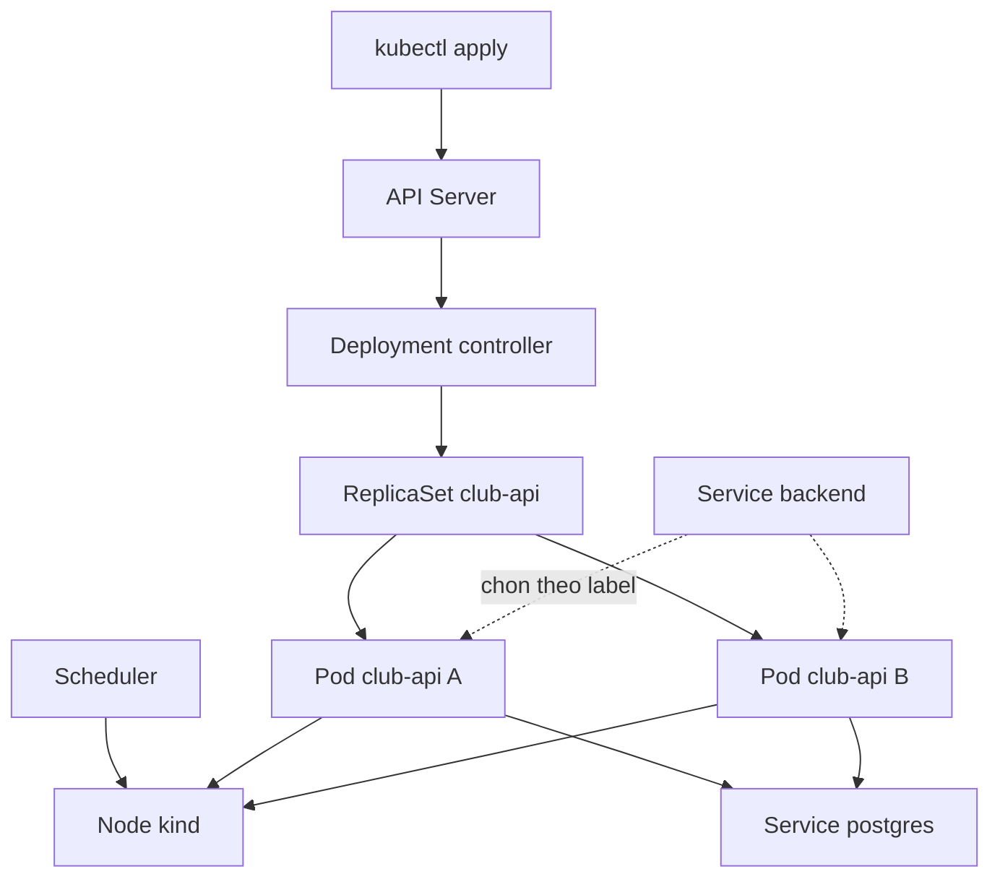
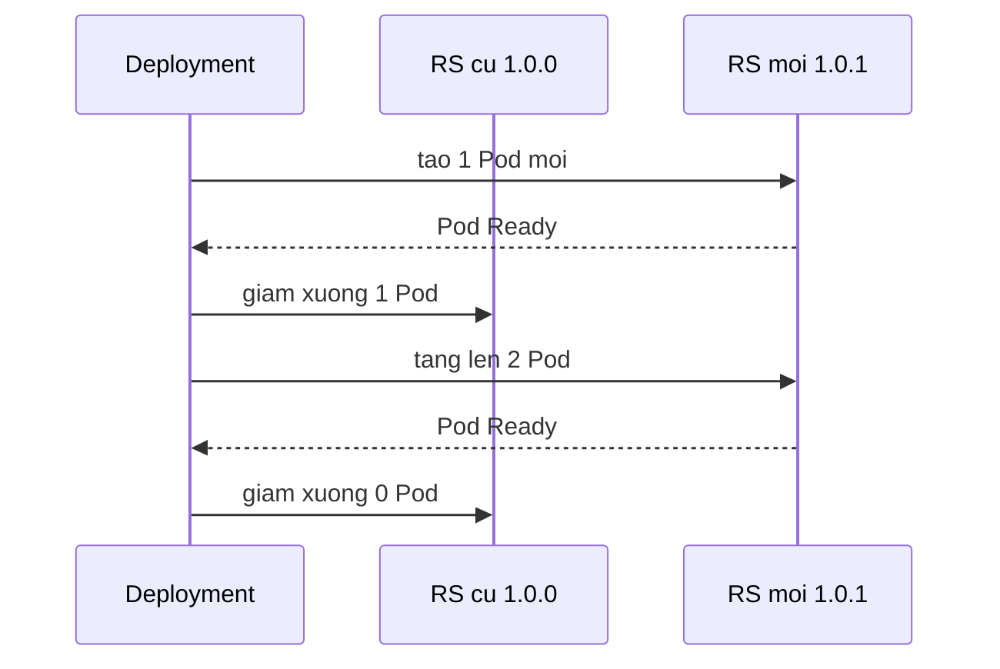

# Buổi 22 – Pods & Deployments

Tuần 11 · Giai đoạn 4 – Kubernetes Engineering · Slide: [Slide buổi 22](../../slides/05-kubernetes/session-22.md)

> **Tóm tắt:** Hiểu vòng đời Pod, ReplicaSet và Deployment, rồi deploy Club API lên kind, thực hiện rolling update, rollback và chẩn đoán ImagePullBackOff.

## Mục tiêu học tập

- Giải thích được quan hệ Deployment, ReplicaSet và Pod, và vì sao không nên chạy Pod trần trong môi trường thật.
- Viết được manifest Pod và Deployment với labels, selector, resources và probes đúng cú pháp.
- Chạy được quy trình build image, `kind load docker-image`, apply manifest và xác nhận Club API trả lời qua `kubectl port-forward`.
- Thực hiện được rolling update, theo dõi bằng `kubectl rollout status` và quay lại bản cũ bằng `kubectl rollout undo`.
- Chẩn đoán được ImagePullBackOff bằng `kubectl describe pod` và `kubectl get events`, nêu được nguyên nhân gốc.
- Giải thích được vì sao selector không khớp labels làm Deployment bị từ chối hoặc không quản lý được Pod.

## Điều kiện cần

- Đã học buổi 21: biết kiến trúc Kubernetes (control plane, worker node) và đã tạo được cluster kind.
- Đã học tuần 4 đến 7: build image Docker, biến môi trường, healthcheck.
- Làm việc trong filesystem của WSL (ví dụ `~/devops-labs/lab-22/`), không dùng `/mnt/c`.
- Có bản sao `starter-project/` tại `~/devops-labs/lab-22/source/starter-project`.
- Công cụ: Docker Desktop (đang chạy), kind 0.23 trở lên, kubectl.

Kiểm tra nhanh:

```bash
docker info --format '{{.ServerVersion}}'
kind version
kubectl version --client
kind get clusters
```

Kết quả mong đợi: Docker in ra phiên bản (ví dụ `27.x.x`), kind in ra `kind v0.23` trở lên, kubectl in ra Client Version, và `kind get clusters` liệt kê cluster tên `club`. Buổi 21 bạn tạo `club-lab` và `club-lab-3` để học; hãy xóa chúng để giải phóng RAM. Bài này dùng cluster `club` tạo từ file cấu hình của starter project (nếu chưa có thư mục, chép từ repo giáo trình):

```bash
mkdir -p ~/devops-labs/lab-22/source
cp -r /đường/dẫn/tới/devops-course/starter-project ~/devops-labs/lab-22/source/
cd ~/devops-labs/lab-22/source/starter-project
kind get clusters | grep -qx club || kind create cluster --name club --config k8s/kind-config.yaml
kubectl cluster-info --context kind-club
```

Kết quả mong đợi: dòng `Kubernetes control plane is running at https://127.0.0.1:...`. Cổng 80 và 443 của máy phải đang rảnh vì `kind-config.yaml` ánh xạ hai cổng này.

## Vấn đề thực tế

CLB đang chạy Club API bằng `docker compose` trên laptop của một bạn. Khi container backend chết vì lỗi bộ nhớ, không ai biết cho tới khi có người mở web và thấy lỗi. Khi muốn chạy 2 bản API để chia tải, bạn phải tự sửa file compose, tự mở thêm cổng, và khi cập nhật phiên bản mới thì cả API sập vài giây. Mỗi việc đó đều do con người làm bằng tay.

Kubernetes giải quyết bằng cách để bạn khai báo trạng thái mong muốn: "luôn có 2 bản club-api:1.0.0 chạy, mỗi bản phải qua readiness probe mới nhận traffic". Controller liên tục so sánh trạng thái thật với trạng thái mong muốn và sửa lệch: Pod chết thì tạo Pod mới, đổi image thì thay dần từng Pod. Buổi này bạn học đơn vị nhỏ nhất (Pod) và đối tượng bạn sẽ dùng hằng ngày (Deployment) để vận hành Club API theo cách đó.

## Khái niệm cốt lõi

### Pod

Pod là đơn vị nhỏ nhất bạn triển khai trong Kubernetes. Một Pod gồm một hoặc nhiều container chia sẻ chung network namespace (cùng một IP, gọi nhau qua `localhost`) và có thể chia sẻ volume. Thông thường mỗi Pod chỉ có một container chính. Pod là tạm thời: khi bị xóa hoặc node hỏng, Pod không tự quay lại, và Pod mới có IP khác.

Vòng đời Pod (trường `status.phase`):

| Phase | Ý nghĩa |
| --- | --- |
| Pending | API server đã nhận Pod, nhưng chưa có container chạy (chờ scheduler chọn node, hoặc đang pull image) |
| Running | Pod đã gán cho node và ít nhất một container đang chạy hoặc đang khởi động lại |
| Succeeded | Mọi container đã kết thúc với exit code 0 và sẽ không khởi động lại (thường là Job) |
| Failed | Mọi container đã kết thúc và ít nhất một container thất bại |
| Unknown | Không lấy được trạng thái Pod, thường do mất liên lạc với node |

Cột STATUS của `kubectl get pods` còn hiển thị các trạng thái cụ thể hơn như `ContainerCreating`, `ErrImagePull`, `ImagePullBackOff`, `CrashLoopBackOff`, `Terminating`. Đó là trạng thái của container hoặc quá trình, không phải phase.

### ReplicaSet

ReplicaSet đảm bảo luôn có đúng N Pod khớp một selector đang chạy. Nếu thiếu, nó tạo Pod mới từ Pod template; nếu thừa, nó xóa bớt. ReplicaSet không biết gì về "phiên bản", nó chỉ đếm Pod. Bạn hiếm khi tạo ReplicaSet trực tiếp.

### Deployment

Deployment quản lý ReplicaSet và thêm khả năng cập nhật có kiểm soát. Mỗi khi Pod template thay đổi (đổi image, đổi biến môi trường), Deployment tạo một ReplicaSet mới và tăng dần số Pod của nó, đồng thời giảm dần số Pod của ReplicaSet cũ. Các ReplicaSet cũ được giữ lại (với 0 Pod) để có thể rollback.

| Tiêu chí | Pod trần | ReplicaSet | Deployment |
| --- | --- | --- | --- |
| Tự tạo lại Pod khi chết | Không | Có | Có |
| Chạy nhiều bản sao | Không | Có | Có |
| Rolling update | Không | Không | Có |
| Rollback | Không | Không | Có (`rollout undo`) |
| Dùng cho | Thử nghiệm, debug nhanh | Hiếm khi dùng trực tiếp | Ứng dụng stateless như Club API |

### Labels và selectors

Label là cặp key=value gắn lên mọi object. Selector chọn object theo label. Đây là cách duy nhất Kubernetes nối các object với nhau: Deployment chọn ReplicaSet và Pod, Service chọn Pod. Không có "tên Pod" nào được hard-code.

- `spec.selector.matchLabels` của Deployment phải khớp `spec.template.metadata.labels`. Nếu không khớp, API server từ chối manifest.
- `spec.selector` của Deployment không sửa được sau khi tạo (immutable). Muốn đổi, phải xóa và tạo lại.
- Service `backend` trong `k8s/backend.yaml` chọn Pod bằng `app: club-api`. Đổi label của Pod là Pod rời khỏi Service.

### Chiến lược RollingUpdate

Mặc định Deployment dùng `strategy.type: RollingUpdate` với `maxSurge: 25%` và `maxUnavailable: 25%`. Với 2 replicas, `maxSurge` làm tròn lên thành 1 và `maxUnavailable` làm tròn xuống thành 0. Nghĩa là: tạo thêm 1 Pod mới, chờ nó Ready, rồi mới xóa 1 Pod cũ, và lặp lại. Nhờ vậy luôn có ít nhất 2 Pod sẵn sàng phục vụ. Readiness probe là thứ quyết định "Ready"; không có probe thì Kubernetes coi Pod Ready ngay khi container khởi động.

### Image trong kind

Node của kind là một container Docker, có container runtime riêng, không thấy image trong Docker Desktop của bạn. Bạn phải nạp image bằng `kind load docker-image`. Với tag cụ thể như `1.0.0` và `imagePullPolicy: IfNotPresent`, kubelet dùng image đã nạp; nếu image không có trong node, nó sẽ thử pull từ Docker Hub (và thất bại với image local). Tránh tag `latest` vì khi đó chính sách mặc định là `Always`.

## Kiến trúc và cách hoạt động



Diễn giải luồng khi bạn chạy `kubectl apply -f k8s/backend.yaml`:

1. kubectl gửi manifest tới API Server, API Server lưu vào etcd.
2. Deployment controller thấy Deployment `club-api` mới, tạo ReplicaSet với Pod template tương ứng.
3. ReplicaSet controller thấy thiếu Pod, tạo 2 object Pod (lúc này ở phase Pending).
4. Scheduler chọn node cho từng Pod (ở đây chỉ có một node).
5. kubelet trên node lấy image `club-api:1.0.0` (đã nạp sẵn), tạo container và chạy probe.
6. Khi readiness probe `/ready` trả 200, Pod được thêm vào danh sách endpoint của Service `backend`.

Rolling update chỉ khác ở bước 2: có thêm một ReplicaSet mới, controller tăng ReplicaSet mới lên 1, đợi Ready, giảm ReplicaSet cũ xuống 1, rồi lặp lại.



## Demo của mentor

Mục đích: cho cả lớp thấy Pod trần khác Deployment ở điểm nào. Dùng cluster kind `club` của mentor, namespace `club`, chạy trong thư mục `starter-project/`. Cần Internet để kéo `nginx:1.27-alpine` (nếu mạng lớp yếu, chạy trước `docker pull nginx:1.27-alpine` rồi `kind load docker-image nginx:1.27-alpine --name club`). Thời gian khoảng 15 phút.

1. Tạo namespace và một Pod trần (file mẫu tương đương: `examples/kubernetes/01-pod.yaml`):

```bash
kubectl apply -f k8s/namespace.yaml
cat <<'EOF' | kubectl apply -f -
apiVersion: v1
kind: Pod
metadata:
  name: demo-nginx
  namespace: club
  labels:
    app: demo-nginx
spec:
  containers:
    - name: nginx
      image: nginx:1.27-alpine
      ports:
        - containerPort: 80
EOF
kubectl get pod demo-nginx -n club -w
```

Kết quả mong đợi (nhấn Ctrl+C sau khi Running):

```text
NAME         READY   STATUS              RESTARTS   AGE
demo-nginx   0/1     ContainerCreating   0          2s
demo-nginx   1/1     Running             0          9s
```

Hỏi lớp: "Pod đã Running, bây giờ tôi xóa nó. Ai nghĩ nó sẽ tự quay lại?"

2. Xóa Pod và cho lớp thấy nó không quay lại:

```bash
kubectl delete pod demo-nginx -n club
kubectl get pods -n club
```

Kết quả mong đợi: `No resources found in club namespace.` Giải thích: không có controller nào sở hữu Pod này.

3. Tạo Deployment cùng image với 3 replicas, rồi xóa một Pod:

```bash
kubectl create deployment demo-nginx --image=nginx:1.27-alpine --replicas=3 -n club
kubectl get pods -n club -l app=demo-nginx
POD=$(kubectl get pods -n club -l app=demo-nginx -o name | head -1)
kubectl delete "$POD" -n club
kubectl get pods -n club -l app=demo-nginx
```

Kết quả mong đợi: sau khi xóa, danh sách vẫn có đủ 3 Pod, trong đó một Pod có AGE vài giây (Pod thay thế do ReplicaSet tạo).

4. Cho lớp xem chuỗi sở hữu:

```bash
kubectl get deployment,replicaset,pod -n club -l app=demo-nginx
kubectl get pod -n club -l app=demo-nginx -o jsonpath='{.items[0].metadata.ownerReferences[0].kind}'
```

Kết quả mong đợi: một Deployment, một ReplicaSet có hậu tố hash, ba Pod; lệnh thứ hai in `ReplicaSet`.

5. Dọn dẹp:

```bash
kubectl delete deployment demo-nginx -n club
```

Câu hỏi cho lớp: (a) Nếu node chứa Pod chết hẳn thì Pod trần sống lại không? (b) Điều gì quyết định Pod nào thuộc ReplicaSet nào? (c) Nếu tôi sửa label của một Pod đang chạy thành `app=other`, ReplicaSet làm gì? (Đáp: Pod đó bị "thả" khỏi ReplicaSet, ReplicaSet thấy thiếu nên tạo Pod mới.)

## Hands-on lab

**Đề bài:** Deploy Club API lên kind, rolling update, rollback, rồi chẩn đoán ImagePullBackOff. Thời gian: 60 phút (Phần 1 đến 5 khoảng 40 phút cho L1, L2 khoảng 20 phút).

### Chuẩn bị

```bash
mkdir -p ~/devops-labs/lab-22/{source,evidence,screenshots}
cd ~/devops-labs/lab-22/source/starter-project
kubectl config current-context
```

Kết quả mong đợi: `kind-club` (hoặc tên cluster của bạn, phải bắt đầu bằng `kind-`). Nếu context sai, chạy `kubectl config use-context kind-club`. Bạn sẽ ghi lệnh và output vào `~/devops-labs/lab-22/evidence/command-output.txt`; cách đơn giản nhất là bọc lệnh bằng `tee -a`, ví dụ `kubectl get pods -n club | tee -a ../../evidence/command-output.txt`.

### Phần 1: Build image và nạp vào kind

1. Build image backend với tag cố định:

```bash
docker build -t club-api:1.0.0 ./backend
```

Kết quả mong đợi: các dòng cuối `naming to docker.io/library/club-api:1.0.0` và không có lỗi. Vì sao: tag cố định `1.0.0` giúp manifest tái lập được; `latest` làm Kubernetes luôn cố pull từ registry.

2. Nạp image vào node của kind:

```bash
kind load docker-image club-api:1.0.0 --name club
```

Kết quả mong đợi: `Image: "club-api:1.0.0" ... loading...` hoặc thông báo tương tự, không có lỗi. Vì sao: node kind không thấy image trong Docker Desktop, lệnh này copy image vào runtime của node.

3. Kiểm tra image đã có trong node (tên container node của cluster `club` là `club-control-plane`):

```bash
docker exec club-control-plane crictl images | grep club-api
```

Kết quả mong đợi: một dòng `docker.io/library/club-api   1.0.0   ...`.

### Phần 2: Dựng nền (namespace, config, secret, Postgres)

Backend cần ConfigMap, Secret và Postgres, nếu thiếu thì Pod không Ready. Bài về Secret học kỹ ở buổi 25; ở đây tạo tối thiểu.

1. Apply namespace và ConfigMap:

```bash
kubectl apply -f k8s/namespace.yaml
kubectl apply -f k8s/configmap.yaml
```

Kết quả mong đợi: `namespace/club created` (hoặc `unchanged`) và `configmap/club-config created`.

2. Tạo Secret từ lệnh, không ghi mật khẩu vào file được commit. Dùng mật khẩu cục bộ của riêng bạn:

```bash
read -rsp "DB password (local): " DB_PASS; echo
kubectl create secret generic club-secrets -n club --from-literal=db-password="$DB_PASS"
unset DB_PASS
```

Kết quả mong đợi: `secret/club-secrets created`. Vì sao: Secret chỉ tồn tại trong cluster; file `secret.example.yaml` chỉ là ví dụ và không được chứa mật khẩu thật.

3. Deploy Postgres và chờ sẵn sàng:

```bash
kubectl apply -f k8s/postgres.yaml
kubectl rollout status statefulset/postgres -n club --timeout=120s
```

Kết quả mong đợi: `statefulset rolling update complete 1 pods at revision postgres-...` (có thể thấy thêm dòng `Waiting for 1 pods to be ready...`).

4. Tạo bảng `members` (manifest Postgres của starter không tự chạy `init.sql`):

```bash
kubectl exec -i -n club postgres-0 -- psql -U club -d clubdb < database/init.sql
```

Kết quả mong đợi: `CREATE TABLE` và `INSERT 0 2`. Vì sao: trong Compose, `init.sql` được mount vào thư mục khởi tạo; trong Kubernetes bạn chưa làm bước đó (sẽ học ConfigMap volume ở buổi 25), nên API sẽ lỗi 500 trên `/api/members` nếu thiếu bảng.

### Phần 3: Deploy Club API

1. Đọc manifest trước khi apply, trả lời trong báo cáo: label nào nối Deployment với Pod? Probe nào chặn Pod nhận traffic? Biến môi trường `DB_HOST` đến từ đâu?

```bash
sed -n 1,52p k8s/backend.yaml
```

2. Apply và theo dõi:

```bash
kubectl apply -f k8s/backend.yaml
kubectl rollout status deployment/club-api -n club --timeout=120s
kubectl get pods -n club -l app=club-api -o wide
```

Kết quả mong đợi:

```text
deployment.apps/club-api created
service/backend created
deployment "club-api" successfully rolled out
NAME                        READY   STATUS    RESTARTS   AGE   IP           NODE
club-api-6f7c9d8b5-abcde    1/1     Running   0          25s   10.244.0.x   club-control-plane
club-api-6f7c9d8b5-fghij    1/1     Running   0          25s   10.244.0.y   club-control-plane
```

Hậu tố hash của bạn sẽ khác. Vì sao cần chờ `rollout status`: Pod chỉ Ready sau khi `/ready` trả 200, tức là kết nối DB thành công.

3. Xem chuỗi Deployment, ReplicaSet, Pod:

```bash
kubectl get deployment,replicaset,pod -n club -l app=club-api
```

Kết quả mong đợi: 1 Deployment (READY 2/2), 1 ReplicaSet (DESIRED 2, READY 2), 2 Pod.

4. Gọi API qua port-forward. Mở terminal thứ hai và giữ chạy:

```bash
kubectl port-forward -n club svc/backend 3000:3000
```

Ở terminal đầu:

```bash
curl -s localhost:3000/health; echo
curl -s localhost:3000/ready; echo
curl -s localhost:3000/api/members; echo
```

Kết quả mong đợi:

```text
{"status":"healthy","service":"club-api"}
{"status":"ready"}
[{"id":1,"name":"Alice","email":"alice@example.com"},{"id":2,"name":"Bob","email":"bob@example.com"}]
```

Lưu ý: `port-forward` chỉ mở cổng trên máy bạn (127.0.0.1) và chỉ tới một Pod phía sau Service; đây không phải cách để expose ra ngoài. Dừng bằng Ctrl+C khi xong. Nếu cổng 3000 trên máy đã bận, đổi thành `3001:3000` và gọi `localhost:3001`.

### Phần 4: Rolling update

1. Tạo phiên bản 1.0.1. Bạn có thể sửa nhẹ code (ví dụ đổi `service: "club-api"` thành `service: "club-api-v2"` trong `backend/app.js`, endpoint `/health`) rồi build; nếu chưa muốn sửa, chỉ cần gắn tag mới cho cùng image:

```bash
docker build -t club-api:1.0.1 ./backend
kind load docker-image club-api:1.0.1 --name club
```

Kết quả mong đợi: build thành công và nạp vào kind không lỗi. Nếu bỏ qua việc sửa code, thay lệnh build bằng `docker tag club-api:1.0.0 club-api:1.0.1`.

2. Mở terminal thứ hai chạy lệnh theo dõi Pod:

```bash
kubectl get pods -n club -l app=club-api -w
```

3. Ở terminal đầu, cập nhật image và ghi lại lý do thay đổi:

```bash
kubectl set image deployment/club-api api=club-api:1.0.1 -n club
kubectl annotate deployment/club-api -n club kubernetes.io/change-cause="update api to 1.0.1" --overwrite
kubectl rollout status deployment/club-api -n club
```

Kết quả mong đợi:

```text
Waiting for deployment "club-api" rollout to finish: 1 out of 2 new replicas have been updated...
Waiting for deployment "club-api" rollout to finish: 1 old replicas are pending termination...
deployment "club-api" successfully rolled out
```

Ở terminal theo dõi, bạn thấy Pod mới `ContainerCreating` rồi `Running`, rồi Pod cũ `Terminating`, không có thời điểm nào số Pod Ready thấp hơn 2. Vì sao: `maxUnavailable` làm tròn xuống 0 với 2 replicas.

4. Xem hai ReplicaSet và lịch sử:

```bash
kubectl get replicaset -n club -l app=club-api
kubectl rollout history deployment/club-api -n club
```

Kết quả mong đợi: hai ReplicaSet, một có 2 Pod (bản 1.0.1), một có 0 Pod (bản 1.0.0); history có REVISION 1 và 2.

5. Rollback:

```bash
kubectl rollout undo deployment/club-api -n club
kubectl rollout status deployment/club-api -n club
kubectl get deployment club-api -n club -o jsonpath='{.spec.template.spec.containers[0].image}'; echo
```

Kết quả mong đợi: dòng cuối in `club-api:1.0.0`. Vì sao: `undo` đưa Pod template về revision trước, tái sử dụng ReplicaSet cũ thay vì tạo cái mới.

### Phần 5: Phá lỗi nhanh

Làm phần "Phá lỗi và debug" bên dưới (ImagePullBackOff) tại đây, khoảng 10 phút, rồi quay lại làm L1 và L2.

### L1 – Foundation: checklist hoàn thành

- [ ] `kubectl get pods -n club` hiển thị 2 Pod `club-api` ở trạng thái `1/1 Running`
- [ ] `curl localhost:3000/api/members` (qua port-forward) trả danh sách thành viên
- [ ] Đã thực hiện rolling update lên 1.0.1 và có output `kubectl rollout status` trong evidence
- [ ] Đã rollback bằng `kubectl rollout undo` và xác nhận image trở về `club-api:1.0.0`
- [ ] Đã chạy `kubectl get replicaset -n club` và chụp hai ReplicaSet (mới và cũ)
- [ ] Đã tái hiện và sửa ImagePullBackOff, ghi lại output `kubectl describe pod`

### L2 – Engineering: thử thách tự làm

**Thử thách 1: Tự viết Deployment.** Không copy `k8s/backend.yaml`. Viết file `lab-22/source/club-api-canary.yaml` tạo Deployment `club-api-canary` trong namespace `club`:

- 1 replica, image `club-api:1.0.1` (đã nạp ở Phần 4)
- labels của Pod: `app: club-api` và `track: canary`; selector của Deployment chọn cả hai label
- lấy `DB_PASSWORD` từ Secret `club-secrets` và các biến còn lại từ ConfigMap `club-config`
- có readinessProbe `/ready`, resources requests và limits

Tiêu chí hoàn thành: Pod canary `1/1 Running`; `kubectl get endpointslices -n club -l kubernetes.io/service-name=backend -o wide` liệt kê 3 địa chỉ (2 Pod chính và 1 canary); bạn giải thích được vì sao Service `backend` tự nhận Pod canary mà không phải sửa Service.

<details>
<summary>Gợi ý</summary>

- Pod template cần đủ cả hai label, selector `matchLabels` phải là tập con của label trong template.
- Service `backend` chỉ chọn `app: club-api`, nên mọi Pod có label đó đều được thêm vào endpoint khi Ready.
- Copy phần `env`, `envFrom`, `readinessProbe` từ manifest gốc là chấp nhận được sau khi bạn đã tự viết khung (apiVersion, kind, metadata, selector, template).

</details>

<details>
<summary>Lời giải</summary>

```yaml
apiVersion: apps/v1
kind: Deployment
metadata:
  name: club-api-canary
  namespace: club
spec:
  replicas: 1
  selector:
    matchLabels:
      app: club-api
      track: canary
  template:
    metadata:
      labels:
        app: club-api
        track: canary
    spec:
      containers:
        - name: api
          image: club-api:1.0.1
          imagePullPolicy: IfNotPresent
          ports:
            - containerPort: 3000
          env:
            - name: PORT
              value: "3000"
            - name: DB_PASSWORD
              valueFrom:
                secretKeyRef:
                  name: club-secrets
                  key: db-password
          envFrom:
            - configMapRef:
                name: club-config
          resources:
            requests:
              cpu: 50m
              memory: 64Mi
            limits:
              memory: 256Mi
          readinessProbe:
            httpGet:
              path: /ready
              port: 3000
            initialDelaySeconds: 5
            periodSeconds: 10
```

Áp dụng bằng `kubectl apply -f club-api-canary.yaml`. Deployment chính `club-api` có selector `app: club-api`, trùng một phần với label của Pod canary. Điều này an toàn vì Pod canary đã có owner là ReplicaSet của canary, nhưng là thực hành không tốt: trong dự án thật hãy thêm label phân biệt vào cả selector của Deployment chính. Vì selector của Deployment chính không sửa được, bạn sẽ phải tạo lại nó. Dọn dẹp bằng `kubectl delete deployment club-api-canary -n club`.

</details>

**Thử thách 2: Kiểm soát rolling update.** Thêm vào Deployment `club-api` khối `strategy` với `maxSurge: 1` và `maxUnavailable: 0`, và `revisionHistoryLimit: 3`. Đặt `replicas: 4`, rồi rolling update lên 1.0.1 và ghi lại số Pod mới nhất tại mỗi thời điểm bằng `kubectl get pods -w`.

Tiêu chí hoàn thành: bạn giải thích bằng lời của mình vì sao tại mọi thời điểm có tối đa 5 Pod và tối thiểu 4 Pod Ready; sửa trực tiếp manifest rồi `kubectl apply`, không dùng `kubectl edit`.

<details>
<summary>Gợi ý</summary>

`strategy` nằm ở cùng cấp với `replicas` và `selector` trong `spec` của Deployment:

```yaml
spec:
  replicas: 4
  revisionHistoryLimit: 3
  strategy:
    type: RollingUpdate
    rollingUpdate:
      maxSurge: 1
      maxUnavailable: 0
```

</details>

<details>
<summary>Lời giải</summary>

Tối đa Pod = replicas + maxSurge = 5. Tối thiểu Pod sẵn sàng = replicas - maxUnavailable = 4. Quy trình: tạo 1 Pod mới (tổng 5), chờ Ready, xóa 1 Pod cũ (tổng 4), lặp lại tới khi cả 4 Pod là bản mới. Nên chép `k8s/backend.yaml` thành `source/backend-l2.yaml`, sửa bản chép rồi `kubectl apply -f source/backend-l2.yaml` (selector không đổi nên apply an toàn); để đổi image, sửa dòng `image:` trong file rồi apply lại (nếu dùng `kubectl set image` thì lần apply sau sẽ ghi đè về image trong file). `revisionHistoryLimit: 3` giữ tối đa 3 ReplicaSet cũ để rollback.

</details>

## Phá lỗi và debug

### Tình huống: ImagePullBackOff (scenario 07)

Tình huống tương ứng trong thư mục `examples/troubleshooting/scenario-07/` (mentor phát cho học viên; học viên chỉ nhận triệu chứng). Bạn tự tái hiện như sau.

1. Phá: trỏ Deployment tới một tag chưa bao giờ nạp vào kind.

```bash
kubectl set image deployment/club-api api=club-api:1.0.9 -n club
kubectl rollout status deployment/club-api -n club --timeout=30s
kubectl get pods -n club -l app=club-api
```

Triệu chứng mong đợi:

```text
error: timed out waiting for the condition
NAME                        READY   STATUS             RESTARTS   AGE
club-api-5b8d77c6f4-xxxxx   0/1     ImagePullBackOff   0          35s
club-api-6f7c9d8b5-abcde    1/1     Running            0          10m
club-api-6f7c9d8b5-fghij    1/1     Running            0          10m
```

Lưu ý quan trọng: hai Pod cũ vẫn Running và vẫn phục vụ traffic. Rolling update bị kẹt chứ không làm sập dịch vụ, nhờ `maxUnavailable` bằng 0 và readiness probe. Có thể thấy trạng thái `ErrImagePull` trước rồi mới tới `ImagePullBackOff`.

2. Điều tra theo từng bước:

```bash
kubectl describe pod -n club -l app=club-api | sed -n '/Events:/,$p'
kubectl get events -n club --sort-by=.lastTimestamp | tail -8
```

Tìm trong Events các dòng `Failed to pull image "club-api:1.0.9"` kèm lý do (ví dụ `pull access denied, repository does not exist or may require authorization`) và `Back-off pulling image`. Nội dung chính xác phụ thuộc phiên bản, nhưng gợi ý chung: kubelet đã thử pull `club-api:1.0.9` từ Docker Hub vì node không có image này.

3. Kiểm tra giả thuyết "image không có trong node":

```bash
docker exec club-control-plane crictl images | grep club-api
```

Kết quả mong đợi: chỉ có `1.0.0` và `1.0.1`, không có `1.0.9`.

4. Nguyên nhân gốc: tag `1.0.9` không tồn tại trong node kind (chưa build và nạp), và cũng không có trên registry công khai. Pod cũ không bị ảnh hưởng vì chúng dùng ReplicaSet cũ.

5. Sửa (làm xong bước này để cluster về trạng thái tốt trước khi làm L2): có hai hướng tùy nguyên nhân thật. Nếu gõ sai tag, quay lại bản tốt bằng `kubectl rollout undo deployment/club-api -n club`. Nếu tag đúng nhưng quên nạp, chạy `kind load docker-image club-api:1.0.9 --name club`; Pod sẽ tự thử pull lại sau thời gian back-off (có thể phải `kubectl rollout restart deployment/club-api -n club` để nhanh hơn).

6. Phòng tránh: luôn `kind load docker-image` ngay sau `docker build`; dùng tag cố định (không dùng `latest`); luôn chạy `kubectl rollout status` sau khi cập nhật và coi `timed out` là tín hiệu phải điều tra; ở môi trường thật dùng registry (GHCR) và `imagePullSecrets` nếu image private.

## Lỗi thường gặp

| Triệu chứng | Nguyên nhân | Cách xử lý |
| --- | --- | --- |
| `ErrImagePull` hoặc `ImagePullBackOff` | Image chưa được nạp vào kind, sai tên hoặc tag, hoặc registry yêu cầu đăng nhập | `kubectl describe pod` xem Events; `kind load docker-image tên:tag --name club`; sửa tag trong manifest |
| `selector` does not match template `labels` khi apply | `spec.selector.matchLabels` không là tập con của `spec.template.metadata.labels` | Sửa cho khớp; với Deployment đã tồn tại thì selector không sửa được, phải xóa và tạo lại |
| Pod `0/1 Running`, không bao giờ Ready | Readiness probe `/ready` trả 503 vì API không kết nối được Postgres (thiếu Secret, sai mật khẩu, Postgres chưa chạy) | `kubectl logs`, `kubectl get pods -l app=postgres`, kiểm tra Secret `club-secrets` |
| `CreateContainerConfigError` | Secret hoặc ConfigMap được tham chiếu không tồn tại trong namespace | `kubectl describe pod` xem Events; tạo `club-secrets` và apply `configmap.yaml` |
| `Error from server (NotFound): namespaces "club" not found` | Chưa apply `k8s/namespace.yaml` | `kubectl apply -f k8s/namespace.yaml` trước |
| `/api/members` trả 500 | Bảng `members` chưa tồn tại vì `init.sql` chưa chạy trong Postgres của cluster | Chạy `kubectl exec -i -n club postgres-0 -- psql -U club -d clubdb < database/init.sql` |
| `kubectl` trả `connection refused` tới `localhost:8080` hoặc cổng khác | Sai context hoặc cluster kind đã bị xóa | `kubectl config get-contexts`, `kubectl config use-context kind-club`, `kind get clusters` |
| Pod `Pending` với `Insufficient cpu` | Tổng `requests` vượt tài nguyên của node | Giảm requests hoặc số replicas; xem `kubectl describe pod` |

## Tự kiểm tra

1. Vì sao Pod trần không tự quay lại sau khi bị xóa, còn Pod thuộc Deployment thì có?

<details>
<summary>Đáp án</summary>

Pod trần không có controller sở hữu nó, nên không ai so sánh trạng thái thật với mong muốn. Pod của Deployment thuộc một ReplicaSet; ReplicaSet liên tục đếm Pod khớp selector và tạo Pod mới khi thiếu.

</details>

2. Deployment có selector `app: club-api` nhưng Pod template có label `app: api`. Điều gì xảy ra khi apply?

<details>
<summary>Đáp án</summary>

API server từ chối manifest vì selector không khớp labels của template, với thông báo kiểu "`selector` does not match template `labels`". Lý do: nếu cho phép, ReplicaSet sẽ không bao giờ thấy Pod do chính nó tạo ra và tạo Pod vô hạn.

</details>

3. Với `replicas: 2`, `maxSurge: 25%`, `maxUnavailable: 25%`, tại mỗi thời điểm của rolling update có tối đa và tối thiểu bao nhiêu Pod sẵn sàng?

<details>
<summary>Đáp án</summary>

`maxSurge` làm tròn lên thành 1, nên tối đa 3 Pod tồn tại cùng lúc. `maxUnavailable` làm tròn xuống thành 0, nên luôn có ít nhất 2 Pod Ready.

</details>

4. Sau `kubectl rollout undo`, ReplicaSet mới được tạo hay ReplicaSet cũ được dùng lại? Vì sao điều này quan trọng?

<details>
<summary>Đáp án</summary>

ReplicaSet cũ (revision trước) được dùng lại, được scale lên và ReplicaSet hiện tại scale về 0. Đó là lý do Deployment giữ ReplicaSet cũ (giới hạn bởi `revisionHistoryLimit`); nếu đặt giá trị này bằng 0 thì không thể rollback.

</details>

5. Tình huống: sau `kubectl set image` lên tag mới, `kubectl rollout status` treo rồi timeout, nhưng người dùng chưa báo lỗi gì. Giải thích và nêu 3 lệnh bạn chạy đầu tiên.

<details>
<summary>Đáp án</summary>

Pod mới không Ready (ví dụ ImagePullBackOff) nên rolling update dừng, trong khi Pod cũ vẫn phục vụ vì `maxUnavailable` là 0. Ba lệnh: `kubectl get pods -n club -l app=club-api`, `kubectl describe pod` cho Pod lỗi (đọc Events), `kubectl logs` nếu container đã khởi động. Cách khắc phục nhanh: `kubectl rollout undo`.

</details>

6. Vì sao cần `kind load docker-image` trong khi image đã có trong Docker Desktop?

<details>
<summary>Đáp án</summary>

Node kind là container có container runtime riêng, tách biệt với image store của Docker trên máy host. Image phải được copy vào node, nếu không kubelet sẽ cố pull từ registry.

</details>

7. Service `backend` chọn Pod bằng cách nào? Nếu bạn đổi label `app` của một Pod đang chạy thì chuyện gì xảy ra với Service và với ReplicaSet?

<details>
<summary>Đáp án</summary>

Service chọn Pod theo label (`app: club-api`) và chỉ gửi traffic tới Pod Ready khớp label. Nếu đổi label, Pod rời khỏi endpoint của Service, và ReplicaSet coi Pod đó không còn thuộc nó nên tạo Pod mới thay thế.

</details>

## Nộp bài

Nộp vào thư mục `lab-22/` trong repo cá nhân (ví dụ `devops-labs`), theo `templates/lab-template.md`:

- [ ] `README.md` trả lời đủ 7 câu: lab giải quyết vấn đề gì, kiến thức đã dùng, các bước thực hiện, kết quả mong đợi, lỗi đã gặp, cách khắc phục, có thể cải thiện gì
- [ ] `source/` chứa manifest bạn đã dùng hoặc viết (`backend.yaml` đã chỉnh nếu có, `club-api-canary.yaml` nếu làm L2)
- [ ] `evidence/command-output.txt` chứa output của `kubectl get pods`, `rollout status`, `rollout history`, `get replicaset` và `describe pod` của lỗi ImagePullBackOff
- [ ] `screenshots/` có ảnh hai ReplicaSet (mới và cũ) sau rolling update
- [ ] `report.md` ghi mốc thời gian, lỗi ImagePullBackOff: triệu chứng, nguyên nhân gốc, cách sửa, cách phòng tránh
- [ ] Đánh dấu level đã làm (L1 hoặc L2) ở cuối README
- [ ] Không commit mật khẩu, token hay file Secret chứa giá trị thật; kiểm tra bằng `git diff --staged` trước khi commit

## Recap

- Pod là đơn vị nhỏ nhất nhưng tạm thời; luôn dùng Deployment cho ứng dụng stateless như Club API.
- Deployment quản lý ReplicaSet, ReplicaSet giữ đúng số Pod theo selector.
- Labels và selectors là cách Kubernetes nối các object; selector phải khớp labels của template và không sửa được sau khi tạo.
- Rolling update tạo ReplicaSet mới và thay Pod dần dần; readiness probe quyết định Pod nào được nhận traffic.
- `kubectl rollout status`, `history` và `undo` là bộ công cụ vận hành; coi timeout là lời cảnh báo.
- Với kind: `docker build`, rồi `kind load docker-image`, và dùng tag cố định; thiếu bước nạp là nguyên nhân hàng đầu của ImagePullBackOff.
- Khi lỗi: `kubectl get pods`, `kubectl describe pod` (Events), rồi `kubectl logs`.

## Tài liệu tham khảo

- [Pods](https://kubernetes.io/docs/concepts/workloads/pods/)
- [Pod Lifecycle](https://kubernetes.io/docs/concepts/workloads/pods/pod-lifecycle/)
- [Deployments](https://kubernetes.io/docs/concepts/workloads/controllers/deployment/)
- [ReplicaSet](https://kubernetes.io/docs/concepts/workloads/controllers/replicaset/)
- [Labels and Selectors](https://kubernetes.io/docs/concepts/overview/working-with-objects/labels/)
- [kind: Loading an Image Into Your Cluster](https://kind.sigs.k8s.io/docs/user/quick-start/#loading-an-image-into-your-cluster)
