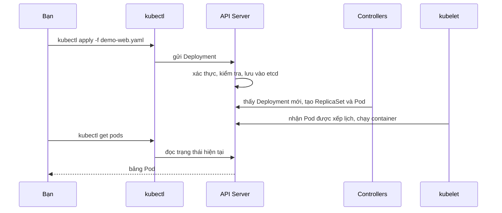

# Buổi 23 – Thử thách nâng cao

Tuần 12/16 · Giai đoạn 4 – Kubernetes Engineering · Buổi 23/32

[Bài học chính](session-23.md) · [Slide](../../slides/06-kubectl/session-23.md) · [Bài tập tuần](../../assignments/weekly/week-12.md) · [Hub tuần](README.md)

> **Tóm tắt:** Trang phụ của buổi 23: kiến thức tìm hiểu thêm về kubectl, phá lỗi ImagePullBackOff, ba thử thách L2, cluster 3 node và câu hỏi tình huống. Tất cả đều tùy chọn, làm sau khi xong lab bắt buộc.

::: tip Trang này dành cho ai
Bạn đã xong checklist L1 của [Buổi 23 – kubectl Fundamentals](session-23.md) và còn thời gian, hoặc bạn cần phần Phá lỗi cho bài tập tuần. Phần Phá lỗi nên làm sớm; các thử thách L2 làm ở nhà. Lời giải đối chiếu nằm trong [trang tuần 12](README.md), chỉ mở sau khi nộp bài.
:::

## Tìm hiểu thêm {#tim-hieu-them}

Các thành phần của kubeconfig:

| Thành phần | Ý nghĩa | Ví dụ |
| --- | --- | --- |
| cluster | Địa chỉ API Server và chứng chỉ CA | `https://127.0.0.1:xxxxx` (kind) |
| user | Thông tin xác thực (chứng chỉ, token) | `kind-club` |
| context | Bộ ba cluster + user + namespace mặc định | `kind-club` |
| current-context | Context đang dùng cho mọi lệnh | `kind-club` |

Có thể ghi đè từng lệnh bằng `--context` và `-n`; đổi file bằng biến `KUBECONFIG`. Không phải tài nguyên nào cũng thuộc namespace: Node, Namespace, PersistentVolume là cluster-scoped.

Nhóm lệnh thường dùng:

| Nhóm | Lệnh | Dùng khi |
| --- | --- | --- |
| Chọn ngữ cảnh | `config get-contexts`, `config use-context`, `config set-context --current --namespace=...` | Trước mọi thao tác |
| Khai báo | `apply -f`, `diff -f`, `delete -f` | Quản lý workload theo manifest |
| Quan sát | `get`, `describe`, `get events`, `explain` | Xem trạng thái, tìm nguyên nhân |
| Gỡ lỗi | `logs`, `exec`, `port-forward` | Đọc log, vào container, truy cập thử |
| Thay đổi nhanh | `scale`, `set image`, `edit`, `rollout` | Thao tác tạm thời hoặc khẩn cấp |

Khai báo và lệnh tay:

| Tiêu chí | Imperative (`create`, `scale`, `edit`) | Declarative (`apply -f`) |
| --- | --- | --- |
| Nguồn sự thật | Trạng thái live trong cluster | File manifest trong Git |
| Tái lập | Khó, không để lại dấu vết | Dễ, chạy lại là xong |
| Review, rollback | Không có | Qua Git |
| Phù hợp | Thử nghiệm, sự cố khẩn | Công việc thường ngày |

Quy tắc của khóa học: khai báo bằng file, dùng lệnh tay để thử hoặc khắc phục khẩn, rồi đưa thay đổi về manifest.

Các cờ định dạng đầu ra:

| Cờ | Kết quả | Dùng để |
| --- | --- | --- |
| (không cờ) | Bảng ngắn | Quét nhanh |
| `-o wide` | Thêm node, IP, image | Biết Pod chạy trên node nào |
| `-o yaml` / `-o json` | Toàn bộ object, gồm `status` | Đọc spec thực tế, xuất ra file |
| `-o jsonpath='...'` | Một vài trường | Dùng trong script |
| `-o custom-columns=...` | Bảng tự định nghĩa | Báo cáo gọn |
| `-o name` | Dạng `kind/tên` | Truyền cho lệnh khác |

Chuyện gì xảy ra khi `kubectl apply`:



1. kubectl đọc context hiện tại để biết gửi tới API Server nào, bằng danh tính nào, namespace nào.
2. `apply` đọc file YAML, so sánh với lần apply trước (annotation `last-applied-configuration`) và gửi thay đổi lên API Server.
3. API Server xác thực, kiểm tra hợp lệ rồi lưu trạng thái mong muốn (desired state) vào etcd.
4. Controller thấy desired state khác thực tế và tạo ReplicaSet, Pod; Scheduler chọn Node; kubelet chạy container.
5. `get`, `describe` chỉ đọc lại trạng thái từ API Server, nên kết quả có độ trễ vài giây sau khi apply.
6. `logs` và `exec` đi qua API Server tới kubelet của Node chứa Pod. `port-forward` mở đường hầm từ cổng localhost của bạn tới cổng của Pod, vẫn qua API Server, nên không cần Service hay Ingress.

## Phá lỗi nâng cao: ImagePullBackOff {#pha-loi}

Tình huống: Deployment cập nhật nhưng Pod mới không lên. Liên quan tới `examples/troubleshooting/scenario-07`; hãy tự điều tra trước, chỉ xem ví dụ đó sau khi xong. Bài tập tuần yêu cầu bạn ghi quá trình này vào `report.md`.

Cách phá (chạy khi `demo-web` đang chạy ở namespace `club`):

```bash
kubectl apply -f source/demo-web.yaml
sed 's#nginx:1.27-alpine#nginx:1.99-nope#' source/demo-web.yaml > source/broken.yaml
kubectl apply -f source/broken.yaml
```

Triệu chứng: sau 1-2 phút, `kubectl get pods -n club` có Pod `ImagePullBackOff` (lúc đầu là `ErrImagePull`) trong khi hai Pod cũ vẫn `Running`; `kubectl rollout status deployment/demo-web -n club` treo hoặc báo "Waiting for deployment ... rollout to finish".

Hướng điều tra, từng bước:

1. `kubectl get pods -n club`: xác định Pod nào lỗi và trạng thái là gì.
2. `kubectl describe pod` của Pod lỗi, đọc Events ở cuối. Bạn sẽ thấy `Failed to pull image "nginx:1.99-nope"` kèm lý do `not found` hoặc `manifest unknown`.
3. `kubectl get deployment demo-web -n club -o jsonpath='{.spec.template.spec.containers[0].image}'`: xác nhận image trong spec.
4. `kubectl rollout history deployment/demo-web -n club`: thấy có revision mới.
5. Phân biệt: tag sai, registry không truy cập được, hay cần credential cho image private.

Nguyên nhân gốc: tag `1.99-nope` không tồn tại trên registry, kubelet không kéo được image nên Pod mới không bao giờ Ready. Rolling update mặc định giữ Pod cũ chạy cho tới khi Pod mới Ready, vì vậy dịch vụ vẫn sống; đó là may mắn của cấu hình mặc định chứ không phải lý do để bỏ qua lỗi.

Khôi phục và phòng tránh:

```bash
kubectl rollout undo deployment/demo-web -n club
kubectl apply -f source/demo-web.yaml
kubectl rollout status deployment/demo-web -n club
```

- Pin tag cụ thể, kiểm tra tag trước khi apply, và dùng `kubectl diff` để thấy thay đổi image.
- Luôn chờ `kubectl rollout status` trước khi coi là xong; thêm vào CI/CD ở các buổi sau.
- Nếu `rollout undo` thì cũng sửa lại file manifest để Git khớp với cluster.

Tình huống phụ (2 phút): chạy `kubectl get pods` khi context đang đặt namespace `default` và giải thích vì sao thấy "No resources found" dù workload vẫn chạy.

## Thử thách L2 (tự làm, không có hướng dẫn từng bước)

Mỗi thử thách có tiêu chí hoàn thành; ghi lệnh và kết quả vào `evidence/command-output.txt`. Hãy tự thử 15 phút trước khi mở gợi ý.

### Thử thách 1 – Script kiểm tra namespace

Viết `source/inspect.sh` nhận một tham số là tên namespace và in ra: (a) bảng Pod gồm tên, node, IP, số lần restart, image; (b) danh sách image duy nhất kèm số Pod dùng nó; (c) các Pod chưa `Running`.

Tiêu chí: chạy `bash source/inspect.sh club` ra kết quả đúng, không lệnh nào thiếu `-n`, và script báo lỗi rõ ràng nếu không truyền namespace. Chạy lại `demo-web` (`kubectl apply -f source/demo-web.yaml`) trước khi thử script.

<details><summary>Gợi ý (tự thử 15 phút trước khi mở)</summary>

- Phần (a) dùng `-o custom-columns`.
- Phần (b) dùng jsonpath với `range`, rồi `sort | uniq -c`.
- Phần (c) dùng `--field-selector=status.phase!=Running`.
- Kiểm tra tham số bằng `${1:?thiếu tên namespace}` hoặc `if [ -z "$1" ]`.

</details>

### Thử thách 2 – Phát hiện drift

Dùng lệnh imperative để thay đổi live (scale và đổi label hoặc image), dùng `kubectl diff` để chứng minh bạn phát hiện được khác biệt, rồi đưa cluster về đúng manifest. Sau đó xuất manifest từ cluster (`-o yaml`) ra `source/exported.yaml`, giải thích bằng 3 gạch đầu dòng những trường nào nên bỏ trước khi commit.

Tiêu chí: có diff trước và sau, giải thích đúng về `status`, `managedFields`, `resourceVersion`/`uid`.

<details><summary>Gợi ý (tự thử 15 phút trước khi mở)</summary>

- `kubectl set image deployment/demo-web web=nginx:1.26-alpine -n club` đổi image live.
- `kubectl diff -f source/demo-web.yaml` luôn so với manifest đang có trong thư mục; exit code 0 là không khác biệt, 1 là có khác biệt.
- Các trường do hệ thống sinh ra không thuộc về manifest: `status`, `metadata.uid`, `resourceVersion`, `creationTimestamp`, `managedFields`, annotation `deployment.kubernetes.io/revision`.
- `kubectl apply -f source/` áp dụng mọi file `.yaml` trong thư mục, kể cả `exported.yaml`; lưu bản xuất vào `evidence/` nếu bạn hay apply cả thư mục.

</details>

### Thử thách 3 – Chẩn đoán Deployment bí ẩn

Chạy lệnh sau ở namespace `club-dev`, tìm nguyên nhân gốc chỉ bằng `get`, `describe`, `logs` (phần chẩn đoán), rồi sửa bằng lệnh kubectl bạn chọn để Pod chạy ổn định:

```bash
kubectl create deployment mystery --image=busybox:1.36 -n club-dev
```

Tiêu chí: giải thích được vì sao Pod không giữ được `Running` (kèm exit code và Reason lấy từ `describe`), và Pod cuối cùng `Running` với `RESTARTS` không tăng nữa.

<details><summary>Gợi ý (tự thử 15 phút trước khi mở)</summary>

- `kubectl get pods -n club-dev -w` cho thấy trạng thái đổi qua lại.
- `kubectl describe pod` mục `Last State`: xem `Reason` và `Exit Code`.
- `kubectl logs --previous` có thể trống: đó cũng là manh mối.
- Image busybox chạy lệnh mặc định `sh`. Điều gì xảy ra với `sh` khi không có terminal nào?

</details>

### Thử thách 4 – Cluster kind 3 node (tùy chọn)

Tạo một cluster riêng 3 node để thấy Pod được rải qua nhiều node, mà không đụng vào cluster `club`. Máy cần thêm khoảng 2-3 GB RAM; nếu máy yếu thì bỏ qua thử thách này.

```bash
cat > source/kind-3-nodes.yaml <<'EOF'
kind: Cluster
apiVersion: kind.x-k8s.io/v1alpha4
nodes:
  - role: control-plane
  - role: worker
  - role: worker
EOF
kind create cluster --name club-3 --config source/kind-3-nodes.yaml
kubectl config get-contexts
```

Kết quả mong đợi: context mới `kind-club-3` và `kubectl get nodes --context kind-club-3` thấy 3 node `Ready`. Từ đây luôn thêm `--context kind-club-3` vào lệnh (hoặc `kubectl config use-context kind-club-3`, rồi nhớ đổi lại `kind-club` khi xong).

Tiêu chí: tạo namespace `club` trong cluster này, apply `demo-web` với `replicas: 6`, rồi dùng `-o wide` hoặc `-o custom-columns` cho thấy Pod nằm trên các node khác nhau; đếm số Pod mỗi node bằng jsonpath và `sort | uniq -c`.

::: danger Dọn đúng cluster
Khi xong, xóa đúng cluster thử nghiệm: `kind delete cluster --name club-3`. Kiểm tra lại tên bằng `kind get clusters` trước khi xóa; tuyệt đối không xóa cluster `club` của khóa học.
:::

## Câu hỏi tình huống thêm

1. Sau khi apply, Pod ở trạng thái `ImagePullBackOff`. Bạn kiểm tra gì đầu tiên, theo thứ tự nào?
2. Viết lệnh in ra mỗi dòng một cặp tên Pod và IP trong namespace `club`.
3. `kubectl get pods` và `kubectl get pods -n club` cho kết quả khác nhau. Ba điều bạn kiểm tra là gì?
4. kubeconfig gồm những thành phần nào, và context là gì?

::: details Đáp án gợi ý
1. `get pods` xác nhận trạng thái; `describe pod` đọc Events để thấy lỗi pull; kiểm tra tên và tag image trong spec; nếu image private thì kiểm tra imagePullSecrets; kiểm tra mạng và registry.
2. `kubectl get pods -n club -o jsonpath='{range .items[*]}{.metadata.name}{"\t"}{.status.podIP}{"\n"}{end}'`
3. `kubectl config current-context` (đúng cluster chưa), `kubectl config view --minify | grep namespace` (namespace mặc định), rồi `kubectl get pods -A` để thấy Pod nằm ở đâu.
4. Danh sách cluster (địa chỉ API Server, CA), user (xác thực) và context (bộ ba cluster + user + namespace mặc định), cùng current-context.
:::
