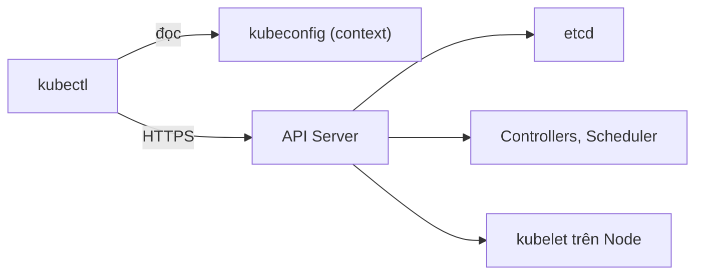

# Buổi 23 – kubectl Fundamentals

Tuần 12/16 · Giai đoạn 4 – Kubernetes Engineering · Buổi 23/32

[Slide](../../slides/06-kubectl/session-23.md) · [Bài tập tuần](../../assignments/weekly/week-12.md) · [Hub tuần](README.md)

> **Tóm tắt:** Dùng kubectl để chọn đúng cluster và namespace, apply manifest, đọc trạng thái, log, exec, port-forward và trích dữ liệu bằng -o yaml, jsonpath.

::: tip Buổi này bạn làm gì
- **Bạn sẽ tạo ra:** một Deployment `demo-web` 2 Pod trong namespace `club`, rồi dùng kubectl để xem, gỡ lỗi và trích dữ liệu từ nó.
- **Thời gian thật:** đọc 15 phút, lab bắt buộc 60 phút, thử thách tùy chọn làm ở nhà.
- **Cần chuẩn bị:**
  - [ ] Cluster kind `club` đang chạy (từ [Buổi 21 – Kubernetes Introduction](../week-11/session-21.md)); `kubectl config current-context` in ra `kind-club`.
  - [ ] Đã học [Buổi 22 – Pods & Deployments](../week-11/session-22.md); môi trường cài theo [Hướng dẫn cài đặt](../../resources/setup-guide.md).
  - [ ] Có tài khoản GitHub và repo `devops-labs` (public) theo [Tài khoản GitHub và repo devops-labs](../../resources/setup-github.md).
- **Phải nộp:** `README.md` (7 câu của mẫu, ghi L1 hay L2); `source/namespace.yaml` và `source/demo-web.yaml`; `evidence/command-output.txt` (lệnh và kết quả thật); `report.md` về tình huống ImagePullBackOff.
- **Đi nhanh:** Đọc > [Làm lab](#hands-on-lab) > [Gặp lỗi?](#gap-loi) > [Tự kiểm tra](#tu-kiem-tra) > [Nộp bài](#nop-bai). Kẹt? Nhảy tới [Gặp lỗi?](#gap-loi).

**Từ mới trong buổi** (xem [Thuật ngữ](../../resources/glossary.md)):
- [kubeconfig](../../resources/glossary.md): file kubectl đọc để biết nói chuyện với cluster nào.
- [context](../../resources/glossary.md): bộ ba cluster, user, namespace đang được chọn.
- [namespace](../../resources/glossary.md): ngăn riêng trong cluster để tách tài nguyên.
- [manifest](../../resources/glossary.md): file YAML mô tả tài nguyên.
:::

## Vấn đề thực tế

Một tối trước buổi sinh hoạt CLB, bạn nhận tin nhắn: "web điểm danh bị lỗi". Bạn gõ `kubectl get pods` và thấy `No resources found`. Bạn tưởng workload đã biến mất, thực ra bạn đang nhìn vào namespace `default` trong khi ứng dụng nằm ở `club`. Một lần khác, bạn `kubectl delete` nhầm trên cluster của nhóm khác vì context cũ vẫn đang được chọn. Dùng đúng kubectl thì từ một lệnh bạn biết Pod nào lỗi, vì sao lỗi, log nói gì, và chui vào container kiểm tra mà không cần mở cổng ra ngoài.

## Khái niệm cốt lõi {#khai-niem}

**kubeconfig và context.** kubectl đọc file kubeconfig (mặc định `~/.kube/config`); context là bộ ba cluster + user + namespace mặc định, và mọi lệnh chạy trên context hiện tại. Ví von: context như ổ cắm bạn đang cắm điện vào, cắm nhầm ổ thì điện đi nhầm chỗ. Cluster của khóa học có context `kind-club`.

**Namespace.** Ngăn riêng trong cluster. Không ghi `-n` thì kubectl dùng namespace của context (mặc định `default`). Ví von: như thư mục trong ổ đĩa; `ls` ở thư mục này không thấy file của thư mục khác.

**Khai báo và lệnh tay.** `apply -f` lấy file YAML trong Git làm nguồn sự thật, chạy lại bao nhiêu lần cũng cùng kết quả. `scale`, `edit`, `set image` sửa thẳng trạng thái live, tiện để thử nhưng lần `apply` sau sẽ ghi đè. Ví von: file YAML là bản thiết kế, lệnh tay là sửa trực tiếp trên công trình.

**Quan sát và gỡ lỗi.** `get` cho bảng ngắn, `describe` cho chi tiết và Events, `logs` cho lời ứng dụng nói, `exec` để chui vào container, `port-forward` mở đường hầm tạm từ máy bạn tới một Pod; `-o yaml`, `-o jsonpath` trích đúng dữ liệu cần. Ví von: bác sĩ đo nhiệt độ (`get`), hỏi bệnh sử (`describe`), rồi mới khám sâu (`exec`).



kubectl chỉ là client HTTP: nó không tạo Pod, nó gửi yêu cầu tới API Server, còn các thành phần khác phản ứng với dữ liệu trong etcd.

::: details Tìm hiểu thêm (đọc sau)
Bảng thành phần kubeconfig, nhóm lệnh thường dùng, so sánh khai báo với lệnh tay, các cờ `-o` và sơ đồ chuyện gì xảy ra khi `kubectl apply` nằm ở [Buổi 23 – Thử thách nâng cao](session-23-challenge.md#tim-hieu-them). Tóm tắt: kubeconfig gồm cluster (địa chỉ API Server, CA), user (xác thực), context (bộ ba cluster + user + namespace) và current-context; Node, Namespace, PersistentVolume là cluster-scoped nên không thuộc namespace nào.
:::

## Hands-on lab (60 phút, bắt buộc) {#hands-on-lab}

Trên lớp, mentor demo trước; tự học thì làm thẳng phần này. Workload dùng `nginx:1.27-alpine` nên không cần build image. Workload nằm ở namespace `club`; `club-dev` chỉ để thực hành.

### Chuẩn bị (5 phút)

```bash
kubectl config current-context
kubectl get nodes
mkdir -p ~/devops-labs/lab-23/{source,screenshots,evidence}
cd ~/devops-labs/lab-23
```

Kết quả mong đợi: `kind-club` và một node `Ready`; lỗi thì xem [Gặp lỗi?](#gap-loi). Chưa có cluster: `kind create cluster --name club --config ~/devops-course/starter-project/k8s/kind-config.yaml`. Tạo hai manifest:

```bash
cat > source/namespace.yaml <<'EOF'
apiVersion: v1
kind: Namespace
metadata:
  name: club
EOF
cat > source/demo-web.yaml <<'EOF'
apiVersion: apps/v1
kind: Deployment
metadata:
  name: demo-web
  namespace: club
  labels:
    app: demo-web
spec:
  replicas: 2
  selector:
    matchLabels:
      app: demo-web
  template:
    metadata:
      labels:
        app: demo-web
    spec:
      containers:
        - name: web
          image: nginx:1.27-alpine
          ports:
            - containerPort: 80
          resources:
            requests:
              cpu: 25m
              memory: 32Mi
            limits:
              memory: 64Mi
          readinessProbe:
            httpGet:
              path: /
              port: 80
            periodSeconds: 5
EOF
```

Lệnh nào muốn đưa vào bằng chứng thì thêm `| tee -a evidence/command-output.txt`, và ghi một dòng `$ lệnh` trước kết quả quan trọng.

### Phần 1 – Context và namespace (8 phút)

```bash
kubectl config get-contexts
kubectl create namespace club-dev
kubectl apply -f source/namespace.yaml
kubectl config set-context --current --namespace=club
kubectl config view --minify | grep namespace
kubectl get pods -n kube-system
```

Kết quả mong đợi:
- Dấu `*` ở dòng `kind-club`; cột NAMESPACE trống nghĩa là `default`.
- `namespace/club-dev created`; với `club` là `created`, `unchanged` hoặc `configured` đều bình thường (`apply` chạy lại vẫn cùng kết quả).
- `    namespace: club`. Từ giờ không cần gõ `-n club`, nhưng quy ước khóa học là vẫn gõ `-n` tường minh trong lệnh ghi vào bằng chứng.
- Các Pod hệ thống `coredns`, `etcd`, `kube-apiserver` (cờ `-n` ghi đè namespace cho một lệnh).

::: tip Kiểm tra: bạn đúng khi
`kubectl config view --minify | grep namespace` in `namespace: club`.
:::

### Phần 2 – apply, get, delete (10 phút)

```bash
kubectl diff -f source/demo-web.yaml
kubectl apply -f source/demo-web.yaml
kubectl rollout status deployment/demo-web -n club
kubectl get pods -n club -l app=demo-web -o wide
```

Kết quả mong đợi: `deployment.apps/demo-web created`, `successfully rolled out`, hai Pod `1/1 Running` có cột NODE và IP (tên Pod trên máy bạn khác, hậu tố ngẫu nhiên). Lần đầu `diff` in toàn bộ object; thói quen tốt là diff trước, apply sau. Xem thêm `kubectl get deploy,rs,pods -n club -l app=demo-web` (Deployment, ReplicaSet, Pod) và `--show-labels`; `kubectl get all` không lấy "tất cả" (thiếu ConfigMap, Secret, Ingress).

Xóa một Pod để thấy tự phục hồi (terminal thứ hai: `kubectl get pods -n club -w`):

```bash
POD=$(kubectl get pods -n club -l app=demo-web -o name | head -1)
kubectl delete "$POD" -n club
```

Kết quả mong đợi: Pod cũ `Terminating`, Pod mới tên khác xuất hiện ngay vì ReplicaSet luôn giữ đủ `replicas: 2`.

::: tip Kiểm tra: bạn đúng khi
`kubectl get pods -n club -l app=demo-web` luôn cho 2 Pod `Running`, kể cả ngay sau khi xóa một Pod.
:::

### Phần 3 – describe, events, explain (8 phút)

```bash
POD=$(kubectl get pods -n club -l app=demo-web -o jsonpath='{.items[0].metadata.name}')
kubectl describe pod "$POD" -n club
kubectl get events -n club --sort-by=.lastTimestamp
kubectl explain deployment.spec.replicas
```

Đọc `describe pod` theo thứ tự `Node`, `IP`, `Image`, `State`, `Conditions`, và cuối cùng `Events` (Scheduled, Pulled, Created, Started). Pod không chạy thì `describe` là nơi đầu tiên cần nhìn. Events chỉ được lưu khoảng một giờ nên xem ngay khi có sự cố. `kubectl explain` tra cấu trúc ngay trong terminal.

::: tip Kiểm tra: bạn đúng khi
Bạn chỉ ra được 3 sự kiện đầu tiên trong phần `Events` của `describe pod`.
:::

### Phần 4 – logs, exec, port-forward (12 phút)

Mở đường hầm ở terminal thứ hai (nó giữ terminal; cổng 8081 vì 8080 thường bị chiếm, nếu lỗi xem [Gặp lỗi?](#gap-loi)):

```bash
kubectl port-forward deployment/demo-web 8081:80 -n club
```

Ở terminal chính:

```bash
curl -sI http://localhost:8081 | head -3
kubectl logs -n club -l app=demo-web --tail=5 --prefix | grep -v kube-probe
kubectl exec -n club "$POD" -- nginx -v
kubectl exec -it -n club "$POD" -- sh
```

Trong shell của container chạy `wget -qO- http://localhost | head -4` rồi `exit`. Kết quả mong đợi:
- `HTTP/1.1 200 OK`. Đường hầm chỉ bind `127.0.0.1` và đi qua API Server tới một Pod duy nhất; nó dùng để gỡ lỗi, không thay Service. Dừng bằng Ctrl+C.
- Dòng log `"HEAD / HTTP/1.1" 200` từ `curl`. Log còn có các dòng `GET /` từ `kube-probe` (readiness probe, 5 giây một lần) nên lọc bằng `grep -v`. `-l app=demo-web --prefix` cho thấy dòng nào của Pod nào.
- `nginx version: nginx/1.27.x`. Dấu `--` tách cờ kubectl khỏi lệnh trong container; image alpine chỉ có `sh` (không `bash`) và `wget` (không `curl`). Thay đổi trong container mất khi Pod bị tạo lại.

Cờ log hữu ích: `--since=10m`, `-f` (theo dõi, Ctrl+C để thoát), `--previous` (log lần chạy trước khi container restart), `-c web` (Pod nhiều container).

::: tip Kiểm tra: bạn đúng khi
`curl` trả `200` qua cổng 8081 và `kubectl logs` có dòng `HEAD /` với mã 200.
:::

### Phần 5 – Định dạng đầu ra (8 phút)

```bash
kubectl get deployment demo-web -n club -o yaml | head -40
kubectl get deployment demo-web -n club -o jsonpath='{.spec.template.spec.containers[0].image}'; echo
kubectl get pods -n club -l app=demo-web -o jsonpath='{range .items[*]}{.metadata.name}{"\t"}{.status.podIP}{"\n"}{end}'
kubectl get pods -n club -o custom-columns=NAME:.metadata.name,NODE:.spec.nodeName,RESTARTS:.status.containerStatuses[0].restartCount
kubectl get pods -n club --sort-by=.metadata.creationTimestamp
```

Kết quả mong đợi: `-o yaml` có `spec` (bạn khai báo) và `status` (Kubernetes ghi lại); jsonpath in `nginx:1.27-alpine` rồi mỗi Pod một dòng tên và IP. jsonpath đặt trong nháy đơn để shell không xử lý `{`, `*`, `$`; `.items` chỉ có khi `get` nhiều object.

Sửa trực tiếp so với manifest:

```bash
kubectl scale deployment demo-web -n club --replicas=3
kubectl diff -f source/demo-web.yaml
kubectl apply -f source/demo-web.yaml
```

Kết quả mong đợi: `diff` thấy `-  replicas: 3` và `+  replicas: 2`; sau `apply` Deployment về `2/2`. `scale` đổi trạng thái live nhưng manifest vẫn ghi 2, nên muốn giữ 3 phải sửa file rồi `apply`.

::: tip Kiểm tra: bạn đúng khi
jsonpath in đúng chuỗi `nginx:1.27-alpine` và sau `apply`, `kubectl get deployment demo-web -n club` cho `2/2`.
:::

### Phần 6 – Dọn dẹp bằng manifest (4 phút)

```bash
kubectl delete -f source/demo-web.yaml
kubectl get pods -n club -l app=demo-web
```

Kết quả mong đợi: `deployment.apps "demo-web" deleted` rồi `No resources found in club namespace.`

::: danger Chỉ xóa namespace thực hành
Xóa namespace sẽ xóa toàn bộ tài nguyên bên trong. Không xóa `club` (nó chứa workload của dự án sau này). Chỉ `club-dev` được xóa: `kubectl delete namespace club-dev`, sau khi bạn làm xong phần Phá lỗi nâng cao và thử thách nếu có.
:::

### Checklist L1

- [ ] Chỉ ra context hiện tại và namespace mặc định của nó.
- [ ] Tạo `club-dev`, apply `namespace.yaml` và `demo-web.yaml` thành công.
- [ ] `kubectl get pods -n club -o wide` cho thấy 2 Pod `Running` và node chạy chúng.
- [ ] Đọc được phần Events trong `describe pod` và chỉ ra 3 sự kiện đầu tiên.
- [ ] Gọi được nginx qua `port-forward` (cổng 8081) và thấy dòng request trong `kubectl logs`.
- [ ] `exec` vào container, chạy `nginx -v`, và giải thích vì sao thay đổi trong container sẽ mất.
- [ ] Dùng được `-o yaml` và một lệnh jsonpath lấy ra tên image.
- [ ] Xóa workload bằng `kubectl delete -f` và xác nhận không còn Pod.

Tự kiểm tra một dòng (chạy trước Phần 6 để thấy 2 Pod, sau Phần 6 để thấy không còn Pod):

```bash
kubectl config current-context && kubectl get ns club club-dev && kubectl get pods -n club
```

## Gặp lỗi? {#gap-loi}

| Triệu chứng | Nguyên nhân | Cách sửa |
| --- | --- | --- |
| `No resources found in default namespace` | Quên `-n club`, hoặc namespace của context là `default` | Thêm `-n club`, hoặc `kubectl config set-context --current --namespace=club` |
| `The connection to the server localhost:8080 was refused` | Không có kubeconfig hoặc `KUBECONFIG` sai, cluster chưa chạy | `kubectl config get-contexts`, `kind get clusters`, mở lại Docker Desktop |
| `Error from server (NotFound): pods ... not found` | Sai tên Pod (có hậu tố ngẫu nhiên) hoặc sai namespace | `kubectl get pods -n club -o name` hoặc dùng `deployment/tên` |
| `Unable to listen on port 8081 ... address already in use` | Cổng local đang bị chiếm | Chọn cổng khác (ví dụ `8082:80`) hoặc tắt `port-forward` cũ |
| `exec: "bash": executable file not found` | Image alpine hoặc distroless không có bash | Dùng `sh`; không có shell thì dùng `kubectl debug` (tìm hiểu thêm) |
| `Error from server (BadRequest): container ... is waiting to start` khi `logs` | Container chưa chạy (đang pull image hoặc crash) | `describe pod` xem Events; dùng `--previous` nếu đã crash |
| jsonpath trả về chuỗi rỗng | Đường dẫn sai, hoặc dùng `.items` cho một object đơn | Chạy `-o yaml` xem cấu trúc rồi viết lại đường dẫn |
| Sửa bằng `edit` rồi `apply` thì thay đổi biến mất | Live bị manifest ghi đè | Sửa manifest rồi `apply`; dùng `kubectl diff` để kiểm tra |
| Pod `ErrImagePull` rồi `ImagePullBackOff` sau khi apply | Tag image không tồn tại, hoặc image private thiếu credential | `describe pod` đọc Events; sửa tag; `kubectl rollout undo deployment/demo-web -n club`, rồi sửa manifest cho khớp (xem [Phá lỗi nâng cao](session-23-challenge.md#pha-loi)) |

## Tự kiểm tra {#tu-kiem-tra}

1. Vì sao `kubectl get pods` có thể báo không có gì dù ứng dụng vẫn chạy?
2. Khác nhau giữa `kubectl apply -f` và `kubectl create -f`? Khi nào dùng `kubectl edit`?
3. `kubectl port-forward` có thay được Service không? Nó mở ra những địa chỉ nào?
4. Làm sao lấy log của container vừa bị restart, và log của mọi Pod có label `app=demo-web`?
5. Đồng đội `kubectl scale` lên 5 Pod cho kịp tải, sáng hôm sau chỉ còn 2. Chuyện gì xảy ra?

::: details Đáp án gợi ý
1. Vì kubectl chỉ xem namespace của context hiện tại (mặc định `default`). Dùng `-n club` hoặc đổi namespace của context.
2. `create` báo lỗi nếu object đã tồn tại; `apply` tạo mới hoặc cập nhật theo manifest. `edit` dành cho sửa khẩn trực tiếp trên live, sau đó phải cập nhật manifest.
3. Không. Nó chỉ là đường hầm tạm tới một Pod, bind vào `127.0.0.1` và `::1` của máy bạn, chỉ để gỡ lỗi. Truy cập ổn định cần Service, Ingress (buổi 24, 27).
4. `kubectl logs POD --previous`; và `kubectl logs -n club -l app=demo-web --prefix`.
5. Replicas được sửa live nhưng manifest vẫn ghi 2. Lần apply tiếp theo (CI hoặc người khác) đưa cluster về 2. Phải sửa manifest rồi apply.
:::

## Nộp bài {#nop-bai}

Nộp vào `lab-23/` trong repo `devops-labs` theo `templates/lab-template.md`. Bài tập tuần: [Bài tập tuần 12](../../assignments/weekly/week-12.md).

- [ ] `README.md` trả lời đủ 7 câu của mẫu và ghi rõ đã làm L1 hay L2.
- [ ] `source/` có `namespace.yaml`, `demo-web.yaml` (L2 thêm `inspect.sh`, `exported.yaml`).
- [ ] `evidence/command-output.txt` có lệnh và kết quả của `config get-contexts`, `get pods -o wide`, `describe pod` (phần Events), một lệnh jsonpath, `logs` có dòng request.
- [ ] `report.md` mô tả tình huống ImagePullBackOff: triệu chứng, bước điều tra, nguyên nhân gốc, cách khắc phục, cách phòng tránh.
- [ ] `screenshots/` có ít nhất một ảnh (kèm source và log, vì ảnh một mình không đủ).
- [ ] Đã dọn `club-dev` và `demo-web`; không commit secret, token hay `~/.kube/config`.

## Recap

- kubectl chỉ là client của API Server; context chọn cluster, namespace chọn nơi nhìn. Kiểm tra cả hai trước khi gõ lệnh phá hoại.
- Manifest trong Git là nguồn sự thật: `diff`, `apply`, `rollout status`; lệnh tay như `scale` sẽ bị manifest ghi đè.
- Lỗi thì `get`, `describe` (Events), `logs`; `exec` và `port-forward` chỉ để gỡ lỗi, không phải giải pháp triển khai.

Buổi tiếp theo: [Buổi 24 – Kubernetes Services](session-24.md).

::: details Thử thách thêm (L2, tùy chọn, làm ở nhà)
Ba thử thách L2 (script `inspect.sh`, phát hiện drift, chẩn đoán Deployment bí ẩn), cluster kind 3 node và các câu hỏi tình huống nằm ở [Buổi 23 – Thử thách nâng cao](session-23-challenge.md). Mỗi thử thách có gợi ý từng bậc; hãy tự thử 15 phút trước khi mở gợi ý. Lời giải đối chiếu nằm trong [trang tuần 12](README.md) (mở sau khi nộp bài).
:::

::: details Phá lỗi nâng cao
Tình huống ImagePullBackOff (Deployment cập nhật nhưng Pod mới không lên), kèm cách phá, hướng điều tra và cách khôi phục, nằm ở [Phá lỗi nâng cao của buổi 23](session-23-challenge.md#pha-loi). Bài tập tuần yêu cầu bạn điều tra tình huống này và ghi vào `report.md`.
:::

::: details Tài liệu tham khảo
- [kubectl reference](https://kubernetes.io/docs/reference/kubectl/)
- [kubectl quick reference](https://kubernetes.io/docs/reference/kubectl/quick-reference/)
- [JSONPath support](https://kubernetes.io/docs/reference/kubectl/jsonpath/)
- [Organizing cluster access using kubeconfig files](https://kubernetes.io/docs/concepts/configuration/organize-cluster-access-kubeconfig/)
- [Namespaces](https://kubernetes.io/docs/concepts/overview/working-with-objects/namespaces/)
- [Use port forwarding to access applications in a cluster](https://kubernetes.io/docs/tasks/access-application-cluster/port-forward-access-application-cluster/)
:::
