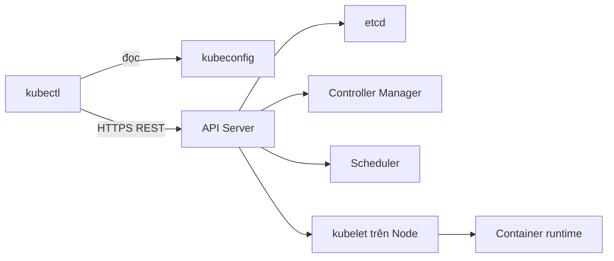
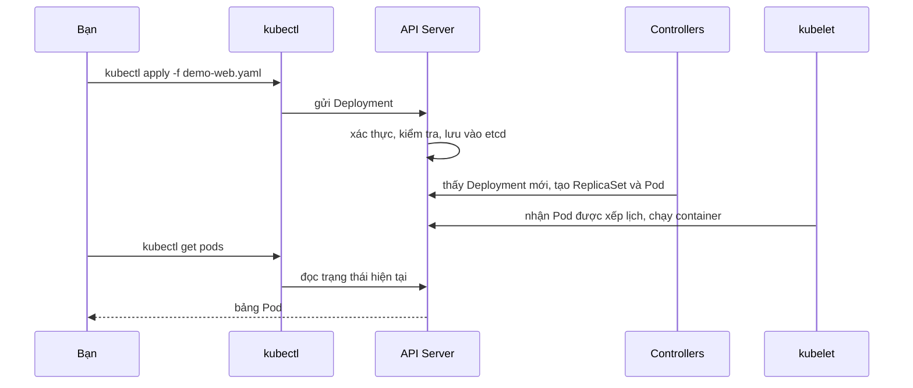

# Buổi 23 – kubectl Fundamentals

Tuần 12 · Giai đoạn 4 – Kubernetes Engineering · Slide: [Slide buổi 23](../../slides/06-kubectl/session-23.md)

> **Tóm tắt:** Dùng kubectl thành thạo để chọn đúng cluster và namespace, apply manifest, đọc trạng thái, log, exec, port-forward và trích dữ liệu bằng -o yaml, jsonpath.

## Mục tiêu học tập

- Giải thích được kubectl làm việc với cluster qua kubeconfig, context và API Server như thế nào.
- Chuyển đổi được giữa context và namespace, và luôn biết lệnh của mình đang tác động vào đâu.
- Chạy được chu trình `apply` – `get` – `describe` – `logs` – `exec` – `port-forward` – `delete` trên một workload thật.
- Trích xuất được thông tin bằng `-o wide`, `-o yaml`, `-o jsonpath`, `-o custom-columns` và `--sort-by`.
- Chẩn đoán được một Deployment lỗi bằng `describe` và events thay vì đoán mò.
- Phân biệt được cách quản lý khai báo (`apply -f`) với chỉnh sửa trực tiếp (`edit`, `scale`) và hệ quả của từng cách.

## Điều kiện cần

- Đã hoàn thành buổi 21 (cài kind, tạo cluster) và buổi 22 ([Pods và Deployments](../week-11/session-22.md)).
- Công cụ: Docker Desktop đang chạy, `kind`, `kubectl`, làm việc trong terminal WSL2 Ubuntu (thư mục dưới `~`, không dùng `/mnt/c`).
- Cluster kind từ buổi 21 đang chạy. Kiểm tra nhanh:

```bash
kubectl version --client
kubectl config current-context
kubectl get nodes
```

Kết quả mong đợi (tên context phụ thuộc tên cluster bạn đã đặt, dạng `kind-` cộng tên cluster):

```text
Client Version: v1.30.x
Kustomize Version: v5.x.x
kind-kind
NAME                 STATUS   ROLES           AGE   VERSION
kind-control-plane   Ready    control-plane   2d    v1.30.x
```

Nếu chưa có cluster, tạo nhanh: `kind create cluster` (cluster tên `kind`, context `kind-kind`). Cluster này chỉ lắng nghe trên máy bạn, không expose ra Internet.

## Vấn đề thực tế

Một tối trước buổi sinh hoạt CLB, bạn nhận tin nhắn: "web điểm danh bị lỗi". Bạn mở terminal và gõ `kubectl get pods`, kết quả là `No resources found`. Bạn tưởng workload đã biến mất, thực ra bạn đang nhìn vào namespace `default` trong khi ứng dụng nằm ở `club`. Một lần khác, bạn `kubectl delete` nhầm trên cluster của nhóm khác vì context cũ vẫn đang được chọn.

kubectl là công cụ duy nhất bạn dùng hằng ngày để nói chuyện với Kubernetes. Dùng sai ngữ cảnh gây ra sự cố thật; dùng đúng thì từ một lệnh bạn biết ngay Pod nào lỗi, vì sao lỗi, log nói gì, và có thể chui vào container kiểm tra mà không cần mở cổng ra ngoài. Buổi này xây nền tảng thao tác đó cho mọi buổi Kubernetes còn lại.

## Khái niệm cốt lõi

### kubeconfig, cluster, user, context

kubectl không "biết" cluster nào cả. Nó đọc file kubeconfig (mặc định `~/.kube/config`, đổi bằng biến `KUBECONFIG`) gồm ba loại thông tin và một thứ gắn chúng lại:

| Thành phần | Ý nghĩa | Ví dụ |
| --- | --- | --- |
| cluster | Địa chỉ API Server và chứng chỉ CA | `https://127.0.0.1:xxxxx` (kind) |
| user | Thông tin xác thực (chứng chỉ, token) | `kind-kind` |
| context | Bộ ba cluster + user + namespace mặc định | `kind-kind` |
| current-context | Context đang được dùng cho mọi lệnh | `kind-kind` |

Mọi lệnh kubectl đều chạy trên context hiện tại. Có thể ghi đè từng lệnh bằng `--context` và `-n`.

### Namespace

Namespace là ranh giới logic để nhóm và tách tài nguyên trong cùng một cluster: tên chỉ cần duy nhất trong namespace. Nếu không chỉ định, kubectl dùng namespace của context (mặc định `default`). Không phải tài nguyên nào cũng thuộc namespace: Node, Namespace, PersistentVolume là cluster-scoped.

### Nhóm lệnh thường dùng

| Nhóm | Lệnh | Dùng khi |
| --- | --- | --- |
| Chọn ngữ cảnh | `config get-contexts`, `config use-context`, `config set-context --current --namespace=...` | Trước mọi thao tác |
| Khai báo | `apply -f`, `diff -f`, `delete -f` | Quản lý workload theo manifest |
| Quan sát | `get`, `describe`, `get events`, `explain` | Xem trạng thái, tìm nguyên nhân |
| Gỡ lỗi | `logs`, `exec`, `port-forward` | Đọc log, vào container, truy cập thử |
| Thay đổi nhanh | `scale`, `set image`, `edit`, `rollout` | Thao tác tạm thời hoặc khẩn cấp |

### Imperative và declarative

| Tiêu chí | Imperative (`create`, `scale`, `edit`) | Declarative (`apply -f`) |
| --- | --- | --- |
| Nguồn sự thật | Trạng thái live trong cluster | File manifest trong Git |
| Tái lập | Khó, không để lại dấu vết | Dễ, chạy lại là xong |
| Review, rollback | Không có | Qua Git |
| Phù hợp | Thử nghiệm, sự cố khẩn | Công việc thường ngày |

Quy tắc của khóa học: khai báo bằng file, dùng imperative để thử hoặc khắc phục khẩn, và sau đó phải đưa thay đổi về manifest.

### Định dạng đầu ra

| Cờ | Kết quả | Dùng để |
| --- | --- | --- |
| (không cờ) | Bảng ngắn | Quét nhanh |
| `-o wide` | Thêm node, IP, image | Biết Pod chạy trên node nào |
| `-o yaml` / `-o json` | Toàn bộ object, gồm `status` | Đọc spec thực tế, xuất ra file |
| `-o jsonpath='...'` | Một vài trường | Dùng trong script |
| `-o custom-columns=...` | Bảng tự định nghĩa | Báo cáo gọn |
| `-o name` | Dạng `kind/tên` | Truyền cho lệnh khác |

## Kiến trúc và cách hoạt động



kubectl chỉ là một client HTTP. Nó không tạo Pod, nó gửi yêu cầu tới API Server; các thành phần khác phản ứng với dữ liệu trong etcd.



Từng bước:

1. kubectl đọc context hiện tại để biết gửi tới API Server nào, bằng danh tính nào, và namespace nào.
2. `apply` đọc file YAML, so sánh với lần apply trước (annotation `last-applied-configuration`) và gửi thay đổi lên API Server.
3. API Server xác thực, kiểm tra hợp lệ rồi lưu trạng thái mong muốn (desired state) vào etcd.
4. Controller thấy desired state khác thực tế và tạo ReplicaSet, Pod; Scheduler chọn Node; kubelet chạy container.
5. `get`, `describe` chỉ đọc lại trạng thái từ API Server, vì vậy kết quả có độ trễ vài giây sau khi apply.
6. `logs` và `exec` đi qua API Server tới kubelet của Node chứa Pod. `port-forward` mở một đường hầm từ cổng localhost của bạn tới cổng của Pod, vẫn qua API Server, nên không cần Service hay Ingress.

## Demo của mentor

Mục tiêu demo (khoảng 10 phút trong phần 30' kiến thức): cho lớp thấy một vòng đời đầy đủ và cái bẫy namespace.

1. Trình chiếu context và namespace:

```bash
kubectl config get-contexts
kubectl get pods
kubectl get pods -n club
```

Kết quả mong đợi: lệnh thứ hai báo `No resources found in default namespace.`, lệnh thứ ba liệt kê Pod của `club` (nếu đã có từ buổi 22). Hỏi lớp: "Workload có mất không? Làm sao biết đang đứng ở namespace nào?"

2. Tạo manifest nhanh không cần nhớ cú pháp, rồi apply:

```bash
kubectl create deployment demo --image=nginx:1.27-alpine --replicas=2 --dry-run=client -o yaml
```

Kết quả mong đợi: YAML của một Deployment được in ra, không có gì được tạo trong cluster. Hỏi: "`--dry-run=client` khác `--dry-run=server` thế nào?" (client chỉ dựng object ở máy bạn; server gửi lên API Server để kiểm tra nhưng không lưu).

3. Cho thấy kubectl thực sự gọi REST:

```bash
kubectl get pods -n club -v=6 2>&1 | head -5
```

Kết quả mong đợi: các dòng dạng `GET https://127.0.0.1:xxxxx/api/v1/namespaces/club/pods?limit=500 200 OK`. Hỏi: "Địa chỉ này là gì? Vì sao chạy được trên máy local?"

4. Xoá một Pod đang được Deployment quản lý và quan sát Pod mới xuất hiện (`kubectl delete pod ...` rồi `kubectl get pods -w`). Hỏi: "Ai tạo lại Pod? Nếu xoá Deployment thì sao?"

5. Mở nhanh `kubectl explain deployment.spec.strategy` để cho thấy tài liệu có sẵn trong terminal.

## Hands-on lab

Thời gian: 60 phút cho Phần 1-6 và checklist L1 (nhóm L1 dừng ở đây); L2 và Phá lỗi dành cho học viên xong sớm hoặc làm tiếp ở nhà, mentor chọn một thử thách để làm chung nếu còn thời gian. Workload dùng `nginx:1.27-alpine` để bài lab chạy được ngay, không cần build image. Mọi thứ tạo trong namespace `club` (workload) và `club-dev` (thực hành namespace).

### Chuẩn bị

```bash
mkdir -p ~/devops-labs/lab-23/{source,screenshots,evidence}
cd ~/devops-labs/lab-23
```

Tạo `source/namespace.yaml`:

```bash
cat > source/namespace.yaml <<'EOF'
apiVersion: v1
kind: Namespace
metadata:
  name: club
EOF
```

Tạo `source/demo-web.yaml`:

```bash
cat > source/demo-web.yaml <<'EOF'
apiVersion: apps/v1
kind: Deployment
metadata:
  name: demo-web
  namespace: club
  labels:
    app: demo-web
spec:
  replicas: 2
  selector:
    matchLabels:
      app: demo-web
  template:
    metadata:
      labels:
        app: demo-web
    spec:
      containers:
        - name: web
          image: nginx:1.27-alpine
          ports:
            - containerPort: 80
          resources:
            requests:
              cpu: 25m
              memory: 32Mi
            limits:
              memory: 64Mi
          readinessProbe:
            httpGet:
              path: /
              port: 80
            periodSeconds: 5
EOF
```

Từ đây, mọi lệnh bạn muốn đưa vào bằng chứng nộp bài hãy thêm `| tee -a evidence/command-output.txt`. Ghi một dòng `$ lệnh` trước mỗi kết quả quan trọng.

### Phần 1 – Context và namespace (8 phút)

1. Xem toàn bộ context và context hiện tại:

```bash
kubectl config get-contexts
kubectl config current-context
```

```text
CURRENT   NAME        CLUSTER     AUTHINFO    NAMESPACE
*         kind-kind   kind-kind   kind-kind
kind-kind
```

Dấu `*` là context đang dùng. Cột NAMESPACE trống nghĩa là `default`.

2. Liệt kê namespace và tạo `club-dev`:

```bash
kubectl get namespaces
kubectl create namespace club-dev
kubectl apply -f source/namespace.yaml
```

```text
namespace/club-dev created
namespace/club configured
```

Nếu `club` chưa tồn tại bạn sẽ thấy `created`; nếu đã có từ buổi 22 thì `unchanged` hoặc `configured` (cả hai đều bình thường). `apply` có tính idempotent: chạy lại nhiều lần vẫn cho cùng kết quả.

3. Đặt namespace mặc định cho context, rồi kiểm tra:

```bash
kubectl config set-context --current --namespace=club
kubectl config view --minify | grep namespace
```

```text
    namespace: club
```

Vì sao: từ giờ không cần gõ `-n club`, nhưng đây cũng là nơi dễ nhầm nhất. Quy ước của khóa học: vẫn gõ `-n` tường minh trong lệnh bạn ghi vào bằng chứng và script.

4. Dùng thử `--context` và `-n` ghi đè cho một lệnh:

```bash
kubectl get pods -n kube-system
kubectl get pods -n kube-system --context "$(kubectl config current-context)" | head -3
```

Bạn sẽ thấy các Pod hệ thống như `coredns`, `etcd`, `kube-apiserver` (tên có hậu tố node). Đây chính là các thành phần ở phần Kiến trúc.

### Phần 2 – apply, get, delete (10 phút)

1. Xem trước thay đổi, rồi áp dụng:

```bash
kubectl diff -f source/demo-web.yaml
kubectl apply -f source/demo-web.yaml
```

```text
deployment.apps/demo-web created
```

`diff` in sự khác biệt giữa manifest và cluster (ở lần đầu là toàn bộ object, có thể kèm cảnh báo không đáng lo). Thói quen tốt: diff trước, apply sau.

2. Theo dõi quá trình rollout:

```bash
kubectl rollout status deployment/demo-web -n club
kubectl get pods -n club -l app=demo-web
```

```text
deployment "demo-web" successfully rolled out
NAME                        READY   STATUS    RESTARTS   AGE
demo-web-6d9c8f7b5d-4xk2p   1/1     Running   0          20s
demo-web-6d9c8f7b5d-q8m7t   1/1     Running   0          20s
```

Phần `6d9c8f7b5d` là hash của ReplicaSet, hậu tố cuối là ngẫu nhiên; tên trên máy bạn sẽ khác.

3. Các cách liệt kê:

```bash
kubectl get deploy,rs,pods -n club -l app=demo-web
kubectl get pods -n club -o wide
kubectl get pods -n club --show-labels
kubectl get all -n club
```

Quan sát cột NODE và IP trong `-o wide`. Lưu ý `get all` không thật sự lấy "tất cả" (ví dụ không có ConfigMap, Secret, Ingress).

4. Xoá một Pod và quan sát tự phục hồi (mở thêm terminal thứ hai chạy `kubectl get pods -n club -w`):

```bash
POD=$(kubectl get pods -n club -l app=demo-web -o name | head -1)
echo "$POD"
kubectl delete "$POD" -n club
```

```text
pod/demo-web-6d9c8f7b5d-4xk2p
pod "demo-web-6d9c8f7b5d-4xk2p" deleted
```

Pod cũ chuyển `Terminating`, một Pod mới tên khác xuất hiện ngay. Vì sao: ReplicaSet luôn giữ đủ `replicas: 2`.

### Phần 3 – describe, events, explain (8 phút)

1. Mô tả Deployment và một Pod:

```bash
kubectl describe deployment demo-web -n club
POD=$(kubectl get pods -n club -l app=demo-web -o jsonpath='{.items[0].metadata.name}')
kubectl describe pod "$POD" -n club
```

Đọc theo thứ tự: `Labels`, `Replicas`, `StrategyType`, rồi cuối cùng phần `Events`. Với Pod, chú ý `Node`, `IP`, `Containers > Image`, `State`, `Ready`, `Conditions`, và `Events` (Scheduled, Pulled, Created, Started).

Vì sao quan trọng: `describe` là nơi đầu tiên cần nhìn khi Pod không chạy, vì lý do thường nằm ở Events.

2. Xem events của cả namespace theo thời gian:

```bash
kubectl get events -n club --sort-by=.lastTimestamp
```

```text
LAST SEEN   TYPE     REASON             OBJECT                            MESSAGE
60s         Normal   Scheduled          pod/demo-web-6d9c8f7b5d-q8m7t     Successfully assigned club/demo-web-... to kind-control-plane
58s         Normal   Pulled             pod/demo-web-6d9c8f7b5d-q8m7t     Container image "nginx:1.27-alpine" already present on machine
```

Events chỉ được lưu khoảng một giờ, vì vậy hãy xem ngay khi có sự cố.

3. Tra cứu cấu trúc mà không cần mở web:

```bash
kubectl explain deployment.spec.replicas
kubectl explain pod.spec.containers.readinessProbe --recursive | head -20
kubectl api-resources | head -10
```

### Phần 4 – logs, exec, port-forward (12 phút)

1. Port-forward rồi tạo traffic (dùng cổng 8081 vì 8080 thường bị chiếm). Chạy lệnh đầu ở terminal thứ hai, nó sẽ giữ terminal:

```bash
kubectl port-forward deployment/demo-web 8081:80 -n club
```

```text
Forwarding from 127.0.0.1:8081 -> 80
Forwarding from [::1]:8081 -> 80
```

Ở terminal chính:

```bash
curl -sI http://localhost:8081 | head -3
```

```text
HTTP/1.1 200 OK
Server: nginx/1.27.x
Date: ...
```

Vì sao: port-forward chỉ bind vào `127.0.0.1` của máy bạn, đường hầm đi qua API Server tới một Pod duy nhất (kubectl chọn Pod đầu tiên của Deployment). Nó phục vụ gỡ lỗi, không thay Service. Dừng bằng Ctrl+C khi xong.

2. Đọc log của Pod nhận request. Đoán xem Pod nào được chọn, hoặc xem cả hai:

```bash
kubectl logs deployment/demo-web -n club --tail=5
kubectl logs -n club -l app=demo-web --tail=3 --prefix
```

```text
[pod/demo-web-6d9c8f7b5d-q8m7t/web] 127.0.0.1 - - [21/Oct/2026:09:12:03 +0000] "HEAD / HTTP/1.1" 200 0 "-" "curl/8.5.0" "-"
```

Ngoài request của bạn, log còn có các dòng `GET /` từ `kube-probe` do readiness probe gọi mỗi 5 giây; hãy lọc bằng `grep -v kube-probe`. `kubectl logs deployment/...` chỉ lấy log của một Pod trong Deployment. Dùng `-l app=demo-web` để lấy từ nhiều Pod, kèm `--prefix` để biết dòng nào của Pod nào.

3. Các cờ log hữu ích:

```bash
kubectl logs "$POD" -n club --since=10m
kubectl logs "$POD" -n club -f
```

`-f` theo dõi liên tục (Ctrl+C để thoát). Khi container đã restart, dùng `--previous` để xem log của lần chạy trước (dùng ở phần Phá lỗi). Pod nhiều container cần `-c web`.

4. Chui vào container:

```bash
kubectl exec -n club "$POD" -- nginx -v
kubectl exec -n club "$POD" -- ls /usr/share/nginx/html
kubectl exec -it -n club "$POD" -- sh
```

Trong shell của container:

```bash
wget -qO- http://localhost | head -4
cat /etc/nginx/conf.d/default.conf | head -5
exit
```

```text
nginx version: nginx/1.27.x
50x.html
index.html
```

Vì sao có dấu `--`: nó tách cờ của kubectl khỏi lệnh chạy trong container. Image alpine không có `bash`, chỉ có `sh`, và không có `curl` mà có `wget` của busybox. Mọi thay đổi bạn làm trong container sẽ mất khi Pod bị tạo lại.

### Phần 5 – Định dạng đầu ra (8 phút)

1. Xem object đầy đủ:

```bash
kubectl get deployment demo-web -n club -o yaml | head -40
kubectl get pod "$POD" -n club -o yaml | grep -A8 "^status:"
```

So sánh `spec` (bạn khai báo) với `status` (Kubernetes ghi lại) và `metadata.managedFields`. Hai phần sau không thuộc manifest của bạn.

2. jsonpath cơ bản:

```bash
kubectl get pods -n club -l app=demo-web -o jsonpath='{.items[*].metadata.name}'; echo
kubectl get deployment demo-web -n club -o jsonpath='{.spec.template.spec.containers[0].image}'; echo
kubectl get pods -n club -l app=demo-web -o jsonpath='{range .items[*]}{.metadata.name}{"\t"}{.status.podIP}{"\t"}{.spec.nodeName}{"\n"}{end}'
```

```text
demo-web-6d9c8f7b5d-q8m7t demo-web-6d9c8f7b5d-x7wzr
nginx:1.27-alpine
demo-web-6d9c8f7b5d-q8m7t	10.244.0.12	kind-control-plane
demo-web-6d9c8f7b5d-x7wzr	10.244.0.13	kind-control-plane
```

Vì sao: `items` là danh sách khi `get` nhiều object; khi `get` một object cụ thể (có tên) thì không có `items`. Đặt jsonpath trong dấu nháy đơn để shell không xử lý dấu `{`, `*`, `$`.

3. Bảng tuỳ chỉnh và sắp xếp:

```bash
kubectl get pods -n club -o custom-columns=NAME:.metadata.name,NODE:.spec.nodeName,IMAGE:.spec.containers[0].image,RESTARTS:.status.containerStatuses[0].restartCount
kubectl get pods -n club --sort-by=.metadata.creationTimestamp
kubectl get pods -n club -o name
```

4. Chỉnh sửa trực tiếp so với manifest. Tăng replicas bằng lệnh, rồi xem `diff`:

```bash
kubectl scale deployment demo-web -n club --replicas=3
kubectl diff -f source/demo-web.yaml
kubectl apply -f source/demo-web.yaml
kubectl get deployment demo-web -n club
```

```text
-  replicas: 3
+  replicas: 2
deployment.apps/demo-web configured
NAME       READY   UP-TO-DATE   AVAILABLE   AGE
demo-web   2/2     2            2           5m
```

Vì sao: `scale` đổi trạng thái live nhưng manifest vẫn ghi 2, nên `apply` đưa cluster về 2. Bài học: nếu muốn giữ 3, sửa file rồi apply. `kubectl edit` cũng có hiệu ứng tương tự.

### Phần 6 – Dọn dẹp bằng manifest (4 phút)

```bash
kubectl delete -f source/demo-web.yaml
kubectl get pods -n club -l app=demo-web
```

```text
deployment.apps "demo-web" deleted
No resources found in club namespace.
```

Xoá bằng đúng file đã apply sẽ xoá đúng những gì file mô tả. Không xoá namespace `club` (nó chứa workload starter-project sau này), chỉ `club-dev` được phép xoá ở cuối lab: `kubectl delete namespace club-dev`. Xoá namespace sẽ xoá toàn bộ tài nguyên bên trong nó.

### L1 – Foundation

- [ ] Chỉ ra context hiện tại và namespace mặc định của nó.
- [ ] Tạo `club-dev`, apply `namespace.yaml` và `demo-web.yaml` thành công.
- [ ] `kubectl get pods -n club -o wide` cho thấy 2 Pod `Running` và node chạy chúng.
- [ ] Đọc được phần Events trong `describe pod` và chỉ ra 3 sự kiện đầu tiên.
- [ ] Gọi được nginx qua `port-forward` (cổng 8081) và thấy dòng request trong `kubectl logs`.
- [ ] `exec` vào container, chạy `nginx -v`, và giải thích vì sao thay đổi trong container sẽ mất.
- [ ] Dùng được `-o yaml` và một lệnh jsonpath lấy ra tên image.
- [ ] Xoá workload bằng `kubectl delete -f` và xác nhận không còn Pod.

### L2 – Engineering

Tự làm, không có hướng dẫn từng bước. Mỗi thử thách có tiêu chí hoàn thành; hãy ghi lệnh và kết quả vào `evidence/command-output.txt`.

**Thử thách 1 – Script kiểm tra namespace.** Viết `source/inspect.sh` nhận một tham số là tên namespace và in ra: (a) bảng Pod gồm tên, node, IP, số lần restart, image; (b) danh sách image duy nhất kèm số Pod dùng nó; (c) các Pod chưa `Running`. Tiêu chí: chạy `bash source/inspect.sh club` ra kết quả đúng, không có lệnh nào thiếu `-n`, và script báo lỗi rõ ràng nếu không truyền namespace.

<details><summary>Gợi ý</summary>

- Phần (a) dùng `-o custom-columns`.
- Phần (b) dùng jsonpath với `range`, rồi `sort | uniq -c`.
- Phần (c) dùng `--field-selector=status.phase!=Running`.
- Kiểm tra tham số bằng `${1:?thiếu tên namespace}` hoặc `if [ -z "$1" ]`.

</details>

<details><summary>Lời giải tham khảo</summary>

```bash
#!/usr/bin/env bash
set -euo pipefail
NS="${1:?Usage: inspect.sh NAMESPACE}"

echo "== Pods in $NS"
kubectl get pods -n "$NS" -o custom-columns=NAME:.metadata.name,NODE:.spec.nodeName,IP:.status.podIP,RESTARTS:.status.containerStatuses[0].restartCount,IMAGE:.spec.containers[0].image

echo "== Unique images"
kubectl get pods -n "$NS" -o jsonpath='{range .items[*]}{.spec.containers[*].image}{"\n"}{end}' | sort | uniq -c

echo "== Pods not Running"
kubectl get pods -n "$NS" --field-selector=status.phase!=Running
```

Chạy lại demo-web (`kubectl apply -f source/demo-web.yaml`) trước khi thử script.

</details>

**Thử thách 2 – Phát hiện drift.** Dùng lệnh imperative để thay đổi live (scale và đổi label hoặc image), dùng `kubectl diff` để chứng minh bạn phát hiện được khác biệt, rồi đưa cluster về đúng manifest. Sau đó xuất manifest từ cluster (`-o yaml`) ra `source/exported.yaml`, giải thích bằng 3 gạch đầu dòng những trường nào nên bỏ trước khi commit. Tiêu chí: có diff trước và sau, giải thích đúng về `status`, `managedFields`, `resourceVersion`/`uid`.

<details><summary>Gợi ý</summary>

- `kubectl set image deployment/demo-web web=nginx:1.26-alpine -n club` đổi image live.
- `kubectl diff -f source/demo-web.yaml` luôn so với manifest đang có trong thư mục.
- Các trường do hệ thống sinh ra không thuộc về manifest: `status`, `metadata.uid`, `resourceVersion`, `creationTimestamp`, `managedFields`, annotation `deployment.kubernetes.io/revision`.

</details>

<details><summary>Lời giải tham khảo</summary>

```bash
kubectl apply -f source/demo-web.yaml
kubectl scale deployment demo-web -n club --replicas=4
kubectl set image deployment/demo-web web=nginx:1.26-alpine -n club
kubectl diff -f source/demo-web.yaml | head -30
kubectl apply -f source/demo-web.yaml
kubectl diff -f source/demo-web.yaml && echo "no drift"
kubectl get deployment demo-web -n club -o yaml > source/exported.yaml
```

`kubectl diff` trả exit code 0 khi không có khác biệt và 1 khi có, nên dùng được trong CI. Trong `exported.yaml`, bỏ `status`, `metadata.uid`, `resourceVersion`, `creationTimestamp`, `managedFields` và annotation sinh tự động; giữ lại `spec` làm manifest. Lưu ý: `kubectl apply -f source/` áp dụng mọi file `.yaml` trong thư mục, kể cả `exported.yaml` (còn chứa `resourceVersion` nên dễ báo xung đột). Nếu bạn hay apply cả thư mục, hãy lưu bản xuất vào `evidence/exported.yaml` thay vì `source/`.

</details>

**Thử thách 3 – Chẩn đoán Deployment bí ẩn.** Chạy lệnh sau ở namespace `club-dev` rồi tìm nguyên nhân gốc và sửa cho Pod chạy ổn định, chỉ dùng `get`, `describe`, `logs`:

```bash
kubectl create deployment mystery --image=busybox:1.36 -n club-dev
```

Tiêu chí: giải thích được vì sao Pod không giữ được trạng thái Running (kèm exit code và Reason lấy từ `describe`), và Pod cuối cùng `Running` với `RESTARTS` không tăng nữa.

<details><summary>Gợi ý</summary>

- `kubectl get pods -n club-dev -w` cho thấy trạng thái đổi qua lại.
- `kubectl describe pod` mục `Last State`: xem `Reason` và `Exit Code`.
- `kubectl logs --previous` có thể trống: đó cũng là manh mối.
- Image busybox chạy lệnh mặc định `sh`. Điều gì xảy ra với `sh` khi không có terminal nào?

</details>

<details><summary>Lời giải tham khảo</summary>

Container busybox chạy `sh`, không có stdin nên thoát ngay với exit code 0 (Reason `Completed`). Deployment luôn muốn Pod chạy mãi, nên kubelet khởi động lại, sau vài lần thì chuyển sang `CrashLoopBackOff`. Đây không phải lỗi image mà là tiến trình chính kết thúc.

```bash
kubectl delete deployment mystery -n club-dev
kubectl create deployment mystery --image=busybox:1.36 -n club-dev -- sleep 3600
kubectl get pods -n club-dev
```

Trong dự án thật, hãy đưa cấu hình này vào manifest thay vì tạo bằng lệnh.

</details>

## Phá lỗi và debug

**Tình huống: Deployment cập nhật nhưng Pod mới không lên (ImagePullBackOff).** Liên quan tới `examples/troubleshooting/scenario-07`; bạn tự điều tra trước, chỉ xem ví dụ đó sau khi xong.

Cách phá:

```bash
kubectl apply -f source/demo-web.yaml
sed 's#nginx:1.27-alpine#nginx:1.99-nope#' source/demo-web.yaml > source/broken.yaml
kubectl apply -f source/broken.yaml
```

Triệu chứng: sau 1-2 phút, `kubectl get pods -n club` có Pod `ImagePullBackOff` (lúc đầu là `ErrImagePull`), trong khi hai Pod cũ vẫn `Running`. `kubectl rollout status deployment/demo-web -n club` treo hoặc báo "Waiting for deployment ... rollout to finish".

Hướng điều tra, từng bước:

1. `kubectl get pods -n club`: xác định Pod nào lỗi và trạng thái là gì.
2. `kubectl describe pod` của Pod lỗi, đọc Events ở cuối. Bạn sẽ thấy dạng `Failed to pull image "nginx:1.99-nope"` kèm lý do `not found` hoặc `manifest unknown`.
3. `kubectl get deployment demo-web -n club -o jsonpath='{.spec.template.spec.containers[0].image}'`: xác nhận image trong spec.
4. `kubectl rollout history deployment/demo-web -n club`: thấy có revision mới.
5. Phân biệt: lỗi tên/tag image sai, registry không truy cập được, hay cần credential cho image private.

Nguyên nhân gốc: tag `1.99-nope` không tồn tại trên registry, kubelet không kéo được image nên Pod mới không bao giờ Ready. Rolling update mặc định giữ Pod cũ chạy cho tới khi Pod mới Ready, vì vậy dịch vụ vẫn sống, đó là điều may mắn chứ không phải thiết kế để bỏ qua lỗi.

Khôi phục và phòng tránh:

```bash
kubectl rollout undo deployment/demo-web -n club
kubectl apply -f source/demo-web.yaml
kubectl rollout status deployment/demo-web -n club
```

- Pin tag cụ thể, kiểm tra tag trước khi apply, và dùng `kubectl diff` để thấy thay đổi image.
- Luôn chờ `kubectl rollout status` trước khi coi là xong; thêm vào CI/CD ở các buổi sau.
- Nếu `rollout undo` thì cũng sửa lại file manifest để Git khớp với cluster.

Tình huống phụ (2 phút): chạy `kubectl get pods` khi context đang đặt namespace `default` và giải thích vì sao thấy "No resources found" dù workload vẫn chạy.

## Lỗi thường gặp

| Triệu chứng | Nguyên nhân | Cách xử lý |
| --- | --- | --- |
| `No resources found in default namespace` | Quên `-n club`, hoặc namespace của context là `default` | Thêm `-n club`, hoặc `kubectl config set-context --current --namespace=club` |
| `The connection to the server localhost:8080 was refused` | Không có kubeconfig hoặc `KUBECONFIG` sai, cluster chưa chạy | `kubectl config get-contexts`, `kind get clusters`, khởi động lại Docker Desktop |
| `Error from server (NotFound): pods ... not found` | Sai tên Pod (tên có hậu tố ngẫu nhiên) hoặc sai namespace | Lấy tên bằng `kubectl get pods -n club -o name` hoặc dùng `deployment/tên` |
| `Unable to listen on port 8081 ... bind: address already in use` | Cổng local đang bị chiếm | Chọn cổng khác (ví dụ 8082:80) hoặc tắt tiến trình `port-forward` cũ |
| `exec: "bash": executable file not found` | Image alpine hoặc distroless không có bash | Dùng `sh`; nếu không có shell, dùng `kubectl debug` (tìm hiểu thêm) |
| `Error from server (BadRequest): container ... is waiting to start` khi `logs` | Container chưa chạy (đang pull image hoặc crash) | `describe pod` xem Events; dùng `--previous` nếu đã crash |
| jsonpath trả về chuỗi rỗng | Đường dẫn sai hoặc dùng `.items` cho một object đơn | Chạy `-o yaml` để xem cấu trúc rồi viết lại đường dẫn |
| Sửa bằng `edit` rồi `apply` thì thay đổi biến mất | Live bị ghi đè bởi manifest | Sửa manifest rồi `apply`; dùng `kubectl diff` để kiểm tra |

## Tự kiểm tra

1. kubeconfig gồm những thành phần nào, và context là gì?
2. Vì sao `kubectl get pods` có thể báo không có gì dù ứng dụng vẫn chạy?
3. Khác nhau giữa `kubectl apply -f` và `kubectl create -f`? Khi nào dùng `kubectl edit`?
4. `kubectl port-forward` có thay thế được Service không? Nó expose ra những địa chỉ nào?
5. Làm sao lấy log của container vừa bị restart, và log của tất cả Pod có label `app=demo-web`?
6. Tình huống: sau khi apply, Pod ở trạng thái `ImagePullBackOff`. Bạn kiểm tra gì đầu tiên, theo thứ tự nào?
7. Tình huống: đồng đội dùng `kubectl scale` để tăng replicas lên 5 cho kịp tải, nhưng sáng hôm sau số Pod về 2. Chuyện gì xảy ra?
8. Viết lệnh in ra mỗi dòng một cặp tên Pod và IP trong namespace `club`.

<details><summary>Đáp án</summary>

1. Danh sách cluster (địa chỉ API Server, CA), user (xác thực) và context (bộ ba cluster + user + namespace mặc định), cùng current-context.
2. Vì kubectl chỉ xem namespace của context hiện tại (mặc định `default`). Dùng `-n club` hoặc đổi namespace của context.
3. `create` báo lỗi nếu object đã tồn tại; `apply` tạo mới hoặc cập nhật theo manifest (khai báo). `edit` dành cho sửa khẩn trực tiếp trên live, và sau đó phải cập nhật manifest.
4. Không. Nó chỉ là đường hầm tạm thời tới một Pod, bind vào `127.0.0.1` (và `::1`) của máy bạn, chỉ dùng để gỡ lỗi. Truy cập ổn định cần Service, Ingress (buổi 24, 27).
5. `kubectl logs POD --previous`; và `kubectl logs -n club -l app=demo-web --prefix`.
6. `get pods` xác nhận trạng thái; `describe pod` đọc Events để thấy lỗi pull; kiểm tra tên và tag image trong spec; nếu image private thì kiểm tra imagePullSecrets; kiểm tra mạng và registry.
7. Replicas được sửa live bằng lệnh nhưng manifest vẫn ghi 2. Lần apply tiếp theo (CI hoặc người khác) đưa cluster về 2. Phải sửa manifest rồi apply.
8. `kubectl get pods -n club -o jsonpath='{range .items[*]}{.metadata.name}{"\t"}{.status.podIP}{"\n"}{end}'`

</details>

## Nộp bài

Nộp vào `lab-23/` trong repository cá nhân (ví dụ `devops-labs`) theo `templates/lab-template.md`:

- [ ] `README.md` trả lời đủ 7 câu của mẫu (vấn đề giải quyết, kiến thức dùng, các bước, kết quả mong đợi, lỗi đã gặp, cách khắc phục, cải thiện được gì) và ghi rõ đã làm L1 hay L2.
- [ ] `source/` chứa `namespace.yaml`, `demo-web.yaml`; nếu làm L2 thêm `inspect.sh` và `exported.yaml`.
- [ ] `evidence/command-output.txt` có lệnh và kết quả của: `config get-contexts`, `get pods -o wide`, `describe pod` (phần Events), một lệnh jsonpath, `logs` có dòng request, và `diff`/`rollout` của phần Phá lỗi.
- [ ] `report.md` mô tả quá trình điều tra tình huống ImagePullBackOff: triệu chứng, bước điều tra, nguyên nhân gốc, cách khắc phục, cách phòng tránh.
- [ ] `screenshots/` có ít nhất một ảnh (kèm source và log, vì ảnh một mình không đủ để chấm).
- [ ] Đã dọn dẹp: `club-dev` bị xoá, `demo-web` bị xoá.
- [ ] Không commit secret, token, hoặc nội dung `~/.kube/config` vào repo.

## Recap

- kubectl chỉ là client của API Server; context quyết định nó nói chuyện với cluster nào, namespace quyết định nhìn vào đâu. Kiểm tra cả hai trước khi gõ lệnh phá hoại.
- Manifest trong Git là nguồn sự thật: `diff`, rồi `apply`, rồi `rollout status`.
- `describe` và events là nơi đầu tiên để tìm nguyên nhân; `logs`, `logs --previous` cho thấy ứng dụng nói gì.
- `exec` để kiểm tra bên trong, `port-forward` để truy cập tạm thời; cả hai là công cụ gỡ lỗi, không phải giải pháp triển khai.
- `-o yaml` cho cái nhìn đầy đủ, `jsonpath` và `custom-columns` cho script và báo cáo.
- Thay đổi live bằng `scale`, `set image`, `edit` sẽ bị manifest ghi đè; đưa thay đổi về file.
- Tự trả lời: vấn đề này giải quyết gì, hoạt động thế nào, khi lỗi kiểm tra gì đầu tiên (`get`, `describe`, events).

## Tài liệu tham khảo

- [kubectl reference](https://kubernetes.io/docs/reference/kubectl/)
- [kubectl quick reference](https://kubernetes.io/docs/reference/kubectl/quick-reference/)
- [JSONPath support](https://kubernetes.io/docs/reference/kubectl/jsonpath/)
- [Organizing cluster access using kubeconfig files](https://kubernetes.io/docs/concepts/configuration/organize-cluster-access-kubeconfig/)
- [Namespaces](https://kubernetes.io/docs/concepts/overview/working-with-objects/namespaces/)
- [Use port forwarding to access applications in a cluster](https://kubernetes.io/docs/tasks/access-application-cluster/port-forward-access-application-cluster/)
