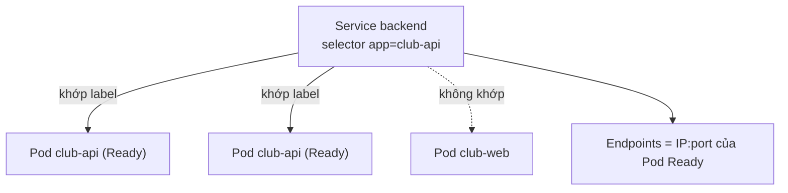
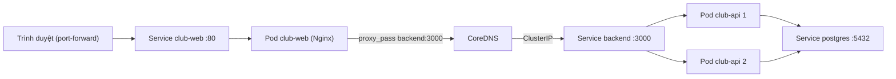

# Buổi 24 – Kubernetes Services

Tuần 12/16 · Giai đoạn 4 – Kubernetes Engineering · Buổi 24/32

[Slide](../../slides/06-kubectl/session-24.md) · [Bài tập tuần](../../assignments/weekly/week-12.md) · [Hub tuần](README.md)

> **Tóm tắt:** Dùng Service (ClusterIP, NodePort, LoadBalancer) và DNS nội bộ để nối Frontend với Backend, rồi chẩn đoán Service có Endpoints rỗng.

::: tip Buổi này bạn làm gì
- **Bạn sẽ tạo ra:** bằng chứng rằng Frontend gọi được Backend qua tên `backend` (DNS và Service), cùng hai Service thử nghiệm NodePort và LoadBalancer.
- **Thời gian thật:** đọc 15 phút, lab bắt buộc 60 phút, thử thách và phá lỗi làm ở nhà.
- **Cần chuẩn bị:**
  - [ ] Cluster kind `club` đang chạy, context `kind-club`; đã học [Buổi 23 – kubectl Fundamentals](session-23.md).
  - [ ] Image `club-api:1.0.0` đã nạp vào kind (`club-web:1.0.0` build ở Chuẩn bị); namespace `club` có Postgres và API từ [Buổi 22 – Pods & Deployments](../week-11/session-22.md); Frontend `club-web` bạn dựng ngay ở phần Chuẩn bị.
  - [ ] Môi trường theo [Hướng dẫn cài đặt](../../resources/setup-guide.md); repo `devops-labs` theo [Tài khoản GitHub và repo devops-labs](../../resources/setup-github.md).
- **Phải nộp:** `README.md` (7 câu của mẫu, ghi L1 hay L2); `evidence/command-output.txt` (`get svc`, `get endpoints backend`, `nslookup` ba tên, `curl` qua port-forward); `report.md` về Endpoints rỗng; `screenshots/` ít nhất một ảnh.
- **Đi nhanh:** Đọc > [Làm lab](#hands-on-lab) > [Gặp lỗi?](#gap-loi) > [Tự kiểm tra](#tu-kiem-tra) > [Nộp bài](#nop-bai). Kẹt? Nhảy tới [Gặp lỗi?](#gap-loi).

**Từ mới trong buổi** (xem [Thuật ngữ](../../resources/glossary.md)):
- [Service](../../resources/glossary.md): địa chỉ ổn định và cân bằng tải cho một nhóm Pod.
- [selector](../../resources/glossary.md): biểu thức chọn Pod theo label.
- [Endpoints](../../resources/glossary.md): danh sách IP:port của các Pod đang Ready đứng sau Service.
- [ClusterIP](../../resources/glossary.md): IP ảo của Service, chỉ dùng được trong cluster.
- [CoreDNS](../../resources/glossary.md): DNS nội bộ, biến tên Service thành ClusterIP.
- [NodePort](../../resources/glossary.md): loại Service mở một cổng cố định trên mọi node.
:::

## Vấn đề thực tế

CLB deploy API với 2 replica. Mỗi lần Pod bị xóa, Deployment tạo Pod mới và Pod mới có IP khác. Nếu Frontend hard-code IP của Pod backend, chỉ một lần rolling update là trang thành viên báo lỗi 502. Còn nếu có hai replica, Frontend phải gửi request cho Pod nào? Service giải quyết cả hai: một tên DNS, một IP ảo ổn định, và tự cân bằng tải giữa các Pod đang sẵn sàng. Nginx của frontend chỉ cần `proxy_pass http://backend:3000;` vì có một Service tên `backend`, y như service `backend` trong Docker Compose.

## Khái niệm cốt lõi {#khai-niem}

**Service.** Địa chỉ mạng ổn định cho một nhóm Pod, gồm `selector` (label dùng để chọn Pod, ví dụ `app: club-api`) và `ports`. Ví von: Service như số tổng đài của quán, nhân viên (Pod) đổi ca thì số vẫn giữ nguyên.

**Endpoints.** Danh sách IP:port của các Pod khớp selector và đang Ready. Pod chưa Ready bị loại; Endpoints rỗng nghĩa là Service không có nơi nào để gửi traffic. Ví von: danh sách nhân viên đang có mặt cạnh tổng đài.

**Ba loại Service.** ClusterIP (mặc định) chỉ dùng trong cluster; NodePort mở cổng 30000-32767 trên mọi node; LoadBalancer cần load balancer của cloud nên trong kind `EXTERNAL-IP` luôn `pending`. Backend dùng ClusterIP; frontend xem từ máy qua `port-forward`; buổi 27 dùng Ingress.

**Cổng.** `port` là cổng client gọi vào Service (`backend:3000`); `targetPort` là cổng trên Pod nhận traffic; `containerPort` chỉ khai báo trong Pod spec. Sai `targetPort` thì Endpoints vẫn có nhưng kết nối bị từ chối.

**DNS.** CoreDNS tạo bản ghi `ten-service.namespace.svc.cluster.local`. Cùng namespace gọi `backend`; khác namespace gọi `backend.club`; tên đầy đủ (FQDN) `backend.club.svc.cluster.local` luôn đúng.



::: details Tìm hiểu thêm (đọc sau)
Service không chạy process nào: control plane tạo ClusterIP ảo, theo dõi Pod khớp selector và Ready để giữ danh sách Endpoints; `kube-proxy` trên mỗi node chuyển traffic tới ClusterIP thành traffic tới một Pod. Tên ngắn hoạt động nhờ `search` domain trong `/etc/resolv.conf` của Pod. Kubernetes dùng EndpointSlice làm cơ chế chính; từ Kubernetes 1.33 `kubectl get endpoints` in thêm cảnh báo `v1 Endpoints is deprecated` (không phải lỗi), tương đương: `kubectl get endpointslices -l kubernetes.io/service-name=backend`.

Bảng loại Service trong kind:

| Loại | Ai truy cập được | Trong kind |
| --- | --- | --- |
| ClusterIP | Chỉ trong cluster | Dùng được, từ máy dùng `kubectl port-forward` |
| NodePort | Trong cluster và qua IP node, cổng 30000-32767 | Cổng nằm trên container node của kind, không tự mở ra máy host (cần `extraPortMappings` khi tạo cluster) |
| LoadBalancer | Qua load balancer do cloud cấp | `EXTERNAL-IP` là `pending` vì không có cloud provider |

Bốn loại cổng: `containerPort` (Pod spec, chủ yếu tài liệu hóa), `targetPort` (Service, cổng Pod), `port` (Service, cổng client gọi), `nodePort` (Service NodePort, cổng trên mọi node). Bỏ `targetPort` thì Kubernetes dùng giá trị bằng `port`.

Đường đi của một request:



Trình duyệt gọi `localhost:8081`, Nginx khớp `location /api/` rồi hỏi CoreDNS tên `backend` (mở rộng thành `backend.club.svc.cluster.local`), `kube-proxy` chọn một trong hai Pod `club-api` trong Endpoints, và API gọi database qua `DB_HOST=postgres` (ConfigMap `club-config`), tức lại đi qua một Service nữa.
:::

## Hands-on lab (60 phút, bắt buộc) {#hands-on-lab}

Trên lớp, mentor demo trước; tự học thì làm thẳng phần này. Manifest của dự án nằm ở `~/devops-course/starter-project/k8s/`.

### Chuẩn bị (5 phút)

```bash
mkdir -p ~/devops-labs/lab-24/{source,screenshots,evidence}
cd ~/devops-labs/lab-24
kubectl config set-context --current --namespace=club
kubectl get pods
```

Kết quả mong đợi: `postgres-0` và hai Pod `club-api-...` đều `Running` `1/1`; chưa có `club-web`. Buổi 22 chỉ deploy API, nên dựng Frontend ngay bây giờ (Service `backend` đã có nên Nginx của frontend phân giải được tên `backend`):

```bash
cd ~/devops-course/starter-project
docker build -t club-web:1.0.0 ./frontend
kind load docker-image club-web:1.0.0 --name club
kubectl apply -f k8s/frontend.yaml
kubectl rollout status deployment/club-web --timeout=120s
cd ~/devops-labs/lab-24
```

Thiếu `postgres-0` hoặc `club-api` thì quay lại [Buổi 22 – Pods & Deployments](../week-11/session-22.md) (Secret `club-secrets` tạo bằng `kubectl create secret generic`, đừng apply `secret.example.yaml`). Namespace mặc định đã đặt là `club` nên không cần `-n club`; sau lab có thể đặt lại `default`. Lệnh quan trọng thì ghi vào bằng chứng: `kubectl get svc | tee -a evidence/command-output.txt`.

### Phần 1 – Đọc Service của backend (10 phút)

```bash
kubectl get svc backend -o yaml
kubectl get pods --show-labels
kubectl describe svc backend
```

Kết quả mong đợi:

```yaml
spec:
  clusterIP: 10.96.x.x
  ports:
  - port: 3000
    protocol: TCP
    targetPort: 3000
  selector:
    app: club-api
  type: ClusterIP
```

Pod `club-api-...` có label `app=club-api`; `describe` liệt kê hai địa chỉ `10.244.x.x:3000` ở mục `Endpoints:`. `selector` là liên kết duy nhất giữa Service và Pod, không có tên Deployment. Hãy ghi lại: Service `backend` chọn Pod nào, `port` và `targetPort` bằng bao nhiêu.

::: tip Kiểm tra: bạn đúng khi
Bạn chỉ ra được selector `app: club-api` khớp label của hai Pod API và `describe svc backend` có hai Endpoints.
:::

### Phần 2 – Gọi Service bằng DNS từ Pod debug (10 phút)

Chạy Pod tạm (tự xóa khi thoát), dấu nhắc sẽ là `/ #`:

```bash
kubectl run debug --rm -it --restart=Never --image=busybox:1.36 -- sh
```

Các lệnh sau chạy bên trong shell này:

```bash
nslookup backend
nslookup backend.club
nslookup backend.club.svc.cluster.local
cat /etc/resolv.conf
wget -qO- http://backend:3000/health
wget -qO- http://backend:3000/api/members
exit
```

Kết quả mong đợi:
- Cả ba tên cùng trả về một ClusterIP (Pod debug cùng namespace `club` nên tên ngắn được mở rộng nhờ search domain).
- `resolv.conf` có `search club.svc.cluster.local svc.cluster.local cluster.local` và `nameserver 10.96.0.10` (rút gọn).
- `{"status":"healthy","service":"club-api"}` và một mảng JSON thành viên (Alice, Bob nếu đã nạp `init.sql` ở buổi 22). API không trả tên Pod nên cân bằng tải được quan sát bằng log ở Phần 4.

::: tip Kiểm tra: bạn đúng khi
Ba lệnh `nslookup` cho cùng một địa chỉ và `/health` trả `healthy`. Nếu `nslookup` ra IP nhưng `wget` lỗi, xem [Gặp lỗi?](#gap-loi).
:::

### Phần 3 – Nối Frontend với Backend và xem từ máy (10 phút)

```bash
kubectl get svc,endpoints club-web
kubectl exec deploy/club-web -- wget -qO- http://backend:3000/health
kubectl port-forward svc/club-web 8081:80
```

Lệnh cuối giữ terminal (kết quả: `Forwarding from 127.0.0.1:8081 -> 80`). Ở terminal khác:

```bash
curl -s http://localhost:8081/api/members
curl -s -o /dev/null -w "%{http_code}\n" http://localhost:8081/
```

Kết quả mong đợi: Service `club-web` cổng `80/TCP` có một endpoint cổng 80; lệnh `exec` trả JSON healthy (chính là đường mà `proxy_pass http://backend:3000` đi); `/api/members` trả JSON đi qua Nginx tới backend; mã HTTP `200`. Cổng 8081 để không đụng 8080 của Compose; Ctrl+C ở terminal đầu để dừng. Cổng bận thì xem [Gặp lỗi?](#gap-loi).

::: tip Kiểm tra: bạn đúng khi
`curl` qua `localhost:8081` trả JSON ở `/api/members` và mã `200` ở trang chủ.
:::

### Phần 4 – NodePort và LoadBalancer (10 phút)

Tạo hai Service thử nghiệm (không sửa Service gốc `club-web`):

```bash
kubectl expose deployment club-web --name=club-web-np --type=NodePort --port=80 --target-port=80
kubectl expose deployment club-web --name=club-web-lb --type=LoadBalancer --port=80 --target-port=80
kubectl get svc club-web-np club-web-lb
```

Kết quả mong đợi: `club-web-np` có `PORT(S)` dạng `80:3xxxx/TCP`; `club-web-lb` có `EXTERNAL-IP` là `<pending>` mãi mãi vì kind không có cloud load balancer (cài cloud-provider-kind hoặc MetalLB nằm ngoài buổi này).

Quan sát log của hai Pod API khi gọi lặp lại qua Service, rồi dọn:

```bash
for i in 1 2 3 4 5 6; do kubectl exec deploy/club-web -- wget -qO- http://backend:3000/health > /dev/null; done
kubectl logs -l app=club-api --prefix --tail=5
kubectl delete svc club-web-np club-web-lb
```

Log có tiền tố tên Pod; starter API không log từng request nên có thể ít dòng (gợi ý để đếm request ở L2).

::: tip Kiểm tra: bạn đúng khi
`kubectl get svc` không còn `club-web-np`, `club-web-lb` và bạn giải thích được vì sao LoadBalancer `pending` trong kind.
:::

### Checklist L1

- [ ] Giải thích được Service `backend` chọn Pod nào (chỉ ra selector và label).
- [ ] Phân giải thành công `backend`, `backend.club` và `backend.club.svc.cluster.local` từ Pod debug.
- [ ] Gọi được `/health` và `/api/members` qua tên `backend`.
- [ ] Xem được frontend qua `port-forward` và `/api/members` trả JSON.
- [ ] Tạo được Service NodePort và LoadBalancer thử nghiệm, nêu được vì sao LoadBalancer `pending` trong kind.
- [ ] Đã lưu output các lệnh chính vào `evidence/command-output.txt`.

Tự kiểm tra một dòng (Endpoints của `backend` phải có hai địa chỉ cổng 3000):

```bash
kubectl get endpoints backend && kubectl get svc
```

## Gặp lỗi? {#gap-loi}

| Triệu chứng | Nguyên nhân | Cách sửa |
| --- | --- | --- |
| `kubectl get endpoints` cho `<none>` | Selector Service không khớp label Pod, hoặc Pod chưa Ready | So `describe svc` với `--show-labels`; kiểm tra readiness probe (xem mục Phá lỗi nâng cao ở cuối trang) |
| Có Endpoints nhưng `Connection refused` | `targetPort` khác cổng process lắng nghe | Sửa `targetPort` đúng cổng ứng dụng (3000 với API) |
| `bad address 'backend'` / `could not resolve host` | Pod ở namespace khác, hoặc sai tên Service | Dùng `backend.club` hoặc FQDN; kiểm tra `kubectl get svc -n club` |
| LoadBalancer `EXTERNAL-IP` là `pending` | kind không có cloud provider | Dùng `port-forward` hoặc Ingress (buổi 27) |
| Mở `localhost:NodePort` không được | NodePort nằm trên container node của kind, chưa map ra host | Dùng `port-forward`, hoặc tạo cluster với `extraPortMappings` |
| `port-forward` báo `address already in use` | Cổng local đã bị dùng (ví dụ 8080 của Compose) | Đổi cổng local, ví dụ `8082:80` |
| Nginx trả 502 khi gọi `/api/` | Service `backend` không có Endpoints, hoặc API đang CrashLoopBackOff | `get endpoints backend`, `logs` của Pod API |
| `kubectl get pods` báo `No resources found` | Namespace của context không phải `club` | `kubectl config set-context --current --namespace=club` |

## Tự kiểm tra {#tu-kiem-tra}

1. Vì sao không nên dùng IP của Pod để các service gọi nhau?
2. Service liên kết với Pod bằng cơ chế nào?
3. `port`, `targetPort` và `containerPort` khác nhau thế nào?
4. Pod ở namespace `lab24` muốn gọi Service `backend` ở `club`. Dùng tên nào?
5. Frontend trả 502 khi gọi `/api/members`, mọi Pod đều `Running`. Bạn kiểm tra gì đầu tiên?

::: details Đáp án gợi ý
1. Pod là tạm thời, mỗi lần bị tạo lại có IP mới. Service cho ClusterIP và tên DNS ổn định, tự cập nhật danh sách Pod phía sau.
2. Label selector. Service chọn mọi Pod cùng namespace có label khớp và đang Ready; không liên quan tới tên Deployment.
3. `port` là cổng Service mà client gọi; `targetPort` là cổng trên Pod nhận traffic; `containerPort` là khai báo cổng container trong Pod spec (mang tính tài liệu hóa).
4. `backend.club` (hoặc `backend.club.svc.cluster.local`). Tên ngắn `backend` chỉ tìm trong namespace của Pod gọi.
5. `kubectl get endpoints backend`. Nếu rỗng, so selector của Service với label Pod rồi kiểm tra Pod có Ready không. Nếu Endpoints có địa chỉ, kiểm tra `targetPort` và log của API.
:::

## Nộp bài {#nop-bai}

Nộp vào `lab-24/` trong repo `devops-labs` theo `templates/lab-template.md`. Bài tập tuần: [Bài tập tuần 12](../../assignments/weekly/week-12.md).

- [ ] `README.md` trả lời đủ 7 câu của mẫu và ghi rõ đã làm L1 hay L2.
- [ ] `evidence/command-output.txt` có output của `kubectl get svc`, `kubectl get endpoints backend`, `nslookup` ba dạng tên, và `curl` qua `port-forward`.
- [ ] `report.md` mô tả quá trình điều tra Endpoints rỗng: triệu chứng, từng bước, nguyên nhân gốc, cách sửa.
- [ ] `source/` chứa `backend-svc-lab.yaml` (nếu làm L2) và mọi manifest bạn đã sửa.
- [ ] `screenshots/` có ảnh `kubectl get svc` và trang frontend (ảnh chỉ bổ trợ, không thay evidence).
- [ ] Không commit secret: Secret thật, password và file `.env` không được có trong repo.

## Recap

- Service cho Pod một IP ảo và tên DNS ổn định; Pod đến rồi đi, Service ở lại. Service chọn Pod bằng label selector, và chỉ Pod Ready nằm trong Endpoints.
- ClusterIP cho nội bộ, NodePort mở cổng trên node, LoadBalancer cần cloud (trong kind là `pending`); `port` là cổng Service, `targetPort` là cổng Pod.
- Nghi ngờ Service thì `get endpoints` trước, rồi `describe svc` và so với `--show-labels`.

Buổi tiếp theo: [Buổi 25 – Configuration Management](../week-13/session-25.md).

:::: details Thử thách thêm (L2, tùy chọn, làm ở nhà)
Mỗi thử thách có tiêu chí hoàn thành. Hãy tự thử 15 phút trước khi mở gợi ý; lời giải nằm trong [trang tuần 12](README.md) (mở sau khi nộp bài).

**Thử thách 1 – Service viết tay.** Tự viết `source/backend-svc-lab.yaml` tạo Service `backend-lab` cho backend, `port: 8080`, `targetPort: 3000`, ClusterIP. Không copy từ `backend.yaml`. Tiêu chí: `kubectl get endpoints backend-lab` có hai địa chỉ cổng 3000, `wget -qO- http://backend-lab:8080/health` từ Pod debug trả JSON healthy, và `report.md` giải thích vì sao client gọi 8080 nhưng Pod nghe 3000.

<details><summary>Gợi ý (tự thử 15 phút trước khi mở)</summary>

Cần đúng ba thứ: `metadata.name`, `selector` khớp label `app: club-api` của Pod, và cặp `port`/`targetPort` đúng. Kiểm tra cú pháp trước bằng `kubectl apply --dry-run=client -f source/backend-svc-lab.yaml`.

</details>

**Thử thách 2 – Truy cập chéo namespace.** Tạo namespace `lab24`, chạy Pod debug ở đó và gọi được backend ở namespace `club`. Tiêu chí: giải thích tên nào chạy được (`backend` hay `backend.club`) và vì sao.

<details><summary>Gợi ý (tự thử 15 phút trước khi mở)</summary>

Search domain của Pod chỉ chứa namespace của chính nó, nên tên ngắn `backend` sẽ tìm trong `lab24.svc.cluster.local` và không thấy.

</details>

::: danger Dọn namespace thử nghiệm
Chỉ xóa đúng namespace bạn tạo: `kubectl delete namespace lab24`. Xóa namespace xóa mọi thứ bên trong; không bao giờ chạy lệnh này với `club`.
:::

**Thử thách 3 – Endpoints rỗng.** Làm theo mục Phá lỗi nâng cao ngay bên dưới, ghi từng bước điều tra vào `report.md`.

**Câu hỏi thêm.** (a) Vì sao Service LoadBalancer trong kind có `EXTERNAL-IP` là `pending`? (b) Một Pod `club-api` fail readiness probe thì điều gì xảy ra với Service `backend`?

<details><summary>Đáp án gợi ý</summary>

(a) Không có cloud controller nào cấp load balancer bên ngoài; trong kind dùng `port-forward`, Ingress hoặc công cụ bổ sung như cloud-provider-kind, MetalLB. (b) Pod đó bị loại khỏi Endpoints, Service chỉ chuyển traffic tới các Pod Ready còn lại; Pod không bị restart (đó là việc của liveness probe).

</details>
::::

::: details Phá lỗi nâng cao
**Tình huống: Service không có Endpoints.** Liên quan tới `examples/troubleshooting/` (scenario-03 API không kết nối được DB, scenario-10 readiness probe fail); hãy tự điều tra trước.

Cách phá: sửa selector của Service `backend` thành giá trị sai (mô phỏng gõ nhầm label).

```bash
kubectl patch svc backend -p '{"spec":{"selector":{"app":"club-apii"}}}'
kubectl get endpoints backend
curl -s -o /dev/null -w "%{http_code}\n" http://localhost:8081/api/members
```

Triệu chứng: cột `ENDPOINTS` là `<none>`. Nếu `port-forward` tới `club-web` đang chạy (Phần 3), `curl` trả `502` (Nginx không kết nối được upstream) hoặc treo rồi lỗi. Các Pod vẫn `Running` và Deployment vẫn khỏe nên `kubectl get pods` không thấy gì bất thường.

Hướng điều tra, từ ngoài vào trong:

1. Lỗi ở tầng nào? Từ Pod debug: `nslookup backend` ra IP nhưng `wget -qO- http://backend:3000/health` lỗi kết nối thì Service tồn tại, vấn đề nằm sau Service.
2. `kubectl get endpoints backend`: thấy `<none>`.
3. `kubectl describe svc backend`: đọc `Selector:` (ví dụ `app=club-apii`).
4. `kubectl get pods --show-labels`: label thật là `app=club-api`; hai bên lệch nhau.
5. `kubectl get pods -l app=club-apii`: `No resources found`, xác nhận selector không khớp Pod nào.
6. Nếu selector đúng mà Endpoints vẫn rỗng, kiểm tra Pod có `READY 1/1` không (readiness probe fail cũng loại Pod khỏi Endpoints).

Nguyên nhân gốc: selector của Service không khớp label của Pod. Sửa:

```bash
kubectl patch svc backend -p '{"spec":{"selector":{"app":"club-api"}}}'
kubectl get endpoints backend
```

Kết quả mong đợi: hai địa chỉ `10.244.x.x:3000` xuất hiện lại và `curl` trả `200`. Phòng tránh: chạy `kubectl get endpoints` sau mỗi lần apply Service, giữ label và selector trong cùng manifest, dùng tên label thống nhất (`app`). Vì `patch` chỉ đổi live, hãy đảm bảo manifest `k8s/backend.yaml` đúng.

**Tình huống phụ: `targetPort` sai.** Đổi `targetPort` thành `3001` rồi gọi `wget -qO- http://backend:3000/health` từ Pod debug: Endpoints vẫn có địa chỉ (cổng 3001) nhưng kết nối bị từ chối (`Connection refused`). Khác selector sai ở chỗ Endpoints không rỗng. Khôi phục: `kubectl patch svc backend -p '{"spec":{"ports":[{"port":3000,"targetPort":3000}]}}'`.
:::

::: details Tài liệu tham khảo
- [Service – Kubernetes](https://kubernetes.io/docs/concepts/services-networking/service/)
- [DNS for Services and Pods](https://kubernetes.io/docs/concepts/services-networking/dns-pod-service/)
- [Connecting Applications with Services](https://kubernetes.io/docs/tutorials/services/connect-applications-service/)
- [Debug Services](https://kubernetes.io/docs/tasks/debug/debug-application/debug-service/)
- [kind – Extra port mappings](https://kind.sigs.k8s.io/docs/user/configuration/#extra-port-mappings)
- [kubectl port-forward](https://kubernetes.io/docs/reference/kubectl/generated/kubectl_port-forward/)
:::
