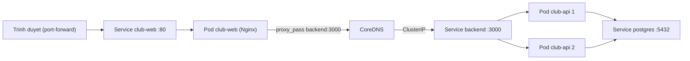
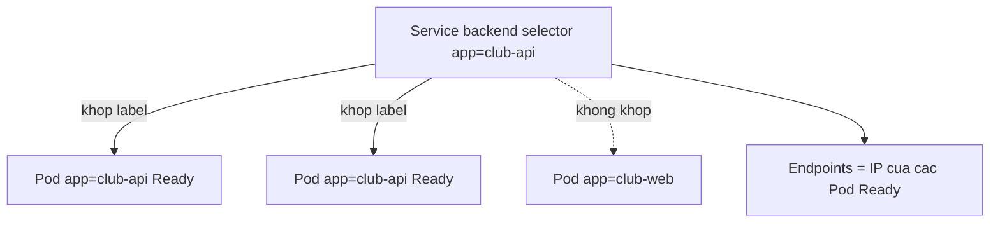

# Buổi 24 – Kubernetes Services

Tuần 12 · Giai đoạn 4 – Kubernetes Engineering · Slide: [Slide buổi 24](../../slides/06-kubectl/session-24.md)

> **Tóm tắt:** Dùng Service (ClusterIP, NodePort, LoadBalancer) và DNS nội bộ của Kubernetes để nối Frontend với Backend, rồi chẩn đoán Service có Endpoints rỗng.

## Mục tiêu học tập

- Giải thích vì sao Pod cần Service và Service chọn Pod bằng label selector như thế nào.
- Phân biệt được ba loại Service ClusterIP, NodePort, LoadBalancer và nói khi nào dùng loại nào trong cluster kind.
- Chạy được lệnh `kubectl get svc`, `kubectl get endpoints`, `kubectl describe svc` và đọc đúng kết quả.
- Kiểm thử được service discovery bằng tên DNS ngắn và tên đầy đủ từ một Pod debug.
- Phân biệt `port`, `targetPort`, `containerPort` và `nodePort`.
- Chẩn đoán được Service có Endpoints rỗng do selector sai và sửa lại.

## Điều kiện cần

- Đã hoàn thành buổi 22 (Pods và Deployments) và buổi 23 (kubectl cơ bản): biết `kubectl apply`, `get`, `describe`, `logs`, `exec`.
- Đã có cluster kind đang chạy và các image `club-api:1.0.0`, `club-web:1.0.0` đã được nạp vào kind (`kind load docker-image`).
- Namespace `club`, ConfigMap `club-config`, Secret `club-secrets` và Postgres (`k8s/postgres.yaml`) đã được tạo từ các buổi trước.
- Làm việc trong filesystem của WSL (ví dụ `~/devops-labs`), không dùng `/mnt/c`.

Kiểm tra nhanh:

```bash
kubectl cluster-info --context kind-kind
kubectl get pods -n club
```

Kết quả mong đợi (rút gọn): control plane đang chạy; Pod `postgres-0`, `club-api-...` và `club-web-...` ở trạng thái `Running`. Nếu thiếu, apply lại theo thứ tự: `namespace.yaml`, `configmap.yaml`, Secret (từ `secret.example.yaml` với password của bạn), `postgres.yaml`, `backend.yaml`, `frontend.yaml` trong `starter-project/k8s/`.

## Vấn đề thực tế

CLB deploy API với 2 replica. Mỗi lần Pod bị xóa, Deployment tạo Pod mới và Pod mới có IP khác. Nếu Frontend hard-code IP của Pod backend, chỉ cần một lần rolling update là trang thành viên báo lỗi 502. Còn nếu có hai replica, Frontend phải biết gửi request cho Pod nào?

Service giải quyết cả hai vấn đề: nó cho một tên DNS và một IP ảo ổn định, đồng thời tự cân bằng tải giữa các Pod đang sẵn sàng. Trong dự án CLB, Nginx của frontend chỉ cần `proxy_pass http://backend:3000;` vì có một Service tên `backend`. Hiểu Service là hiểu vì sao cấu hình đó chạy được ở Kubernetes mà không cần sửa gì so với Docker Compose.

## Khái niệm cốt lõi

### Service là gì

Service là một object Kubernetes cung cấp địa chỉ mạng ổn định cho một nhóm Pod. Hai thành phần chính:

- **selector**: tập label dùng để chọn Pod (ví dụ `app: club-api`).
- **ports**: cổng Service lắng nghe (`port`) và cổng trên Pod nhận traffic (`targetPort`).

Service không chạy process nào. Khi bạn tạo Service, control plane tạo một ClusterIP ảo, rồi theo dõi các Pod khớp selector và đang Ready để duy trì danh sách địa chỉ (Endpoints/EndpointSlice). `kube-proxy` trên mỗi node dùng danh sách này để chuyển traffic đến ClusterIP thành traffic tới một Pod cụ thể.

### Các loại Service

| Loại | Ai truy cập được | Dùng khi | Trong kind |
| --- | --- | --- | --- |
| ClusterIP (mặc định) | Chỉ trong cluster | Backend, database, service nội bộ | Dùng được, truy cập từ máy bằng `kubectl port-forward` |
| NodePort | Trong cluster và qua IP của node ở cổng 30000-32767 | Thử nghiệm nhanh, nền tảng cho LoadBalancer | Cổng nằm trên container node của kind, không tự mở ra máy host (cần `extraPortMappings` khi tạo cluster) |
| LoadBalancer | Qua load balancer bên ngoài do cloud cấp | Cluster cloud (EKS, AKS, GKE) | `EXTERNAL-IP` ở trạng thái `pending` vì không có cloud provider |

Với bài này: backend dùng ClusterIP (không cần ai ngoài cluster gọi trực tiếp), frontend sẽ được xem qua `port-forward`, và ở buổi 27 bạn dùng Ingress để vào bằng `club.localhost`.

### Bốn loại cổng dễ nhầm

| Tên | Nằm ở đâu | Ý nghĩa |
| --- | --- | --- |
| `containerPort` | Pod spec | Khai báo cổng container lắng nghe (chủ yếu để tài liệu hóa) |
| `targetPort` | Service | Cổng trên Pod mà Service chuyển traffic tới |
| `port` | Service | Cổng của Service (client gọi `backend:3000`) |
| `nodePort` | Service NodePort | Cổng mở trên mọi node |

Nếu bỏ `targetPort`, Kubernetes dùng giá trị bằng `port`. Nếu `targetPort` không khớp cổng process thật sự lắng nghe, Service vẫn có Endpoints nhưng kết nối bị từ chối.

### Service discovery và DNS

CoreDNS trong cluster tạo bản ghi cho mỗi Service theo dạng `ten-service.namespace.svc.cluster.local`. Từ Pod, bạn có thể gọi:

| Cách gọi | Hoạt động khi |
| --- | --- |
| `backend` | Pod cùng namespace với Service |
| `backend.club` | Pod ở namespace khác |
| `backend.club.svc.cluster.local` | Luôn đúng (tên đầy đủ, FQDN) |

Tên ngắn hoạt động nhờ `search` domain trong `/etc/resolv.conf` của Pod. Đây là lý do `proxy_pass http://backend:3000` trong `starter-project/frontend/nginx.conf` chạy được khi frontend và backend cùng namespace `club`.

### Endpoints

Endpoints là danh sách IP:port của các Pod đang Ready khớp selector. Kubernetes hiện dùng EndpointSlice làm cơ chế chính, nhưng `kubectl get endpoints` vẫn dùng được và đủ cho bài này. Từ Kubernetes 1.33 lệnh này in thêm cảnh báo `v1 Endpoints is deprecated` (không phải lỗi); xem tương đương bằng `kubectl get endpointslices -l kubernetes.io/service-name=backend`. Quy tắc quan trọng: Pod chưa Ready (readiness probe fail) bị loại khỏi Endpoints. Endpoints rỗng nghĩa là Service không có nơi nào để gửi traffic.

## Kiến trúc và cách hoạt động



Từng bước:

1. Trình duyệt gọi `http://localhost:8081` (port-forward tới Service `club-web`) và nhận trang HTML từ Nginx.
2. Trang gọi `fetch("/api/members")`. Nginx khớp `location /api/` và `proxy_pass http://backend:3000`.
3. Nginx hỏi CoreDNS tên `backend`. Nhờ search domain, tên được mở rộng thành `backend.club.svc.cluster.local` và trả về ClusterIP.
4. `kube-proxy` chuyển traffic tới ClusterIP thành traffic tới IP của một trong hai Pod `club-api` có trong Endpoints.
5. API truy vấn database qua `DB_HOST=postgres` (từ ConfigMap `club-config`), tức là lại đi qua một Service nữa.



## Demo của mentor

Mục tiêu: cho lớp thấy Service là ranh giới ổn định phía trước các Pod thay đổi liên tục. Các manifest của dự án có sẵn trong `starter-project/k8s/`; ví dụ rút gọn nằm ở `examples/kubernetes/03-service.yaml`.

1. Xem Service hiện có.

   ```bash
   kubectl get svc -n club
   ```

   Kết quả mong đợi (rút gọn):

   ```text
   NAME       TYPE        CLUSTER-IP     EXTERNAL-IP   PORT(S)    AGE
   backend    ClusterIP   10.96.x.x      <none>        3000/TCP   20m
   club-web   ClusterIP   10.96.x.x      <none>        80/TCP     20m
   postgres   ClusterIP   10.96.x.x      <none>        5432/TCP   25m
   ```

   Hỏi lớp: vì sao database cũng cần Service dù chỉ có một Pod `postgres-0`? (Để API gọi tên `postgres` thay vì IP Pod; `DB_HOST=postgres` trong ConfigMap.) Câu hỏi mở rộng: StatefulSet khai báo `serviceName: postgres`, vì sao thường dùng headless Service (`clusterIP: None`) cho loại workload này?

2. Xem Endpoints khớp với Pod.

   ```bash
   kubectl get endpoints backend -n club
   kubectl get pods -n club -l app=club-api -o wide
   ```

   Kết quả mong đợi: cột `ENDPOINTS` của `backend` có hai địa chỉ dạng `10.244.x.x:3000`, trùng IP của hai Pod `club-api`.

3. Xóa một Pod rồi quan sát.

   ```bash
   kubectl delete pod -n club -l app=club-api --wait=false
   kubectl get endpoints backend -n club -w
   ```

   Kết quả mong đợi: danh sách địa chỉ thay đổi khi Pod mới Ready; ClusterIP của Service không đổi. Nhấn Ctrl+C để thoát.

   Hỏi lớp: nếu frontend gọi thẳng IP Pod thì chuyện gì xảy ra? Pod mới có Ready ngay không, và vì sao readiness probe quan trọng với Endpoints?

4. Cho lớp thấy DNS từ một Pod tạm.

   ```bash
   kubectl run dns-demo -n club --rm -it --restart=Never --image=busybox:1.36 -- nslookup backend
   ```

   Kết quả mong đợi: `Name: backend.club.svc.cluster.local` và một `Address` là ClusterIP của Service.

## Hands-on lab

Thời gian dự kiến: 60 phút (Chuẩn bị 5', Phần 1-4 khoảng 40', L1/L2 và dọn dẹp 15').

### Chuẩn bị

Tạo thư mục nộp bài và đặt biến namespace:

```bash
mkdir -p ~/devops-labs/lab-24/{source,screenshots,evidence}
cd ~/devops-labs/lab-24
kubectl config set-context --current --namespace=club
kubectl get pods
```

Kết quả mong đợi: các Pod `postgres-0`, hai Pod `club-api-...`, một Pod `club-web-...` đều `Running` và `READY 1/1`.

Vì sao đặt namespace mặc định: tránh gõ `-n club` ở mọi lệnh. Nhớ khôi phục sau lab nếu bạn dùng namespace khác (`kubectl config set-context --current --namespace=default`).

Từ đây ghi lại output các lệnh quan trọng vào `evidence/command-output.txt` (ví dụ `kubectl get svc | tee -a evidence/command-output.txt`).

### Phần 1 – Đọc Service của backend (10 phút)

1. Xem manifest Service đang chạy:

   ```bash
   kubectl get svc backend -o yaml
   ```

   Kết quả mong đợi (rút gọn):

   ```yaml
   spec:
     clusterIP: 10.96.x.x
     ports:
     - port: 3000
       protocol: TCP
       targetPort: 3000
     selector:
       app: club-api
     type: ClusterIP
   ```

   Vì sao: `selector` là liên kết duy nhất giữa Service và Pod. Không có tham chiếu tới tên Deployment.

2. So sánh selector với label của Pod:

   ```bash
   kubectl get pods --show-labels
   kubectl describe svc backend
   ```

   Kết quả mong đợi: Pod `club-api-...` có label `app=club-api`; phần `Endpoints:` trong `describe` liệt kê hai địa chỉ `10.244.x.x:3000`.

3. Ghi lại: Service `backend` chọn những Pod nào, và `port`, `targetPort` bằng bao nhiêu.

### Phần 2 – Gọi Service bằng DNS từ Pod debug (10 phút)

1. Chạy một Pod debug tạm thời (tự xóa khi thoát):

   ```bash
   kubectl run debug --rm -it --restart=Never --image=busybox:1.36 -- sh
   ```

   Kết quả mong đợi: dấu nhắc `/ #`. Lệnh trong các bước sau chạy bên trong shell này.

2. Phân giải tên bằng ba cách:

   ```bash
   nslookup backend
   nslookup backend.club
   nslookup backend.club.svc.cluster.local
   ```

   Kết quả mong đợi: cả ba cùng trả về một địa chỉ ClusterIP. Vì sao: Pod debug cùng namespace `club` nên tên ngắn được mở rộng nhờ search domain.

3. Xem cấu hình DNS của Pod:

   ```bash
   cat /etc/resolv.conf
   ```

   Kết quả mong đợi (rút gọn):

   ```text
   search club.svc.cluster.local svc.cluster.local cluster.local
   nameserver 10.96.0.10
   ```

4. Gọi API qua Service:

   ```bash
   wget -qO- http://backend:3000/health
   wget -qO- http://backend:3000/api/members
   ```

   Kết quả mong đợi: `{"status":"healthy","service":"club-api"}` và một mảng JSON các thành viên (rỗng `[]` nếu bảng chưa có dữ liệu mẫu).

5. Thoát shell bằng `exit`. API không trả tên Pod nên việc quan sát cân bằng tải được làm bằng log ở Phần 4.

### Phần 3 – Nối Frontend với Backend và xem từ máy (10 phút)

1. Xem Service frontend và Endpoints:

   ```bash
   kubectl get svc club-web
   kubectl get endpoints club-web
   ```

   Kết quả mong đợi: ClusterIP cổng `80/TCP`; một địa chỉ endpoint cổng 80.

2. Kiểm tra Nginx trong Pod frontend phân giải được `backend`:

   ```bash
   kubectl exec deploy/club-web -- wget -qO- http://backend:3000/health
   ```

   Kết quả mong đợi: `{"status":"healthy","service":"club-api"}`. Vì sao: đây chính là đường mà `proxy_pass http://backend:3000` đi.

3. Mở cổng từ máy tới Service frontend (để terminal này chạy):

   ```bash
   kubectl port-forward svc/club-web 8081:80
   ```

   Kết quả mong đợi: `Forwarding from 127.0.0.1:8081 -> 80`.

4. Ở terminal khác:

   ```bash
   curl -s http://localhost:8081/api/members
   curl -s -o /dev/null -w "%{http_code}\n" http://localhost:8081/
   ```

   Kết quả mong đợi: JSON danh sách thành viên đi qua Nginx rồi tới backend; mã HTTP `200`. Dùng cổng 8081 để không đụng 8080 (Compose) trên máy. Nhấn Ctrl+C ở terminal đầu để dừng.

### Phần 4 – NodePort và LoadBalancer (10 phút)

1. Tạo Service NodePort thử nghiệm cho frontend (không sửa Service gốc):

   ```bash
   kubectl expose deployment club-web --name=club-web-np --type=NodePort --port=80 --target-port=80
   kubectl get svc club-web-np
   ```

   Kết quả mong đợi: `TYPE` là `NodePort`, cột `PORT(S)` dạng `80:3xxxx/TCP`.

2. Tạo Service LoadBalancer thử nghiệm:

   ```bash
   kubectl expose deployment club-web --name=club-web-lb --type=LoadBalancer --port=80 --target-port=80
   kubectl get svc club-web-lb
   ```

   Kết quả mong đợi: `EXTERNAL-IP` là `<pending>` mãi mãi. Vì sao: kind không có cloud load balancer. (Có thể cài cloud-provider-kind hoặc MetalLB, nằm ngoài phạm vi buổi này.)

3. Quan sát log của hai Pod API khi gọi lặp lại qua Service:

   ```bash
   for i in 1 2 3 4 5 6; do kubectl exec deploy/club-web -- wget -qO- http://backend:3000/health > /dev/null; done
   kubectl logs -l app=club-api --prefix --tail=5
   ```

   Kết quả mong đợi: log có tiền tố tên Pod. Starter API không log từng request nên có thể ít dòng; nếu muốn đếm request, đây là gợi ý cho L2.

4. Dọn hai Service thử nghiệm:

   ```bash
   kubectl delete svc club-web-np club-web-lb
   ```

### L1 – Foundation

- [ ] Giải thích được Service `backend` chọn Pod nào (chỉ ra selector và label).
- [ ] Phân giải thành công `backend`, `backend.club` và `backend.club.svc.cluster.local` từ Pod debug.
- [ ] Gọi được `/health` và `/api/members` qua tên `backend`.
- [ ] Xem được frontend qua `port-forward` và `/api/members` trả JSON.
- [ ] Tạo được Service NodePort và LoadBalancer thử nghiệm, nêu được vì sao LoadBalancer `pending` trong kind.
- [ ] Đã lưu output các lệnh chính vào `evidence/command-output.txt`.

### L2 – Engineering

**Thử thách 1 – Service viết tay.** Tự viết manifest `source/backend-svc-lab.yaml` tạo Service tên `backend-lab` cho backend, `port: 8080`, `targetPort: 3000`, loại ClusterIP. Không copy từ `backend.yaml`.

Tiêu chí hoàn thành: `kubectl get endpoints backend-lab` có hai địa chỉ cổng 3000, và `wget -qO- http://backend-lab:8080/health` từ Pod debug trả về JSON healthy. Giải thích trong `report.md` vì sao client gọi 8080 nhưng Pod nghe 3000.

<details>
<summary>Gợi ý</summary>

Cần đúng ba thứ: `metadata.name`, `selector` khớp label `app: club-api` của Pod, và cặp `port`/`targetPort` đúng. Dùng `kubectl apply --dry-run=client -f source/backend-svc-lab.yaml` để kiểm tra cú pháp trước.

</details>

<details>
<summary>Lời giải</summary>

```yaml
apiVersion: v1
kind: Service
metadata:
  name: backend-lab
  namespace: club
spec:
  type: ClusterIP
  selector:
    app: club-api
  ports:
    - port: 8080
      targetPort: 3000
```

```bash
kubectl apply -f source/backend-svc-lab.yaml
kubectl get endpoints backend-lab
```

</details>

**Thử thách 2 – Truy cập chéo namespace.** Tạo namespace `lab24`, chạy Pod debug ở đó và gọi được backend ở namespace `club`.

Tiêu chí hoàn thành: giải thích tên nào chạy được (`backend` hay `backend.club`) và vì sao.

<details>
<summary>Gợi ý</summary>

Search domain của Pod chỉ chứa namespace của chính nó. Tên ngắn `backend` sẽ tìm trong `lab24.svc.cluster.local` và không thấy.

</details>

<details>
<summary>Lời giải</summary>

```bash
kubectl create namespace lab24
kubectl run debug -n lab24 --rm -it --restart=Never --image=busybox:1.36 -- sh
# trong shell:
wget -qO- http://backend:3000/health          # lỗi: bad address
wget -qO- http://backend.club:3000/health     # chạy được
exit
kubectl delete namespace lab24
```

</details>

**Thử thách 3 – Endpoints rỗng.** Làm theo phần "Phá lỗi và debug" bên dưới, ghi lại từng bước điều tra vào `report.md`.

## Phá lỗi và debug

### Tình huống: Service không có Endpoints

Cách phá: sửa selector của Service `backend` thành giá trị sai (mô phỏng gõ nhầm label).

```bash
kubectl patch svc backend -p '{"spec":{"selector":{"app":"club-apii"}}}'
```

Triệu chứng:

```bash
kubectl get endpoints backend
curl -s -o /dev/null -w "%{http_code}\n" http://localhost:8081/api/members
```

Kết quả: cột `ENDPOINTS` là `<none>`. Nếu `port-forward` tới `club-web` đang chạy (Phần 3), `curl` trả `502` (Nginx không kết nối được upstream) hoặc treo rồi lỗi. Các Pod vẫn `Running` và Deployment vẫn khỏe, nên `kubectl get pods` không cho thấy gì bất thường.

Hướng điều tra, đi từ ngoài vào trong:

1. Lỗi nằm ở tầng nào? Gọi trực tiếp từ Pod debug: `wget -qO- http://backend:3000/health`. Nếu lỗi kết nối nhưng DNS vẫn phân giải được (`nslookup backend` ra IP) thì Service tồn tại, vấn đề nằm sau Service.
2. `kubectl get endpoints backend`: thấy `<none>`. Service không có Pod nào để chuyển traffic tới.
3. `kubectl describe svc backend`: đọc `Selector:` (ví dụ `app=club-apii`).
4. `kubectl get pods --show-labels`: so label thật (`app=club-api`). Hai bên lệch nhau.
5. Kiểm tra bằng `kubectl get pods -l app=club-apii`: trả `No resources found`, xác nhận selector không khớp Pod nào.
6. Loại trừ nguyên nhân khác: nếu selector đúng nhưng Endpoints vẫn rỗng, kiểm tra Pod có `READY 1/1` không (readiness probe fail cũng làm Pod bị loại khỏi Endpoints).

Nguyên nhân gốc: selector của Service không khớp label của Pod, nên không Pod nào được chọn.

Sửa:

```bash
kubectl patch svc backend -p '{"spec":{"selector":{"app":"club-api"}}}'
kubectl get endpoints backend
```

Kết quả mong đợi: hai địa chỉ `10.244.x.x:3000` xuất hiện lại và `curl` trả `200`.

Phòng tránh: luôn chạy `kubectl get endpoints` sau khi apply Service; giữ label và selector trong cùng một repo/manifest; dùng tên label thống nhất (`app`). Với các lỗi liên quan, xem thêm `examples/troubleshooting/` (scenario-03 API không kết nối được DB và scenario-10 readiness probe fail).

### Tình huống phụ: targetPort sai

Đổi `targetPort` thành `3001` rồi gọi `wget -qO- http://backend:3000/health` từ Pod debug. Endpoints vẫn có địa chỉ (cổng 3001) nhưng kết nối bị từ chối (`Connection refused`). Dấu hiệu phân biệt với selector sai: Endpoints không rỗng nhưng cổng sai. Khôi phục bằng `kubectl patch svc backend -p '{"spec":{"ports":[{"port":3000,"targetPort":3000}]}}'`.

## Lỗi thường gặp

| Triệu chứng | Nguyên nhân | Cách xử lý |
| --- | --- | --- |
| `kubectl get endpoints` cho `<none>` | Selector Service không khớp label Pod, hoặc Pod chưa Ready | So `describe svc` với `--show-labels`; kiểm tra readiness probe |
| Có Endpoints nhưng `Connection refused` | `targetPort` khác cổng process lắng nghe | Sửa `targetPort` cho đúng cổng ứng dụng (3000 với API) |
| `bad address 'backend'` / `could not resolve host` | Pod ở namespace khác, hoặc sai tên Service | Dùng `backend.club` hoặc FQDN; kiểm tra `kubectl get svc -n club` |
| LoadBalancer `EXTERNAL-IP` là `pending` | kind không có cloud provider | Dùng `port-forward` hoặc Ingress (buổi 27) |
| Mở `localhost:NodePort` không được | NodePort nằm trên container node của kind, chưa map ra host | Dùng `port-forward`, hoặc tạo cluster với `extraPortMappings` |
| `port-forward` báo `address already in use` | Cổng local đã bị dùng (ví dụ 8080 của Compose) | Đổi cổng local, ví dụ `8082:80` |
| Nginx trả 502 khi gọi `/api/` | Service `backend` không có Endpoints, hoặc API đang CrashLoopBackOff | `get endpoints backend`, `logs` của Pod API |

## Tự kiểm tra

1. Vì sao không nên dùng IP của Pod để các service gọi nhau?

   <details><summary>Đáp án</summary>

   Pod là tạm thời; mỗi lần bị tạo lại nó có IP mới. Service cung cấp ClusterIP và tên DNS ổn định và tự cập nhật danh sách Pod phía sau.

   </details>

2. Service liên kết với Pod bằng cơ chế nào?

   <details><summary>Đáp án</summary>

   Label selector. Service chọn mọi Pod cùng namespace có label khớp và đang Ready; không liên quan tới tên Deployment.

   </details>

3. `port`, `targetPort` và `containerPort` khác nhau thế nào?

   <details><summary>Đáp án</summary>

   `port` là cổng của Service mà client gọi; `targetPort` là cổng trên Pod nhận traffic; `containerPort` là khai báo cổng container lắng nghe trong Pod spec (mang tính tài liệu hóa).

   </details>

4. Pod ở namespace `lab24` muốn gọi Service `backend` ở `club`. Dùng tên nào?

   <details><summary>Đáp án</summary>

   `backend.club` (hoặc `backend.club.svc.cluster.local`). Tên ngắn `backend` chỉ tìm trong namespace của Pod gọi.

   </details>

5. Vì sao Service LoadBalancer trong kind có `EXTERNAL-IP` là `pending`?

   <details><summary>Đáp án</summary>

   Không có cloud controller nào cấp load balancer bên ngoài. Trong kind dùng `port-forward`, Ingress hoặc công cụ bổ sung như cloud-provider-kind/MetalLB.

   </details>

6. Tình huống: Frontend trả 502 khi gọi `/api/members`, mọi Pod đều `Running`. Bạn kiểm tra gì đầu tiên?

   <details><summary>Đáp án</summary>

   `kubectl get endpoints backend`. Nếu rỗng, so selector của Service với label của Pod, rồi kiểm tra Pod có Ready không. Nếu Endpoints có địa chỉ, kiểm tra `targetPort` và log của API.

   </details>

7. Một Pod `club-api` fail readiness probe. Điều gì xảy ra với Service `backend`?

   <details><summary>Đáp án</summary>

   Pod đó bị loại khỏi Endpoints, Service chỉ chuyển traffic tới các Pod Ready còn lại. Pod không bị restart (đó là việc của liveness probe).

   </details>

## Nộp bài

Nộp vào thư mục `lab-24/` trong repository cá nhân, theo `templates/lab-template.md`.

- [ ] `README.md` trả lời đủ 7 câu hỏi của template (vấn đề giải quyết, kiến thức dùng, các bước, kết quả mong đợi, lỗi đã gặp, cách khắc phục, cải thiện).
- [ ] `evidence/command-output.txt` có output của `kubectl get svc`, `kubectl get endpoints backend`, `nslookup` ba dạng tên, và `curl` qua `port-forward`.
- [ ] `report.md` mô tả quá trình điều tra tình huống Endpoints rỗng: triệu chứng, từng bước, nguyên nhân gốc, cách sửa.
- [ ] `source/` chứa `backend-svc-lab.yaml` (nếu làm L2) và mọi manifest bạn đã sửa.
- [ ] `screenshots/` có ảnh `kubectl get svc` và trang frontend (ảnh chỉ bổ trợ, không thay evidence).
- [ ] Ghi rõ đã làm L1 hay L2 ở cuối `README.md`.
- [ ] Không commit secret: Secret thật, password và file `.env` không được có trong repo.

## Recap

- Service cho Pod một IP ảo và tên DNS ổn định; Pod đến rồi đi, Service ở lại.
- Service chọn Pod bằng label selector; chỉ Pod Ready mới nằm trong Endpoints.
- ClusterIP cho truy cập nội bộ, NodePort mở cổng trên node, LoadBalancer cần cloud (trong kind thì `pending`).
- Tên DNS: `backend` (cùng namespace), `backend.club`, `backend.club.svc.cluster.local` (FQDN).
- `port` là cổng Service, `targetPort` là cổng Pod; sai `targetPort` gây `Connection refused`.
- Khi nghi ngờ Service: `get endpoints` đầu tiên, sau đó `describe svc` và so với `--show-labels`.
- Nginx của frontend gọi `http://backend:3000` thành công nhờ Service và CoreDNS, không cần IP.

## Tài liệu tham khảo

- [Service – Kubernetes](https://kubernetes.io/docs/concepts/services-networking/service/)
- [DNS for Services and Pods](https://kubernetes.io/docs/concepts/services-networking/dns-pod-service/)
- [Connecting Applications with Services](https://kubernetes.io/docs/tutorials/services/connect-applications-service/)
- [Debug Services](https://kubernetes.io/docs/tasks/debug/debug-application/debug-service/)
- [kind – Extra port mappings](https://kind.sigs.k8s.io/docs/user/configuration/#extra-port-mappings)
- [kubectl port-forward](https://kubernetes.io/docs/reference/kubectl/generated/kubectl_port-forward/)
