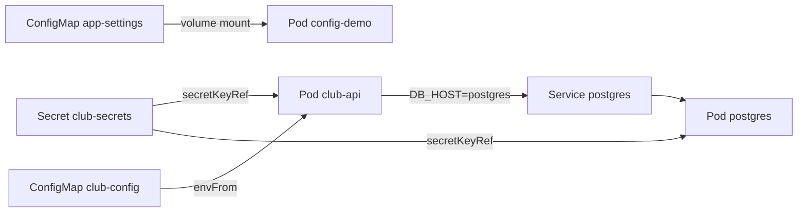

# Buổi 25 – Configuration Management

Tuần 13/16 · Giai đoạn 4 – Kubernetes Engineering · Buổi 25/32

[Slide](../../slides/06-kubectl/session-25.md) · [Bài tập tuần](../../assignments/weekly/week-13.md) · [Hub tuần](README.md)

> **Tóm tắt:** Tách cấu hình khỏi image bằng ConfigMap và Secret, nạp vào Pod qua biến môi trường hoặc file mount, và biết khi nào Pod thấy giá trị mới.

::: tip Buổi này bạn làm gì
- **Bạn sẽ tạo ra:** một ConfigMap và một Secret để `club-api` kết nối PostgreSQL mà không có mật khẩu nào nằm trong image, rồi tự đổi cấu hình và làm sai cấu hình để xem Pod phản ứng ra sao.
- **Thời gian thật:** đọc 15 phút, lab bắt buộc 60 phút, thử thách tùy chọn làm ở nhà.
- **Cần chuẩn bị:**
  - [ ] Cluster kind `club` đang chạy, `kubectl config current-context` in `kind-club`; `club-api` và `postgres` chạy ở namespace `club` (từ [Buổi 24 – Kubernetes Services](../week-12/session-24.md)).
  - [ ] Image `club-api:1.0.0`, `club-web:1.0.0` đã nạp vào kind; môi trường cài theo [Hướng dẫn cài đặt](../../resources/setup-guide.md).
  - [ ] Repo giáo trình ở `~/devops-course` và repo `devops-labs` (public) theo [Tài khoản GitHub và repo devops-labs](../../resources/setup-github.md).
- **Phải nộp:** `README.md` (7 câu của mẫu, ghi L1 hay L2); `source/` có `config-demo.yaml` và các manifest bạn dùng; `evidence/command-output.txt` (lệnh và kết quả thật); `report.md` về env so với file mount và về lỗi `DB_HOST` sai.
- **Đi nhanh:** Đọc > [Làm lab](#hands-on-lab) > [Gặp lỗi?](#gap-loi) > [Tự kiểm tra](#tu-kiem-tra) > [Nộp bài](#nop-bai). Kẹt? Nhảy tới [Gặp lỗi?](#gap-loi).

**Từ mới trong buổi** (xem [Thuật ngữ](../../resources/glossary.md)):
- [ConfigMap](../../resources/glossary.md): đối tượng chứa cấu hình không nhạy cảm như host, port, tên database.
- [Secret](../../resources/glossary.md): đối tượng chứa dữ liệu nhạy cảm như mật khẩu, token.
- [base64](../../resources/glossary.md): cách viết lại dữ liệu bằng ký tự thường, ai cũng giải ngược được, không phải mã hóa bảo mật.
- [biến môi trường](../../resources/glossary.md): cặp tên và giá trị được đưa vào tiến trình lúc nó khởi động.
- [volume mount](../../resources/glossary.md): gắn dữ liệu vào container thành thư mục hoặc file.
- [rollout](../../resources/glossary.md): quá trình Deployment thay Pod cũ bằng Pod mới.
:::

## Vấn đề thực tế

CLB có ba môi trường: máy của từng thành viên, máy demo của mentor và (sau này) một cụm dùng chung. Mỗi nơi dùng một mật khẩu và một địa chỉ database khác nhau. Nếu `DB_HOST` và `DB_PASSWORD` được viết cứng vào image, bạn phải build lại image cho mỗi môi trường, và tệ hơn, mật khẩu nằm trong các layer của image, ai pull được image là đọc được.

Nguyên tắc của The Twelve-Factor App là cùng một image, nhiều cấu hình. Kubernetes có hai đối tượng cho việc này: ConfigMap cho cấu hình thường, Secret cho dữ liệu nhạy cảm. Hôm nay bạn gỡ cấu hình khỏi `club-api`, cho nó đọc từ ConfigMap và Secret, rồi cố tình làm hỏng cấu hình để biết triệu chứng trông thế nào.

## Khái niệm cốt lõi {#khai-niem}

**ConfigMap.** Một "tờ giấy ghi chú" chứa các cặp tên và giá trị không nhạy cảm, được nạp vào Pod khi Pod chạy. Ví von: như bảng thông báo dán ở cửa phòng CLB, ai vào cũng đọc được. Giá trị luôn là chuỗi, nên `DB_PORT: "5432"` phải có nháy.

**Secret.** Giống ConfigMap nhưng dành cho mật khẩu và token: `describe` không in giá trị, có thể phân quyền riêng và bật mã hóa khi lưu. Ví von: như ngăn tủ có khóa. Nhưng giá trị trong Secret chỉ là base64, ai có quyền `get secret` đều giải ngược được bằng một lệnh, nên Secret thật không bao giờ được commit lên Git.

**Ba cách đưa cấu hình vào container.** `env` chọn từng key, `envFrom` nạp cả bộ key thành biến môi trường, volume mount biến mỗi key thành một file. Ví von: nhét tờ giấy vào túi áo lúc ra khỏi nhà (env) so với dán tờ giấy lên tường để nhìn lại bất cứ lúc nào (file).

**Khi cấu hình đổi, Pod thấy khi nào.** Biến môi trường được chốt lúc container khởi động, nên đổi ConfigMap xong phải `kubectl rollout restart` mới có giá trị mới. File mount được kubelet đồng bộ lại sau khoảng vài chục giây đến vài phút, trừ khi mount bằng `subPath`. Ví von: tờ giấy trong túi áo không tự đổi chữ, còn tờ dán tường thì có người thay.



::: details Tìm hiểu thêm (đọc sau)
Bảng so sánh ConfigMap và Secret, cấu hình đầy đủ của `club-api`, năm bước kubelet nạp cấu hình và hai ngoại lệ (`subPath`, `immutable`) nằm ở [Buổi 25 – Thử thách nâng cao](session-25-challenge.md#tim-hieu-them). Tóm tắt: Secret mặc định chưa mã hóa trong etcd; thiếu ConfigMap hoặc Secret thì Pod dừng ở `CreateContainerConfigError`; ứng dụng Node.js đọc `process.env` một lần lúc khởi động.
:::

## Hands-on lab (60 phút, bắt buộc) {#hands-on-lab}

Trên lớp, mentor demo trước; tự học thì làm thẳng phần này. Phần 1–3 và 5 làm trên namespace `club` (giữ nguyên `club-api` và `postgres` cho các buổi sau). Phần 4 làm ở namespace riêng `lab25` để thử nghiệm không đụng tới trạng thái của bạn.

### Chuẩn bị (5 phút)

```bash
kubectl config current-context
kubectl -n club get pods
docker image ls | grep -E "club-(api|web)"
mkdir -p ~/devops-labs/lab-25/{source,screenshots,evidence}
cd ~/devops-labs/lab-25
cp -r ~/devops-course/starter-project/k8s source/
```

Kết quả mong đợi: `kind-club`; Pod `club-api` và `postgres` ở trạng thái `Running`; hai image `1.0.0`. Thiếu cluster hoặc image: xem [Gặp lỗi?](#gap-loi). Để ghi lệnh và kết quả, chạy `script -a ~/devops-labs/lab-25/evidence/command-output.txt` ở đầu buổi và gõ `exit` khi xong (terminal port-forward không cần ghi).

### Phần 1 – ConfigMap bằng manifest (5 phút)

```bash
kubectl apply -f source/k8s/namespace.yaml
kubectl apply -f source/k8s/configmap.yaml
kubectl get configmap club-config -n club -o yaml
```

Kết quả mong đợi (rút gọn; nếu `club` có từ trước thì dòng đầu là `unchanged`):

```text
configmap/club-config created
data:
  DB_HOST: postgres
  DB_NAME: clubdb
  DB_PORT: "5432"
  DB_USER: club
```

Vì sao: cấu hình không nhạy cảm được lưu thành YAML trong Git, nên mọi thay đổi có lịch sử và review được. Không có `DB_PASSWORD` ở đây vì mật khẩu thuộc Secret.

::: tip Kiểm tra: bạn đúng khi
`club-config` có bốn key và `DB_PORT` nằm trong dấu nháy.
:::

### Phần 2 – Secret tạo bằng lệnh (7 phút)

Secret `club-secrets` có thể đã được tạo từ [Buổi 22 – Pods & Deployments](../week-11/session-22.md). Mật khẩu PostgreSQL chỉ được đọc lần đầu khi khởi tạo dữ liệu, nên nếu Secret đã có thì giữ nguyên, đừng tạo lại. Nếu lệnh đầu báo `NotFound`, tạo mới bằng mật khẩu cục bộ của riêng bạn (không dùng mật khẩu thật của dịch vụ nào khác):

```bash
kubectl get secret club-secrets -n club
read -r -s -p "Mat khau DB local: " DB_PASS; echo
kubectl create secret generic club-secrets -n club --from-literal=db-password="$DB_PASS"
```

Rồi giải mã để tự chứng minh base64 không phải bảo mật:

```bash
kubectl describe secret club-secrets -n club
kubectl get secret club-secrets -n club -o jsonpath='{.data.db-password}' | base64 -d; echo
```

Kết quả mong đợi: `describe` chỉ có dòng `db-password:  N bytes`; lệnh sau in đúng mật khẩu bạn đã đặt. Vì sao: `kubectl create secret` tự base64 giá trị và giá trị không nằm trong file nào để lỡ tay commit, nhưng ai có quyền `get secret` đều giải mã được. Nếu đang ghi bằng `script`, mật khẩu giải mã sẽ nằm trong evidence: dùng mật khẩu tạm chỉ cho lab hoặc che giá trị trước khi nộp. File `starter-project/k8s/secret.example.yaml` chỉ chứa giá trị giả `change-me-locally`; file thật không bao giờ được commit.

::: tip Kiểm tra: bạn đúng khi
`describe secret` chỉ hiện số byte, còn `base64 -d` in ra đúng mật khẩu của bạn.
:::

### Phần 3 – Chạy PostgreSQL và API bằng cấu hình đã tách (12 phút)

```bash
kubectl apply -f source/k8s/postgres.yaml
kubectl rollout status statefulset/postgres -n club --timeout=120s
kubectl apply -f source/k8s/backend.yaml
kubectl rollout status deployment/club-api -n club --timeout=120s
kubectl exec -n club deploy/club-api -- printenv DB_HOST DB_PORT DB_NAME DB_USER
kubectl exec -n club deploy/club-api -- sh -c 'test -n "$DB_PASSWORD" && echo co-gia-tri'
```

Kết quả mong đợi (rút gọn): `deployment "club-api" successfully rolled out`, rồi `postgres`, `5432`, `clubdb`, `club`, `co-gia-tri`. Nếu `rollout status` quá thời gian, chạy `kubectl get pods -n club` rồi xem [Gặp lỗi?](#gap-loi). Vì sao: `envFrom` nạp mọi key của ConfigMap thành biến môi trường; đừng in `DB_PASSWORD` ra màn hình hay log, chỉ kiểm tra nó tồn tại. Giờ chứng minh API nối được database. Mở terminal thứ hai cho port-forward:

```bash
kubectl port-forward -n club svc/backend 13000:3000
```

Ở terminal chính:

```bash
curl -s localhost:13000/ready; echo
curl -s localhost:13000/api/members; echo
```

Kết quả mong đợi: `{"status":"ready"}` rồi danh sách thành viên (Alice, Bob nếu bạn đã nạp `init.sql` ở buổi 22; `[]` nếu bảng còn trống, vẫn là bình thường). Vì sao: `/ready` chạy `SELECT 1`, nên `ready` chứng minh cả bốn biến trong ConfigMap lẫn mật khẩu trong Secret đều đúng.

::: tip Kiểm tra: bạn đúng khi
Hai Pod `club-api` đều `1/1 Running` và `/ready` trả `ready`. Lỗi mật khẩu hoặc `CreateContainerConfigError`: xem [Gặp lỗi?](#gap-loi).
:::

### Phần 4 – File mount và hành vi cập nhật (15 phút)

Phần này dùng namespace thử nghiệm `lab25`, tách khỏi `club`.

```bash
kubectl create namespace lab25
kubectl create configmap app-settings -n lab25 \
  --from-literal=club-name="HCMUTE DSC" --from-literal=log-level=info
cat > source/config-demo.yaml <<'YAML'
apiVersion: v1
kind: Pod
metadata:
  name: config-demo
  namespace: lab25
spec:
  containers:
    - name: demo
      image: busybox:1.36
      command: ["sh", "-c", "sleep 3600"]
      env:
        - name: LOG_LEVEL
          valueFrom:
            configMapKeyRef:
              name: app-settings
              key: log-level
      volumeMounts:
        - name: settings
          mountPath: /etc/club
          readOnly: true
  volumes:
    - name: settings
      configMap:
        name: app-settings
YAML
kubectl apply -f source/config-demo.yaml
kubectl wait --for=condition=Ready pod/config-demo -n lab25 --timeout=60s
kubectl exec -n lab25 config-demo -- ls /etc/club
kubectl exec -n lab25 config-demo -- printenv LOG_LEVEL
```

Kết quả mong đợi: hai file `club-name` và `log-level`, rồi `info`. Mỗi key trở thành một file có tên là key. Giờ đổi ConfigMap; hãy ghi dự đoán vào `report.md` trước khi chạy: file đổi hay biến đổi?

```bash
kubectl patch configmap app-settings -n lab25 --type merge -p '{"data":{"log-level":"debug"}}'
kubectl exec -n lab25 config-demo -- printenv LOG_LEVEL
for i in $(seq 1 12); do
  echo "lan $i: $(kubectl exec -n lab25 config-demo -- cat /etc/club/log-level)"
  sleep 10
done
```

Kết quả mong đợi (rút gọn): `printenv` vẫn in `info`; vòng lặp in `info` vài lần đầu rồi chuyển sang `debug` (ví dụ từ lần 6). File đổi sau khoảng 10 giây đến vài phút, hãy ghi số giây của bạn vào report. Cuối cùng, tạo lại Pod để biến nhận giá trị mới:

```bash
kubectl delete pod config-demo -n lab25
kubectl apply -f source/config-demo.yaml
kubectl wait --for=condition=Ready pod/config-demo -n lab25 --timeout=60s
kubectl exec -n lab25 config-demo -- printenv LOG_LEVEL
```

Kết quả: `debug`. Với Deployment, bạn dùng `kubectl rollout restart deployment/TEN` thay cho việc xóa Pod (bài thêm ở [Buổi 25 – Thử thách nâng cao](session-25-challenge.md#rollout-restart)).

::: tip Kiểm tra: bạn đúng khi
Ngay sau `patch`, `printenv` vẫn in `info` còn file đổi sang `debug` sau một lúc; sau khi tạo lại Pod, `printenv` in `debug`. File không đổi sau 3 phút: xem [Gặp lỗi?](#gap-loi).
:::

### Phần 5 – Làm sai cấu hình và chẩn đoán (12 phút)

Tình huống: ai đó sửa nhầm `DB_HOST` trong ConfigMap rồi rollout ra cụm. Hãy chọn một tên sai của riêng bạn thay cho `postgres-db` (mọi tên không phải Service thật đều cho cùng triệu chứng).

```bash
kubectl patch configmap club-config -n club --type merge -p '{"data":{"DB_HOST":"postgres-db"}}'
kubectl rollout restart deployment/club-api -n club
kubectl get pods -n club -l app=club-api -w
```

Nhấn `Ctrl+C` sau khoảng 40 giây: Pod mới `Running` nhưng `0/1`, các Pod cũ vẫn `1/1`. Điều tra theo năm bước, ghi output từng bước vào evidence (thay `TEN_POD_MOI` bằng tên Pod `0/1`):

```bash
kubectl get pods -n club -l app=club-api
kubectl describe pod TEN_POD_MOI -n club
kubectl exec -n club TEN_POD_MOI -- wget -qO- http://127.0.0.1:3000/api/members
kubectl logs TEN_POD_MOI -n club
kubectl exec -n club TEN_POD_MOI -- printenv DB_HOST
kubectl get configmap club-config -n club -o yaml
```

Kết quả mong đợi: Events có `Readiness probe failed: HTTP probe failed with statuscode: 503`; `logs` có dòng `getaddrinfo ENOTFOUND postgres-db` (trước khi gọi `/api/members` log chỉ có `API listening on port 3000`, vì handler `/ready` nuốt lỗi, nên log "sạch" không có nghĩa app khỏe); `printenv` và ConfigMap cho thấy giá trị sai ngay ở nguồn. Nguyên nhân gốc: tên Service sai nên Pod mới không phân giải được DNS, `SELECT 1` thất bại và `/ready` trả 503. Hai Pod cũ vẫn phục vụ vì rolling update không tắt Pod cũ khi Pod mới chưa Ready. Khôi phục và xác nhận:

```bash
kubectl patch configmap club-config -n club --type merge -p '{"data":{"DB_HOST":"postgres"}}'
kubectl rollout restart deployment/club-api -n club
kubectl rollout status deployment/club-api -n club --timeout=120s
curl -s localhost:13000/ready; echo
```

Nếu `port-forward` đã dừng khi Pod bị thay, chạy lại lệnh ở Phần 3 trước khi `curl`. Cách phòng tránh: review thay đổi ConfigMap qua Pull Request, luôn có readiness probe phản ánh phụ thuộc thật, theo dõi `rollout status` sau mỗi lần đổi cấu hình.

::: tip Kiểm tra: bạn đúng khi
Sau khôi phục, `rollout status` báo `successfully rolled out`, hai Pod `club-api` `1/1`, `/ready` trả `ready` và ConfigMap có `DB_HOST: postgres`.
:::

### Dọn dẹp và checklist L1

::: danger Chỉ xóa namespace thực hành
Lệnh dưới xóa mọi tài nguyên trong namespace `lab25`. Đọc lại tên trước khi chạy và không bao giờ thay bằng `club`: namespace `club` đang chứa `club-api`, `postgres` và dữ liệu cho các buổi sau.
:::

```bash
kubectl delete namespace lab25
```

- [ ] ConfigMap `club-config` có `DB_HOST: postgres`; Secret `club-secrets` có sẵn, không có file chứa mật khẩu thật trong thư mục nộp bài.
- [ ] Hai Pod `club-api` `1/1 Running` và `curl localhost:13000/ready` trả `ready`.
- [ ] Giải mã được `db-password` bằng `base64 -d` và viết một câu giải thích vì sao điều đó nguy hiểm.
- [ ] Chứng minh bằng lệnh: sau khi sửa ConfigMap, file mount đổi còn biến môi trường không đổi.
- [ ] Đã chẩn đoán `DB_HOST` sai theo năm bước và khôi phục.

Tự kiểm tra một dòng: `kubectl -n club get cm club-config -o jsonpath='{.data.DB_HOST}{"\n"}'; kubectl -n club get deploy club-api` phải in `postgres` và `2/2` Ready.

## Gặp lỗi? {#gap-loi}

| Triệu chứng | Nguyên nhân | Cách sửa |
| --- | --- | --- |
| `kubectl config current-context` không in `kind-club`, hoặc `connection refused` | Cluster chưa chạy hoặc kubectl đang trỏ cluster khác | Bật Docker Desktop; `kubectl config use-context kind-club`; chưa có cluster thì xem [Buổi 21 – Kubernetes Introduction](../week-11/session-21.md) |
| Pod `ErrImageNeverPull` hoặc `ImagePullBackOff` | Image `club-api:1.0.0` chưa nạp vào kind | `kind load docker-image club-api:1.0.0 club-web:1.0.0 --name club` |
| Pod ở `CreateContainerConfigError`, Events ghi `secret "club-secrets" not found` | Chưa tạo Secret, hoặc tạo sai namespace | `kubectl get secret -n club`; tạo lại đúng namespace, Pod tự khởi động lại |
| Events ghi `couldn't find key db-password in Secret` | Tên key trong Secret khác tên key trong `secretKeyRef` | `kubectl describe secret`; tạo lại với `--from-literal=db-password=...` |
| API báo `password authentication failed for user "club"` | Mật khẩu trong Secret khác mật khẩu đã khởi tạo trong PVC của PostgreSQL | Dùng lại đúng mật khẩu đã đặt từ đầu; chỉ khi cả cụm là của bạn và bạn chấp nhận mất dữ liệu mới xóa PVC `postgres` để khởi tạo lại |
| Đăng nhập lỗi dù mật khẩu đúng | Tạo Secret bằng `echo` có dấu xuống dòng thừa | Dùng `--from-literal` hoặc `echo -n` |
| `apply` lỗi `cannot unmarshal number into Go struct field ConfigMap.data of type string` | Giá trị số trong ConfigMap chưa đặt nháy | Viết `"5432"` |
| Đổi ConfigMap nhưng ứng dụng vẫn dùng giá trị cũ | Biến môi trường chỉ đọc lúc container start | `kubectl rollout restart deployment/TEN` |
| File mount không bao giờ cập nhật | Mount có `subPath`, hoặc ConfigMap đánh dấu `immutable` | Mount cả thư mục, hoặc tạo ConfigMap mới và đổi tên tham chiếu |
| Pod mới `Running` nhưng `0/1`, Pod cũ vẫn `1/1` (Phần 5) | `DB_HOST` sai nên `/ready` trả 503 | `describe pod` đọc Events, `exec printenv DB_HOST`, sửa ConfigMap rồi `rollout restart` |
| `curl localhost:13000` báo `Connection refused` | `port-forward` đã dừng khi Pod bị thay | Chạy lại `kubectl port-forward -n club svc/backend 13000:3000` |
| Mật khẩu xuất hiện trong lịch sử Git | Commit manifest Secret chứa giá trị thật | Đổi mật khẩu ngay, xóa khỏi lịch sử, chỉ commit `secret.example.yaml` |

## Tự kiểm tra {#tu-kiem-tra}

1. Vì sao không nên viết `DB_PASSWORD` trực tiếp trong Dockerfile hoặc trong code?
2. Base64 trong Secret có phải mã hóa không? Nêu một lệnh chứng minh.
3. Bạn sửa ConfigMap `club-config` mà `kubectl exec ... printenv DB_HOST` vẫn thấy giá trị cũ. Nguyên nhân và cách xử lý? File mount thì khác thế nào?
4. Sau `rollout restart`, Pod mới `Running` nhưng `0/1`, Pod cũ vẫn `1/1`. Bạn điều tra theo thứ tự nào?
5. Bạn lỡ commit manifest Secret thật lên GitHub công khai. Xóa file ở commit sau có đủ không?

::: details Đáp án gợi ý
1. Giá trị nằm trong layer của image, ai pull được image đều đọc được, và phải build lại image mỗi khi đổi cấu hình.
2. Không, đó chỉ là encoding. Ví dụ `kubectl get secret club-secrets -n club -o jsonpath='{.data.db-password}' | base64 -d`.
3. Biến môi trường chỉ được chốt khi container khởi động; chạy `kubectl rollout restart deployment/club-api -n club`. File mount được kubelet đồng bộ (trừ khi dùng `subPath`) nhưng ứng dụng vẫn phải đọc lại file.
4. `describe pod` xem Events và readiness; `logs` hoặc `exec wget` xem lỗi ứng dụng; `exec printenv` kiểm tra biến; đối chiếu với ConfigMap hoặc Secret nguồn.
5. Không. Lịch sử Git vẫn còn bản cũ. Phải coi mật khẩu đã lộ, đổi ngay, rồi mới dọn lịch sử.
:::

## Nộp bài {#nop-bai}

Nộp vào thư mục `lab-25/` trong repo `devops-labs`, theo [mẫu lab](../../templates/lab-template.md) và [Bài tập tuần 13](../../assignments/weekly/week-13.md):

- [ ] `README.md` trả lời đủ 7 câu của mẫu (bài lab giải quyết vấn đề gì, kiến thức đã dùng, các bước, kết quả mong đợi, lỗi đã gặp, cách khắc phục, có thể cải thiện gì); cuối file ghi rõ đã làm L1 hay L2.
- [ ] `evidence/command-output.txt` chứa lệnh và kết quả của Phần 1–5 (gồm `describe secret`, kết quả `base64 -d` đã che nếu là mật khẩu quan trọng, `printenv`, vòng lặp quan sát file mount, năm bước điều tra `DB_HOST`, `rollout status`).
- [ ] `report.md` giải thích bằng lời của bạn: dự đoán và kết quả thật về env so với file mount, vì sao base64 không phải bảo mật, và phân tích lỗi `DB_HOST`.
- [ ] `source/` chứa `config-demo.yaml` và các manifest thử thách L2 nếu có; `screenshots/` có ít nhất một ảnh `kubectl get pods -n club` khỏe mạnh.
- [ ] Không có mật khẩu, token hoặc file Secret thật trong repo; kiểm tra bằng `git grep -n -i -E "stringData|kind: Secret"` và đọc `git diff --cached` trước khi push (chỉ cho phép giá trị giả như `change-me-locally`).

## Recap

- Cùng một image, nhiều cấu hình: ConfigMap cho dữ liệu thường, Secret cho dữ liệu nhạy cảm; base64 không phải bảo mật nên không commit Secret thật.
- Biến môi trường chốt lúc container khởi động (cần `rollout restart`); file mount được kubelet đồng bộ nhưng `subPath` thì không.
- Cấu hình sai giá trị lộ ra qua readiness và Events chứ không qua log: dùng `describe`, `exec printenv`, rồi đối chiếu ConfigMap nguồn.

Buổi tiếp theo: [Buổi 26 – Resource & Health](session-26.md).

::: details Thử thách thêm (L2, tùy chọn, làm ở nhà)
Hai thử thách: mount một file cấu hình bằng `subPath` mà không che các file khác, và mount Secret thành volume với quyền `0400`. Gợi ý từng bậc và tiêu chí hoàn thành nằm ở [Buổi 25 – Thử thách nâng cao](session-25-challenge.md). Hãy tự thử 15 phút trước khi mở gợi ý; lời giải đối chiếu ở [trang tuần 13](README.md), chỉ mở sau khi nộp bài.
:::

::: details Phá lỗi nâng cao
Tạo một Pod tham chiếu Secret không tồn tại trong namespace `lab25` rồi quan sát `CreateContainerConfigError` bằng `kubectl describe pod`; sau đó tạo Secret đúng tên và xem Pod tự khởi động. Các tình huống liên quan nằm ở `examples/troubleshooting/` (scenario-03 về API không kết nối được DB, scenario-10 về readiness probe). Chi tiết ở [Buổi 25 – Thử thách nâng cao](session-25-challenge.md#pha-loi-nang-cao).
:::

::: details Tài liệu tham khảo
- [ConfigMaps – Kubernetes](https://kubernetes.io/docs/concepts/configuration/configmap/)
- [Secrets – Kubernetes](https://kubernetes.io/docs/concepts/configuration/secret/)
- [Configure a Pod to Use a ConfigMap](https://kubernetes.io/docs/tasks/configure-pod-container/configure-pod-configmap/)
- [Good practices for Kubernetes Secrets](https://kubernetes.io/docs/concepts/security/secrets-good-practices/)
- [The Twelve-Factor App – Config](https://12factor.net/config)
- Ví dụ đi kèm: `examples/kubernetes/04-configmap-secret.yaml`.
:::
