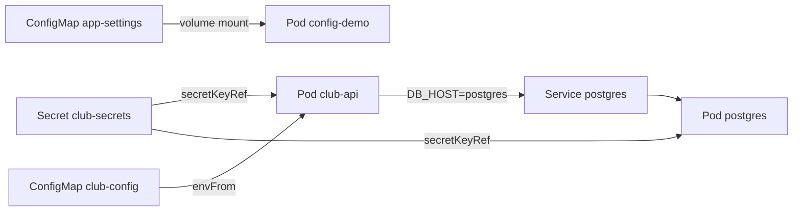

# Buổi 25 – Configuration Management

Tuần 13 · Giai đoạn 4 – Kubernetes Engineering · Slide: [Slide buổi 25](../../slides/06-kubectl/session-25.md)

> **Tóm tắt:** Tách cấu hình khỏi image bằng ConfigMap và Secret, nạp qua biến môi trường hoặc file mount, và hiểu khi nào Pod thấy giá trị mới.

## Mục tiêu học tập

- Giải thích vì sao cấu hình phải nằm ngoài image và phân biệt dữ liệu nên đặt trong ConfigMap hay Secret.
- Tạo được ConfigMap và Secret bằng cả lệnh `kubectl create` lẫn manifest YAML, rồi kiểm tra nội dung bằng `kubectl get` và `kubectl describe`.
- Nạp cấu hình vào Pod bằng `env`, `envFrom` và volume mount, đồng thời chạy được API `club-api` kết nối PostgreSQL bằng cấu hình đó.
- Chứng minh bằng lệnh rằng base64 trong Secret chỉ là mã hóa dạng ký tự (encoding), không phải mã hóa bảo mật (encryption).
- Dự đoán và quan sát được hành vi cập nhật: biến môi trường cần restart Pod, file mount được kubelet đồng bộ, `subPath` thì không.
- Chẩn đoán được lỗi do cấu hình sai (sai `DB_HOST`, thiếu key, thiếu Secret) từ `describe`, `logs` và trạng thái readiness.

## Điều kiện cần

- Đã hoàn thành buổi 22–24: biết `Deployment`, `Service`, `kubectl apply`, `kubectl get`, `kubectl logs`, `kubectl port-forward`.
- Có cluster kind đang chạy (tạo ở buổi 21) và image `club-api:1.0.0`, `club-web:1.0.0` đã build.
- Làm việc trong filesystem của WSL2 (ví dụ `~/devops-labs`), không dùng `/mnt/c`.

Kiểm tra nhanh:

```bash
kubectl config current-context
kubectl get nodes
docker image ls | grep -E "club-(api|web)"
```

Kết quả mong đợi (rút gọn):

```text
kind-kind
NAME                 STATUS   ROLES           AGE   VERSION
kind-control-plane   Ready    control-plane   6d    v1.31.0
club-api    1.0.0   3f2a9c1d5e7b   2 days ago   180MB
club-web    1.0.0   8b1d4e6a2c90   2 days ago   48MB
```

Nếu bạn tạo cluster bằng `kind create cluster` (không có `--name`) thì tên mặc định là `kind` (context `kind-kind`, node `kind-control-plane`). Tên cluster, dung lượng image và phiên bản của bạn có thể khác. Nếu thiếu image, build lại theo `starter-project/` ở mục Chuẩn bị bên dưới.

## Vấn đề thực tế

CLB có ba môi trường: máy của từng thành viên, máy demo của mentor và (sau này) một cụm dùng chung. Mỗi nơi dùng một mật khẩu database và một địa chỉ database khác nhau. Nếu `DB_HOST` và `DB_PASSWORD` được viết cứng vào image, bạn phải build lại image cho mỗi môi trường, và tệ hơn, mật khẩu nằm trong các layer của image, ai pull được image là đọc được.

Nguyên tắc của The Twelve-Factor App: cùng một image, nhiều cấu hình. Kubernetes cung cấp hai đối tượng để làm việc này. ConfigMap chứa cấu hình không nhạy cảm (host, port, tên database, log level). Secret chứa dữ liệu nhạy cảm (mật khẩu, token). Hôm nay bạn sẽ gỡ toàn bộ cấu hình khỏi `club-api`, cho nó đọc từ ConfigMap và Secret, rồi cố tình làm hỏng cấu hình để xem triệu chứng trông thế nào.

## Khái niệm cốt lõi

### ConfigMap và Secret

| Tiêu chí | ConfigMap | Secret |
| --- | --- | --- |
| Dùng cho | Cấu hình không nhạy cảm | Mật khẩu, token, khóa |
| Dữ liệu lưu | Chuỗi UTF-8 trong `data` (hoặc nhị phân trong `binaryData`) | Giá trị base64 trong `data`; `stringData` cho phép viết chuỗi thường |
| Giới hạn kích thước | 1 MiB | 1 MiB |
| Hiển thị khi `kubectl describe` | Hiện giá trị | Chỉ hiện tên key và số byte |
| Mã hóa trong etcd | Không | Mặc định không (cần bật encryption at rest) |
| Mount thành volume | Lưu trên đĩa của node | Lưu trên tmpfs (RAM) của node |

Điểm quan trọng nhất: base64 không phải bảo mật. Ai có quyền `get secret` đều giải mã được bằng một lệnh. Secret chỉ tốt hơn ConfigMap ở chỗ có thể phân quyền RBAC riêng, không in giá trị ra `describe`, và có thể bật mã hóa khi lưu trong etcd. Vì vậy không bao giờ commit manifest Secret chứa giá trị thật lên Git.

### Ba cách đưa cấu hình vào container

| Cách | Cú pháp rút gọn | Khi nào dùng | Cập nhật khi ConfigMap đổi |
| --- | --- | --- | --- |
| Một biến | `env` + `valueFrom.configMapKeyRef` hoặc `secretKeyRef` | Chọn từng key, đổi tên biến | Không, cần restart Pod |
| Cả bộ key | `envFrom` + `configMapRef` | Nhiều biến cùng nhóm (như `DB_*`) | Không, cần restart Pod |
| File mount | `volumes.configMap` + `volumeMounts` | File cấu hình (nginx.conf, app.properties) | Có, kubelet đồng bộ sau tối đa khoảng 1–2 phút |

Hai ngoại lệ cần nhớ: volume mount dùng `subPath` không bao giờ được cập nhật tự động, và ConfigMap/Secret đánh dấu `immutable: true` không thể sửa (phải tạo bản mới và đổi tên tham chiếu). Biến môi trường được chốt tại thời điểm container khởi động, nên đổi ConfigMap xong phải chạy `kubectl rollout restart` thì Pod mới thấy giá trị mới.

### Cấu hình của starter-project

`club-api` đọc cấu hình từ `process.env` trong `starter-project/backend/db.js`:

| Biến | Nguồn trong Kubernetes | Giá trị |
| --- | --- | --- |
| `DB_HOST` | ConfigMap `club-config` | `postgres` (tên Service) |
| `DB_PORT` | ConfigMap `club-config` | `5432` |
| `DB_NAME` | ConfigMap `club-config` | `clubdb` |
| `DB_USER` | ConfigMap `club-config` | `club` |
| `DB_PASSWORD` | Secret `club-secrets`, key `db-password` | Bạn tự tạo, không commit |
| `PORT` | Viết thẳng trong Deployment | `3000` |

Lưu ý: giá trị trong ConfigMap luôn là chuỗi, nên `DB_PORT: "5432"` phải có dấu nháy, nếu không YAML hiểu là số và `kubectl apply` báo lỗi.

## Kiến trúc và cách hoạt động



Từng bước khi bạn chạy `kubectl apply` cho Deployment `club-api`:

1. API Server lưu ConfigMap, Secret và Deployment vào etcd. Secret nằm trong etcd dưới dạng base64 (hoặc đã mã hóa nếu admin bật).
2. Scheduler gán Pod vào node. Kubelet trên node đọc spec của Pod.
3. Với `envFrom` và `secretKeyRef`, kubelet hỏi API Server lấy giá trị rồi truyền vào container thành biến môi trường lúc tạo container. Nếu ConfigMap hoặc Secret không tồn tại, Pod dừng ở trạng thái `CreateContainerConfigError`.
4. Với volume mount, kubelet ghi các key thành file trong thư mục tạm của Pod rồi mount vào container. Định kỳ kubelet kiểm tra và cập nhật file khi nguồn thay đổi (cơ chế symlink `..data` đổi nguyên tử).
5. Ứng dụng Node.js đọc `process.env` đúng một lần khi tạo `pg.Pool`, vì vậy sau khi biến đổi bạn vẫn phải khởi động lại tiến trình.

## Demo của mentor

Mục đích: cho cả lớp thấy cùng một image chạy với cấu hình khác nhau và base64 không che giấu gì. Dùng namespace `club` và Pod busybox nhỏ để không phụ thuộc starter-project.

1. Tạo namespace và ConfigMap bằng lệnh.

```bash
kubectl create namespace club
kubectl create configmap app-settings -n club \
  --from-literal=club-name="HCMUTE DSC" \
  --from-literal=log-level=info
kubectl get configmap app-settings -n club -o yaml
```

Kết quả mong đợi (rút gọn):

```text
apiVersion: v1
data:
  club-name: HCMUTE DSC
  log-level: info
kind: ConfigMap
metadata:
  name: app-settings
  namespace: club
```

2. Tạo Secret rồi giải mã.

```bash
kubectl create secret generic demo-secret -n club --from-literal=token='demo-only-value'
kubectl get secret demo-secret -n club -o jsonpath='{.data.token}'
echo
kubectl get secret demo-secret -n club -o jsonpath='{.data.token}' | base64 -d
echo
```

Kết quả mong đợi:

```text
ZGVtby1vbmx5LXZhbHVl
demo-only-value
```

3. Chạy `kubectl describe secret demo-secret -n club` và chỉ cho lớp thấy `describe` ẩn giá trị, nhưng `get -o yaml` cộng `base64 -d` thì lộ hết.

Câu hỏi cho lớp:

- "Nếu tôi dán đoạn YAML này lên một kênh chat, ai nhìn thấy mật khẩu?" (Tất cả, vì giải mã chỉ cần một lệnh.)
- "Tôi đổi ConfigMap xong, Pod đang chạy có biết không? Biến môi trường thì sao, file mount thì sao?" Cho lớp dự đoán, rồi kiểm chứng ở Phần 4 của lab.
- "Vì sao `echo 'abc' | base64` và `echo -n 'abc' | base64` cho kết quả khác nhau?" (Dấu xuống dòng thừa bị mã hóa theo, gây lỗi mật khẩu khó thấy.)

Dọn demo trước khi vào lab: `kubectl delete secret demo-secret -n club`.

## Hands-on lab

Thời lượng 60 phút: Chuẩn bị 5', Phần 1–5 khoảng 35' (L1), L2 khoảng 20'.

### Chuẩn bị

Thư mục làm việc, nằm trong WSL2:

```bash
mkdir -p ~/devops-labs/lab-25/{source,screenshots,evidence}
cd ~/devops-labs/lab-25
cp -r <duong-dan-toi>/starter-project/k8s source/
```

Thay `<duong-dan-toi>` bằng đường dẫn tới bản sao starter-project của bạn (nhóm capstone dùng repo nhóm). Nếu chưa build image hoặc cluster mới được tạo lại:

```bash
cd <duong-dan-toi>/starter-project
docker build -t club-api:1.0.0 ./backend
docker build -t club-web:1.0.0 ./frontend
kind load docker-image club-api:1.0.0 club-web:1.0.0 --name kind
```

Từ đây ghi lại toàn bộ lệnh và kết quả vào `evidence/command-output.txt`. Cách nhanh: chạy `script -a ~/devops-labs/lab-25/evidence/command-output.txt` ở đầu buổi và gõ `exit` khi xong (chỉ ghi terminal chính, terminal port-forward không cần ghi).

Nếu namespace `club` còn tài nguyên từ buổi trước, xóa sạch để bắt đầu từ trạng thái rõ ràng (chỉ làm với cluster của bạn):

```bash
kubectl delete namespace club --ignore-not-found
```

### Phần 1 – Namespace và ConfigMap bằng manifest

Bước 1.1: Tạo namespace và ConfigMap từ manifest có sẵn.

```bash
kubectl apply -f source/k8s/namespace.yaml
kubectl apply -f source/k8s/configmap.yaml
kubectl get configmap club-config -n club -o yaml
```

Kết quả mong đợi (rút gọn):

```text
namespace/club created
configmap/club-config created
data:
  DB_HOST: postgres
  DB_NAME: clubdb
  DB_PORT: "5432"
  DB_USER: club
```

Vì sao: cấu hình không nhạy cảm nên được lưu thành YAML và commit vào Git. Mọi thay đổi cấu hình đều có lịch sử và review được.

Bước 1.2: Xem ConfigMap bằng `describe`.

```bash
kubectl describe configmap club-config -n club
```

Kết quả mong đợi: danh sách `DB_HOST`, `DB_NAME`, `DB_PORT`, `DB_USER` kèm giá trị. Ghi nhận: không có `DB_PASSWORD`, vì mật khẩu không thuộc ConfigMap.

### Phần 2 – Secret tạo bằng lệnh

Bước 2.1: Tạo Secret. Chọn một mật khẩu cục bộ của riêng bạn (không dùng mật khẩu thật của dịch vụ nào khác) và đặt vào biến shell để tránh gõ lại.

```bash
read -r -s -p "Mat khau DB local: " DB_PASS; echo
kubectl create secret generic club-secrets -n club --from-literal=db-password="$DB_PASS"
```

Kết quả mong đợi:

```text
secret/club-secrets created
```

Vì sao: tạo bằng lệnh nên giá trị không nằm trong file nào để lỡ tay commit. `read -s` không in mật khẩu lên màn hình. Lệnh `kubectl create secret` tự base64 giá trị cho bạn.

Bước 2.2: Kiểm tra `describe` và giải mã.

```bash
kubectl describe secret club-secrets -n club
kubectl get secret club-secrets -n club -o jsonpath='{.data.db-password}' | base64 -d; echo
```

Kết quả mong đợi (rút gọn):

```text
Type:  Opaque
Data
====
db-password:  N bytes
<mật khẩu bạn đã nhập>
```

Vì sao: bạn vừa tự chứng minh Secret không được mã hóa bảo mật. Nếu đang ghi bằng `script`, mật khẩu hiện ra ở đây sẽ nằm trong `evidence/command-output.txt`: hãy dùng mật khẩu tạm chỉ dành cho lab, hoặc che giá trị trước khi nộp.

Bước 2.3: Xem file ví dụ `starter-project/k8s/secret.example.yaml`. Nó chỉ chứa giá trị giả `change-me-locally` ở trường `stringData`. File thật không bao giờ được commit.

### Phần 3 – Chạy PostgreSQL và API bằng cấu hình đã tách

Bước 3.1: Triển khai PostgreSQL (dùng Secret `club-secrets`) và API.

```bash
kubectl apply -f source/k8s/postgres.yaml
kubectl rollout status statefulset/postgres -n club --timeout=120s
kubectl apply -f source/k8s/backend.yaml
kubectl rollout status deployment/club-api -n club --timeout=120s
```

Kết quả mong đợi (rút gọn):

```text
persistentvolumeclaim/postgres-pvc created
statefulset.apps/postgres created
service/postgres created
statefulset rolling update complete (thông báo chính xác tùy phiên bản kubectl)
deployment.apps/club-api created
service/backend created
deployment "club-api" successfully rolled out
```

Nếu `rollout status` quá thời gian, chạy `kubectl get pods -n club` và chuyển sang mục Phá lỗi và debug để chẩn đoán. Lưu ý quan trọng: PostgreSQL chỉ đọc `POSTGRES_PASSWORD` khi khởi tạo thư mục dữ liệu lần đầu. Nếu PVC cũ còn dữ liệu từ lần chạy trước với mật khẩu khác, API sẽ không đăng nhập được; xóa namespace (kèm PVC) rồi làm lại.

Bước 3.2: Xác nhận Pod nhận đúng biến môi trường.

```bash
kubectl get pods -n club -l app=club-api
kubectl exec -n club deploy/club-api -- printenv DB_HOST DB_PORT DB_NAME DB_USER
```

Kết quả mong đợi:

```text
NAME                        READY   STATUS    RESTARTS   AGE
club-api-6d8f7b9c5d-4xk2m   1/1     Running   0          40s
club-api-6d8f7b9c5d-qv7zt   1/1     Running   0          40s
postgres
5432
clubdb
club
```

Vì sao: `envFrom` nạp mọi key của ConfigMap thành biến môi trường. Không in `DB_PASSWORD` ra màn hình hay log; chỉ kiểm tra nó có tồn tại bằng `kubectl exec -n club deploy/club-api -- sh -c 'test -n "$DB_PASSWORD" && echo co-gia-tri'`.

Bước 3.3: Kiểm tra API thật sự kết nối được database. Mở một terminal thứ hai cho port-forward:

```bash
kubectl port-forward -n club svc/backend 13000:3000
```

Ở terminal chính:

```bash
curl -s localhost:13000/health; echo
curl -s localhost:13000/ready; echo
curl -s localhost:13000/api/members; echo
```

Kết quả mong đợi:

```text
{"status":"healthy","service":"club-api"}
{"status":"ready"}
[]
```

Vì sao: `/ready` chạy `SELECT 1` trên database, nên `ready` chứng minh cả bốn biến trong ConfigMap lẫn mật khẩu trong Secret đều đúng. Danh sách trống `[]` là bình thường vì chưa nạp dữ liệu (có thể trả thêm các dòng nếu bạn đã chạy `database/init.sql` có dữ liệu mẫu).

### Phần 4 – File mount và hành vi cập nhật

Bước 4.1: Tạo Pod `config-demo` đọc `app-settings` theo cả hai cách (biến môi trường và file).

```bash
kubectl create configmap app-settings -n club \
  --from-literal=club-name="HCMUTE DSC" \
  --from-literal=log-level=info
cat > source/config-demo.yaml <<'EOF'
apiVersion: v1
kind: Pod
metadata:
  name: config-demo
  namespace: club
spec:
  containers:
    - name: demo
      image: busybox:1.36
      command: ["sh", "-c", "sleep 3600"]
      env:
        - name: LOG_LEVEL
          valueFrom:
            configMapKeyRef:
              name: app-settings
              key: log-level
      volumeMounts:
        - name: settings
          mountPath: /etc/club
          readOnly: true
  volumes:
    - name: settings
      configMap:
        name: app-settings
EOF
kubectl apply -f source/config-demo.yaml
kubectl wait --for=condition=Ready pod/config-demo -n club --timeout=60s
```

Bước 4.2: Đọc cấu hình theo hai đường.

```bash
kubectl exec -n club config-demo -- ls /etc/club
kubectl exec -n club config-demo -- cat /etc/club/log-level; echo
kubectl exec -n club config-demo -- printenv LOG_LEVEL
```

Kết quả mong đợi:

```text
club-name
log-level
info
info
```

Vì sao: mỗi key trở thành một file có tên là key, nội dung là value.

Bước 4.3: Đổi ConfigMap rồi theo dõi. Dự đoán trước khi chạy: file đổi hay biến đổi?

```bash
kubectl patch configmap app-settings -n club --type merge -p '{"data":{"log-level":"debug"}}'
kubectl exec -n club config-demo -- printenv LOG_LEVEL
for i in $(seq 1 12); do
  echo "lan $i: $(kubectl exec -n club config-demo -- cat /etc/club/log-level)"
  sleep 10
done
```

Kết quả mong đợi (rút gọn):

```text
info
lan 1: info
lan 2: info
...
lan 6: debug
...
lan 12: debug
```

Dòng `info` đầu tiên là `printenv`; biến môi trường vẫn là `info` suốt buổi. File đổi sang `debug` sau khoảng 10 giây đến vài phút (tùy chu kỳ đồng bộ của kubelet, nên con số lần thứ 6 chỉ là ví dụ). Vì sao: kubelet đồng bộ volume định kỳ, còn biến môi trường chỉ được chốt khi container khởi động.

Bước 4.4: Áp dụng giá trị mới cho biến môi trường bằng cách tạo lại Pod.

```bash
kubectl delete pod config-demo -n club
kubectl apply -f source/config-demo.yaml
kubectl wait --for=condition=Ready pod/config-demo -n club --timeout=60s
kubectl exec -n club config-demo -- printenv LOG_LEVEL
```

Kết quả mong đợi: `debug`. Với Deployment, bạn dùng `kubectl rollout restart deployment/<ten>` thay cho việc xóa Pod.

### Phần 5 – Đổi cấu hình của club-api bằng rollout

Bước 5.1: Thêm một biến cấu hình mới vào ConfigMap `club-config` và cho Pod nhận.

```bash
kubectl patch configmap club-config -n club --type merge -p '{"data":{"LOG_LEVEL":"debug"}}'
kubectl exec -n club deploy/club-api -- printenv LOG_LEVEL
```

Kết quả mong đợi: `printenv` không in gì và `kubectl` báo `command terminated with exit code 1`, vì Pod cũ chưa được khởi động lại. (`club-api` không dùng biến `LOG_LEVEL`; ở đây chỉ dùng nó để quan sát cơ chế nạp biến.)

Bước 5.2: Rollout để Pod nhận biến mới.

```bash
kubectl rollout restart deployment/club-api -n club
kubectl rollout status deployment/club-api -n club --timeout=120s
kubectl exec -n club deploy/club-api -- printenv LOG_LEVEL
```

Kết quả mong đợi:

```text
deployment.apps/club-api restarted
deployment "club-api" successfully rolled out
debug
```

Vì sao: `rollout restart` tạo ReplicaSet mới; Pod mới chạy từng cái một nên API không bị gián đoạn (readiness chặn Pod chưa sẵn sàng nhận traffic).

### L1 – Foundation

- [ ] Namespace `club` và ConfigMap `club-config` tồn tại (`kubectl get cm -n club`).
- [ ] Secret `club-secrets` được tạo bằng lệnh, không có file chứa mật khẩu thật trong thư mục nộp bài.
- [ ] Hai Pod `club-api` ở trạng thái `1/1 Running` và `curl localhost:13000/ready` trả `ready`.
- [ ] Giải mã được `db-password` bằng `base64 -d` và viết một câu giải thích vì sao điều đó nguy hiểm.
- [ ] Chứng minh bằng lệnh: sau khi sửa ConfigMap, file mount đổi còn biến môi trường không đổi.

### L2 – Engineering

Thử thách A – Mount file cấu hình dạng file ứng dụng (khoảng 10 phút).

Tạo file `source/app.properties` với nội dung `club.name=HCMUTE DSC` và `feature.members=true`. Tạo ConfigMap `app-config` từ file đó bằng `--from-file`, mount vào Pod `config-demo2` (busybox:1.36) tại `/etc/club/app.properties` mà không che mất các file khác trong `/etc/club`. Sau đó sửa ConfigMap và đo bao lâu thì file trong Pod đổi.

Tiêu chí hoàn thành: `cat /etc/club/app.properties` trong Pod hiển thị nội dung từ ConfigMap; bạn giải thích được vì sao cần `subPath` để mount một file vào thư mục đã có file khác, và vì sao dùng `subPath` thì file không tự cập nhật.

<details>
<summary>Gợi ý</summary>

Dùng `kubectl create configmap app-config -n club --from-file=app.properties=source/app.properties`. Trong `volumeMounts` thêm `mountPath: /etc/club/app.properties` và `subPath: app.properties`. Kiểm tra kết quả bằng `kubectl exec` và so sánh với Pod ở Phần 4 (không dùng `subPath`).

</details>

<details>
<summary>Lời giải</summary>

```yaml
apiVersion: v1
kind: Pod
metadata:
  name: config-demo2
  namespace: club
spec:
  containers:
    - name: demo
      image: busybox:1.36
      command: ["sh", "-c", "sleep 3600"]
      volumeMounts:
        - name: props
          mountPath: /etc/club/app.properties
          subPath: app.properties
          readOnly: true
  volumes:
    - name: props
      configMap:
        name: app-config
```

Mount thông thường thay thế cả thư mục đích, nên cần `subPath` để chỉ chèn một file. Đổi lại, kubelet không cập nhật file mount bằng `subPath`: sau khi `patch` ConfigMap, nội dung trong Pod giữ nguyên cho tới khi tạo lại Pod. Nếu cần tự cập nhật, mount cả thư mục vào một đường dẫn riêng (ví dụ `/etc/club/conf.d`) và cho ứng dụng đọc từ đó.

</details>

Thử thách B – Secret dạng volume và quyền truy cập (khoảng 10 phút).

Mount `club-secrets` vào Pod busybox tại `/etc/secrets` với quyền `0400`. Chứng minh Pod đọc được file `db-password`, và giải thích vì sao cách mount này thường được ưu tiên hơn biến môi trường (biến môi trường dễ lọt vào log hoặc crash dump khi ứng dụng in toàn bộ `env`, được mọi tiến trình con kế thừa, và đọc được qua `/proc/PID/environ`; file mount chỉ lộ cho tiến trình có quyền đọc file).

Tiêu chí hoàn thành: `ls -lL /etc/secrets` cho thấy quyền chỉ đọc cho chủ sở hữu (`-r--------`; `-L` để theo symlink tới file thật), và bạn nêu được ít nhất hai cách thực tế để bảo vệ Secret tốt hơn base64 (RBAC chặt, encryption at rest, Sealed Secrets hoặc External Secrets).

<details>
<summary>Gợi ý</summary>

Dùng `volumes.secret` với `secretName: club-secrets` và `defaultMode: 0400`. Trong YAML, `0400` là số bát phân, nên viết `defaultMode: 0400` (không đặt trong dấu nháy). Dùng `ls -lL /etc/secrets` để theo symlink và xem quyền của file thật.

</details>

<details>
<summary>Lời giải</summary>

```yaml
apiVersion: v1
kind: Pod
metadata:
  name: secret-demo
  namespace: club
spec:
  containers:
    - name: demo
      image: busybox:1.36
      command: ["sh", "-c", "sleep 3600"]
      volumeMounts:
        - name: creds
          mountPath: /etc/secrets
          readOnly: true
  volumes:
    - name: creds
      secret:
        secretName: club-secrets
        defaultMode: 0400
```

Secret mount được lưu trên tmpfs của node nên không ghi xuống đĩa. Lưu ý container chạy bằng user khác root có thể không đọc được file `0400` thuộc root; khi đó đặt `securityContext.fsGroup` hoặc chạy cùng user. Biện pháp tốt hơn base64: giới hạn RBAC (ai được `get secrets`), bật encryption at rest cho etcd ở cụm thật, và lưu manifest Secret đã mã hóa bằng Sealed Secrets hoặc lấy từ kho bên ngoài bằng External Secrets.

</details>

Dọn dẹp Pod demo sau khi xong (giữ lại `club-api` và `postgres` cho buổi 26):

```bash
kubectl delete pod config-demo config-demo2 secret-demo -n club --ignore-not-found
kubectl delete configmap app-settings app-config -n club --ignore-not-found
```

## Phá lỗi và debug

Tình huống: ConfigMap bị sửa sai `DB_HOST`, rồi cấu hình được rollout ra cụm.

Cách phá (cố tình):

```bash
kubectl patch configmap club-config -n club --type merge -p '{"data":{"DB_HOST":"postgress"}}'
kubectl rollout restart deployment/club-api -n club
kubectl get pods -n club -l app=club-api -w
```

Nhấn `Ctrl+C` để thoát chế độ `-w` sau khoảng 40 giây.

Triệu chứng: có Pod mới ở trạng thái `Running` nhưng `READY 0/1`, trong khi hai Pod cũ vẫn `1/1`. `kubectl rollout status` đứng chờ ở dòng `1 out of 2 new replicas` (bấm `Ctrl+C` để thoát; Deployment chỉ báo quá hạn sau 600 giây mặc định). Gọi `/ready` bên trong Pod mới (bằng `kubectl exec`) trả `503`.

Hướng điều tra, từng bước:

1. `kubectl get pods -n club`: Pod mới `Running` nhưng chưa Ready nghĩa là container sống, readiness probe đang fail. Đây không phải lỗi image.
2. `kubectl describe pod <ten-pod-moi> -n club`: xem mục Events, thấy `Readiness probe failed: HTTP probe failed with statuscode: 503`.
3. `kubectl logs <ten-pod-moi> -n club`: chỉ thấy `API listening on port 3000`. Handler `/ready` của starter-project bắt lỗi và trả 503 mà không ghi log, nên log "sạch" không có nghĩa là app khỏe. Để thấy lỗi thật, chạy `kubectl exec -n club <ten-pod-moi> -- wget -qO- http://127.0.0.1:3000/api/members` (trả 500) rồi xem lại `logs`: có dòng `getaddrinfo ENOTFOUND postgress`.
4. `kubectl exec -n club <ten-pod-moi> -- printenv DB_HOST`: xác nhận biến có giá trị `postgress`.
5. `kubectl get configmap club-config -n club -o yaml`: tìm thấy lỗi gõ sai trong nguồn.

Nguyên nhân gốc: ConfigMap chứa tên Service sai, nên Pod mới không phân giải được DNS và `/ready` (chạy `SELECT 1`) trả 503. Hai Pod cũ vẫn phục vụ được vì Deployment chặn rolling update khi Pod mới chưa Ready, nên người dùng chưa thấy sự cố. Nếu không có readiness probe, Pod hỏng sẽ nhận traffic ngay.

Sửa và kiểm chứng:

```bash
kubectl patch configmap club-config -n club --type merge -p '{"data":{"DB_HOST":"postgres"}}'
kubectl rollout restart deployment/club-api -n club
kubectl rollout status deployment/club-api -n club --timeout=120s
```

Cách phòng tránh: review thay đổi ConfigMap qua Pull Request, luôn có readiness probe phản ánh phụ thuộc thật (như `/ready`), theo dõi `rollout status` sau mỗi lần đổi cấu hình, và giữ ConfigMap trong Git để `git diff` thấy ngay chỗ sai.

Thử thêm (không bắt buộc): tạo Pod tham chiếu Secret không tồn tại và quan sát `CreateContainerConfigError` với `kubectl describe pod`. Các tình huống liên quan nằm ở `examples/troubleshooting/` (scenario-03 về API không kết nối được DB, scenario-10 về readiness probe).

## Lỗi thường gặp

| Triệu chứng | Nguyên nhân | Cách xử lý |
| --- | --- | --- |
| Pod ở `CreateContainerConfigError`, Events ghi `secret "club-secrets" not found` | Chưa tạo Secret, hoặc tạo sai namespace | `kubectl get secret -n club`; tạo lại đúng namespace rồi Pod tự khởi động lại |
| Events ghi `couldn't find key db-password in Secret` | Tên key trong Secret khác tên key trong `secretKeyRef` | `kubectl describe secret`; tạo lại với `--from-literal=db-password=...` |
| Đổi ConfigMap nhưng ứng dụng vẫn dùng giá trị cũ | Biến môi trường chỉ đọc lúc container start | `kubectl rollout restart deployment/<ten>` |
| File mount không bao giờ cập nhật | Mount có `subPath`, hoặc ConfigMap đánh dấu `immutable` | Mount cả thư mục, hoặc tạo ConfigMap mới và đổi tên tham chiếu |
| API báo `password authentication failed for user "club"` | Mật khẩu trong Secret khác mật khẩu đã khởi tạo trong PVC của PostgreSQL | Xóa namespace (kèm PVC) và làm lại, hoặc đổi mật khẩu bên trong PostgreSQL |
| Đăng nhập lỗi dù mật khẩu đúng | Tạo Secret bằng `echo` có dấu xuống dòng thừa | Dùng `--from-literal` hoặc `echo -n` |
| `apply` lỗi `cannot unmarshal number into Go struct field ConfigMap.data of type string` | Giá trị số trong ConfigMap chưa đặt nháy | Viết `"5432"` |
| Mật khẩu xuất hiện trong lịch sử Git | Commit manifest Secret chứa giá trị thật | Đổi mật khẩu ngay, xóa khỏi lịch sử, chỉ commit `secret.example.yaml` |

## Tự kiểm tra

1. Vì sao không nên viết `DB_PASSWORD` trực tiếp trong Dockerfile hoặc trong code?
2. Base64 trong Secret có phải mã hóa không? Nêu một lệnh chứng minh.
3. Bạn sửa ConfigMap `club-config` và chạy `kubectl exec ... printenv DB_HOST` vẫn thấy giá trị cũ. Nguyên nhân và cách xử lý?
4. Khác biệt giữa `env`/`valueFrom`, `envFrom` và volume mount khi cấu hình thay đổi?
5. Vì sao dùng `subPath` thì file không tự cập nhật?
6. Tình huống: sau khi `rollout restart`, Pod mới `Running` nhưng `0/1`, Pod cũ vẫn `1/1`. Bạn điều tra theo thứ tự nào?
7. Tình huống: bạn lỡ commit manifest Secret thật lên GitHub công khai, chỉ cần xóa file ở commit sau là đủ không?

<details>
<summary>Đáp án</summary>

1. Giá trị nằm trong layer của image, ai pull được image đều đọc được, và phải build lại image mỗi khi đổi cấu hình.
2. Không, đó chỉ là encoding. Ví dụ `kubectl get secret club-secrets -n club -o jsonpath='{.data.db-password}' | base64 -d`.
3. Biến môi trường chỉ được chốt khi container khởi động. Chạy `kubectl rollout restart deployment/club-api -n club`.
4. `env` và `envFrom` không cập nhật nếu không restart; volume mount được kubelet đồng bộ (trừ khi dùng `subPath`), nhưng ứng dụng vẫn phải đọc lại file.
5. Kubelet cập nhật bằng cách đổi symlink `..data` của thư mục mount; `subPath` mount trực tiếp một file nên bỏ qua cơ chế này.
6. `describe pod` xem Events và readiness; `logs` xem lỗi ứng dụng; `exec printenv` kiểm tra biến; đối chiếu với ConfigMap/Secret nguồn.
7. Không. Lịch sử Git vẫn còn bản cũ. Phải coi mật khẩu đã lộ, đổi ngay, rồi mới dọn lịch sử.

</details>

## Nộp bài

Nộp vào thư mục `lab-25/` trong repository cá nhân (ví dụ `devops-labs`), theo `templates/lab-template.md`:

- [ ] `README.md` trả lời đủ 7 câu: bài lab giải quyết vấn đề gì, kiến thức đã dùng, các bước, kết quả mong đợi, lỗi đã gặp, cách khắc phục, có thể cải thiện gì; cuối file ghi rõ đã làm L1 hay L2.
- [ ] `evidence/command-output.txt` chứa lệnh và kết quả của Phần 1–5 (gồm `describe secret`, kết quả `base64 -d` đã che mật khẩu thật nếu bạn dùng mật khẩu quan trọng, `printenv`, vòng lặp quan sát file mount, `rollout status`).
- [ ] `report.md` giải thích bằng lời của bạn: khác biệt env và mounted config, vì sao base64 không phải bảo mật, và phân tích lỗi `DB_HOST` sai theo năm bước điều tra.
- [ ] `source/` chứa `configmap.yaml`, `config-demo.yaml` và các manifest thử thách L2 đã làm.
- [ ] `screenshots/` có ít nhất một ảnh `kubectl get pods -n club` ở trạng thái khỏe mạnh.
- [ ] Không có mật khẩu, token hoặc file Secret thật nào trong repository; kiểm tra bằng `git grep -n -i -E "stringData|kind: Secret"` và đọc `git diff --cached` trước khi push (chỉ cho phép giá trị giả như `change-me-locally`).

## Recap

- Cùng một image, nhiều cấu hình: ConfigMap cho dữ liệu thường, Secret cho dữ liệu nhạy cảm.
- Base64 chỉ là encoding: ai đọc được Secret đều giải mã được, nên phải kiểm soát RBAC và không commit Secret thật.
- Biến môi trường được chốt lúc container khởi động; muốn đổi cần `kubectl rollout restart`.
- Volume mount được kubelet cập nhật (có độ trễ), nhưng `subPath` thì không, và ứng dụng phải tự đọc lại file.
- Thiếu ConfigMap hoặc Secret khiến Pod dừng ở `CreateContainerConfigError`; cấu hình sai giá trị thường lộ ra qua readiness probe và log.
- Dùng `describe`, `logs`, `exec printenv` để truy ngược từ triệu chứng về cấu hình nguồn.

## Tài liệu tham khảo

- [ConfigMaps – Kubernetes](https://kubernetes.io/docs/concepts/configuration/configmap/)
- [Secrets – Kubernetes](https://kubernetes.io/docs/concepts/configuration/secret/)
- [Configure a Pod to Use a ConfigMap](https://kubernetes.io/docs/tasks/configure-pod-container/configure-pod-configmap/)
- [Good practices for Kubernetes Secrets](https://kubernetes.io/docs/concepts/security/secrets-good-practices/)
- [The Twelve-Factor App – Config](https://12factor.net/config)

Ví dụ đi kèm: `examples/kubernetes/04-configmap-secret.yaml`.
