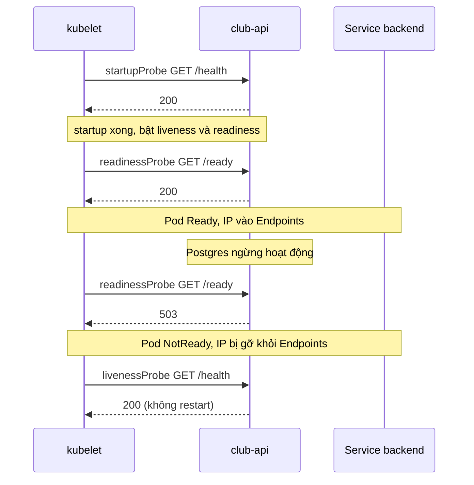

# Buổi 26 – Thử thách nâng cao

Tuần 13/16 · Giai đoạn 4 – Kubernetes Engineering · Buổi 26/32

[Bài học chính](session-26.md) · [Slide](../../slides/07-operations/session-26.md) · [Bài tập tuần](../../assignments/weekly/week-13.md) · [Hub tuần](README.md)

> **Tóm tắt:** Trang phụ của buổi 26: kiến thức tìm hiểu thêm về tài nguyên và probe, ba thử thách L2, phá lỗi nâng cao với tình huống 10 và OOMKilled. Tất cả đều tùy chọn, làm sau khi xong lab bắt buộc.

::: tip Trang này dành cho ai
Bạn đã xong checklist L1 của [Buổi 26 – Resource & Health](session-26.md) và còn thời gian. Mỗi thử thách có gợi ý theo bậc: hãy tự thử ít nhất 15 phút trước khi mở bậc 1, và thêm 15 phút nữa trước khi mở bậc 2. Lời giải đối chiếu nằm trong [Walkthrough tuần 13](../../mentors/walkthroughs/week-13.md), chỉ mở sau khi nộp bài. Mọi thử thách sửa `club-api` hoặc `postgres` đều phải khôi phục bằng `kubectl apply -f source/backend-deploy.yaml` và đưa Postgres về `--replicas=1`, nếu không buổi sau sẽ bắt đầu từ trạng thái hỏng.
:::

## Tìm hiểu thêm {#tim-hieu-them}

Requests và limits:

| | `requests` | `limits` |
| --- | --- | --- |
| Ai dùng | Scheduler | kubelet, container runtime và kernel |
| Ý nghĩa | Lượng tối thiểu được đảm bảo, dùng để chọn node | Trần tối đa container được dùng |
| Vượt thì sao | Không có khái niệm vượt | CPU: bị throttle (chậm). Memory: bị OOMKilled |
| Không đủ chỗ | Pod ở trạng thái Pending | Không liên quan tới scheduling |

Đơn vị CPU: `1` là 1 core, `500m` là 0,5 core (millicore); CPU là tài nguyên "nén được" nên vượt limit thì process bị làm chậm chứ không bị giết. Đơn vị memory: `128Mi` (mebibyte), `1Gi`; memory không nén được nên vượt limit thì kernel giết process (OOM kill), container thoát với exit code 137 và Kubernetes ghi `Reason: OOMKilled`. `128M` (10^6 byte) khác `128Mi` (2^20 byte), hãy dùng hậu tố `Mi`, `Gi` để tránh nhầm.

QoS class: khi node thiếu memory, Pod bị đuổi (evict) theo thứ tự BestEffort, rồi Burstable, rồi Guaranteed.

| QoS class | Điều kiện | Ví dụ |
| --- | --- | --- |
| Guaranteed | Mọi container có requests và limits cho cả CPU và memory, và requests bằng limits | cpu 500m/500m, memory 256Mi/256Mi |
| Burstable | Có ít nhất một request hoặc limit nhưng không đủ điều kiện Guaranteed | `club-api` hiện tại: request 100m/128Mi, limit 500m/256Mi |
| BestEffort | Không container nào khai báo requests hay limits | Pod "trần" |

Ba loại probe:

| Probe | Câu hỏi | Khi fail | Khi nào dùng |
| --- | --- | --- | --- |
| `startupProbe` | Ứng dụng đã khởi động xong chưa? | Hết `failureThreshold` thì container bị restart | App khởi động chậm; trong lúc này liveness và readiness bị tắt |
| `readinessProbe` | Có nên gửi traffic cho Pod này không? | Pod bị loại khỏi Endpoints của Service, KHÔNG restart | Kiểm tra phụ thuộc cần thiết để phục vụ request (ví dụ database) |
| `livenessProbe` | Process có bị kẹt không? | Container bị kubelet restart | Chỉ phát hiện deadlock hoặc treo, không kiểm tra phụ thuộc ngoài |

Các tham số chính của mọi probe: `initialDelaySeconds` (chờ trước lần đầu), `periodSeconds` (chu kỳ), `timeoutSeconds` (mặc định 1 giây), `failureThreshold` (số lần fail liên tiếp mới coi là fail, mặc định 3), `successThreshold` (mặc định 1). Cơ chế probe: `httpGet` (mã 200 đến 399 là thành công), `tcpSocket`, `exec` (exit code 0 là thành công). `club-api` có sẵn hai endpoint: `/health` luôn trả 200 `{"status":"healthy"}` và không chạm database (dùng cho liveness, startup); `/ready` chạy `SELECT 1` tới Postgres, lỗi thì trả 503 (dùng cho readiness). Thiết kế này là cố ý: liveness chỉ trả lời "process còn sống", readiness trả lời "phục vụ được không".

Diễn biến khi Pod khởi động và khi database sập:

1. Container start, kubelet chỉ chạy `startupProbe` cho tới khi thành công. Trong thời gian này liveness và readiness chưa chạy, nên app chậm không bị giết oan.
2. Sau khi startup thành công, readiness và liveness chạy song song theo `periodSeconds` của từng probe.
3. Readiness thành công thì Pod được đánh dấu `Ready` và IP của nó xuất hiện trong Endpoints của Service.
4. Khi database sập, `/ready` trả 503. Sau `failureThreshold` lần liên tiếp Pod chuyển `NotReady`, bị gỡ khỏi Endpoints. Traffic đi sang Pod khác, hoặc không đi đâu nếu tất cả đều NotReady.
5. Liveness vẫn gọi `/health` (200) nên container không bị restart. Khi database quay lại, readiness thành công và Pod nhận traffic trở lại mà không cần ai can thiệp.

## Thử thách L2 {#thu-thach-l2}

### Thử thách A – Guaranteed QoS (khoảng 10 phút)

Sửa `resources` trong bản `source/backend-deploy.yaml` của bạn (lưu thành `source/backend-guaranteed.yaml`) sao cho Pod có QoS `Guaranteed`, xác nhận bằng `jsonpath` trên `.status.qosClass`.

Tiêu chí hoàn thành: output `Guaranteed` cho mọi Pod `club-api`; giải thích bằng 2 đến 3 câu vì sao đây là lựa chọn tốt cho Postgres nhưng có thể tốn kém cho dịch vụ nhỏ. Khôi phục bằng `kubectl apply -f source/backend-deploy.yaml`.

::: details Gợi ý bậc 1 (chỉ mở sau 15 phút tự thử)
Điều kiện của Guaranteed áp dụng cho mọi container trong Pod (kể cả init container và sidecar), và cho cả hai tài nguyên cpu và memory. Pod đổi QoS cần được tạo lại, nên kiểm tra trên Pod mới sau `rollout status`.
:::

::: details Gợi ý bậc 2 (chỉ mở sau 15 phút nữa)
Đặt requests bằng limits cho cả cpu và memory (ví dụ cả hai là `250m` và `256Mi`). Nếu chỉ đặt limits mà bỏ requests, Kubernetes tự lấy requests bằng limits, cũng cho ra Guaranteed. Kiểm tra bằng `kubectl -n club get pods -l app=club-api -o jsonpath='{range .items[*]}{.status.qosClass}{"\n"}{end}'`.
:::

### Thử thách B – Liveness phụ thuộc database gây restart dây chuyền (khoảng 10 phút)

Đổi path của livenessProbe thành `/ready`, tắt Postgres (`kubectl -n club scale statefulset postgres --replicas=0`), quan sát cột RESTARTS tăng.

Tiêu chí hoàn thành: bằng chứng RESTARTS tăng trên cả hai Pod, Events chứa `Liveness probe failed` và `will be restarted`, và đoạn giải thích vì sao thiết kế này sai. Sau đó khôi phục cả liveness và Postgres.

::: details Gợi ý bậc 1 (chỉ mở sau 15 phút tự thử)
Dùng `kubectl patch` kiểu JSON (như Phần 4 của bài chính) nhưng trỏ tới `livenessProbe`. Với `periodSeconds: 10` và `failureThreshold: 3`, cần khoảng 30 giây liveness fail liên tiếp thì kubelet mới restart, nên đừng kết luận quá sớm.
:::

::: details Gợi ý bậc 2 (chỉ mở sau 15 phút nữa)
Quan sát bằng `kubectl -n club get pods -l app=club-api -w` ở một terminal và `kubectl -n club get events --sort-by=.lastTimestamp | tail` ở terminal khác. Khôi phục: `scale statefulset postgres --replicas=1`, rồi `kubectl apply -f source/backend-deploy.yaml`.
:::

### Thử thách C – Startup probe sai cổng (khoảng 10 phút)

`club-api` không có sẵn cơ chế khởi động chậm, nên hãy mô phỏng bằng cách đặt `startupProbe` trỏ cổng sai (3001) với `failureThreshold: 3`, `periodSeconds: 2` rồi giải thích kết quả.

Tiêu chí hoàn thành: chỉ ra Events `Startup probe failed`, container bị restart sau khoảng 6 giây và Pod không bao giờ Ready; nêu công thức thời gian tối đa startup (`failureThreshold` nhân `periodSeconds`). Khôi phục bằng `kubectl apply -f source/backend-deploy.yaml`.

::: details Gợi ý bậc 1 (chỉ mở sau 15 phút tự thử)
Cần sửa hai trường trong `startupProbe` bằng một lệnh `kubectl patch` kiểu JSON (hai phép `replace`). Rollout sẽ treo vì Pod mới không Ready, còn Pod cũ vẫn phục vụ.
:::

::: details Gợi ý bậc 2 (chỉ mở sau 15 phút nữa)
Hai đường dẫn cần thay là `/spec/template/spec/containers/0/startupProbe/httpGet/port` (giá trị 3001) và `/spec/template/spec/containers/0/startupProbe/failureThreshold` (giá trị 3). Dùng `kubectl -n club describe pod -l app=club-api | grep -i "startup probe failed"` để tìm Events.
:::

## Phá lỗi nâng cao {#pha-loi-nang-cao}

### Tình huống 10: Pod Running nhưng 0/1

Phá: mentor chạy `bash setup.sh` trong `examples/troubleshooting/scenario-10/` (dùng namespace `ts-10`, thay `-n club` bằng `-n ts-10` ở các lệnh dưới nếu làm theo kịch bản đó). Học viên chỉ nhận triệu chứng, không đọc manifest trước. Nếu không dùng kịch bản, tự tái hiện bằng Phần 4 của bài chính trong namespace `club`.

Triệu chứng: "Deploy xong, `kubectl get pods` thấy Pod `Running` nhưng READY là `0/1`, truy cập qua Service hoặc Ingress báo 503 hoặc không có backend."

Hướng điều tra theo từng bước:

1. `kubectl -n club get pods`: STATUS `Running`, READY `0/1`, RESTARTS `0`. Không restart nghĩa là không phải liveness hay crash.
2. `kubectl -n club get endpoints backend`: rỗng, xác nhận Pod bị loại vì NotReady (không phải selector sai: nếu selector sai thì Pod vẫn có thể `1/1` mà Endpoints rỗng).
3. `kubectl -n club describe pod TEN_POD`: đọc Events, tìm `Readiness probe failed` và mã lỗi (404, 503 hay `connection refused`).
4. Đối chiếu probe với ứng dụng: `kubectl -n club exec TEN_POD -- wget -qO- http://127.0.0.1:3000/ready` để xem endpoint thực trả gì, và so với `path` và `port` trong manifest.
5. Nếu trả 503: kiểm tra database (`kubectl -n club get pods -l app=postgres`, Secret `club-secrets`, `DB_HOST` trong `club-config`).

Nguyên nhân gốc thường gặp: sai `path`, sai `port`, hoặc database không kết nối được nên `/ready` trả 503. Phòng tránh: kiểm tra endpoint probe bằng `exec` hoặc `port-forward` trước khi viết vào manifest; đặt `failureThreshold` và `timeoutSeconds` hợp lý; theo dõi `rollout status` sau mỗi lần deploy.

### Container chết không để lại log lỗi

Phá: Phần 3 của bài chính (OOMKilled). Triệu chứng: Pod `OOMKilled` hoặc `CrashLoopBackOff` với RESTARTS tăng, log dừng giữa chừng. Điều tra: `describe` xem `Last State`, `Reason`, `Exit Code`; exit code 137 cộng `OOMKilled` là kết luận. Nguyên nhân gốc: memory limit nhỏ hơn nhu cầu thực (hoặc memory leak). Cách xử lý: đo mức dùng thực trong tải điển hình, đặt limit có đệm (thường 1,5 đến 2 lần mức dùng ổn định), đặt requests sát mức dùng thường, và theo dõi xu hướng để phát hiện leak thay vì chỉ tăng limit.

## Câu hỏi tình huống

1. Một ứng dụng cần 90 giây để khởi động. Bạn cấu hình probe thế nào để không bị giết oan mà vẫn phát hiện treo nhanh sau khi chạy?
2. Vì sao `kubectl get endpoints backend` rỗng có thể do readiness fail, và cũng có thể do selector sai? Làm sao phân biệt?

::: details Đáp án gợi ý
1. Dùng `startupProbe` với `failureThreshold` nhân `periodSeconds` lớn hơn 90 giây (ví dụ 30 nhân 5), còn liveness giữ chu kỳ ngắn vì nó chỉ bắt đầu sau khi startup thành công.
2. Readiness fail thì Pod `Running` nhưng `0/1`; selector sai thì Pod vẫn có thể `1/1` mà Endpoints rỗng. So `kubectl get pods --show-labels` với selector của Service để phân biệt.
:::

## Tài liệu tham khảo

- [Resource Management for Pods and Containers](https://kubernetes.io/docs/concepts/configuration/manage-resources-containers/)
- [Configure Quality of Service for Pods](https://kubernetes.io/docs/tasks/configure-pod-container/quality-service-pod/)
- [Liveness, Readiness and Startup Probes](https://kubernetes.io/docs/concepts/configuration/liveness-readiness-startup-probes/)
- [Debug Running Pods](https://kubernetes.io/docs/tasks/debug/debug-application/debug-running-pod/)
