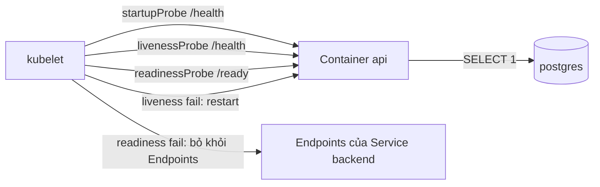
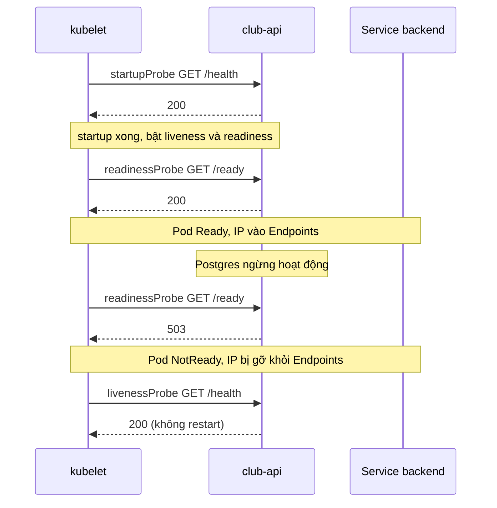

# Buổi 26 – Resource & Health

Tuần 13 · Giai đoạn 4 – Kubernetes Engineering · Slide: [Slide buổi 26](../../slides/07-operations/session-26.md)

> **Tóm tắt:** Đặt requests/limits và ba loại probe cho backend club-api, mô phỏng OOMKilled và readiness probe fail, rồi chẩn đoán bằng describe, events và logs.

## Mục tiêu học tập

- Giải thích sự khác nhau giữa `requests` (dùng để scheduler xếp Pod) và `limits` (kubelet và kernel cưỡng chế lúc chạy) cho CPU và memory.
- Phân loại được QoS class (Guaranteed, Burstable, BestEffort) của một Pod từ manifest và xác nhận bằng `kubectl`.
- Cấu hình được `startupProbe`, `readinessProbe`, `livenessProbe` cho club-api và giải thích mỗi probe quyết định điều gì.
- Chạy được thí nghiệm OOMKilled và nhận ra qua `Reason: OOMKilled`, exit code 137.
- Chẩn đoán được readiness probe fail (Pod `0/1 Running`, Endpoints rỗng) và phân biệt với liveness probe fail (container bị restart).
- Giải thích vì sao liveness probe không nên phụ thuộc vào database.

## Điều kiện cần

- Đã hoàn thành buổi 22 đến 25: có cluster kind, namespace `club`, ConfigMap `club-config`, Secret `club-secrets`, Deployment `club-api`, StatefulSet `postgres` từ thư mục `starter-project/k8s/`.
- Image `club-api:1.0.0` đã được nạp vào kind (`kind load docker-image club-api:1.0.0`).
- Công cụ: `kubectl` 1.30+, `kind` 0.23+, Docker Desktop, làm việc trong WSL2 Ubuntu (không dùng `/mnt/c`).

Kiểm tra nhanh trước khi bắt đầu:

```bash
kubectl config current-context
kubectl -n club get deploy,sts,pods
```

Kết quả mong đợi (rút gọn):

```text
kind-kind
NAME                       READY   UP-TO-DATE   AVAILABLE
deployment.apps/club-api   2/2     2            2
deployment.apps/club-web   1/1     1            1
NAME                        READY
statefulset.apps/postgres   1/1
```

Nếu cluster chưa có, dựng lại theo `starter-project/k8s/` (kind-config.yaml, namespace, configmap, secret, postgres, backend, frontend) trước khi vào lab. Dòng `club-web` chỉ xuất hiện nếu bạn đã triển khai frontend (buổi 25 chỉ dựng `club-api` và `postgres`); nếu chưa có thì bỏ qua, buổi này không dùng tới; điều bắt buộc là `club-api` và `postgres` ở trạng thái Ready.

## Vấn đề thực tế

Một buổi sinh hoạt CLB, API thành viên chạy ổn trên máy dev. Lên cluster, hai chuyện xảy ra: có lúc backend "đang chạy" nhưng người dùng nhận 502 vì Pod chưa kết nối được database mà vẫn nhận traffic; có lúc Pod tự chết lặp đi lặp lại mà log không có lỗi nào vì bị kernel giết khi vượt quá bộ nhớ. Cả hai đều là lỗi cấu hình tài nguyên và health check, không phải lỗi code.

Kubernetes chỉ quản lý tốt khi nó biết hai điều về ứng dụng của bạn: cần bao nhiêu tài nguyên (để xếp chỗ và để không ảnh hưởng hàng xóm) và khi nào ứng dụng khỏe, sẵn sàng nhận traffic (để restart đúng lúc, cấp traffic đúng lúc). Buổi này dạy bạn khai báo hai điều đó và quan sát cách cluster phản ứng khi khai báo sai.

## Khái niệm cốt lõi

### Requests và limits

| | `requests` | `limits` |
| --- | --- | --- |
| Ai dùng | Scheduler | kubelet + container runtime + kernel |
| Ý nghĩa | Lượng tối thiểu được đảm bảo, dùng để chọn Node | Trần tối đa container được dùng |
| Vượt thì sao | Không có khái niệm vượt | CPU: bị throttle (chậm). Memory: bị OOMKilled |
| Không đủ chỗ | Pod ở trạng thái Pending | Không liên quan tới scheduling |

Đơn vị:

- CPU: `1` = 1 core, `500m` = 0,5 core (millicore). CPU là tài nguyên "nén được": vượt limit thì process bị làm chậm chứ không bị giết.
- Memory: `128Mi` (mebibyte), `1Gi`. Memory không nén được: vượt limit thì kernel giết process (OOM kill), container thoát với exit code 137 và Kubernetes ghi `Reason: OOMKilled`.

Lưu ý `128M` (megabyte, 10^6) khác `128Mi` (2^20). Hãy dùng hậu tố `Mi`, `Gi` để tránh nhầm.

### QoS class

Kubernetes tự gán QoS class cho Pod dựa trên requests/limits của tất cả container. Khi Node thiếu memory, Pod bị đuổi (evict) theo thứ tự BestEffort, rồi Burstable, rồi Guaranteed.

| QoS class | Điều kiện | Ví dụ |
| --- | --- | --- |
| Guaranteed | Mọi container có requests và limits cho cả CPU và memory, và requests bằng limits | cpu 500m/500m, memory 256Mi/256Mi |
| Burstable | Có ít nhất một request hoặc limit nhưng không đủ điều kiện Guaranteed | club-api hiện tại: request 100m/128Mi, limit 500m/256Mi |
| BestEffort | Không container nào khai báo requests hay limits | Pod "trần" |

### Ba loại probe

| Probe | Câu hỏi | Khi fail | Khi nào dùng |
| --- | --- | --- | --- |
| `startupProbe` | Ứng dụng đã khởi động xong chưa? | Hết `failureThreshold` thì container bị restart | App khởi động chậm; trong lúc này liveness/readiness bị tắt |
| `readinessProbe` | Có nên gửi traffic cho Pod này không? | Pod bị loại khỏi Endpoints của Service, KHÔNG restart | Kiểm tra phụ thuộc cần thiết để phục vụ request (ví dụ DB) |
| `livenessProbe` | Process có bị kẹt không? | Container bị kubelet restart | Chỉ phát hiện deadlock/treo, không kiểm tra phụ thuộc ngoài |

Các tham số chính của mọi probe: `initialDelaySeconds` (chờ trước lần đầu), `periodSeconds` (chu kỳ), `timeoutSeconds` (mặc định 1 giây), `failureThreshold` (số lần fail liên tiếp mới coi là fail, mặc định 3), `successThreshold` (mặc định 1).

Cơ chế probe: `httpGet` (mã 200-399 là thành công), `tcpSocket`, `exec` (exit code 0 là thành công). club-api có sẵn hai endpoint:

| Endpoint | Hành vi trong `app.js` | Dùng cho |
| --- | --- | --- |
| `/health` | Luôn trả 200 `{"status":"healthy"}`, không chạm DB | liveness, startup |
| `/ready` | Chạy `SELECT 1` tới Postgres; lỗi thì trả 503 | readiness |

Thiết kế này là cố ý: liveness chỉ trả lời "process còn sống", readiness trả lời "phục vụ được không".

## Kiến trúc và cách hoạt động



Diễn biến khi Pod khởi động và khi DB sập:



Giải thích từng bước:

1. Container start, kubelet chỉ chạy `startupProbe` cho tới khi thành công. Trong thời gian này liveness và readiness chưa chạy, nên app chậm không bị giết oan.
2. Sau khi startup thành công, readiness và liveness chạy song song theo `periodSeconds` của từng probe.
3. Readiness thành công thì Pod được đánh dấu `Ready` và địa chỉ IP của nó xuất hiện trong Endpoints của Service.
4. Khi DB sập, `/ready` trả 503. Sau `failureThreshold` lần liên tiếp Pod chuyển `NotReady`, bị gỡ khỏi Endpoints. Traffic đi sang Pod khác, hoặc không đi đâu nếu tất cả đều NotReady.
5. Liveness vẫn gọi `/health` (200), nên container không bị restart. Khi DB quay lại, readiness thành công và Pod nhận traffic trở lại mà không cần ai can thiệp. Đây là hành vi mong muốn.

## Demo của mentor

Mục tiêu: cho cả lớp thấy cùng một lỗi DB tạo ra hai kết quả khác nhau tùy probe được cấu hình. Thời lượng khoảng 12 phút, nằm trong 30' kiến thức + demo.

**Bước 1. Xem cấu hình hiện tại và QoS.**

```bash
kubectl -n club get deploy club-api -o jsonpath='{.spec.template.spec.containers[0].resources}{"\n"}'
kubectl -n club get pods -l app=club-api -o jsonpath='{range .items[*]}{.metadata.name}{"  "}{.status.qosClass}{"\n"}{end}'
```

Kết quả mong đợi:

```text
{"limits":{"cpu":"500m","memory":"256Mi"},"requests":{"cpu":"100m","memory":"128Mi"}}
club-api-7d9c6b8f5-abcde  Burstable
club-api-7d9c6b8f5-fghij  Burstable
```

Câu hỏi cho lớp: "Muốn Pod này thành Guaranteed thì phải đổi gì?" (Đáp: đặt requests bằng limits cho cả cpu và memory.)

**Bước 2. Tắt DB, quan sát readiness.** Mở hai terminal. Terminal A:

```bash
kubectl -n club get pods -l app=club-api -w
```

Terminal B:

```bash
kubectl -n club scale statefulset postgres --replicas=0
```

Kết quả mong đợi trong terminal A sau khoảng 30 giây: cột READY của hai Pod `club-api` chuyển từ `1/1` sang `0/1`, cột RESTARTS giữ nguyên.

```bash
kubectl -n club get endpoints backend
```

```text
NAME      ENDPOINTS   AGE
backend   <none>      3h
```

Ghi chú: từ Kubernetes 1.33 `kubectl` có thể in cảnh báo `v1 Endpoints is deprecated`; vẫn dùng được cho mục đích quan sát. Cách mới: `kubectl -n club get endpointslices -l kubernetes.io/service-name=backend`.

Câu hỏi cho lớp: "Pod vẫn Running, tại sao Service không có endpoint? Nếu bây giờ người dùng gọi API thì chuyện gì xảy ra?"

**Bước 3. Bật DB lại.**

```bash
kubectl -n club scale statefulset postgres --replicas=1
kubectl -n club rollout status statefulset/postgres
kubectl -n club get endpoints backend
```

Sau khoảng 30 giây hai IP trở lại trong Endpoints. Không có Pod nào bị restart. Hỏi lớp: "Nếu liveness trỏ vào `/ready` thì bước 2 sẽ khác gì?" (Đáp: sau vài chu kỳ liveness fail, cả hai Pod bị restart liên tục mà DB vẫn chưa lên, gây restart dây chuyền và thêm tải khi DB trở lại.)

## Hands-on lab

Thời lượng 60 phút: Phần 1 (10'), Phần 2 (10'), Phần 3 (15'), Phần 4 (10'), L1/L2 (15').

### Chuẩn bị

```bash
mkdir -p ~/devops-labs/lab-26/{source,screenshots,evidence}
cd ~/devops-labs/lab-26
cp ~/devops-course/starter-project/k8s/backend.yaml source/backend-original.yaml 2>/dev/null || echo "Hãy tự chép k8s/backend.yaml của bạn vào source/"
kubectl -n club get pods
```

Đường dẫn `~/devops-course` chỉ là ví dụ; hãy dùng nơi bạn đã clone starter-project (trong filesystem WSL). Ghi lại mọi lệnh và kết quả quan trọng vào `evidence/command-output.txt`, ví dụ bằng `script evidence/session.log` hoặc `| tee -a evidence/command-output.txt`.

### Phần 1. Đọc requests/limits và QoS của club-api

Bước 1.1. Xem Deployment hiện tại.

```bash
kubectl -n club describe pod -l app=club-api | grep -A8 -E "Limits|QoS"
```

Kết quả mong đợi (rút gọn):

```text
    Limits:
      cpu:     500m
      memory:  256Mi
    Requests:
      cpu:      100m
      memory:   128Mi
...
QoS Class:                   Burstable
```

Vì sao: `describe` gom cả cấu hình lẫn trạng thái, nên đây là lệnh đầu tiên để kiểm tra Pod.

Bước 1.2. Kiểm tra metrics-server có cài không.

```bash
kubectl top pods -n club
```

Kết quả thường gặp trên kind mới dựng:

```text
error: Metrics API not available
```

Điều này bình thường: kind không cài metrics-server mặc định. Lab này không cần `kubectl top`. Bạn có thể xem usage thực qua `kubectl exec` (Phần 3) hoặc tìm hiểu cài metrics-server như bài đọc thêm (kind cần thêm tham số `--kubelet-insecure-tls`, hãy đọc tài liệu chính thức trước khi áp dụng).

### Phần 2. Thêm startup, readiness, liveness probe

Bước 2.1. Tạo file `source/backend-deploy.yaml` (chỉ Deployment; Service `backend` đã có sẵn từ trước và không đổi):

```yaml
apiVersion: apps/v1
kind: Deployment
metadata:
  name: club-api
  namespace: club
spec:
  replicas: 2
  selector:
    matchLabels:
      app: club-api
  template:
    metadata:
      labels:
        app: club-api
    spec:
      containers:
        - name: api
          image: club-api:1.0.0
          imagePullPolicy: IfNotPresent
          ports:
            - containerPort: 3000
          env:
            - name: PORT
              value: "3000"
            - name: DB_PASSWORD
              valueFrom:
                secretKeyRef:
                  name: club-secrets
                  key: db-password
          envFrom:
            - configMapRef:
                name: club-config
          resources:
            requests:
              cpu: 100m
              memory: 128Mi
            limits:
              cpu: 500m
              memory: 256Mi
          startupProbe:
            httpGet:
              path: /health
              port: 3000
            periodSeconds: 2
            failureThreshold: 15
          readinessProbe:
            httpGet:
              path: /ready
              port: 3000
            periodSeconds: 5
            timeoutSeconds: 2
            failureThreshold: 3
          livenessProbe:
            httpGet:
              path: /health
              port: 3000
            periodSeconds: 10
            timeoutSeconds: 2
            failureThreshold: 3
```

Điểm cần giải thích được:

- `startupProbe` cho tối đa 2 x 15 = 30 giây để app khởi động; sau đó mới bật hai probe còn lại, nên không cần `initialDelaySeconds`.
- readiness trỏ `/ready` (có kiểm tra DB), liveness trỏ `/health` (không kiểm tra DB).

Bước 2.2. Áp dụng và chờ rollout.

```bash
kubectl apply -f source/backend-deploy.yaml
kubectl -n club rollout status deploy/club-api
```

Kết quả mong đợi:

```text
deployment.apps/club-api configured
Waiting for deployment "club-api" rollout to finish: 1 out of 2 new replicas have been updated...
deployment "club-api" successfully rolled out
```

Bước 2.3. Xem probe đã được ghi nhận.

```bash
kubectl -n club describe pod -l app=club-api | grep -E "Liveness|Readiness|Startup"
```

```text
    Liveness:   http-get http://:3000/health delay=0s timeout=2s period=10s #success=1 #failure=3
    Readiness:  http-get http://:3000/ready delay=0s timeout=2s period=5s #success=1 #failure=3
    Startup:    http-get http://:3000/health delay=0s timeout=1s period=2s #success=1 #failure=15
```

Bước 2.4. Tự gọi endpoint từ trong container (image alpine có `wget` của busybox).

```bash
kubectl -n club exec deploy/club-api -- wget -qO- http://127.0.0.1:3000/health
kubectl -n club exec deploy/club-api -- wget -qO- http://127.0.0.1:3000/ready
```

```text
{"status":"healthy","service":"club-api"}
{"status":"ready"}
```

### Phần 3. Mô phỏng OOMKilled

Ý tưởng: không sửa club-api (nó dùng ít bộ nhớ), mà tạo một Pod thử nghiệm chạy lại image `club-api:1.0.0` (đã nằm sẵn trong kind, không cần tải thêm) với lệnh khác, cố ý tiêu thụ bộ nhớ vượt limit 64Mi. Bạn có thể đối chiếu với `examples/kubernetes/06-resources-oom.yaml` (dùng busybox và namespace `demo`); ở đây bạn tự viết để hiểu từng dòng.

Bước 3.1. Tạo `source/oom-demo.yaml`.

```yaml
apiVersion: v1
kind: Pod
metadata:
  name: oom-demo
  namespace: club
spec:
  restartPolicy: Never
  containers:
    - name: hog
      image: club-api:1.0.0
      imagePullPolicy: IfNotPresent
      command: ["node", "-e"]
      args:
        - "const a=[]; setInterval(()=>{a.push(Buffer.alloc(10*1024*1024,1)); console.log('allocated', a.length*10, 'MiB')}, 300)"
      resources:
        requests:
          cpu: 50m
          memory: 32Mi
        limits:
          cpu: 200m
          memory: 64Mi
```

Vì sao dùng `Buffer.alloc(..., 1)` (Node.js khi khởi động đã chiếm khoảng 40 MiB nên chỉ cần vài lần cấp phát là chạm trần 64Mi): bộ nhớ nằm ngoài heap V8 và được ghi giá trị thật, nên kernel tính vào memory của cgroup. `restartPolicy: Never` giữ nguyên trạng thái lỗi để dễ quan sát, thay vì restart liên tục.

Bước 3.2. Chạy và quan sát.

```bash
kubectl apply -f source/oom-demo.yaml
kubectl -n club get pod oom-demo -w
```

Kết quả mong đợi (dừng bằng Ctrl+C khi thấy trạng thái cuối):

```text
NAME       READY   STATUS              RESTARTS   AGE
oom-demo   0/1     ContainerCreating   0          1s
oom-demo   1/1     Running             0          3s
oom-demo   0/1     OOMKilled           0          6s
```

Bước 3.3. Xác nhận nguyên nhân.

```bash
kubectl -n club logs oom-demo
kubectl -n club describe pod oom-demo | grep -A6 "State:"
kubectl -n club get pod oom-demo -o jsonpath='{.status.containerStatuses[0].state.terminated.reason}{" "}{.status.containerStatuses[0].state.terminated.exitCode}{"\n"}'
```

```text
allocated 10 MiB
allocated 20 MiB
    State:          Terminated
      Reason:       OOMKilled
      Exit Code:    137
OOMKilled 137
```

Số dòng `allocated` thực tế có thể khác (tùy mức nhớ nền của Node.js). Chú ý: log dừng đột ngột, không có stack trace hay thông báo lỗi nào của ứng dụng. Đó là dấu hiệu đặc trưng: tiến trình bị giết từ bên ngoài (SIGKILL = 128 + 9 = 137), nên app không có cơ hội ghi log.

Bước 3.4. Dọn dẹp.

```bash
kubectl -n club delete pod oom-demo
```

### Phần 4. Mô phỏng readiness probe fail (Tình huống 10)

Bước 4.1. Cố ý đặt sai đường dẫn readiness bằng `kubectl patch`.

```bash
kubectl -n club patch deploy club-api --type=json -p='[{"op":"replace","path":"/spec/template/spec/containers/0/readinessProbe/httpGet/path","value":"/readyy"}]'
kubectl -n club get pods -l app=club-api -w
```

Kết quả mong đợi: Deployment tạo Pod mới, Pod mới `Running` nhưng `0/1` và không bao giờ Ready. Rolling update mặc định có `maxUnavailable: 25%` (làm tròn xuống thành 0 với 2 replicas) và `maxSurge: 25%` (làm tròn lên thành 1): K8s chỉ tạo thêm 1 Pod mới và không tắt Pod cũ nào cho tới khi Pod mới Ready. Vì vậy hai Pod cũ vẫn phục vụ và rollout bị treo; đây chính là lý do readiness bảo vệ bạn khỏi bản triển khai hỏng.

```text
NAME                        READY   STATUS    RESTARTS   AGE
club-api-6f7d8c9b44-xxxxx   0/1     Running   0          40s
club-api-7d9c6b8f5-abcde    1/1     Running   0          10m
club-api-7d9c6b8f5-fghij    1/1     Running   0          10m
```

Bước 4.2. Chẩn đoán như học viên thật: chỉ có triệu chứng.

```bash
kubectl -n club describe pod -l app=club-api | grep -B2 -A4 "Readiness probe failed"
kubectl -n club get endpoints backend
kubectl -n club logs deploy/club-api --tail=5
```

```text
  Warning  Unhealthy  5s (x12 over 55s)  kubelet  Readiness probe failed: HTTP probe failed with statuscode: 404
```

Lưu ý: `get endpoints backend` vẫn liệt kê IP của hai Pod cũ (còn `1/1`), nhưng không có IP của Pod mới. So sánh với `kubectl -n club get pods -l app=club-api -o wide`. Log của app chỉ có dòng `API listening on port 3000`: lỗi probe nằm ở events chứ không ở log.

Giải thích: 404 nghĩa là app trả lời nhưng route không tồn tại, nên lỗi nằm ở cấu hình probe, không phải DB hay code. Nếu là 503 thì app nói "chưa sẵn sàng" (thường do DB). Nếu là `connection refused` thì sai cổng hoặc app chưa lắng nghe.

Bước 4.3. Sửa và xác nhận.

```bash
kubectl apply -f source/backend-deploy.yaml
kubectl -n club rollout status deploy/club-api
kubectl -n club get endpoints backend
```

Rollout hoàn tất, Pod `0/1` bị thay thế và Endpoints có đúng hai IP của hai Pod Ready. `apply` lại file gốc là cách khôi phục có kiểm soát (manifest là nguồn sự thật, `patch` chỉ để thí nghiệm).

### L1 – Foundation

- [ ] `source/backend-deploy.yaml` có requests, limits, startupProbe, readinessProbe, livenessProbe và được `kubectl apply` thành công, `rollout status` báo successfully rolled out.
- [ ] Chụp hoặc ghi lại output `describe` cho thấy 3 dòng Liveness, Readiness, Startup và `QoS Class`.
- [ ] Chạy được `oom-demo` và có output chứa `OOMKilled` và exit code `137` trong `evidence/command-output.txt`.
- [ ] Làm hỏng readiness bằng đường dẫn sai, chỉ ra dòng `Readiness probe failed` trong events, rồi khôi phục.
- [ ] Trả lời bằng lời của bạn: probe nào làm Pod bị restart, probe nào chỉ làm Pod bị gỡ khỏi Endpoints?

### L2 – Engineering

**Thử thách A. Guaranteed QoS.** Sửa `resources` trong bản `source/backend-deploy.yaml` của bạn (lưu thành `source/backend-guaranteed.yaml`) sao cho Pod có QoS `Guaranteed`, xác nhận bằng `jsonpath` trên `.status.qosClass`. Tiêu chí hoàn thành: output `Guaranteed`; giải thích bằng 2-3 câu vì sao đây là lựa chọn tốt cho Postgres nhưng có thể tốn kém cho dịch vụ nhỏ.

<details><summary>Gợi ý</summary>

Cả hai tài nguyên (cpu và memory) phải có requests bằng limits, ở mọi container trong Pod (kể cả init container và sidecar). Nếu chỉ đặt limits mà bỏ requests, Kubernetes tự lấy requests bằng limits, cũng cho ra Guaranteed.

</details>

<details><summary>Lời giải</summary>

```yaml
          resources:
            requests:
              cpu: 250m
              memory: 256Mi
            limits:
              cpu: 250m
              memory: 256Mi
```

```bash
kubectl -n club get pods -l app=club-api -o jsonpath='{range .items[*]}{.status.qosClass}{"\n"}{end}'
```

Áp dụng bằng `kubectl apply -f source/backend-guaranteed.yaml`, xong thì khôi phục bằng `kubectl apply -f source/backend-deploy.yaml`. Guaranteed được bảo vệ cuối cùng khi Node thiếu tài nguyên, nhưng bạn "đặt cọc" đủ limit làm request nên scheduler khó xếp Pod hơn và Node dùng kém hiệu quả.

</details>

**Thử thách B. Liveness phụ thuộc DB gây restart dây chuyền.** Đổi path của livenessProbe thành `/ready`, tắt Postgres (`scale statefulset postgres --replicas=0`), quan sát cột RESTARTS tăng. Tiêu chí hoàn thành: bằng chứng RESTARTS tăng trên cả hai Pod, events chứa `Liveness probe failed` và `will be restarted`, và đoạn giải thích vì sao thiết kế này sai. Sau đó khôi phục cả liveness và Postgres.

<details><summary>Gợi ý</summary>

Với `periodSeconds: 10` và `failureThreshold: 3`, cần khoảng 30 giây liveness fail liên tiếp thì kubelet mới restart. Dùng `kubectl -n club get pods -l app=club-api -w` và `kubectl -n club get events --sort-by=.lastTimestamp | tail`.

</details>

<details><summary>Lời giải</summary>

```bash
kubectl -n club patch deploy club-api --type=json -p='[{"op":"replace","path":"/spec/template/spec/containers/0/livenessProbe/httpGet/path","value":"/ready"}]'
kubectl -n club rollout status deploy/club-api
kubectl -n club scale statefulset postgres --replicas=0
kubectl -n club get pods -l app=club-api -w
```

Khi DB mất, `/ready` trả 503, liveness fail, kubelet restart container. Container mới vẫn không thấy DB, tiếp tục fail: số RESTARTS tăng đều và có thể chuyển sang `CrashLoopBackOff` khi kubelet tăng dần thời gian chờ giữa các lần restart. Restart không sửa được DB, chỉ thêm tải và làm mất log/trạng thái. Khôi phục:

```bash
kubectl -n club scale statefulset postgres --replicas=1
kubectl apply -f source/backend-deploy.yaml
```

</details>

**Thử thách C. Startup probe cứu app khởi động chậm.** club-api không có sẵn cơ chế khởi động chậm, nên hãy mô phỏng bằng cách đặt `startupProbe` trỏ cổng sai (3001) với `failureThreshold: 3`, `periodSeconds: 2` rồi giải thích kết quả. Tiêu chí hoàn thành: chỉ ra event `Startup probe failed`, container bị restart sau khoảng 6 giây và Pod không bao giờ Ready; nêu công thức thời gian tối đa startup (`failureThreshold x periodSeconds`).

<details><summary>Lời giải</summary>

```bash
kubectl -n club patch deploy club-api --type=json -p='[{"op":"replace","path":"/spec/template/spec/containers/0/startupProbe/httpGet/port","value":3001},{"op":"replace","path":"/spec/template/spec/containers/0/startupProbe/failureThreshold","value":3}]'
kubectl -n club describe pod -l app=club-api | grep -i "startup probe failed"
```

Sau 3 lần fail cách nhau 2 giây, kubelet giết container và restart (event `Container api failed startup probe, will be restarted`). Pod mới của rollout không thành Ready nên rollout treo, Pod cũ vẫn phục vụ. Khôi phục bằng `kubectl apply -f source/backend-deploy.yaml`.

</details>

## Phá lỗi và debug

### Tình huống: Pod Running nhưng 0/1 (Tình huống 10)

Phá: mentor chạy `bash setup.sh` trong `examples/troubleshooting/scenario-10/` (dùng namespace `ts-10`, thay `-n club` bằng `-n ts-10` ở các lệnh dưới nếu làm theo kịch bản đó). Học viên chỉ nhận triệu chứng, không đọc manifest trước. Nếu không dùng kịch bản, tự tái hiện bằng Phần 4 trong namespace `club`.

Triệu chứng học viên nhận được: "Deploy xong, `kubectl get pods` thấy Pod `Running` nhưng READY là `0/1`, truy cập qua Service/Ingress báo 503 hoặc không có backend."

Hướng điều tra theo từng bước:

1. `kubectl -n club get pods`: STATUS `Running`, READY `0/1`, RESTARTS `0`. Không restart nghĩa là không phải liveness hay crash.
2. `kubectl -n club get endpoints backend`: rỗng, xác nhận Pod bị loại vì NotReady (không phải selector sai: nếu selector sai thì Pod vẫn có thể `1/1` mà Endpoints rỗng).
3. `kubectl -n club describe pod ten-pod`: đọc Events, tìm `Readiness probe failed` và mã lỗi (404, 503 hay connection refused).
4. Đối chiếu probe với ứng dụng: `kubectl -n club exec ten-pod -- wget -qO- http://127.0.0.1:3000/ready` để xem endpoint thực trả gì, và so với `path` và `port` trong manifest.
5. Nếu trả 503: kiểm tra DB (`kubectl -n club get pods -l app=postgres`, Secret `club-secrets`, `DB_HOST` trong `club-config`).

Nguyên nhân gốc thường gặp: sai `path`, sai `port`, hoặc DB không kết nối được nên `/ready` trả 503. Phòng tránh: kiểm tra endpoint probe bằng `exec`/`port-forward` trước khi viết vào manifest; đặt `failureThreshold` và `timeoutSeconds` hợp lý; theo dõi `rollout status` sau mỗi lần deploy.

### Tình huống: container chết không để lại log lỗi

Phá: Phần 3 (OOMKilled). Triệu chứng: Pod `OOMKilled` hoặc `CrashLoopBackOff` với RESTARTS tăng, log dừng giữa chừng. Điều tra: `describe` xem `Last State`, `Reason`, `Exit Code`; exit code 137 cộng `OOMKilled` là kết luận. Nguyên nhân gốc: memory limit nhỏ hơn nhu cầu thực (hoặc memory leak). Cách xử lý: đo mức dùng thực trong tải điển hình, đặt limit có đệm (thường 1,5 đến 2 lần mức dùng ổn định), đặt requests sát mức dùng thường, và theo dõi xu hướng để phát hiện leak thay vì chỉ tăng limit.

## Lỗi thường gặp

| Triệu chứng | Nguyên nhân | Cách xử lý |
| --- | --- | --- |
| Pod `Running` nhưng `0/1`, Endpoints rỗng | Readiness fail (sai path/port hoặc DB không kết nối) | `describe` đọc Events; `exec wget` thử endpoint; sửa probe hoặc sửa DB |
| RESTARTS tăng đều, log không có lỗi | OOMKilled (exit 137) | `describe` xem `Last State`; tăng memory limit hợp lý hoặc sửa leak |
| Tất cả Pod bị restart khi DB sập | Liveness trỏ vào endpoint kiểm tra DB | Liveness chỉ dùng `/health`; dùng readiness cho phụ thuộc ngoài |
| Pod `Pending`, event `Insufficient memory` hoặc `Insufficient cpu` | `requests` lớn hơn tài nguyên còn lại của Node | Giảm requests hoặc thêm tài nguyên cho Node; `describe node` xem Allocatable |
| App chậm bất thường nhưng không chết | CPU limit quá thấp bị throttle | Tăng CPU limit hoặc bỏ limit CPU, giữ request |
| Rollout treo ở "1 out of 2 new replicas" | Pod mới không bao giờ Ready (probe sai) | `kubectl rollout status`, `describe` Pod mới, sửa probe rồi apply lại |
| App khởi động chậm bị restart ngay | Liveness `initialDelaySeconds` quá ngắn, không có startupProbe | Thêm `startupProbe` với `failureThreshold x periodSeconds` đủ lớn |
| `kubectl top` báo Metrics API not available | Chưa cài metrics-server | Không cần cho lab; nếu cần thì cài theo tài liệu chính thức |

## Tự kiểm tra

1. `requests` và `limits` khác nhau thế nào về người sử dụng và hậu quả khi vượt?

<details><summary>Đáp án</summary>

`requests` dùng cho scheduler để chọn Node, là mức được đảm bảo. `limits` được kubelet/kernel cưỡng chế lúc chạy: vượt CPU thì bị throttle, vượt memory thì container bị OOMKilled.

</details>

2. Pod có một container với requests cpu 100m, memory 128Mi, limits cpu 500m, memory 256Mi thuộc QoS class nào? Cần đổi gì để thành Guaranteed?

<details><summary>Đáp án</summary>

Burstable. Đặt requests bằng limits cho cả cpu và memory (ví dụ cả hai là 500m và 256Mi).

</details>

3. Ba probe khác nhau ở hành động khi fail như thế nào?

<details><summary>Đáp án</summary>

Startup fail: restart container sau khi vượt ngưỡng (và hoãn hai probe còn lại khi chưa thành công). Readiness fail: gỡ Pod khỏi Endpoints, không restart. Liveness fail: kubelet restart container.

</details>

4. Tình huống: `kubectl get pods` cho thấy `club-api-xxx 0/1 Running 0`. Bạn kiểm tra gì đầu tiên và kỳ vọng thấy gì?

<details><summary>Đáp án</summary>

`kubectl describe pod` đọc Events tìm `Readiness probe failed` kèm mã (404 sai path, 503 app chưa sẵn sàng thường do DB, connection refused sai port). RESTARTS bằng 0 loại trừ liveness và OOM.

</details>

5. Tình huống: Pod restart liên tục, `kubectl logs` không có lỗi, `describe` thấy `Reason: OOMKilled`, `Exit Code: 137`. Giải thích vì sao log không có lỗi và hướng xử lý.

<details><summary>Đáp án</summary>

Kernel gửi SIGKILL khi cgroup vượt memory limit nên process không kịp ghi log. Xử lý: đo mức dùng thực, tăng limit có đệm hoặc sửa leak; không chỉ tăng vô hạn.

</details>

6. Vì sao `/health` của club-api không nên gọi DB nếu dùng cho liveness?

<details><summary>Đáp án</summary>

Vì DB lỗi không được khắc phục bằng cách restart app; liveness fail sẽ gây restart dây chuyền toàn bộ replicas. Việc "không có DB thì không nhận traffic" thuộc về readiness.

</details>

7. Một ứng dụng cần 90 giây để khởi động. Bạn cấu hình thế nào để không bị giết oan mà vẫn phát hiện treo nhanh sau khi chạy?

<details><summary>Đáp án</summary>

Dùng `startupProbe` với `failureThreshold x periodSeconds` lớn hơn 90 giây (ví dụ 30 x 5), còn liveness giữ chu kỳ ngắn vì nó chỉ bắt đầu sau khi startup thành công.

</details>

## Nộp bài

Nộp vào thư mục `lab-26/` trong repository cá nhân theo `templates/lab-template.md`:

- [ ] `README.md` trả lời đủ 7 câu của template (bài lab giải quyết vấn đề gì, kiến thức đã dùng, các bước, kết quả mong đợi, lỗi đã gặp, cách khắc phục, có thể cải thiện gì) và đánh dấu level đã làm (L1/L2).
- [ ] `source/` chứa `backend-deploy.yaml` (có requests/limits và 3 probe) và `oom-demo.yaml`; nếu làm L2, thêm manifest của từng thử thách.
- [ ] `evidence/command-output.txt` chứa output thật của: `describe` có 3 probe và QoS Class, `oom-demo` với `OOMKilled` và `137`, events `Readiness probe failed`, `get endpoints backend` rỗng rồi có lại.
- [ ] `screenshots/` (không bắt buộc) chỉ bổ sung; không thay cho source và log.
- [ ] `report.md` (1 trang): bảng so sánh ba probe, giải thích vì sao liveness không phụ thuộc DB, và phân tích nguyên nhân gốc của Tình huống 10 theo các bước điều tra.
- [ ] Đã rà soát: không có password, token hay giá trị Secret thật trong file nộp (Secret `club-secrets` tạo bằng lệnh, không commit).

## Recap

- `requests` để xếp Pod, `limits` để cưỡng chế: vượt CPU limit thì chậm, vượt memory limit thì OOMKilled (exit 137, log dừng đột ngột).
- QoS class (Guaranteed, Burstable, BestEffort) quyết định thứ tự bị đuổi khi Node thiếu tài nguyên.
- `startupProbe` bảo vệ app khởi động chậm; thời gian tối đa là `failureThreshold x periodSeconds`.
- Readiness fail chỉ gỡ Pod khỏi Endpoints; liveness fail mới restart container.
- Liveness chỉ kiểm tra process còn sống (`/health`); phụ thuộc ngoài như DB thuộc về readiness (`/ready`).
- Pod `Running` nhưng `0/1`: bắt đầu từ `describe` Events, rồi tự gọi endpoint bằng `exec`.
- Thay đổi bằng `patch` chỉ để thí nghiệm; manifest trong Git mới là nguồn sự thật.

## Tài liệu tham khảo

- [Resource Management for Pods and Containers](https://kubernetes.io/docs/concepts/configuration/manage-resources-containers/)
- [Configure Quality of Service for Pods](https://kubernetes.io/docs/tasks/configure-pod-container/quality-service-pod/)
- [Liveness, Readiness and Startup Probes](https://kubernetes.io/docs/concepts/configuration/liveness-readiness-startup-probes/)
- [Configure Liveness, Readiness and Startup Probes (task)](https://kubernetes.io/docs/tasks/configure-pod-container/configure-liveness-readiness-startup-probes/)
- [Assign Memory Resources to Containers and Pods](https://kubernetes.io/docs/tasks/configure-pod-container/assign-memory-resource/)
- [Debug Running Pods](https://kubernetes.io/docs/tasks/debug/debug-application/debug-running-pod/)
