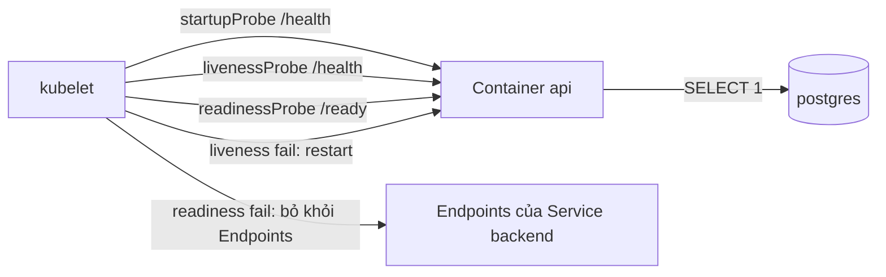

# Buổi 26 – Resource & Health

Tuần 13/16 · Giai đoạn 4 – Kubernetes Engineering · Buổi 26/32

[Slide](../../slides/07-operations/session-26.md) · [Bài tập tuần](../../assignments/weekly/week-13.md) · [Hub tuần](README.md)

> **Tóm tắt:** Đặt requests, limits và ba loại probe cho club-api, mô phỏng OOMKilled và readiness probe fail, rồi chẩn đoán bằng describe, events và logs.

::: tip Buổi này bạn làm gì
- **Bạn sẽ tạo ra:** một Deployment `club-api` có requests, limits và đủ ba probe, cùng một Pod thử nghiệm bị OOMKilled và một lần cố ý làm hỏng readiness probe để tự chẩn đoán.
- **Thời gian thật:** đọc 15 phút, lab bắt buộc 60 phút, thử thách tùy chọn làm ở nhà.
- **Cần chuẩn bị:**
  - [ ] Cluster kind `club` chạy, `kubectl config current-context` in `kind-club`; `club-api` (2 Pod) và `postgres` đang `Ready` ở namespace `club` (từ [Buổi 25 – Configuration Management](session-25.md)).
  - [ ] Image `club-api:1.0.0` đã nạp vào kind; môi trường cài theo [Hướng dẫn cài đặt](../../resources/setup-guide.md).
  - [ ] Repo giáo trình ở `~/devops-course` và repo `devops-labs` (public) theo [Tài khoản GitHub và repo devops-labs](../../resources/setup-github.md).
- **Phải nộp:** `README.md` (7 câu của mẫu, ghi L1 hay L2); `source/backend-deploy.yaml` và `source/oom-demo.yaml`; `evidence/command-output.txt` (lệnh và kết quả thật); `report.md` so sánh ba probe và phân tích tình huống 10.
- **Đi nhanh:** Đọc > [Làm lab](#hands-on-lab) > [Gặp lỗi?](#gap-loi) > [Tự kiểm tra](#tu-kiem-tra) > [Nộp bài](#nop-bai). Kẹt? Nhảy tới [Gặp lỗi?](#gap-loi).

**Từ mới trong buổi** (xem [Thuật ngữ](../../resources/glossary.md)):
- [requests và limits](../../resources/glossary.md): mức tài nguyên xin trước và mức trần được dùng.
- [probe](../../resources/glossary.md): phép kiểm tra định kỳ để kubelet biết app còn sống hay đã sẵn sàng.
- [OOMKilled](../../resources/glossary.md): container bị kernel giết vì dùng vượt giới hạn bộ nhớ.
- [Endpoints](../../resources/glossary.md): danh sách IP Pod đang nhận traffic của một Service.
- [QoS class](../../resources/glossary.md): hạng ưu tiên của Pod khi node thiếu bộ nhớ.
:::

## Vấn đề thực tế

Một buổi sinh hoạt CLB, API thành viên chạy ổn trên máy dev. Lên cluster, hai chuyện xảy ra: có lúc backend "đang chạy" nhưng người dùng nhận 502 vì Pod chưa kết nối được database mà vẫn nhận traffic; có lúc Pod tự chết lặp đi lặp lại mà log không có lỗi nào vì bị kernel giết khi vượt bộ nhớ. Cả hai đều là lỗi cấu hình tài nguyên và health check, không phải lỗi code. Kubernetes chỉ quản lý tốt khi biết app cần bao nhiêu tài nguyên và khi nào app khỏe; buổi này bạn khai báo hai điều đó rồi quan sát cluster phản ứng khi khai báo sai.

## Khái niệm cốt lõi {#khai-niem}

**requests và limits.** `requests` là mức tài nguyên xin trước, scheduler dùng để chọn node; `limits` là mức trần, kubelet và kernel cưỡng chế lúc chạy. Vượt limit CPU thì chạy chậm (throttle), vượt limit memory thì container bị giết (OOMKilled, exit code 137). Ví von: requests là chỗ ngồi bạn đặt trước ở quán, limits là số món tối đa quán cho gọi. Dùng hậu tố `Mi`, `Gi` (128Mi khác 128M).

**QoS class.** Hạng ưu tiên Kubernetes tự gán: Guaranteed (requests bằng limits cho cả cpu và memory), Burstable (có khai báo nhưng chưa đủ), BestEffort (không khai báo gì). Node thiếu bộ nhớ thì đuổi BestEffort trước, Guaranteed sau cùng. `club-api` hiện tại (100m/128Mi và 500m/256Mi) là Burstable.

**readinessProbe.** Câu hỏi "có nên gửi traffic cho Pod này không?". Fail thì Pod bị gỡ khỏi Endpoints nhưng không bị restart. Ví von: biển "đang dọn bàn, chưa nhận khách" ở cửa. Trong `club-api`, `/ready` chạy `SELECT 1` tới Postgres.

**livenessProbe.** Câu hỏi "process có bị kẹt không?". Fail thì kubelet restart container. Vì vậy liveness chỉ nên trỏ `/health` (luôn trả 200, không chạm database); restart không sửa được database.

**startupProbe.** Câu hỏi "app đã khởi động xong chưa?". Trong lúc chưa thành công, liveness và readiness bị hoãn, nên app khởi động chậm không bị giết oan. Thời gian tối đa là `failureThreshold` nhân `periodSeconds`.



::: details Tìm hiểu thêm (đọc sau)
Đơn vị CPU và memory, bảng QoS, tham số probe, sơ đồ diễn biến khi database sập và giải thích từng bước nằm ở [Buổi 26 – Thử thách nâng cao](session-26-challenge.md#tim-hieu-them). Tóm tắt: `500m` là 0,5 core; probe có `httpGet`, `tcpSocket`, `exec`; khi Postgres sập, readiness fail nên Pod ra khỏi Endpoints còn liveness vẫn 200 nên không restart; Postgres quay lại thì Pod tự Ready lại.
:::

## Hands-on lab (60 phút, bắt buộc) {#hands-on-lab}

Trên lớp, mentor demo trước (tắt rồi bật database để xem readiness); tự học thì làm thẳng phần này. Mọi thí nghiệm chạy trong namespace `club` và kết thúc bằng việc khôi phục `club-api` về manifest của bạn.

### Chuẩn bị (5 phút)

```bash
mkdir -p ~/devops-labs/lab-26/{source,screenshots,evidence}
cd ~/devops-labs/lab-26
cp ~/devops-course/starter-project/k8s/backend.yaml source/backend-original.yaml
kubectl config current-context
kubectl -n club get deploy,sts,pods
```

Kết quả mong đợi (rút gọn): `kind-club`; `deployment.apps/club-api` `2/2`; `statefulset.apps/postgres` `1/1`. Chưa có `club-api` hoặc `postgres` Ready: quay lại [Buổi 25 – Configuration Management](session-25.md), hoặc xem [Gặp lỗi?](#gap-loi). Ghi lệnh và kết quả vào `evidence/command-output.txt`, ví dụ bằng `script -a evidence/command-output.txt`.

### Phần 1 – Đọc requests, limits và QoS của club-api (7 phút)

```bash
kubectl -n club describe pod -l app=club-api | grep -A8 -E "Limits|QoS"
kubectl -n club get pods -l app=club-api -o jsonpath='{range .items[*]}{.metadata.name}{"  "}{.status.qosClass}{"\n"}{end}'
kubectl top pods -n club
```

Kết quả mong đợi (rút gọn): `Limits` cpu `500m`, memory `256Mi`; `Requests` cpu `100m`, memory `128Mi`; `QoS Class: Burstable`. Lệnh `kubectl top` thường báo `error: Metrics API not available` vì kind không cài metrics-server; điều đó bình thường và lab không cần nó. Vì sao: `describe` gom cả cấu hình lẫn trạng thái nên là lệnh đầu tiên để kiểm tra Pod.

::: tip Kiểm tra: bạn đúng khi
Bạn đọc ra được requests, limits và `Burstable` của `club-api`, và giải thích được vì sao nó không phải Guaranteed.
:::

### Phần 2 – Thêm startup, readiness và liveness probe (15 phút)

Tạo `source/backend-deploy.yaml` (chỉ Deployment; Service `backend` đã có và không đổi). `DB_PASSWORD` lấy từ Secret, các biến còn lại từ ConfigMap `club-config`:

```yaml
apiVersion: apps/v1
kind: Deployment
metadata:
  name: club-api
  namespace: club
spec:
  replicas: 2
  selector:
    matchLabels:
      app: club-api
  template:
    metadata:
      labels:
        app: club-api
    spec:
      containers:
        - name: api
          image: club-api:1.0.0
          imagePullPolicy: IfNotPresent
          ports:
            - containerPort: 3000
          env:
            - name: PORT
              value: "3000"
            - name: DB_PASSWORD
              valueFrom:
                secretKeyRef:
                  name: club-secrets
                  key: db-password
          envFrom:
            - configMapRef:
                name: club-config
          resources:
            requests: {cpu: 100m, memory: 128Mi}
            limits: {cpu: 500m, memory: 256Mi}
          startupProbe:
            httpGet: {path: /health, port: 3000}
            periodSeconds: 2
            failureThreshold: 15
          readinessProbe:
            httpGet: {path: /ready, port: 3000}
            periodSeconds: 5
            timeoutSeconds: 2
            failureThreshold: 3
          livenessProbe:
            httpGet: {path: /health, port: 3000}
            periodSeconds: 10
            timeoutSeconds: 2
            failureThreshold: 3
```

Hai điểm cần giải thích được: `startupProbe` cho tối đa 2 nhân 15 bằng 30 giây để app khởi động nên không cần `initialDelaySeconds`; readiness trỏ `/ready` (có kiểm tra database) còn liveness trỏ `/health` (không kiểm tra database). Áp dụng và kiểm tra:

```bash
kubectl apply -f source/backend-deploy.yaml
kubectl -n club rollout status deploy/club-api
kubectl -n club describe pod -l app=club-api | grep -E "Liveness|Readiness|Startup|QoS"
kubectl -n club exec deploy/club-api -- wget -qO- http://127.0.0.1:3000/health
kubectl -n club exec deploy/club-api -- wget -qO- http://127.0.0.1:3000/ready
```

Kết quả mong đợi (rút gọn):

```text
deployment "club-api" successfully rolled out
    Liveness:   http-get http://:3000/health delay=0s timeout=2s period=10s #success=1 #failure=3
    Readiness:  http-get http://:3000/ready delay=0s timeout=2s period=5s #success=1 #failure=3
    Startup:    http-get http://:3000/health delay=0s timeout=1s period=2s #success=1 #failure=15
QoS Class:                   Burstable
{"status":"healthy","service":"club-api"}
{"status":"ready"}
```

Pod `ErrImageNeverPull` hoặc `ImagePullBackOff`: xem [Gặp lỗi?](#gap-loi).

::: tip Kiểm tra: bạn đúng khi
`rollout status` báo `successfully rolled out` với 2/2 Ready, và `describe` có đủ ba dòng `Liveness`, `Readiness`, `Startup` cùng `QoS Class`.
:::

### Phần 3 – Mô phỏng OOMKilled (13 phút)

Ý tưởng: không sửa club-api, mà tạo Pod thử nghiệm chạy lại image `club-api:1.0.0` (đã nằm sẵn trong kind) với lệnh khác, cố ý tiêu thụ bộ nhớ vượt limit 64Mi. `restartPolicy: Never` giữ nguyên trạng thái lỗi để dễ quan sát.

```bash
cat > source/oom-demo.yaml <<'YAML'
apiVersion: v1
kind: Pod
metadata:
  name: oom-demo
  namespace: club
spec:
  restartPolicy: Never
  containers:
    - name: hog
      image: club-api:1.0.0
      imagePullPolicy: IfNotPresent
      command: ["node", "-e"]
      args:
        - "const a=[]; setInterval(()=>{a.push(Buffer.alloc(10*1024*1024,1)); console.log('allocated', a.length*10, 'MiB')}, 300)"
      resources:
        requests: {cpu: 50m, memory: 32Mi}
        limits: {cpu: 200m, memory: 64Mi}
YAML
kubectl apply -f source/oom-demo.yaml
kubectl -n club get pod oom-demo -w
```

Nhấn `Ctrl+C` khi thấy trạng thái cuối. Kết quả mong đợi: `ContainerCreating`, `Running`, rồi `OOMKilled` sau vài giây. Xác nhận nguyên nhân:

```bash
kubectl -n club logs oom-demo
kubectl -n club describe pod oom-demo | grep -A6 "State:"
kubectl -n club get pod oom-demo -o jsonpath='{.status.containerStatuses[0].state.terminated.reason}{" "}{.status.containerStatuses[0].state.terminated.exitCode}{"\n"}'
```

Kết quả mong đợi: vài dòng `allocated 10 MiB`, `allocated 20 MiB`; `Reason: OOMKilled`, `Exit Code: 137`; và dòng cuối `OOMKilled 137`. Số dòng `allocated` có thể khác (Node.js khi khởi động đã chiếm khoảng 40 MiB). Log dừng đột ngột, không có stack trace: tiến trình bị giết từ bên ngoài bằng SIGKILL (128 cộng 9 bằng 137), nên app không có cơ hội ghi log. Dọn dẹp ngay:

```bash
kubectl -n club delete pod oom-demo
```

::: tip Kiểm tra: bạn đúng khi
Evidence có `OOMKilled` và `137`, và bạn giải thích được vì sao log không có thông báo lỗi nào.
:::

### Phần 4 – Readiness probe fail: Pod Running nhưng 0/1 (15 phút)

Tình huống 10: cố ý đặt sai đường dẫn readiness. Hãy chọn một đường dẫn sai của riêng bạn thay cho `/readyy`.

```bash
kubectl -n club patch deploy club-api --type=json -p='[{"op":"replace","path":"/spec/template/spec/containers/0/readinessProbe/httpGet/path","value":"/readyy"}]'
kubectl -n club get pods -l app=club-api -w
```

Nhấn `Ctrl+C` sau khoảng 40 giây. Pod mới `Running` nhưng `0/1` và không bao giờ Ready, còn hai Pod cũ vẫn `1/1`. Lý do: rolling update mặc định chỉ tạo thêm 1 Pod mới và không tắt Pod cũ nào cho tới khi Pod mới Ready, nên rollout bị treo nhưng người dùng chưa thấy sự cố. Điều tra như học viên thật, chỉ có triệu chứng:

```bash
kubectl -n club get pods -l app=club-api
kubectl -n club get endpoints backend
kubectl -n club describe pod -l app=club-api | grep -B2 -A4 "Readiness probe failed"
kubectl -n club exec deploy/club-api -- wget -qO- http://127.0.0.1:3000/ready
kubectl -n club logs deploy/club-api --tail=5
```

Kết quả mong đợi: `RESTARTS` bằng 0 (loại trừ liveness và OOM); `Endpoints` chỉ có IP của hai Pod cũ, không có IP Pod mới (so sánh với `get pods -o wide`); Events có `Readiness probe failed: HTTP probe failed with statuscode: 404`; log chỉ có `API listening on port 3000` vì lỗi probe nằm ở Events chứ không ở log. Bảng mã: 404 nghĩa là app trả lời nhưng route không tồn tại (sai path), 503 là app báo chưa sẵn sàng (thường do database), `connection refused` là sai cổng hoặc app chưa lắng nghe. Khôi phục bằng manifest (manifest là nguồn sự thật, `patch` chỉ để thí nghiệm):

```bash
kubectl apply -f source/backend-deploy.yaml
kubectl -n club rollout status deploy/club-api
kubectl -n club get endpoints backend
```

Kết quả mong đợi: rollout hoàn tất, Pod `0/1` bị thay thế và Endpoints có đúng hai IP của hai Pod Ready. Cách phòng tránh: thử endpoint của probe bằng `exec` hoặc `port-forward` trước khi viết vào manifest và theo dõi `rollout status` sau mỗi lần deploy.

::: tip Kiểm tra: bạn đúng khi
Evidence có Pod mới `0/1 Running` với RESTARTS 0, dòng `Readiness probe failed` kèm mã HTTP, Endpoints thiếu IP Pod mới; sau khôi phục có đủ hai IP và `club-api` `2/2`.
:::

### Checklist L1

- [ ] `source/backend-deploy.yaml` có requests, limits, ba probe, `kubectl apply` thành công và `rollout status` báo successfully rolled out.
- [ ] Có output `describe` cho thấy ba dòng `Liveness`, `Readiness`, `Startup` và `QoS Class`.
- [ ] Chạy được `oom-demo` và có `OOMKilled` cùng exit code `137` trong `evidence/command-output.txt`.
- [ ] Làm hỏng readiness bằng đường dẫn sai, chỉ ra dòng `Readiness probe failed` trong Events, rồi khôi phục.
- [ ] Trả lời bằng lời của bạn: probe nào làm Pod bị restart, probe nào chỉ làm Pod bị gỡ khỏi Endpoints?

Tự kiểm tra một dòng: `kubectl -n club get deploy club-api; kubectl -n club get pods -l app=club-api` phải thấy `2/2` và hai Pod `1/1`, không còn Pod `oom-demo`.

## Gặp lỗi? {#gap-loi}

| Triệu chứng | Nguyên nhân | Cách sửa |
| --- | --- | --- |
| `kubectl -n club get pods` báo `No resources found` hoặc `club-api`, `postgres` không có | Sai namespace, hoặc chưa làm xong buổi 25 | Kiểm tra `kubectl config current-context` là `kind-club`; làm lại [Buổi 25 – Configuration Management](session-25.md) |
| Pod `ErrImageNeverPull` hoặc `ImagePullBackOff` | Image `club-api:1.0.0` chưa nạp vào kind | `kind load docker-image club-api:1.0.0 --name club` |
| Pod `Running` nhưng `0/1`, Endpoints rỗng | Readiness fail (sai path, sai port hoặc database không kết nối) | `describe` đọc Events; `exec wget` thử endpoint; sửa probe hoặc sửa database |
| RESTARTS tăng đều, log không có lỗi | OOMKilled (exit 137) | `describe` xem `Last State`; tăng memory limit có đệm hoặc sửa leak |
| Tất cả Pod bị restart khi database sập | Liveness trỏ vào endpoint kiểm tra database | Liveness chỉ dùng `/health`; phụ thuộc ngoài dùng readiness |
| Pod `Pending`, event `Insufficient memory` hoặc `Insufficient cpu` | `requests` lớn hơn tài nguyên còn lại của node | Giảm requests hoặc tăng tài nguyên Docker Desktop; `describe node` xem Allocatable |
| Rollout treo ở `1 out of 2 new replicas` | Pod mới không bao giờ Ready (probe sai) | `describe` Pod mới, sửa probe rồi `apply` lại manifest |
| App khởi động chậm bị restart ngay | Không có `startupProbe`, liveness quá nhạy | Thêm `startupProbe` với `failureThreshold` nhân `periodSeconds` đủ lớn |
| `kubectl top` báo `Metrics API not available` | Kind chưa cài metrics-server | Không cần cho lab; bỏ qua |
| App chậm bất thường nhưng không chết | CPU limit quá thấp nên bị throttle | Tăng CPU limit hoặc bỏ limit CPU, giữ request |

## Tự kiểm tra {#tu-kiem-tra}

1. `requests` và `limits` khác nhau thế nào về người sử dụng và hậu quả khi vượt?
2. Pod có requests cpu 100m, memory 128Mi và limits cpu 500m, memory 256Mi thuộc QoS class nào? Cần đổi gì để thành Guaranteed?
3. Ba loại probe khác nhau ở hành động khi fail như thế nào, và vì sao liveness không nên gọi database?
4. `kubectl get pods` cho thấy `club-api-xxx 0/1 Running 0`. Bạn kiểm tra gì đầu tiên và kỳ vọng thấy gì?
5. Pod restart liên tục, `kubectl logs` không có lỗi, `describe` thấy `OOMKilled`, `Exit Code: 137`. Vì sao log không có lỗi và bạn xử lý thế nào?

::: details Đáp án gợi ý
1. `requests` dùng cho scheduler để chọn node, là mức được đảm bảo; `limits` do kubelet và kernel cưỡng chế: vượt CPU thì bị throttle, vượt memory thì OOMKilled.
2. Burstable. Đặt requests bằng limits cho cả cpu và memory.
3. Startup fail: restart container sau khi vượt ngưỡng. Readiness fail: gỡ Pod khỏi Endpoints, không restart. Liveness fail: kubelet restart container. Database lỗi không sửa được bằng restart app, liveness gọi database sẽ gây restart dây chuyền; việc "không có database thì không nhận traffic" thuộc về readiness.
4. `kubectl describe pod` đọc Events tìm `Readiness probe failed` kèm mã (404 sai path, 503 app chưa sẵn sàng thường do database, `connection refused` sai port). RESTARTS bằng 0 loại trừ liveness và OOM.
5. Kernel gửi SIGKILL khi cgroup vượt memory limit nên process không kịp ghi log. Xử lý: đo mức dùng thực, đặt limit có đệm (thường 1,5 đến 2 lần mức dùng ổn định), theo dõi xu hướng để phát hiện leak thay vì chỉ tăng limit.
:::

## Nộp bài {#nop-bai}

Nộp vào thư mục `lab-26/` trong repo `devops-labs`, theo [mẫu lab](../../templates/lab-template.md) và [Bài tập tuần 13](../../assignments/weekly/week-13.md):

- [ ] `README.md` trả lời đủ 7 câu của mẫu (bài lab giải quyết vấn đề gì, kiến thức đã dùng, các bước, kết quả mong đợi, lỗi đã gặp, cách khắc phục, có thể cải thiện gì) và đánh dấu level đã làm (L1 hay L2).
- [ ] `source/` chứa `backend-deploy.yaml` (requests, limits và 3 probe) và `oom-demo.yaml`; nếu làm L2, thêm manifest của từng thử thách.
- [ ] `evidence/command-output.txt` chứa output thật của: `describe` có 3 probe và QoS Class, `oom-demo` với `OOMKilled` và `137`, Events `Readiness probe failed`, `get endpoints backend` trước và sau khôi phục.
- [ ] `report.md` (1 trang): bảng so sánh ba probe, vì sao liveness không phụ thuộc database, và nguyên nhân gốc của tình huống 10 theo các bước điều tra.
- [ ] Không có password, token hay giá trị Secret thật trong file nộp; `screenshots/` chỉ bổ sung, không thay cho source và log.

## Recap

- `requests` để xếp Pod, `limits` để cưỡng chế: vượt CPU thì chậm, vượt memory thì OOMKilled (exit 137, log dừng đột ngột); QoS class quyết định thứ tự bị đuổi khi node thiếu tài nguyên.
- Readiness fail chỉ gỡ Pod khỏi Endpoints; liveness fail mới restart; startup bảo vệ app khởi động chậm. Liveness chỉ kiểm tra process sống (`/health`), phụ thuộc ngoài thuộc về readiness (`/ready`).
- Pod `Running` nhưng `0/1`: bắt đầu từ `describe` Events, rồi gọi endpoint bằng `exec`; `patch` chỉ để thí nghiệm, manifest trong Git mới là nguồn sự thật.

Buổi tiếp theo: [Buổi 27 – Storage & Ingress](../week-14/session-27.md).

::: details Thử thách thêm (L2, tùy chọn, làm ở nhà)
Ba thử thách: Guaranteed QoS, liveness phụ thuộc database gây restart dây chuyền, và startup probe sai cổng. Gợi ý từng bậc và tiêu chí hoàn thành nằm ở [Buổi 26 – Thử thách nâng cao](session-26-challenge.md#thu-thach-l2). Hãy tự thử 15 phút trước khi mở gợi ý; lời giải đối chiếu ở [Walkthrough tuần 13](../../mentors/walkthroughs/week-13.md), chỉ mở sau khi nộp bài.
:::

::: details Phá lỗi nâng cao
Tình huống container chết không để lại log lỗi và cách tái hiện tình huống 10 bằng `examples/troubleshooting/scenario-10/` (namespace `ts-10`) nằm ở [Buổi 26 – Thử thách nâng cao](session-26-challenge.md#pha-loi-nang-cao). Làm sau khi xong lab bắt buộc.
:::

::: details Tài liệu tham khảo
- [Resource Management for Pods and Containers](https://kubernetes.io/docs/concepts/configuration/manage-resources-containers/)
- [Configure Quality of Service for Pods](https://kubernetes.io/docs/tasks/configure-pod-container/quality-service-pod/)
- [Liveness, Readiness and Startup Probes](https://kubernetes.io/docs/concepts/configuration/liveness-readiness-startup-probes/)
- [Configure Liveness, Readiness and Startup Probes (task)](https://kubernetes.io/docs/tasks/configure-pod-container/configure-liveness-readiness-startup-probes/)
- [Assign Memory Resources to Containers and Pods](https://kubernetes.io/docs/tasks/configure-pod-container/assign-memory-resource/)
- [Debug Running Pods](https://kubernetes.io/docs/tasks/debug/debug-application/debug-running-pod/)
- Ví dụ đi kèm: `examples/kubernetes/05-probes.yaml`, `examples/kubernetes/06-resources-oom.yaml`.
:::
