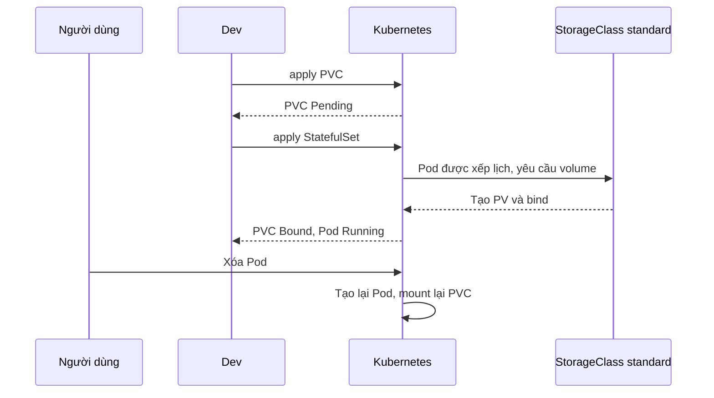

# Buổi 27 – Thử thách nâng cao

Tuần 14/16 · Giai đoạn 4 – Kubernetes Engineering · Buổi 27/32

[Bài học chính](session-27.md) · [Slide](../../slides/07-operations/session-27.md) · [Bài tập tuần](../../assignments/weekly/week-14.md) · [Hub tuần](README.md)

> **Tóm tắt:** Trang phụ của buổi 27: kiến thức tìm hiểu thêm về storage và Ingress, ba thử thách L2 (vòng đời PV, Retain, host thứ hai) và hai tình huống phá lỗi. Tất cả đều tùy chọn.

::: tip Trang này dành cho ai
Bạn đã xong checklist L1 của [Buổi 27 – Storage & Ingress](session-27.md) và còn thời gian, hoặc bạn cần phần Phá lỗi cho bài tập tuần. Hãy tự thử 15 phút trước khi mở gợi ý. Lời giải đối chiếu nằm trong [trang tuần 14](README.md), chỉ mở sau khi nộp bài.
:::

## Tìm hiểu thêm {#tim-hieu-them}

| accessModes | Ý nghĩa |
| --- | --- |
| ReadWriteOnce (RWO) | Một node đọc/ghi tại một thời điểm; phù hợp database |
| ReadOnlyMany, ReadWriteMany | Cần storage hỗ trợ; kind mặc định không có RWX |

| pathType | Hành vi |
| --- | --- |
| Prefix | Khớp theo tiền tố từng đoạn path: `/api` khớp `/api` và `/api/members` |
| Exact | Chỉ khớp đúng path |
| ImplementationSpecific | Tùy controller |

Nhiều rule cùng khớp thì rule có path dài hơn được ưu tiên, nên `/api` thắng `/`. Ingress hoạt động ở tầng HTTP (host, path), khác với Service LoadBalancer ở tầng TCP/UDP. StatefulSet nhiều replica dùng `volumeClaimTemplates` để mỗi Pod có PVC riêng; lab dùng một replica nên `postgres.yaml` tạo `postgres-pvc` tường minh.

Vòng đời PVC khi tạo Pod:



Năm bước của một request `GET http://club.localhost/api/members`:

1. Trình duyệt phân giải `club.localhost` về 127.0.0.1 (tên miền `.localhost` luôn trỏ về máy local).
2. Request tới port 80 của máy; Docker map vào port 80 của container node kind (do `extraPortMappings`).
3. ingress-nginx tìm Ingress có host `club.localhost` và path `/api`, chuyển tới Service `backend` port 3000.
4. Service chọn một trong hai Pod `club-api`; Pod này truy vấn Service `postgres`.
5. Pod `postgres-0` đọc dữ liệu từ `/var/lib/postgresql/data`, thực chất là PV gắn qua PVC `postgres-pvc`.

## Thử thách L2 {#thu-thach}

Mỗi thử thách có tiêu chí hoàn thành. Hãy dự đoán trước khi chạy lệnh và ghi dự đoán vào `report.md`.

::: danger Xóa PVC làm mất dữ liệu
Thử thách 1 và 2 xóa PVC `postgres-pvc` của bạn. Với policy `Delete`, dữ liệu mất vĩnh viễn và phải chạy lại `init.sql`. Chỉ xóa đúng PVC của mình trong namespace `club`.
:::

**Thử thách 1. Chứng minh vòng đời PV/PVC.**

- Ghi tên PV hiện tại và reclaim policy.
- Dự đoán rồi kiểm chứng: xóa StatefulSet `postgres` (không xóa PVC) thì dữ liệu còn không? Tạo lại StatefulSet, truy vấn lại.
- Dự đoán rồi kiểm chứng: xóa PVC thì chuyện gì xảy ra với PV và dữ liệu?
- Tiêu chí hoàn thành: bảng 3 dòng (hành động, dự đoán, kết quả thực tế) trong `report.md`, và giải thích vì sao khi xóa PVC mà Pod vẫn đang dùng, PVC ở trạng thái `Terminating`.

<details>
<summary>Gợi ý (tự thử 15 phút trước khi mở)</summary>

- `kubectl delete statefulset postgres -n club` rồi `kubectl apply -f k8s/postgres.yaml`: PVC không bị đụng tới.
- `kubectl delete pvc postgres-pvc -n club` khi Pod còn chạy sẽ treo ở `Terminating` do finalizer `kubernetes.io/pvc-protection`; xóa Pod/StatefulSet trước.
- Theo dõi PV bằng `kubectl get pv -w` ở terminal thứ hai.

</details>

**Thử thách 2. Chuyển sang Retain.** Đặt PV hiện tại về `Retain` bằng `kubectl patch pv`, xóa StatefulSet và PVC, quan sát PV chuyển `Released`. Giải thích vì sao PV `Released` chưa thể bind lại cho PVC mới và nêu cách admin phục hồi.

- Tiêu chí hoàn thành: output `kubectl get pv` trước và sau, cùng lời giải thích 3-5 câu.

<details>
<summary>Gợi ý (tự thử 15 phút trước khi mở)</summary>

Lệnh patch có dạng `kubectl patch pv TEN_PV -p '{"spec":{"persistentVolumeReclaimPolicy":"Retain"}}'`. Thay `TEN_PV` bằng tên PV thật từ `kubectl get pv`. PV `Released` còn `claimRef` trỏ tới PVC cũ, nên không bind cho PVC khác. Gợi ý thêm cho cách phục hồi: nghĩ tới `claimRef`.

</details>

**Thử thách 3 (nếu còn thời gian). Thêm host thứ hai.** Tạo Ingress mới trong file `~/devops-labs/lab-27/source/ingress-api.yaml` để `api.club.localhost` chuyển toàn bộ tới Service `backend`, trong khi `club.localhost` vẫn hoạt động. Kiểm tra bằng curl với header Host.

- Tiêu chí hoàn thành: hai lệnh curl khác host trả đúng nội dung, `kubectl describe ingress -n club` hiển thị cả hai rule.

<details>
<summary>Gợi ý (tự thử 15 phút trước khi mở)</summary>

Sao chép `k8s/ingress.yaml`, đổi `metadata.name` (ví dụ `club-api-host`), đổi `host`, và chỉ giữ một `path: /` kiểu `Prefix` trỏ tới Service `backend` cổng 3000. Apply từ thư mục `starter-project` bằng đường dẫn tới file của bạn.

</details>

## Phá lỗi nâng cao {#pha-loi}

Mỗi tình huống: bạn tự phá, tự quan sát triệu chứng, tự điều tra từng bước, rồi khôi phục.

### Tình huống A. PVC Pending mãi

Phá: tạo PVC tham chiếu StorageClass không tồn tại.

```bash
kubectl apply -n club -f - <<'EOF'
apiVersion: v1
kind: PersistentVolumeClaim
metadata:
  name: broken-pvc
spec:
  storageClassName: fast-ssd
  accessModes: [ReadWriteOnce]
  resources:
    requests:
      storage: 1Gi
EOF
kubectl get pvc -n club broken-pvc
```

Triệu chứng: `STATUS` là `Pending` không đổi; nếu Pod dùng PVC này, Pod cũng `Pending`. Điều tra theo bước:

1. `kubectl describe pvc broken-pvc -n club`: đọc Events, thấy `storageclass.storage.k8s.io "fast-ssd" not found`.
2. `kubectl get storageclass`: chỉ có `standard`.
3. Phân biệt với Pending bình thường của `WaitForFirstConsumer` (Events nói "waiting for first consumer").

Nguyên nhân gốc: tên StorageClass sai nên không có provisioner nào xử lý PVC. Cách sửa: xóa PVC, tạo lại với `standard` hoặc bỏ trường `storageClassName` để dùng mặc định. Phòng tránh: kiểm tra `kubectl get storageclass` trước khi viết PVC; PVC không đổi được `storageClassName` sau khi tạo. Dọn dẹp: `kubectl delete pvc broken-pvc -n club`. Xem thêm `examples/troubleshooting/scenario-09`.

### Tình huống B. Ingress trả 404 hoặc 503

Phá 1: gọi không có header Host đúng.

```bash
curl -s -o /dev/null -w "%{http_code}\n" http://127.0.0.1/api/members
```

Triệu chứng: mã `404` từ nginx vì không có rule cho host `127.0.0.1`.

Phá 2: sửa tên Service trong Ingress thành `backendd` rồi gọi lại.

```bash
sed 's/name: backend$/name: backendd/' k8s/ingress.yaml | kubectl apply -f -
curl -i -H "Host: club.localhost" http://127.0.0.1/api/members
```

Triệu chứng: `503 Service Temporarily Unavailable` (không có endpoint hợp lệ). Điều tra:

1. `kubectl describe ingress club -n club`: cột Backends hiển thị `backendd:3000 (<error: endpoints "backendd" not found>)`.
2. `kubectl get svc,endpoints -n club`: đối chiếu tên Service và có endpoint hay không.
3. `kubectl logs -n ingress-nginx -l app.kubernetes.io/component=controller --tail=20`.

Nguyên nhân gốc: Ingress tham chiếu Service không tồn tại, hoặc Service không có Pod Ready. Phòng tránh: dùng `kubectl describe ingress` ngay sau khi apply; kiểm tra readiness của backend. Khôi phục bằng `kubectl apply -f k8s/ingress.yaml`.

### Tình huống C. Cluster thiếu port mapping

Nếu cluster tạo bằng `kind create cluster` mặc định (không có `--config`), `curl http://127.0.0.1/` báo `Connection refused` dù controller chạy tốt. Điều tra bằng `docker ps` và xem cột PORTS của container `club-control-plane`: không có `0.0.0.0:80->80/tcp`. Cách sửa: xóa cluster và tạo lại với `k8s/kind-config.yaml` (xem hộp danger trong phần Chuẩn bị của [bài học chính](session-27.md)).
