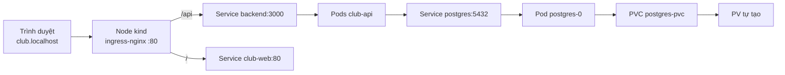

# Buổi 27 – Storage & Ingress

Tuần 14/16 · Giai đoạn 4 – Kubernetes Engineering · Buổi 27/32

[Slide](../../slides/07-operations/session-27.md) · [Bài tập tuần](../../assignments/weekly/week-14.md) · [Hub tuần](README.md)

> **Tóm tắt:** Dùng PV, PVC, StorageClass để PostgreSQL giữ dữ liệu khi Pod bị xóa, và dùng ingress-nginx trên kind để truy cập ứng dụng qua host club.localhost.

::: tip Buổi này bạn làm gì
- **Bạn sẽ tạo ra:** Postgres trên kind giữ nguyên dữ liệu sau khi xóa Pod, và cả ứng dụng Club Management mở được bằng `http://club.localhost`.
- **Thời gian thật:** đọc 15 phút, lab bắt buộc 60 phút, thử thách làm ở nhà.
- **Cần chuẩn bị:**
  - [ ] Cluster kind `club` đang chạy (context `kind-club`), đã học [Buổi 26 – Resource & Health](../week-13/session-26.md).
  - [ ] Image `club-api:1.0.0`, `club-web:1.0.0` có trong Docker; repo giáo trình ở `~/devops-course`.
  - [ ] Môi trường theo [Hướng dẫn cài đặt](../../resources/setup-guide.md); repo `devops-labs` theo [Tài khoản GitHub và repo devops-labs](../../resources/setup-github.md).
- **Phải nộp:** `README.md` (7 câu của mẫu); `evidence/command-output.txt` (PVC, số đếm `members` trước và sau xóa Pod, Ingress, ba lệnh curl); `report.md` (giải thích Pending và 404); `source/postgres.yaml`, `source/ingress.yaml`.
- **Đi nhanh:** Đọc > [Làm lab](#hands-on-lab) > [Gặp lỗi?](#gap-loi) > [Tự kiểm tra](#tu-kiem-tra) > [Nộp bài](#nop-bai). Kẹt? Nhảy tới [Gặp lỗi?](#gap-loi).

**Từ mới trong buổi** (xem [Thuật ngữ](../../resources/glossary.md)):
- [PersistentVolumeClaim (PVC)](../../resources/glossary.md): yêu cầu dung lượng lưu trữ của một workload.
- [PersistentVolume (PV)](../../resources/glossary.md): phần dung lượng lưu trữ thật trong cluster.
- [StorageClass](../../resources/glossary.md): mô tả loại storage và cách tạo PV tự động.
- [StatefulSet](../../resources/glossary.md): workload cho ứng dụng có trạng thái, như database.
- [Ingress](../../resources/glossary.md): luật chuyển request HTTP theo host và path tới Service.
- [Ingress controller](../../resources/glossary.md): Pod proxy thật đọc Ingress và thực thi luật.
:::

## Vấn đề thực tế

Sau buổi 26, Postgres của CLB chạy trong một Pod. Nếu ai đó lỡ chạy `kubectl delete pod` hoặc node khởi động lại, danh sách thành viên biến mất vì dữ liệu nằm trong filesystem tạm của container. Database mà mất dữ liệu mỗi khi Pod chết thì không dùng được.

Vấn đề thứ hai: Service `ClusterIP` chỉ truy cập được từ trong cluster, nên bạn đang `port-forward` từng Service với từng cổng khác nhau. Người dùng thật chỉ gõ một tên miền. Buổi này giải quyết cả hai: lưu trữ bền (PVC) và một cổng vào HTTP duy nhất (Ingress).

## Khái niệm cốt lõi {#khai-niem}

**PV, PVC, StorageClass.** PVC là yêu cầu "tôi cần 1Gi", PV là phần dung lượng thật đáp ứng yêu cầu, StorageClass là bộ máy tự tạo PV khi có PVC. Developer chỉ tạo PVC. Ví von: PVC là phiếu đặt chỗ, PV là chỗ ngồi thật, StorageClass là nhà hàng tự xếp chỗ.

**Reclaim policy và binding mode.** Với `Delete`, xóa PVC thì PV và dữ liệu mất theo; với `Retain`, PV còn lại (trạng thái `Released`) để admin xử lý. Trên kind, StorageClass `standard` dùng `Delete` và `WaitForFirstConsumer`: PV chỉ được tạo khi có Pod dùng PVC, nên PVC `Pending` lúc mới tạo là bình thường. Ví von: `Delete` như thuê tủ gửi đồ rồi trả tủ thì tủ bị dọn sạch; `Retain` như giữ lại tủ và đồ bên trong.

**StatefulSet.** Dành cho ứng dụng có trạng thái như database: Pod tên ổn định (`postgres-0`) và mount lại đúng PVC cũ khi được tạo lại. Xóa Pod hoặc StatefulSet không xóa PVC; chỉ xóa PVC mới (có thể) làm mất dữ liệu.

**Ingress và Ingress controller.** Ingress chỉ là luật ("host nào, path nào, tới Service nào"); controller (ở đây là ingress-nginx) là Pod proxy thật đọc luật và thực thi. Chỉ tạo Ingress mà không cài controller thì không có gì xảy ra. Path dài hơn thắng: `/api` thắng `/`. Ví von: Ingress là bảng chỉ đường, controller là bảo vệ đọc bảng rồi dẫn khách.



::: details Tìm hiểu thêm (đọc sau)
Kind không có cloud load balancer, nên `kind-config.yaml` map port 80 và 443 của node ra máy (`extraPortMappings`) và gắn nhãn `ingress-ready=true` để controller được xếp lịch vào đúng node đó. Port mapping chỉ đặt được lúc tạo cluster.

Database dùng access mode ReadWriteOnce (một node đọc/ghi tại một thời điểm); `pathType: Prefix` khớp theo tiền tố từng đoạn nên `/api` khớp cả `/api/members`. Bảng access mode và pathType, sơ đồ tuần tự vòng đời PVC và năm bước đi của một request nằm ở [Buổi 27 – Thử thách nâng cao](session-27-challenge.md).
:::

## Hands-on lab (60 phút, bắt buộc) {#hands-on-lab}

Trên lớp, mentor demo trước; tự học thì làm thẳng phần này. Mọi lệnh chạy trong WSL, trong thư mục `~/devops-course/starter-project`, nên đường dẫn `k8s/...` và `database/...` tính từ đó.

### Chuẩn bị (5 phút)

```bash
mkdir -p ~/devops-labs/lab-27/{source,evidence,screenshots}
export EV=~/devops-labs/lab-27/evidence/command-output.txt
cd ~/devops-course/starter-project
kubectl config current-context
kubectl get nodes
docker ps --filter name=club-control-plane --format '{{.Ports}}'
docker image ls | grep -E 'club-(api|web)'
```

Kết quả mong đợi: context `kind-club`, node `club-control-plane` ở trạng thái `Ready`, cột port có `0.0.0.0:80->80/tcp`, và hai image có tag `1.0.0`. Lệnh quan trọng thì thêm `| tee -a "$EV"` để lưu vào bằng chứng (biến `EV` mất khi đóng terminal, khai báo lại là được).

Thiếu image thì build lại: `docker build -t club-api:1.0.0 ./backend` và `docker build -t club-web:1.0.0 ./frontend`. Thiếu port mapping thì xem hộp dưới đây.

::: danger Chỉ làm khi cluster thiếu dòng 80->80
`kind delete cluster --name club` xóa toàn bộ workload trong cluster `club`. Chỉ chạy khi `docker ps` ở trên không có `0.0.0.0:80->80/tcp`, vì port mapping không sửa được sau khi tạo:

```bash
kind delete cluster --name club
kind create cluster --name club --config k8s/kind-config.yaml
```
:::

### Phần 1. Làm sạch namespace, nạp image, thấy PVC Pending (8 phút)

Các buổi trước đã dựng sẵn Postgres trong namespace `club`. Để bắt đầu lại sạch (và thấy được PVC `Pending`), xóa namespace này.

::: danger Xóa namespace club
Lệnh dưới xóa mọi thứ trong namespace `club` (Pod, PVC, Secret). Chỉ chạy đúng tên `club`; không bao giờ chạy với `kube-system` hay `ingress-nginx`.
:::

```bash
kubectl delete namespace club --ignore-not-found
kubectl wait --for=delete namespace/club --timeout=120s
kubectl apply -f k8s/namespace.yaml
kind load docker-image club-api:1.0.0 --name club
kind load docker-image club-web:1.0.0 --name club
```

Vì sao: kind không tự thấy image trong Docker local, nên phải nạp vào node. Bây giờ tạo một PVC thử và đọc trạng thái:

```bash
kubectl apply -n club -f - <<'EOF'
apiVersion: v1
kind: PersistentVolumeClaim
metadata:
  name: demo-pvc
spec:
  accessModes: [ReadWriteOnce]
  resources:
    requests:
      storage: 100Mi
EOF
kubectl get pvc -n club demo-pvc | tee -a "$EV"
kubectl describe pvc demo-pvc -n club | tail -4 | tee -a "$EV"
kubectl delete pvc demo-pvc -n club
```

Kết quả mong đợi: `STATUS` là `Pending`, và Events nói `waiting for first consumer`. Đây không phải lỗi: chưa có Pod dùng PVC nên kind chưa tạo PV.

::: tip Kiểm tra: bạn đúng khi
`demo-pvc` ở `Pending` kèm dòng "waiting for first consumer", và output đã nằm trong `command-output.txt`.
:::

### Phần 2. Postgres với PVC và init.sql (12 phút)

1. Tạo ConfigMap, Secret (tạo bằng lệnh, không commit giá trị thật) và triển khai Postgres:

```bash
kubectl apply -f k8s/configmap.yaml
kubectl create secret generic club-secrets -n club --from-literal=db-password='lab-local-pass-27'
kubectl apply -f k8s/postgres.yaml
kubectl wait -n club --for=condition=Ready pod/postgres-0 --timeout=120s
kubectl get pvc,pv -n club | tee -a "$EV"
```

Kết quả mong đợi: `secret/club-secrets created`; `postgres-0` `Ready`; PVC `postgres-pvc` `Bound`; một PV có `CLAIM` là `club/postgres-pvc`, `RECLAIM POLICY` là `Delete`, StorageClass `standard`. Lệnh `wait` hết thời gian thì chạy `kubectl describe pod postgres-0 -n club` và xem [Gặp lỗi?](#gap-loi).

2. Kubernetes không tự chạy `init.sql` như Compose, bạn nạp tay rồi thêm một dòng của riêng bạn (email chứa MSSV hoặc username GitHub, để dễ nhận ra):

```bash
kubectl exec -i -n club postgres-0 -- psql -U club -d clubdb < database/init.sql
kubectl exec -n club postgres-0 -- psql -U club -d clubdb -c "INSERT INTO members (name, email) VALUES ('Ban', 'ban-mssv@example.com');"
kubectl exec -n club postgres-0 -- psql -U club -d clubdb -c "SELECT id, name, email FROM members;" | tee -a "$EV"
```

Kết quả mong đợi: ba dòng gồm Alice, Bob và dòng của bạn.

```text
 id | name  |       email
----+-------+--------------------
  1 | Alice | alice@example.com
  2 | Bob   | bob@example.com
  3 | Ban   | ban-mssv@example.com
```

::: tip Kiểm tra: bạn đúng khi
`kubectl get pvc -n club` báo `Bound` và bảng `members` có đúng ba dòng, trong đó có email của bạn.
:::

### Phần 3. Chứng minh dữ liệu còn sau khi xóa Pod (8 phút)

```bash
kubectl exec -n club postgres-0 -- psql -U club -d clubdb -c "SELECT count(*) FROM members;" | tee -a "$EV"
kubectl delete pod postgres-0 -n club
kubectl wait -n club --for=condition=Ready pod/postgres-0 --timeout=120s
kubectl exec -n club postgres-0 -- psql -U club -d clubdb -c "SELECT count(*) FROM members;" | tee -a "$EV"
kubectl exec -n club postgres-0 -- psql -U club -d clubdb -c "SELECT email FROM members WHERE name='Ban';" | tee -a "$EV"
```

Kết quả mong đợi: StatefulSet tạo lại Pod cùng tên `postgres-0`; `count` là 3 cả hai lần; dòng `ban-mssv@example.com` vẫn còn.

Vì sao: Pod mới mount lại cùng PVC nên thấy cùng dữ liệu. Biến `PGDATA=/var/lib/postgresql/data/pgdata` (đặt sẵn trong `postgres.yaml`) tránh lỗi Postgres từ chối khởi tạo khi thư mục mount không rỗng.

::: tip Kiểm tra: bạn đúng khi
Hai lần `count(*)` bằng nhau và dòng email riêng của bạn còn sau khi Pod bị xóa.
:::

### Phần 4. Triển khai backend và frontend (10 phút)

```bash
kubectl apply -f k8s/backend.yaml
kubectl apply -f k8s/frontend.yaml
kubectl rollout status deployment/club-api -n club
kubectl rollout status deployment/club-web -n club
kubectl get pods -n club | tee -a "$EV"
```

Kết quả mong đợi: hai Pod `club-api`, một Pod `club-web`, một Pod `postgres-0`, tất cả `1/1 Running`. Bước `ErrImageNeverPull` hoặc `ImagePullBackOff` thì xem [Gặp lỗi?](#gap-loi).

Kiểm tra backend trước khi có Ingress, để biết lỗi (nếu có) không thuộc về Ingress. Dùng cổng 3001 để tránh xung đột cổng 3000:

```bash
kubectl port-forward -n club svc/backend 3001:3000 &
sleep 2
curl -s http://localhost:3001/ready
curl -s http://localhost:3001/api/members
kill %1
```

Kết quả mong đợi: `{"status":"ready"}` và danh sách ba thành viên dạng JSON.

::: tip Kiểm tra: bạn đúng khi
Bốn Pod đều `1/1 Running` và `curl` tới backend qua port-forward trả JSON có dòng của bạn.
:::

### Phần 5. Cài ingress-nginx và truy cập qua club.localhost (15 phút)

1. Cài ingress-nginx bản dành cho kind (URL ghim tag `controller-v1.12.1` để cả lớp cùng một phiên bản) và chờ controller sẵn sàng:

```bash
kubectl apply -f https://raw.githubusercontent.com/kubernetes/ingress-nginx/controller-v1.12.1/deploy/static/provider/kind/deploy.yaml
kubectl wait --namespace ingress-nginx --for=condition=ready pod \
  --selector=app.kubernetes.io/component=controller --timeout=120s
```

Kết quả mong đợi: `pod/ingress-nginx-controller-... condition met`. Lần đầu có thể mất 1-2 phút để kéo image. Dự án ingress-nginx đã thông báo ngừng bảo trì từ tháng 3/2026; bản ghim vẫn chạy tốt cho lab local, còn hệ thống thật nên xem Gateway API hoặc controller khác (xem [kind – Ingress](https://kind.sigs.k8s.io/docs/user/ingress/)).

2. Áp dụng Ingress của dự án và xem luật:

```bash
cat k8s/ingress.yaml
kubectl apply -f k8s/ingress.yaml
kubectl get ingress -n club | tee -a "$EV"
kubectl describe ingress club -n club | tee -a "$EV"
```

Kết quả mong đợi: Ingress `club`, HOSTS là `club.localhost`, CLASS là `nginx`; `describe` liệt kê hai path: `/api` tới `backend:3000` và `/` tới `club-web:80`.

3. Gọi qua Ingress bằng header Host (không phụ thuộc DNS của WSL), rồi thử gọi thiếu Host:

```bash
curl -s -H "Host: club.localhost" http://127.0.0.1/api/members | tee -a "$EV"
curl -s -o /dev/null -w "%{http_code}\n" -H "Host: club.localhost" http://127.0.0.1/ | tee -a "$EV"
curl -s -o /dev/null -w "%{http_code}\n" http://127.0.0.1/api/members | tee -a "$EV"
kubectl logs -n ingress-nginx -l app.kubernetes.io/component=controller --tail=5 | tee -a "$EV"
```

Kết quả mong đợi: JSON thành viên (có dòng của bạn), mã `200`, rồi mã `404` ở lệnh thiếu Host; năm dòng log cuối thấy các request vừa gửi. Trên Windows, mở `http://club.localhost` trong trình duyệt sẽ thấy giao diện frontend; chụp ảnh vào `screenshots/`.

Vì sao: ingress-nginx chọn luật theo header Host; không có luật cho host `127.0.0.1` thì controller trả 404. Request `/api/members` khớp cả `/api` lẫn `/`, và path dài hơn thắng nên đi tới backend. Hãy ghi hai điều này vào `report.md`, cùng một câu giải thích vì sao PVC `Pending` ở Phần 1 không phải lỗi.

::: tip Kiểm tra: bạn đúng khi
Ba lệnh curl trả JSON, `200` và `404`; `describe ingress` có hai path; log controller có các request vừa gửi.
:::

### Checklist L1

- [ ] Cluster `club` có `Ready`, port mapping 80 hoạt động.
- [ ] Có output `Pending` của PVC (hoặc "waiting for first consumer") và `Bound` của `postgres-pvc` trong `command-output.txt`.
- [ ] Bảng `members` có dòng của riêng bạn; hai lần `count(*)` trước và sau khi xóa `postgres-0` bằng nhau.
- [ ] Bốn Pod `1/1 Running`, `kubectl get ingress -n club` có host `club.localhost`.
- [ ] Ba lệnh curl (JSON, 200, 404) và 5 dòng log controller đã lưu.

Tự kiểm tra một dòng (kỳ vọng `Bound` rồi `200`):

```bash
kubectl get pvc postgres-pvc -n club -o jsonpath='{.status.phase}{"\n"}' && curl -s -o /dev/null -w "%{http_code}\n" -H "Host: club.localhost" http://127.0.0.1/api/members
```

## Gặp lỗi? {#gap-loi}

| Triệu chứng | Nguyên nhân | Cách sửa |
| --- | --- | --- |
| PVC `Pending` ngay sau khi tạo | `WaitForFirstConsumer`, chưa có Pod dùng PVC | Bình thường; tạo Pod dùng PVC thì tự `Bound` |
| PVC `Pending` mãi dù có Pod; Events có `storageclass ... not found` | `storageClassName` sai tên nên không provisioner nào xử lý | `kubectl describe pvc`, `kubectl get storageclass`; xóa PVC, tạo lại với `standard` hoặc bỏ trường này (không sửa tại chỗ được) |
| `postgres-0` CrashLoopBackOff, log báo thư mục data không rỗng | Thiếu `PGDATA` trỏ thư mục con (khi bạn tự sửa YAML) | Dùng `PGDATA=/var/lib/postgresql/data/pgdata`, xóa PVC hỏng và tạo lại |
| `exec` báo container chưa chạy hoặc không kết nối được | Gọi quá sớm khi Pod chưa `Ready` | `kubectl wait -n club --for=condition=Ready pod/postgres-0 --timeout=120s` |
| `/api/members` trả 500, bảng không tồn tại | Chưa chạy `init.sql` trên Postgres mới | Chạy lại lệnh `psql < database/init.sql` |
| Xóa PVC xong database rỗng | `reclaimPolicy` là `Delete` | Sao lưu trước; dùng `Retain` cho dữ liệu quan trọng |
| `ErrImageNeverPull` hoặc `ImagePullBackOff` ở backend | Quên `kind load docker-image` vào đúng cluster | Nạp lại: `kind load docker-image club-api:1.0.0 --name club` |
| `curl` tới `127.0.0.1` báo `Connection refused` | Cluster thiếu `extraPortMappings` (cột PORTS của `docker ps` không có `80->80`), hoặc port 80 bị chiếm | Tạo lại cluster với `k8s/kind-config.yaml` (hộp danger ở Chuẩn bị); tắt chương trình đang dùng port 80 |
| Controller `Pending` | Node thiếu nhãn `ingress-ready=true` | Tạo lại cluster đúng cấu hình |
| Ingress có nhưng trả 404 | Sai header Host, hoặc thiếu `ingressClassName: nginx` | Gọi đúng `-H "Host: club.localhost"`; `kubectl get ingressclass` |
| Ingress trả 503 `Service Temporarily Unavailable` | Ingress trỏ tới Service không tồn tại hoặc Service không có Pod Ready | `kubectl describe ingress club -n club` (cột Backends báo lỗi endpoints), `kubectl get svc,endpoints -n club`; khôi phục bằng `kubectl apply -f k8s/ingress.yaml` |

Cách tìm lỗi theo lớp, từ trong ra ngoài: PVC (`describe`), Pod, Service và endpoints, Ingress, cuối cùng là log của controller.

## Tự kiểm tra {#tu-kiem-tra}

1. PV, PVC và StorageClass khác nhau thế nào? Developer thường tạo đối tượng nào?
2. Vì sao PVC trên kind ở trạng thái `Pending` trước khi có Pod, và đó có phải lỗi không?
3. Bạn xóa `postgres-0`, dữ liệu còn. Hôm sau bạn xóa PVC rồi apply lại `postgres.yaml`, database rỗng. Giải thích cả hai kết quả bằng reclaim policy.
4. Chỉ cài Ingress mà không có Ingress controller thì điều gì xảy ra, và vì sao kind cần `extraPortMappings` cùng nhãn `ingress-ready=true`?
5. `curl http://127.0.0.1/api/members` trả 404 còn port-forward trực tiếp vào Service thì chạy. Bạn kiểm tra gì theo thứ tự?

::: details Đáp án gợi ý
1. PV là dung lượng thật; PVC là yêu cầu của workload; StorageClass mô tả loại storage và cách tạo PV tự động. Developer tạo PVC.
2. `WaitForFirstConsumer` chờ Pod được xếp lịch để chọn node; không phải lỗi. `describe pvc` cho thấy Events "waiting for first consumer".
3. Xóa Pod: PVC và PV vẫn còn, Pod mới mount lại nên còn dữ liệu. Xóa PVC với policy `Delete`: PV và dữ liệu bị xóa, PVC mới được cấp PV mới trống. Với `Retain`, PV còn ở `Released` và dữ liệu giữ lại để admin xử lý.
4. Không có gì xảy ra: Ingress chỉ là khai báo, cần controller đọc và thực thi. Kind chạy trong container Docker nên cần port mapping để đưa port 80/443 của máy vào node; nhãn giúp controller chạy đúng node có mapping.
5. Có gửi đúng header Host `club.localhost` không; `kubectl describe ingress`; `ingressClassName`; Service và endpoints có tồn tại không; log controller.
:::

## Nộp bài {#nop-bai}

Nộp vào thư mục `lab-27/` trong repo `devops-labs` theo `templates/lab-template.md`. Bài tập tuần: [Bài tập tuần 14](../../assignments/weekly/week-14.md).

- [ ] `README.md` trả lời đủ 7 câu theo template, ghi rõ đã làm L1 hay L2.
- [ ] `source/` chứa manifest bạn dùng hoặc sửa (`postgres.yaml`, `ingress.yaml`, thêm `ingress-api.yaml` nếu làm L2).
- [ ] `evidence/command-output.txt` có `kubectl get pvc,pv`, `kubectl get ingress -n club`, số đếm trước và sau khi xóa Pod, và ba lệnh curl.
- [ ] `report.md` giải thích PVC `Pending`, vì sao 404 khi thiếu Host, path nào thắng; kèm bảng dự đoán/kết quả nếu làm thử thách 1.
- [ ] `screenshots/` có ảnh trình duyệt mở `http://club.localhost` (bổ sung, không thay evidence).
- [ ] Không commit mật khẩu thật; Secret chỉ tạo bằng lệnh.

## Recap

- PVC tách dữ liệu khỏi vòng đời Pod: xóa Pod không mất dữ liệu, xóa PVC (policy `Delete`) thì mất.
- Ingress chỉ là luật; cần controller, và kind cần port mapping cùng nhãn node. Path dài hơn thắng.
- Debug theo lớp: PVC, Pod, Service và endpoints, Ingress, log controller.

Buổi tiếp theo: [Buổi 28 – Kubernetes Operations](session-28.md).

::: details Thử thách thêm (L2, tùy chọn, làm ở nhà)
Ba thử thách đầy đủ, kèm tiêu chí hoàn thành và gợi ý từng bậc, nằm ở [Buổi 27 – Thử thách nâng cao](session-27-challenge.md). Hãy tự thử 15 phút trước khi mở gợi ý; lời giải ở [Walkthrough tuần 14](../../mentors/walkthroughs/week-14.md) (mở sau khi nộp bài).
Gồm: vòng đời PV/PVC, chuyển PV sang `Retain`, và Ingress cho host thứ hai `api.club.localhost`.
:::

::: details Phá lỗi nâng cao
Hai tình huống tự phá và tự chẩn đoán (PVC `Pending` mãi vì StorageClass sai, Ingress trả 503 vì sai tên Service) có từng bước ở [Buổi 27 – Thử thách nâng cao](session-27-challenge.md). Bảng Gặp lỗi? ở trên là bản tóm tắt.
:::

::: details Tài liệu tham khảo
- [Persistent Volumes](https://kubernetes.io/docs/concepts/storage/persistent-volumes/)
- [Storage Classes](https://kubernetes.io/docs/concepts/storage/storage-classes/)
- [Ingress](https://kubernetes.io/docs/concepts/services-networking/ingress/)
- [StatefulSets](https://kubernetes.io/docs/concepts/workloads/controllers/statefulset/)
- [kind – Ingress](https://kind.sigs.k8s.io/docs/user/ingress/)
- [ingress-nginx documentation](https://kubernetes.github.io/ingress-nginx/)
:::
