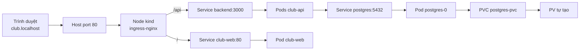
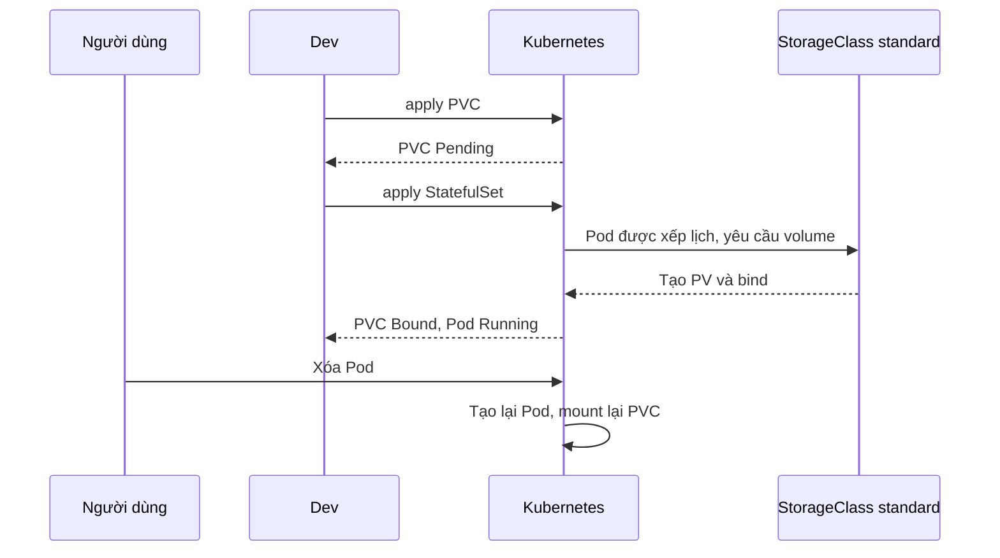

# Buổi 27 – Storage & Ingress

Tuần 14 · Giai đoạn 4 – Kubernetes Engineering · Slide: [Slide buổi 27](../../slides/07-operations/session-27.md)

> **Tóm tắt:** Dùng PV, PVC, StorageClass để PostgreSQL giữ dữ liệu khi Pod bị xóa, và dùng ingress-nginx trên kind để truy cập ứng dụng qua host club.localhost.

## Mục tiêu học tập

- Giải thích được vòng đời PV, PVC, StorageClass và vì sao Pod bị xóa nhưng dữ liệu vẫn còn.
- Chạy được PostgreSQL dạng StatefulSet có PVC trên cluster kind và chứng minh dữ liệu còn sau khi xóa Pod.
- Phân biệt được reclaim policy Delete và Retain, dự đoán điều gì xảy ra khi xóa PVC.
- Cài được ingress-nginx cho kind và định tuyến host club.localhost tới frontend và backend.
- Chẩn đoán được lỗi Ingress (404, 502, không truy cập được) và PVC bị Pending bằng kubectl describe.

## Điều kiện cần

- Đã hoàn thành buổi 23-26: Pod, Deployment, Service, ConfigMap, Secret, resource và probe.
- Có Docker Desktop (WSL2 integration bật), kind 0.23+, kubectl, làm việc trong filesystem WSL (ví dụ `~/devops-labs`).
- Có thư mục `starter-project/` đã sao chép vào repo cá nhân; image `club-api:1.0.0` và `club-web:1.0.0` đã build.
- Port 80 và 443 của máy chưa bị chương trình khác chiếm (kind sẽ map hai port này).

Kiểm tra nhanh:

```bash
docker version --format '{{.Server.Version}}'
kind version
kubectl version --client
docker image ls | grep -E 'club-(api|web)'
```

Kết quả mong đợi: Docker Server 27 trở lên, kind v0.23 trở lên, hai image có tag `1.0.0`. Nếu thiếu image, build lại:

```bash
cd ~/devops-labs/starter-project
docker build -t club-api:1.0.0 ./backend
docker build -t club-web:1.0.0 ./frontend
```

## Vấn đề thực tế

CLB chạy Club Management trên Kubernetes. Sau buổi 25, Postgres chạy như một Pod, nhưng khi một bạn lỡ chạy `kubectl delete pod` hoặc node khởi động lại, danh sách thành viên biến mất vì dữ liệu nằm trong filesystem tạm của container. Một cơ sở dữ liệu mà mất dữ liệu mỗi khi Pod chết thì không dùng được.

Vấn đề thứ hai: Service kiểu ClusterIP chỉ truy cập được từ trong cluster. Để xem ứng dụng, bạn đang dùng `kubectl port-forward` cho từng Service, mỗi lần một cổng khác nhau. Người dùng thật không làm vậy; họ gõ một tên miền, và một cổng vào duy nhất quyết định request đi tới frontend hay API. Buổi này giải quyết cả hai: lưu trữ bền vững (PVC) và cổng vào HTTP (Ingress).

## Khái niệm cốt lõi

### Vì sao cần storage riêng

Filesystem của container gắn với vòng đời container. Container bị thay thế thì lớp ghi (writable layer) bị bỏ. Kubernetes tách "chỗ chứa dữ liệu" khỏi Pod bằng ba đối tượng.

| Đối tượng | Ý nghĩa | Ai tạo | Ví dụ |
| --- | --- | --- | --- |
| PersistentVolume (PV) | Một phần dung lượng lưu trữ thật trong cluster | Admin hoặc provisioner tự động | Thư mục trên node kind |
| PersistentVolumeClaim (PVC) | Yêu cầu dung lượng và kiểu truy cập của một workload | Developer | `postgres-pvc`, 1Gi |
| StorageClass | Mô tả "loại" storage và cách tạo PV tự động | Admin | `standard` trên kind |

Chuỗi hoạt động: Pod tham chiếu PVC, PVC được gắn (bind) với một PV, PV trỏ tới storage thật. Với dynamic provisioning, bạn chỉ tạo PVC; StorageClass tự tạo PV phù hợp.

### Access mode, reclaim policy, binding mode

| Thuộc tính | Giá trị | Ý nghĩa |
| --- | --- | --- |
| accessModes | ReadWriteOnce (RWO) | Một node đọc/ghi tại một thời điểm; phù hợp database |
| accessModes | ReadOnlyMany, ReadWriteMany | Cần storage hỗ trợ; kind mặc định không có RWX |
| reclaimPolicy | Delete | Xóa PVC thì PV và dữ liệu bị xóa theo |
| reclaimPolicy | Retain | Xóa PVC thì PV còn, ở trạng thái Released, dữ liệu giữ lại để admin xử lý |
| volumeBindingMode | Immediate | Tạo PV ngay khi có PVC |
| volumeBindingMode | WaitForFirstConsumer | Chờ tới khi có Pod dùng PVC mới tạo PV, để chọn đúng node |

Trên kind, StorageClass mặc định tên `standard` (local-path provisioner), reclaimPolicy `Delete`, binding mode `WaitForFirstConsumer`. Hệ quả quan trọng: PVC vừa tạo ở trạng thái `Pending` là bình thường cho tới khi có Pod dùng nó.

### StatefulSet và PVC

Deployment dùng cho workload không trạng thái. Database cần danh tính ổn định và storage riêng, nên dùng StatefulSet. Trong lab này, `starter-project/k8s/postgres.yaml` tạo PVC `postgres-pvc` riêng rồi để StatefulSet mount vào. Với nhiều replica, bạn sẽ dùng `volumeClaimTemplates` để mỗi Pod có PVC riêng; với một replica, cách PVC tường minh giúp bạn thấy rõ từng đối tượng. Lưu ý: xóa StatefulSet hoặc Pod không xóa PVC; chỉ xóa PVC mới (có thể) làm mất dữ liệu.

### Ingress và Ingress controller

| Thành phần | Vai trò |
| --- | --- |
| Ingress (đối tượng API) | Khai báo luật: host nào, path nào, chuyển tới Service nào |
| Ingress controller (ví dụ ingress-nginx) | Pod chạy proxy thật, đọc các Ingress và áp dụng luật |
| IngressClass | Chọn controller nào xử lý Ingress (`ingressClassName: nginx`) |

Chỉ tạo Ingress mà không cài controller thì không có gì xảy ra: Ingress chỉ là khai báo. Ingress hoạt động ở tầng HTTP (host, path), khác với Service LoadBalancer hoạt động ở tầng TCP/UDP. Trên kind không có cloud load balancer, nên ta map port 80 và 443 của container node ra máy host bằng `extraPortMappings`, và gắn nhãn `ingress-ready=true` để controller được xếp lịch lên đúng node đó.

### Path matching

| pathType | Hành vi |
| --- | --- |
| Prefix | Khớp theo tiền tố từng đoạn path: `/api` khớp `/api` và `/api/members` |
| Exact | Chỉ khớp đúng path |
| ImplementationSpecific | Tùy controller |

Nhiều rule cùng khớp thì rule có path dài hơn được ưu tiên, nên `/api` thắng `/`.

## Kiến trúc và cách hoạt động



Từng bước của một request `GET http://club.localhost/api/members`:

1. Trình duyệt phân giải `club.localhost` về 127.0.0.1 (tên miền `.localhost` luôn trỏ về máy local).
2. Request tới port 80 của máy; Docker map vào port 80 của container node kind (do `extraPortMappings`).
3. ingress-nginx nhận request, tìm Ingress có host `club.localhost` và path `/api`, chuyển tới Service `backend` port 3000.
4. Service chọn một trong hai Pod `club-api`; Pod này truy vấn Service `postgres`.
5. Pod `postgres-0` đọc dữ liệu từ `/var/lib/postgresql/data`, thực chất là PV gắn qua PVC `postgres-pvc`.



## Demo của mentor

Mục đích: cho cả lớp thấy dữ liệu sống sót qua việc xóa Pod, và Ingress là "bảng chỉ đường". Dùng cluster đã tạo sẵn (hoặc tạo ở phần Chuẩn bị của lab). Thời lượng khoảng 15 phút trong 30 phút lý thuyết.

1. Quan sát StorageClass:

```bash
kubectl get storageclass
```

Kết quả mong đợi (rút gọn):

```text
NAME                 PROVISIONER             RECLAIMPOLICY   VOLUMEBINDINGMODE
standard (default)   rancher.io/local-path   Delete          WaitForFirstConsumer
```

Hỏi lớp: "Vì sao binding mode là WaitForFirstConsumer? Nếu cluster có 3 node thì điều gì có thể sai nếu PV tạo trước khi biết Pod chạy ở node nào?"

2. Tạo riêng PVC và quan sát trạng thái Pending:

```bash
kubectl apply -f starter-project/k8s/namespace.yaml
kubectl apply -n club -f - <<'EOF'
apiVersion: v1
kind: PersistentVolumeClaim
metadata:
  name: demo-pvc
spec:
  accessModes: [ReadWriteOnce]
  resources:
    requests:
      storage: 100Mi
EOF
kubectl get pvc -n club demo-pvc
```

Kết quả mong đợi: `STATUS` là `Pending`. Chạy `kubectl describe pvc demo-pvc -n club`, mục Events nói "waiting for first consumer". Hỏi lớp: "Pending ở đây là lỗi không?" (Không.)

3. Tạo Pod dùng PVC, ghi file, xóa Pod, tạo lại:

```bash
kubectl apply -n club -f - <<'EOF'
apiVersion: v1
kind: Pod
metadata:
  name: demo-writer
spec:
  containers:
    - name: busybox
      image: busybox:1.36
      command: ["sh", "-c", "date >> /data/log.txt; sleep 3600"]
      volumeMounts:
        - name: data
          mountPath: /data
  volumes:
    - name: data
      persistentVolumeClaim:
        claimName: demo-pvc
EOF
kubectl wait -n club --for=condition=Ready pod/demo-writer --timeout=60s
kubectl get pvc,pv -n club
kubectl delete pod demo-writer -n club
```

Kết quả mong đợi: PVC chuyển `Bound`, có một PV tên dạng `pvc-xxxxxxxx`. Sau đó apply lại Pod rồi `kubectl exec -n club demo-writer -- cat /data/log.txt` thấy hai dòng ngày giờ: dữ liệu còn nguyên. Hỏi lớp: "Nếu giờ xóa PVC thì file còn không?"

4. Dọn dẹp demo: `kubectl delete pod demo-writer -n club --ignore-not-found` rồi `kubectl delete pvc demo-pvc -n club`. Cho lớp thấy `kubectl get pv` không còn PV tương ứng (reclaimPolicy Delete).

5. Ingress: giải thích file `starter-project/k8s/ingress.yaml` từng dòng (`ingressClassName`, `host`, hai `path`). Hỏi lớp: "Nếu đổi thứ tự hai path, `/api/members` đi đâu?" (Vẫn tới backend vì path dài hơn thắng.)

## Hands-on lab

Thời gian dự kiến: 60 phút. Mục tiêu: chạy toàn bộ Club Management trên kind, Postgres có PVC, truy cập qua `http://club.localhost`.

### Chuẩn bị

Làm việc trong WSL:

```bash
cd ~/devops-labs
mkdir -p lab-27/source lab-27/evidence lab-27/screenshots
cp -r ~/devops-labs/starter-project lab-27/source/ 2>/dev/null || true
cd lab-27/source/starter-project
```

Nếu bạn dùng thư mục starter-project ở nơi khác, hãy `cd` vào đó. Từ đây các đường dẫn `k8s/...` tính từ thư mục `starter-project`.

Xóa cluster cũ (nếu có) để dùng cấu hình có port mapping:

```bash
kind get clusters
kind delete cluster --name club
```

Lệnh này xóa toàn bộ workload trong cluster `club` cũ; nếu chưa có cluster thì kind chỉ báo không tìm thấy, bỏ qua.

Ghi toàn bộ lệnh và kết quả vào file bằng cách chạy `script` hoặc sao chép tay vào `../../evidence/command-output.txt`.

### Phần 1. Tạo cluster kind có port mapping

1. Xem cấu hình cluster:

```bash
cat k8s/kind-config.yaml
```

Hai điểm quan trọng: nhãn `ingress-ready=true` và `extraPortMappings` cho port 80, 443. Thiếu hai điểm này, ingress-nginx không nhận được traffic từ máy host.

2. Tạo cluster:

```bash
kind create cluster --name club --config k8s/kind-config.yaml
kubectl cluster-info --context kind-club
```

Kết quả mong đợi:

```text
Creating cluster "club" ...
 ✓ Ensuring node image
 ✓ Preparing nodes
Set kubectl context to "kind-club"
```

Vì sao: cluster kind là một container Docker; port mapping chỉ có thể đặt lúc tạo cluster, không sửa sau được.

3. Nạp image vào kind (kind không tự thấy image trong Docker local):

```bash
kind load docker-image club-api:1.0.0 --name club
kind load docker-image club-web:1.0.0 --name club
```

Nếu lệnh báo không tìm thấy image, quay lại phần Điều kiện cần để build.

### Phần 2. Postgres với PVC

1. Tạo namespace, ConfigMap và Secret (Secret tạo bằng lệnh, không commit giá trị thật):

```bash
kubectl apply -f k8s/namespace.yaml
kubectl apply -f k8s/configmap.yaml
kubectl create secret generic club-secrets -n club --from-literal=db-password='lab-local-pass-27'
```

Kết quả mong đợi: `secret/club-secrets created`. Giá trị mật khẩu chỉ dùng cho lab local.

2. Triển khai Postgres:

```bash
kubectl apply -f k8s/postgres.yaml
kubectl get pvc -n club
kubectl get pods -n club -w
```

Kết quả mong đợi: ban đầu PVC `Pending`, vài giây sau `Bound`; Pod `postgres-0` chuyển `Running` và `READY 1/1`. Nhấn Ctrl+C để thoát chế độ `-w`.

Vì sao: PVC Pending cho tới khi Pod `postgres-0` được xếp lịch (WaitForFirstConsumer), sau đó local-path provisioner tạo PV.

3. Xem PV và PVC liên kết với nhau:

```bash
kubectl get pv
kubectl describe pvc postgres-pvc -n club
```

Kết quả mong đợi: một PV `Bound` với `CLAIM` là `club/postgres-pvc`, `RECLAIM POLICY` là `Delete`, StorageClass `standard`. Ghi lại tên PV, bạn sẽ cần ở L2.

4. Tạo bảng và dữ liệu mẫu (Kubernetes không tự chạy `init.sql` như Compose):

```bash
kubectl exec -i -n club postgres-0 -- psql -U club -d clubdb < database/init.sql
kubectl exec -n club postgres-0 -- psql -U club -d clubdb -c "SELECT id, name, email FROM members;"
```

Kết quả mong đợi:

```text
 id | name  |      email
----+-------+-------------------
  1 | Alice | alice@example.com
  2 | Bob   | bob@example.com
```

Nếu không thấy thư mục `database/`, tìm đúng đường dẫn file `init.sql` trong starter-project.

5. Thêm một dòng "của riêng bạn" để dễ nhận ra dữ liệu:

```bash
kubectl exec -n club postgres-0 -- psql -U club -d clubdb -c "INSERT INTO members (name, email) VALUES ('Ban', 'ban@example.com');"
```

### Phần 3. Chứng minh dữ liệu còn sau khi xóa Pod

1. Xóa Pod:

```bash
kubectl delete pod postgres-0 -n club
kubectl get pods -n club -w
```

Kết quả mong đợi: StatefulSet tạo lại Pod cùng tên `postgres-0`, trở lại `Running`.

2. Kiểm tra dữ liệu:

```bash
kubectl exec -n club postgres-0 -- psql -U club -d clubdb -c "SELECT count(*) FROM members;"
```

Kết quả mong đợi: `count` là 3, bao gồm dòng `Ban`.

Vì sao: Pod mới mount lại cùng PVC, nên thấy cùng dữ liệu. Biến `PGDATA=/var/lib/postgresql/data/pgdata` (đặt trong `postgres.yaml`) tránh lỗi Postgres từ chối khởi tạo khi thư mục mount có thư mục `lost+found` hoặc không rỗng.

### Phần 4. Triển khai backend và frontend

```bash
kubectl apply -f k8s/backend.yaml
kubectl apply -f k8s/frontend.yaml
kubectl rollout status deployment/club-api -n club
kubectl rollout status deployment/club-web -n club
kubectl get pods -n club
```

Kết quả mong đợi: hai Pod `club-api`, một Pod `club-web`, một Pod `postgres-0`, tất cả `1/1 Running`.

Kiểm tra backend trước khi có Ingress, để biết lỗi (nếu có) không thuộc về Ingress:

```bash
kubectl port-forward -n club svc/backend 3001:3000 &
sleep 2
curl -s http://localhost:3001/ready
curl -s http://localhost:3001/api/members
kill %1
```

Kết quả mong đợi: `{"status":"ready"}` và danh sách ba thành viên dạng JSON. Dùng port 3001 để tránh xung đột port 3000 trên máy.

### Phần 5. Cài ingress-nginx và tạo Ingress

1. Cài ingress-nginx bản manifest dành cho kind (do dự án kind duy trì, đã kèm toleration và nhãn node cần thiết):

```bash
kubectl apply -f https://raw.githubusercontent.com/kubernetes/ingress-nginx/controller-v1.12.1/deploy/static/provider/kind/deploy.yaml
kubectl wait --namespace ingress-nginx \
  --for=condition=ready pod \
  --selector=app.kubernetes.io/component=controller \
  --timeout=120s
```

Kết quả mong đợi: `pod/ingress-nginx-controller-... condition met`. Lần đầu có thể mất 1-2 phút để kéo image.

Vì sao: manifest này yêu cầu node có nhãn `ingress-ready=true`, và bạn đã đặt nhãn đó trong `kind-config.yaml`. URL ghim vào tag `controller-v1.12.1` để mọi học viên cài cùng một phiên bản. Lưu ý: dự án ingress-nginx đã thông báo ngừng bảo trì từ tháng 3/2026; bản đã ghim vẫn chạy tốt cho lab local, nhưng với hệ thống thật hãy xem xét Gateway API hoặc controller khác (xem trang kind - Ingress để biết hướng dẫn mới nhất).

2. Áp dụng Ingress của dự án:

```bash
cat k8s/ingress.yaml
kubectl apply -f k8s/ingress.yaml
kubectl get ingress -n club
```

Kết quả mong đợi: Ingress `club`, HOSTS là `club.localhost`, CLASS là `nginx`.

3. Truy cập qua Ingress. Dùng header Host để không phụ thuộc DNS của WSL:

```bash
curl -s -H "Host: club.localhost" http://127.0.0.1/api/members
curl -s -o /dev/null -w "%{http_code}\n" -H "Host: club.localhost" http://127.0.0.1/
```

Kết quả mong đợi: JSON thành viên và mã `200`. Trên Windows, mở trình duyệt vào `http://club.localhost` sẽ thấy giao diện frontend.

Vì sao: Ingress chọn luật theo header Host; không có header đúng, controller trả 404.

4. Xem log controller để thấy request đi qua:

```bash
kubectl logs -n ingress-nginx -l app.kubernetes.io/component=controller --tail=5
```

### L1 – Foundation: checklist hoàn thành

- [ ] Cluster `club` tạo bằng `k8s/kind-config.yaml`, `kubectl get nodes` báo `Ready`.
- [ ] PVC `postgres-pvc` ở trạng thái `Bound`, có chụp/ghi lại kết quả `kubectl get pvc,pv`.
- [ ] Bảng `members` có dữ liệu, kể cả dòng do bạn thêm.
- [ ] Sau khi xóa `postgres-0`, truy vấn vẫn thấy đủ dữ liệu.
- [ ] `curl -H "Host: club.localhost" http://127.0.0.1/api/members` trả JSON.
- [ ] Lưu lệnh và output vào `evidence/command-output.txt`.

### L2 – Engineering: thử thách tự làm

Thử thách 1. Chứng minh vòng đời PV/PVC. Không xem gợi ý trước.

- Ghi tên PV hiện tại và reclaim policy.
- Dự đoán rồi kiểm chứng: xóa StatefulSet `postgres` (không xóa PVC) thì dữ liệu còn không? Tạo lại StatefulSet, truy vấn lại.
- Dự đoán rồi kiểm chứng: xóa PVC thì chuyện gì xảy ra với PV và dữ liệu?
- Tiêu chí hoàn thành: bảng 3 dòng (hành động, dự đoán, kết quả thực tế) trong `report.md`, và giải thích vì sao khi xóa PVC mà Pod vẫn đang dùng, PVC ở trạng thái `Terminating`.

<details>
<summary>Gợi ý</summary>

- `kubectl delete statefulset postgres -n club` rồi `kubectl apply -f k8s/postgres.yaml`: PVC không bị đụng tới.
- `kubectl delete pvc postgres-pvc -n club` khi Pod còn chạy sẽ treo ở `Terminating` do finalizer `kubernetes.io/pvc-protection`; xóa Pod/StatefulSet trước.
- Theo dõi PV bằng `kubectl get pv -w` ở terminal thứ hai.

</details>

<details>
<summary>Lời giải</summary>

```bash
kubectl get pv
kubectl delete statefulset postgres -n club
kubectl get pvc -n club                 # vẫn Bound
kubectl apply -f k8s/postgres.yaml
kubectl exec -n club postgres-0 -- psql -U club -d clubdb -c "SELECT count(*) FROM members;"   # còn dữ liệu

kubectl delete statefulset postgres -n club
kubectl delete pvc postgres-pvc -n club
kubectl get pv                          # PV biến mất vì reclaimPolicy Delete
kubectl apply -f k8s/postgres.yaml      # tạo lại PVC mới, database rỗng
kubectl exec -n club postgres-0 -- psql -U club -d clubdb -c "\dt"   # không có bảng members
```

Kết luận: xóa PVC với reclaimPolicy Delete làm mất dữ liệu vĩnh viễn; phải chạy lại `init.sql`.

</details>

Thử thách 2. Chuyển sang Retain. Đặt PV hiện tại về `Retain` bằng `kubectl patch pv`, xóa StatefulSet và PVC, quan sát PV chuyển `Released`. Giải thích vì sao PV `Released` chưa thể bind lại cho PVC mới và nêu cách admin phục hồi (gợi ý: `claimRef`).

- Tiêu chí hoàn thành: output `kubectl get pv` trước và sau, cùng lời giải thích 3-5 câu.

<details>
<summary>Gợi ý</summary>

Lệnh patch có dạng `kubectl patch pv TEN_PV -p '{"spec":{"persistentVolumeReclaimPolicy":"Retain"}}'`. Thay `TEN_PV` bằng tên PV thật từ `kubectl get pv`. PV Released còn `claimRef` trỏ tới PVC cũ, nên không bind cho PVC khác.

</details>

<details>
<summary>Lời giải</summary>

```bash
PV=$(kubectl get pvc postgres-pvc -n club -o jsonpath='{.spec.volumeName}')
kubectl patch pv "$PV" -p '{"spec":{"persistentVolumeReclaimPolicy":"Retain"}}'
kubectl delete statefulset postgres -n club
kubectl delete pvc postgres-pvc -n club
kubectl get pv     # STATUS: Released
```

PV giữ dữ liệu nhưng còn `claimRef` cũ. Để dùng lại: xóa `spec.claimRef` (`kubectl patch pv "$PV" --type=json -p='[{"op":"remove","path":"/spec/claimRef"}]'`) để PV về `Available`, rồi tạo PVC khớp (storageClassName, dung lượng) hoặc đặt `volumeName` trong PVC. Với local-path, dữ liệu nằm trên node nên phải dọn thủ công khi không cần nữa.

</details>

Thử thách 3 (nếu còn thời gian). Thêm host thứ hai. Tạo Ingress mới (file `lab-27/source/ingress-api.yaml`, tức `../ingress-api.yaml` tính từ thư mục `starter-project`) để `api.club.localhost` chuyển toàn bộ tới Service `backend`, trong khi `club.localhost` vẫn hoạt động. Kiểm tra bằng curl với header Host.

- Tiêu chí hoàn thành: hai lệnh curl khác host trả đúng nội dung, `kubectl describe ingress` hiển thị cả hai rule.

<details>
<summary>Lời giải</summary>

```yaml
apiVersion: networking.k8s.io/v1
kind: Ingress
metadata:
  name: club-api-host
  namespace: club
spec:
  ingressClassName: nginx
  rules:
    - host: api.club.localhost
      http:
        paths:
          - path: /
            pathType: Prefix
            backend:
              service:
                name: backend
                port:
                  number: 3000
```

```bash
kubectl apply -f ../ingress-api.yaml
curl -s -H "Host: api.club.localhost" http://127.0.0.1/api/members
```

</details>

## Phá lỗi và debug

### Tình huống A. PVC bị Pending mãi (liên quan Tình huống 09 – Pod Pending)

Phá: tạo PVC tham chiếu StorageClass không tồn tại.

```bash
kubectl apply -n club -f - <<'EOF'
apiVersion: v1
kind: PersistentVolumeClaim
metadata:
  name: broken-pvc
spec:
  storageClassName: fast-ssd
  accessModes: [ReadWriteOnce]
  resources:
    requests:
      storage: 1Gi
EOF
kubectl get pvc -n club broken-pvc
```

Triệu chứng: `STATUS` là `Pending` không đổi; nếu Pod dùng PVC này, Pod cũng `Pending`.

Điều tra theo bước:

1. `kubectl describe pvc broken-pvc -n club`: đọc Events, thấy `storageclass.storage.k8s.io "fast-ssd" not found`.
2. `kubectl get storageclass`: chỉ có `standard`.
3. Phân biệt với Pending bình thường của WaitForFirstConsumer (Events nói "waiting for first consumer").

Nguyên nhân gốc: tên StorageClass sai nên không có provisioner nào xử lý PVC. Cách sửa: xóa PVC, tạo lại với `standard` hoặc bỏ trường `storageClassName` để dùng mặc định. Phòng tránh: kiểm tra `kubectl get storageclass` trước khi viết PVC; PVC không đổi được `storageClassName` sau khi tạo.

Dọn dẹp: `kubectl delete pvc broken-pvc -n club`. Xem thêm `examples/troubleshooting/scenario-09`.

### Tình huống B. Ingress trả 404 hoặc 503

Phá 1: gọi không có header Host đúng.

```bash
curl -s -o /dev/null -w "%{http_code}\n" http://127.0.0.1/api/members
```

Triệu chứng: mã `404` từ nginx vì không có rule cho host `127.0.0.1`.

Phá 2: tạo bản lỗi từ file gốc bằng `sed 's/name: backend$/name: backendd/' k8s/ingress.yaml | kubectl apply -f -`, tức là sửa tên Service trong Ingress thành `backendd` rồi apply lại, gọi `curl -i -H "Host: club.localhost" http://127.0.0.1/api/members`.

Triệu chứng: `503 Service Temporarily Unavailable` (không có endpoint hợp lệ).

Điều tra:

1. `kubectl describe ingress club -n club`: cột Backends hiển thị `backendd:3000 (<error: endpoints "backendd" not found>)`.
2. `kubectl get svc,endpoints -n club`: đối chiếu tên Service và có endpoint hay không.
3. `kubectl logs -n ingress-nginx -l app.kubernetes.io/component=controller --tail=20`.

Nguyên nhân gốc: Ingress tham chiếu Service không tồn tại, hoặc Service không có Pod Ready. Phòng tránh: dùng `kubectl describe ingress` ngay sau khi apply; kiểm tra readiness của backend. Khôi phục bằng `kubectl apply -f k8s/ingress.yaml`.

### Tình huống C. Cluster thiếu port mapping

Nếu cluster tạo bằng `kind create cluster` mặc định (không có `--config`), `curl http://127.0.0.1/` báo `Connection refused` dù controller chạy tốt. Điều tra bằng `docker ps` và xem cột PORTS của container `club-control-plane`: không có `0.0.0.0:80->80/tcp`. Cách sửa: xóa cluster và tạo lại với `k8s/kind-config.yaml`.

## Lỗi thường gặp

| Triệu chứng | Nguyên nhân | Cách xử lý |
| --- | --- | --- |
| PVC `Pending` ngay sau khi tạo | WaitForFirstConsumer, chưa có Pod dùng PVC | Bình thường; tạo Pod dùng PVC |
| PVC `Pending` mãi dù có Pod | StorageClass sai tên hoặc không có provisioner | `kubectl describe pvc`, sửa `storageClassName` |
| `postgres-0` CrashLoopBackOff, log báo thư mục data không rỗng | Thiếu `PGDATA` trỏ thư mục con | Dùng `PGDATA=/var/lib/postgresql/data/pgdata`, xóa PVC cũ hỏng và tạo lại |
| Xóa PVC xong database rỗng | reclaimPolicy Delete | Sao lưu trước; dùng Retain cho dữ liệu quan trọng |
| `curl` tới localhost:80 bị refused | Cluster tạo thiếu `extraPortMappings`, hoặc port 80 bị chiếm | Tạo lại cluster với `kind-config.yaml`; kiểm tra port 80 |
| Ingress có nhưng trả 404 | Sai host/header, hoặc thiếu `ingressClassName: nginx` | Gọi đúng Host; kiểm tra `kubectl get ingressclass` |
| Controller `Pending` | Node thiếu nhãn `ingress-ready=true` | Tạo lại cluster đúng cấu hình |
| `ErrImageNeverPull` hoặc `ImagePullBackOff` ở backend | Quên `kind load docker-image` | Nạp lại image vào cluster `club` |
| `/api/members` trả 500, bảng không tồn tại | Chưa chạy `init.sql` trên Postgres mới | Chạy lại lệnh `psql < init.sql` |

## Tự kiểm tra

1. PV, PVC và StorageClass khác nhau thế nào? Developer thường tạo đối tượng nào?
2. Vì sao PVC trên kind ở trạng thái Pending trước khi có Pod, và đó có phải lỗi không?
3. reclaimPolicy Delete và Retain khác nhau thế nào khi xóa PVC?
4. Chỉ cài Ingress mà không có Ingress controller thì điều gì xảy ra?
5. Vì sao kind cần `extraPortMappings` và nhãn `ingress-ready=true`?
6. Tình huống: bạn xóa `postgres-0`, Pod tạo lại, dữ liệu còn. Hôm sau bạn xóa PVC rồi apply lại `postgres.yaml`, database rỗng. Giải thích cả hai kết quả.
7. Tình huống: `curl http://127.0.0.1/api/members` trả 404 còn port-forward trực tiếp vào Service thì chạy. Bạn kiểm tra gì theo thứ tự?

<details>
<summary>Đáp án</summary>

1. PV là dung lượng thật; PVC là yêu cầu của workload; StorageClass mô tả loại storage và cách tạo PV tự động. Developer tạo PVC.
2. Binding mode WaitForFirstConsumer chờ Pod được xếp lịch để chọn node; không phải lỗi. Dùng `describe pvc` để thấy Events.
3. Delete: xóa PV và dữ liệu cùng PVC. Retain: PV còn ở trạng thái Released, dữ liệu giữ lại, admin phải xử lý thủ công.
4. Không có gì: Ingress chỉ là khai báo, cần controller (ví dụ ingress-nginx) đọc và thực thi.
5. Cluster kind chạy trong container Docker; port mapping đưa port 80/443 của host vào node, nhãn giúp controller chạy đúng node có mapping.
6. Xóa Pod: PVC và PV vẫn còn, Pod mới mount lại nên còn dữ liệu. Xóa PVC với policy Delete: PV và dữ liệu bị xóa, PVC mới cấp PV mới trống.
7. Có gửi đúng header Host `club.localhost` không; `kubectl describe ingress`; `ingressClassName`; Service và endpoints có tồn tại không; log controller.

</details>

## Nộp bài

Nộp vào thư mục `lab-27/` trong repository cá nhân theo `templates/lab-template.md`.

- [ ] `README.md` trả lời đủ 7 câu theo template, ghi rõ đã làm L1 hay L2.
- [ ] `source/` chứa manifest bạn dùng hoặc sửa (`postgres.yaml`, `ingress.yaml`, `ingress-api.yaml` nếu làm L2).
- [ ] `evidence/command-output.txt` có output của `kubectl get pvc,pv`, `kubectl get ingress -n club`, truy vấn dữ liệu trước và sau khi xóa Pod, và hai lệnh curl.
- [ ] `report.md` có bảng dự đoán/kết quả của thử thách 1, phân tích một lỗi bạn đã gặp (hoặc Tình huống A/B) kèm nguyên nhân gốc.
- [ ] `screenshots/` có ảnh trình duyệt mở `http://club.localhost` (bổ sung, không thay cho evidence).
- [ ] Không commit mật khẩu thật; Secret chỉ tạo bằng lệnh, không có file chứa giá trị thật trong repo.

## Recap

- PVC tách dữ liệu khỏi vòng đời Pod; Pod bị xóa không làm mất dữ liệu, xóa PVC thì có thể.
- StorageClass cấp PV tự động; trên kind là `standard` với policy Delete và WaitForFirstConsumer.
- Database trên Kubernetes dùng StatefulSet, RWO, `PGDATA` trỏ thư mục con, và init dữ liệu là việc của bạn.
- Ingress chỉ là luật; cần Ingress controller để chạy, và kind cần port mapping cùng nhãn node.
- Path dài hơn thắng: `/api` tới backend, `/` tới frontend.
- Debug theo lớp: PVC (describe) rồi Pod, Service và endpoints, Ingress, cuối cùng log controller.

## Tài liệu tham khảo

- [Persistent Volumes](https://kubernetes.io/docs/concepts/storage/persistent-volumes/)
- [Storage Classes](https://kubernetes.io/docs/concepts/storage/storage-classes/)
- [Ingress](https://kubernetes.io/docs/concepts/services-networking/ingress/)
- [StatefulSets](https://kubernetes.io/docs/concepts/workloads/controllers/statefulset/)
- [kind – Ingress](https://kind.sigs.k8s.io/docs/user/ingress/)
- [ingress-nginx documentation](https://kubernetes.github.io/ingress-nginx/)
