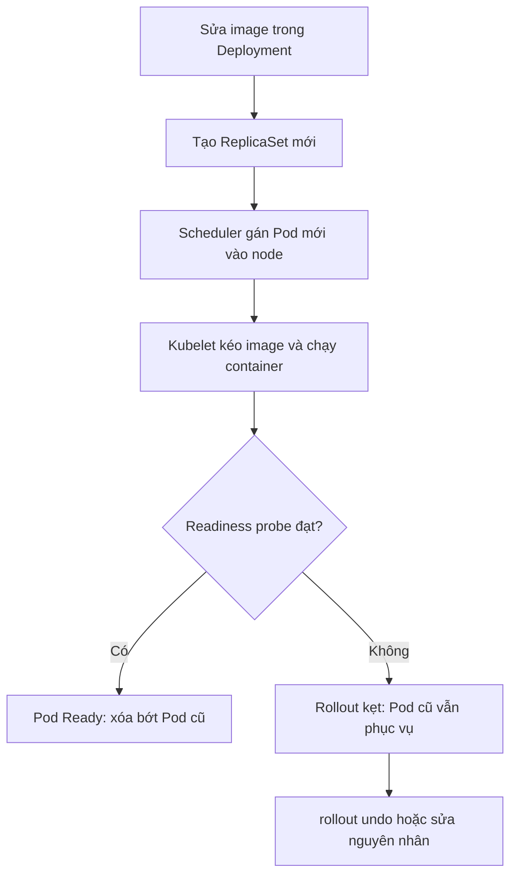

# Buổi 28 – Thử thách nâng cao

Tuần 14/16 · Giai đoạn 4 – Kubernetes Engineering · Buổi 28/32

[Bài học chính](session-28.md) · [Slide](../../slides/07-operations/session-28.md) · [Bài tập tuần](../../assignments/weekly/week-14.md) · [Hub tuần](README.md)

> **Tóm tắt:** Trang phụ của buổi 28: ba thử thách L2 (ba tình huống chỉ có triệu chứng, sự cố trên ứng dụng thật club-api, report 5 mục) và tình huống tổng hợp Pod 0/1 sau khi deploy.

::: tip Trang này dành cho ai
Bạn đã xong checklist L1 của [Buổi 28 – Kubernetes Operations](session-28.md) và còn thời gian, hoặc bạn cần phần L2 cho bài tập tuần. Ở trang này bạn chỉ nhận triệu chứng, đáp án nằm ở phía mentor: hãy tự điều tra bằng quy trình `get pods`, `describe`, `logs --previous`, rồi mới đối chiếu với [Walkthrough tuần 14](../../mentors/walkthroughs/week-14.md) sau khi nộp bài.
:::

## Thử thách L2 {#thu-thach}

**Thử thách 1. Ba tình huống chỉ có triệu chứng.** Xử lý `examples/troubleshooting/scenario-07`, `scenario-08` và `scenario-09` (ImagePullBackOff, CrashLoopBackOff, Pod Pending). Mentor dựng lỗi giúp bạn; tự học thì chạy `setup.sh` của từng thư mục (kịch bản 07 cần chạy bằng `KIND_CLUSTER=club bash setup.sh`), chỉ đọc `README.md` và chưa mở `deployment.yaml` trước khi điều tra. Mỗi tình huống chạy trong namespace riêng (`ts-07`, `ts-08`, `ts-09`).

| Tình huống | Triệu chứng bạn nhận được |
| --- | --- |
| 07 | Pod `club-api` không lên `Running`; `ErrImagePull`, vài chục giây sau `ImagePullBackOff`. Người triển khai nói: "Tôi đã build image rồi mà". |
| 08 | Pod `club-notes` `CrashLoopBackOff`, `RESTARTS` tăng dần. `describe pod` không có dòng nào về lỗi kéo image hay lỗi scheduling. |
| 09 | Pod `club-web` `Pending` mãi, cột `NODE` trống, chưa có container nào được tạo. |

- Tiêu chí hoàn thành: mỗi tình huống có bằng chứng (lệnh và output) chỉ ra nguyên nhân, cách sửa, và cách kiểm chứng đã khôi phục (`1/1 Running`). Dọn dẹp bằng `bash cleanup.sh` trong thư mục tình huống.

**Thử thách 2. Sự cố trên ứng dụng thật của CLB.** Namespace `club` vẫn còn `club-api` từ [Buổi 27 – Storage & Ingress](session-27.md). Chạy:

```bash
kubectl -n club set image deployment/club-api api=club-api:9.9.9
kubectl -n club rollout status deployment/club-api --timeout=60s
```

- Tiêu chí hoàn thành: giải thích vì sao ứng dụng vẫn phục vụ được trong lúc rollout kẹt, tìm ra nguyên nhân gốc, khôi phục bằng `rollout undo`, và chạy lại `kubectl -n club get pods` để chứng minh 2 replicas `Ready`.

<details>
<summary>Gợi ý (tự thử 15 phút trước khi mở)</summary>

Trong lúc rollout kẹt, `maxUnavailable` mặc định 25% làm tròn xuống: với 2 replicas là 0, nên Pod cũ chỉ bị xóa sau khi Pod mới `Ready`. Dùng `kubectl -n club get rs` để thấy hai ReplicaSet và `kubectl -n club describe pod` trên Pod mới để đọc event. Hãy hỏi: tag `9.9.9` đã từng được build và nạp vào node kind chưa? Sau khi undo, kiểm tra image bằng `kubectl -n club get deployment club-api -o jsonpath='{.spec.template.spec.containers[0].image}'`, kết quả mong đợi là `club-api:1.0.0`.

</details>

**Thử thách 3. Troubleshooting report.** Viết `report.md` theo mẫu 5 mục ở mục [Mẫu report 5 mục](#mau-report) ở cuối trang này cho ít nhất hai sự cố (L2: gồm tình huống 07, 08, 09).

## Phá lỗi nâng cao {#pha-loi}

**Tình huống tổng hợp: "bản mới của API chết sau khi deploy".** Người giao đề (mentor hoặc bạn cùng nhóm) phá giúp bạn và chỉ nói: "Sau khi cập nhật, `get pods` có Pod không Ready, nhưng web vẫn mở được".

Triệu chứng bạn quan sát: Pod `Running` nhưng `READY 0/1`, rollout không hoàn tất, cột `RESTARTS` không tăng.

Nhiệm vụ: tìm nguyên nhân gốc bằng `get pods`, `describe pod` và các lệnh kiểm tra từ bên ngoài (`kubectl port-forward` rồi `curl`), sửa, rồi xác nhận bằng `rollout status`. Ghi lại thành một sự cố theo mẫu 5 mục. Phòng tránh hãy nêu một thay đổi cụ thể (ví dụ cách kiểm tra cấu hình trước khi apply). Tình huống tương tự được đào sâu ở [Buổi 26 – Resource & Health](../week-13/session-26.md).

Nếu bạn tự học, tự phá bằng cách đổi `readinessProbe` của một Deployment sang một đường dẫn mà ứng dụng không có, rồi apply và chỉ nhìn triệu chứng như ở trên.

## Tìm hiểu thêm {#tim-hieu-them}

Các bước của một rollout và trạng thái lỗi tương ứng:



Lỗi ở nút C ra `Pending`, ở nút D ra `ImagePullBackOff` hoặc `CrashLoopBackOff`, ở nút E ra `Running` nhưng `0/1`. Giải thích từng bước: Deployment so `spec.template` với ReplicaSet hiện tại và tạo ReplicaSet mới nếu khác; scheduler chọn node (không có chỗ thì `Pending` kèm `FailedScheduling`); kubelet kéo image (thất bại thì `ErrImagePull` rồi `ImagePullBackOff`) rồi chạy container (thoát liên tục thì `CrashLoopBackOff`); khi readiness probe đạt, Pod vào Service endpoints và Deployment mới xóa Pod cũ tương ứng; bước nào kẹt thì Pod cũ và mới cùng tồn tại.

Bộ công cụ chẩn đoán:

| Lệnh | Dùng khi |
| --- | --- |
| `kubectl get pods -o wide` | Xem trạng thái, restart, node |
| `kubectl describe pod TEN_POD` | Xem Events, Last State, exit code, điều kiện |
| `kubectl get events --sort-by=.lastTimestamp` | Xem dòng thời gian sự kiện trong namespace |
| `kubectl logs TEN_POD --previous` | Xem log của lần chạy trước (khi container đã crash) |
| `kubectl rollout history deployment/TEN` | Xem các revision |
| `kubectl rollout undo deployment/TEN` | Quay về revision trước |

## Mẫu report 5 mục {#mau-report}

Dùng cho `report.md` của bài tập tuần (ít nhất hai sự cố; L2 gồm tình huống 07, 08, 09):

```text
## Sự cố NN – tên ngắn
1. Triệu chứng: bạn thấy gì, lúc nào, lệnh nào cho thấy
2. Bằng chứng: trích events, logs, exit code (kèm lệnh)
3. Nguyên nhân gốc: một câu, giải thích vì sao xảy ra
4. Cách khắc phục: lệnh hoặc thay đổi YAML đã làm, và cách kiểm chứng
5. Phòng tránh: thay đổi quy trình hoặc cấu hình để không lặp lại
```
