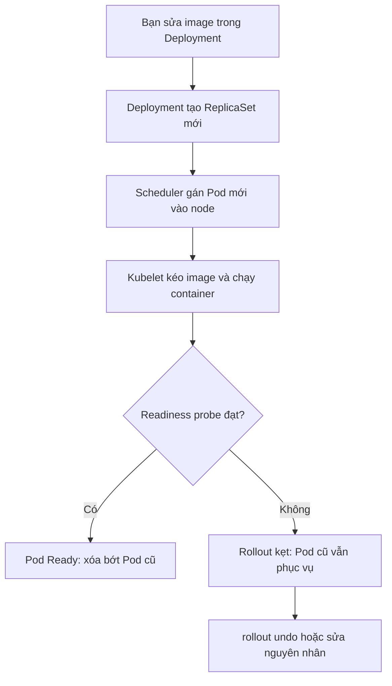
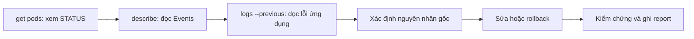

# Buổi 28 – Kubernetes Operations

Tuần 14 · Giai đoạn 4 – Kubernetes Engineering · Slide: [Slide buổi 28](../../slides/07-operations/session-28.md)

> **Tóm tắt:** Vận hành workload trên Kubernetes: rollout, rollback, scale, đọc events, và chẩn đoán ImagePullBackOff, CrashLoopBackOff, Pending theo quy trình từ triệu chứng đến nguyên nhân gốc.

## Mục tiêu học tập

- Giải thích Deployment cập nhật Pod bằng ReplicaSet mới như thế nào, và vai trò của `maxSurge`, `maxUnavailable`.
- Chạy được `kubectl rollout status`, `history`, `undo` và `kubectl scale` trên một Deployment.
- Đọc được `kubectl describe` và `kubectl get events` để tìm lý do thật sự một Pod không chạy.
- Chẩn đoán được ImagePullBackOff, CrashLoopBackOff và Pending bằng bằng chứng (events, logs, exit code), không đoán mò.
- Phân biệt "rollback để cứu dịch vụ" với "sửa nguyên nhân gốc", và viết Troubleshooting report 5 mục.

## Điều kiện cần

- Đã hoàn thành buổi 22-27: Pod, Deployment, Service, ConfigMap/Secret, probes, PVC/Ingress.
- Cluster kind `club` đang chạy (tạo ở buổi 27 bằng `kind create cluster --name club --config starter-project/k8s/kind-config.yaml`), `kubectl` trỏ đúng context. Cần Internet để kéo image `nginx` và `busybox` từ Docker Hub.
- Làm việc trong filesystem của WSL (ví dụ `~/devops-labs/lab-28`), không dùng `/mnt/c`.

Kiểm tra nhanh:

```bash
kubectl config current-context
kubectl get nodes
```

Kết quả mong đợi (nếu bạn đặt tên cluster khác `club` thì context và tên node sẽ khác):

```text
kind-club
NAME                 STATUS   ROLES           AGE   VERSION
club-control-plane   Ready    control-plane   2d    v1.30.x
```

Nếu `NotReady` hoặc lỗi kết nối, dừng lại và nhờ mentor trước khi làm tiếp.

## Vấn đề thực tế

Trước buổi demo của CLB, một bạn đẩy bản `club-api` mới lên cluster. Năm phút sau trang web vẫn chạy, nhưng bản mới không lên: `kubectl get pods` đầy chữ đỏ, và cả nhóm chat "sập rồi". Người chưa có quy trình sẽ xóa Pod, apply lại, đổi lung tung cho tới khi "có vẻ ổn" mà không biết vì sao. Lần sau lỗi quay lại.

Vận hành là kỹ năng đọc bằng chứng theo thứ tự cố định: trạng thái, events, logs. Kubernetes luôn ghi lại lý do, nhưng nó nằm ở `describe` và events chứ không nằm ở dòng `STATUS`. Buổi này bạn tự phá ba loại lỗi phổ biến nhất, tự khôi phục, và ghi lại bằng một báo cáo mà đồng đội đọc là hiểu.

## Khái niệm cốt lõi

### Rollout: cập nhật có kiểm soát

Khi bạn đổi `spec.template` của Deployment (image, env, probe...), Deployment tạo một **ReplicaSet mới** và chuyển Pod từ ReplicaSet cũ sang mới dần dần (RollingUpdate). ReplicaSet cũ được giữ lại (với 0 replicas) để làm điểm quay về. Chỉ đổi `replicas` thì không tạo revision mới.

| Tham số | Ý nghĩa | Mặc định |
| --- | --- | --- |
| `maxSurge` | Số Pod dư tối đa được tạo thêm trong lúc cập nhật | 25% (làm tròn lên) |
| `maxUnavailable` | Số Pod tối đa được phép không sẵn sàng | 25% (làm tròn xuống) |
| `revisionHistoryLimit` | Số ReplicaSet cũ được giữ để rollback | 10 |
| `progressDeadlineSeconds` | Sau bao lâu rollout không tiến triển thì bị coi là thất bại | 600 |

Với 3 replicas: `maxSurge` = 1, `maxUnavailable` = 0. Nghĩa là Kubernetes tạo 1 Pod mới, chờ nó Ready rồi mới xóa 1 Pod cũ. Vì vậy khi bản mới hỏng, các Pod cũ vẫn phục vụ: đây là lý do rolling update an toàn, và cũng là lý do lỗi dễ bị bỏ sót nếu bạn không chạy `rollout status`.

### Ba trạng thái lỗi kinh điển

| Trạng thái | Nghĩa là | Nơi tìm bằng chứng đầu tiên |
| --- | --- | --- |
| `ErrImagePull` / `ImagePullBackOff` | Kubelet không kéo được image (sai tên/tag, registry cần đăng nhập, image chưa nạp vào kind) | `kubectl describe pod`, mục Events |
| `CrashLoopBackOff` | Container khởi động rồi thoát liên tục; kubelet chờ lâu dần giữa các lần restart (tối đa 5 phút) | `kubectl logs --previous` và Last State trong `describe` |
| `Pending` | Pod đã tạo nhưng chưa được scheduler gán vào node (thiếu tài nguyên, nodeSelector/taint không khớp, PVC chưa bind) | Events với lý do `FailedScheduling` |

`BackOff` là cơ chế chờ tăng dần (10s, 20s, 40s... tối đa 5 phút), không phải lỗi riêng. Nguyên nhân thật nằm ở lần thất bại trước đó.

### Công cụ chẩn đoán

| Lệnh | Dùng khi |
| --- | --- |
| `kubectl get pods -o wide` | Xem trạng thái, restart, node |
| `kubectl describe pod TEN_POD` | Xem Events, Last State, exit code, điều kiện |
| `kubectl get events --sort-by=.lastTimestamp` | Xem dòng thời gian sự kiện trong namespace |
| `kubectl logs TEN_POD --previous` | Xem log của lần chạy trước (khi container đã crash) |
| `kubectl rollout history deployment/TEN` | Xem các revision |
| `kubectl rollout undo deployment/TEN` | Quay về revision trước |

Events chỉ được giữ khoảng 1 giờ theo mặc định, nên hãy lưu output vào `evidence/command-output.txt` ngay khi chẩn đoán.

## Kiến trúc và cách hoạt động



Giải thích từng bước:

1. Controller của Deployment so sánh `spec.template` với ReplicaSet hiện tại. Khác nhau thì tạo ReplicaSet mới và ghi revision.
2. Scheduler chọn node cho từng Pod mới. Nếu không có node nào đủ chỗ, Pod ở trạng thái `Pending` kèm event `FailedScheduling`.
3. Kubelet trên node kéo image. Thất bại thì chuyển `ErrImagePull`, rồi `ImagePullBackOff`.
4. Kubelet chạy container. Container thoát liên tục thì thành `CrashLoopBackOff`.
5. Khi readiness probe đạt, Pod được thêm vào Service endpoints, và Deployment mới xóa Pod cũ tương ứng.
6. Nếu bước nào kẹt, rollout dừng giữa chừng: một phần Pod cũ và một phần Pod mới cùng tồn tại.

Quy trình chẩn đoán dùng cho cả buổi:



## Demo của mentor

Mentor làm trong namespace riêng `ops-demo` để không đụng workload của học viên. Mỗi bước dừng lại hỏi lớp.

1. Tạo Deployment 3 replicas và quan sát rollout:

```bash
kubectl create namespace ops-demo
kubectl create deployment web --image=nginx:1.26 --replicas=3 -n ops-demo
kubectl rollout status deployment/web -n ops-demo
```

```text
deployment "web" successfully rolled out
```

Hỏi lớp: "Phía sau lệnh này có những object nào được tạo?" (Deployment, ReplicaSet, 3 Pod.)

2. Cập nhật image và xem hai ReplicaSet:

```bash
kubectl set image deployment/web nginx=nginx:1.27 -n ops-demo
kubectl rollout status deployment/web -n ops-demo
kubectl get rs -n ops-demo
```

```text
NAME             DESIRED   CURRENT   READY   AGE
web-5d9f8c7b6    3         3         3       10s
web-7c6b4f9d8    0         0         0       2m
```

Hỏi lớp: "Vì sao ReplicaSet cũ vẫn còn?" (làm điểm rollback.)

3. Cố tình đặt tag không tồn tại:

```bash
kubectl set image deployment/web nginx=nginx:1.27-khong-ton-tai -n ops-demo
kubectl rollout status deployment/web -n ops-demo --timeout=45s
kubectl get pods -n ops-demo
```

```text
Waiting for deployment "web" rollout to finish: 1 out of 3 new replicas have been updated...
error: timed out waiting for the condition
NAME                   READY   STATUS             RESTARTS   AGE
web-5d9f8c7b6-aaaaa    1/1     Running            0          2m
web-5d9f8c7b6-bbbbb    1/1     Running            0          2m
web-5d9f8c7b6-ccccc    1/1     Running            0          2m
web-6f7d9b5c4-ddddd    0/1     ImagePullBackOff   0          45s
```

Hỏi lớp: "Người dùng có thấy lỗi không?" (Không: 3 Pod cũ vẫn phục vụ. Lỗi im lặng nếu không theo dõi rollout.)

4. Đọc nguyên nhân rồi rollback:

```bash
kubectl get events -n ops-demo --field-selector type=Warning --sort-by=.lastTimestamp
kubectl rollout undo deployment/web -n ops-demo
kubectl rollout status deployment/web -n ops-demo
```

Hỏi lớp: "Rollback xong là hết việc chưa?" (Chưa: cần tìm vì sao tag sai lọt vào, ví dụ typo, và phòng tránh.)

5. Dọn dẹp: `kubectl delete namespace ops-demo`.

## Hands-on lab

Mục tiêu: tự phá và tự khôi phục ba loại lỗi, ghi bằng chứng cho mỗi loại. Thời gian gợi ý: chuẩn bị 5', Phần 1-2 15', Phần 3-4 25', Phần 5 và L2 15'.

### Chuẩn bị

```bash
mkdir -p ~/devops-labs/lab-28/{source,screenshots,evidence}
cd ~/devops-labs/lab-28
kubectl create namespace ops-lab
kubectl config set-context --current --namespace=ops-lab
```

```text
namespace/ops-lab created
Context "kind-club" modified.
```

Từ giờ mọi lệnh chạy trong namespace `ops-lab`. Lưu toàn bộ output quan trọng vào file bằng `tee -a evidence/command-output.txt`.

Tạo `source/web.yaml`:

```yaml
apiVersion: apps/v1
kind: Deployment
metadata:
  name: web
  namespace: ops-lab
spec:
  replicas: 3
  selector:
    matchLabels:
      app: web
  template:
    metadata:
      labels:
        app: web
    spec:
      containers:
        - name: nginx
          image: nginx:1.26
          ports:
            - containerPort: 80
          resources:
            requests:
              cpu: 50m
              memory: 32Mi
            limits:
              memory: 64Mi
```

### Phần 1 – Triển khai và đọc history

1. Apply và chờ rollout:

```bash
kubectl apply -f source/web.yaml
kubectl rollout status deployment/web
kubectl get pods -o wide
```

```text
deployment.apps/web created
deployment "web" successfully rolled out
NAME                   READY   STATUS    RESTARTS   AGE   IP           NODE
web-5d9f8c7b6-xxxxx    1/1     Running   0          15s   10.244.0.x   club-control-plane
```

2. Ghi lý do thay đổi để history dễ đọc:

```bash
kubectl annotate deployment/web kubernetes.io/change-cause="deploy nginx 1.26" --overwrite
kubectl rollout history deployment/web
```

```text
REVISION  CHANGE-CAUSE
1         deploy nginx 1.26
```

Vì sao: `change-cause` là ghi chú cho con người; không có nó cột này là `none` và bạn không biết revision nào là gì khi cần rollback gấp.

### Phần 2 – Rollout bản mới và scale

1. Nâng cấp lên bản hợp lệ:

```bash
kubectl set image deployment/web nginx=nginx:1.27
kubectl annotate deployment/web kubernetes.io/change-cause="upgrade nginx 1.27" --overwrite
kubectl rollout status deployment/web
kubectl rollout history deployment/web
```

```text
deployment "web" successfully rolled out
REVISION  CHANGE-CAUSE
1         deploy nginx 1.26
2         upgrade nginx 1.27
```

2. Scale lên rồi xuống, và kiểm tra history không đổi:

```bash
kubectl scale deployment/web --replicas=5
kubectl get deployment web
kubectl scale deployment/web --replicas=3
kubectl rollout history deployment/web
```

```text
deployment.apps/web scaled
NAME   READY   UP-TO-DATE   AVAILABLE   AGE
web    5/5     5            5           3m
```

Vì sao: scale chỉ đổi `replicas`, không đổi `spec.template`, nên không có revision mới.

### Phần 3 – Break 1: ImagePullBackOff, chẩn đoán và rollback

1. Phá: đặt tag sai (giả lập typo):

```bash
kubectl set image deployment/web nginx=nginx:1.27.999
kubectl rollout status deployment/web --timeout=45s
kubectl get pods
```

```text
error: timed out waiting for the condition
NAME                   READY   STATUS             RESTARTS   AGE
web-xxxxxxxxxx-aaaaa   1/1     Running            0          5m
web-xxxxxxxxxx-bbbbb   1/1     Running            0          5m
web-xxxxxxxxxx-ccccc   1/1     Running            0          5m
web-yyyyyyyyyy-ddddd   0/1     ImagePullBackOff   0          45s
```

2. Chẩn đoán: đọc events của Pod lỗi (thay tên Pod bằng tên thật của bạn):

```bash
kubectl describe pod web-yyyyyyyyyy-ddddd | sed -n '/Events:/,$p'
kubectl get events --sort-by=.lastTimestamp | tail -8
```

```text
Events:
  Type     Reason     Age   From               Message
  Normal   Scheduled  50s   default-scheduler  Successfully assigned ops-lab/web-... to club-control-plane
  Normal   Pulling    49s   kubelet            Pulling image "nginx:1.27.999"
  Warning  Failed     47s   kubelet            Failed to pull image "nginx:1.27.999": ... not found
  Warning  Failed     47s   kubelet            Error: ErrImagePull
  Normal   BackOff    20s   kubelet            Back-off pulling image "nginx:1.27.999"
  Warning  Failed     20s   kubelet            Error: ImagePullBackOff
```

Nguyên nhân gốc: tag `1.27.999` không tồn tại trong registry. Câu chữ chính xác của thông báo có thể khác tùy phiên bản container runtime; hãy tìm từ khóa `not found`, `manifest unknown`, `unauthorized`.

3. Khôi phục bằng rollback:

```bash
kubectl rollout undo deployment/web
kubectl rollout status deployment/web
kubectl get pods
kubectl rollout history deployment/web
```

```text
deployment.apps/web rolled back
deployment "web" successfully rolled out
```

Vì sao: `undo` đưa `spec.template` về revision liền trước. Lưu ý revision được đánh số lại: bản vừa quay về xuất hiện với số mới.

4. Xác nhận image đang chạy:

```bash
kubectl get deployment web -o jsonpath='{.spec.template.spec.containers[0].image}{"\n"}'
```

```text
nginx:1.27
```

### Phần 4 – Break 2: CrashLoopBackOff

1. Tạo `source/crash.yaml`: container in log lỗi rồi thoát với mã 1.

```yaml
apiVersion: apps/v1
kind: Deployment
metadata:
  name: crashy
  namespace: ops-lab
spec:
  replicas: 1
  selector:
    matchLabels:
      app: crashy
  template:
    metadata:
      labels:
        app: crashy
    spec:
      containers:
        - name: app
          image: busybox:1.36
          command: ["sh", "-c", "echo booting; echo 'FATAL: thieu bien DB_HOST' >&2; exit 1"]
```

2. Apply và theo dõi Pod:

```bash
kubectl apply -f source/crash.yaml
kubectl get pods -l app=crashy -w
```

Nhấn Ctrl+C sau khoảng 1 phút.

```text
NAME                     READY   STATUS             RESTARTS      AGE
crashy-xxxxxxxxxx-aaaaa  0/1     Error              0             5s
crashy-xxxxxxxxxx-aaaaa  0/1     CrashLoopBackOff   1 (8s ago)    12s
crashy-xxxxxxxxxx-aaaaa  0/1     CrashLoopBackOff   3 (15s ago)   60s
```

3. Chẩn đoán theo thứ tự: logs, rồi exit code:

```bash
kubectl logs deploy/crashy --previous
kubectl describe pod -l app=crashy | grep -A6 "Last State"
```

```text
booting
FATAL: thieu bien DB_HOST
    Last State:     Terminated
      Reason:       Error
      Exit Code:    1
```

Nguyên nhân gốc: ứng dụng tự thoát với mã 1 vì thiếu cấu hình. Kubernetes chỉ khởi động lại theo `restartPolicy: Always`. Gợi ý đọc exit code: 1 là lỗi ứng dụng chung, 137 là bị kill (thường OOMKilled, xem `Reason`), 127 là lệnh không tồn tại.

4. Sửa nguyên nhân gốc: cung cấp biến môi trường và giữ tiến trình chạy. Sửa `source/crash.yaml`, thay phần `containers`:

```yaml
      containers:
        - name: app
          image: busybox:1.36
          env:
            - name: DB_HOST
              value: postgres
          command: ["sh", "-c", "echo \"DB_HOST=$DB_HOST\"; sleep 3600"]
```

```bash
kubectl apply -f source/crash.yaml
kubectl rollout status deployment/crashy
kubectl logs deploy/crashy
```

```text
deployment "crashy" successfully rolled out
DB_HOST=postgres
```

Vì sao không dùng `rollout undo` ở đây: revision 1 cũng hỏng. Rollback chỉ cứu được khi có một bản tốt trước đó.

### Phần 5 – Break 3: Pending

1. Phá: yêu cầu CPU vượt xa khả năng của node.

```bash
kubectl create deployment hungry --image=nginx:1.27 --replicas=1
kubectl set resources deployment/hungry --requests=cpu=100
kubectl get pods -l app=hungry
```

```text
NAME                      READY   STATUS    RESTARTS   AGE
hungry-xxxxxxxxxx-aaaaa   1/1     Running   0          40s
hungry-yyyyyyyyyy-bbbbb   0/1     Pending   0          10s
```

Pod cũ (chưa có request) vẫn `Running`; Pod mới từ template có request quá lớn bị `Pending`. Đây lại là rolling update che lỗi, giống Phần 3.

2. Chẩn đoán: Pod `Pending` chưa chạy nên không có log; bằng chứng nằm ở events.

```bash
kubectl get events --field-selector reason=FailedScheduling
kubectl describe node | grep -A8 "Allocatable"
```

```text
LAST SEEN   TYPE      REASON             OBJECT                        MESSAGE
15s         Warning   FailedScheduling   pod/hungry-yyyyyyyyyy-bbbbb   0/1 nodes are available: 1 Insufficient cpu. ...
```

Nguyên nhân gốc: `requests.cpu` bằng 100 core, trong khi node chỉ có vài core. Scheduler dựa trên `requests`, không phải mức dùng thực tế.

3. Khôi phục: đặt request hợp lý.

```bash
kubectl set resources deployment/hungry --requests=cpu=100m
kubectl rollout status deployment/hungry
```

```text
deployment "hungry" successfully rolled out
```

4. Dọn dẹp:

```bash
kubectl delete deployment hungry crashy
```

### L1 – Foundation

- [ ] Tạo namespace `ops-lab` và Deployment `web` với 3 replicas; `rollout history` có ít nhất 2 revision kèm change-cause.
- [ ] Gây ImagePullBackOff bằng tag sai, chỉ ra dòng event chứa lý do, rồi `rollout undo` thành công.
- [ ] Gây CrashLoopBackOff, lấy được thông báo lỗi bằng `logs --previous` và exit code từ `describe`.
- [ ] Gây Pending, chỉ ra event `FailedScheduling` và sửa được.
- [ ] Lưu output các lệnh chẩn đoán vào `evidence/command-output.txt`.

### L2 – Engineering

Thử thách 1: xử lý ba tình huống trong `examples/troubleshooting/scenario-07/`, `scenario-08/` và `scenario-09/` (ImagePullBackOff, CrashLoopBackOff, Pod Pending). Bạn chỉ nhận triệu chứng, phải tự tìm nguyên nhân gốc. Tiêu chí hoàn thành: mỗi tình huống có bằng chứng (lệnh và output) chỉ ra nguyên nhân, cách sửa, cách kiểm chứng đã khôi phục.

Thử thách 2: áp dụng trên ứng dụng thật của CLB. Triển khai starter-project (xem `starter-project/k8s/` và README ở đó), sau đó chạy:

```bash
kubectl -n club set image deployment/club-api api=club-api:9.9.9
kubectl -n club rollout status deployment/club-api --timeout=60s
```

Tiêu chí hoàn thành: giải thích tại sao ứng dụng vẫn phục vụ được trong lúc rollout kẹt, tìm ra nguyên nhân (image không có trong node kind, `imagePullPolicy: IfNotPresent` nên kubelet thử kéo từ registry), khôi phục bằng `rollout undo`, và chạy lại `kubectl -n club get pods` để chứng minh 2 replicas Ready.

Thử thách 3: viết `report.md` theo mẫu 5 mục dưới đây cho ít nhất hai sự cố.

```text
## Sự cố NN – tên ngắn
1. Triệu chứng: bạn thấy gì, lúc nào, lệnh nào cho thấy
2. Bằng chứng: trích events, logs, exit code (kèm lệnh)
3. Nguyên nhân gốc: một câu, giải thích vì sao xảy ra
4. Cách khắc phục: lệnh hoặc thay đổi YAML đã làm, và cách kiểm chứng
5. Phòng tránh: thay đổi quy trình hoặc cấu hình để không lặp lại
```

<details>
<summary>Gợi ý cho Thử thách 2</summary>

Trong lúc rollout kẹt, `maxUnavailable` mặc định 25% làm tròn xuống: với 2 replicas là 0, nên Pod cũ chỉ bị xóa sau khi Pod mới Ready. Dùng `kubectl -n club get rs` để thấy hai ReplicaSet và `kubectl -n club describe pod` trên Pod mới để đọc event. Sau khi undo, đừng quên kiểm tra image bằng `kubectl -n club get deployment club-api -o jsonpath='{.spec.template.spec.containers[0].image}'`, kết quả mong đợi là `club-api:1.0.0`.

</details>

<details>
<summary>Lời giải gợi ý cho Thử thách 2</summary>

```bash
kubectl -n club describe pod -l app=club-api | sed -n '/Events:/,$p'
kubectl -n club rollout undo deployment/club-api
kubectl -n club rollout status deployment/club-api
kubectl -n club get pods
```

Nguyên nhân gốc: tag `9.9.9` chưa từng được build hay nạp vào kind. Cách đúng để phát hành bản mới là `docker build -t club-api:1.0.1 ./backend`, rồi `kind load docker-image club-api:1.0.1`, rồi mới `set image`. Phòng tránh: tag bất biến, kiểm tra image tồn tại trước khi deploy, luôn chạy `rollout status` sau khi deploy.

</details>

## Phá lỗi và debug

Tình huống tổng hợp: "bản mới của API chết sau khi deploy". Người giao đề (mentor hoặc bạn cùng nhóm) chỉ nói: "Sau khi cập nhật, `get pods` có Pod không Ready, nhưng web vẫn mở được".

Cách phá (mentor chuẩn bị): đặt `readinessProbe.httpGet.path` của một Deployment thành đường dẫn không tồn tại, ví dụ `/readyz`, rồi apply.

Triệu chứng: Pod `Running` nhưng `READY 0/1`, rollout không hoàn tất, không có `Restarts`.

Hướng điều tra từng bước:

1. `kubectl get pods`: STATUS Running nhưng READY 0/1 nghĩa là container sống, chỉ readiness chưa đạt.
2. `kubectl describe pod TEN_POD`: tìm event `Readiness probe failed: HTTP probe failed with statuscode: 404`.
3. `kubectl get pods -o wide` và `kubectl port-forward` rồi `curl` từng đường dẫn: `/ready` trả 200, `/readyz` trả 404. Lưu ý backend `starter-project` không ghi log từng request nên `kubectl logs` không cho thấy đường dẫn sai.
4. So `readinessProbe.path` trong YAML với route thật trong `starter-project/backend/app.js` (`/health` và `/ready`).
5. Sửa path đúng, apply, `rollout status` để xác nhận.

Nguyên nhân gốc: cấu hình probe không khớp route của ứng dụng; không phải lỗi image hay tài nguyên.

Phòng tránh: kiểm tra probe bằng `kubectl port-forward` và `curl` trước khi apply, dùng `kubectl diff -f` để xem thay đổi, và luôn theo dõi `rollout status`. Tình huống tương tự được đào sâu ở buổi 26 (tình huống 10).

## Lỗi thường gặp

| Triệu chứng | Nguyên nhân | Cách xử lý |
| --- | --- | --- |
| `ImagePullBackOff` với image tự build trong kind | Image chỉ có trong Docker, chưa nạp vào node kind | `kind load docker-image TEN:TAG`, và dùng `imagePullPolicy: IfNotPresent` |
| `ImagePullBackOff` với `unauthorized` | Image private chưa có imagePullSecret | Tạo Secret kiểu docker-registry và khai báo `imagePullSecrets` (không commit token) |
| `CrashLoopBackOff`, `logs` trống | Đang xem log của container mới khởi động lại | Dùng `kubectl logs --previous` |
| `CrashLoopBackOff` với exit code 137 | Bị kill do vượt `limits.memory` (OOMKilled) hoặc bị kill bởi hệ thống | Xem `Reason` trong Last State; tăng limit hoặc sửa rò rỉ bộ nhớ |
| `Pending` và `Insufficient cpu` hoặc `Insufficient memory` | `requests` lớn hơn phần còn trống của node | Giảm `requests`, hoặc thêm node |
| `Pending` với `unbound immediate PersistentVolumeClaims` | PVC chưa bind (sai StorageClass, hết dung lượng) | `kubectl get pvc`, `describe pvc`, sửa StorageClass |
| `rollout undo` xong nhưng lỗi quay lại ở lần deploy sau | Chỉ rollback, không sửa nguyên nhân gốc | Sửa nguồn gốc (tag, config), ghi vào report |
| `rollout status` treo rất lâu | Mặc định chờ tới `progressDeadlineSeconds` | Thêm `--timeout=60s` khi thực hành |

## Tự kiểm tra

1. Vì sao khi rollout kẹt với 3 replicas, người dùng thường không thấy lỗi?
2. `kubectl logs` trống với Pod `CrashLoopBackOff`. Bạn làm gì tiếp?
3. Pod `Pending` có chạy được `kubectl logs` không? Bằng chứng nằm ở đâu?
4. `kubectl scale` có tạo revision mới trong `rollout history` không?
5. Tình huống: bạn deploy `club-api:1.0.1`, Pod mới `ImagePullBackOff`. Mô tả hai bước đầu tiên của bạn.
6. Khi nào `rollout undo` không giúp được gì?
7. `BackOff` trong `CrashLoopBackOff` là lỗi gì?

<details>
<summary>Đáp án</summary>

1. `maxUnavailable` làm tròn xuống thành 0, nên Pod cũ chỉ bị xóa khi Pod mới Ready; các Pod cũ vẫn nhận traffic.
2. Chạy `kubectl logs TEN_POD --previous` để xem log của lần chạy trước, và `describe` để xem exit code.
3. Không: container chưa được tạo. Bằng chứng nằm ở events `FailedScheduling` trong `kubectl describe pod`.
4. Không. Chỉ thay đổi `spec.template` mới tạo revision.
5. Chạy `kubectl describe pod` đọc Events để lấy thông báo kéo image lỗi (tag không tồn tại, chưa nạp vào kind, unauthorized); kiểm tra tag đã build và `kind load` chưa. Sau đó mới quyết định rollback hay sửa.
6. Khi không có revision tốt trước đó (ví dụ lần deploy đầu đã hỏng), hoặc lỗi nằm ngoài template (ví dụ Secret, ConfigMap, dữ liệu).
7. Không phải lỗi riêng. Đó là thời gian chờ tăng dần giữa các lần kubelet khởi động lại container; nguyên nhân là việc container thoát liên tục.

</details>

## Nộp bài

Nộp vào `lab-28/` trong repository cá nhân (ví dụ `devops-labs`) theo `templates/lab-template.md`.

- [ ] `README.md` trả lời đủ 7 câu của mẫu và đánh dấu level đã làm (L1 hoặc L2).
- [ ] `source/` chứa `web.yaml`, `crash.yaml` (bản đã sửa) và mọi YAML bạn dùng.
- [ ] `evidence/command-output.txt` chứa output của `rollout history`, `describe`, `get events`, `logs --previous` cho từng sự cố.
- [ ] `report.md` có ít nhất hai sự cố theo mẫu 5 mục (L2: gồm tình huống 07, 08, 09).
- [ ] `screenshots/` có ảnh minh họa trạng thái trước và sau khi khôi phục (không thay thế evidence dạng text).
- [ ] Đã kiểm tra: không có secret, token, password thật trong bất kỳ file nào.

## Recap

- Rollout tạo ReplicaSet mới; ReplicaSet cũ được giữ lại để `rollout undo`.
- Luôn chạy `kubectl rollout status` sau deploy: rolling update che lỗi vì Pod cũ vẫn phục vụ.
- Thứ tự chẩn đoán: `get pods`, `describe` (Events), `logs --previous`, rồi mới sửa.
- ImagePullBackOff là lỗi lấy image, CrashLoopBackOff là ứng dụng thoát liên tục, Pending là chưa được lên lịch.
- Rollback cứu dịch vụ nhưng không thay thế việc tìm nguyên nhân gốc.
- Ghi lại triệu chứng, bằng chứng, nguyên nhân, cách sửa, phòng tránh: đó là Troubleshooting report.

## Tài liệu tham khảo

- [Deployments (rolling update, rollback)](https://kubernetes.io/docs/concepts/workloads/controllers/deployment/)
- [Debug Pods](https://kubernetes.io/docs/tasks/debug/debug-application/debug-pods/)
- [Pod lifecycle: container states và restart policy](https://kubernetes.io/docs/concepts/workloads/pods/pod-lifecycle/)
- [Images: pull policy và imagePullSecrets](https://kubernetes.io/docs/concepts/containers/images/)
- [kubectl rollout](https://kubernetes.io/docs/reference/kubectl/generated/kubectl_rollout/)
- [kind: Loading an image into your cluster](https://kind.sigs.k8s.io/docs/user/quick-start/#loading-an-image-into-your-cluster)
