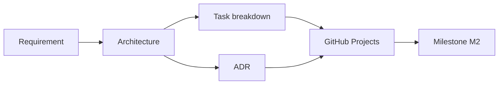

# Buổi 29 – Thử thách thêm

Tuần 15/16 · Giai đoạn 5 – Capstone Project · Buổi 29/32

[Bài học Buổi 29 – Architecture & Planning](session-29.md) · [Bài tập tuần](../../assignments/weekly/week-15.md) · [Hub tuần](README.md)

> **Tóm tắt:** Trang phụ của buổi 29: kiến thức nền đọc sau, ADR mẫu để đối chiếu, ba thử thách L2, tình huống secret bị commit và tài liệu tham khảo. Không bắt buộc để nộp bài L1.

## Tìm hiểu thêm (đọc sau) {#tim-hieu-them}

**Loại requirement trong Capstone:**

| Loại | Ví dụ | Cách kiểm chứng |
| --- | --- | --- |
| Chức năng | F3: `POST /api/members` trả 201, sai dữ liệu trả 400 | `curl` và test tự động |
| Phi chức năng | F8: dữ liệu không mất khi recreate container | `docker compose down` rồi `up`, truy vấn lại |
| Vận hành | Scale backend 2 lên 3 replicas không lỗi | `kubectl scale`, `kubectl rollout status` |
| Bảo mật | Không có secret trong lịch sử Git | `git log -p`, quét thủ công hoặc công cụ |
| Ràng buộc | Chạy local trên Windows 11 + WSL2, không expose Internet | Review kiến trúc |

**Thành phần của starter-project:**

| Thành phần | Trong starter-project | Ghi chú thiết kế |
| --- | --- | --- |
| Frontend | `frontend/` (Nginx tĩnh), proxy `/api/` sang `backend:3000` | Image `club-web:1.0.0`, service `club-web` trên k8s |
| Backend | `backend/` (Node.js 22, Express 5, pg), cổng 3000 | Image `club-api:1.0.0`, Deployment `club-api` 2 replicas |
| Database | PostgreSQL, schema ở `database/init.sql`, volume `postgres-data` | StatefulSet `postgres` + PVC trên k8s |
| Mạng | Compose network `club-network`; Ingress `club.localhost` trên kind | Không expose máy ra Internet |
| Cấu hình | `.env` (`DB_PASSWORD`, `WEB_PORT`), ConfigMap `club-config`, Secret `club-secrets` | Không commit giá trị thật |

**Container design và CI/CD design.** Container design trả lời: mỗi thành phần đóng gói thế nào (base image nào, multi-stage hay không, chạy user nào, healthcheck ra sao). CI/CD design trả lời: sự kiện nào (PR, merge vào `main`, tag) kích hoạt job nào, image gắn tag gì, ai được quyền publish. Bạn đã có `.github/workflows/ci.yml` và `publish.yml` làm mẫu ở repo giáo trình. Buổi này chỉ thiết kế, buổi 30 mới triển khai.

| Sự kiện | Job | Kết quả |
| --- | --- | --- |
| Mở PR | `test`, build thử image, validate compose | Chặn merge nếu đỏ |
| Merge vào `main` | build + push GHCR | Image tag theo SHA |
| Tag `v1.0.0` | build + push GHCR | Image tag theo semver |

**Quy trình lập kế hoạch** đi theo chuỗi sau:



1. **Requirement** (F1-F8 cộng yêu cầu kỹ thuật) quyết định hệ thống cần những gì.
2. **Architecture** biến requirement thành các thành phần và luồng dữ liệu.
3. **ADR** ghi lại các chỗ có nhiều hơn một cách làm hợp lý và nhóm đã chọn một cách.
4. **Task breakdown** cắt kiến trúc thành các Issue nhỏ, mỗi Issue có tiêu chí hoàn thành.
5. **GitHub Projects** là nơi theo dõi trạng thái; mỗi Issue gắn milestone M2, M3 hoặc M4 theo [Milestones](../../assignments/capstone/milestones.md).

Luồng request của người dùng: browser gọi `club.localhost`, Ingress chuyển tới `club-web`, Nginx proxy đường dẫn `/api/` sang Service `backend` (cổng 3000), backend truy vấn PostgreSQL qua Service `postgres`. Dữ liệu nằm trên PVC của StatefulSet, vì vậy xóa Pod không làm mất dữ liệu.

## ADR mẫu: chiến lược tag image {#adr-mau}

Chỉ mở để đối chiếu sau khi nhóm đã viết ADR của mình. Điều chỉnh ngày cho đúng.

```markdown
# ADR-0001 – Chiến lược tag image

- Trạng thái: Đã chấp nhận
- Ngày: 2026-01-01
- Người quyết định: cả nhóm

## Bối cảnh

Image publish lên GHCR cần truy vết được về commit. Dùng mỗi tag latest thì không biết image đang chạy từ code nào và không rollback chính xác được.

## Các lựa chọn đã cân nhắc

| Lựa chọn | Ưu điểm | Nhược điểm |
| --- | --- | --- |
| Chỉ latest | Đơn giản | Không truy vết, không rollback |
| Tag theo SHA | Truy vết chính xác | Khó đọc |
| SHA + semver khi gắn tag git | Truy vết và dễ đọc | Cần quy trình gắn tag |

## Quyết định

Mỗi lần merge vào main gắn tag SHA ngắn; khi gắn tag git v1.0.0 thêm tag semver.

## Hệ quả

- Dễ hơn: rollback về đúng SHA, giải thích trong buổi bảo vệ.
- Khó hơn: manifest k8s phải cập nhật tag mỗi lần triển khai.
- Việc cần làm tiếp: viết workflow publish ở buổi 30.
```

## Thử thách L2 (tùy chọn, làm ở nhà) {#thu-thach}

::: warning Tự thử 15 phút trước khi mở gợi ý
Mỗi thử thách có gợi ý trong khung gập bên dưới. Hãy tự nghĩ 15 phút rồi mới mở; đối chiếu cuối cùng với mentor sau khi nộp bài.
:::

**Thử thách 1: ADR có sức nặng.** Viết thêm ADR thứ tư về chiến lược test backend (mock database hay database thật trong CI). Tiêu chí hoàn thành: so sánh tối thiểu hai lựa chọn kèm ít nhất một rủi ro mỗi lựa chọn; phần Hệ quả nêu việc cần làm ở buổi 30; reviewer chéo đã comment và nhóm đã trả lời.

::: details Gợi ý
Đề bài Capstone yêu cầu `npm test` chạy được mà không cần database thật. Hãy xem `starter-project/backend/tests/health.test.js` và `db.js` để thấy cách tách tầng truy cập dữ liệu. Rủi ro của mock: test xanh nhưng SQL thật sai. Rủi ro của DB thật trong CI: chậm hơn và cần service container.
:::

**Thử thách 2: Dependency và đường găng.** Vẽ sơ đồ phụ thuộc giữa các Issue (mermaid `flowchart`) và chỉ ra chuỗi Issue dài nhất dẫn tới M2. Tiêu chí hoàn thành: không có Issue nào bị chặn bởi Issue của chính người đó mà không ai biết; ít nhất 2 Issue được đổi thứ tự hoặc tách nhỏ để giảm thời gian chờ.

::: details Gợi ý
Frontend form xóa phụ thuộc endpoint `DELETE`; workflow publish phụ thuộc Dockerfile chạy được và test xanh. Hãy tìm Issue nào mà cả nhóm đang chờ.
:::

**Thử thách 3: Kế hoạch rủi ro.** Liệt kê 5 rủi ro (ví dụ một thành viên vắng 1 buổi, Ingress trên kind không chạy, GHCR từ chối push) kèm biện pháp giảm thiểu và người phụ trách. Tiêu chí hoàn thành: bảng rủi ro trong `docs/risks.md`, mỗi rủi ro có tín hiệu cảnh báo và phương án dự phòng.

::: details Gợi ý
Với mỗi rủi ro, hỏi "Nhóm sẽ biết điều này đang xảy ra bằng cách nào, sớm nhất khi nào?". Phương án dự phòng cho Ingress là `kubectl port-forward`; cho thành viên vắng là vòng review chéo và tài liệu đủ để người khác tiếp quản.
:::

## Phá lỗi nâng cao: secret bị commit vào Git {#pha-loi-nang-cao}

Mô phỏng một thành viên tạo `.env` thật, nhưng `.gitignore` của họ đã mất dòng `.env`. Chỉ làm trên repo thử nghiệm bên dưới, không làm trên repo nhóm.

```bash
mkdir -p ~/break-secret && cd ~/break-secret
git init -b main
echo "DB_PASSWORD=mat-khau-gia-lap" > .env
git add .
git commit -m "Add config"
git ls-files
```

Triệu chứng: `git ls-files` in ra `.env`. File chứa mật khẩu đã nằm trong lịch sử Git. Không có thông báo lỗi nào, đó là điều nguy hiểm.

Hướng điều tra, từng bước:

1. Kiểm tra file có đang được theo dõi: `git ls-files | grep -E "(^|/)\.env$"`. Có kết quả nghĩa là đã commit.
2. Kiểm tra `.gitignore` có chặn không: `git check-ignore -v .env`. Không in gì nghĩa là không có quy tắc chặn.
3. Tìm trong lịch sử: `git log --oneline --all -- .env` cho thấy commit nào đã thêm file.
4. Xem nội dung đã lộ: `git show HEAD:.env` (chỉ làm trên repo thử nghiệm).

Nguyên nhân gốc: thiếu quy tắc `.gitignore` chặn `.env` và không có kiểm tra trước commit; bản thân việc `git add .` quá rộng chỉ là cái cớ. Lưu ý: thêm `.env` vào `.gitignore` sau đó không gỡ file đã được theo dõi, và xóa file ở commit sau không xóa nó khỏi lịch sử.

Cách xử lý đúng: (1) coi mật khẩu đã lộ và **đổi (rotate) ngay** ở nơi nó được dùng; (2) `git rm --cached .env`, thêm `.env` vào `.gitignore`, commit; (3) nếu repo đã đẩy lên GitHub, làm sạch lịch sử bằng công cụ chuyên dụng chỉ khi mentor hướng dẫn, vì việc đổi secret mới là bước bắt buộc.

Cách phòng tránh: kiểm tra `git check-ignore -v .env` trước commit đầu tiên (bước 4 của lab), dùng `git status` trước mỗi `git add`, thêm mục "không có secret" vào checklist của PR template, và chỉ commit `.env.example` với giá trị giả.

::: danger Dọn dẹp: chỉ xóa thư mục thử nghiệm
`rm -rf` xóa vĩnh viễn, không có thùng rác. Chỉ chạy trên thư mục thử nghiệm bạn vừa tạo, không đổi đường dẫn:

```bash
cd ~ && rm -rf ~/break-secret
```
:::

Liên quan thêm: ôn lại cách đặt chẩn đoán ở các tình huống trong thư mục `examples/troubleshooting/` (ví dụ scenario-03 về kết nối DB) để luyện tư duy "triệu chứng, nguyên nhân gốc".

## Câu hỏi tự kiểm tra thêm

1. Vì sao `main` cần được bảo vệ bằng PR và status check `test` ngay từ đầu dự án?
2. Mỗi thành viên giải thích được toàn hệ thống khi bảo vệ. Bạn dùng hoạt động nào trong kế hoạch để đảm bảo điều đó?

::: details Đáp án gợi ý
1. Để mọi thay đổi đều được review chéo và qua kiểm thử tự động, tránh push thẳng làm hỏng bản demo; đồng thời lịch sử PR là bằng chứng đóng góp của từng thành viên.
2. Vòng reviewer chéo (mỗi người đọc code mảng khác), đổi vai khi gỡ lỗi ở buổi 31 và cả nhóm cùng viết ADR.
:::

## Tài liệu tham khảo {#tai-lieu-tham-khao}

- [Git – git-check-ignore](https://git-scm.com/docs/git-check-ignore)
- [GitHub Docs – Planning and tracking with Projects](https://docs.github.com/en/issues/planning-and-tracking-with-projects)
- [GitHub Docs – About protected branches](https://docs.github.com/en/repositories/configuring-branches-and-merges-in-your-repository/managing-protected-branches/about-protected-branches)
- [GitHub Docs – Linking a pull request to an issue](https://docs.github.com/en/issues/tracking-your-work-with-issues/using-issues/linking-a-pull-request-to-an-issue)
- [Michael Nygard – Documenting Architecture Decisions](https://cognitect.com/blog/2011/11/15/documenting-architecture-decisions)
- [Mermaid – Flowchart syntax](https://mermaid.js.org/syntax/flowchart.html)
