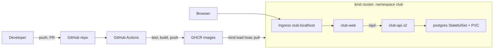
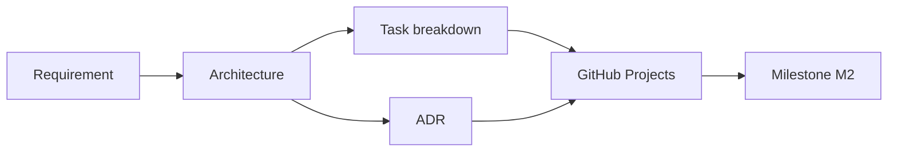
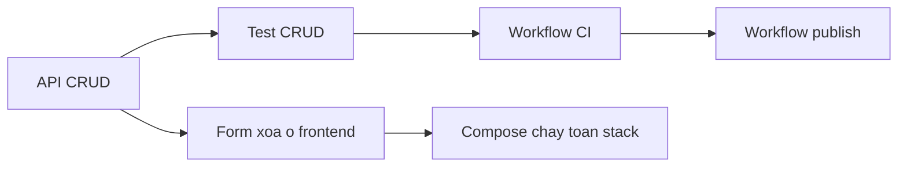

# Buổi 29 – Architecture & Planning

Tuần 15 · Giai đoạn 5 – Capstone Project · Slide: [Slide buổi 29](../../slides/08-capstone/session-29.md)

> **Tóm tắt:** Nhóm Capstone chốt requirement, vẽ kiến trúc, tạo repo từ starter-project, dựng GitHub Projects với backlog có tiêu chí hoàn thành và viết ba ADR đầu tiên.

## Mục tiêu học tập

- Chuyển đề bài Capstone thành danh sách requirement kiểm chứng được (chức năng, phi chức năng, ràng buộc) và gắn mỗi requirement với một tiêu chí chấp nhận.
- Vẽ được kiến trúc hệ thống bằng mermaid, thể hiện luồng CI/CD, thành phần trong cluster, luồng request và nơi lưu dữ liệu.
- Tạo repo nhóm từ `starter-project/`, kiểm tra `.gitignore` chặn `.env` và bật quy ước nhánh, PR, review chéo.
- Chia nhỏ công việc thành Issue có owner, size, milestone và checklist hoàn thành trên GitHub Projects.
- Viết ít nhất ba Architecture Decision Record (ADR) nêu rõ bối cảnh, lựa chọn, quyết định và hệ quả.
- Phát hiện và sửa một lỗ hổng kế hoạch phổ biến (secret nằm trong Git, backlog không có Definition of Done) trước khi bắt đầu viết code.

## Điều kiện cần

- Đã hoàn thành các buổi 1–28: Linux, Git, Docker, Compose, GitHub Actions, Kubernetes cơ bản và vận hành.
- Đã đọc [đề bài Capstone](../../assignments/capstone/README.md) và [milestones](../../assignments/capstone/milestones.md), đặc biệt mốc M1.
- Nhóm 3–4 người đã được mentor chốt; mỗi người có tài khoản GitHub và biết tài khoản của nhau.
- Máy có Git, Docker Desktop, WSL2 Ubuntu. Làm việc trong filesystem của WSL (ví dụ `~/`), không dùng `/mnt/c`.

Kiểm tra nhanh:

```bash
git --version
docker --version
docker compose version
git config --global user.name
git config --global user.email
```

Kết quả mong đợi: bốn lệnh đầu in ra phiên bản, hai lệnh cuối in tên và email của bạn. Nếu `git config` trống, đặt bằng `git config --global user.name "Tên của bạn"` và `git config --global user.email "email@example.com"`.

## Vấn đề thực tế

Một nhóm CLB nhận đề "làm hệ thống quản lý thành viên". Cả nhóm hào hứng, mở máy và bắt đầu code ngay. Hai tuần sau: ba người cùng viết ba kiểu API khác nhau, không ai biết ai review ai, `.env` chứa mật khẩu đã bị đẩy lên GitHub, và đến buổi demo mới phát hiện không ai có Kubernetes manifest chạy được vì "tưởng bạn kia làm". Nguyên nhân gốc không phải thiếu kỹ năng mà là thiếu kế hoạch chung: không có bức tranh kiến trúc thống nhất, không có định nghĩa "xong", không có người chịu trách nhiệm cho từng phần.

Buổi này giải quyết đúng vấn đề đó. Trong 120 phút, nhóm tạo ra những thứ mà mentor và chính nhóm sẽ dựa vào trong ba buổi còn lại: repo sạch, bảng công việc, sơ đồ kiến trúc và các quyết định kỹ thuật được ghi lại. Việc ghi lại quyết định (ADR) cũng là thứ bạn sẽ phải giải thích ở buổi bảo vệ kỹ thuật (buổi 32): "Vì sao chọn StatefulSet cho PostgreSQL?" dễ trả lời hơn nhiều nếu bạn đã viết lý do từ tuần đầu.

## Khái niệm cốt lõi

### Requirement: nói rõ "xong" nghĩa là gì

Requirement là điều hệ thống phải làm hoặc phải đảm bảo. Một requirement tốt có thể kiểm chứng bằng một lệnh hoặc một thao tác.

| Loại | Ví dụ trong Capstone | Cách kiểm chứng |
| --- | --- | --- |
| Chức năng | F3: `POST /api/members` trả 201, sai dữ liệu trả 400 | `curl` và test tự động |
| Phi chức năng | F8: dữ liệu không mất khi recreate container | `docker compose down` rồi `up`, truy vấn lại |
| Vận hành | Scale backend 2 lên 3 replicas không lỗi | `kubectl scale`, `kubectl rollout status` |
| Bảo mật | Không có secret trong lịch sử Git | `git log -p`, quét thủ công hoặc công cụ |
| Ràng buộc | Chạy local trên Windows 11 + WSL2, không expose Internet | Review kiến trúc |

Cách viết xấu: "API chạy tốt". Cách viết tốt: "`GET /api/members/999` trả 404 với JSON có trường `error`". Từ "tốt" không kiểm chứng được, mã trạng thái thì có.

### Kiến trúc: một bức tranh cả nhóm cùng hiểu

Kiến trúc không phải bản vẽ đẹp mà là câu trả lời cho bốn câu hỏi: (1) có những thành phần nào, (2) chúng nói chuyện với nhau ra sao, (3) dữ liệu nằm ở đâu, (4) code đi từ máy developer tới nơi chạy bằng đường nào. Với starter-project, câu trả lời đã có sẵn một phần:

| Thành phần | Trong starter-project | Ghi chú thiết kế |
| --- | --- | --- |
| Frontend | `frontend/` (Nginx tĩnh), proxy `/api/` sang `backend:3000` | Image `club-web:1.0.0`, service `club-web` trên k8s |
| Backend | `backend/` (Node.js 22, Express 5, pg), cổng 3000 | Image `club-api:1.0.0`, Deployment `club-api` 2 replicas |
| Database | PostgreSQL, schema ở `database/init.sql`, volume `postgres-data` | StatefulSet `postgres` + PVC trên k8s |
| Mạng | Compose network `club-network`; Ingress `club.localhost` trên kind | Không expose máy ra Internet |
| Cấu hình | `.env` (`DB_PASSWORD`, `WEB_PORT`), ConfigMap `club-config`, Secret `club-secrets` | Không commit giá trị thật |

### Container design và CI/CD design

Container design trả lời: mỗi thành phần đóng gói thế nào (base image nào, multi-stage hay không, chạy user nào, healthcheck ra sao). CI/CD design trả lời: sự kiện nào (PR, merge vào `main`, tag) kích hoạt job nào, image gắn tag gì, ai được quyền publish.

| Sự kiện | Job | Kết quả |
| --- | --- | --- |
| Mở PR | `test`, build thử image, validate compose | Chặn merge nếu đỏ |
| Merge vào `main` | build + push GHCR | Image tag theo SHA |
| Tag `v1.0.0` | build + push GHCR | Image tag theo semver |

Bạn đã có `.github/workflows/ci.yml` và `publish.yml` làm mẫu ở repo giáo trình. Buổi này chỉ thiết kế, buổi 30 mới triển khai.

### Task breakdown: chia theo kết quả, không chia theo công cụ

Chia việc "A làm Docker, B làm Kubernetes, C làm Actions" nghe hợp lý nhưng dẫn tới tích hợp muộn: mọi người đợi nhau và lỗi chỉ lộ ra vào phút cuối. Chia theo lát cắt kết quả (vertical slice) tốt hơn: "xóa được thành viên từ giao diện" gồm API, test, frontend và một dòng trong README, có thể review và demo được ngay.

Một Issue tốt có: tiêu đề bắt đầu bằng động từ, owner, size (S, M, L), milestone, checklist tiêu chí hoàn thành. Size gợi ý: S dưới 1 giờ, M 1–3 giờ, L trên 3 giờ (nên tách nhỏ).

### Definition of Done và ADR

Definition of Done (DoD) là danh sách điều kiện mà mọi mục công việc phải thỏa trước khi chuyển sang Done: code đã review chéo, test chạy xanh, tài liệu cập nhật, không có secret. DoD của cả dự án nằm ở mục 5 của [đề bài Capstone](../../assignments/capstone/README.md).

ADR là file ngắn ghi lại một quyết định kiến trúc: bối cảnh, các lựa chọn, quyết định, hệ quả. Dùng [template ADR](../../templates/adr-template.md). Quy tắc: mỗi quyết định một file, tối đa một trang, đặt tại `docs/adr/`, không sửa ADR cũ mà tạo ADR mới thay thế.

## Kiến trúc và cách hoạt động

Đây là kiến trúc mục tiêu mà nhóm sẽ vẽ lại và chỉnh theo hệ thống của mình:



Quy trình lập kế hoạch của buổi này đi theo chuỗi sau:



Giải thích từng bước:

1. **Requirement** (F1–F8 cộng yêu cầu kỹ thuật) quyết định hệ thống cần những gì.
2. **Architecture** biến requirement thành các thành phần và luồng dữ liệu.
3. **ADR** ghi lại các chỗ có nhiều hơn một cách làm hợp lý và nhóm đã chọn một cách.
4. **Task breakdown** cắt kiến trúc thành các Issue nhỏ, mỗi Issue có tiêu chí hoàn thành.
5. **GitHub Projects** là nơi theo dõi trạng thái; mỗi Issue gắn milestone M2, M3 hoặc M4 theo [milestones](../../assignments/capstone/milestones.md).

Luồng request của người dùng: browser gọi `club.localhost`, Ingress chuyển tới `club-web`, Nginx proxy đường dẫn `/api/` sang Service `backend` (cổng 3000), backend truy vấn PostgreSQL qua Service `postgres`. Dữ liệu nằm trên PVC của StatefulSet, vì vậy xóa Pod không làm mất dữ liệu.

## Demo của mentor

Mentor chiếu màn hình và dựng "repo nhóm mẫu" trước lớp trong khoảng 10 phút. Học viên chỉ quan sát và ghi lại điều không hiểu.

1. **Tạo repo từ starter-project** (giả sử bản sao giáo trình ở `~/devops-course`):

   ```bash
   mkdir -p ~/demo-club && cp -a ~/devops-course/starter-project/. ~/demo-club/
   cd ~/demo-club
   git init -b main
   git status --short
   ```

   Kết quả mong đợi: `Initialized empty Git repository`, sau đó danh sách `??` gồm `.env.example`, `.gitignore`, `README.md`, `backend/`, `compose.yaml`, `database/`, `frontend/`, `k8s/`.

   Câu hỏi cho lớp: "Nếu em tạo file `.env` ngay bây giờ, `git status` có hiện nó không? Làm sao biết chắc?"

2. **Kiểm tra `.gitignore` bằng chứng cứ, không bằng niềm tin:**

   ```bash
   cp .env.example .env
   git check-ignore -v .env
   git status --short | grep -c "\.env$"
   ```

   Kết quả mong đợi: dòng đầu in `.gitignore:1:.env	.env` (file `.gitignore`, dòng 1, mẫu `.env`); lệnh `grep -c` in `0`. Đó là bằng chứng `.env` bị chặn.

3. **Vẽ kiến trúc trong 3 phút:** mentor mở README, dán sơ đồ mermaid ở mục trên và thêm một thành phần nhóm tự bổ sung (ví dụ bước quét image bằng Trivy trong CI), rồi hỏi: "Thành phần mới này nằm ở đâu trong luồng? Vì sao?"

4. **Một ADR mẫu:** mentor điền nhanh một ADR về chiến lược tag image (xem phần Hands-on), đọc to phần "Hệ quả" và hỏi: "Điều gì trở nên khó hơn sau quyết định này?"

5. **Bảng GitHub Projects:** mentor tạo Issue "Add DELETE /api/members/:id" với checklist, gán owner, size M, milestone M2, rồi kéo thẻ qua các cột. Nhấn mạnh quy tắc WIP: mỗi người tối đa 2 thẻ `In progress`.

## Hands-on lab

Lab chia thành 5 phần, 60 phút. Cả nhóm làm cùng nhau; một người (trưởng nhóm) thực hiện thao tác tạo repo, những người còn lại theo dõi và kiểm tra bằng cách clone về máy mình.

| Phần | Nội dung | Thời gian |
| --- | --- | --- |
| 1 | Requirement và tiêu chí chấp nhận | 10' |
| 2 | Repo nhóm từ starter-project | 12' |
| 3 | Kiến trúc và phân vai | 12' |
| 4 | GitHub Projects và backlog | 14' |
| 5 | ADR | 12' |

### Chuẩn bị

Thống nhất nhóm: tên repo (ví dụ `club-management`), tài khoản chủ repo, vai trò từng người theo bảng phân công trong [đề bài Capstone](../../assignments/capstone/README.md) (mục 6, nhóm 3 hoặc 4 người), và vòng reviewer chéo. Trưởng nhóm tạo thư mục làm việc:

```bash
mkdir -p ~/club-management
cd ~/club-management
pwd
```

Kết quả mong đợi: `/home/ten-ban/club-management`. Nếu đường dẫn bắt đầu bằng `/mnt/c`, bạn đang ở filesystem Windows, hãy chuyển về `~/` để tránh chậm và lỗi phân quyền.

### Phần 1: Requirement và tiêu chí chấp nhận (10')

Mục tiêu: mỗi requirement có một câu kiểm chứng được.

1. Tạo thư mục tài liệu và file requirement:

   ```bash
   cd ~/club-management
   cp -a ~/devops-course/starter-project/. ~/club-management/
   mkdir -p docs/adr
   ls
   ```

   Kết quả mong đợi: thấy `backend`, `compose.yaml`, `database`, `docs`, `frontend`, `k8s`, `README.md`. Lệnh `cp -a ... /.` copy cả file ẩn như `.gitignore` và `.env.example`.

2. Đọc schema thật trước khi thiết kế API:

   ```bash
   cat database/init.sql
   ```

   Kết quả mong đợi: bảng `members` với `id`, `name`, `email` (UNIQUE), `created_at`. Vì sao: validation của `POST` và `PUT` phải khớp ràng buộc này (name không rỗng, email hợp lệ và không trùng).

3. Tạo `docs/requirements.md` với bảng sau, điền cột "Cách kiểm chứng" cho từng dòng (F1–F8 lấy từ đề bài):

   ```markdown
   # Requirement – Club Management

   | Mã | Requirement | Cách kiểm chứng | Owner |
   | --- | --- | --- | --- |
   | F2 | GET /api/members/:id trả 200 hoặc 404 | curl với id có và không có | A |
   | F3 | POST /api/members trả 201, sai dữ liệu trả 400 | test tự động + curl | A |
   | F8 | Dữ liệu bền vững sau recreate | docker compose down rồi up, GET lại | C |
   ```

   Nhóm điền đủ F1–F8 và thêm ít nhất 3 dòng phi chức năng (secret, CI chặn merge, scale 2 lên 3).

### Phần 2: Repo nhóm từ starter-project (12')

4. Kiểm tra `.gitignore` trước lần commit đầu tiên:

   ```bash
   cd ~/club-management
   cp .env.example .env
   git init -b main
   git check-ignore -v .env
   git add .
   git status --short | grep -E "\.env$|node_modules" || echo "OK: khong co file nhay cam"
   ```

   Kết quả mong đợi: dòng `.gitignore:1:.env	.env` và `OK: khong co file nhay cam`. Dòng `.env.example` không bị lọc bởi `grep` vì mẫu kết thúc bằng `.env$` không khớp `.env.example`. Vì sao: lần commit đầu tiên là lúc dễ lỡ tay nhất.

5. Commit đầu tiên (các file đã được `git add .` ở bước 4) và đẩy lên GitHub. Trên GitHub, trưởng nhóm tạo repo rỗng (không chọn README, không chọn `.gitignore`), rồi:

   ```bash
   git commit -m "Import starter project as team baseline"
   git remote add origin git@github.com:TEN-CHU-REPO/club-management.git
   git push -u origin main
   ```

   Kết quả mong đợi: `Branch 'main' set up to track 'origin/main'`. Thay `TEN-CHU-REPO` bằng tên tài khoản thật. Nếu chưa cấu hình SSH key, dùng URL HTTPS của repo.

6. Mời các thành viên: Settings, Collaborators (repo cá nhân) hoặc thêm vào team (tổ chức). Mỗi thành viên clone về và chạy `git log --oneline` để thấy commit đầu tiên.

7. Bật bảo vệ nhánh: Settings, Branches (hoặc Rules, Rulesets), tạo quy tắc cho `main`: yêu cầu pull request, 1 approval, status check `test` (check này sẽ xuất hiện sau khi CI chạy lần đầu ở buổi 30). Repo cá nhân miễn phí có thể không hỗ trợ đầy đủ; khi đó nhóm ghi cam kết quy ước vào README và mentor kiểm tra qua lịch sử.

8. Tạo `.github/pull_request_template.md` bằng nội dung mẫu ở mục 7 của [đề bài Capstone](../../assignments/capstone/README.md), rồi mở nhánh đầu tiên bằng PR (không push thẳng `main`):

   ```bash
   git switch -c docs/add-pr-template
   mkdir -p .github
   # dán nội dung mẫu vào .github/pull_request_template.md
   git add .github/pull_request_template.md
   git commit -m "Add pull request template"
   git push -u origin docs/add-pr-template
   ```

   Kết quả mong đợi: Git in đường dẫn gợi ý mở Pull Request. Mở PR, gán reviewer chéo theo bảng phân vai, reviewer duyệt và Squash and merge.

### Phần 3: Kiến trúc và phân vai (12')

9. Đọc nhanh manifest và Compose có sẵn để vẽ cho đúng (không đoán):

   ```bash
   grep -nE "^  [a-z-]+:$|ports:|networks:|volumes:" compose.yaml
   grep -nE "^kind:|name:" k8s/backend.yaml | head
   ```

   Kết quả mong đợi: thấy các service `frontend`, `backend`, `postgres`, network `club-network`, volume `postgres-data` và các tài nguyên k8s `Deployment`, `Service`. Vì sao: sơ đồ kiến trúc phải phản ánh hệ thống thật, vì mentor sẽ đối chiếu.

10. Thay mục kiến trúc trong `README.md` bằng sơ đồ mermaid của nhóm. Bắt đầu từ sơ đồ trong phần "Kiến trúc và cách hoạt động", rồi thêm ít nhất một thành phần hoặc chú thích nhóm tự quyết (ví dụ quét image, hoặc cổng `WEB_PORT`). Mỗi mũi tên phải trả lời được "dữ liệu gì đi qua đây".

11. Thêm bảng phân vai vào README theo mẫu `templates/project-template.md`:

    ```markdown
    ## Thành viên và vai trò
    | Thành viên | Trách nhiệm | Reviewer chéo |
    | --- | --- | --- |
    | Nguyen Van A | Backend: API CRUD, test, Dockerfile backend | Nguyen Van D |
    ```

    Vòng review phải khép kín: không ai review PR của chính mình, và mỗi người review một mảng khác chuyên môn của mình.

### Phần 4: GitHub Projects và backlog (14')

12. Tạo Project: tab Projects của tài khoản hoặc tổ chức, New project, chọn mẫu Board, đặt tên `Club Management Capstone`, rồi liên kết với repo (Link a repository trong menu Project).

13. Cấu hình trường: đổi các giá trị của trường Status thành `Backlog`, `Ready`, `In progress`, `In review`, `Done`. Thêm các trường tùy chỉnh `Milestone` (M1 đến M4), `Owner`, `Size` (S, M, L). Tên trường và giao diện có thể khác chút tùy phiên bản GitHub; kiểm tra tài liệu chính thức nếu không thấy nút.

14. Tạo Issue cho mỗi requirement F1–F8 và mỗi mục Definition of Done, tối thiểu 12 Issue. Để kịp 14 phút, mỗi người tạo 3 đến 4 Issue của mảng mình phụ trách (có thể dán danh sách tiêu đề trước, bổ sung checklist sau). Mỗi Issue theo mẫu:

    ```markdown
    ## Mục tiêu
    Thêm DELETE /api/members/:id

    ## Tiêu chí hoàn thành
    - [ ] 204 khi xóa thành công, 404 khi không có id
    - [ ] Có ít nhất 2 test (thành công, không tồn tại)
    - [ ] README mô tả endpoint
    - [ ] PR được reviewer chéo duyệt, CI xanh
    ```

15. Thêm Issue vào Project, gán Owner, Size, Milestone (M2 cho phần cài đặt, M3 cho kiểm thử trên kind, M4 cho demo). Đặt Issue sẵn sàng làm ngay vào cột `Ready`, còn lại ở `Backlog`.

16. Tự kiểm tra backlog bằng ba câu hỏi: Có Issue nào không có tiêu chí hoàn thành không? Có ai đang nhận hơn 2 thẻ cùng lúc không? Có Issue size L nào cần tách nhỏ không?

### Phần 5: ADR (12')

17. Viết ba ADR bằng template. Chủ đề đề xuất: chiến lược tag image, cách lưu PostgreSQL trên k8s, cách truy cập từ ngoài cluster. Ví dụ file đầu tiên:

    ```bash
    git switch main && git pull
    git switch -c docs/adr-image-tags
    cat > docs/adr/0001-image-tag-strategy.md <<'EOF'
    # ADR-0001 – Chiến lược tag image

    - Trạng thái: Đã chấp nhận
    - Ngày: 2026-01-01
    - Người quyết định: cả nhóm

    ## Bối cảnh

    Image publish lên GHCR cần truy vết được về commit. Dùng mỗi tag latest thì không biết image đang chạy từ code nào và không rollback chính xác được.

    ## Các lựa chọn đã cân nhắc

    | Lựa chọn | Ưu điểm | Nhược điểm |
    | --- | --- | --- |
    | Chỉ latest | Đơn giản | Không truy vết, không rollback |
    | Tag theo SHA | Truy vết chính xác | Khó đọc |
    | SHA + semver khi gắn tag git | Truy vết và dễ đọc | Cần quy trình gắn tag |

    ## Quyết định

    Mỗi lần merge vào main gắn tag SHA ngắn; khi gắn tag git v1.0.0 thêm tag semver.

    ## Hệ quả

    - Dễ hơn: rollback về đúng SHA, giải thích trong buổi bảo vệ.
    - Khó hơn: manifest k8s phải cập nhật tag mỗi lần triển khai.
    - Việc cần làm tiếp: viết workflow publish ở buổi 30.
    EOF
    ls docs/adr
    ```

    Kết quả mong đợi: `0001-image-tag-strategy.md`. Điều chỉnh ngày cho đúng. Với ba ADR, mỗi ADR phải có ít nhất hai lựa chọn được so sánh thật, không viết cho đủ.

18. Đẩy nhánh, mở PR, chỉ định reviewer chéo. Reviewer đọc ADR và đặt ít nhất một câu hỏi bằng comment trước khi approve.

### L1 – Foundation: checklist hoàn thành

- [ ] Repo nhóm tạo từ `starter-project/`, mọi thành viên đã clone được
- [ ] `git check-ignore -v .env` xác nhận `.env` bị chặn; `.env.example` nằm trong repo
- [ ] `docs/requirements.md` có F1–F8, mỗi dòng có cách kiểm chứng và owner
- [ ] README có sơ đồ kiến trúc mermaid và bảng phân vai kèm reviewer chéo
- [ ] GitHub Project có đủ cột Status và trường Milestone, Owner, Size
- [ ] Ít nhất 12 Issue có checklist tiêu chí hoàn thành, owner, milestone
- [ ] Ít nhất 2 PR đã merge (PR template, ADR đầu tiên), mỗi PR có reviewer khác tác giả

### L2 – Engineering: thử thách tự làm

**Thử thách 1: ADR có sức nặng.** Viết thêm ADR thứ tư về chiến lược test backend (mock database hay database thật trong CI). Tiêu chí hoàn thành: so sánh tối thiểu hai lựa chọn kèm ít nhất một rủi ro mỗi lựa chọn; phần Hệ quả nêu việc cần làm ở buổi 30; reviewer chéo đã comment và nhóm đã trả lời.

<details><summary>Gợi ý</summary>

Đề bài Capstone yêu cầu `npm test` chạy được mà không cần database thật. Hãy xem `starter-project/backend/tests/health.test.js` và `db.js` để thấy cách tách tầng truy cập dữ liệu. Rủi ro của mock: test xanh nhưng SQL thật sai. Rủi ro của DB thật trong CI: chậm hơn và cần service container.

</details>

<details><summary>Lời giải mẫu</summary>

Quyết định: dùng mock ở tầng `db.js` cho test đơn vị (nhanh, chạy offline), cộng thêm một bước smoke test bằng Compose ở buổi 31 để bắt lỗi SQL thật. Hệ quả: cần module truy cập dữ liệu inject được; việc tiếp theo là viết tối thiểu 5 test CRUD và lỗi ở buổi 30.

</details>

**Thử thách 2: Dependency và đường găng.** Vẽ sơ đồ phụ thuộc giữa các Issue (mermaid `flowchart`) và chỉ ra chuỗi Issue dài nhất dẫn tới M2. Tiêu chí hoàn thành: không có Issue nào bị chặn bởi Issue của chính người đó mà không ai biết; ít nhất 2 Issue được đổi thứ tự hoặc tách nhỏ để giảm thời gian chờ.

<details><summary>Gợi ý</summary>

Frontend form xóa phụ thuộc endpoint `DELETE`; workflow publish phụ thuộc Dockerfile chạy được và test xanh. Hãy tìm Issue nào mà cả nhóm đang chờ.

</details>

<details><summary>Lời giải mẫu</summary>



Chuỗi dài nhất: API, Test, CI, Publish. Biện pháp: định nghĩa trước hợp đồng API (đường dẫn, mã trạng thái) để frontend làm song song với backend bằng dữ liệu giả; tách Issue "Workflow CI" thành "chạy test" và "build thử image" để người phụ trách CI bắt đầu sớm.

</details>

**Thử thách 3: Kế hoạch rủi ro.** Liệt kê 5 rủi ro (ví dụ một thành viên vắng 1 buổi, Ingress trên kind không chạy, GHCR từ chối push) kèm biện pháp giảm thiểu và người phụ trách. Tiêu chí hoàn thành: bảng rủi ro trong `docs/risks.md`, mỗi rủi ro có tín hiệu cảnh báo và phương án dự phòng.

<details><summary>Gợi ý</summary>

Với mỗi rủi ro, hỏi "Nhóm sẽ biết điều này đang xảy ra bằng cách nào, sớm nhất khi nào?". Phương án dự phòng cho Ingress là `kubectl port-forward`; cho thành viên vắng là vòng review chéo và tài liệu đủ để người khác tiếp quản.

</details>

## Phá lỗi và debug

**Tình huống: secret bị commit vào Git.**

Phá: một thành viên tạo `.env` thật, nhưng trong repo của họ `.gitignore` đã bị sửa mất dòng `.env` (mô phỏng bằng thao tác dưới đây trên repo thử nghiệm, không làm trên repo nhóm).

```bash
mkdir -p ~/break-secret && cd ~/break-secret
git init -b main
echo "DB_PASSWORD=mat-khau-gia-lap" > .env
git add .
git commit -m "Add config"
git ls-files
```

Triệu chứng: `git ls-files` in ra `.env`. File chứa mật khẩu đã nằm trong lịch sử Git. Không có thông báo lỗi nào, đó là điều nguy hiểm.

Hướng điều tra, từng bước:

1. Kiểm tra file có đang được theo dõi: `git ls-files | grep -E "(^|/)\.env$"`. Có kết quả nghĩa là đã commit.
2. Kiểm tra `.gitignore` có chặn không: `git check-ignore -v .env`. Không in gì nghĩa là không có quy tắc chặn.
3. Tìm trong lịch sử: `git log --oneline --all -- .env` cho thấy commit nào đã thêm file.
4. Xem nội dung đã lộ: `git show HEAD:.env` (chỉ làm trên repo thử nghiệm).

Nguyên nhân gốc: thiếu quy tắc `.gitignore` chặn `.env` và không có kiểm tra trước commit; bản thân việc `git add .` quá rộng chỉ là cái cớ. Lưu ý: thêm `.env` vào `.gitignore` sau đó không gỡ file đã được theo dõi, và xóa file ở commit sau không xóa nó khỏi lịch sử.

Cách xử lý đúng: (1) coi mật khẩu đã lộ và **đổi (rotate) ngay** ở nơi nó được dùng; (2) `git rm --cached .env`, thêm `.env` vào `.gitignore`, commit; (3) nếu repo đã đẩy lên GitHub, làm sạch lịch sử bằng công cụ chuyên dụng chỉ khi mentor hướng dẫn, vì việc đổi secret mới là bước bắt buộc.

Cách phòng tránh: kiểm tra `git check-ignore -v .env` trước commit đầu tiên (bước 4 của lab), dùng `git status` trước mỗi `git add`, thêm mục "không có secret" vào checklist của PR template, và chỉ commit `.env.example` với giá trị giả.

Dọn dẹp: `rm -rf ~/break-secret`.

Liên quan thêm: ôn lại cách đặt chẩn đoán ở các tình huống trong thư mục `examples/troubleshooting/` (ví dụ scenario-03 về kết nối DB) để luyện tư duy "triệu chứng, nguyên nhân gốc".

## Lỗi thường gặp

| Triệu chứng | Nguyên nhân | Cách xử lý |
| --- | --- | --- |
| Backlog chỉ có "Làm Docker", "Làm Kubernetes" | Chia việc theo công cụ, không có kết quả kiểm chứng | Viết lại Issue theo kết quả (ví dụ "Xóa được thành viên từ giao diện") kèm checklist |
| Issue không có tiêu chí hoàn thành | Chưa định nghĩa Definition of Done | Thêm checklist vào mỗi Issue; áp dụng DoD chung ở PR template |
| Một người nhận gần hết Issue | Phân việc theo "ai giỏi mảng đó" | Chia lại theo vòng review chéo; mỗi người tối đa 2 thẻ `In progress` |
| `git push` bị từ chối: `Permission denied (publickey)` | Chưa cấu hình SSH key hoặc sai URL remote | Dùng URL HTTPS, hoặc thêm SSH key vào GitHub; kiểm tra `git remote -v` |
| `.env` xuất hiện trong `git status` | `.gitignore` bị sửa hoặc copy thiếu file ẩn | Dùng `cp -a starter-project/. dest/` để giữ file ẩn; kiểm tra `git check-ignore -v .env` |
| Không bật được branch protection trên repo cá nhân | Gói miễn phí giới hạn tính năng trên repo private | Chuyển repo sang public hoặc tổ chức; nếu không, ghi cam kết quy ước và để mentor kiểm tra lịch sử |
| Sơ đồ mermaid không hiển thị trên GitHub | Nhãn có ký tự đặc biệt chưa đặt trong ngoặc kép | Đặt nhãn trong dấu nháy kép, rút ngắn nhãn |
| PR không tự đóng Issue khi merge | Mô tả PR thiếu `Closes #số` | Thêm `Closes #12` vào mô tả PR; kiểm tra Issue có trong cùng repo |

## Tự kiểm tra

1. Hai requirement "API chạy tốt" và "`GET /api/members/999` trả 404" khác nhau thế nào về khả năng kiểm chứng?

   <details><summary>Đáp án</summary>

   Câu thứ nhất mơ hồ, không có cách kiểm tra thống nhất. Câu thứ hai kiểm chứng được bằng `curl` hoặc test tự động. Requirement tốt phải gắn với một quan sát cụ thể.

   </details>

2. Vì sao chia task theo vertical slice tốt hơn chia theo công cụ?

   <details><summary>Đáp án</summary>

   Mỗi slice cho ra kết quả demo và review được ngay, lộ lỗi tích hợp sớm. Chia theo công cụ khiến mọi người chờ nhau và tích hợp muộn.

   </details>

3. ADR khác tài liệu thiết kế thông thường ở điểm nào? Khi quyết định đổi, bạn làm gì với ADR cũ?

   <details><summary>Đáp án</summary>

   ADR ngắn, mỗi quyết định một file, ghi bối cảnh, lựa chọn và hệ quả. Khi đổi quyết định, tạo ADR mới và đánh dấu ADR cũ "Thay thế bởi ADR-NNNN" thay vì sửa lịch sử.

   </details>

4. Tình huống: bạn là reviewer chéo, PR thêm `DELETE /api/members/:id` nhưng không có test và mô tả PR trống. Bạn xử lý thế nào?

   <details><summary>Đáp án</summary>

   Yêu cầu bổ sung theo DoD: test cho trường hợp thành công và 404, mô tả PR theo template, liên kết Issue. Không approve cho tới khi đạt, và nêu rõ tiêu chí trong comment.

   </details>

5. Tình huống: sau khi push, bạn nhận ra đã commit `.env` có mật khẩu thật. Việc đầu tiên phải làm là gì và vì sao không phải là xóa file?

   <details><summary>Đáp án</summary>

   Đổi (rotate) mật khẩu ngay, vì bất kỳ ai đã clone hoặc bot quét đều có thể đã sao chép nó và lịch sử Git vẫn giữ bản cũ. Sau đó mới gỡ file khỏi theo dõi, bổ sung `.gitignore` và làm sạch lịch sử nếu cần.

   </details>

6. Vì sao `main` cần được bảo vệ bằng PR và status check `test` ngay từ đầu dự án?

   <details><summary>Đáp án</summary>

   Để mọi thay đổi đều được review chéo và qua kiểm thử tự động, tránh push thẳng làm hỏng bản demo; đồng thời lịch sử PR là bằng chứng đóng góp của từng thành viên.

   </details>

7. Mỗi thành viên giải thích được toàn hệ thống khi bảo vệ. Bạn dùng hoạt động nào trong kế hoạch để đảm bảo điều đó?

   <details><summary>Đáp án</summary>

   Vòng reviewer chéo (mỗi người đọc code mảng khác), đổi vai khi gỡ lỗi ở buổi 31 và cả nhóm cùng viết ADR.

   </details>

## Nộp bài

Nộp vào thư mục `lab-29/` trong repository cá nhân theo `templates/lab-template.md`:

- [ ] `README.md` trả lời đủ 7 câu: bài lab giải quyết vấn đề gì, kiến thức đã dùng, các bước thực hiện, kết quả mong đợi, lỗi đã gặp, cách khắc phục, cải thiện được gì
- [ ] `evidence/command-output.txt` chứa kết quả `git check-ignore -v .env`, `git log --oneline`, `ls docs/adr`
- [ ] `report.md` ghi vai trò của bạn, các Issue bạn là owner, các PR bạn đã review và nhận xét chính
- [ ] `source/` có `docs/requirements.md`, ít nhất 3 file ADR, phần README (kiến trúc, phân vai) và liên kết tới repo nhóm cùng GitHub Project
- [ ] `screenshots/` chứa ảnh bảng Project (cột, trường, Issue) và PR đã merge; ảnh chỉ bổ sung, không thay thế file và log ở trên
- [ ] Đánh dấu level đã làm (L1, L2) ở cuối `README.md`
- [ ] Đã kiểm tra: không có `.env`, token hay mật khẩu thật trong mọi file nộp

## Recap

- Requirement tốt gắn với một cách kiểm chứng cụ thể; "xong" phải được định nghĩa trước khi code.
- Kiến trúc là câu trả lời cho: có thành phần nào, nói chuyện ra sao, dữ liệu ở đâu, code đi tới nơi chạy bằng đường nào.
- Chia task theo kết quả (vertical slice), mỗi Issue có owner, size, milestone và checklist hoàn thành.
- ADR ghi lại lựa chọn và hệ quả; không sửa lịch sử mà thay thế bằng ADR mới.
- Kiểm tra `.gitignore` bằng `git check-ignore -v .env` trước commit đầu; secret đã lộ thì phải rotate.
- Vòng review chéo và branch protection là cách đảm bảo cả nhóm hiểu cả hệ thống.

## Tài liệu tham khảo

- [Git – git-check-ignore](https://git-scm.com/docs/git-check-ignore)
- [GitHub Docs – Planning and tracking with Projects](https://docs.github.com/en/issues/planning-and-tracking-with-projects)
- [GitHub Docs – About protected branches](https://docs.github.com/en/repositories/configuring-branches-and-merges-in-your-repository/managing-protected-branches/about-protected-branches)
- [GitHub Docs – Linking a pull request to an issue](https://docs.github.com/en/issues/tracking-your-work-with-issues/using-issues/linking-a-pull-request-to-an-issue)
- [Michael Nygard – Documenting Architecture Decisions](https://cognitect.com/blog/2011/11/15/documenting-architecture-decisions)
- [Mermaid – Flowchart syntax](https://mermaid.js.org/syntax/flowchart.html)
