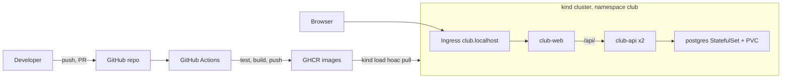

# Buổi 29 – Architecture & Planning

Tuần 15/16 · Giai đoạn 5 – Capstone Project · Buổi 29/32

[Slide](../../slides/08-capstone/session-29.md) · [Bài tập tuần](../../assignments/weekly/week-15.md) · [Hub tuần](README.md)

> **Tóm tắt:** Nhóm Capstone chốt requirement, vẽ kiến trúc, tạo repo từ starter-project, dựng GitHub Projects với backlog có tiêu chí hoàn thành và viết ba ADR đầu tiên.

::: tip Buổi này bạn làm gì
- **Bạn sẽ tạo ra:** repo nhóm sạch (không có `.env`) kèm `docs/requirements.md`, sơ đồ kiến trúc, bảng GitHub Project có ít nhất 12 Issue và ba ADR đã qua review.
- **Thời gian thật:** đọc 15 phút, lab bắt buộc 60 phút (cả nhóm làm cùng nhau), thử thách tùy chọn làm ở nhà.
- **Cần chuẩn bị:**
  - [ ] Nhóm 3-4 người đã chốt; mỗi người có tài khoản GitHub theo [Tài khoản GitHub và repo devops-labs](../../resources/setup-github.md).
  - [ ] Đã đọc [Đề bài Capstone](../../assignments/capstone/README.md) và mốc M1 trong [Milestones](../../assignments/capstone/milestones.md); đã học [Buổi 28](../week-14/session-28.md).
  - [ ] Máy có Git, Docker, WSL2 Ubuntu theo [Hướng dẫn cài đặt](../../resources/setup-guide.md); làm trong `~/` của WSL, không dùng `/mnt/c`.
- **Phải nộp:** `README.md` (7 câu của mẫu, ghi L1 hay L2); `evidence/command-output.txt`; `report.md` (vai trò, Issue, PR đã review); `source/` có `requirements.md`, ba ADR và phần kiến trúc.
- **Đi nhanh:** Đọc > [Làm lab](#hands-on-lab) > [Gặp lỗi?](#gap-loi) > [Tự kiểm tra](#tu-kiem-tra) > [Nộp bài](#nop-bai). Kẹt? Nhảy tới [Gặp lỗi?](#gap-loi).

**Từ mới trong buổi** (xem [Thuật ngữ](../../resources/glossary.md)):
- [requirement](../../resources/glossary.md): điều hệ thống phải làm, kiểm chứng được.
- [ADR](../../resources/glossary.md): file ngắn ghi một quyết định kiến trúc.
- [Definition of Done](../../resources/glossary.md): danh sách điều kiện để một việc được coi là xong.
- [branch protection](../../resources/glossary.md): luật chặn push thẳng vào `main`.
:::

## Vấn đề thực tế

Một nhóm CLB nhận đề "làm hệ thống quản lý thành viên", mở máy và code ngay. Hai tuần sau: ba người viết ba kiểu API khác nhau, không ai biết ai review ai, `.env` chứa mật khẩu đã bị đẩy lên GitHub, và đến buổi demo mới thấy không ai có Kubernetes manifest chạy được. Nguyên nhân gốc là thiếu kế hoạch chung: không có bức tranh kiến trúc, không có định nghĩa "xong", không có người chịu trách nhiệm từng phần. Trong 60 phút lab, nhóm tạo ra thứ ba buổi còn lại dựa vào: repo sạch, bảng công việc, sơ đồ kiến trúc, các quyết định được ghi lại (ADR cũng là thứ bạn giải thích ở buổi bảo vệ, buổi 32).

## Khái niệm cốt lõi {#khai-niem}

**Requirement.** Điều hệ thống phải làm hoặc đảm bảo, và kiểm chứng được bằng một lệnh hoặc thao tác. Ví von: như đề thi có đáp án; "làm cho tốt" không có đáp án để chấm. Xấu: "API chạy tốt". Tốt: "`GET /api/members/999` trả 404 với JSON có trường `error`".

**Kiến trúc.** Câu trả lời cho bốn câu hỏi: có những thành phần nào, chúng nói chuyện ra sao, dữ liệu nằm ở đâu, code đi từ máy developer tới nơi chạy bằng đường nào. Ví von: bản đồ khu phố cả nhóm cùng nhìn, vẽ đúng quan trọng hơn vẽ đẹp.

**Vertical slice (lát cắt dọc).** Chia việc theo kết quả chạy được, không chia theo công cụ. "Xóa được thành viên từ giao diện" gồm API, test, frontend, một dòng README: review và demo được ngay. Một Issue tốt có: tiêu đề bắt đầu bằng động từ, owner, size (S dưới 1 giờ, M 1-3 giờ, L trên 3 giờ nên tách nhỏ), milestone, checklist hoàn thành.

**Definition of Done (DoD).** Điều kiện mọi việc phải thỏa trước khi sang Done: đã review chéo, test xanh, tài liệu cập nhật, không có secret. DoD của cả dự án nằm ở mục 5 của [Đề bài Capstone](../../assignments/capstone/README.md).

**ADR.** File ngắn ghi một quyết định: bối cảnh, lựa chọn đã cân nhắc, quyết định, hệ quả. Mỗi quyết định một file, tối đa một trang, đặt ở `docs/adr/`, không sửa ADR cũ mà tạo ADR mới thay thế. Dùng [Mẫu ADR](../../templates/adr-template.md). Ví von: nhật ký "vì sao ta chọn vậy" để sáu tháng sau còn nhớ.

Kiến trúc mục tiêu mà nhóm sẽ vẽ lại và chỉnh theo hệ thống của mình:



::: details Tìm hiểu thêm (đọc sau)
Bảng loại requirement, thành phần của starter-project, thiết kế container và CI/CD, quy trình lập kế hoạch và luồng request nằm ở [Buổi 29 – Thử thách thêm](session-29-challenge.md#tim-hieu-them). Tóm tắt: luồng request đi Browser, Ingress `club.localhost`, Nginx `club-web`, `/api/` sang `backend:3000`, rồi PostgreSQL; dữ liệu nằm trên PVC nên xóa Pod không mất dữ liệu.
:::

## Hands-on lab (60 phút, bắt buộc) {#hands-on-lab}

Trên lớp, mentor demo trước; tự học thì làm thẳng phần này. Cả nhóm làm cùng nhau; trưởng nhóm thao tác tạo repo, những người còn lại theo dõi và kiểm tra bằng cách clone về máy mình. Năm phần: requirement 10', repo 12', kiến trúc 12', GitHub Projects 14', ADR 12'.

### Chuẩn bị (5 phút)

Thống nhất nhóm: tên repo (ví dụ `club-management`), tài khoản chủ repo (để repo public), vai trò từng người theo mục 6 của [Đề bài Capstone](../../assignments/capstone/README.md), và vòng reviewer chéo. Mỗi người kiểm tra môi trường; trưởng nhóm tạo thư mục làm việc:

```bash
git --version
docker --version
docker compose version
git config --global user.name
git config --global user.email
mkdir -p ~/club-management
cd ~/club-management
pwd
```

Kết quả mong đợi: ba lệnh đầu in phiên bản, hai lệnh `git config` in tên và email của bạn, `pwd` in `/home/ten-ban/club-management`. Nếu `git config` trống, đặt bằng `git config --global user.name "Tên của bạn"` và `git config --global user.email "email@example.com"`. Nếu `pwd` bắt đầu bằng `/mnt/c`, xem [Gặp lỗi?](#gap-loi).

### Phần 1: Requirement và tiêu chí chấp nhận (10 phút)

1. Copy starter-project về repo nhóm, tạo thư mục tài liệu:

   ```bash
   cd ~/club-management
   cp -a ~/devops-course/starter-project/. ~/club-management/
   mkdir -p docs/adr
   ls
   ```

   Kết quả mong đợi: thấy `backend`, `compose.yaml`, `database`, `docs`, `frontend`, `k8s`, `README.md`. Lệnh `cp -a ... /.` copy cả file ẩn như `.gitignore` và `.env.example`.

2. Đọc schema thật trước khi thiết kế API:

   ```bash
   cat database/init.sql
   ```

   Kết quả mong đợi: bảng `members` với `id`, `name`, `email` (UNIQUE), `created_at`. Vì sao: validation của `POST` và `PUT` phải khớp ràng buộc này (name không rỗng, email hợp lệ và không trùng).

3. Tạo `docs/requirements.md` với bảng sau, điền cột "Cách kiểm chứng" cho từng dòng (F1-F8 lấy từ đề bài):

   ```markdown
   # Requirement – Club Management

   | Mã | Requirement | Cách kiểm chứng | Owner |
   | --- | --- | --- | --- |
   | F2 | GET /api/members/:id trả 200 hoặc 404 | curl với id có và không có | A |
   | F3 | POST /api/members trả 201, sai dữ liệu trả 400 | test tự động + curl | A |
   | F8 | Dữ liệu bền vững sau recreate | docker compose down rồi up, GET lại | C |
   ```

   Nhóm điền đủ F1-F8 và thêm ít nhất 3 dòng phi chức năng (secret, CI chặn merge, scale 2 lên 3).

::: tip Kiểm tra: bạn đúng khi
`docs/requirements.md` có F1-F8 cộng 3 dòng phi chức năng, mỗi dòng có lệnh hoặc mã trạng thái cụ thể và có owner; không dòng nào dùng từ "tốt", "nhanh" mà thiếu số liệu.
:::

### Phần 2: Repo nhóm từ starter-project (12 phút)

4. Kiểm tra `.gitignore` trước lần commit đầu tiên (lần commit đầu là lúc dễ lỡ tay nhất):

   ```bash
   cd ~/club-management
   cp .env.example .env
   git init -b main
   git check-ignore -v .env
   git add .
   git status --short | grep -E "\.env$|node_modules" || echo "OK: khong co file nhay cam"
   ```

   Kết quả mong đợi: dòng `.gitignore:1:.env	.env` và `OK: khong co file nhay cam`. Dòng `.env.example` không bị lọc vì mẫu `.env$` không khớp `.env.example`. Thấy `.env` trong `git status`: xem [Gặp lỗi?](#gap-loi).

5. Commit đầu tiên (các file đã `git add .` ở bước 4) và đẩy lên GitHub. Trên GitHub, trưởng nhóm tạo repo rỗng (không chọn README, không chọn `.gitignore`), rồi:

   ```bash
   git commit -m "Import starter project as team baseline"
   git remote add origin git@github.com:TEN-CHU-REPO/club-management.git
   git push -u origin main
   ```

   Kết quả mong đợi: `Branch 'main' set up to track 'origin/main'`. Thay `TEN-CHU-REPO` bằng tên tài khoản thật. Nếu chưa có SSH key, dùng URL HTTPS của repo; lỗi `Permission denied (publickey)`: xem [Gặp lỗi?](#gap-loi).

6. Mời các thành viên (Settings, Collaborators hoặc thêm vào team). Mỗi thành viên clone về và chạy `git log --oneline` để thấy commit đầu tiên.

7. Bật bảo vệ nhánh: Settings, Branches (hoặc Rulesets), quy tắc cho `main`: yêu cầu pull request, 1 approval, status check `test` (check này chỉ xuất hiện sau khi CI chạy lần đầu ở [Buổi 30 – Implementation](session-30.md)). Không bật đầy đủ được: xem [Gặp lỗi?](#gap-loi).

8. Tạo `.github/pull_request_template.md` bằng nội dung mẫu ở mục 7 của [Đề bài Capstone](../../assignments/capstone/README.md), rồi mở nhánh đầu tiên bằng PR (không push thẳng `main`):

   ```bash
   git switch -c docs/add-pr-template
   mkdir -p .github
   # dán nội dung mẫu vào .github/pull_request_template.md
   git add .github/pull_request_template.md
   git commit -m "Add pull request template"
   git push -u origin docs/add-pr-template
   ```

   Kết quả mong đợi: Git in đường dẫn gợi ý mở Pull Request. Mở PR, gán reviewer chéo theo bảng phân vai, reviewer duyệt và Squash and merge.

::: tip Kiểm tra: bạn đúng khi
`git check-ignore -v .env` có output, `.env.example` nằm trong repo, mọi thành viên clone được, và có ít nhất 1 PR đã merge với reviewer khác tác giả.
:::

### Phần 3: Kiến trúc và phân vai (12 phút)

9. Đọc nhanh manifest và Compose có sẵn để vẽ cho đúng (không đoán, vì mentor sẽ đối chiếu):

   ```bash
   grep -nE "^  [a-z-]+:$|ports:|networks:|volumes:" compose.yaml
   grep -nE "^kind:|name:" k8s/backend.yaml | head
   ```

   Kết quả mong đợi: thấy các service `frontend`, `backend`, `postgres`, network `club-network`, volume `postgres-data` và các tài nguyên k8s `Deployment`, `Service`.

10. Thay mục kiến trúc trong `README.md` bằng sơ đồ mermaid của nhóm. Bắt đầu từ sơ đồ ở phần Khái niệm cốt lõi, thêm ít nhất một thành phần hoặc chú thích nhóm tự quyết (ví dụ quét image, hoặc cổng `WEB_PORT`). Mỗi mũi tên phải trả lời được "dữ liệu gì đi qua đây". Sơ đồ không hiện trên GitHub: xem [Gặp lỗi?](#gap-loi).

11. Thêm bảng phân vai vào README theo mẫu `templates/project-template.md`:

    ```markdown
    ## Thành viên và vai trò
    | Thành viên | Trách nhiệm | Reviewer chéo |
    | --- | --- | --- |
    | Nguyen Van A | Backend: API CRUD, test, Dockerfile backend | Nguyen Van D |
    ```

    Vòng review phải khép kín: không ai review PR của chính mình, và mỗi người review một mảng khác chuyên môn của mình.

::: tip Kiểm tra: bạn đúng khi
README có sơ đồ với ít nhất một thành phần nhóm tự thêm, bạn chỉ ra được dòng trong `compose.yaml` hoặc `k8s/` ứng với ít nhất 3 chi tiết của sơ đồ, và bảng phân vai có vòng review chéo khép kín.
:::

### Phần 4: GitHub Projects và backlog (14 phút)

12. Tạo Project: tab Projects của tài khoản hoặc tổ chức, New project, chọn mẫu Board, đặt tên `Club Management Capstone`, rồi liên kết với repo (Link a repository trong menu Project).

13. Cấu hình trường: đổi các giá trị của trường Status thành `Backlog`, `Ready`, `In progress`, `In review`, `Done`. Thêm các trường tùy chỉnh `Milestone` (M1 đến M4), `Owner`, `Size` (S, M, L). Tên trường và giao diện có thể khác chút tùy phiên bản GitHub; xem tài liệu chính thức nếu không thấy nút.

14. Tạo Issue cho mỗi requirement F1-F8 và mỗi mục Definition of Done, tối thiểu 12 Issue. Để kịp 14 phút, mỗi người tạo 3-4 Issue của mảng mình phụ trách (dán danh sách tiêu đề trước, bổ sung checklist sau). Mỗi Issue theo mẫu:

    ```markdown
    ## Mục tiêu
    Thêm DELETE /api/members/:id

    ## Tiêu chí hoàn thành
    - [ ] 204 khi xóa thành công, 404 khi không có id
    - [ ] Có ít nhất 2 test (thành công, không tồn tại)
    - [ ] README mô tả endpoint
    - [ ] PR được reviewer chéo duyệt, CI xanh
    ```

15. Thêm Issue vào Project, gán Owner, Size, Milestone (M2 cho phần cài đặt, M3 cho kiểm thử trên kind, M4 cho demo). Issue sẵn sàng làm ngay đặt ở cột `Ready`, còn lại ở `Backlog`.

16. Tự kiểm tra backlog: Issue nào thiếu tiêu chí hoàn thành? Ai đang nhận hơn 2 thẻ `In progress`? Issue size L nào cần tách nhỏ?

::: tip Kiểm tra: bạn đúng khi
Project có đủ 5 cột Status và trường Milestone, Owner, Size; có ít nhất 12 Issue, mỗi Issue có checklist, owner, size, milestone; trả lời "không" cho cả ba câu hỏi ở bước 16.
:::

### Phần 5: ADR (12 phút)

17. Viết ba ADR bằng [Mẫu ADR](../../templates/adr-template.md). Chủ đề đề xuất: chiến lược tag image, cách lưu PostgreSQL trên k8s, cách truy cập từ ngoài cluster. Tạo khung cho file đầu tiên rồi cả nhóm điền (ADR mẫu về tag image đã điền sẵn ở [Buổi 29 – Thử thách thêm](session-29-challenge.md#adr-mau), chỉ mở để đối chiếu sau khi nhóm đã viết bản của mình):

    ```bash
    git switch main && git pull
    git switch -c docs/adr-image-tags
    cat > docs/adr/0001-image-tag-strategy.md <<'EOF'
    # ADR-0001 – Chiến lược tag image

    - Trạng thái: Đã chấp nhận
    - Ngày: (điền ngày thật)

    ## Bối cảnh
    ## Các lựa chọn đã cân nhắc
    ## Quyết định
    ## Hệ quả
    EOF
    ls docs/adr
    ```

    Kết quả mong đợi: `0001-image-tag-strategy.md`. Điều chỉnh ngày cho đúng. Với ba ADR, mỗi ADR phải so sánh ít nhất hai lựa chọn thật, không viết cho đủ.

18. Đẩy nhánh, mở PR, chỉ định reviewer chéo. Reviewer đọc ADR và đặt ít nhất một câu hỏi bằng comment trước khi approve.

::: tip Kiểm tra: bạn đúng khi
`ls docs/adr` thấy ít nhất 3 file đánh số; mỗi ADR có đủ bốn phần, so sánh 2 lựa chọn thật trở lên, Hệ quả nêu cả điều khó hơn; mỗi ADR nằm trong một PR đã có comment của reviewer.
:::

### Checklist L1 (bắt buộc)

- [ ] Repo nhóm tạo từ `starter-project/`, mọi thành viên đã clone được
- [ ] `git check-ignore -v .env` xác nhận `.env` bị chặn; `.env.example` nằm trong repo
- [ ] `docs/requirements.md` có F1-F8, mỗi dòng có cách kiểm chứng và owner
- [ ] README có sơ đồ kiến trúc mermaid và bảng phân vai kèm reviewer chéo
- [ ] GitHub Project có đủ cột Status và trường Milestone, Owner, Size
- [ ] Ít nhất 12 Issue có checklist tiêu chí hoàn thành, owner, milestone
- [ ] Ít nhất 2 PR đã merge (PR template, ADR đầu tiên), mỗi PR có reviewer khác tác giả

Lệnh tự kiểm tra một dòng:

```bash
git check-ignore -v .env && ls docs/adr && git log --oneline | head -3
```

## Gặp lỗi? {#gap-loi}

| Triệu chứng | Nguyên nhân | Cách sửa |
| --- | --- | --- |
| `pwd` bắt đầu bằng `/mnt/c` | Đang làm trong filesystem Windows | Chuyển về `~/` của WSL để tránh chậm và lỗi phân quyền |
| `.env` xuất hiện trong `git status` | `.gitignore` bị sửa hoặc copy thiếu file ẩn | Dùng `cp -a starter-project/. dest/` để giữ file ẩn; kiểm tra `git check-ignore -v .env` |
| `git ls-files` in ra `.env` (secret đã commit) | Thiếu quy tắc chặn `.env`, `git add .` quá rộng | Rotate (đổi) mật khẩu ngay, rồi `git rm --cached .env`; xem mục Phá lỗi nâng cao cuối trang |
| `git push` bị từ chối: `Permission denied (publickey)` | Chưa cấu hình SSH key hoặc sai URL remote | Dùng URL HTTPS, hoặc thêm SSH key vào GitHub; kiểm tra `git remote -v` |
| Không bật được branch protection trên repo cá nhân | Gói miễn phí giới hạn tính năng trên repo private | Chuyển repo sang public hoặc tổ chức; nếu không, ghi cam kết quy ước vào README và để mentor kiểm tra lịch sử |
| Sơ đồ mermaid không hiển thị trên GitHub | Nhãn có ký tự đặc biệt chưa đặt trong ngoặc kép | Đặt nhãn trong dấu nháy kép, rút ngắn nhãn |
| PR không tự đóng Issue khi merge | Mô tả PR thiếu `Closes #số` | Thêm `Closes #12` vào mô tả PR; kiểm tra Issue có trong cùng repo |
| Backlog chỉ có "Làm Docker", "Làm Kubernetes", hoặc Issue không có tiêu chí hoàn thành | Chia việc theo công cụ, chưa có Definition of Done | Viết lại Issue theo kết quả (ví dụ "Xóa được thành viên từ giao diện") kèm checklist; áp DoD chung ở PR template |
| Một người nhận gần hết Issue | Phân việc theo "ai giỏi mảng đó" | Chia lại theo vòng review chéo; mỗi người tối đa 2 thẻ `In progress` |

## Tự kiểm tra {#tu-kiem-tra}

1. Hai requirement "API chạy tốt" và "`GET /api/members/999` trả 404" khác nhau thế nào về khả năng kiểm chứng?
2. Vì sao chia task theo vertical slice tốt hơn chia theo công cụ?
3. ADR khác tài liệu thiết kế thông thường ở điểm nào? Khi quyết định đổi, bạn làm gì với ADR cũ?
4. Tình huống: bạn là reviewer chéo, PR thêm `DELETE /api/members/:id` nhưng không có test và mô tả PR trống. Bạn xử lý thế nào?
5. Tình huống: sau khi push, bạn nhận ra đã commit `.env` có mật khẩu thật. Việc đầu tiên phải làm là gì và vì sao không phải là xóa file?

::: details Đáp án gợi ý
1. Câu thứ nhất mơ hồ, không có cách kiểm tra thống nhất. Câu thứ hai kiểm chứng được bằng `curl` hoặc test tự động. Requirement tốt phải gắn với một quan sát cụ thể.
2. Mỗi slice cho ra kết quả demo và review được ngay, lộ lỗi tích hợp sớm. Chia theo công cụ khiến mọi người chờ nhau và tích hợp muộn.
3. ADR ngắn, mỗi quyết định một file, ghi bối cảnh, lựa chọn và hệ quả. Khi đổi quyết định, tạo ADR mới và đánh dấu ADR cũ "Thay thế bởi ADR-NNNN" thay vì sửa lịch sử.
4. Yêu cầu bổ sung theo DoD: test cho trường hợp thành công và 404, mô tả PR theo template, liên kết Issue. Không approve cho tới khi đạt, và nêu rõ tiêu chí trong comment.
5. Đổi (rotate) mật khẩu ngay, vì bất kỳ ai đã clone hoặc bot quét đều có thể đã sao chép nó và lịch sử Git vẫn giữ bản cũ. Sau đó mới gỡ file khỏi theo dõi, bổ sung `.gitignore` và làm sạch lịch sử nếu cần.
:::

## Nộp bài {#nop-bai}

Nộp vào thư mục `lab-29/` trong repo cá nhân `devops-labs` theo [Mẫu nộp bài lab](../../templates/lab-template.md); chi tiết yêu cầu và barem ở [Bài tập tuần 15](../../assignments/weekly/week-15.md).

- [ ] `README.md` trả lời đủ 7 câu: bài lab giải quyết vấn đề gì, kiến thức đã dùng, các bước thực hiện, kết quả mong đợi, lỗi đã gặp, cách khắc phục, cải thiện được gì
- [ ] `evidence/command-output.txt` chứa kết quả `git check-ignore -v .env`, `git log --oneline`, `ls docs/adr`
- [ ] `report.md` ghi vai trò của bạn, các Issue bạn là owner, các PR bạn đã review và nhận xét chính
- [ ] `source/` có `docs/requirements.md`, ít nhất 3 file ADR, phần README (kiến trúc, phân vai) và liên kết tới repo nhóm cùng GitHub Project
- [ ] `screenshots/` chứa ảnh bảng Project và PR đã merge (chỉ bổ sung, không thay file và log); đánh dấu level đã làm (L1, L2) ở cuối `README.md`
- [ ] Đã kiểm tra: không có `.env`, token hay mật khẩu thật trong mọi file nộp

## Recap

- Requirement tốt gắn với cách kiểm chứng cụ thể; chia việc theo kết quả, mỗi Issue có owner, size, milestone, checklist.
- ADR ghi lựa chọn và hệ quả, không sửa lịch sử; kiểm tra `git check-ignore -v .env` trước commit đầu, secret đã lộ thì phải rotate.
- Vòng review chéo và branch protection giúp cả nhóm hiểu cả hệ thống.

Buổi tiếp theo: [Buổi 30 – Implementation](session-30.md).

::: details Thử thách thêm (L2, tùy chọn, làm ở nhà)
Ba thử thách (ADR về chiến lược test, sơ đồ phụ thuộc và đường găng, bảng rủi ro), mỗi thử thách có tiêu chí hoàn thành và gợi ý từng bậc, nằm ở [Buổi 29 – Thử thách thêm](session-29-challenge.md). Tự thử 15 phút trước khi mở gợi ý.
:::

::: details Phá lỗi nâng cao: secret bị commit vào Git
Mô phỏng một thành viên commit nhầm `.env` thật, trên repo thử nghiệm, kèm cây điều tra và cách xử lý (rotate trước, rồi gỡ khỏi theo dõi): xem [Buổi 29 – Thử thách thêm](session-29-challenge.md#pha-loi-nang-cao).
:::

::: details Tài liệu tham khảo
Danh sách liên kết (git-check-ignore, GitHub Projects, protected branches, ADR, mermaid) ở cuối [Buổi 29 – Thử thách thêm](session-29-challenge.md#tai-lieu-tham-khao).
:::
