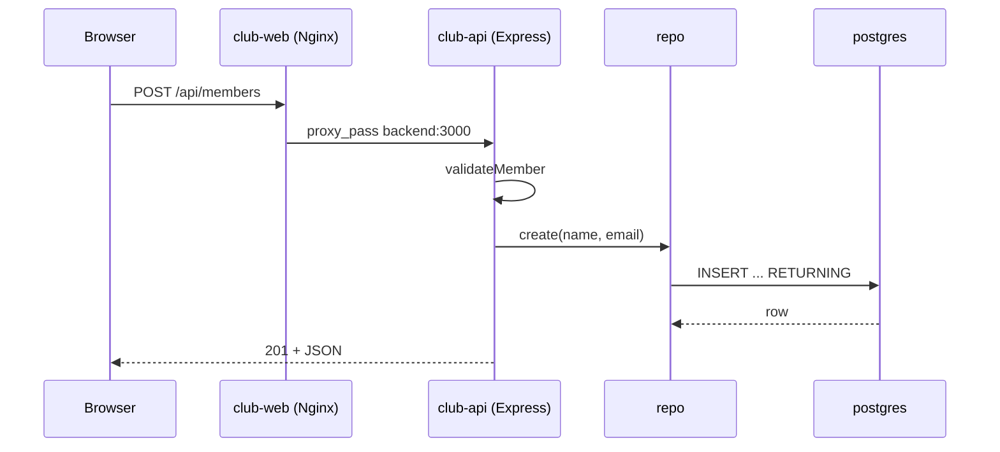

# Buổi 30 – Mã gợi ý và thử thách

Tuần 15/16 · Giai đoạn 5 – Capstone Project · Buổi 30/32

[Bài học Buổi 30 – Implementation](session-30.md) · [Bài tập tuần](../../assignments/weekly/week-15.md) · [Hub tuần](README.md)

> **Tóm tắt:** Trang phụ của buổi 30: sơ đồ request, mã gợi ý cho vai trò A, B, D, ba thử thách L2, tình huống đổi tên trường API và tài liệu tham khảo. Tự thử trước khi mở mã gợi ý.

::: warning Tự thiết kế 15 phút trước khi mở mã
Capstone là bài của nhóm bạn: hãy tự phác thảo cấu trúc API, test và workflow, rồi mới mở mã gợi ý để đối chiếu hoặc khi kẹt. Mã dưới đây là một cách làm khớp với `starter-project/`, không phải đáp án duy nhất; ghi lại những chỗ nhóm bạn làm khác và vì sao trong `report.md`.
:::

## Tìm hiểu thêm (đọc sau) {#tim-hieu-them}

Đường đi của một request `POST /api/members`:



1. Trình duyệt chỉ nói chuyện với Nginx; mọi đường dẫn bắt đầu bằng `/api/` được proxy sang `backend:3000` (xem `starter-project/frontend/nginx.conf`).
2. Handler kiểm tra dữ liệu trước. Dữ liệu sai bị chặn ở đây, không bao giờ chạm tới DB.
3. Handler gọi `repo.create`. `repo` dùng truy vấn tham số hóa (`$1`, `$2`), không nối chuỗi, nên an toàn trước SQL injection.
4. Lỗi `23505` được middleware lỗi chuyển thành 409; lỗi không lường trước thành 500 và ghi log, không lộ chi tiết cho client.
5. Ở phía CI, mỗi PR chạy `.github/workflows/ci.yml`; sau khi merge vào `main`, `.github/workflows/publish.yml` build và đẩy image lên GHCR với tag theo SHA.

## Mã gợi ý vai trò A: tách tầng dữ liệu, CRUD và test {#ma-a}

**Bước 1.** Tạo `backend/members-repo.js` chứa toàn bộ truy vấn SQL:

```js
import { pool } from "./db.js";

const COLUMNS = "id, name, email";

export const pgMembersRepo = {
  async list() {
    const r = await pool.query(`SELECT ${COLUMNS} FROM members ORDER BY id`);
    return r.rows;
  },
  async get(id) {
    const r = await pool.query(`SELECT ${COLUMNS} FROM members WHERE id = $1`, [id]);
    return r.rows[0] ?? null;
  },
  async create({ name, email }) {
    const r = await pool.query(
      `INSERT INTO members (name, email) VALUES ($1, $2) RETURNING ${COLUMNS}`,
      [name, email]
    );
    return r.rows[0];
  },
  async update(id, { name, email }) {
    const r = await pool.query(
      `UPDATE members SET name = $1, email = $2 WHERE id = $3 RETURNING ${COLUMNS}`,
      [name, email, id]
    );
    return r.rows[0] ?? null;
  },
  async remove(id) {
    const r = await pool.query("DELETE FROM members WHERE id = $1", [id]);
    return r.rowCount > 0;
  }
};
```

Vì sao: `${COLUMNS}` là hằng số do bạn viết nên nối chuỗi an toàn; mọi giá trị người dùng đi qua `$1`, `$2`.

**Bước 2.** Thay toàn bộ `backend/app.js` bằng phiên bản dùng factory `createApp`. Tên export `app` được giữ nguyên để `tests/health.test.js` hiện có vẫn chạy:

```js
import express from "express";
import { pool } from "./db.js";
import { pgMembersRepo } from "./members-repo.js";

const EMAIL_RE = /^[^\s@]+@[^\s@]+\.[^\s@]+$/;

export function validateMember(body) {
  const name = typeof body?.name === "string" ? body.name.trim() : "";
  const email = typeof body?.email === "string" ? body.email.trim() : "";
  const errors = [];
  if (name.length < 1 || name.length > 100) errors.push("name must be 1-100 characters");
  if (email.length > 150 || !EMAIL_RE.test(email)) errors.push("email is invalid");
  return { errors, value: { name, email } };
}

export function parseId(raw) {
  if (!/^[1-9]\d{0,9}$/.test(String(raw))) return null;
  const id = Number(raw);
  return id <= 2147483647 ? id : null; // giới hạn kiểu INTEGER của cột SERIAL
}

export function createApp(repo = pgMembersRepo, db = pool) {
  const app = express();
  app.use(express.json());

  app.get("/health", (req, res) => {
    res.json({ status: "healthy", service: "club-api" });
  });

  app.get("/ready", async (req, res) => {
    try {
      await db.query("SELECT 1");
      res.json({ status: "ready" });
    } catch {
      res.status(503).json({ status: "not-ready" });
    }
  });

  app.get("/api/members", async (req, res) => {
    res.json(await repo.list());
  });

  app.get("/api/members/:id", async (req, res) => {
    const id = parseId(req.params.id);
    if (id === null) return res.status(400).json({ message: "Invalid id" });
    const member = await repo.get(id);
    if (!member) return res.status(404).json({ message: "Member not found" });
    res.json(member);
  });

  app.post("/api/members", async (req, res) => {
    const { errors, value } = validateMember(req.body);
    if (errors.length) return res.status(400).json({ message: "Validation failed", errors });
    res.status(201).json(await repo.create(value));
  });

  app.put("/api/members/:id", async (req, res) => {
    const id = parseId(req.params.id);
    if (id === null) return res.status(400).json({ message: "Invalid id" });
    const { errors, value } = validateMember(req.body);
    if (errors.length) return res.status(400).json({ message: "Validation failed", errors });
    const member = await repo.update(id, value);
    if (!member) return res.status(404).json({ message: "Member not found" });
    res.json(member);
  });

  app.delete("/api/members/:id", async (req, res) => {
    const id = parseId(req.params.id);
    if (id === null) return res.status(400).json({ message: "Invalid id" });
    const removed = await repo.remove(id);
    if (!removed) return res.status(404).json({ message: "Member not found" });
    res.status(204).end();
  });

  // Express 5 chuyển lỗi của handler async vào middleware này.
  app.use((err, req, res, next) => {
    if (err.type === "entity.parse.failed") {
      return res.status(400).json({ message: "Invalid JSON body" });
    }
    if (err.code === "23505") {
      return res.status(409).json({ message: "Email already exists" });
    }
    console.error(err);
    res.status(500).json({ message: "Internal server error" });
  });

  return app;
}

export const app = createApp();
```

Vì sao: `createApp(repo)` cho phép test truyền `repo` giả. Express 5 tự chuyển promise bị reject vào middleware lỗi nên không cần `try/catch` ở từng handler.

**Bước 3.** Tạo `backend/tests/members.test.js` với repo giả trong bộ nhớ:

```js
import { test } from "node:test";
import assert from "node:assert/strict";
import { createApp } from "../app.js";

function fakeRepo() {
  let nextId = 3;
  const rows = [
    { id: 1, name: "Alice", email: "alice@example.com" },
    { id: 2, name: "Bob", email: "bob@example.com" }
  ];
  const dup = (email, id) => rows.some((r) => r.email === email && r.id !== id);
  const conflict = () => Object.assign(new Error("duplicate"), { code: "23505" });
  return {
    async list() { return rows; },
    async get(id) { return rows.find((r) => r.id === id) ?? null; },
    async create(v) {
      if (dup(v.email)) throw conflict();
      const row = { id: nextId++, ...v };
      rows.push(row);
      return row;
    },
    async update(id, v) {
      const row = rows.find((r) => r.id === id);
      if (!row) return null;
      if (dup(v.email, id)) throw conflict();
      Object.assign(row, v);
      return row;
    },
    async remove(id) {
      const i = rows.findIndex((r) => r.id === id);
      if (i < 0) return false;
      rows.splice(i, 1);
      return true;
    }
  };
}

async function withServer(fn) {
  const server = createApp(fakeRepo(), { query: async () => {} }).listen(0, "127.0.0.1");
  await new Promise((resolve) => server.once("listening", resolve));
  const base = `http://127.0.0.1:${server.address().port}`;
  try {
    await fn(base);
  } finally {
    await new Promise((resolve) => server.close(resolve));
  }
}

const json = (method, body) => ({
  method,
  headers: { "Content-Type": "application/json" },
  body: JSON.stringify(body)
});

test("GET /api/members returns the list", () =>
  withServer(async (base) => {
    const res = await fetch(`${base}/api/members`);
    assert.equal(res.status, 200);
    assert.equal((await res.json()).length, 2);
  }));

test("POST creates a member and returns 201", () =>
  withServer(async (base) => {
    const res = await fetch(`${base}/api/members`, json("POST", { name: "Carol", email: "carol@example.com" }));
    assert.equal(res.status, 201);
    assert.equal((await res.json()).name, "Carol");
  }));

test("POST with invalid email returns 400", () =>
  withServer(async (base) => {
    const res = await fetch(`${base}/api/members`, json("POST", { name: "X", email: "not-an-email" }));
    assert.equal(res.status, 400);
  }));

test("POST with duplicate email returns 409", () =>
  withServer(async (base) => {
    const res = await fetch(`${base}/api/members`, json("POST", { name: "Dup", email: "alice@example.com" }));
    assert.equal(res.status, 409);
  }));

test("GET unknown id returns 404, bad id returns 400", () =>
  withServer(async (base) => {
    assert.equal((await fetch(`${base}/api/members/999`)).status, 404);
    assert.equal((await fetch(`${base}/api/members/abc`)).status, 400);
  }));

test("PUT updates a member", () =>
  withServer(async (base) => {
    const res = await fetch(`${base}/api/members/1`, json("PUT", { name: "Alice N", email: "alice@example.com" }));
    assert.equal(res.status, 200);
    assert.equal((await res.json()).name, "Alice N");
  }));

test("DELETE returns 204 then 404", () =>
  withServer(async (base) => {
    assert.equal((await fetch(`${base}/api/members/2`, { method: "DELETE" })).status, 204);
    assert.equal((await fetch(`${base}/api/members/2`, { method: "DELETE" })).status, 404);
  }));
```

**Bước 4.** Chạy `cd backend && npm test`; kết quả mong đợi là 8 test pass, 0 fail. `health.test.js` cũ vẫn chạy vì `app` còn được export (nó tự đóng `pool` ở cuối). Mỗi file test chạy trong một tiến trình riêng nên `members.test.js` không cần đóng `pool`. Nếu test treo không kết thúc, kiểm tra xem có test nào để lại server chưa đóng.

## Mã gợi ý vai trò B: giao diện thêm và xóa {#ma-b}

Sửa `frontend/index.html`: đặt khối `form` bên dưới `<p id="status">`, và thay toàn bộ khối `script` cũ bằng khối dưới đây. Dùng `textContent` (không dùng `innerHTML`) để tránh XSS:

```html
<form id="add-form">
  <input id="name" placeholder="Name" required maxlength="100">
  <input id="email" type="email" placeholder="Email" required maxlength="150">
  <button type="submit">Add</button>
</form>
<script>
  const tbody = document.getElementById("members");
  const statusEl = document.getElementById("status");

  async function api(path, options) {
    const res = await fetch(path, options);
    if (!res.ok) {
      const body = await res.json().catch(() => ({}));
      throw new Error(body.message || `HTTP ${res.status}`);
    }
    return res.status === 204 ? null : res.json();
  }

  async function load() {
    try {
      const members = await api("/api/members");
      statusEl.textContent = `${members.length} member(s)`;
      tbody.replaceChildren();
      for (const m of members) {
        const tr = document.createElement("tr");
        for (const value of [m.id, m.name, m.email]) {
          const td = document.createElement("td");
          td.textContent = value;
          tr.appendChild(td);
        }
        const td = document.createElement("td");
        const btn = document.createElement("button");
        btn.textContent = "Delete";
        btn.addEventListener("click", async () => {
          try { await api(`/api/members/${m.id}`, { method: "DELETE" }); await load(); }
          catch (err) { statusEl.textContent = err.message; }
        });
        td.appendChild(btn);
        tr.appendChild(td);
        tbody.appendChild(tr);
      }
    } catch (err) {
      statusEl.textContent = `Cannot load members: ${err.message}`;
    }
  }

  document.getElementById("add-form").addEventListener("submit", async (e) => {
    e.preventDefault();
    const name = document.getElementById("name").value;
    const email = document.getElementById("email").value;
    try {
      await api("/api/members", {
        method: "POST",
        headers: { "Content-Type": "application/json" },
        body: JSON.stringify({ name, email })
      });
      e.target.reset();
      await load();
    } catch (err) { statusEl.textContent = err.message; }
  });

  load();
</script>
```

Nhớ thêm một cột tiêu đề trống `<th></th>` vào hàng tiêu đề của bảng cho cột nút Delete. Vì sao: nút xóa nằm trong cột thứ tư của mỗi dòng. Frontend được đóng gói vào image Nginx nên mỗi lần sửa HTML phải build lại (`--build`) và tải lại trang bằng Ctrl+F5 để bỏ cache.

## Mã gợi ý vai trò D: workflow CI {#ma-d}

Thêm job `build-images` (build thử, không push) để PR bắt được Dockerfile hỏng. Bản `ci.yml` đầy đủ cho cấu trúc repo nhóm:

```yaml
name: CI

on:
  push:
    branches: [main]
  pull_request:

permissions:
  contents: read

jobs:
  test:
    runs-on: ubuntu-latest
    steps:
      - uses: actions/checkout@v4
      - uses: actions/setup-node@v4
        with:
          node-version: 22
          cache: npm
          cache-dependency-path: backend/package-lock.json
      - name: Install dependencies
        working-directory: backend
        run: npm ci
      - name: Run tests
        working-directory: backend
        run: npm test

  validate-compose:
    runs-on: ubuntu-latest
    steps:
      - uses: actions/checkout@v4
      - name: Validate compose file
        env:
          DB_PASSWORD: ci-only-password
        run: docker compose config --quiet

  build-images:
    runs-on: ubuntu-latest
    steps:
      - uses: actions/checkout@v4
      - uses: docker/setup-buildx-action@v3
      - name: Build backend image
        uses: docker/build-push-action@v6
        with:
          context: backend
          push: false
          tags: club-api:ci
      - name: Build frontend image
        uses: docker/build-push-action@v6
        with:
          context: frontend
          push: false
          tags: club-web:ci
```

Vì sao: `push: false` nghĩa là build để kiểm tra, không cần đăng nhập registry và an toàn cho PR từ nhánh khác. `DB_PASSWORD: ci-only-password` chỉ là giá trị giả để `compose config` không báo thiếu biến. Lưu bản này thành `.github/workflows/ci.yml`, commit cả hai file workflow và mở PR như các vai trò khác. Check `test`, `validate-compose`, `build-images` xuất hiện sau lần chạy đầu tiên của PR này; tên check hiển thị lúc đó mới chọn được trong branch protection.

## Thử thách L2 (tùy chọn, làm ở nhà) {#thu-thach}

Chọn ít nhất hai thử thách và ghi lại trong `report.md`.

::: warning Tự thử 15 phút trước khi mở gợi ý
Mỗi thử thách có gợi ý trong khung gập bên dưới. Hãy tự nghĩ 15 phút rồi mới mở; đối chiếu cuối cùng với mentor sau khi nộp bài.
:::

1. **Tag image truy vết được.** Workflow publish gắn thêm tag semver khi đẩy tag `v1.1.0`, và bạn chứng minh tag hoạt động. Tiêu chí: Packages hiển thị tag `v1.1.0`; giải thích vì sao không dùng `latest` làm tag duy nhất.
2. **Chặn merge khi test đỏ.** Cố tình viết một PR làm hỏng test. Tiêu chí: ảnh chụp và link PR cho thấy nút merge bị chặn bởi check đỏ, sau đó sửa và merge.
3. **Chạy thử trên kind.** Build `club-api:1.1.0` từ code mới, nạp vào kind, triển khai bằng manifest trong `k8s/`, đổi `image` trong `k8s/backend.yaml` sang `club-api:1.1.0`. Tiêu chí: `kubectl get pods -n club` thấy Pod `Running`, `POST` qua `kubectl port-forward` thành công. Nhớ nạp dữ liệu mẫu thủ công vì `init.sql` không tự chạy trên Kubernetes.

::: details Gợi ý
- Thử thách 1: trong `docker/metadata-action@v5`, `type=ref,event=tag` đã có trong `publish.yml`; việc cần làm là tạo tag Git: `git tag v1.1.0 && git push origin v1.1.0`.
- Thử thách 2: tạo PR mà test kỳ vọng `201` nhưng đổi tạm giá trị thành `200`; sau khi chụp bằng chứng, `git revert` hoặc sửa lại.
- Thử thách 3: nạp bảng bằng `kubectl exec -i -n club postgres-0 -- psql -U club -d clubdb < database/init.sql`. Tên Pod `postgres-0` do StatefulSet `postgres` sinh ra. Cluster của khóa học tên `club` (context `kind-club`), xem bằng `kind get clusters`.
:::

## Phá lỗi nâng cao: merge muộn làm vỡ stack {#pha-loi-nang-cao}

Hai bạn làm song song: A đổi API trả `full_name` thay cho `name`, B vẫn viết frontend đọc `m.name`.

Cách phá (mô phỏng): trong hàm `list()` của `members-repo.js`, đổi câu truy vấn thành `SELECT id, name AS full_name, email FROM members ORDER BY id`, rebuild backend rồi mở giao diện. Sau khi xong, khôi phục bằng `git restore backend/members-repo.js` (nếu file đã được commit) và build lại.

```bash
docker compose up -d --build backend
curl -s http://localhost:3000/api/members
```

Triệu chứng: API vẫn trả 200, test cũ có thể vẫn xanh, nhưng giao diện hiển thị cột Name trống.

Hướng điều tra theo từng bước:

1. Mở DevTools, tab Network: xem response của `/api/members`. Có dữ liệu, status 200, vậy lỗi không nằm ở mạng hay Nginx.
2. So tên trường trong JSON (`full_name`) với tên frontend đọc (`m.name`).
3. Dùng `git log -p -- backend/members-repo.js` để tìm commit đổi tên trường.
4. Kiểm tra test: có test nào khẳng định hình dạng JSON không? Nếu không, đó là lỗ hổng.

Nguyên nhân gốc: thay đổi hợp đồng API (contract) không được thông báo và không được test bảo vệ. Cách phòng tránh: ghi contract trong README, thêm assertion về tên trường vào test (`assert.deepEqual(Object.keys(row), ["id","name","email"])`), PR đổi contract phải gắn nhãn và được người dùng contract review. Lưu ý giới hạn: test dùng `repo` giả không đi qua `members-repo.js`, nên không bắt được lỗi đổi alias ngay trong câu SQL; assertion về tên trường chỉ bảo vệ phần handler. Muốn bắt lỗi kiểu này, thêm một bước smoke test với PostgreSQL thật (ví dụ `curl` rồi kiểm tra có trường `"name"`) sau khi `docker compose up`.

Tình huống mở rộng cho học viên khá: kịch bản 03 và 05 trong `examples/troubleshooting/` (API không kết nối được DB, image build thất bại) rất hay gặp trong tích hợp; thử làm trước khi xem gợi ý.

## Câu hỏi tự kiểm tra thêm

1. Vì sao dùng `$1`, `$2` thay vì nối chuỗi vào câu SQL?
2. Tình huống: sau khi thêm cột `phone` vào `init.sql`, API báo `column "phone" does not exist` dù đã rebuild. Vì sao và xử lý ra sao?

::: details Đáp án gợi ý
1. Truy vấn tham số hóa tách dữ liệu khỏi câu lệnh, ngăn SQL injection.
2. `init.sql` chỉ chạy lần đầu khi volume trống nên DB cũ không có cột mới. Môi trường local: `docker compose down -v` rồi `up`. Nếu có dữ liệu cần giữ: chạy `ALTER TABLE` thủ công và về lâu dài dùng migration có version.
:::

## Tài liệu tham khảo {#tai-lieu-tham-khao}

- [Express 5 – Error handling](https://expressjs.com/en/guide/error-handling.html)
- [Node.js test runner](https://nodejs.org/api/test.html)
- [node-postgres – Queries](https://node-postgres.com/features/queries)
- [Docker Compose – Volumes và lệnh down](https://docs.docker.com/reference/cli/docker/compose/down/)
- [GitHub Actions – Workflow syntax](https://docs.github.com/en/actions/writing-workflows/workflow-syntax-for-github-actions)
- [GitHub Packages – Container registry](https://docs.github.com/en/packages/working-with-a-github-packages-registry/working-with-the-container-registry)
