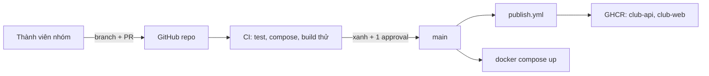
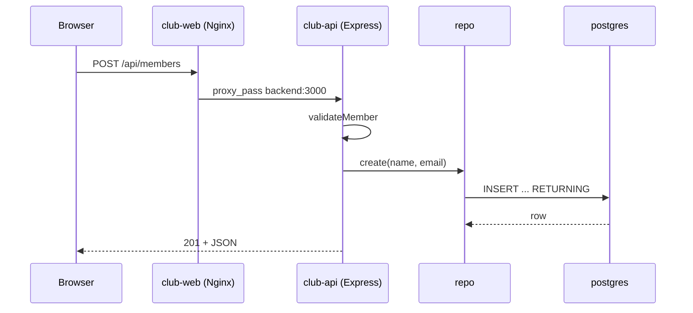

# Buổi 30 – Implementation

Tuần 15 · Giai đoạn 5 – Capstone Project · Slide: [Slide buổi 30](../../slides/08-capstone/session-30.md)

> **Tóm tắt:** Nhóm hoàn thiện CRUD API có test, giao diện web, Compose, CI trên Pull Request và publish image lên GHCR, đạt mốc M2 của Capstone bằng quy trình làm việc theo PR và review chéo.

## Mục tiêu học tập

- Triển khai được `POST`, `PUT`, `DELETE`, `GET /api/members/:id` với validation và mã trạng thái đúng.
- Viết được ít nhất 5 test chạy bằng `npm test` mà không cần PostgreSQL thật, nhờ tách tầng truy cập dữ liệu.
- Chạy được toàn stack bằng `docker compose up -d --build` và chứng minh dữ liệu còn nguyên sau khi recreate container.
- Cấu hình được workflow CI chạy trên Pull Request (test, validate compose, build thử image) và publish image lên GHCR.
- Làm việc được theo vòng nhánh nhỏ, PR nhỏ, review chéo theo vai trò của nhóm.
- Chẩn đoán được lỗi tích hợp thường gặp khi ghép nhiều phần do nhiều người viết (merge muộn, sai biến môi trường, sai tag image).

## Điều kiện cần

- Đã hoàn thành buổi 29: có repo nhóm tạo từ `starter-project/`, Project board, phân vai, ADR đầu tiên (xem [buổi 29](session-29.md)).
- Đã học Docker, Compose, GitHub Actions, Kubernetes cơ bản ở các buổi trước.
- Mỗi người làm việc trong filesystem của WSL (ví dụ `~/club-management`), không dùng `/mnt/c`.

Kiểm tra nhanh trong WSL:

```bash
node --version && docker --version && docker compose version && git --version
cd ~/club-management && git status -sb && ls
```

Kết quả mong đợi (rút gọn):

```text
v22.x.x
Docker version 27.x.x ...
Docker Compose version v2.x.x
## main...origin/main
backend  compose.yaml  database  frontend  k8s  README.md
```

Nếu WSL chưa cài Node.js 22, vai trò A có thể chạy test trong container thay vì cài Node (cần `package-lock.json` đã có sẵn trong `backend/`):

```bash
docker run --rm -v "$PWD/backend":/app -w /app node:22-alpine sh -c "npm ci && npm test"
```

Tài liệu đối chiếu yêu cầu: `assignments/capstone/README.md` (F1–F8, Definition of Done) và `assignments/capstone/milestones.md` (mốc M2).

## Vấn đề thực tế

Ở buổi 29 nhóm đã có kế hoạch, nhưng kế hoạch đẹp không chạy được. Thất bại phổ biến của dự án nhóm là mỗi người viết phần của mình rất lâu trên máy riêng, rồi ghép vào phút cuối: API đổi tên trường mà frontend không biết, Compose thiếu biến môi trường, CI chưa từng chạy nên không ai biết test đang đỏ. Lỗi tích hợp bị dồn thành một cục và không ai gỡ nổi trong 30 phút cuối.

Buổi này giải quyết bằng một nguyên tắc: tích hợp liên tục theo lát cắt nhỏ. Mỗi người làm một PR nhỏ trong vòng 20-30 phút, CI tự kiểm tra, đồng đội review rồi merge ngay. Sau 60 phút lab, nhánh `main` của nhóm phải ở trạng thái chạy được từ đầu đến cuối, kể cả khi một vài tính năng nâng cao còn dang dở.

## Khái niệm cốt lõi

### Lát cắt dọc và PR nhỏ

Thay vì chia "backend, frontend, hạ tầng" rồi ghép sau, hãy chia theo lát cắt có thể chạy và kiểm chứng. Thứ tự đề xuất cho 60 phút:

| Thứ tự | Lát cắt | Vai trò chính | Kiểm chứng bằng |
| --- | --- | --- | --- |
| 1 | Tách tầng dữ liệu, thêm validation và CRUD, test | A – Backend | `npm test` |
| 2 | Form thêm/xóa trên giao diện | B – Frontend | Mở trình duyệt, gọi `/api/` |
| 3 | `.env.example`, kiểm tra Compose, volume | C – Data và Compose | `docker compose ps`, recreate |
| 4 | CI trên PR, build thử image, publish GHCR | D – CI/CD và Kubernetes | Tab Actions, trang Packages |

Quy tắc: một PR chỉ làm một việc, diff dưới khoảng 200 dòng, có mô tả "đã kiểm chứng bằng lệnh nào".

### Tách tầng dữ liệu để test không cần DB

Nếu handler gọi thẳng `pool.query`, test phải có PostgreSQL. Cách gọn nhất: handler chỉ nói chuyện với một đối tượng `repo` (list, get, create, update, remove). Production dùng `repo` thật nói chuyện với PostgreSQL, test dùng `repo` giả lưu trong bộ nhớ. Đây là dependency injection ở mức đơn giản nhất: truyền phụ thuộc qua tham số hàm.

### Mã trạng thái HTTP của CRUD

| Thao tác | Thành công | Lỗi thường gặp |
| --- | --- | --- |
| `GET /api/members/:id` | 200 + JSON | 400 id không hợp lệ, 404 không có |
| `POST /api/members` | 201 + thành viên mới | 400 dữ liệu sai, 409 trùng email |
| `PUT /api/members/:id` | 200 + bản ghi đã sửa | 400, 404, 409 |
| `DELETE /api/members/:id` | 204, không có body | 400, 404 |

Cột `email` trong `database/init.sql` là `UNIQUE NOT NULL`, PostgreSQL báo trùng bằng mã lỗi `23505`; API nên đổi thành 409 thay vì để rơi thành 500.

### Ba lớp kiểm tra trước khi merge

| Lớp | Công cụ | Trả lời câu hỏi |
| --- | --- | --- |
| Logic | `npm test` | Handler và validation đúng không? |
| Cấu hình | `docker compose config --quiet` | File Compose hợp lệ và đủ biến không? |
| Đóng gói | `docker build` trong CI (không push) | Image còn build được không? |

CI chạy cả ba lớp trên mỗi PR; branch protection chặn merge khi CI đỏ.

## Kiến trúc và cách hoạt động





Giải thích từng bước:

1. Trình duyệt chỉ nói chuyện với Nginx; mọi đường dẫn bắt đầu bằng `/api/` được proxy sang `backend:3000` (xem `starter-project/frontend/nginx.conf`).
2. Handler kiểm tra dữ liệu trước. Dữ liệu sai bị chặn ở đây, không bao giờ chạm tới DB.
3. Handler gọi `repo.create`. `repo` dùng truy vấn tham số hóa (`$1`, `$2`), không nối chuỗi, nên an toàn trước SQL injection.
4. Lỗi `23505` được middleware lỗi chuyển thành 409; lỗi không lường trước thành 500 và ghi log, không lộ chi tiết cho client.
5. Ở phía CI, mỗi PR chạy `.github/workflows/ci.yml`; sau khi merge vào `main`, `.github/workflows/publish.yml` build và đẩy image lên GHCR với tag theo SHA.

## Demo của mentor

Mentor demo trên starter-project chưa sửa, theo kịch bản 8-10 phút.

1. Chạy stack và cho thấy hiện trạng chỉ có `GET`:

```bash
cd ~/club-management
cp .env.example .env
docker compose up -d --build
curl -i -X POST http://localhost:3000/api/members \
  -H "Content-Type: application/json" \
  -d '{"name":"Test User","email":"test.user@example.com"}'
```

Kết quả mong đợi (rút gọn): Express trả `404 Not Found` vì chưa có route `POST`.

2. Tạo nhánh và thêm duy nhất route `GET /api/members/:id` kèm một test. Chạy `npm test` trước và sau khi sửa để lớp thấy vòng đỏ-xanh.
3. Mở PR, cho lớp xem tab Checks chạy CI, rồi nhờ một học viên review và approve.
4. Cố tình push một commit làm test đỏ, cho lớp thấy nút merge bị chặn.

Câu hỏi mentor nên hỏi lớp:

- Vì sao chỉ thêm một route mỗi PR thay vì làm cả CRUD rồi mới PR?
- Test này có cần PostgreSQL không? Nếu cần thì CI sẽ phải làm gì thêm?
- Nếu hai người cùng sửa `app.js`, conflict xảy ra ở đâu và giảm thiểu bằng cách nào?

## Hands-on lab

Thời gian gợi ý: 60 phút, làm theo vai trò của nhóm (xem bảng phân vai trong `assignments/capstone/README.md`). Nhóm 3 người gộp vai trò, giữ nguyên vòng review chéo.

### Chuẩn bị

1. Mỗi người cập nhật `main` và tạo nhánh riêng:

```bash
cd ~/club-management
git switch main && git pull
git switch -c feature/api-crud     # đổi tên theo phần việc của bạn (quy ước: feature/, fix/, docs/, ci/)
```

2. Xác nhận `.env` không bị theo dõi bởi Git:

```bash
git check-ignore -v .env
```

Kết quả mong đợi: một dòng chỉ ra `.gitignore` chặn `.env`. Nếu không có kết quả, dừng lại và sửa `.gitignore` trước khi làm gì khác.

### Phần 1 – Vai trò A: tách tầng dữ liệu và viết CRUD

Bước 1. Tạo `backend/members-repo.js` chứa toàn bộ truy vấn SQL:

```js
import { pool } from "./db.js";

const COLUMNS = "id, name, email";

export const pgMembersRepo = {
  async list() {
    const r = await pool.query(`SELECT ${COLUMNS} FROM members ORDER BY id`);
    return r.rows;
  },
  async get(id) {
    const r = await pool.query(`SELECT ${COLUMNS} FROM members WHERE id = $1`, [id]);
    return r.rows[0] ?? null;
  },
  async create({ name, email }) {
    const r = await pool.query(
      `INSERT INTO members (name, email) VALUES ($1, $2) RETURNING ${COLUMNS}`,
      [name, email]
    );
    return r.rows[0];
  },
  async update(id, { name, email }) {
    const r = await pool.query(
      `UPDATE members SET name = $1, email = $2 WHERE id = $3 RETURNING ${COLUMNS}`,
      [name, email, id]
    );
    return r.rows[0] ?? null;
  },
  async remove(id) {
    const r = await pool.query("DELETE FROM members WHERE id = $1", [id]);
    return r.rowCount > 0;
  }
};
```

Vì sao: `${COLUMNS}` là hằng số do bạn viết nên nối chuỗi an toàn; mọi giá trị người dùng đi qua `$1`, `$2`.

Bước 2. Thay toàn bộ `backend/app.js` bằng phiên bản dùng factory `createApp`. Tên export `app` được giữ nguyên để `tests/health.test.js` hiện có vẫn chạy:

```js
import express from "express";
import { pool } from "./db.js";
import { pgMembersRepo } from "./members-repo.js";

const EMAIL_RE = /^[^\s@]+@[^\s@]+\.[^\s@]+$/;

export function validateMember(body) {
  const name = typeof body?.name === "string" ? body.name.trim() : "";
  const email = typeof body?.email === "string" ? body.email.trim() : "";
  const errors = [];
  if (name.length < 1 || name.length > 100) errors.push("name must be 1-100 characters");
  if (email.length > 150 || !EMAIL_RE.test(email)) errors.push("email is invalid");
  return { errors, value: { name, email } };
}

export function parseId(raw) {
  if (!/^[1-9]\d{0,9}$/.test(String(raw))) return null;
  const id = Number(raw);
  return id <= 2147483647 ? id : null; // giới hạn kiểu INTEGER của cột SERIAL
}

export function createApp(repo = pgMembersRepo, db = pool) {
  const app = express();
  app.use(express.json());

  app.get("/health", (req, res) => {
    res.json({ status: "healthy", service: "club-api" });
  });

  app.get("/ready", async (req, res) => {
    try {
      await db.query("SELECT 1");
      res.json({ status: "ready" });
    } catch {
      res.status(503).json({ status: "not-ready" });
    }
  });

  app.get("/api/members", async (req, res) => {
    res.json(await repo.list());
  });

  app.get("/api/members/:id", async (req, res) => {
    const id = parseId(req.params.id);
    if (id === null) return res.status(400).json({ message: "Invalid id" });
    const member = await repo.get(id);
    if (!member) return res.status(404).json({ message: "Member not found" });
    res.json(member);
  });

  app.post("/api/members", async (req, res) => {
    const { errors, value } = validateMember(req.body);
    if (errors.length) return res.status(400).json({ message: "Validation failed", errors });
    res.status(201).json(await repo.create(value));
  });

  app.put("/api/members/:id", async (req, res) => {
    const id = parseId(req.params.id);
    if (id === null) return res.status(400).json({ message: "Invalid id" });
    const { errors, value } = validateMember(req.body);
    if (errors.length) return res.status(400).json({ message: "Validation failed", errors });
    const member = await repo.update(id, value);
    if (!member) return res.status(404).json({ message: "Member not found" });
    res.json(member);
  });

  app.delete("/api/members/:id", async (req, res) => {
    const id = parseId(req.params.id);
    if (id === null) return res.status(400).json({ message: "Invalid id" });
    const removed = await repo.remove(id);
    if (!removed) return res.status(404).json({ message: "Member not found" });
    res.status(204).end();
  });

  // Express 5 chuyển lỗi của handler async vào middleware này.
  app.use((err, req, res, next) => {
    if (err.type === "entity.parse.failed") {
      return res.status(400).json({ message: "Invalid JSON body" });
    }
    if (err.code === "23505") {
      return res.status(409).json({ message: "Email already exists" });
    }
    console.error(err);
    res.status(500).json({ message: "Internal server error" });
  });

  return app;
}

export const app = createApp();
```

Vì sao: `createApp(repo)` cho phép test truyền `repo` giả. Express 5 tự chuyển promise bị reject vào middleware lỗi nên không cần `try/catch` ở từng handler.

Bước 3. Tạo `backend/tests/members.test.js` với repo giả trong bộ nhớ:

```js
import { test } from "node:test";
import assert from "node:assert/strict";
import { createApp } from "../app.js";

function fakeRepo() {
  let nextId = 3;
  const rows = [
    { id: 1, name: "Alice", email: "alice@example.com" },
    { id: 2, name: "Bob", email: "bob@example.com" }
  ];
  const dup = (email, id) => rows.some((r) => r.email === email && r.id !== id);
  const conflict = () => Object.assign(new Error("duplicate"), { code: "23505" });
  return {
    async list() { return rows; },
    async get(id) { return rows.find((r) => r.id === id) ?? null; },
    async create(v) {
      if (dup(v.email)) throw conflict();
      const row = { id: nextId++, ...v };
      rows.push(row);
      return row;
    },
    async update(id, v) {
      const row = rows.find((r) => r.id === id);
      if (!row) return null;
      if (dup(v.email, id)) throw conflict();
      Object.assign(row, v);
      return row;
    },
    async remove(id) {
      const i = rows.findIndex((r) => r.id === id);
      if (i < 0) return false;
      rows.splice(i, 1);
      return true;
    }
  };
}

async function withServer(fn) {
  const server = createApp(fakeRepo(), { query: async () => {} }).listen(0, "127.0.0.1");
  await new Promise((resolve) => server.once("listening", resolve));
  const base = `http://127.0.0.1:${server.address().port}`;
  try {
    await fn(base);
  } finally {
    await new Promise((resolve) => server.close(resolve));
  }
}

const json = (method, body) => ({
  method,
  headers: { "Content-Type": "application/json" },
  body: JSON.stringify(body)
});

test("GET /api/members returns the list", () =>
  withServer(async (base) => {
    const res = await fetch(`${base}/api/members`);
    assert.equal(res.status, 200);
    assert.equal((await res.json()).length, 2);
  }));

test("POST creates a member and returns 201", () =>
  withServer(async (base) => {
    const res = await fetch(`${base}/api/members`, json("POST", { name: "Carol", email: "carol@example.com" }));
    assert.equal(res.status, 201);
    assert.equal((await res.json()).name, "Carol");
  }));

test("POST with invalid email returns 400", () =>
  withServer(async (base) => {
    const res = await fetch(`${base}/api/members`, json("POST", { name: "X", email: "not-an-email" }));
    assert.equal(res.status, 400);
  }));

test("POST with duplicate email returns 409", () =>
  withServer(async (base) => {
    const res = await fetch(`${base}/api/members`, json("POST", { name: "Dup", email: "alice@example.com" }));
    assert.equal(res.status, 409);
  }));

test("GET unknown id returns 404, bad id returns 400", () =>
  withServer(async (base) => {
    assert.equal((await fetch(`${base}/api/members/999`)).status, 404);
    assert.equal((await fetch(`${base}/api/members/abc`)).status, 400);
  }));

test("PUT updates a member", () =>
  withServer(async (base) => {
    const res = await fetch(`${base}/api/members/1`, json("PUT", { name: "Alice N", email: "alice@example.com" }));
    assert.equal(res.status, 200);
    assert.equal((await res.json()).name, "Alice N");
  }));

test("DELETE returns 204 then 404", () =>
  withServer(async (base) => {
    assert.equal((await fetch(`${base}/api/members/2`, { method: "DELETE" })).status, 204);
    assert.equal((await fetch(`${base}/api/members/2`, { method: "DELETE" })).status, 404);
  }));
```

Bước 4. Chạy test:

```bash
cd backend && npm test
```

Kết quả mong đợi (rút gọn):

```text
ℹ tests 8
ℹ suites 0
ℹ pass 8
ℹ fail 0
```

Định dạng dòng tổng kết có thể là `# tests 8` (kiểu TAP) nếu output không phải terminal; điều cần nhìn là 8 test pass và 0 fail. `health.test.js` cũ vẫn chạy vì `app` còn được export (nó tự đóng `pool` ở cuối). Mỗi file test chạy trong một tiến trình riêng nên `members.test.js` không cần đóng `pool`. Nếu test treo không kết thúc, kiểm tra xem có test nào để lại server chưa đóng.

Bước 5. Commit, push, mở PR và nhờ reviewer chéo của bạn duyệt:

```bash
cd ..
git add backend
git commit -m "feat(api): add members CRUD with validation and tests"
git push -u origin feature/api-crud
```

### Phần 2 – Vai trò B: giao diện thêm và xóa

Bước 1. Trên nhánh riêng (ví dụ `feature/web-add-delete`), sửa `frontend/index.html`: đặt khối `<form>` bên dưới `<p id="status">`, và thay toàn bộ khối `<script>` cũ bằng khối `<script>` dưới đây. Dùng `textContent` (không dùng `innerHTML`) để tránh XSS:

```html
<form id="add-form">
  <input id="name" placeholder="Name" required maxlength="100">
  <input id="email" type="email" placeholder="Email" required maxlength="150">
  <button type="submit">Add</button>
</form>
<script>
  const tbody = document.getElementById("members");
  const statusEl = document.getElementById("status");

  async function api(path, options) {
    const res = await fetch(path, options);
    if (!res.ok) {
      const body = await res.json().catch(() => ({}));
      throw new Error(body.message || `HTTP ${res.status}`);
    }
    return res.status === 204 ? null : res.json();
  }

  async function load() {
    try {
      const members = await api("/api/members");
      statusEl.textContent = `${members.length} member(s)`;
      tbody.replaceChildren();
      for (const m of members) {
        const tr = document.createElement("tr");
        for (const value of [m.id, m.name, m.email]) {
          const td = document.createElement("td");
          td.textContent = value;
          tr.appendChild(td);
        }
        const td = document.createElement("td");
        const btn = document.createElement("button");
        btn.textContent = "Delete";
        btn.addEventListener("click", async () => {
          try { await api(`/api/members/${m.id}`, { method: "DELETE" }); await load(); }
          catch (err) { statusEl.textContent = err.message; }
        });
        td.appendChild(btn);
        tr.appendChild(td);
        tbody.appendChild(tr);
      }
    } catch (err) {
      statusEl.textContent = `Cannot load members: ${err.message}`;
    }
  }

  document.getElementById("add-form").addEventListener("submit", async (e) => {
    e.preventDefault();
    const name = document.getElementById("name").value;
    const email = document.getElementById("email").value;
    try {
      await api("/api/members", {
        method: "POST",
        headers: { "Content-Type": "application/json" },
        body: JSON.stringify({ name, email })
      });
      e.target.reset();
      await load();
    } catch (err) { statusEl.textContent = err.message; }
  });

  load();
</script>
```

Nhớ thêm một cột tiêu đề trống `<th></th>` vào hàng tiêu đề của bảng cho cột nút Delete. Vì sao: nút xóa nằm trong cột thứ tư của mỗi dòng. Frontend được đóng gói vào image Nginx nên mỗi lần sửa HTML phải build lại (`--build`) và tải lại trang bằng Ctrl+F5 để bỏ cache.

Bước 2. Kiểm tra bằng Compose (sau khi PR của A đã merge và bạn đã `git pull` lại `main` vào nhánh của mình):

```bash
docker compose up -d --build
```

Mở `http://localhost:8080` (hoặc giá trị `WEB_PORT`), thêm một thành viên, xóa một thành viên. Thêm email trùng và xác nhận trang hiển thị thông báo lỗi thay vì im lặng.

### Phần 3 – Vai trò C: Compose và dữ liệu bền vững

Bước 1. Kiểm tra stack và healthcheck:

```bash
docker compose ps
```

Kết quả mong đợi (rút gọn): `postgres` ở trạng thái `healthy`, `backend` và `frontend` ở trạng thái `running`.

Bước 2. Chứng minh dữ liệu bền vững (yêu cầu F8):

```bash
curl -s -X POST http://localhost:3000/api/members \
  -H "Content-Type: application/json" \
  -d '{"name":"Persist Check","email":"persist@example.com"}'
docker compose down
docker compose up -d
until curl -sf http://localhost:3000/ready > /dev/null; do sleep 2; done
curl -s http://localhost:3000/api/members
```

Kết quả mong đợi: bản ghi `Persist Check` vẫn còn trong danh sách (cùng Alice, Bob). Vì sao: `docker compose down` giữ volume `postgres-data`; chỉ `docker compose down -v` mới xóa dữ liệu. Vòng `until` chờ tới khi backend kết nối được PostgreSQL (`/ready` trả 200) rồi mới đọc dữ liệu.

Bước 3. Rà soát cấu hình: `.env.example` chỉ chứa placeholder, `.env` nằm trong `.gitignore`, Dockerfile backend dùng `USER node`. Nếu nhóm thêm trường vào bảng `members`, sửa `database/init.sql`, API, test và README trong cùng một PR; lưu ý `init.sql` chỉ chạy khi volume còn trống.

### Phần 4 – Vai trò D: CI trên PR và publish GHCR

Bước 1. Repo nhóm được tạo từ nội dung `starter-project/` nên chưa có thư mục `.github/workflows/`. Lấy `publish.yml` từ bản giáo trình (giả sử ở `~/devops-course`) và bỏ tiền tố `starter-project/`, vì repo nhóm có `backend/` và `frontend/` ở gốc. `ci.yml` sẽ được viết mới ở bước 2.

```bash
cd ~/club-management
git switch main && git pull
git switch -c ci/workflows
mkdir -p .github/workflows
cp ~/devops-course/.github/workflows/publish.yml .github/workflows/publish.yml
sed -i "s#starter-project/##g" .github/workflows/publish.yml
grep -n "context:" .github/workflows/publish.yml
```

Kết quả mong đợi: hai dòng `context: backend` và `context: frontend`. Vì sao: workflow chỉ chạy được khi đường dẫn khớp cấu trúc repo thật.

Bước 2. Thêm job `build-images` (build thử, không push) để PR bắt được Dockerfile hỏng. Bản `ci.yml` đầy đủ cho cấu trúc repo nhóm:

```yaml
name: CI

on:
  push:
    branches: [main]
  pull_request:

permissions:
  contents: read

jobs:
  test:
    runs-on: ubuntu-latest
    steps:
      - uses: actions/checkout@v4
      - uses: actions/setup-node@v4
        with:
          node-version: 22
          cache: npm
          cache-dependency-path: backend/package-lock.json
      - name: Install dependencies
        working-directory: backend
        run: npm ci
      - name: Run tests
        working-directory: backend
        run: npm test

  validate-compose:
    runs-on: ubuntu-latest
    steps:
      - uses: actions/checkout@v4
      - name: Validate compose file
        env:
          DB_PASSWORD: ci-only-password
        run: docker compose config --quiet

  build-images:
    runs-on: ubuntu-latest
    steps:
      - uses: actions/checkout@v4
      - uses: docker/setup-buildx-action@v3
      - name: Build backend image
        uses: docker/build-push-action@v6
        with:
          context: backend
          push: false
          tags: club-api:ci
      - name: Build frontend image
        uses: docker/build-push-action@v6
        with:
          context: frontend
          push: false
          tags: club-web:ci
```

Vì sao: `push: false` nghĩa là build để kiểm tra, không cần đăng nhập registry và an toàn cho PR từ nhánh khác. `DB_PASSWORD: ci-only-password` chỉ là giá trị giả để `compose config` không báo thiếu biến. Lưu bản này thành `.github/workflows/ci.yml`, commit cả hai file workflow và mở PR như các vai trò khác. Vì workflow chỉ chạy khi đã nằm trên GitHub, check `test`, `validate-compose`, `build-images` xuất hiện sau lần chạy đầu tiên của PR này.

Bước 3. Trong Settings của repo, bật branch protection cho `main`: yêu cầu PR, ít nhất 1 approval, và các check `test`, `validate-compose`, `build-images` phải xanh (tên check hiển thị sau khi workflow chạy ít nhất một lần).

Bước 4. Sau khi các PR của A, B, C merge, theo dõi workflow publish:

```bash
gh run list --workflow publish.yml --limit 3
```

Kết quả mong đợi: lần chạy mới nhất có trạng thái `completed` và kết luận `success` (hoặc dấu tích xanh, tùy phiên bản `gh`). Nếu chưa cài `gh`, xem tab Actions trên GitHub. Sau đó mở trang Packages của repo hoặc tài khoản và xác nhận có image `club-api` và `club-web` với tag dạng `sha-xxxxxxx`.

Lưu ý: `publish.yml` cần `permissions: packages: write` (đã có trong mẫu) và dùng `GITHUB_TOKEN`, không bao giờ dán token vào file.

### Phần 5 – Review chéo và tích hợp

1. Mỗi người review PR của đồng đội theo vòng A → D → C → B → A: kéo nhánh về, chạy lệnh trong mô tả PR, để lại ít nhất một nhận xét cụ thể.
2. Merge theo thứ tự: A (API) trước, rồi B, C, D, để mỗi người rebase lên `main` mới nhất.
3. Cuối buổi, một người chưa từng đụng vào code clone lại repo vào thư mục mới và chạy theo README. Trước đó, dừng stack cũ (`docker compose down` trong thư mục `~/club-management`) vì hai stack cùng dùng cổng 3000 và 8080:

```bash
git clone git@github.com:ORG/club-management.git ~/clean-check
cd ~/clean-check && cp .env.example .env && docker compose up -d --build
curl -s http://localhost:3000/api/members
```

### L1 – Foundation: checklist hoàn thành

- [ ] `GET /api/members/:id`, `POST`, `PUT`, `DELETE` hoạt động, trả đúng 200, 201, 204, 400, 404
- [ ] `npm test` có ít nhất 5 test và tất cả pass, không cần PostgreSQL
- [ ] Giao diện thêm và xóa được thành viên trên `http://localhost:8080`
- [ ] `docker compose down` rồi `up` vẫn còn dữ liệu
- [ ] Mỗi thành viên có ít nhất 1 PR đã merge và đã review 1 PR của người khác
- [ ] CI xanh trên ít nhất một PR

### L2 – Engineering: thử thách tự làm

Chọn ít nhất hai thử thách và ghi lại trong `report.md`.

1. **Tag image truy vết được.** Workflow publish gắn thêm tag semver khi đẩy tag `v1.1.0`, và bạn chứng minh tag hoạt động. Tiêu chí: Packages hiển thị tag `v1.1.0`; giải thích vì sao không dùng `latest` làm tag duy nhất.
2. **Chặn merge khi test đỏ.** Cố tình viết một PR làm hỏng test. Tiêu chí: ảnh chụp và link PR cho thấy nút merge bị chặn bởi check đỏ, sau đó sửa và merge.
3. **Chạy thử trên kind.** Build `club-api:1.1.0` từ code mới, nạp vào kind, triển khai bằng manifest trong `k8s/`, đổi `image` trong `k8s/backend.yaml` sang `club-api:1.1.0`. Tiêu chí: `kubectl get pods -n club` thấy Pod `Running`, `POST` qua `kubectl port-forward` thành công. Nhớ nạp dữ liệu mẫu thủ công vì `init.sql` không tự chạy trên Kubernetes.

<details><summary>Gợi ý</summary>

- Thử thách 1: trong `docker/metadata-action@v5`, `type=ref,event=tag` đã có trong `publish.yml`; việc cần làm là tạo tag Git: `git tag v1.1.0 && git push origin v1.1.0`.
- Thử thách 2: tạo PR mà test kỳ vọng `201` nhưng đổi tạm giá trị thành `200`; sau khi chụp bằng chứng, `git revert` hoặc sửa lại.
- Thử thách 3: nạp bảng bằng `kubectl exec -i -n club postgres-0 -- psql -U club -d clubdb < database/init.sql`. Tên Pod `postgres-0` do StatefulSet `postgres` sinh ra.

</details>

<details><summary>Lời giải thử thách 3</summary>

```bash
docker build -t club-api:1.1.0 ./backend
kind load docker-image club-api:1.1.0 --name club-lab
kubectl set image deployment/club-api api=club-api:1.1.0 -n club
kubectl rollout status deployment/club-api -n club
kubectl exec -i -n club postgres-0 -- psql -U club -d clubdb < database/init.sql
kubectl port-forward -n club svc/backend 3000:3000
```

Mở terminal khác và chạy `curl -i -X POST http://localhost:3000/api/members ...` như phần demo. Sau khi xong, sửa `image` trong `k8s/backend.yaml` để khớp với những gì đang chạy, tránh lệch giữa manifest và cluster. Thay `club-lab` bằng tên cluster của bạn (xem bằng `kind get clusters`). Cổng 3000 chỉ cần rảnh trên máy bạn trong lúc port-forward; nếu bận, đổi cổng bên trái, ví dụ `3100:3000`.

</details>

## Phá lỗi và debug

**Tình huống: merge muộn làm vỡ stack.** Hai bạn làm song song: A đổi API trả `fullName` thay cho `name`, B vẫn viết frontend đọc `m.name`.

Cách phá (mô phỏng): trong hàm `list()` của `members-repo.js`, đổi câu truy vấn thành `SELECT id, name AS full_name, email FROM members ORDER BY id`, rebuild backend rồi mở giao diện. Sau khi xong, khôi phục bằng `git restore backend/members-repo.js` (nếu file đã được commit) và build lại.

```bash
docker compose up -d --build backend
curl -s http://localhost:3000/api/members
```

Triệu chứng: API vẫn trả 200, test cũ có thể vẫn xanh, nhưng giao diện hiển thị cột Name trống.

Hướng điều tra theo từng bước:

1. Mở DevTools, tab Network: xem response của `/api/members`. Có dữ liệu, status 200, vậy lỗi không nằm ở mạng hay Nginx.
2. So tên trường trong JSON (`full_name`) với tên frontend đọc (`m.name`).
3. Dùng `git log -p -- backend/members-repo.js` để tìm commit đổi tên trường.
4. Kiểm tra test: có test nào khẳng định hình dạng JSON không? Nếu không, đó là lỗ hổng.

Nguyên nhân gốc: thay đổi hợp đồng API (contract) không được thông báo và không được test bảo vệ. Cách phòng tránh: ghi contract trong README, thêm assertion về tên trường vào test (`assert.deepEqual(Object.keys(row), ["id","name","email"])`), PR đổi contract phải gắn nhãn và được người dùng contract review. Lưu ý giới hạn: test dùng `repo` giả không đi qua `members-repo.js`, nên không bắt được lỗi đổi alias ngay trong câu SQL; assertion về tên trường chỉ bảo vệ phần handler. Muốn bắt lỗi kiểu này, thêm một bước smoke test với PostgreSQL thật (ví dụ `curl` rồi kiểm tra có trường `"name"`) sau khi `docker compose up`.

Tình huống mở rộng cho học viên khá: kịch bản 03 và 05 trong `examples/troubleshooting/` (API không kết nối được DB, image build thất bại) rất hay gặp trong tích hợp; thử làm trước khi xem gợi ý.

## Lỗi thường gặp

| Triệu chứng | Nguyên nhân | Cách xử lý |
| --- | --- | --- |
| `POST` trả `400 Invalid JSON body` | Thiếu header `Content-Type: application/json` hoặc JSON sai cú pháp (hay gặp khi quote trên PowerShell) | Chạy `curl` trong WSL, dùng nháy đơn bao JSON |
| `POST` trả 500 khi email trùng | Chưa xử lý mã lỗi `23505` | Thêm nhánh `err.code === "23505"` trả 409 trong middleware lỗi |
| `npm test` treo, không thoát | Server hoặc `pool` còn mở sau test | Đóng server trong `finally`; gọi `pool.end()` trong test dùng DB thật |
| Backend `Exited` ngay khi Compose chạy | Thiếu `DB_PASSWORD` hoặc lỗi cú pháp trong `app.js` | `docker compose logs backend`; kiểm tra `.env` có `DB_PASSWORD` |
| Frontend gọi `/api/` báo 502 | Backend chưa chạy hoặc Nginx chưa nhận được địa chỉ mới | `docker compose ps`, `docker compose restart frontend` |
| Thêm cột mới nhưng DB không có cột đó | `init.sql` chỉ chạy khi volume rỗng | Dev local: `docker compose down -v` rồi `up`; có dữ liệu thật thì viết migration |
| Workflow không chạy trên PR | File đặt sai thư mục hoặc `on:` không có `pull_request` | Workflow phải ở `.github/workflows/` ở gốc repo |
| Publish lỗi `invalid reference format` hoặc image bị từ chối vì chữ hoa | Tên image GHCR phải viết thường; tên tài khoản có chữ hoa gây lỗi nếu tự ghép tên | Giữ `docker/metadata-action` tạo tên (nó chuẩn hóa chữ thường) hoặc viết thường tên thủ công |
| Publish lỗi `denied` khi push GHCR | Thiếu `packages: write` hoặc login sai | Kiểm tra khối `permissions` của job và bước `docker/login-action` |
| Conflict lớn khi merge | Nhánh sống quá lâu | Rebase lên `main` mỗi lần có PR merge, PR nhỏ |

## Tự kiểm tra

1. Vì sao `createApp(repo)` giúp test chạy không cần PostgreSQL?
2. `PUT` với id không tồn tại nên trả mã nào? `DELETE` thành công trả mã nào và có body không?
3. Vì sao dùng `$1`, `$2` thay vì nối chuỗi vào câu SQL?
4. `docker compose down` và `docker compose down -v` khác nhau thế nào về dữ liệu?
5. Job `build-images` đặt `push: false` để làm gì, và vì sao không cần đăng nhập GHCR?
6. Tình huống: CI xanh trên PR nhưng sau khi merge, workflow publish đỏ. Bạn kiểm tra những gì đầu tiên?
7. Tình huống: sau khi thêm cột `phone` vào `init.sql`, API báo `column "phone" does not exist` dù đã rebuild. Vì sao và xử lý ra sao?

<details>
<summary>Đáp án</summary>

1. Vì handler chỉ phụ thuộc vào đối tượng `repo` truyền vào; test truyền bản giả lưu trong bộ nhớ, còn production truyền bản nói chuyện với PostgreSQL.
2. 404. `DELETE` thành công trả 204 và không có body.
3. Truy vấn tham số hóa tách dữ liệu khỏi câu lệnh, ngăn SQL injection.
4. `down` xóa container và network nhưng giữ volume `postgres-data`; `down -v` xóa cả volume nên mất dữ liệu.
5. Để kiểm tra Dockerfile build được mà không đẩy image; build không cần quyền ghi registry nên không cần đăng nhập.
6. Mở log của lần chạy lỗi để xem bước nào đỏ; kiểm tra `permissions: packages: write`, tên image và context đúng với repo nhóm, và sự khác biệt giữa trigger của CI (PR) với publish (push lên `main`).
7. `init.sql` chỉ chạy lần đầu khi volume trống nên DB cũ không có cột mới. Môi trường local: `docker compose down -v` rồi `up`. Nếu có dữ liệu cần giữ: chạy `ALTER TABLE` thủ công và về lâu dài dùng migration có version.

</details>

## Nộp bài

Nộp vào thư mục `lab-30/` trong repository cá nhân (ví dụ `devops-labs`) theo `templates/lab-template.md`:

- [ ] `README.md` trả lời đủ 7 câu của template (bài lab giải quyết gì, kiến thức dùng, các bước, kết quả mong đợi, lỗi đã gặp, cách khắc phục, cải thiện được gì), ghi rõ đã làm L1 hay L2
- [ ] `evidence/command-output.txt` chứa output của `npm test`, `docker compose ps`, lệnh `curl` CRUD và kiểm tra dữ liệu sau `down`/`up`
- [ ] `evidence/test-results.txt` chứa kết quả `npm test` đầy đủ
- [ ] `source/` chứa `members-repo.js`, `app.js`, `tests/members.test.js`, `index.html` và workflow đã sửa (phần của bạn)
- [ ] `report.md` ghi vai trò của bạn, link tới PR bạn tạo và PR bạn review, một lỗi tích hợp đã gặp và cách xử lý
- [ ] `screenshots/` có ảnh tab Actions xanh và trang Packages (ảnh chỉ bổ sung, không thay thế bằng chứng dạng văn bản)
- [ ] Không có secret nào trong file nộp: `.env`, mật khẩu, token đều không được commit

## Recap

- Tích hợp liên tục bằng PR nhỏ giảm rủi ro hơn nhiều so với merge lớn vào phút cuối.
- Tách tầng dữ liệu qua tham số `repo` giúp test nhanh, không cần DB thật.
- Validation ở rìa API và mã trạng thái đúng (400, 404, 409) là một phần của hợp đồng API, cần được test bảo vệ.
- Compose giữ dữ liệu qua `down`; chỉ `down -v` mới xóa volume.
- CI nên kiểm tra ba lớp: test, cấu hình Compose, build image; branch protection biến CI thành cổng chặn thật.
- Luôn kiểm chứng trên bản clone sạch: nếu người mới không chạy được theo README thì dự án chưa xong.

## Tài liệu tham khảo

- [Express 5 – Error handling](https://expressjs.com/en/guide/error-handling.html)
- [Node.js test runner](https://nodejs.org/api/test.html)
- [node-postgres – Queries](https://node-postgres.com/features/queries)
- [Docker Compose – Volumes và lệnh down](https://docs.docker.com/reference/cli/docker/compose/down/)
- [GitHub Actions – Workflow syntax](https://docs.github.com/en/actions/writing-workflows/workflow-syntax-for-github-actions)
- [GitHub Packages – Container registry](https://docs.github.com/en/packages/working-with-a-github-packages-registry/working-with-the-container-registry)
