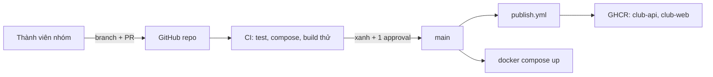

# Buổi 30 – Implementation

Tuần 15/16 · Giai đoạn 5 – Capstone Project · Buổi 30/32

[Slide](../../slides/08-capstone/session-30.md) · [Bài tập tuần](../../assignments/weekly/week-15.md) · [Hub tuần](README.md)

> **Tóm tắt:** Nhóm hoàn thiện CRUD API có test, giao diện web, Compose, CI trên Pull Request và publish image lên GHCR, đạt mốc M2 của Capstone bằng PR nhỏ và review chéo.

::: tip Buổi này bạn làm gì
- **Bạn sẽ tạo ra:** nhánh `main` của nhóm chạy được từ đầu đến cuối: CRUD API có test, giao diện thêm/xóa, Compose giữ dữ liệu, CI xanh trên PR và image trên GHCR.
- **Thời gian thật:** đọc 15 phút, lab bắt buộc 60 phút (4 vai trò làm song song rồi review chéo), thử thách tùy chọn làm ở nhà.
- **Cần chuẩn bị:**
  - [ ] Repo nhóm, Project board, phân vai và ADR đầu tiên từ [Buổi 29 – Architecture & Planning](session-29.md); repo để public.
  - [ ] Docker, Node.js 22 trong WSL theo [Hướng dẫn cài đặt](../../resources/setup-guide.md); tài khoản theo [Tài khoản GitHub và repo devops-labs](../../resources/setup-github.md).
  - [ ] Làm trong `~/club-management` của WSL (không dùng `/mnt/c`); nắm [Đề bài Capstone](../../assignments/capstone/README.md) (F1-F8, DoD) và mốc M2 trong [Milestones](../../assignments/capstone/milestones.md).
- **Phải nộp:** `README.md` (7 câu của mẫu, ghi L1 hay L2); `evidence/` (`command-output.txt`, `test-results.txt`); `source/` các file của bạn; `report.md` (vai trò, link PR tạo và review, một lỗi tích hợp).
- **Đi nhanh:** Đọc > [Làm lab](#hands-on-lab) > [Gặp lỗi?](#gap-loi) > [Tự kiểm tra](#tu-kiem-tra) > [Nộp bài](#nop-bai). Kẹt? Nhảy tới [Gặp lỗi?](#gap-loi).

**Từ mới trong buổi** (xem [Thuật ngữ](../../resources/glossary.md)):
- [CRUD](../../resources/glossary.md): bốn thao tác tạo, đọc, sửa, xóa dữ liệu.
- [validation](../../resources/glossary.md): kiểm tra dữ liệu đầu vào trước khi xử lý.
- [dependency injection](../../resources/glossary.md): truyền phụ thuộc vào hàm qua tham số.
- [GHCR](../../resources/glossary.md): kho image của GitHub.
- [rebase](../../resources/glossary.md): đặt lại nhánh của bạn lên đầu `main` mới nhất.
:::

## Vấn đề thực tế

Buổi 29 nhóm đã có kế hoạch, nhưng kế hoạch đẹp không chạy được. Thất bại phổ biến: mỗi người viết rất lâu trên máy riêng rồi ghép vào phút cuối, API đổi tên trường mà frontend không biết, Compose thiếu biến môi trường, CI chưa từng chạy nên không ai biết test đang đỏ. Lỗi tích hợp dồn thành một cục, không gỡ nổi trong 30 phút cuối.

Nguyên tắc của buổi này: tích hợp liên tục theo lát cắt nhỏ. Mỗi người làm một PR nhỏ trong 20-30 phút, CI tự kiểm tra, đồng đội review rồi merge ngay. Sau 60 phút lab, `main` phải chạy được từ đầu đến cuối, kể cả khi vài tính năng nâng cao còn dang dở.

## Khái niệm cốt lõi {#khai-niem}

**PR nhỏ theo lát cắt dọc.** Mỗi PR chỉ làm một việc, diff dưới khoảng 200 dòng, mô tả "đã kiểm chứng bằng lệnh nào". Ví von: nộp bài từng chương cho thầy sửa, đừng ôm cả cuốn tới đêm cuối. Thứ tự đề xuất: A (Backend: tách tầng dữ liệu, CRUD, test), B (Frontend: form thêm, xóa), C (Data và Compose: `.env.example`, volume), D (CI/CD: CI trên PR, publish GHCR).

**Tách tầng dữ liệu.** Handler chỉ nói chuyện với một đối tượng `repo` (list, get, create, update, remove). Production truyền `repo` thật nói chuyện với PostgreSQL; test truyền `repo` giả lưu trong bộ nhớ, nên `npm test` không cần database. Ví von: diễn tập chữa cháy bằng khói giả thay vì đốt nhà. Đây là dependency injection ở mức đơn giản nhất.

**Mã trạng thái là một phần hợp đồng API.** `email` là `UNIQUE NOT NULL`; PostgreSQL báo trùng bằng mã lỗi `23505`, API phải đổi thành 409 thay vì để rơi thành 500.

| Thao tác | Thành công | Lỗi thường gặp |
| --- | --- | --- |
| `GET /api/members/:id` | 200 + JSON | 400 id không hợp lệ, 404 không có |
| `POST /api/members` | 201 + thành viên mới | 400 dữ liệu sai, 409 trùng email |
| `PUT /api/members/:id` | 200 + bản ghi đã sửa | 400, 404, 409 |
| `DELETE /api/members/:id` | 204, không có body | 400, 404 |

**Ba lớp kiểm tra trước khi merge.** `npm test` (logic), `docker compose config --quiet` (cấu hình), `docker build` trong CI không push (đóng gói). CI chạy cả ba trên mỗi PR; branch protection chặn merge khi CI đỏ.



::: details Tìm hiểu thêm (đọc sau)
Sơ đồ tuần tự của một request `POST /api/members` và giải thích từng bước (Nginx proxy `/api/` sang `backend:3000`, validation chặn dữ liệu sai trước DB, truy vấn tham số hóa `$1`, `$2`, middleware lỗi đổi `23505` thành 409) nằm ở [Buổi 30 – Mã gợi ý và thử thách](session-30-challenge.md#tim-hieu-them).
:::

## Hands-on lab (60 phút, bắt buộc) {#hands-on-lab}

Trên lớp, mentor demo trước; tự học thì làm thẳng phần này. Phần 1-4 là bốn vai trò làm song song (khoảng 35 phút); nhóm 3 người gộp vai trò nhưng giữ vòng review chéo. Phần 5 (review và tích hợp) 15 phút. Mã gợi ý nằm ở [Buổi 30 – Mã gợi ý và thử thách](session-30-challenge.md); hãy tự thiết kế 15 phút trước khi mở.

### Chuẩn bị (5 phút)

```bash
node --version && docker --version && docker compose version && git --version
cd ~/club-management && git status -sb && ls
git switch main && git pull
git switch -c feature/api-crud     # đổi tên theo phần việc của bạn (quy ước: feature/, fix/, docs/, ci/)
git check-ignore -v .env
```

Kết quả mong đợi: `v22.x.x`, Docker và Compose in phiên bản, `## main...origin/main`, danh sách có `backend compose.yaml database frontend k8s README.md`, và một dòng cho thấy `.gitignore` chặn `.env`. Không có kết quả ở dòng cuối: dừng lại, sửa `.gitignore` trước (xem [Gặp lỗi?](#gap-loi)). Chưa cài Node.js 22, vai trò A chạy test trong container (cần `backend/package-lock.json`):

```bash
docker run --rm -v "$PWD/backend":/app -w /app node:22-alpine sh -c "npm ci && npm test"
```

### Phần 1 – Vai trò A: tách tầng dữ liệu và CRUD (khoảng 25 phút)

1. Tạo `backend/members-repo.js` chứa toàn bộ truy vấn SQL: đối tượng `pgMembersRepo` với `list`, `get`, `create`, `update`, `remove`. Giá trị người dùng luôn đi qua `$1`, `$2`, không nối chuỗi.
2. Viết lại `backend/app.js` dùng factory `createApp(repo = pgMembersRepo, db = pool)`: thêm `validateMember`, `parseId` (chỉ nhận số nguyên dương trong giới hạn kiểu INTEGER), các route trong bảng mã trạng thái, giữ `GET /health` và `GET /ready`, middleware lỗi đổi `23505` thành 409 và JSON hỏng thành 400. Vẫn `export const app = createApp()` để `tests/health.test.js` hiện có chạy.
3. Tạo `backend/tests/members.test.js` với `repo` giả trong bộ nhớ, ít nhất 5 test phủ 201, 400, 404, 409 (cộng PUT, DELETE).

Mã gợi ý cho cả ba file: [Mã gợi ý vai trò A](session-30-challenge.md#ma-a). Chạy test:

```bash
cd backend && npm test
```

Kết quả mong đợi (rút gọn, với mã gợi ý):

```text
ℹ tests 8
ℹ suites 0
ℹ pass 8
ℹ fail 0
```

Dòng tổng kết có thể là `# tests 8` (kiểu TAP); điều cần nhìn là mọi test pass và 0 fail. Test treo không thoát: xem [Gặp lỗi?](#gap-loi). Rồi commit, push, mở PR và nhờ reviewer chéo duyệt:

```bash
cd ..
git add backend
git commit -m "feat(api): add members CRUD with validation and tests"
git push -u origin feature/api-crud
```

::: tip Kiểm tra: bạn đúng khi
`npm test` có ít nhất 5 test pass khi PostgreSQL chưa chạy, và các test phủ 201, 400, 404, 409.
:::

### Phần 2 – Vai trò B: giao diện thêm và xóa (khoảng 20 phút)

Trên nhánh riêng (ví dụ `feature/web-add-delete`), sửa `frontend/index.html`: thêm form (tên, email, nút Add) bên dưới `<p id="status">`, thêm cột nút Delete (nhớ `<th></th>` ở hàng tiêu đề), và gọi `/api/members` bằng `fetch`. Dùng `textContent`, không dùng `innerHTML`, để tránh XSS; hiển thị `message` của API khi lỗi để thấy được 409. Mã gợi ý: [Mã gợi ý vai trò B](session-30-challenge.md#ma-b).

Frontend được đóng gói vào image Nginx nên mỗi lần sửa HTML phải build lại. Sau khi PR của A đã merge và bạn đã `git pull` lại `main` vào nhánh của mình:

```bash
docker compose up -d --build
```

Mở `http://localhost:8080` (hoặc giá trị `WEB_PORT`), tải lại bằng Ctrl+F5 để bỏ cache, thêm một thành viên, xóa một thành viên, rồi thêm email trùng.

::: tip Kiểm tra: bạn đúng khi
Thêm và xóa được thành viên trên trang; thêm email trùng thì trang hiển thị thông báo lỗi thay vì im lặng.
:::

### Phần 3 – Vai trò C: Compose và dữ liệu bền vững (khoảng 15 phút)

1. Kiểm tra stack và healthcheck:

   ```bash
   docker compose ps
   ```

   Kết quả mong đợi (rút gọn): `postgres` ở trạng thái `healthy`, `backend` và `frontend` ở trạng thái `running`.

2. Chứng minh dữ liệu bền vững (yêu cầu F8):

   ```bash
   curl -s -X POST http://localhost:3000/api/members \
     -H "Content-Type: application/json" \
     -d '{"name":"Persist Check","email":"persist@example.com"}'
   docker compose down
   docker compose up -d
   until curl -sf http://localhost:3000/ready > /dev/null; do sleep 2; done
   curl -s http://localhost:3000/api/members
   ```

   Kết quả mong đợi: bản ghi `Persist Check` vẫn còn trong danh sách (cùng Alice, Bob). Vì sao: `docker compose down` giữ volume `postgres-data`; chỉ `down -v` mới xóa dữ liệu. Vòng `until` chờ tới khi backend kết nối được PostgreSQL (`/ready` trả 200) rồi mới đọc dữ liệu.

3. Rà soát cấu hình: `.env.example` chỉ chứa placeholder, `.env` nằm trong `.gitignore`, Dockerfile backend dùng `USER node`. Thêm trường vào bảng `members` thì sửa `database/init.sql`, API, test và README trong cùng một PR; `init.sql` chỉ chạy khi volume còn trống (xem [Gặp lỗi?](#gap-loi)).

::: tip Kiểm tra: bạn đúng khi
`curl` sau `down` rồi `up` vẫn thấy `Persist Check`; bạn dùng `down` chứ không phải `down -v`.
:::

### Phần 4 – Vai trò D: CI trên PR và publish GHCR (khoảng 25 phút)

1. Repo nhóm tạo từ `starter-project/` nên chưa có `.github/workflows/`. Lấy `publish.yml` từ bản giáo trình (giả sử ở `~/devops-course`) và bỏ tiền tố `starter-project/`, vì repo nhóm có `backend/` và `frontend/` ở gốc:

   ```bash
   cd ~/club-management
   git switch main && git pull
   git switch -c ci/workflows
   mkdir -p .github/workflows
   cp ~/devops-course/.github/workflows/publish.yml .github/workflows/publish.yml
   sed -i "s#starter-project/##g" .github/workflows/publish.yml
   grep -n "context:" .github/workflows/publish.yml
   ```

   Kết quả mong đợi: hai dòng `context: backend` và `context: frontend`. Vì sao: workflow chỉ chạy được khi đường dẫn khớp cấu trúc repo thật.

2. Viết `.github/workflows/ci.yml` chạy trên `pull_request` và `push` lên `main`, `permissions: contents: read`, với ba job: `test` (setup-node 22, `npm ci`, `npm test` trong `backend`), `validate-compose` (`docker compose config --quiet`, với `DB_PASSWORD: ci-only-password` là giá trị giả chỉ dùng cho CI) và `build-images` (build thử hai image với `push: false`). Bản đầy đủ: [Mã gợi ý vai trò D](session-30-challenge.md#ma-d). `push: false` nghĩa là build để kiểm tra, không cần đăng nhập registry. Commit cả hai file workflow và mở PR; check `test`, `validate-compose`, `build-images` chỉ hiện sau lần chạy đầu tiên của PR này.

3. Trong Settings của repo, bật branch protection cho `main`: yêu cầu PR, ít nhất 1 approval, và ba check trên phải xanh.

4. Sau khi các PR của A, B, C merge, theo dõi workflow publish:

   ```bash
   gh run list --workflow publish.yml --limit 3
   ```

   Kết quả mong đợi: lần chạy mới nhất có trạng thái `completed` và kết luận `success` (hoặc dấu tích xanh). Chưa cài `gh`, xem tab Actions. Sau đó mở trang Packages và xác nhận có image `club-api` và `club-web` với tag dạng `sha-xxxxxxx`. `publish.yml` cần `permissions: packages: write` và dùng `GITHUB_TOKEN`, không bao giờ dán token vào file; lỗi push: xem [Gặp lỗi?](#gap-loi).

::: tip Kiểm tra: bạn đúng khi
`grep` in đúng hai dòng `context`, tab Actions có CI xanh trên một PR, và Packages có `club-api`, `club-web` tag `sha-`.
:::

### Phần 5 – Review chéo và tích hợp (15 phút)

1. Mỗi người review PR của đồng đội theo vòng A, D, C, B, A: kéo nhánh về, chạy lệnh trong mô tả PR, để lại ít nhất một nhận xét cụ thể.
2. Merge theo thứ tự A (API) trước, rồi B, C, D, để mỗi người rebase lên `main` mới nhất.
3. Cuối buổi, một người chưa từng đụng vào code clone lại repo vào thư mục mới và chạy theo README. Dừng stack cũ trước (`docker compose down` trong `~/club-management`) vì hai stack cùng dùng cổng 3000 và 8080:

   ```bash
   git clone git@github.com:ORG/club-management.git ~/clean-check
   cd ~/clean-check && cp .env.example .env && docker compose up -d --build
   curl -s http://localhost:3000/api/members
   ```

   Thay `ORG` bằng tên tài khoản thật.

::: tip Kiểm tra: bạn đúng khi
Người chưa từng đụng vào code chạy được repo clone sạch chỉ bằng README, và `curl` trả danh sách thành viên.
:::

### Checklist L1 (bắt buộc)

- [ ] `GET /api/members/:id`, `POST`, `PUT`, `DELETE` hoạt động, trả đúng 200, 201, 204, 400, 404
- [ ] `npm test` có ít nhất 5 test và tất cả pass, không cần PostgreSQL
- [ ] Giao diện thêm và xóa được thành viên trên `http://localhost:8080`
- [ ] `docker compose down` rồi `up` vẫn còn dữ liệu
- [ ] Mỗi thành viên có ít nhất 1 PR đã merge và đã review 1 PR của người khác
- [ ] CI xanh trên ít nhất một PR

Lệnh tự kiểm tra một dòng (khi stack đang chạy):

```bash
(cd backend && npm test) && curl -s -o /dev/null -w "%{http_code}\n" http://localhost:3000/api/members/999
```

Kết quả mong đợi: test pass, rồi in `404`.

## Gặp lỗi? {#gap-loi}

| Triệu chứng | Nguyên nhân | Cách sửa |
| --- | --- | --- |
| `POST` trả `400 Invalid JSON body` | Thiếu header `Content-Type: application/json` hoặc JSON sai cú pháp (hay gặp khi quote trên PowerShell) | Chạy `curl` trong WSL, dùng nháy đơn bao JSON |
| `POST` trả 500 khi email trùng | Chưa xử lý mã lỗi `23505` | Thêm nhánh `err.code === "23505"` trả 409 trong middleware lỗi |
| `npm test` treo, không thoát | Server hoặc `pool` còn mở sau test | Đóng server trong `finally`; gọi `pool.end()` trong test dùng DB thật |
| Backend `Exited` ngay khi Compose chạy | Thiếu `DB_PASSWORD` hoặc lỗi cú pháp trong `app.js` | `docker compose logs backend`; kiểm tra `.env` có `DB_PASSWORD` |
| Frontend gọi `/api/` báo 502 | Backend chưa chạy hoặc Nginx chưa nhận được địa chỉ mới | `docker compose ps`, `docker compose restart frontend` |
| API trả 200 nhưng cột Name trên giao diện trống | Tên trường JSON đổi (ví dụ `full_name`) mà frontend vẫn đọc `m.name` | DevTools tab Network xem JSON, so tên trường; thêm test khẳng định các khóa JSON |
| Thêm cột mới nhưng DB không có cột đó | `init.sql` chỉ chạy khi volume rỗng | Dev local: `docker compose down -v` rồi `up` (mất dữ liệu thử); có dữ liệu thật thì viết migration |
| `docker compose up` báo cổng 3000 hoặc 8080 bận | Stack cũ hoặc thư mục khác còn chạy | `docker compose down` ở thư mục cũ; hoặc đổi `WEB_PORT` |
| Workflow không chạy trên PR | File đặt sai thư mục hoặc `on:` không có `pull_request` | Workflow phải ở `.github/workflows/` ở gốc repo |
| Publish lỗi `invalid reference format` hoặc image bị từ chối vì chữ hoa | Tên image GHCR phải viết thường | Giữ `docker/metadata-action` tạo tên (nó chuẩn hóa chữ thường) hoặc viết thường tên thủ công |
| Publish lỗi `denied` khi push GHCR | Thiếu `packages: write` hoặc login sai | Kiểm tra khối `permissions` của job và bước `docker/login-action` |
| Conflict lớn khi merge | Nhánh sống quá lâu | Rebase lên `main` mỗi lần có PR merge, PR nhỏ |

## Tự kiểm tra {#tu-kiem-tra}

1. Vì sao `createApp(repo)` giúp test chạy không cần PostgreSQL?
2. `PUT` với id không tồn tại nên trả mã nào? `DELETE` thành công trả mã nào và có body không?
3. `docker compose down` và `docker compose down -v` khác nhau thế nào về dữ liệu?
4. Job `build-images` đặt `push: false` để làm gì, và vì sao không cần đăng nhập GHCR?
5. Tình huống: CI xanh trên PR nhưng sau khi merge, workflow publish đỏ. Bạn kiểm tra những gì đầu tiên?

::: details Đáp án gợi ý
1. Handler chỉ phụ thuộc vào đối tượng `repo` truyền vào; test truyền bản giả lưu trong bộ nhớ, còn production truyền bản nói chuyện với PostgreSQL.
2. 404. `DELETE` thành công trả 204 và không có body.
3. `down` xóa container và network nhưng giữ volume `postgres-data`; `down -v` xóa cả volume nên mất dữ liệu.
4. Để kiểm tra Dockerfile build được mà không đẩy image; build không cần quyền ghi registry nên không cần đăng nhập.
5. Mở log của lần chạy lỗi để xem bước nào đỏ; kiểm tra `permissions: packages: write`, tên image và context đúng với repo nhóm, và sự khác biệt giữa trigger của CI (PR) với publish (push lên `main`).
:::

## Nộp bài {#nop-bai}

Nộp vào thư mục `lab-30/` trong repo cá nhân `devops-labs` theo [Mẫu nộp bài lab](../../templates/lab-template.md); yêu cầu chi tiết và barem ở [Bài tập tuần 15](../../assignments/weekly/week-15.md).

- [ ] `README.md` trả lời đủ 7 câu của template, ghi rõ đã làm L1 hay L2
- [ ] `evidence/command-output.txt` chứa output của `npm test`, `docker compose ps`, lệnh `curl` CRUD và kiểm tra dữ liệu sau `down`/`up`; `evidence/test-results.txt` chứa kết quả `npm test` đầy đủ
- [ ] `source/` chứa `members-repo.js`, `app.js`, `tests/members.test.js`, `index.html` và workflow đã sửa (phần của bạn)
- [ ] `report.md` ghi vai trò của bạn, link tới PR bạn tạo và PR bạn review, một lỗi tích hợp đã gặp và cách xử lý
- [ ] `screenshots/` có ảnh tab Actions xanh và trang Packages (chỉ bổ sung, không thay bằng chứng dạng văn bản)
- [ ] Không có secret nào trong file nộp: `.env`, mật khẩu, token đều không được commit

## Recap

- PR nhỏ liên tục an toàn hơn merge lớn vào phút cuối; tách tầng dữ liệu qua tham số `repo` giúp test nhanh, không cần DB.
- 400, 404, 409 là một phần hợp đồng API và phải có test; Compose giữ dữ liệu qua `down`, chỉ `down -v` mới xóa volume.
- CI kiểm tra ba lớp và branch protection biến CI thành cổng chặn thật; luôn kiểm chứng trên bản clone sạch.

Buổi tiếp theo: [Buổi 31 – Testing & Troubleshooting](../week-16/session-31.md).

::: details Thử thách thêm (L2, tùy chọn, làm ở nhà)
Ba thử thách (tag image truy vết được, chặn merge khi test đỏ, chạy thử trên kind), chọn ít nhất hai, có gợi ý từng bậc ở [Buổi 30 – Mã gợi ý và thử thách](session-30-challenge.md#thu-thach). Tự thử 15 phút trước khi mở gợi ý.
:::

::: details Phá lỗi nâng cao: merge muộn làm vỡ stack
Tình huống A đổi API trả `full_name` thay cho `name` trong khi B vẫn đọc `m.name`, kèm cây điều tra: [Buổi 30 – Mã gợi ý và thử thách](session-30-challenge.md#pha-loi-nang-cao).
:::

::: details Tài liệu tham khảo
Danh sách liên kết (Express 5, Node.js test runner, node-postgres, Docker Compose, GitHub Actions, GHCR) ở cuối [Buổi 30 – Mã gợi ý và thử thách](session-30-challenge.md#tai-lieu-tham-khao).
:::
