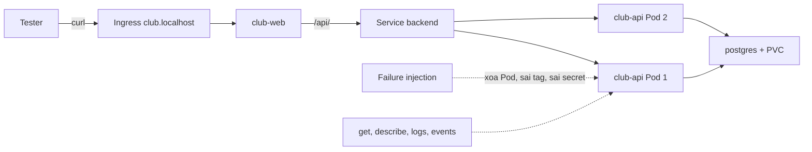

# Buổi 31 – Testing & Troubleshooting

Tuần 16/16 · Giai đoạn 5 – Capstone Project · Buổi 31/32

[Slide](../../slides/08-capstone/session-31.md) · [Bài tập tuần](../../assignments/weekly/week-16.md) · [Hub tuần](README.md)

> **Tóm tắt:** Tự phá hệ thống capstone có kiểm soát: clean clone, ba sự cố trên kind, đọc get, describe, logs để tìm nguyên nhân gốc, rồi ghi troubleshooting log và runbook.

::: tip Buổi này bạn làm gì
- **Bạn sẽ tạo ra:** một troubleshooting log cho ba sự cố bạn tự gây ra trên cluster kind của nhóm, cùng một runbook ngắn để người khác xử lý lại.
- **Thời gian thật:** đọc 15 phút, lab bắt buộc 60 phút (làm theo nhóm 3-4 người), thử thách và phá lỗi nâng cao làm ở nhà.
- **Cần chuẩn bị:**
  - [ ] Nhóm có repo capstone chạy được Compose và có `k8s/` (từ [Buổi 29 – Architecture & Planning](../week-15/session-29.md) và [Buổi 30 – Implementation](../week-15/session-30.md)).
  - [ ] Docker Desktop (bật WSL integration), `kind`, `kubectl`, `git`, `curl`, cluster kind `club` (context `kind-club`); cài theo [Hướng dẫn cài đặt](../../resources/setup-guide.md).
  - [ ] Repo `devops-labs` (public) theo [Tài khoản GitHub và repo devops-labs](../../resources/setup-github.md); làm việc trong WSL (`~/work`), không dùng `/mnt/c`.
- **Phải nộp:** thư mục `lab-31/` gồm `README.md` (7 câu của mẫu), `evidence/command-output.txt` (clean clone, smoke test, ba sự cố trước/trong/sau), `report.md` (troubleshooting log, nhận xét hiệu năng), `source/runbook.md`.
- **Đi nhanh:** Đọc > [Làm lab](#hands-on-lab) > [Gặp lỗi?](#gap-loi) > [Tự kiểm tra](#tu-kiem-tra) > [Nộp bài](#nop-bai). Kẹt? Nhảy tới [Gặp lỗi?](#gap-loi).

**Từ mới trong buổi** (xem [Thuật ngữ](../../resources/glossary.md)):
- [clean-clone test](../../resources/glossary.md): clone repo vào thư mục mới rồi làm đúng README để xem người khác dựng lại được không.
- [smoke test](../../resources/glossary.md): vài lệnh nhanh kiểm tra các đường quan trọng còn sống.
- [failure injection](../../resources/glossary.md): cố ý gây lỗi có kiểm soát để xem hệ thống phản ứng.
- [readiness probe](../../resources/glossary.md): phép thử quyết định Pod có được nhận traffic hay không.
- [liveness probe](../../resources/glossary.md): phép thử quyết định Pod có bị khởi động lại hay không.
- [rollout](../../resources/glossary.md): quá trình Deployment thay Pod cũ bằng Pod mới.
:::

## Vấn đề thực tế

Một nhóm CLB xong CRUD vào đêm trước buổi demo. Trên máy người viết code mọi thứ chạy tốt vì máy đó còn image cũ, file `.env` chưa từng commit và volume từ ba tuần trước. Sáng hôm sau, bạn cùng nhóm clone repo về máy khác: `docker compose up` báo thiếu `DB_PASSWORD`, và trên kind Pod `club-api` báo `ImagePullBackOff` vì chưa ai `kind load` image. Code không sai, chỉ là hệ thống chỉ chạy được trên đúng một máy.

Kiểm thử DevOps trả lời ba câu: người khác làm lại từ đầu có dựng được không, khi một thành phần hỏng thì hệ thống phản ứng thế nào, và lúc 11 giờ đêm người trực có tìm ra nguyên nhân trong 10 phút không. Hôm nay bạn tự phá hệ thống của mình trước khi người khác làm điều đó.

## Khái niệm cốt lõi

- **Clean-clone test:** làm lại hệ thống từ một bản clone mới chỉ với README. Giống thử chìa khóa mới cắt: chìa của bạn mở được chưa chắc chìa của người khác mở được.
- **Failure injection:** cố ý gây một lỗi có kiểm soát để xác nhận hệ thống tự hồi phục và bạn đọc đúng tín hiệu. Giống diễn tập báo cháy. Quy tắc: chỉ làm trên môi trường của nhóm, mỗi lần một lỗi, biết cách hoàn tác trước, và dự đoán triệu chứng trước khi chạy lệnh.
- **Chẩn đoán từ ngoài vào trong:** đi theo thứ tự trạng thái, sự kiện, log, cấu hình. Giống bác sĩ nhìn, hỏi rồi mới xét nghiệm.

  | Bước | Lệnh | Cho biết |
  | --- | --- | --- |
  | 1. Trạng thái | `kubectl get pods -n club` | READY, STATUS, RESTARTS |
  | 2. Sự kiện | `kubectl describe pod TEN_POD -n club` | Vì sao kubelet từ chối hoặc restart |
  | 3. Log | `kubectl logs TEN_POD -n club` (thêm `--previous` nếu đã restart) | Lỗi của ứng dụng |
  | 4. Cấu hình | `kubectl get deployment club-api -n club -o yaml` | Image, env, probe có đúng ý không |

  `TEN_POD` là tên Pod thật của bạn, ví dụ `club-api-7d9f8b6c5-abcde`.
- **Readiness và liveness:** readiness (`GET /ready`, chạy `SELECT 1`) quyết định Pod có nhận traffic không, giống bảng "đang nhận khách". Liveness (`GET /health`) chỉ hỏi tiến trình còn sống, giống "còn thở". Mất DB làm Pod `0/1` nhưng không restart, đó là thiết kế có chủ đích. Rolling update giữ Pod cũ nếu Pod mới không Ready.



::: details Tìm hiểu thêm (đọc sau)
Bảng các tầng kiểm thử, checklist bảo mật đầy đủ, performance basics và giải thích từng bước của sơ đồ nằm ở [Buổi 31 – Thử thách nâng cao](session-31-challenge.md), mục "Tham khảo mở rộng".
:::

## Hands-on lab (60 phút) {#hands-on-lab}

Trên lớp, mentor demo trước; tự học thì làm thẳng phần này. Ghi mọi lệnh quan trọng vào `command-output.txt`. Bắt buộc = L1.

### Chuẩn bị (5 phút)

```bash
mkdir -p ~/work/lab-31/evidence ~/work/lab-31/screenshots ~/work/lab-31/source
cd ~/work/lab-31
echo "Lab 31 - bat dau $(date -Is)" | tee -a evidence/command-output.txt
export REPO_URL=git@github.com:ORG/club-management.git   # thay bằng repo nhóm (có thể dùng https)
docker version --format '{{.Server.Version}}'
docker compose version
kind version
kubectl version --client
kubectl config current-context
```

Kết quả mong đợi: một dòng thời điểm bắt đầu; mỗi lệnh in phiên bản, không có `command not found`; context là `kind-club`. Từ đây thêm `| tee -a evidence/command-output.txt` sau lệnh muốn lưu. Thiếu công cụ thì chạy `bash resources/check-env.sh` hoặc xem [Gặp lỗi?](#gap-loi).

### Phần 1. Kiểm thử từ máy sạch bằng Compose (10 phút)

Chỉ clone mới lộ ra những thứ "chạy trên máy tôi". Làm đúng README của nhóm, không dùng kiến thức ngoài README.

::: danger Lệnh xóa thư mục
`rm -rf` xóa không hỏi lại. Lệnh dưới chỉ xóa thư mục thử `~/work/clean-check` do bạn tạo ở bước này; không chạy nó ở thư mục làm việc thật.
:::

```bash
rm -rf ~/work/clean-check
cd ~/work && git clone "$REPO_URL" clean-check && cd clean-check
git ls-files | grep -E '(^|/)\.env$' || echo "OK: khong co .env trong Git"
cp .env.example .env
# mở .env, đặt DB_PASSWORD (mật khẩu thử nghiệm, KHÔNG dùng mật khẩu thật) và WEB_PORT=8080
docker compose config -q && echo "compose hop le"
docker compose up -d --build
docker compose ps
```

Kết quả mong đợi (rút gọn): `OK: khong co .env trong Git`; `compose hop le`; ba service `frontend`, `backend`, `postgres` đều `running`, `postgres` là `healthy`. Nếu `.env` bị liệt kê trong Git, dừng lại: đó là lỗi bảo mật. Thiếu `.env.example` thì ghi vào danh sách lỗi README của `report.md` (phát hiện có giá trị).

Smoke test và kiểm tra dữ liệu bền:

```bash
curl -s http://localhost:8080/api/members
curl -s -o /dev/null -w "health=%{http_code}\n" http://localhost:3000/health
curl -s -o /dev/null -w "ready=%{http_code}\n" http://localhost:3000/ready
curl -s -X POST http://localhost:8080/api/members -H "Content-Type: application/json" \
  -d '{"name":"Test Lab31","email":"lab31@example.com"}'
docker compose down
docker compose up -d
curl -s http://localhost:8080/api/members | grep lab31 && echo "OK: du lieu con"
docker compose down
```

Kết quả mong đợi: JSON thành viên, `health=200`, `ready=200`, `OK: du lieu con`. Lệnh `down` không có `-v` nên volume `postgres-data` được giữ. Nếu API chưa có `POST`, bỏ bước thêm và kiểm tra Alice, Bob còn nguyên. Lệnh `down` cuối giải phóng cổng trước khi sang kind. Cổng 8080 hoặc 3000 bận: xem [Gặp lỗi?](#gap-loi).

::: tip Kiểm tra: bạn đúng khi
- Không có `.env` trong Git, `docker compose ps` thấy ba service `running` và `postgres` healthy.
- Ba mã smoke test đúng và dữ liệu còn sau `down` rồi `up`.
:::

### Phần 2. Triển khai lên kind và đo độ trễ (7 phút)

Dùng cluster `club`; nếu chưa có, tạo lại theo `starter-project/k8s/kind-config.yaml` và cài ingress-nginx như [Buổi 27 – Storage & Ingress](../week-14/session-27.md).

```bash
cd ~/work/clean-check
docker build -t club-api:1.0.0 ./backend
docker build -t club-web:1.0.0 ./frontend
kind load docker-image club-api:1.0.0 club-web:1.0.0 --name club
kubectl apply -f k8s/namespace.yaml
kubectl create secret generic club-secrets -n club --from-literal=db-password='DAT_MAT_KHAU_THU_NGHIEM' --dry-run=client -o yaml | kubectl apply -f -
kubectl apply -f k8s/configmap.yaml -f k8s/postgres.yaml -f k8s/backend.yaml -f k8s/frontend.yaml -f k8s/ingress.yaml
kubectl rollout status deployment/club-api -n club
kubectl exec -i -n club postgres-0 -- psql -U club -d clubdb < database/init.sql
kubectl get pods,svc,ingress -n club
```

Kết quả mong đợi (rút gọn): `successfully rolled out`; `psql` in `CREATE TABLE` và `INSERT 0 2` (hoặc `INSERT 0 0` nếu dữ liệu mẫu đã có); `postgres-0`, hai `club-api`, `club-web` đều `Running` và Ready; Ingress `club` có host `club.localhost`.

Vì sao có lệnh `psql`: trên Kubernetes `init.sql` không tự chạy, nên PVC mới chưa có bảng `members` và `/api/members` trả 500 dù Pod đều Ready; lệnh nạp lại an toàn vì `init.sql` dùng `IF NOT EXISTS` và `ON CONFLICT DO NOTHING`. Mật khẩu Secret phải khớp mật khẩu PostgreSQL đã khởi tạo trên PVC.

```bash
for i in 1 2 3 4 5; do curl -s -o /dev/null -w "%{http_code} %{time_total}s\n" http://club.localhost/api/members; done | tee -a ~/work/lab-31/evidence/command-output.txt
```

Kết quả mong đợi: năm dòng `200`, thời gian vài mili giây đến vài chục mili giây. `club.localhost` không phân giải: dùng `kubectl port-forward svc/club-web 8081:80 -n club` rồi gọi `http://localhost:8081/api/members` ([Gặp lỗi?](#gap-loi)).

::: tip Kiểm tra: bạn đúng khi
Mọi Pod `Running` và Ready, năm lần `curl` đều `200`.
:::

### Phần 3. Failure injection: ba sự cố bắt buộc (20 phút)

Với mỗi sự cố, viết dự đoán ra giấy trước khi chạy lệnh, chụp trạng thái trước, trong và sau (9 đoạn output có nhãn như `=== Su co B - trong luc loi ===`). Chạy tuần tự, xác nhận cluster khỏe lại giữa hai sự cố.

**Sự cố A. Xóa một Pod backend (5 phút)**

```bash
kubectl get pods -n club -l app=club-api
POD=$(kubectl get pods -n club -l app=club-api -o jsonpath='{.items[0].metadata.name}')
kubectl delete pod "$POD" -n club
for i in 1 2 3 4 5 6; do curl -s -o /dev/null -w "%{http_code} " http://club.localhost/api/members; sleep 1; done; echo
kubectl get pods -n club -l app=club-api
```

Kết quả mong đợi: các mã `200` liên tục, sau đó Pod mới thay Pod bị xóa. Vì sao: Deployment giữ đủ số replica, Service chỉ trỏ tới Pod Ready.

**Sự cố B. Sai tag image (6 phút)**

```bash
kubectl set image deployment/club-api api=club-api:9.9.9 -n club
sleep 20
kubectl get pods -n club -l app=club-api
kubectl get events -n club --sort-by=.lastTimestamp | tail -8
```

Kết quả mong đợi (rút gọn): một Pod mới `ImagePullBackOff`, hai Pod cũ `Running`; events có `Failed to pull image` và `Back-off pulling image`. Nguyên nhân gốc: `club-api:9.9.9` không có trong node kind và cũng không có trên registry. Hoàn tác:

```bash
kubectl rollout undo deployment/club-api -n club
kubectl rollout status deployment/club-api -n club
```

**Sự cố C. Sai mật khẩu database (9 phút)**

```bash
ORIG_PW=$(kubectl get secret club-secrets -n club -o jsonpath='{.data.db-password}' | base64 -d)
kubectl create secret generic club-secrets -n club --from-literal=db-password='SAI_MAT_KHAU' --dry-run=client -o yaml | kubectl apply -f -
kubectl rollout restart deployment/club-api -n club
sleep 30
kubectl get pods -n club -l app=club-api
NEWPOD=$(kubectl get pods -n club -l app=club-api --sort-by=.metadata.creationTimestamp -o name | tail -n 1)
kubectl exec "$NEWPOD" -n club -- wget -qO- http://localhost:3000/api/members
kubectl logs "$NEWPOD" -n club --tail=10
```

Kết quả mong đợi (rút gọn): một Pod mới `Running` nhưng `0/1`, hai Pod cũ vẫn `1/1`; `wget` báo `500 Internal Server Error`; log của Pod mới có lỗi kiểu `password authentication failed for user "club"`. Phải gọi `wget` thẳng vào Pod mới vì Service không gửi request tới Pod chưa Ready, và `kubectl logs deployment/club-api` có thể chọn nhầm Pod cũ. Hoàn tác (mật khẩu gốc nằm trong `ORIG_PW`, không in ra evidence):

```bash
kubectl create secret generic club-secrets -n club --from-literal=db-password="$ORIG_PW" --dry-run=client -o yaml | kubectl apply -f -
kubectl rollout restart deployment/club-api -n club
kubectl rollout status deployment/club-api -n club
unset ORIG_PW
```

Phải `rollout restart` vì biến môi trường lấy từ Secret chỉ được đọc khi container khởi động.

::: tip Kiểm tra: bạn đúng khi
Cả ba sự cố đã hoàn tác: `kubectl get pods -n club` thấy hai `club-api` `1/1`, và `curl` tới `/api/members` trả `200`.
:::

### Phần 4. Log, bảo mật và hiệu năng cơ bản (10 phút)

```bash
kubectl logs -l app=club-api -n club --tail=5 --prefix
kubectl logs postgres-0 -n club --tail=10
cd ~/work/clean-check
git log -p --all | grep -i -E "password|secret|token" | grep -v -E "DB_PASSWORD|db-password|secretKeyRef|club-secrets" | head
docker run --rm club-api:1.0.0 id
grep -n -A3 "^permissions" .github/workflows/*.yml
```

Kết quả mong đợi: log PostgreSQL có `database system is ready to accept connections` (log backend có thể trống nếu chưa có lỗi); lệnh `git log` không in mật khẩu thật (nếu in gì, đọc từng dòng, có thể chỉ là văn bản mô tả); `id` in `uid=1000(node)`, không phải `uid=0(root)`; workflow có khối `permissions`. Nếu có Trivy, quét image và ghi số lỗ hổng HIGH và CRITICAL.

Đo hiệu năng: 50 request tuần tự trước và sau khi scale, rồi trả về 2 replica.

```bash
time (for i in $(seq 1 50); do curl -s -o /dev/null http://club.localhost/api/members; done)
kubectl scale deployment club-api -n club --replicas=3
kubectl rollout status deployment/club-api -n club
time (for i in $(seq 1 50); do curl -s -o /dev/null http://club.localhost/api/members; done)
kubectl scale deployment club-api -n club --replicas=2
```

Kết quả mong đợi: hai tổng thời gian gần nhau, vì vòng lặp gửi tuần tự nên số replica không ảnh hưởng; nút thắt là `curl`, Ingress và một PostgreSQL duy nhất. Ghi nhận xét này vào `report.md`.

::: tip Kiểm tra: bạn đúng khi
`id` không in `uid=0`, workflow có `permissions`, có hai số `time`, và replica đã về 2.
:::

### Phần 5. Ghi nhận: troubleshooting log và runbook (8 phút)

Tạo `~/work/lab-31/source/troubleshooting-log.md`, mỗi sự cố một mục theo mẫu:

```text
Su co: B - sai tag image
Trieu chung: Pod moi ImagePullBackOff, Pod cu van Running
Nguyen nhan goc: tag club-api:9.9.9 khong ton tai
Cach xac minh: kubectl describe pod, kubectl get events
Cach sua: kubectl rollout undo deployment/club-api -n club
Phong tranh: kiem tra tag bang kubectl set image co dry-run, dung tag co SHA/semver trong CI
```

Sau đó thêm `docs/runbook.md` vào repo nhóm với năm mục: xem log, xem events, rollout restart, rollback, scale. Mỗi mục một lệnh đã chạy thật ở trên, một câu "khi nào dùng", và cách lấy tên Pod thay vì ghi tên cố định.

::: tip Kiểm tra: bạn đúng khi
Có đủ ba mục trong troubleshooting log, và nguyên nhân gốc của mỗi mục không chỉ nhắc lại triệu chứng.
:::

### Checklist L1 (bắt buộc)

- [ ] Clone sạch, làm theo README, `docker compose up -d --build` chạy được; ghi lại chỗ README thiếu hoặc sai.
- [ ] `/api/members`, `/health`, `/ready` đều thành công; dữ liệu còn sau `down` rồi `up`.
- [ ] Triển khai lên kind, mọi Pod Ready, truy cập được qua `club.localhost` hoặc `port-forward`.
- [ ] Hoàn thành sự cố A, B, C và hoàn tác về trạng thái khỏe mạnh.
- [ ] Chạy checklist bảo mật; có troubleshooting log cho cả ba sự cố và `docs/runbook.md`.

Tự kiểm tra một dòng: `kubectl get pods -n club && curl -s -o /dev/null -w "api=%{http_code}\n" http://club.localhost/api/members`

## Gặp lỗi? {#gap-loi}

| Triệu chứng | Nguyên nhân | Cách sửa |
| --- | --- | --- |
| `docker compose up` báo thiếu `DB_PASSWORD` | Clone mới chưa có `.env` | Tạo `.env` từ `.env.example`; bổ sung `.env.example` vào repo nếu thiếu |
| Cổng 8080 hoặc 3000 đã được dùng | Stack Compose cũ hoặc tiến trình khác | `docker compose down`, xem `docker ps`, hoặc đặt `WEB_PORT` khác trong `.env` |
| `command not found` (kind, kubectl) | Chưa cài đủ công cụ | Xem [Hướng dẫn cài đặt](../../resources/setup-guide.md), chạy `bash resources/check-env.sh` |
| Pod `ImagePullBackOff` trên kind | Chưa `kind load docker-image` hoặc sai tag | Build lại, nạp image vào kind (`--name club`), kiểm tra tag bằng `kubectl get deployment -o yaml` |
| Mọi Pod Ready nhưng `/api/members` trả 500 | PVC mới chưa có bảng `members` | Chạy lệnh `psql` nạp `database/init.sql` ở Phần 2 |
| Pod backend mới `0/1`, `/ready` trả 503, rollout treo | Sai mật khẩu hoặc `DB_HOST`, PostgreSQL chưa sẵn sàng | Gọi `kubectl exec` vào Pod mới, `kubectl logs` Pod mới, so Secret và ConfigMap với `kubectl get svc -n club` |
| Đổi Secret hoặc ConfigMap nhưng app không đổi | Biến môi trường chỉ đọc khi container khởi động | `kubectl rollout restart deployment/club-api -n club` |
| `club.localhost` không truy cập được | Chưa cài ingress-nginx, thiếu `extraPortMappings`, cổng 80 bận | Xem Buổi 27; thử `curl --resolve club.localhost:80:127.0.0.1 http://club.localhost/api/members`; tạm dùng `kubectl port-forward` |
| Mật khẩu mới không có tác dụng với PostgreSQL | Mật khẩu chỉ đặt lúc khởi tạo volume lần đầu | Dùng đúng mật khẩu cũ, hoặc xóa PVC (mất dữ liệu, chỉ làm khi test) |
| Test pass trên máy bạn nhưng clone mới fail | File chưa commit, phụ thuộc trạng thái local | Chạy lại Phần 1; kiểm tra `git status` trước khi push |
| Quên hoàn tác: Pod còn tag `9.9.9`, Secret sai, replica 3 | Bỏ qua bước hoàn tác | `kubectl rollout undo`, khôi phục Secret rồi `rollout restart`, `kubectl scale ... --replicas=2` |

## Tự kiểm tra {#tu-kiem-tra}

1. Vì sao clean-clone test quan trọng hơn chạy lại trên máy đang làm việc?
2. Khi một Pod backend `Running` nhưng `0/1` Ready, người dùng có nhận lỗi không?
3. Vì sao liveness probe của dự án gọi `/health` thay vì `/ready`?
4. Sau khi sửa Secret, API vẫn dùng mật khẩu cũ. Bạn làm gì và vì sao?
5. Thêm replica thứ ba có làm vòng lặp 50 request tuần tự nhanh hơn không?

::: details Đáp án gợi ý
1. Máy làm việc có trạng thái ẩn (image cache, `.env`, volume, biến môi trường). Clone mới chỉ có những gì nằm trong Git và README nên lộ ra phụ thuộc chưa ghi lại.
2. Thường là không nếu còn Pod Ready khác: Service loại Pod chưa Ready khỏi danh sách endpoint. Nếu không còn Pod Ready nào, request sẽ lỗi.
3. Nếu liveness phụ thuộc DB, một lần DB gián đoạn sẽ khiến Kubernetes restart toàn bộ backend, làm tình hình tệ hơn. Liveness chỉ kiểm tra tiến trình; phụ thuộc ngoài thuộc về readiness.
4. `kubectl rollout restart deployment/club-api -n club`. Biến môi trường từ Secret chỉ đọc khi container khởi động; Pod đang chạy giữ giá trị cũ.
5. Gần như không. Request gửi tuần tự nên mỗi lúc chỉ một request được xử lý; nút thắt ở client, Ingress và PostgreSQL. Replica giúp khi có nhiều request đồng thời và CPU backend là nút thắt.

Câu luyện thêm: thứ tự chẩn đoán đúng là trạng thái, sự kiện, log (thêm `--previous` nếu đã restart), cấu hình. Pod `ImagePullBackOff` thì kiểm tra trước: tên và tag image trong Deployment, image đã `kind load` chưa, và dòng lỗi cụ thể trong `kubectl describe pod`.
:::

## Nộp bài {#nop-bai}

Nộp vào thư mục `lab-31/` trong repo `devops-labs`, theo [mẫu lab](../../templates/lab-template.md). Bài tập tuần: [Bài tập tuần 16](../../assignments/weekly/week-16.md).

- [ ] `README.md` trả lời đủ 7 câu của mẫu và ghi rõ đã làm L1 hay L2.
- [ ] `evidence/command-output.txt` có clean clone, smoke test, ba sự cố A, B, C (trước, trong, sau) và checklist bảo mật.
- [ ] `report.md` có troubleshooting log 5 mục cho từng sự cố, nhận xét hiệu năng, danh sách điểm README cần sửa.
- [ ] `source/` có `troubleshooting-log.md` và bản `docs/runbook.md`; `screenshots/` có ảnh `kubectl get pods` lúc lỗi và sau khi sửa (ảnh chỉ bổ trợ).
- [ ] Không commit mật khẩu, token hay `.env` vào bất kỳ file nào.

## Recap

- Kiểm thử gồm clean-clone, smoke test và failure injection, không chỉ unit test.
- Chẩn đoán theo thứ tự trạng thái, sự kiện, log, cấu hình; readiness quyết định nhận traffic, liveness quyết định restart.
- Mỗi sự cố cần ghi: triệu chứng, nguyên nhân gốc, cách xác minh, cách sửa, cách phòng tránh.

Buổi tiếp theo: [Buổi 32 – Final Demo & Review](session-32.md).

::: details Thử thách thêm (L2, tùy chọn, làm ở nhà)
Thiết kế một failure injection mới cho nhóm bên cạnh để họ chẩn đoán mà không biết trước nguyên nhân: chỉ gây một lỗi, hoàn tác bằng một đến hai lệnh, chỉ chạy trên cluster của nhóm nhận, nhóm nhận nộp báo cáo 5 mục trong 15 phút. Tiêu chí đầy đủ và gợi ý từng bậc ở [Buổi 31 – Thử thách nâng cao](session-31-challenge.md). Tự thử 15 phút trước khi mở gợi ý. Đối chiếu sau khi nộp bài: [Walkthrough tuần 16](../../mentors/walkthroughs/week-16.md).
:::

::: details Phá lỗi nâng cao
Tình huống `DB_HOST` sai chính tả (rollout treo, Pod mới `0/1`, web vẫn dùng được) có hướng điều tra từng bước trong [Buổi 31 – Thử thách nâng cao](session-31-challenge.md). Tự thử 15 phút trước khi mở lời giải.
:::

::: details Tài liệu tham khảo
Đề bài và tiêu chí: [Đề bài Capstone](../../assignments/capstone/README.md), [Milestones](../../assignments/capstone/milestones.md) (mốc M3), [Rubric Capstone](../../curriculum/capstone-rubric.md). Liên kết chính thức về debug Pod, probe, Deployment, kind, Docker Compose và Trivy nằm ở cuối [Buổi 31 – Thử thách nâng cao](session-31-challenge.md).
:::
