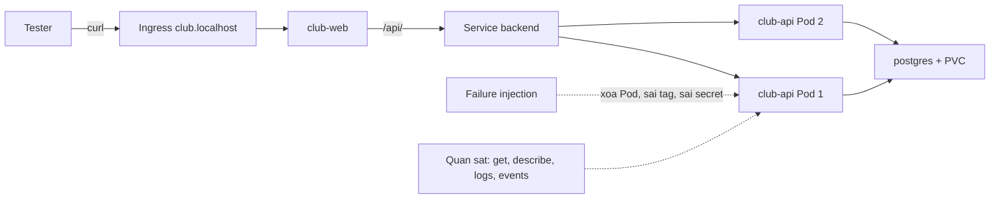

# Buổi 31 – Testing & Troubleshooting

Tuần 16 · Giai đoạn 5 – Capstone Project · Slide: [Slide buổi 31](../../slides/08-capstone/session-31.md)

> **Tóm tắt:** Kiểm thử hệ thống capstone từ máy sạch, cố ý phá bằng failure injection, đọc log và events để tìm nguyên nhân gốc, rồi ghi lại thành troubleshooting log và runbook.

## Mục tiêu học tập

- Chạy được quy trình kiểm tra từ máy sạch (clean clone) cho stack Docker Compose và kiểm chứng dữ liệu còn nguyên sau `down` rồi `up`.
- Thực hiện được ít nhất ba failure injection có kiểm soát trên kind và quan sát đúng triệu chứng của từng lỗi.
- Chẩn đoán được nguyên nhân gốc bằng `kubectl get`, `describe`, `logs`, `events` thay vì đoán mò.
- Áp dụng được checklist bảo mật cơ bản: không secret trong Git, container chạy non-root, quét image, quyền tối thiểu cho workflow.
- Đo được độ trễ cơ bản của API bằng `curl` và giải thích vì sao thêm replica không tự động làm hệ thống nhanh hơn.
- Viết được troubleshooting log 5 mục và runbook ngắn để người khác xử lý lại sự cố.

## Điều kiện cần

- Đã hoàn thành buổi 29 và 30: nhóm có repo capstone (bắt đầu từ `starter-project/`) với CRUD, Compose, Dockerfile và manifest trong `k8s/`.
- Buổi này làm theo nhóm 3-4 người; mỗi người nộp bài lab riêng trong repo cá nhân.
- Công cụ: Docker Desktop (WSL integration bật), `kind`, `kubectl`, `git`, `curl`. Làm việc trong filesystem của WSL (ví dụ `~/work`), không dùng `/mnt/c`.

Kiểm tra nhanh:

```bash
docker version --format '{{.Server.Version}}'
docker compose version
kind version
kubectl version --client
```

Kết quả mong đợi (rút gọn): mỗi lệnh in ra phiên bản mà không báo lỗi `command not found`. Nếu thiếu công cụ, xem `resources/setup-guide.md` và chạy `bash resources/check-env.sh`.

Tài liệu của buổi này: [đề bài Capstone](../../assignments/capstone/README.md), [milestones](../../assignments/capstone/milestones.md) (mốc M3) và [rubric Capstone](../../curriculum/capstone-rubric.md) (tiêu chí Troubleshooting và Security).

## Vấn đề thực tế

Một nhóm CLB hoàn thành CRUD vào đêm trước buổi demo. Trên máy của người viết code, mọi thứ chạy tốt, vì máy đó còn sẵn image cũ, file `.env` chưa từng commit, và một volume chứa dữ liệu từ ba tuần trước. Sáng hôm sau, bạn cùng nhóm clone repo về máy khác: `docker compose up` báo lỗi thiếu `DB_PASSWORD`, và trên kind thì Pod `club-api` báo `ImagePullBackOff` vì chưa ai `kind load` image. Không phải code sai, mà là hệ thống chỉ chạy được trên đúng một máy.

Kiểm thử trong DevOps không chỉ là `npm test`. Nó trả lời câu hỏi: nếu người khác làm lại từ đầu, hệ thống có dựng được không; khi một thành phần hỏng, hệ thống phản ứng thế nào; và khi nó hỏng lúc 11 giờ đêm, người trực có tìm ra nguyên nhân trong 10 phút không. Hôm nay bạn sẽ tự phá hệ thống của mình trước khi người khác làm điều đó.

## Khái niệm cốt lõi

### Các tầng kiểm thử

| Tầng | Câu hỏi | Công cụ trong dự án | Chạy khi nào |
| --- | --- | --- | --- |
| Unit test | Hàm/route có đúng logic? | `npm test` (node:test) | Mỗi commit, trong CI |
| Build test | Image có build được từ đầu? | `docker build`, `docker compose build` | Mỗi PR |
| Deployment test | Stack có lên và trả lời đúng? | `docker compose up`, `kubectl apply`, `curl` | Trước mỗi mốc |
| Smoke test | Các đường quan trọng còn sống? | `curl /health /ready /api/members` | Sau mỗi deploy |
| Failure injection | Khi hỏng thì hệ thống phản ứng thế nào? | `kubectl delete pod`, sai tag, sai secret | Có kế hoạch, trong môi trường test |
| Clean-machine test | Người khác làm lại được không? | Clone mới, làm theo README | Trước demo |

Happy path chỉ là một dòng trong bảng này. Phần lớn lỗi thật nằm ở các dòng còn lại.

### Failure injection

Failure injection là cố ý gây lỗi có kiểm soát để xác nhận hai điều: hệ thống tự hồi phục như thiết kế (ví dụ Deployment tạo lại Pod bị xóa) và người vận hành nhận ra lỗi qua tín hiệu đúng (log, events, trạng thái Pod). Quy tắc an toàn:

- Chỉ thực hiện trên môi trường local hoặc test của chính nhóm, không bao giờ trên máy người khác.
- Mỗi lần chỉ gây một lỗi, ghi lại thời điểm và lệnh đã dùng.
- Biết trước cách hoàn tác trước khi bắt đầu.
- Dự đoán triệu chứng trước khi chạy; so sánh dự đoán với thực tế.

### Quy trình chẩn đoán

Dù lỗi là gì, đi theo thứ tự từ ngoài vào trong: trạng thái, sự kiện, log, cấu hình.

| Bước | Lệnh | Cho biết |
| --- | --- | --- |
| 1. Trạng thái | `kubectl get pods -n club` | READY, STATUS, RESTARTS |
| 2. Sự kiện | `kubectl describe pod TEN_POD -n club` và `kubectl get events -n club --sort-by=.lastTimestamp` | Lý do scheduler/kubelet từ chối hoặc khởi động lại |
| 3. Log | `kubectl logs TEN_POD -n club` (thêm `--previous` nếu container đã restart) | Lỗi của ứng dụng |
| 4. Cấu hình | `kubectl get deployment club-api -n club -o yaml` | Image, env, probe có đúng ý không |
| 5. Kết nối | `kubectl exec` hoặc `kubectl port-forward` rồi `curl` | Tầng mạng, DNS, Service |

Trong bảng trên `TEN_POD` là tên Pod thật của bạn, ví dụ `club-api-7d9f8b6c5-abcde`.

### Checklist bảo mật tối thiểu

| Hạng mục | Cách kiểm tra |
| --- | --- |
| Không secret trong Git | `git ls-files` không chứa `.env`; `git log -p` không chứa mật khẩu thật |
| Container không chạy root | `docker run --rm club-api:1.0.0 id` không in `uid=0` |
| Image được quét | Trivy hoặc công cụ nhóm chọn, ghi lại số lỗ hổng HIGH/CRITICAL |
| Workflow quyền tối thiểu | Khối `permissions:` ở đầu workflow, chỉ cấp `contents: read` (và `packages: write` cho job publish) |
| Image pin phiên bản | Không dùng `latest` làm tag duy nhất |

### Performance basics

Ở mức capstone, bạn chỉ cần đo ba thứ: thời gian phản hồi một request (`curl -w`), hành vi khi nhiều request liên tiếp, và tác động của số replica. Hai điều cần nhớ: đo trước khi kết luận, và thêm replica chỉ giúp khi nút thắt nằm ở CPU của backend. Nếu nút thắt là PostgreSQL một instance, thêm backend không làm nhanh hơn.

## Kiến trúc và cách hoạt động



Giải thích từng bước:

1. Tester gửi request qua Ingress (hoặc `port-forward` nếu chưa có Ingress). Ingress chuyển `/api` tới Service `backend` và `/` tới `club-web`.
2. Service `backend` chỉ gửi traffic tới Pod đã qua readiness probe (`GET /ready`). Pod không sẵn sàng bị loại khỏi danh sách endpoint, nên người dùng không nhận lỗi từ Pod đó.
3. Liveness probe (`GET /health`) chỉ trả lời "tiến trình còn sống". Nó không kiểm tra database. Vì vậy mất kết nối DB làm Pod `0/1 Ready` nhưng không restart; đây là thiết kế có chủ đích.
4. Khi bạn tiêm lỗi, Kubernetes phản ứng theo cơ chế của controller: Deployment tạo lại Pod bị xóa, rolling update giữ Pod cũ nếu Pod mới không Ready.
5. Việc của người vận hành là đọc tín hiệu theo thứ tự trạng thái, sự kiện, log, cấu hình, rồi ghi lại.

## Demo của mentor

Mentor dùng cụm kind đã dựng sẵn với manifest của `starter-project/k8s/` (namespace `club`). Mục tiêu demo: cho lớp thấy một chu trình đầy đủ "dự đoán, phá, quan sát, sửa".

1. Cho lớp xem trạng thái khỏe mạnh.

   ```bash
   kubectl get pods -n club
   curl -s http://club.localhost/api/members
   ```

   Kết quả mong đợi (rút gọn): hai Pod `club-api` `1/1 Running`, một `club-web`, một `postgres-0`; API trả mảng JSON có Alice và Bob.

   Hỏi lớp: "Nếu tôi xóa một Pod club-api, người dùng có thấy lỗi không? Dự đoán trước khi tôi chạy."

2. Xóa một Pod backend và quan sát.

   ```bash
   kubectl delete pod -n club -l app=club-api --field-selector=status.phase=Running --wait=false
   kubectl get pods -n club -w
   ```

   Kết quả mong đợi: các Pod `club-api` chuyển `Terminating`, Pod mới xuất hiện `ContainerCreating` rồi `Running`. Nhấn Ctrl+C để thoát chế độ theo dõi. Lưu ý lệnh này xóa cả hai Pod nên có khoảng ngắn không có backend; hãy nói rõ điều đó với lớp (người dùng có thể thấy lỗi 502/503 trong khoảnh khắc đó). Ở Sự cố A trong lab, nhóm chỉ xóa một Pod để thấy sự khác biệt.

   Hỏi lớp: "Vì sao tôi nên xóa từng Pod một thay vì cả hai? Replica thứ hai giúp gì?"

3. Đổi sang tag không tồn tại.

   ```bash
   kubectl set image deployment/club-api api=club-api:9.9.9 -n club
   kubectl get pods -n club
   kubectl describe pod -n club -l app=club-api | grep -A3 -i "failed\|back-off"
   ```

   Kết quả mong đợi (rút gọn): một Pod mới ở `ErrImagePull` rồi `ImagePullBackOff`, hai Pod cũ vẫn `Running` vì rolling update không tắt Pod cũ khi Pod mới chưa Ready.

   Hỏi lớp: "Người dùng có bị gián đoạn không? Vì sao?"

4. Hoàn tác và chứng minh.

   ```bash
   kubectl rollout undo deployment/club-api -n club
   kubectl rollout status deployment/club-api -n club
   ```

   Kết quả mong đợi: `deployment "club-api" successfully rolled out`.

Chốt demo: ba lệnh `get`, `describe`, `events` đã đủ cho hai lỗi trên; chưa cần mở code.

## Hands-on lab

Thời lượng 60 phút. Làm theo thứ tự; Phần 1 và 2 cho mọi nhóm, Phần 3 đến 5 là phần chính của M3. Phân bổ gợi ý: Phần 1 khoảng 12 phút, Phần 2 khoảng 8 phút, Phần 3 khoảng 20 phút, Phần 4 khoảng 12 phút, Phần 5 khoảng 8 phút. Nếu kind đã dựng sẵn từ buổi 30, Phần 2 chỉ là kiểm tra lại.

### Chuẩn bị

1. Mỗi nhóm chọn một repo nhóm và một "người điều khiển" cho mỗi phần (đổi vai sau mỗi phần). Cả nhóm nhìn chung một màn hình hoặc mỗi người tự chạy trên máy mình.
2. Tạo thư mục bằng chứng, mọi lệnh quan trọng ghi vào `command-output.txt`:

   ```bash
   mkdir -p ~/work/lab-31/evidence ~/work/lab-31/screenshots ~/work/lab-31/source
   cd ~/work/lab-31
   echo "Lab 31 - bat dau $(date -Is)" | tee -a evidence/command-output.txt
   ```

   Kết quả mong đợi: một dòng ghi thời điểm bắt đầu. Từ đây, dùng `| tee -a evidence/command-output.txt` sau các lệnh bạn muốn lưu.

3. Biến cho các bước sau (thay `ORG/club-management` bằng repo nhóm của bạn):

   ```bash
   export REPO_URL=git@github.com:ORG/club-management.git
   ```

### Phần 1. Kiểm thử từ máy sạch (Compose)

Lý do: chỉ clone mới mới lộ ra những thứ "chạy trên máy tôi".

1. Clone vào thư mục mới, không dùng thư mục làm việc cũ.

   ```bash
   cd ~/work && rm -rf clean-check && git clone "$REPO_URL" clean-check && cd clean-check
   git ls-files | grep -E '(^|/)\.env$' || echo "OK: khong co .env trong Git"
   ```

   Kết quả mong đợi: dòng `OK: khong co .env trong Git`. Nếu `.env` bị liệt kê, dừng lại: đó là lỗi bảo mật cần xử lý trước.

2. Làm đúng theo README của nhóm, không dùng kiến thức ngoài README. Thông thường:

   ```bash
   cp .env.example .env
   # mở .env và đặt DB_PASSWORD, WEB_PORT=8080 (mật khẩu thử nghiệm, KHÔNG dùng mật khẩu thật)
   docker compose config -q && echo "compose hop le"
   docker compose up -d --build
   docker compose ps
   ```

   Kết quả mong đợi (rút gọn): `compose hop le`; ba service `frontend`, `backend`, `postgres` ở trạng thái `running`, `postgres` có `healthy`. Nếu repo không có `.env.example`, ghi lại thành lỗi của README (đây là phát hiện có giá trị).

3. Smoke test.

   ```bash
   curl -s http://localhost:8080/api/members
   curl -s -o /dev/null -w "health=%{http_code}\n" http://localhost:3000/health
   curl -s -o /dev/null -w "ready=%{http_code}\n" http://localhost:3000/ready
   ```

   Kết quả mong đợi: JSON danh sách thành viên; `health=200`; `ready=200`. Truy cập qua `localhost:8080/api/` chứng minh Nginx proxy tới `backend:3000` hoạt động.

4. Kiểm tra dữ liệu bền vững (yêu cầu F8).

   ```bash
   curl -s -X POST http://localhost:8080/api/members -H "Content-Type: application/json" \
     -d '{"name":"Test Lab31","email":"lab31@example.com"}'
   docker compose down
   docker compose up -d
   curl -s http://localhost:8080/api/members | grep lab31 && echo "OK: du lieu con"
   ```

   Kết quả mong đợi: `OK: du lieu con`. Lệnh `down` không có `-v` nên volume `postgres-data` được giữ. Nếu API của nhóm chưa có `POST`, bỏ bước thêm và kiểm tra dữ liệu mẫu Alice, Bob còn nguyên.

5. Dọn dẹp trước khi chuyển sang kind để tránh tranh chấp cổng:

   ```bash
   docker compose down
   ```

### Phần 2. Triển khai lên kind và kiểm tra nền

Dùng kind cluster từ buổi 27 và 30. Nếu chưa có, tạo lại theo `starter-project/k8s/kind-config.yaml` và cài ingress-nginx như trong buổi 27.

```bash
cd ~/work/clean-check
docker build -t club-api:1.0.0 ./backend
docker build -t club-web:1.0.0 ./frontend
kind load docker-image club-api:1.0.0 club-web:1.0.0
# Nếu cluster không có tên mặc định "kind": thêm --name TEN_CLUSTER (xem: kind get clusters)
kubectl apply -f k8s/namespace.yaml
kubectl create secret generic club-secrets -n club --from-literal=db-password='DAT_MAT_KHAU_THU_NGHIEM' --dry-run=client -o yaml | kubectl apply -f -
kubectl apply -f k8s/configmap.yaml -f k8s/postgres.yaml -f k8s/backend.yaml -f k8s/frontend.yaml -f k8s/ingress.yaml
kubectl rollout status deployment/club-api -n club
kubectl exec -i -n club postgres-0 -- psql -U club -d clubdb < database/init.sql
kubectl get pods,svc,ingress -n club
```

Kết quả mong đợi (rút gọn): `successfully rolled out`; lệnh `psql` in `CREATE TABLE` và `INSERT 0 2` (hoặc `INSERT 0 0` nếu dữ liệu mẫu đã có); Pod `postgres-0`, hai `club-api`, `club-web` đều `Running` và `READY` đầy đủ; Ingress `club` có host `club.localhost`.

Vì sao có lệnh `psql`: trên Kubernetes, `init.sql` không tự chạy như trong Compose (không có volume nào gắn file này vào PostgreSQL), nên một PVC mới chưa có bảng `members` và `/api/members` sẽ trả 500 dù Pod đều Ready (`/ready` chỉ chạy `SELECT 1`). Lệnh nạp lại an toàn vì `init.sql` dùng `IF NOT EXISTS` và `ON CONFLICT DO NOTHING`. Nếu bạn đã nạp schema ở thử thách 3 của buổi 30 và vẫn dùng PVC đó thì lệnh này không thay đổi gì.

Vì sao: Secret được tạo bằng lệnh (không commit file chứa mật khẩu). Mật khẩu này phải khớp với mật khẩu mà PostgreSQL đã khởi tạo trên PVC; nếu bạn đang dùng lại PVC cũ với mật khẩu khác, backend sẽ không vào được DB.

Smoke test và đo độ trễ cơ bản:

```bash
curl -s http://club.localhost/api/members
for i in 1 2 3 4 5; do curl -s -o /dev/null -w "%{http_code} %{time_total}s\n" http://club.localhost/api/members; done | tee -a ~/work/lab-31/evidence/command-output.txt
```

Kết quả mong đợi: năm dòng `200` với thời gian thường vài mili giây đến vài chục mili giây trên máy local. Nếu `club.localhost` không phân giải, dùng `kubectl port-forward svc/club-web 8081:80 -n club` rồi gọi `http://localhost:8081/api/members`.

Lưu ý: với dữ liệu nhỏ như ở đây, độ trễ phụ thuộc chủ yếu vào lớp Ingress và Nginx, không phải truy vấn.

### Phần 3. Failure injection: ba sự cố bắt buộc

Với mỗi sự cố, điền một dòng vào troubleshooting log (mẫu ở Phần 5). Dự đoán triệu chứng trước khi chạy lệnh.

#### Sự cố A. Xóa một Pod backend

```bash
kubectl get pods -n club -l app=club-api
POD=$(kubectl get pods -n club -l app=club-api -o jsonpath='{.items[0].metadata.name}')
kubectl delete pod "$POD" -n club
for i in 1 2 3 4 5 6; do curl -s -o /dev/null -w "%{http_code} " http://club.localhost/api/members; sleep 1; done; echo
kubectl get pods -n club -l app=club-api
```

Kết quả mong đợi: các mã `200` liên tục (Pod còn lại phục vụ), sau đó Pod mới thay thế Pod bị xóa. Vì sao: Deployment đảm bảo số replica mong muốn, Service chỉ trỏ tới Pod Ready.

#### Sự cố B. Sai tag image

```bash
kubectl set image deployment/club-api api=club-api:9.9.9 -n club
sleep 20
kubectl get pods -n club -l app=club-api
kubectl get events -n club --sort-by=.lastTimestamp | tail -8
```

Kết quả mong đợi (rút gọn): một Pod mới `ImagePullBackOff`; hai Pod cũ `Running`; events có `Failed to pull image` và `Back-off pulling image`. Hoàn tác:

```bash
kubectl rollout undo deployment/club-api -n club
kubectl rollout status deployment/club-api -n club
```

Vì sao nguyên nhân là tag: image `club-api:9.9.9` không có trong node kind, và `imagePullPolicy: IfNotPresent` khiến kubelet thử kéo từ registry, nơi cũng không có image này.

#### Sự cố C. Sai mật khẩu database

```bash
ORIG_PW=$(kubectl get secret club-secrets -n club -o jsonpath='{.data.db-password}' | base64 -d)
kubectl create secret generic club-secrets -n club --from-literal=db-password='SAI_MAT_KHAU' --dry-run=client -o yaml | kubectl apply -f -
kubectl rollout restart deployment/club-api -n club
sleep 30
kubectl get pods -n club -l app=club-api
NEWPOD=$(kubectl get pods -n club -l app=club-api --sort-by=.metadata.creationTimestamp -o name | tail -n 1)
kubectl exec "$NEWPOD" -n club -- wget -qO- http://localhost:3000/api/members
kubectl logs "$NEWPOD" -n club --tail=10
```

Kết quả mong đợi (rút gọn): có một Pod mới `Running` nhưng `0/1` READY, hai Pod cũ vẫn `1/1` (rolling update bị kẹt, người dùng chưa bị ảnh hưởng). Lệnh `wget` báo lỗi `500 Internal Server Error`; log của Pod mới chứa lỗi xác thực kiểu `password authentication failed for user "club"`. Vì sao `0/1` mà không restart: `/ready` chạy `SELECT 1` và trả 503, còn liveness `/health` vẫn 200. Vì sao phải gọi `wget` trực tiếp vào Pod mới: Service không gửi request tới Pod chưa Ready nên `curl` qua Ingress không sinh ra log lỗi, và `kubectl logs deployment/club-api` có thể chọn nhầm Pod cũ.

Hoàn tác (mật khẩu gốc nằm trong biến `ORIG_PW`):

```bash
kubectl create secret generic club-secrets -n club --from-literal=db-password="$ORIG_PW" --dry-run=client -o yaml | kubectl apply -f -
kubectl rollout restart deployment/club-api -n club
kubectl rollout status deployment/club-api -n club
unset ORIG_PW
```

Vì sao phải `rollout restart`: biến môi trường lấy từ Secret chỉ được đọc khi container khởi động, nên đổi Secret không tự cập nhật Pod đang chạy.

### Phần 4. Log, bảo mật và hiệu năng cơ bản

1. Xem log theo nhiều cách:

   ```bash
   kubectl logs deployment/club-api -n club --tail=20
   kubectl logs -l app=club-api -n club --tail=5 --prefix
   kubectl logs postgres-0 -n club --tail=10
   ```

   Kết quả mong đợi: log của backend (có thể trống nếu chưa có lỗi, vì app chỉ ghi khi có lỗi), log PostgreSQL có dòng `database system is ready to accept connections`. Vì sao: `--prefix` cho biết dòng log đến từ Pod nào khi có nhiều replica.

2. Checklist bảo mật:

   ```bash
   cd ~/work/clean-check
   git log -p --all | grep -i -E "password|secret|token" | grep -v -E "DB_PASSWORD|db-password|secretKeyRef|club-secrets" | head
   docker run --rm club-api:1.0.0 id
   grep -n -A3 "^permissions" .github/workflows/*.yml
   ```

   Kết quả mong đợi: lệnh đầu không in mật khẩu thật (nếu in thứ gì đó, xem xét từng dòng, có thể chỉ là văn bản mô tả); lệnh `id` in `uid=1000(node)`, không phải `uid=0(root)`; workflow có khối `permissions`. Nếu có `trivy` hoặc dùng container của Trivy, quét image và ghi số lượng HIGH và CRITICAL vào bằng chứng; xem hướng dẫn chính thức ở phần tài liệu tham khảo.

3. Hiệu năng cơ bản: gửi 50 request liên tiếp trước và sau khi scale.

   ```bash
   time (for i in $(seq 1 50); do curl -s -o /dev/null http://club.localhost/api/members; done)
   kubectl scale deployment club-api -n club --replicas=3
   kubectl rollout status deployment/club-api -n club
   time (for i in $(seq 1 50); do curl -s -o /dev/null http://club.localhost/api/members; done)
   kubectl scale deployment club-api -n club --replicas=2
   ```

   Kết quả mong đợi: hai tổng thời gian gần nhau. Vì sao: vòng lặp gửi tuần tự từng request, nên số replica không ảnh hưởng; nút thắt là `curl`, Ingress và một PostgreSQL duy nhất. Ghi nhận xét này vào báo cáo.

### Phần 5. Ghi nhận: troubleshooting log và runbook

Tạo `~/work/lab-31/source/troubleshooting-log.md` với mỗi sự cố một mục theo mẫu:

```text
Su co: B - sai tag image
Trieu chung: Pod moi ImagePullBackOff, Pod cu van Running
Nguyen nhan goc: tag club-api:9.9.9 khong ton tai
Cach xac minh: kubectl describe pod, kubectl get events
Cach sua: kubectl rollout undo deployment/club-api -n club
Phong tranh: kiem tra tag bang kubectl set image co dry-run, dung tag co SHA/semver trong CI
```

Sau đó nhóm bổ sung `docs/runbook.md` trong repo nhóm với các mục: xem log, xem events, rollout restart, rollback, scale (mỗi mục một lệnh đã chạy thật ở trên).

### L1 – Foundation: checklist hoàn thành

- [ ] Clone sạch, làm theo README, `docker compose up -d --build` chạy được; ghi lại chỗ README thiếu hoặc sai.
- [ ] Smoke test `/api/members`, `/health`, `/ready` đều thành công.
- [ ] Dữ liệu còn sau `docker compose down` rồi `up`.
- [ ] Triển khai lên kind, tất cả Pod Ready, truy cập được qua `club.localhost` hoặc `port-forward`.
- [ ] Hoàn thành ba sự cố A, B, C và hoàn tác về trạng thái khỏe mạnh.
- [ ] Chạy checklist bảo mật và ghi kết quả.
- [ ] Có troubleshooting log cho cả ba sự cố.

### L2 – Engineering: thử thách tự làm

Thử thách: thiết kế một failure injection mới cho nhóm bên cạnh, để họ chẩn đoán mà không biết trước nguyên nhân. Tiêu chí hoàn thành:

- [ ] Kịch bản chỉ gây một lỗi, có cách hoàn tác bằng một đến hai lệnh, chỉ chạy trên cluster của nhóm nhận.
- [ ] Triệu chứng quan sát được (không đưa nguyên nhân cho nhóm nhận).
- [ ] Nhóm nhận nộp báo cáo 5 mục (triệu chứng, nguyên nhân gốc, cách xác minh, cách sửa, phòng tránh) trong vòng 15 phút.
- [ ] Nhóm ra đề viết nhận xét: báo cáo có đủ bằng chứng không, quy trình chẩn đoán có đi từ ngoài vào trong không.

<details>
<summary>Gợi ý</summary>

Một số ý tưởng đơn giản và an toàn: đổi `DB_HOST` trong ConfigMap thành `postgress`; đổi `path` của readiness probe thành `/readyy`; đặt memory limit rất thấp để Pod bị `OOMKilled`; đặt `nodeSelector` không tồn tại để Pod `Pending`. Mỗi ý có cách hoàn tác bằng `kubectl rollout undo` hoặc `kubectl apply -f` lại manifest gốc (với trường mà manifest gốc không có, như `nodeSelector`, ưu tiên `rollout undo`).

</details>

<details>
<summary>Lời giải mẫu: đổi readiness path</summary>

Gây lỗi:

```bash
kubectl patch deployment club-api -n club --type=json \
  -p='[{"op":"replace","path":"/spec/template/spec/containers/0/readinessProbe/httpGet/path","value":"/readyy"}]'
```

Triệu chứng: Pod mới `Running` nhưng `0/1` Ready, rollout bị kẹt, Pod cũ vẫn phục vụ. `kubectl describe pod` cho thấy `Readiness probe failed: HTTP probe failed with statuscode: 404`. Sửa: `kubectl rollout undo deployment/club-api -n club`. Phòng tránh: kiểm thử probe bằng `curl` trong Pod trước khi đưa vào manifest, và để CI chạy `kubectl apply --dry-run=client` cho cú pháp.

</details>

## Phá lỗi và debug

Tình huống: mentor đổi `DB_HOST` trong ConfigMap thành `postgress` (thừa một chữ `s`) rồi restart backend.

Cách phá (mentor chạy, học viên không biết):

```bash
kubectl patch configmap club-config -n club --type=merge -p '{"data":{"DB_HOST":"postgress"}}'
kubectl rollout restart deployment/club-api -n club
```

Triệu chứng học viên nhận được: "Sau khi áp dụng cấu hình mới, `kubectl rollout status` treo mãi, `kubectl get pods` cho thấy một Pod backend mới `0/1` Ready; web vẫn dùng được nhưng nhóm không biết vì sao rollout không xong."

Hướng điều tra, từng bước:

1. `kubectl get pods -n club`: Pod backend mới `Running` nhưng `0/1`, không có restart, hai Pod cũ vẫn `1/1` nên người dùng chưa thấy lỗi. Kết luận: tiến trình sống, readiness fail, nghi vấn đề phụ thuộc (DB).
2. `kubectl describe pod -n club -l app=club-api`: events báo `Readiness probe failed ... statuscode: 503`. Xác nhận `/ready` đang thất bại.
3. Lấy tên Pod mới (`kubectl get pods -n club --sort-by=.metadata.creationTimestamp`), gọi route trực tiếp trong Pod đó bằng `kubectl exec TEN_POD_MOI -n club -- wget -qO- http://localhost:3000/api/members` (báo lỗi 500), rồi `kubectl logs TEN_POD_MOI -n club --tail=20`: có dòng kiểu `getaddrinfo ENOTFOUND postgress` (có thể là `EAI_AGAIN` tùy DNS). Lưu ý `/ready` không in log lỗi, chỉ route `/api/members` mới `console.error`, và request qua Ingress không bao giờ tới Pod chưa Ready, nên phải gọi trực tiếp vào Pod.
4. `kubectl get configmap club-config -n club -o yaml`: thấy `DB_HOST: postgress`, so với tên Service thật bằng `kubectl get svc -n club` (là `postgres`).

Nguyên nhân gốc: tên host trong ConfigMap sai nên DNS trong cluster không phân giải được; không phải lỗi code.

Cách sửa:

```bash
kubectl apply -f k8s/configmap.yaml
kubectl rollout restart deployment/club-api -n club
kubectl rollout status deployment/club-api -n club
```

Cách phòng tránh: giữ cấu hình trong Git và `kubectl apply` từ file thay vì `patch` tay; làm cho `/ready` ghi log lý do thất bại; thêm smoke test sau deploy. Xem thêm các kịch bản tương tự trong `examples/troubleshooting/` (ví dụ scenario-03: API không kết nối được DB, scenario-10: readiness probe fail).

## Lỗi thường gặp

| Triệu chứng | Nguyên nhân | Cách xử lý |
| --- | --- | --- |
| `docker compose up` báo thiếu `DB_PASSWORD` | Clone mới chưa có file `.env` | Tạo `.env` từ `.env.example`, bổ sung `.env.example` vào repo nếu thiếu |
| Port 8080 hoặc 3000 đã được sử dụng | Stack Compose cũ hoặc tiến trình khác còn chạy | `docker compose down`, kiểm tra bằng `docker ps`, hoặc đặt `WEB_PORT` khác trong `.env` |
| Pod `ImagePullBackOff` trên kind | Chưa `kind load docker-image` hoặc sai tag | Build lại, nạp image vào kind, kiểm tra tag trong `kubectl get deployment -o yaml` |
| Pod backend mới `0/1` Ready, `/ready` trả 503, rollout treo | Sai mật khẩu hoặc `DB_HOST`, PostgreSQL chưa sẵn sàng | Kiểm tra Secret, ConfigMap, `kubectl logs postgres-0 -n club` |
| Đổi Secret hoặc ConfigMap nhưng app không đổi | Biến môi trường chỉ đọc khi container khởi động | `kubectl rollout restart deployment/club-api -n club` |
| `club.localhost` không truy cập được | Chưa cài ingress-nginx, cluster không có `extraPortMappings`, cổng 80 bị chiếm, hoặc tên không phân giải | Kiểm tra buổi 27; thử `curl --resolve club.localhost:80:127.0.0.1 http://club.localhost/api/members`; dùng `kubectl port-forward` làm phương án tạm |
| Mật khẩu mới không có tác dụng với PostgreSQL | Mật khẩu chỉ được đặt khi khởi tạo volume lần đầu | Dùng đúng mật khẩu cũ, hoặc xóa PVC (mất dữ liệu, chỉ làm khi test) |
| Test pass trên máy bạn nhưng clone mới fail | File chưa commit, phụ thuộc vào trạng thái local | Chạy lại Phần 1; kiểm tra `git status` trước khi push |

## Tự kiểm tra

1. Vì sao clean-clone test quan trọng hơn chạy lại trên máy đang làm việc?

   <details>
   <summary>Đáp án</summary>

   Máy làm việc có trạng thái ẩn (image cache, `.env`, volume, biến môi trường). Clone mới chỉ có những gì nằm trong Git và README, nên lộ ra phụ thuộc chưa được ghi lại.

   </details>

2. Khi một Pod backend `Running` nhưng `0/1` Ready, người dùng có nhận lỗi không?

   <details>
   <summary>Đáp án</summary>

   Thường là không, nếu còn Pod Ready khác: Service loại Pod chưa Ready khỏi danh sách endpoint. Nếu không còn Pod Ready nào, request sẽ lỗi.

   </details>

3. Vì sao liveness probe của dự án gọi `/health` thay vì `/ready`?

   <details>
   <summary>Đáp án</summary>

   Nếu liveness phụ thuộc DB, một lần DB gián đoạn sẽ khiến Kubernetes restart toàn bộ backend, làm tình hình tệ hơn. Liveness chỉ nên kiểm tra tiến trình còn phản hồi; phụ thuộc ngoài thuộc về readiness.

   </details>

4. Tình huống: sau khi sửa Secret, API vẫn dùng mật khẩu cũ. Bạn làm gì và vì sao?

   <details>
   <summary>Đáp án</summary>

   Chạy `kubectl rollout restart deployment/club-api -n club`. Biến môi trường từ Secret chỉ đọc khi container khởi động; Pod đang chạy giữ giá trị cũ.

   </details>

5. Thêm replica thứ ba có làm vòng lặp 50 request tuần tự nhanh hơn không? Giải thích.

   <details>
   <summary>Đáp án</summary>

   Gần như không. Request gửi tuần tự nên chỉ một request xử lý tại một thời điểm; nút thắt nằm ở client, Ingress và PostgreSQL. Replica giúp khi có nhiều request đồng thời và CPU backend là nút thắt.

   </details>

6. Thứ tự đúng khi chẩn đoán một Pod lỗi là gì?

   <details>
   <summary>Đáp án</summary>

   Trạng thái (`get`), sự kiện (`describe`, `events`), log (`logs`, thêm `--previous` nếu đã restart), rồi cấu hình (`get -o yaml`). Đi từ ngoài vào trong để không đoán mò.

   </details>

7. Tình huống: Pod ở trạng thái `ImagePullBackOff`. Bạn cần kiểm tra ba thứ gì đầu tiên?

   <details>
   <summary>Đáp án</summary>

   Tên và tag image trong Deployment, image đã được nạp vào kind chưa (`kind load docker-image`), và dòng lỗi cụ thể trong `kubectl describe pod` (không tìm thấy, không có quyền, hay sai tên registry).

   </details>

## Nộp bài

Nộp vào thư mục `lab-31/` trong repository cá nhân (ví dụ `devops-labs`), theo `templates/lab-template.md`:

- [ ] `README.md` trả lời đủ 7 câu: bài lab giải quyết gì, kiến thức đã dùng, các bước, kết quả mong đợi, lỗi đã gặp, cách khắc phục, có thể cải thiện gì.
- [ ] `evidence/command-output.txt` chứa output của clean-clone test, smoke test, ba sự cố A, B, C (trước, trong, sau) và checklist bảo mật.
- [ ] `report.md` gồm troubleshooting log 5 mục cho từng sự cố, nhận xét về hiệu năng, và danh sách điểm README nhóm cần sửa.
- [ ] `source/` chứa `troubleshooting-log.md` và bản `docs/runbook.md` của nhóm.
- [ ] `screenshots/` có ảnh `kubectl get pods` ở trạng thái lỗi và sau khi sửa (ảnh chỉ bổ sung, không thay cho log).
- [ ] Đánh dấu level đã làm (L1, L2) ở cuối `README.md`.
- [ ] Đã kiểm tra không có mật khẩu, token hoặc file `.env` trong bất kỳ file nào được commit.

## Recap

- Kiểm thử bao gồm clean-clone, smoke test và failure injection, không chỉ unit test.
- Chẩn đoán theo thứ tự trạng thái, sự kiện, log, cấu hình; mỗi bước thu hẹp phạm vi.
- Readiness quyết định Pod có nhận traffic không; liveness quyết định Pod có bị restart không; đừng gộp hai việc này.
- Biến môi trường từ Secret và ConfigMap chỉ có hiệu lực sau khi Pod khởi động lại.
- Rolling update bảo vệ người dùng: Pod mới lỗi không thay thế Pod cũ đang khỏe.
- Số replica không thay thế việc đo; hãy tìm nút thắt trước.
- Mỗi sự cố cần được ghi lại: triệu chứng, nguyên nhân gốc, cách xác minh, cách sửa, cách phòng tránh.

## Tài liệu tham khảo

- [Kubernetes: Debug Pods](https://kubernetes.io/docs/tasks/debug/debug-application/debug-pods/)
- [Kubernetes: Configure Liveness, Readiness and Startup Probes](https://kubernetes.io/docs/tasks/configure-pod-container/configure-liveness-readiness-startup-probes/)
- [Kubernetes: Deployments (rollout, rollback)](https://kubernetes.io/docs/concepts/workloads/controllers/deployment/)
- [kind: Loading an image into your cluster](https://kind.sigs.k8s.io/docs/user/quick-start/#loading-an-image-into-your-cluster)
- [Docker Compose: docker compose up](https://docs.docker.com/reference/cli/docker/compose/up/)
- [Trivy documentation](https://trivy.dev/latest/docs/)
