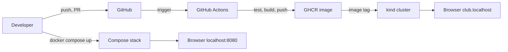
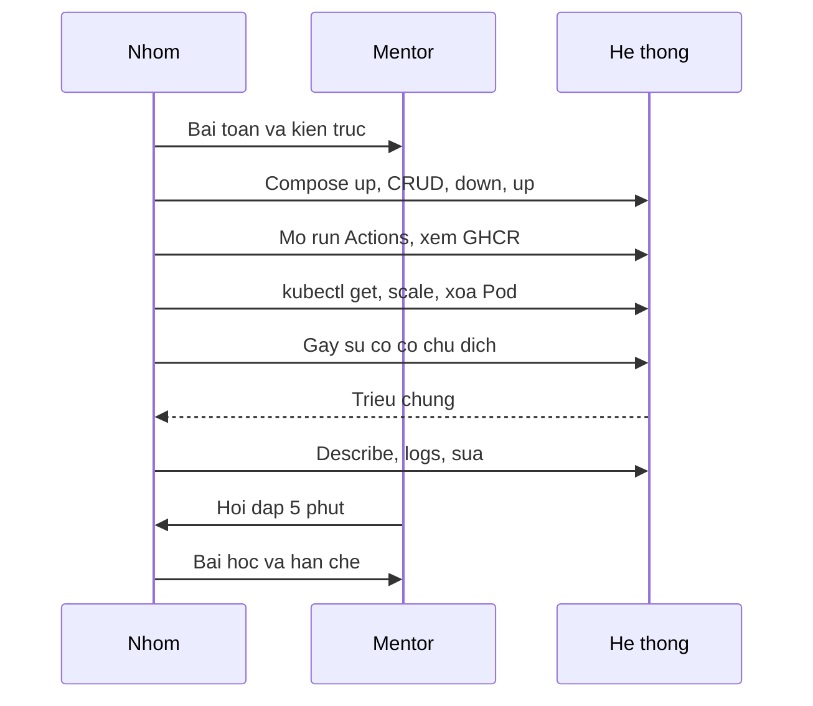

# Buổi 32 – Final Demo & Review

Tuần 16 · Giai đoạn 5 – Capstone Project · Slide: [Slide buổi 32](../../slides/08-capstone/session-32.md)

> **Tóm tắt:** Mỗi nhóm demo hệ thống Club Management từ Compose, CI/CD tới Kubernetes, gây và xử lý một sự cố có chủ đích, rồi bảo vệ kỹ thuật và rút ra bài học.

## Mục tiêu học tập

- Trình bày được kiến trúc và luồng từ commit tới Pod đang chạy của hệ thống trong 10 phút, mỗi thành viên nói ít nhất một đoạn.
- Chạy được demo trực tiếp trên máy của nhóm: Docker Compose, một run GitHub Actions và Kubernetes trên kind, không phụ thuộc ảnh chụp.
- Chẩn đoán được một sự cố có chủ đích ngay trên màn hình bằng `describe`, `logs`, events và nêu nguyên nhân gốc.
- Giải thích được các quyết định kỹ thuật (multi-stage build, volume, probe, Secret, rolling update) khi bị hỏi bất kỳ phần nào.
- Đánh giá được công việc của đồng đội bằng bằng chứng (PR, Issue, commit) thông qua peer review.
- Rút ra bài học và đề xuất cải tiến cho hệ thống và cho khóa học.

## Điều kiện cần

- Đã hoàn thành các buổi 29–31: hệ thống chạy được bằng Compose và Kubernetes, pipeline CI/CD xanh, đã có troubleshooting log. Xem [milestones](../../assignments/capstone/milestones.md).
- Đọc trước [hướng dẫn demo và bảo vệ kỹ thuật](../../assignments/capstone/demo-guide.md) và [rubric Capstone](../../curriculum/capstone-rubric.md), đặc biệt tiêu chí 10.
- Mỗi nhóm đã chạy thử toàn bộ kịch bản ít nhất một lần có bấm giờ.
- Công cụ: Windows 11 + WSL2 Ubuntu, Docker Desktop, `kind`, `kubectl`, trình duyệt, tài khoản GitHub.

Kiểm tra nhanh trong terminal WSL2:

```bash
docker version --format '{{.Server.Version}}'
kind version
kubectl version --client
git status --short
```

Kết quả mong đợi: ba lệnh đầu in ra phiên bản, lệnh cuối không liệt kê file lạ nào chưa commit (`.env` đã nằm trong `.gitignore` nên không được hiện ra; kiểm tra thêm bằng `git ls-files | grep -E '(^|/)\.env$'` phải không in gì).

## Vấn đề thực tế

Một hệ thống chạy được trên máy một người chưa phải là hệ thống đã sẵn sàng vận hành. Khi CLB nhận bàn giao dự án, người tiếp nhận cần biết: nó chạy thế nào, nằm ở đâu, hỏng thì xem gì, ai hiểu phần nào. Buổi demo cuối là lúc cả nhóm chứng minh điều đó với người chưa từng đụng vào code của mình.

Trong công việc thật, kỹ năng này xuất hiện ở sprint review, buổi bàn giao cho đội vận hành và postmortem sau sự cố. Người làm DevOps không chỉ cần làm đúng mà còn phải giải thích được vì sao, và giữ bình tĩnh khi một lệnh bất ngờ báo lỗi ngay trước mặt khách hàng. Vì vậy buổi này chấm cả cách nhóm xử lý lỗi, không chỉ kết quả cuối.

## Khái niệm cốt lõi

### Demo tốt và demo kém

| Yếu tố | Demo kém | Demo tốt |
| --- | --- | --- |
| Nội dung | Đọc lại README, lướt qua file | Chạy thật, chỉ ra kết quả và giải thích |
| Cấu trúc | Đi theo thứ tự file trong repo | Đi theo luồng: bài toán, kiến trúc, chạy, pipeline, vận hành, bài học |
| Dự phòng | Không có, lỗi là dừng | Có trạng thái sạch, video dự phòng, ảnh chụp kết quả |
| Phân vai | Một người nói, người khác im lặng | Mỗi người một đoạn, ai cũng trả lời được |
| Sự cố | Giấu, hoặc xóa sạch rồi làm lại | Nói to điều thấy, giả thuyết, kiểm chứng, sửa |

### Bảo vệ kỹ thuật là gì

Bảo vệ kỹ thuật (technical defense) là phần hỏi đáp 5 phút sau demo. Mentor hỏi vì sao thay vì hỏi là gì. Ví dụ không hỏi "Dockerfile của em có multi-stage không" mà hỏi "image cuối cùng chứa gì và không chứa gì, vì sao bạn chọn vậy". Mentor có thể chỉ định bất kỳ thành viên nào trả lời bất kỳ phần nào, do đó cả nhóm phải hiểu toàn bộ hệ thống.

### Bằng chứng thay cho lời kể

Rubric chấm bằng bằng chứng. Một phát biểu chỉ có giá trị khi đi kèm thứ kiểm chứng được:

| Phát biểu | Bằng chứng |
| --- | --- |
| "Dữ liệu không mất khi recreate" | `docker compose down` rồi `up`, gọi lại `GET /api/members` |
| "Pipeline chặn code lỗi" | Một run đỏ trong tab Actions và PR không merge được |
| "Pod tự phục hồi" | `kubectl delete pod`, `kubectl get pods -w` thấy Pod mới |
| "Image truy ngược được về commit" | Tag SHA hoặc phiên bản trên GHCR khớp commit |
| "Secret không nằm trong Git" | `git ls-files` không có file Secret thật |

### Peer review và lessons learned

Peer review ghi nhận đóng góp của từng người bằng sự việc cụ thể (PR, Issue, commit) theo [template peer review](../../templates/peer-review-template.md). Nó chỉ mentor đọc và dùng để tham khảo khi quy điểm nhóm về điểm cá nhân. Lessons learned là phần nhìn lại: điều làm tốt, điều làm chưa tốt, điều sẽ làm khác. Nhận xét tốt nêu hành vi quan sát được, không đánh giá con người.

## Kiến trúc và cách hoạt động

Luồng bạn cần kể trong demo chính là đường đi của một thay đổi:



Cấu trúc một buổi demo 10 phút và 5 phút hỏi đáp:



Giải thích từng bước:

1. **Bài toán và kiến trúc (1 phút):** nói hệ thống có ba thành phần (frontend Nginx, backend Node.js, PostgreSQL) và hai cách chạy (Compose, Kubernetes). Chỉ vào sơ đồ trong README của nhóm.
2. **Compose (2 phút):** chạy từ trạng thái sạch, chứng minh dữ liệu bền qua `down` rồi `up`.
3. **CI/CD (2 phút):** mở run xanh, một run đỏ đã sửa, image trên GHCR.
4. **Kubernetes (2 phút):** Pod, Service, Ingress, scale, xóa Pod để thấy self-healing.
5. **Sự cố (1,5 phút):** gây lỗi, đọc triệu chứng, tìm nguyên nhân gốc, sửa.
6. **Bài học (1 phút):** điều tốt, hạn chế, việc sẽ làm tiếp.

Kịch bản này khớp bảng phút trong [demo-guide](../../assignments/capstone/demo-guide.md). Nếu repo nhóm khác tên service hoặc nhãn, hãy điều chỉnh lệnh nhưng giữ nguyên luồng.

## Demo của mentor

Mentor demo một lượt mẫu bằng starter-project (hoặc repo mẫu của mentor) trong khoảng 10 phút để lớp thấy nhịp độ. Giả định đang ở thư mục gốc repo, đã có file `.env` với `DB_PASSWORD` và `WEB_PORT`.

**Bước 1. Trạng thái sạch rồi chạy Compose**

```bash
docker compose up -d --build
docker compose ps
curl -s http://localhost:3000/health
```

Kết quả mong đợi (rút gọn): ba service `frontend`, `backend`, `postgres` ở trạng thái `running`, `postgres` là `healthy`; lệnh `curl` trả về JSON báo trạng thái ok.

Câu hỏi cho lớp: "Backend gọi PostgreSQL bằng tên gì, vì sao tên đó phân giải được?" (Đáp: `postgres`, DNS nội bộ của network `club-network`.)

**Bước 2. Chứng minh dữ liệu bền**

```bash
docker compose down
docker compose up -d
curl -s http://localhost:3000/api/members
```

Kết quả mong đợi: danh sách thành viên vẫn còn vì volume `postgres-data` không bị xóa.

Câu hỏi cho lớp: "Nếu tôi chạy `docker compose down -v` thì sao?" (Đáp: volume bị xóa, dữ liệu mất, `init.sql` chạy lại lần sau.)

**Bước 3. Kubernetes: scale và tự phục hồi**

```bash
kubectl get pods -n club
kubectl scale deployment club-api -n club --replicas=3
kubectl rollout status deployment/club-api -n club
kubectl scale deployment club-api -n club --replicas=2
kubectl delete pod -n club -l app=club-api --wait=false
kubectl get pods -n club -w
```

Kết quả mong đợi: sau scale thấy 3 Pod `club-api` `Running`; sau khi xóa Pod, các Pod mới xuất hiện và về `Running`. Dừng `-w` bằng Ctrl+C.

Câu hỏi cho lớp: "Ai tạo ra Pod mới? Nếu tôi xóa Deployment thay vì Pod thì sao?"

**Bước 4. Sự cố có chủ đích: sai tag image**

```bash
kubectl set image deployment/club-api api=club-api:does-not-exist -n club
kubectl get pods -n club
kubectl describe pod -n club -l app=club-api
kubectl rollout undo deployment/club-api -n club
```

Kết quả mong đợi: Pod mới ở `ErrImagePull` rồi `ImagePullBackOff`, Pod cũ vẫn phục vụ nhờ rolling update; phần Events của `describe` có thông báo không kéo được image. Sau `rollout undo`, mọi Pod về `Running`.

Câu hỏi cho lớp: "Vì sao người dùng chưa thấy lỗi?" và "Làm sao biết tên container `api` mà không đoán?" (Đáp: `kubectl get deployment club-api -n club -o jsonpath='{.spec.template.spec.containers[*].name}'`.)

Sau demo, mentor nhận xét theo ba mục: điều làm tốt, rủi ro chính, một việc nên làm tiếp, đúng như sẽ làm với các nhóm.

## Hands-on lab

Lab 60 phút này gồm các lượt demo của từng nhóm. Với 4 nhóm, mỗi nhóm có khoảng 15 phút (10 demo, 5 hỏi đáp). Với 5 nhóm, lịch trong [milestones](../../assignments/capstone/milestones.md) dành 75 phút cho demo; nếu đông hơn, chia hai phòng với hai mentor. Phần chuẩn bị trạng thái sạch diễn ra trong 15 phút đầu của buổi (thay cho phần ôn tập). Các nhóm không đang demo đóng vai reviewer.

### Chuẩn bị

Mỗi nhóm thực hiện trước lượt demo của mình, trong WSL2 (không dùng `/mnt/c`):

```bash
cd ~/devops-capstone
git switch main
git pull
git status --short
kubectl config current-context
kubectl get nodes
```

Kết quả mong đợi: working tree sạch, context là `kind-` kèm tên cluster, node `Ready`.

Vì sao: demo trên nhánh đang sửa dở hoặc sai context là nguyên nhân số một khiến demo hỏng.

Tạo file ghi lệnh dùng cho demo (không chứa secret):

```bash
mkdir -p docs
cat > docs/demo-commands.md <<'EOF'
# Lệnh demo
docker compose up -d --build
docker compose ps
kubectl get pods -n club
EOF
```

### Phần 1. Preflight (nhóm tự làm, 10 phút)

1. Kiểm tra cổng và Docker:

```bash
docker ps --format '{{.Names}}\t{{.Ports}}'
docker compose config --quiet && echo "compose hop le"
```

Kết quả mong đợi: không có container lạ chiếm cổng 8080, dòng `compose hop le` xuất hiện. Vì sao: lỗi port đã được sử dụng (xem scenario-01 trong `examples/troubleshooting/`) là lỗi demo phổ biến nhất.

2. Chọn trạng thái xuất phát và thống nhất cả nhóm: (a) cluster đã tạo, image đã nạp, chưa apply manifest để triển khai ngay trên màn hình; hoặc (b) đã triển khai, chỉ trình bày kiểm tra.

```bash
kind get clusters
kubectl get ns club
docker image ls club-api
```

Kết quả mong đợi: thấy cluster của nhóm; namespace `club` tồn tại hoặc báo `NotFound` đúng với trạng thái đã chọn; image có tag phiên bản cụ thể (ví dụ `1.0.0`).

3. Phân vai: ghi tên người nói cho từng đoạn trong bảng kịch bản của [demo-guide](../../assignments/capstone/demo-guide.md). Mỗi người ít nhất một đoạn.

4. Quay video dự phòng 2–3 phút các bước quan trọng và lưu ảnh chụp run Actions xanh. Video chỉ dùng khi sự cố mạng và phải báo mentor.

### Phần 2. Demo trực tiếp (10 phút mỗi nhóm)

1. **Kiến trúc (1 phút):** mở sơ đồ trong README, nêu ba thành phần, hai cách chạy, tên image.
2. **Git (1,5 phút):** mở một PR có review thật và lịch sử `main`.

```bash
git log --oneline -n 10
git shortlog -sn --no-merges
```

Kết quả mong đợi: nhiều tác giả khác nhau, thông điệp commit mô tả được thay đổi. Vì sao: chứng minh cả nhóm cùng đóng góp.

3. **Compose (1,5 phút):** chạy `docker compose up -d --build`, thêm một thành viên qua giao diện, rồi `down`, `up`, kiểm tra dữ liệu còn.

```bash
curl -s http://localhost:3000/api/members
```

Kết quả mong đợi: JSON chứa thành viên vừa thêm sau khi stack khởi động lại.

4. **CI/CD (1,5 phút):** mở tab Actions, chỉ ra job test, build, publish, một run đỏ đã sửa và package trên GHCR với tag SHA hoặc phiên bản. Giải thích quyền `packages: write` và vì sao dùng `GITHUB_TOKEN`.
5. **Kubernetes (2 phút):**

```bash
kubectl get pods,svc,ingress -n club
kubectl scale deployment club-api -n club --replicas=3
kubectl rollout status deployment/club-api -n club
kubectl delete pod -n club -l app=club-api --wait=false
```

Kết quả mong đợi: Pod `Running`, Service `backend` và `club-web`, Ingress host `club.localhost`; Pod bị xóa được thay thế. Nhãn `app=club-api` phải khớp với manifest; kiểm tra bằng `kubectl get pods -n club --show-labels`.

6. **Sự cố có chủ đích (1,5 phút):** mentor chọn một trong các sự cố dưới đây, nhóm không được biết trước.

| Sự cố do mentor chọn | Cách gây | Hướng xử lý |
| --- | --- | --- |
| Sai tag image | `kubectl set image` với tag không tồn tại | `describe pod`, events, `rollout undo` |
| Sai mật khẩu DB | Sửa giá trị trong Secret rồi `rollout restart` backend | Pod mới `0/1`; `kubectl logs` của Pod mới (Pod cũ vẫn phục vụ), so sánh Secret và biến môi trường |
| Readiness fail | Sửa đường dẫn probe sai | `describe pod`, `kubectl get endpoints backend -n club` (thiếu Pod mới) |

7. **Bài học (1 phút):** nêu một điều làm tốt, một hạn chế, một việc sẽ làm nếu có thêm thời gian.

### Phần 3. Hỏi đáp kỹ thuật (5 phút mỗi nhóm)

Mentor hỏi theo bài làm, chỉ định thành viên trả lời. Nhóm trả lời theo ba bước: kết luận, lý do, bằng chứng (lệnh hoặc file). Ví dụ câu hỏi: khác nhau giữa liveness và readiness; `down` và `down -v`; Secret có thực sự bí mật không. Danh sách đầy đủ ở mục 6 của [demo-guide](../../assignments/capstone/demo-guide.md).

### Phần 4. Peer review và lessons learned (10 phút, sau khi demo)

1. Mỗi thành viên điền [template peer review](../../templates/peer-review-template.md) cho từng bạn cùng nhóm, kèm link PR hoặc Issue cụ thể, và phần tự đánh giá cho chính mình. Không chia sẻ nội dung với nhau.
2. Cả nhóm viết lessons learned vào `report.md` theo ba mục: điều làm tốt, điều làm chưa tốt, điều sẽ làm khác.
3. Ghi lại nhận xét của mentor vào mục "Có thể cải thiện gì" của báo cáo.

### L1 – Foundation

- [ ] Demo chạy thật trong 10 phút hoặc ít hơn, có Compose và Kubernetes
- [ ] Mỗi thành viên nói ít nhất một đoạn
- [ ] Chứng minh dữ liệu bền qua `down` rồi `up`
- [ ] Mở được run Actions xanh và image trên GHCR
- [ ] Trả lời được ít nhất 3 câu hỏi mentor, có thể tra tài liệu
- [ ] Đã điền peer review cho từng bạn cùng nhóm

### L2 – Engineering

Thử thách: trả lời sâu về vận hành và đề xuất cải tiến. Tiêu chí hoàn thành:

- [ ] Xử lý được sự cố do mentor chọn trong 2 phút, nêu nguyên nhân gốc và cách phòng tránh.
- [ ] Trình bày một failure injection do nhóm tự chọn (xóa Pod PostgreSQL, ép backend crash, làm hỏng probe) với giả thuyết, kết quả quan sát và cách khôi phục.
- [ ] Viết đề xuất cải tiến có ưu tiên: ít nhất 3 mục cho hệ thống và 2 mục cho khóa học, mỗi mục có lý do và ước lượng công sức.
- [ ] Trả lời được hai câu mở rộng: nút thắt đầu tiên khi có nhiều người dùng, và cần đổi gì khi chuyển từ kind sang cluster thật.

<details>
<summary>Gợi ý</summary>

- Failure injection nên có phần dự đoán trước khi chạy: "tôi nghĩ sẽ xảy ra X". So sánh dự đoán với thực tế mới là phần học được.
- Với Pod PostgreSQL bị xóa: StatefulSet tạo lại Pod, PVC giữ dữ liệu, backend tạm thời fail readiness hoặc báo lỗi kết nối rồi hồi phục.
- Đề xuất cải tiến nên cụ thể: "thêm quét lỗ hổng image vào CI, fail khi có lỗ hổng mức Critical" tốt hơn "cải thiện bảo mật".

</details>

<details>
<summary>Lời giải mẫu: xóa Pod PostgreSQL</summary>

```bash
kubectl get pods -n club
kubectl delete pod postgres-0 -n club
kubectl get pods -n club -w
curl -s http://club.localhost/api/members
```

Tên Pod `postgres-0` giả định StatefulSet tên `postgres`; hãy lấy tên thật từ `kubectl get pods`. Kết quả mong đợi: Pod `postgres-0` được tạo lại, gắn lại PVC cũ, dữ liệu vẫn còn (trong lúc Pod chưa Ready, `curl` có thể trả lỗi 500 hoặc 502 vài giây, sau đó hồi phục). Có thể thấy cột `RESTARTS` của một Pod `club-api` tăng thêm 1: với starter-project, `db.js` chưa lắng nghe sự kiện `error` của connection pool nên khi PostgreSQL ngắt kết nối đột ngột, tiến trình Node.js có thể thoát và Kubernetes khởi động lại container. Đó là điểm yếu đáng ghi vào danh sách cải tiến, không phải lỗi của bài lab. Nếu muốn mất dữ liệu phải xóa cả PVC, đó là hành động có chủ ý.

</details>

## Phá lỗi và debug

**Tình huống: mất dữ liệu sau khi dọn dẹp trước demo.** Một thành viên muốn "làm sạch" môi trường nên chạy:

```bash
docker compose down -v
docker compose up -d
curl -s http://localhost:3000/api/members
```

Triệu chứng: giao diện mở bình thường nhưng danh sách thành viên chỉ còn dữ liệu mẫu từ `init.sql`, các thành viên nhóm đã thêm biến mất.

Hướng điều tra:

1. Xem volume: `docker volume ls` và kiểm tra `postgres-data` có vừa được tạo mới hay không.
2. Xem lịch sử lệnh trong terminal để thấy cờ `-v`.
3. Xem log `docker compose logs postgres`: thấy PostgreSQL khởi tạo database mới và chạy `init.sql`.
4. So với scenario-04 trong `examples/troubleshooting/` (database mất dữ liệu sau recreate).

Nguyên nhân gốc: `-v` xóa named volume, dữ liệu nằm trong volume chứ không nằm trong container. Cách phòng tránh: chỉ dùng `down` bình thường; có script seed để dựng lại dữ liệu demo; sao lưu bằng `pg_dump` trước khi thao tác nguy hiểm; không "dọn dẹp" ngay trước demo.

**Tình huống 2: lỗi ngay khi demo.** Nếu một lệnh bất ngờ lỗi trước mặt mentor, áp dụng quy trình: nói to điều thấy, đọc log và events, nêu giả thuyết, kiểm chứng. Nếu quá 2 phút chưa xong thì nói rõ và chuyển sang video dự phòng. Không xóa sạch rồi làm lại mà không giải thích nguyên nhân.

## Lỗi thường gặp

| Triệu chứng | Nguyên nhân | Cách xử lý |
| --- | --- | --- |
| Demo dừng vì cổng 8080 bận | Còn container hoặc tiến trình cũ chiếm cổng | `docker ps`, dừng container của mình, hoặc đổi `WEB_PORT` trong `.env` |
| Pod `ErrImagePull` ngay khi demo | Image chưa nạp vào kind hoặc sai tag | `kind load docker-image club-api:1.0.0`, kiểm tra tag trong manifest |
| `localhost` không mở được Ingress | Chưa cài ingress controller hoặc thiếu ánh xạ cổng trong `kind-config.yaml` | Kiểm tra `kubectl get pods -n ingress-nginx` và cấu hình cổng của cluster |
| Một người nói thay cả nhóm | Không phân vai trước | Ghi người nói cho từng đoạn, luyện lại |
| Lệnh `kubectl` trỏ nhầm cluster | Sai context | `kubectl config current-context`, `kubectl config use-context` |
| Run Actions đỏ ngay trước demo | Sửa vội trên `main` | Dùng run xanh gần nhất, giải thích run đỏ và cách sửa |
| Không còn thời gian trả lời | Demo quá 10 phút | Bấm giờ khi luyện, cắt phần ít quan trọng |
| Nhãn Pod không khớp lệnh | Nhãn trong manifest khác `app=club-api` | `kubectl get pods -n club --show-labels` rồi sửa lệnh |

## Tự kiểm tra

1. Vì sao demo nên bắt đầu từ trạng thái sạch đã thống nhất?
2. Khác nhau giữa `docker compose down` và `docker compose down -v`?
3. Pod mới xuất hiện sau khi xóa Pod `club-api`: thành phần nào tạo ra nó?
4. Khi rolling update gặp tag image sai, vì sao người dùng chưa thấy lỗi?
5. Bạn có đúng 2 phút còn lại và Pod ở `CrashLoopBackOff`. Bạn kiểm tra theo thứ tự nào?
6. Làm sao truy ngược từ Pod đang chạy về commit?
7. Nhận xét peer review tốt khác nhận xét kém ở điểm nào?

<details>
<summary>Đáp án</summary>

1. Để lặp lại được, tránh lỗi do trạng thái dở dang và để mentor thấy triển khai thật từ đầu.
2. `down` giữ named volume nên dữ liệu còn; `down -v` xóa volume nên dữ liệu mất.
3. ReplicaSet do Deployment quản lý, luôn duy trì số bản sao mong muốn.
4. Rolling update chỉ tắt Pod cũ khi Pod mới sẵn sàng; Pod mới không pull được image nên Pod cũ vẫn phục vụ.
5. `kubectl describe pod` xem events, `kubectl logs --previous` xem log lần chạy trước, so sánh cấu hình (biến môi trường, Secret, probe), nêu giả thuyết rồi kiểm chứng.
6. Tag image là SHA hoặc phiên bản gắn với commit; xem image trong `kubectl describe pod`, đối chiếu tag trên GHCR và lịch sử Git.
7. Nhận xét tốt nêu sự việc cụ thể (PR, Issue), mang tính xây dựng; nhận xét kém chung chung hoặc dựa trên cảm tính.

</details>

## Nộp bài

Nộp vào thư mục `lab-32/` trong repo cá nhân (ví dụ `devops-labs`) theo `templates/lab-template.md`:

- [ ] `README.md` trả lời đủ 7 câu hỏi của template (giải quyết vấn đề gì, kiến thức dùng, các bước, kết quả mong đợi, lỗi gặp, cách khắc phục, cải thiện)
- [ ] `evidence/command-output.txt` chứa lệnh và kết quả thật của phần demo (Compose, `kubectl get pods`, sự cố và cách sửa)
- [ ] `report.md` gồm lessons learned, nhận xét của mentor và danh sách đề xuất cải tiến
- [ ] `source/` chứa `docs/demo-commands.md` hoặc `demo.sh`, link tới repo nhóm và PR của bạn
- [ ] `screenshots/` có run Actions xanh và image trên GHCR
- [ ] Đã nộp peer review cho từng bạn cùng nhóm cho mentor (không đưa vào repo công khai)
- [ ] Ghi rõ đã làm L1 hay L2
- [ ] Không commit `.env`, password, token, private key hay file Secret thật

## Recap

- Demo tốt là chạy thật, đi theo luồng từ commit tới Pod và có kế hoạch dự phòng.
- Cả nhóm phải hiểu toàn bộ hệ thống, vì mentor có thể hỏi bất kỳ ai.
- Chứng minh bằng bằng chứng: lệnh, log, run Actions, lịch sử Git.
- Khi lỗi, nói to điều thấy rồi đi theo quy trình: triệu chứng, log và events, giả thuyết, kiểm chứng.
- `down -v` và xóa PVC là hành động mất dữ liệu; dùng có chủ ý.
- Peer review và lessons learned giúp ghi nhận đóng góp và cải tiến lần sau.

## Tài liệu tham khảo

- [kubectl cheat sheet](https://kubernetes.io/docs/reference/kubectl/quick-reference/)
- [Debug Pods trong Kubernetes](https://kubernetes.io/docs/tasks/debug/debug-application/debug-pods/)
- [Docker Compose CLI: docker compose down](https://docs.docker.com/reference/cli/docker/compose/down/)
- [kind: Quick Start](https://kind.sigs.k8s.io/docs/user/quick-start/)
- [GitHub Actions: workflow syntax](https://docs.github.com/en/actions/writing-workflows/workflow-syntax-for-github-actions)
