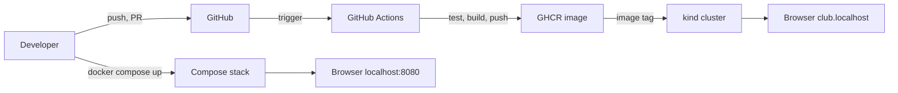

# Buổi 32 – Final Demo & Review

Tuần 16/16 · Giai đoạn 5 – Capstone Project · Buổi 32/32

[Slide](../../slides/08-capstone/session-32.md) · [Bài tập tuần](../../assignments/weekly/week-16.md) · [Hub tuần](README.md)

> **Tóm tắt:** Mỗi nhóm demo Club Management từ Compose, CI/CD tới Kubernetes trong 10 phút, xử lý một sự cố có chủ đích, trả lời hỏi đáp kỹ thuật, rồi peer review và rút ra bài học.

::: tip Buổi này bạn làm gì
- **Bạn sẽ tạo ra:** một buổi demo 10 phút chạy thật trên máy của nhóm, kèm lessons learned và peer review cho từng bạn trong nhóm.
- **Thời gian thật:** đọc 15 phút; lab 60 phút trên lớp gồm lượt demo của các nhóm (nhóm chưa demo đóng vai reviewer); chạy thử có bấm giờ ít nhất một lần trước buổi (khoảng 30 phút).
- **Cần chuẩn bị:**
  - [ ] Hệ thống chạy được bằng Compose và Kubernetes, pipeline CI/CD xanh, đã có troubleshooting log từ [Buổi 31 – Testing & Troubleshooting](session-31.md).
  - [ ] WSL2 Ubuntu, Docker Desktop, `kind`, `kubectl`, cluster `club` (context `kind-club`), tài khoản GitHub; cài theo [Hướng dẫn cài đặt](../../resources/setup-guide.md).
  - [ ] Đã đọc [hướng dẫn demo và bảo vệ kỹ thuật](../../assignments/capstone/demo-guide.md) và [Rubric Capstone](../../curriculum/capstone-rubric.md) (tiêu chí 10); repo `devops-labs` (public) sẵn sàng theo [Tài khoản GitHub và repo devops-labs](../../resources/setup-github.md).
- **Phải nộp:** thư mục `lab-32/` gồm `README.md` (7 câu của mẫu), `evidence/command-output.txt` (lượt chạy thử), `report.md` (lessons learned, nhận xét của mentor), `source/demo-commands.md`; peer review nộp riêng cho mentor, không đưa vào repo.
- **Đi nhanh:** Đọc > [Làm lab](#hands-on-lab) > [Gặp lỗi?](#gap-loi) > [Tự kiểm tra](#tu-kiem-tra) > [Nộp bài](#nop-bai). Kẹt? Nhảy tới [Gặp lỗi?](#gap-loi).

**Từ mới trong buổi** (xem [Thuật ngữ](../../resources/glossary.md)):
- [bảo vệ kỹ thuật](../../resources/glossary.md): 5 phút hỏi đáp sau demo, mentor hỏi "vì sao" chứ không hỏi "là gì".
- [bằng chứng](../../resources/glossary.md): lệnh, log, run Actions hay lịch sử Git kiểm chứng được một phát biểu.
- [preflight](../../resources/glossary.md): bước kiểm tra trạng thái trước khi demo.
- [peer review](../../resources/glossary.md): bạn cùng nhóm nhận xét đóng góp của nhau bằng sự việc cụ thể.
- [lessons learned](../../resources/glossary.md): nhìn lại điều làm tốt, chưa tốt và sẽ làm khác.
- [Definition of Done](../../resources/glossary.md): danh sách điều kiện để coi hệ thống là xong.
:::

## Vấn đề thực tế

Một hệ thống chạy được trên máy một người chưa phải là hệ thống sẵn sàng vận hành. Khi CLB nhận bàn giao dự án, người tiếp nhận cần biết: nó chạy thế nào, nằm ở đâu, hỏng thì xem gì, ai hiểu phần nào. Buổi demo cuối là lúc cả nhóm chứng minh điều đó với người chưa từng đụng vào code của mình.

Ngoài đời, kỹ năng này xuất hiện ở sprint review, buổi bàn giao cho đội vận hành và postmortem sau sự cố. Người làm DevOps cần giải thích được vì sao, và giữ bình tĩnh khi một lệnh báo lỗi ngay trước mặt khách hàng. Vì vậy buổi này chấm cả cách nhóm xử lý lỗi, không chỉ kết quả cuối.

## Khái niệm cốt lõi

- **Demo tốt:** chạy thật theo luồng bài toán, kiến trúc, chạy, pipeline, vận hành, bài học; mỗi người một đoạn; có trạng thái sạch và video dự phòng. Demo kém đọc lại README. Giống đầu bếp nấu trực tiếp trước thực khách thay vì đọc công thức.
- **Bảo vệ kỹ thuật:** mentor chỉ định bất kỳ thành viên trả lời bất kỳ phần nào, nên cả nhóm phải hiểu toàn bộ hệ thống. Trả lời theo ba bước: kết luận, lý do, bằng chứng (lệnh hoặc file). Giống vấn đáp luận văn.
- **Bằng chứng thay cho lời kể:** mỗi phát biểu cần một thứ kiểm chứng được. Giống hóa đơn kèm lời hứa bảo hành.

  | Phát biểu | Bằng chứng |
  | --- | --- |
  | "Dữ liệu không mất khi recreate" | `docker compose down` rồi `up`, gọi lại `GET /api/members` |
  | "Pipeline chặn code lỗi" | Một run đỏ trong tab Actions và PR không merge được |
  | "Pod tự phục hồi" | `kubectl delete pod`, `kubectl get pods -w` thấy Pod mới |
  | "Image truy ngược được về commit" | Tag SHA hoặc phiên bản trên GHCR khớp commit |
  | "Secret không nằm trong Git" | `git ls-files` không có file Secret thật |
- **Peer review và lessons learned:** peer review ghi nhận đóng góp bằng sự việc cụ thể (PR, Issue, commit) theo [template peer review](../../templates/peer-review-template.md), chỉ mentor đọc. Nhận xét tốt nêu hành vi quan sát được, không đánh giá con người.



::: details Tìm hiểu thêm (đọc sau)
Kịch bản 10 phút khớp bảng phút trong [demo-guide](../../assignments/capstone/demo-guide.md): bài toán và kiến trúc 1 phút (ba thành phần frontend Nginx, backend Node.js, PostgreSQL; hai cách chạy Compose và Kubernetes), Git 1,5 phút, Compose 1,5 phút, CI/CD 1,5 phút, Kubernetes 2 phút, sự cố 1,5 phút, bài học 1 phút. Nếu repo nhóm khác tên service hoặc nhãn, hãy điều chỉnh lệnh nhưng giữ nguyên luồng.
:::

## Hands-on lab (60 phút) {#hands-on-lab}

Với 4 nhóm, mỗi nhóm khoảng 15 phút (10 demo, 5 hỏi đáp). Với 5 nhóm, lịch trong [milestones](../../assignments/capstone/milestones.md) dành 75 phút; nếu đông hơn, chia hai phòng với hai mentor. Phần Chuẩn bị và Preflight diễn ra trong 15 phút đầu của buổi. Bắt buộc = L1.

### Chuẩn bị (5 phút)

Mỗi nhóm làm trước lượt demo của mình, trong WSL2 (không dùng `/mnt/c`):

```bash
cd ~/devops-capstone
git switch main
git pull
git status --short
kubectl config current-context
kubectl get nodes
git ls-files | grep -E '(^|/)\.env$'
```

Kết quả mong đợi: working tree sạch, context là `kind-club`, node `Ready`, lệnh cuối không in gì. Demo trên nhánh sửa dở hoặc sai context là nguyên nhân số một khiến demo hỏng ([Gặp lỗi?](#gap-loi)). Tạo file ghi lệnh dùng cho demo (không chứa secret):

```bash
mkdir -p docs
cat > docs/demo-commands.md <<'EOF'
# Lệnh demo
docker compose up -d --build
docker compose ps
kubectl get pods -n club
EOF
```

### Phần 1. Preflight (10 phút)

1. Kiểm tra cổng và Docker:

   ```bash
   docker ps --format '{{.Names}}\t{{.Ports}}'
   docker compose config --quiet && echo "compose hop le"
   ```

   Kết quả mong đợi: không có container lạ chiếm cổng 8080, dòng `compose hop le` xuất hiện. Cổng bận là lỗi demo phổ biến nhất (xem scenario-01 trong `examples/troubleshooting/`).

2. Thống nhất trạng thái xuất phát: (a) cluster đã tạo, image đã nạp, chưa apply manifest để triển khai ngay trên màn hình (nhớ nạp schema vào `postgres-0` như Phần 2 buổi 31); hoặc (b) đã triển khai, chỉ trình bày kiểm tra.

   ```bash
   kind get clusters
   kubectl get ns club
   docker image ls club-api
   ```

   Kết quả mong đợi: thấy cluster `club`; namespace `club` tồn tại hoặc báo `NotFound` đúng với trạng thái đã chọn; image có tag phiên bản cụ thể (ví dụ `1.0.0`).

3. Phân vai: ghi tên người nói cho từng đoạn trong bảng kịch bản của [demo-guide](../../assignments/capstone/demo-guide.md); mỗi người ít nhất một đoạn.
4. Quay video dự phòng 2-3 phút các bước quan trọng và lưu ảnh chụp run Actions xanh. Video chỉ dùng khi sự cố mạng và phải báo mentor.

::: tip Kiểm tra: bạn đúng khi
Không có container lạ chiếm cổng 8080, nhóm đã chọn trạng thái xuất phát (a) hoặc (b), và mỗi người đã có ít nhất một đoạn để nói.
:::

### Phần 2. Demo trực tiếp (10 phút mỗi nhóm)

Trước khi demo, đối chiếu Definition of Done của capstone (mỗi mục có một cách kiểm chứng nhanh):

- [ ] Clone sạch chạy được bằng Compose (clone thư mục mới, làm theo README).
- [ ] CRUD qua API và giao diện (thêm và xóa trên web, `curl` mã trạng thái).
- [ ] Dữ liệu persistent (`down` rồi `up`, `GET /api/members`).
- [ ] CI chặn merge khi test fail (một PR đỏ không merge được).
- [ ] Image publish lên GHCR (trang Packages có tag SHA hoặc phiên bản).
- [ ] Triển khai trên kind, truy cập từ browser (`kubectl get pods,svc,ingress -n club`, mở `club.localhost`).
- [ ] Scale 2 lên 3 rồi quay lại 2.
- [ ] Có troubleshooting log (ít nhất 3 sự cố, đủ 5 trường).
- [ ] Không secret trong lịch sử Git (`git log -p --all`, `git ls-files`).
- [ ] Mỗi người có PR và review (`git shortlog -sn --no-merges`).

Hướng dẫn demo 10 phút, theo đúng thứ tự:

1. **Kiến trúc (1 phút):** mở sơ đồ trong README, nêu ba thành phần, hai cách chạy, tên image.
2. **Git (1,5 phút):** mở một PR có review thật và lịch sử `main`.

   ```bash
   git log --oneline -n 10
   git shortlog -sn --no-merges
   ```

   Kết quả mong đợi: nhiều tác giả khác nhau, thông điệp commit mô tả được thay đổi.

3. **Compose (1,5 phút):** `docker compose up -d --build`, thêm một thành viên qua giao diện, rồi `down`, `up`, kiểm tra dữ liệu còn.

   ```bash
   curl -s http://localhost:3000/api/members
   ```

   Kết quả mong đợi: JSON chứa thành viên vừa thêm sau khi stack khởi động lại.

4. **CI/CD (1,5 phút):** mở tab Actions, chỉ ra job test, build, publish, một run đỏ đã sửa và package trên GHCR với tag SHA hoặc phiên bản. Giải thích quyền `packages: write` và vì sao dùng `GITHUB_TOKEN`.
5. **Kubernetes (2 phút):**

   ```bash
   kubectl get pods,svc,ingress -n club
   kubectl scale deployment club-api -n club --replicas=3
   kubectl rollout status deployment/club-api -n club
   kubectl delete pod -n club -l app=club-api --wait=false
   ```

   Kết quả mong đợi: Pod `Running`, Service `backend` và `club-web`, Ingress host `club.localhost`; Pod bị xóa được thay thế. Nhãn `app=club-api` phải khớp manifest (`kubectl get pods -n club --show-labels`). Nhớ `scale` về 2 sau khi demo.

6. **Sự cố có chủ đích (1,5 phút):** mentor chọn một trong ba loại bạn đã luyện ở buổi 31 (sai tag image, sai mật khẩu DB, readiness fail), nhóm không biết trước. Quy trình: nói to điều thấy, đọc `describe`, `logs` và events, nêu giả thuyết, kiểm chứng, sửa.
7. **Bài học (1 phút):** nêu một điều làm tốt, một hạn chế, một việc sẽ làm nếu có thêm thời gian.

::: tip Kiểm tra: bạn đúng khi
Demo chạy thật trong 10 phút hoặc ít hơn, có cả Compose và Kubernetes, mỗi người nói ít nhất một đoạn, và bạn chỉ ra được bằng chứng cho mỗi phát biểu.
:::

### Phần 3. Hỏi đáp kỹ thuật (5 phút mỗi nhóm)

Mentor hỏi theo bài làm và chỉ định thành viên trả lời. Trả lời theo ba bước: kết luận, lý do, bằng chứng (lệnh hoặc file). Câu hỏi hay gặp: khác nhau giữa liveness và readiness; `down` và `down -v`; Secret có thực sự bí mật không. Danh sách đầy đủ ở mục 6 của [demo-guide](../../assignments/capstone/demo-guide.md). Được tra tài liệu.

### Phần 4. Peer review và lessons learned (10 phút, sau khi demo)

1. Mỗi người điền [template peer review](../../templates/peer-review-template.md) cho từng bạn cùng nhóm, kèm link PR hoặc Issue cụ thể, cộng phần tự đánh giá. Không chia sẻ nội dung với nhau.
2. Cả nhóm viết lessons learned vào `report.md`: điều làm tốt, điều làm chưa tốt, điều sẽ làm khác.
3. Ghi nhận xét của mentor vào mục "Có thể cải thiện gì" của báo cáo.

### Checklist L1 (bắt buộc)

- [ ] Demo chạy thật trong 10 phút hoặc ít hơn, có Compose và Kubernetes.
- [ ] Mỗi thành viên nói ít nhất một đoạn; chứng minh dữ liệu bền qua `down` rồi `up`.
- [ ] Mở được run Actions xanh và image trên GHCR.
- [ ] Trả lời được ít nhất 3 câu hỏi mentor (có thể tra tài liệu); đã điền peer review cho từng bạn.

Tự kiểm tra một dòng: `git status --short && kubectl get pods -n club && git ls-files | grep -E '(^|/)\.env$' || echo "san sang demo"`

## Gặp lỗi? {#gap-loi}

| Triệu chứng | Nguyên nhân | Cách sửa |
| --- | --- | --- |
| Demo dừng vì cổng 8080 bận | Còn container hoặc tiến trình cũ chiếm cổng | `docker ps`, dừng container của mình, hoặc đổi `WEB_PORT` trong `.env` |
| Pod `ErrImagePull` ngay khi demo | Image chưa nạp vào kind hoặc sai tag | `kind load docker-image club-api:1.0.0 --name club`, kiểm tra tag trong manifest |
| `localhost` không mở được Ingress | Chưa cài ingress controller hoặc thiếu ánh xạ cổng trong `kind-config.yaml` | `kubectl get pods -n ingress-nginx`, kiểm tra cấu hình cổng của cluster |
| Lệnh `kubectl` trỏ nhầm cluster | Sai context | `kubectl config current-context`, `kubectl config use-context kind-club` |
| Nhãn Pod không khớp lệnh | Nhãn trong manifest khác `app=club-api` | `kubectl get pods -n club --show-labels` rồi sửa lệnh |
| Run Actions đỏ ngay trước demo | Sửa vội trên `main` | Dùng run xanh gần nhất, giải thích run đỏ và cách sửa |
| Giao diện mở được nhưng chỉ còn dữ liệu mẫu từ `init.sql` | Đã chạy `docker compose down -v` nên volume `postgres-data` bị xóa | `docker volume ls`, xem `docker compose logs postgres`; chạy script seed; chỉ dùng `down` thường |
| Một lệnh bất ngờ lỗi trước mặt mentor | Trạng thái dở dang hoặc quên bước | Nói to điều thấy, đọc log và events, nêu giả thuyết, kiểm chứng; quá 2 phút thì chuyển sang video dự phòng và nói rõ |
| Một người nói thay cả nhóm, hoặc demo quá 10 phút | Không phân vai, không bấm giờ | Ghi người nói cho từng đoạn, luyện lại có bấm giờ, cắt phần ít quan trọng |

## Tự kiểm tra {#tu-kiem-tra}

1. Vì sao demo nên bắt đầu từ trạng thái sạch đã thống nhất?
2. Khác nhau giữa `docker compose down` và `docker compose down -v`?
3. Pod mới xuất hiện sau khi xóa Pod `club-api`: thành phần nào tạo ra nó?
4. Khi rolling update gặp tag image sai, vì sao người dùng chưa thấy lỗi?
5. Bạn có đúng 2 phút còn lại và Pod ở `CrashLoopBackOff`. Bạn kiểm tra theo thứ tự nào?

::: details Đáp án gợi ý
1. Để lặp lại được, tránh lỗi do trạng thái dở dang và để mentor thấy triển khai thật từ đầu.
2. `down` giữ named volume nên dữ liệu còn; `down -v` xóa volume nên dữ liệu mất.
3. ReplicaSet do Deployment quản lý, luôn duy trì số bản sao mong muốn.
4. Rolling update chỉ tắt Pod cũ khi Pod mới sẵn sàng; Pod mới không pull được image nên Pod cũ vẫn phục vụ.
5. `kubectl describe pod` xem events, `kubectl logs --previous` xem log lần chạy trước, so sánh cấu hình (biến môi trường, Secret, probe), nêu giả thuyết rồi kiểm chứng.

Câu luyện thêm: truy ngược từ Pod đang chạy về commit bằng tag image là SHA hoặc phiên bản gắn với commit (xem image trong `kubectl describe pod`, đối chiếu tag trên GHCR và lịch sử Git). Nhận xét peer review tốt nêu sự việc cụ thể (PR, Issue) và mang tính xây dựng; nhận xét kém chung chung hoặc dựa trên cảm tính.
:::

## Nộp bài {#nop-bai}

Nộp vào thư mục `lab-32/` trong repo `devops-labs`, theo [mẫu lab](../../templates/lab-template.md). Bài tập tuần: [Bài tập tuần 16](../../assignments/weekly/week-16.md).

- [ ] `README.md` trả lời đủ 7 câu của mẫu và ghi rõ đã làm L1 hay L2.
- [ ] `evidence/command-output.txt` có lệnh và kết quả thật của lượt chạy thử (Compose, `kubectl get pods`, sự cố và cách sửa).
- [ ] `report.md` có lessons learned, nhận xét của mentor và danh sách đề xuất cải tiến.
- [ ] `source/` có `docs/demo-commands.md` hoặc `demo.sh`, link tới repo nhóm và PR của bạn; `screenshots/` có run Actions xanh và image trên GHCR.
- [ ] Đã nộp peer review cho từng bạn cùng nhóm cho mentor (không đưa vào repo công khai).
- [ ] Không commit `.env`, password, token, private key hay file Secret thật.

## Recap

- Demo tốt là chạy thật, đi theo luồng từ commit tới Pod, có kế hoạch dự phòng; cả nhóm phải hiểu toàn bộ hệ thống.
- Chứng minh bằng bằng chứng; khi lỗi, nói to điều thấy rồi đi theo quy trình triệu chứng, log và events, giả thuyết, kiểm chứng.
- `down -v` và xóa PVC làm mất dữ liệu, chỉ dùng có chủ ý. Đây là buổi cuối: xem lại [Hub tuần 16](README.md) hoặc [Lộ trình](../../curriculum/syllabus.md).

::: details Thử thách thêm (L2, tùy chọn, làm ở nhà)
Trả lời sâu về vận hành và đề xuất cải tiến. Tự thử 15 phút trước khi mở gợi ý. Tiêu chí hoàn thành:

- [ ] Xử lý được sự cố do mentor chọn trong 2 phút, nêu nguyên nhân gốc và cách phòng tránh.
- [ ] Trình bày một failure injection do nhóm tự chọn (xóa Pod PostgreSQL, ép backend crash, làm hỏng probe) với giả thuyết, kết quả quan sát và cách khôi phục.
- [ ] Viết đề xuất cải tiến có ưu tiên: ít nhất 3 mục cho hệ thống và 2 mục cho khóa học, mỗi mục có lý do và ước lượng công sức.
- [ ] Trả lời được hai câu mở rộng: nút thắt đầu tiên khi có nhiều người dùng, và cần đổi gì khi chuyển từ kind sang cluster thật.

:::: details Gợi ý bậc 1: dự đoán trước
Failure injection nên có phần dự đoán trước khi chạy: "tôi nghĩ sẽ xảy ra X". So sánh dự đoán với thực tế mới là phần học được.
::::

:::: details Gợi ý bậc 2: xóa Pod PostgreSQL
StatefulSet tạo lại Pod, PVC giữ dữ liệu, backend tạm thời fail readiness hoặc báo lỗi kết nối rồi hồi phục. Lấy tên Pod thật từ `kubectl get pods`.
::::

:::: details Gợi ý bậc 3: đề xuất cải tiến
Đề xuất nên cụ thể: "thêm quét lỗ hổng image vào CI, fail khi có lỗ hổng mức Critical" tốt hơn "cải thiện bảo mật". Lời giải mẫu nằm ở [trang tuần 16](README.md); chỉ mở sau khi nộp bài.
::::
:::

::: details Phá lỗi nâng cao
**Tình huống: mất dữ liệu sau khi dọn dẹp trước demo.** Một thành viên muốn "làm sạch" môi trường nên chạy `docker compose down -v`, rồi `docker compose up -d` và `curl -s http://localhost:3000/api/members`. Triệu chứng: giao diện mở bình thường nhưng danh sách chỉ còn dữ liệu mẫu từ `init.sql`.

Tự thử 15 phút trước khi đọc tiếp. Hướng điều tra: (1) `docker volume ls` xem `postgres-data` có vừa được tạo mới không; (2) xem lịch sử lệnh để thấy cờ `-v`; (3) `docker compose logs postgres` thấy khởi tạo database mới và chạy `init.sql`; (4) so với scenario-04 trong `examples/troubleshooting/`. Nguyên nhân gốc: `-v` xóa named volume, dữ liệu nằm trong volume chứ không nằm trong container. Phòng tránh: chỉ dùng `down` thường; có script seed dựng lại dữ liệu demo; sao lưu bằng `pg_dump` trước thao tác nguy hiểm; không "dọn dẹp" ngay trước demo.
:::

::: details Tài liệu tham khảo
- [kubectl cheat sheet](https://kubernetes.io/docs/reference/kubectl/quick-reference/)
- [Debug Pods trong Kubernetes](https://kubernetes.io/docs/tasks/debug/debug-application/debug-pods/)
- [Docker Compose CLI: docker compose down](https://docs.docker.com/reference/cli/docker/compose/down/)
- [kind: Quick Start](https://kind.sigs.k8s.io/docs/user/quick-start/)
- [GitHub Actions: workflow syntax](https://docs.github.com/en/actions/writing-workflows/workflow-syntax-for-github-actions)
:::
