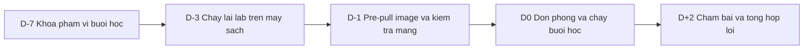

# Quy trình một buổi học

> **Tóm tắt:** Quy trình trước, trong và sau một buổi: checklist ngắn cho từng giai đoạn. Phần chi tiết (chạy lại lab trên máy sạch, pre-pull image, đồng hồ từng phút, xử lý sự cố, biên bản) gập sẵn bên dưới, mở khi cần.

::: warning Dành cho mentor
Trang này dành cho người dạy; học viên không cần đọc.
:::

Trang này dành cho Technical Mentor và Lab Assistant. Mỗi buổi dùng một bản sao của checklist bên dưới (dán vào Issue của buổi và tick dần). Quy tắc chung của khóa nằm ở [Sổ tay mentor](handbook.md).

Bốn loại trang đi cùng nhau, đừng nhầm:

| Trang | Dùng để |
| --- | --- |
| Quy trình một buổi học (trang này) | Khung chung cho mọi buổi: mốc chuẩn bị, mạng, phòng, sự cố, dọn dẹp, biên bản |
| Kịch bản buổi | Riêng từng buổi: demo của mentor, câu hỏi cho lớp, khung thời gian, lưu ý riêng; xem cột "Kịch bản buổi" trong [bảng 16 tuần](index.md) |
| Hướng dẫn chấm | Riêng từng tuần: barem, lỗi hay bị trừ điểm; dùng khi chấm bài sau buổi |
| Đáp án | [Mục lục đáp án](walkthroughs/index.md): để đối chiếu, không phát trước |

Trong lớp, mentor mở kịch bản buổi trên máy của mình; học viên chỉ mở bài học của học viên.

## Trước buổi

- [ ] D-7: đã đọc kịch bản buổi và bài học của buổi, phân công người dẫn chính, người trực từng nhóm, người ghi chép sự cố; mở Issue "Buổi XX" gắn Milestone phase.
- [ ] D-7: đã chọn tình huống lỗi cho phần Break, không để lộ nguyên nhân.
- [ ] D-3: một người khác tác giả đã chạy lại lab (L1 và L2) trên máy sạch, kết quả khớp "Kết quả mong đợi"; L1 xong trong khoảng 40 đến 45 phút với người mới.
- [ ] D-3: lỗi tài liệu đã ghi vào Issue nhãn `doc-bug` và sửa trước D-1.
- [ ] D-1: đã pre-pull image trên máy mentor và máy dự phòng, kiểm tra mạng phòng học đúng khung giờ học thật.
- [ ] D-1: slide và demo đã chạy thử trên máy chiếu thật; có bản offline (output mẫu hoặc video ngắn) cho từng demo.
- [ ] D-1: đã thông báo học viên (qua Discussions) chủ đề, thứ cần cài sẵn, mang laptop sạc đầy.
- [ ] D0, 30 phút trước giờ: phòng, màn chiếu, ổ điện, Wi-Fi hoặc LAN đã sẵn sàng; đồng hồ đếm ngược đã đặt; mỗi lab assistant có danh sách học viên mình trực.
- [ ] Đã mở sẵn trang [Gặp lỗi?](../resources/troubleshooting-setup.md) cho các lỗi môi trường phổ biến.

## Trong buổi

- [ ] Điểm danh, nhắc mục tiêu một câu, kiểm tra nhanh `docker version` trên máy học viên trong 5 phút đầu.
- [ ] Giữ đúng nhịp: ôn tập, lecture tối đa 20 phút, demo, lab 60 phút, review. Khung 120 phút có ở [Sổ tay mentor](handbook.md); bản từng phút nằm trong phần chi tiết bên dưới.
- [ ] Đến phút 70 mà dưới một nửa lớp qua được bước chính: dừng lớp 3 phút, hướng dẫn lại bước kẹt, rút gọn phần Break.
- [ ] Học viên tụt lại: leo thang theo 5 bước (tự gỡ, hỏi bạn, lab assistant, technical mentor, Issue và office hour).
- [ ] Giữ phần review: 2 đến 3 học viên giải thích lỗi đã gặp.
- [ ] Phút 117 đến 120: nhắc deadline, hướng dẫn nộp PR, thu phản hồi một câu.

## Sau buổi

- [ ] Nhắc học viên dừng stack (`docker compose down`, không kèm `-v` nếu muốn giữ dữ liệu bài sau); máy chung thì dọn container và cluster kind tạo trong buổi.
- [ ] Không để lại `.env` hay token trên máy dùng chung; xóa file `.tar` image khỏi thư mục chia sẻ công khai nếu không cần.
- [ ] D+2: cập nhật Project (đã nộp, quá hạn, cần hỗ trợ); review PR theo [Hướng dẫn chấm bài](grading-guide.md).
- [ ] D+2: tổng hợp sự cố ngày học thành Issue (nhãn `doc-bug` hoặc `env-issue`), cập nhật bảng sự cố nếu có sự cố mới.
- [ ] Dán biên bản sau buổi vào Issue (mẫu ở phần chi tiết).

## Chi tiết

Các phần dưới đây gập sẵn. Mở phần nào cần dùng.

::: details Mốc chuẩn bị D-7 đến D+2, từng việc một



### D-7: khóa phạm vi buổi học

- [ ] Xác định buổi học trong [lịch học](../curriculum/schedule.md), mở file lab tương ứng trong `labs/`.
- [ ] Phân công: người dẫn chính, người trực lab cho từng nhóm, người ghi chép sự cố.
- [ ] Danh sách học viên dự kiến và học viên cần hỗ trợ thêm (tụt lại, máy 8 GB).
- [ ] Xác định phần Break của buổi và chọn tình huống lỗi phù hợp (xem mục "Chuẩn bị phần Break").
- [ ] Mở Issue "Buổi XX" gắn Milestone phase, liệt kê các việc chuẩn bị dưới đây.

### D-3: chạy lại lab trên máy sạch

- [ ] Người chạy lại khác người soạn lab (tránh bỏ sót bước vì đã quen).
- [ ] Chạy L1 từ đầu đến cuối, đúng từng bước trong tài liệu, không dùng kiến thức ngoài.
- [ ] Chạy L2 theo yêu cầu, ghi lại một phương án làm hợp lý.
- [ ] Đối chiếu "kết quả mong đợi" trong lab với output thật; ghi lệch (phiên bản, thứ tự dòng).
- [ ] Bấm giờ: L1 phải xong trong khoảng 40 đến 45 phút với người mới, để học viên chậm vẫn kịp trong 60 phút.
- [ ] Ghi mọi lỗi tài liệu vào Issue gắn nhãn `doc-bug`, sửa trước D-1.
- [ ] Đã thử cả phần Break: tạo lỗi, xác nhận triệu chứng, xác nhận cách dọn dẹp.

### D-1: image, mạng, tài liệu

- [ ] Pre-pull image (xem mục "Mạng và pre-pull image") trên máy mentor và máy dự phòng.
- [ ] Kiểm tra mạng phòng học (phần Kiểm tra mạng phòng học).
- [ ] Slide và demo đã chạy thử trên máy chiếu thật, font terminal đủ lớn.
- [ ] Đã chuẩn bị bản sao offline: output mẫu hoặc video ngắn cho từng demo.
- [ ] Thông báo cho học viên (qua Discussions): chủ đề, thứ cần cài sẵn, cần mang laptop sạc đầy.

### D0: trước giờ học 30 phút

- [ ] Mở phòng, kiểm tra màn chiếu, âm thanh, ổ cắm điện đủ cho số máy.
- [ ] Đăng nhập Wi-Fi hoặc cắm LAN, chạy lại kiểm tra tốc độ (phần Kiểm tra mạng phòng học).
- [ ] Đặt sẵn đồng hồ đếm ngược cho từng khối của buổi.
- [ ] Mở sẵn Project board, trang tài liệu lab, kênh liên lạc.
- [ ] Mỗi lab assistant có danh sách học viên mình trực.

### D+2: sau buổi

- [ ] Cập nhật Project: học viên nào đã nộp, quá hạn, cần hỗ trợ.
- [ ] Review PR theo [Hướng dẫn chấm bài](grading-guide.md).
- [ ] Tổng hợp sự cố ngày học thành Issue (nhãn `doc-bug` hoặc `env-issue`).
- [ ] Cập nhật bảng sự cố trong mục "Xử lý sự cố ngày học" nếu có sự cố mới.

:::

::: details Chạy lại lab trên máy sạch

Một máy sạch nghĩa là chỉ có những gì [Setup Guide](../resources/setup-guide.md) yêu cầu, chưa có image, container, volume hay cấu hình do bạn tự thêm.

Cách có máy sạch, từ tốt đến chấp nhận được:

1. Một máy Windows 11 thật chưa dùng cho phát triển (tốt nhất, giống máy học viên).
2. Một máy ảo Windows 11 có hỗ trợ ảo hóa lồng (nested virtualization), tùy năng lực máy chủ.
3. Một bản distro WSL mới. Ngay sau khi cài xong Ubuntu (chưa cài thêm gì), lưu bản sao bằng PowerShell:

```powershell
wsl --export Ubuntu D:\wsl-backup\ubuntu-clean.tar
```

Mỗi lần cần môi trường sạch, nhập thành một distro mới:

```powershell
wsl --import UbuntuClean D:\wsl\UbuntuClean D:\wsl-backup\ubuntu-clean.tar
wsl -d UbuntuClean
```

Khi dọn xong, xóa distro thử nghiệm bằng `wsl --unregister UbuntuClean`. Cẩn thận: lệnh này xóa toàn bộ dữ liệu của distro có tên đó, kiểm tra tên trước khi chạy.

Với Docker Desktop, môi trường sạch hoàn toàn nghĩa là chưa có image nào. Nếu không có máy riêng, chạy `docker image ls` và `docker ps -a` để ghi lại những gì đã có, rồi chỉ dọn thứ do bạn tạo ra cho buổi thử, không chạy dọn dẹp hàng loạt trên máy dùng chung.

Kiểm tra môi trường trước khi chạy lab:

```bash
git --version
docker version
docker compose version
kubectl version --client
kind version
node --version
```

Kết quả mong đợi: mỗi lệnh in ra phiên bản, không có `command not found`. Các lệnh `kubectl` và `kind` chỉ cần từ tuần 11.

Làm việc trong filesystem của WSL (hoặc thư mục home trong Git Bash ở buổi 01), ví dụ thư mục home:

```bash
cd ~
git clone https://github.com/OWNER/devops-course.git
cd devops-course/starter-project
cp .env.example .env
docker compose up -d --build
docker compose ps
```

Thay `OWNER` bằng tài khoản hoặc tổ chức đang chứa repo giáo trình. Kết quả mong đợi: ba service `frontend`, `backend`, `postgres` ở trạng thái chạy (running, và healthy nếu đã cấu hình healthcheck). Truy cập `http://localhost:8080` (hoặc `WEB_PORT` trong `.env`) mở được trang frontend.

Ghi biên bản chạy lại bằng bảng sau và dán vào Issue của buổi:

| Bước lab | Kết quả | Thời gian | Ghi chú lệch tài liệu |
| --- | --- | --- | --- |
| Bước 1 | Đạt hoặc lỗi | phút | |

:::

::: details Mạng và pre-pull image

### 3.1 Vì sao phải pre-pull

Một image như `node:22-alpine` hay `postgres:17-alpine` nặng từ vài chục đến vài trăm MB. 30 máy cùng pull trong 5 phút đầu giờ qua một đường mạng chung dễ làm cả lớp đứng hình. Đồng thời registry công cộng có giới hạn tốc độ pull theo địa chỉ IP (nhiều máy sau cùng một NAT dùng chung một IP), có thể gây lỗi `toomanyrequests`. Tham khảo giới hạn hiện hành của Docker Hub trong tài liệu chính thức: https://docs.docker.com/docker-hub/usage/

Nguyên tắc: không để học viên pull image lớn lần đầu trong giờ học.

### 3.2 Kiểm tra mạng phòng học

Làm tại phòng học thật, đúng khung giờ học (ví dụ cùng giờ của buổi sau), vì mạng buổi sáng và buổi tối khác nhau.

- [ ] Mạng Wi-Fi hoặc LAN của CLB cho phép truy cập Docker Hub, GitHub, GHCR, npm registry.
- [ ] Thử pull một image nhỏ và đo thời gian:

```bash
time docker pull alpine:3.20
```

- [ ] Thử tải một file lớn hơn để ước lượng băng thông (ví dụ clone repo giáo trình):

```bash
time git clone --depth 1 https://github.com/OWNER/devops-course.git /tmp/clone-test
```

- [ ] Quy ước ngân sách: tổng dung lượng image mỗi buổi nhân với số học viên không vượt quá băng thông khả dụng trong 10 phút. Ví dụ 25 học viên và 400 MB image mỗi người là 10 GB, cần khoảng 140 Mbit/s liên tục để xong trong 10 phút. Nếu không đạt, bắt buộc dùng phương án phân phối nội bộ (mục "Phân phối image nội bộ khi mạng yếu" bên dưới).
- [ ] Xác nhận cổng ra của mạng không chặn các domain cần dùng. Không đoán: mở trình duyệt hoặc dùng `curl -I` thử từng domain.

### 3.3 Danh sách image theo buổi

Image gốc đã dùng trong starter project:

| Image | Dùng ở |
| --- | --- |
| `node:22-alpine` | build backend (Dockerfile multi-stage) |
| `nginx:1.27-alpine` | frontend |
| `postgres:17-alpine` | database (Compose và Kubernetes) |

Với Kubernetes, kind cần image node `kindest/node` đúng phiên bản của bản kind đang dùng. Xem tag chính xác trong ghi chú phát hành (release notes) của kind: https://github.com/kubernetes-sigs/kind/releases và pin cùng một phiên bản cho cả lớp.

Mỗi buổi, mentor ghi trong Issue danh sách image cần dùng. Script pre-pull mẫu (chạy trong WSL, sửa danh sách cho đúng buổi):

```bash
#!/usr/bin/env bash
set -euo pipefail

IMAGES=(
  "node:22-alpine"
  "nginx:1.27-alpine"
  "postgres:17-alpine"
)

for image in "${IMAGES[@]}"; do
  echo "Pulling ${image}"
  docker pull "${image}"
done

docker image ls
```

Kết quả mong đợi: mỗi image in `Status: Downloaded newer image` hoặc `Image is up to date`, cuối cùng `docker image ls` liệt kê đủ image.

### 3.4 Phân phối image nội bộ khi mạng yếu

Phương án A: một máy pull, các máy khác nạp từ file. Trên máy mentor:

```bash
docker save -o club-images.tar node:22-alpine nginx:1.27-alpine postgres:17-alpine
ls -lh club-images.tar
```

Chép file `club-images.tar` qua USB hoặc thư mục chia sẻ trong mạng LAN. Trên máy học viên:

```bash
docker load -i club-images.tar
docker image ls
```

Kết quả mong đợi: `docker load` in `Loaded image: ...` cho từng image.

Phương án B: image của chính khóa học (`club-api:1.0.0`, `club-web:1.0.0`) cũng có thể xuất và nạp theo cách trên, để học viên bỏ qua bước build khi cần cứu buổi học:

```bash
docker save -o club-app.tar club-api:1.0.0 club-web:1.0.0
docker load -i club-app.tar
```

Phương án C: dựng một registry cache (pull-through cache) trong mạng CLB bằng image `registry`. Phương án này cần cấu hình thêm ở từng máy (Docker `registry-mirrors`) và giải quyết vấn đề TLS, nên chỉ dùng khi có mentor đã làm quen. Đọc tài liệu chính thức trước: https://docs.docker.com/docker-hub/image-library/mirror/

### 3.5 Dự phòng sự cố mạng

- [ ] Có sẵn `club-images.tar` và `club-app.tar` trên ít nhất hai USB và một thư mục chia sẻ.
- [ ] Có hotspot điện thoại của mentor làm đường dự phòng cho việc cần ít băng thông (kiểm tra đăng nhập, mở GitHub). Không pull image lớn qua hotspot cho cả lớp.
- [ ] Mỗi lab có thể làm "chế độ offline" khi image đã nạp. Ghi rõ trong Issue của buổi những bước cần Internet (ví dụ push lên GHCR, chạy GitHub Actions) và bước nào làm offline được.
- [ ] Với buổi CI/CD cần GitHub: nếu GitHub hoặc mạng gián đoạn, chuyển sang phần đọc workflow, dự đoán kết quả và làm bài L2 dạng viết. Phần chạy thật bù vào buổi sau.

:::

::: details Chuẩn bị phòng và thiết bị

- [ ] Đủ ổ điện, ổ chia, dây mạng (nếu dùng LAN).
- [ ] Máy chiếu hoặc màn hình lớn, adapter HDMI.
- [ ] Máy dự phòng đã cài sẵn môi trường để học viên hỏng máy có chỗ làm.
- [ ] Bảng trắng để vẽ sơ đồ (network, luồng CI/CD).
- [ ] Danh sách học viên in sẵn hoặc trên màn hình, kèm nhóm và người trực.
- [ ] Thẻ màu hoặc ly (xanh: ổn, đỏ: cần giúp) trên bàn để học viên báo trợ giúp mà không phải giơ tay liên tục.

:::

::: details Chuẩn bị phần Break

Chỉ chuẩn bị lỗi từ danh sách [10 tình huống lỗi](../examples/troubleshooting-scenarios.md). Quy trình:

1. Chọn tình huống khớp nội dung buổi (ví dụ lỗi port ở buổi Docker Basics, lỗi probe ở buổi Kubernetes health).
2. Chuẩn bị bản "broken" (nhánh Git hoặc thư mục riêng) và bản "fixed" để đối chiếu. Bản "fixed" và nguyên nhân chi tiết chỉ để trong repo mentor private, xem [Quản lý repo giáo trình](repo-governance.md).
3. Viết đề bài chỉ gồm triệu chứng (xem khung mẫu ở phần "Tạo lỗi cho phần Break" ngay bên dưới).
4. Chạy thử: tạo lỗi trên máy sạch và xác nhận triệu chứng đúng như đề.
5. Chuẩn bị ba mức gợi ý và lệnh dọn dẹp.
6. Không đặt lời giải trong cùng thư mục học viên sẽ clone.

Các cách gây lỗi an toàn nói chung: sửa một giá trị cấu hình trong file của lab (cổng, tên host, tên image, đường dẫn), bỏ một khai báo (volume, biến môi trường), hoặc chiếm một cổng bằng một container thử nghiệm. Tránh mọi cách ảnh hưởng ngoài phạm vi lab (Windows, Docker Desktop, mạng của phòng học).

### Tạo lỗi cho phần Break

Phần Break là điểm khác biệt của khóa học. Mười tình huống chuẩn nằm ở [10 tình huống lỗi](../examples/troubleshooting-scenarios.md). Nguyên tắc khi tạo lỗi:

1. Chỉ đưa triệu chứng. Học viên nhận mô tả những gì quan sát được (ví dụ: "trang web mở được nhưng danh sách thành viên trống"), không nhận tên nguyên nhân.
2. Mỗi lỗi chỉ có một nguyên nhân gốc rõ ràng. Không chồng nhiều lỗi vào một tình huống ở các tuần đầu.
3. Lỗi phải tái lập được. Mentor tự tạo lỗi trên máy sạch và xác nhận triệu chứng giống mô tả trước khi đưa cho học viên.
4. Lỗi chỉ gây hại trong phạm vi lab. Không xóa dữ liệu của học viên, không sửa cấu hình hệ thống Windows, không đụng tới cài đặt Docker Desktop.
5. Có đường thoát: mỗi tình huống có lệnh dọn dẹp và trạng thái "tốt" để quay lại.
6. Gợi ý theo bậc. Chuẩn bị ba mức gợi ý (hướng điều tra, lệnh nên dùng, vị trí nguyên nhân) và chỉ đưa lần lượt khi học viên bí.
7. Sau khi giải xong, học viên trình bày năm mục: triệu chứng, nguyên nhân gốc, cách xác minh, giải pháp, biện pháp phòng tránh.

Cách đưa lỗi vào lab: mentor chuẩn bị một thư mục hoặc nhánh Git "broken" (ví dụ một commit có cấu hình sai) để học viên checkout hoặc áp dụng. Với lỗi gắn với runtime (port bị chiếm, thiếu volume), mentor dùng một script nhỏ hoặc tài liệu hướng dẫn tạo điều kiện lỗi. Mọi file chứa lời giải và nguyên nhân chỉ để trong repo mentor private, xem [Quản lý repo giáo trình](repo-governance.md).

Ví dụ khung mô tả một tình huống đưa cho học viên:

```text
Tình huống: Trang web mở được nhưng danh sách thành viên luôn trống.
Bạn biết: hôm qua hệ thống vẫn hiển thị đủ dữ liệu.
Nhiệm vụ: tìm nguyên nhân gốc, sửa, và chứng minh đã sửa.
Cần nộp: triệu chứng, nguyên nhân gốc, cách xác minh, giải pháp, cách phòng tránh.
Giới hạn thời gian: 20 phút. Hỏi mentor khi đã thử tối thiểu ba giả thuyết.
```

:::

::: details Phân bổ hoạt động trong một buổi

Mục tiêu tỷ lệ cho toàn khóa:

| Hoạt động | Tỷ lệ mục tiêu | Thời lượng tham chiếu |
| --- | --- | --- |
| Lecture | 20% | khoảng 20 đến 24 phút |
| Demo | 10% | khoảng 10 đến 12 phút |
| Lab | 50% | 60 phút |
| Group challenge | 10% | khoảng 12 phút |
| Review | 10% | khoảng 12 phút |

Khung 120 phút thực tế chia theo bốn khối: 15 phút ôn tập, 30 phút kiến thức và demo, 60 phút thực hành, 15 phút review. Các tỷ lệ trên được làm tròn trong khung này: group challenge nằm trong khối ôn tập, review nằm trong khối cuối, vài phút chuyển tiếp là phần dư. Đừng chạy theo con số chính xác, hãy giữ nguyên tắc: lab chiếm một nửa thời gian, giảng không quá 30 phút liên tục.

:::

::: details Đồng hồ từng phút cho buổi 120 phút

Cột "Ai" gồm: Lead (người dẫn chính), LA (lab assistant), TM (technical mentor trực lab).

| Phút | Việc | Ai | Kiểm tra hoàn thành |
| --- | --- | --- | --- |
| 0 đến 2 | Chào, điểm danh, nhắc mục tiêu một câu | Lead | Danh sách có mặt |
| 2 đến 5 | Học viên mở WSL, chạy `docker version` | LA | Không ai báo lỗi môi trường |
| 5 đến 7 | Giao đề group challenge (ôn bài trước) | Lead | Nhóm 2 đến 3 người đã hình thành |
| 7 đến 15 | Nhóm làm group challenge, không tra đáp án | LA đi quanh | Mỗi nhóm có một câu trả lời |
| 15 đến 17 | Chốt đáp án group challenge, nối sang chủ đề mới | Lead | Học viên nêu được vì sao chủ đề mới cần thiết |
| 17 đến 27 | Lecture phần 1: khái niệm cốt lõi, vẽ sơ đồ | Lead | 1 câu hỏi nhanh trả lời đúng |
| 27 đến 35 | Lecture phần 2: các điểm dễ sai, so sánh | Lead | 1 câu hỏi nhanh trả lời đúng |
| 35 đến 45 | Demo: chạy lệnh thật, gây một lỗi nhỏ và sửa | Lead | Học viên dự đoán đúng kết quả của ít nhất 1 lệnh |
| 45 đến 48 | Giao lab: nêu L1 và L2, thời hạn, quy tắc xin giúp đỡ | Lead | Mọi người mở file lab |
| 48 đến 70 | Lab L1 phần xây dựng (Build và Deploy) | TM, LA | Phần lớn lớp đã chạy được bước chính |
| 70 đến 85 | Lab phần Break và Debug | TM, LA | Học viên đã ghi triệu chứng và giả thuyết |
| 85 đến 105 | Hoàn thiện, viết báo cáo ngắn, L2 cho người xong sớm | TM, LA | Ít nhất 70% có bằng chứng lệnh và output |
| 105 đến 115 | Review: 2 đến 3 học viên trình bày, giải thích lỗi đã gặp | Lead | Có ít nhất 1 nguyên nhân gốc được giải thích đúng |
| 115 đến 118 | Chốt kiến thức, nêu lỗi phổ biến quan sát được | Lead | |
| 118 đến 120 | Nhắc deadline, hướng dẫn nộp PR, thu phản hồi nhanh | Lead | Phản hồi (một câu) từ ít nhất nửa lớp |

Điểm dừng quyết định (checkpoint) trong lab. Nếu đến phút 70 mà dưới một nửa lớp qua được bước chính:

- Dừng lớp 3 phút, lead hướng dẫn lại bước kẹt trên màn chiếu.
- Chuyển các học viên đã xong sang giúp bạn bằng cách đặt câu hỏi.
- Rút gọn phần Break còn một câu hỏi chẩn đoán thay vì một lỗi đầy đủ.

Nếu lab tuần đó nặng (Kubernetes, CI/CD), hạ mục tiêu: cả lớp phải xong L1, L2 làm ở nhà.

:::

::: details Xử lý học viên tụt lại

Luôn có một nhóm học viên làm chậm hơn nhịp lớp. Quy trình leo thang:

1. Tự gỡ (5 phút): học viên đọc thông báo lỗi, chạy lệnh chẩn đoán trong lab, thử một giả thuyết.
2. Hỏi bạn cùng bàn (5 phút): pair với bạn đã xong, nhưng bạn đó chỉ được chỉ vào màn hình và đặt câu hỏi, không gõ hộ.
3. Gọi lab assistant: assistant hỏi "bạn đã thử gì, kết quả ra sao" trước khi gợi ý. Chỉ gợi ý một bước tiếp theo.
4. Gọi technical mentor: dành cho lỗi môi trường (WSL, Docker Desktop, mạng) hoặc lỗi tài liệu.
5. Ghi vào Issue và hẹn office hour nếu lỗi quá 15 phút không tiến triển. Cho học viên dùng môi trường dự phòng (máy của bạn cùng nhóm, hoặc đoạn output mẫu) để không bị mất phần còn lại của buổi.

Học viên đã tụt hơn một buổi cần một cuộc trao đổi riêng với mentor để xác định lý do (môi trường, thời gian, nền tảng kiến thức) và lập kế hoạch bù. Không để học viên tự im lặng bỏ cuộc.

Dấu hiệu cần chủ động hỏi thăm: vắng hai buổi liên tiếp, không có PR trong một tuần, hỏi cùng một loại lỗi nhiều lần, ngồi im không gõ lệnh quá 10 phút.

:::

::: details Ghép L1 và L2, pair programming

Mỗi lab có L1 (Foundation) và L2 (Engineering). Cách tổ chức:

- Mọi học viên bắt đầu bằng L1. Học viên xong L1 sớm chuyển sang L2 và có thể đóng vai người hỗ trợ ngang hàng.
- Học viên mới hoặc yếu hơn: ưu tiên hoàn thành L1 cho chắc, L2 là bài tự học thêm. Điều kiện hoàn thành khóa tính trên bài lab bắt buộc, không ép L2.
- L2 không có hướng dẫn từng bước. Mentor chỉ xác nhận yêu cầu, không chỉ cách làm. Học viên phải giải thích lựa chọn của mình trong báo cáo.

Pair programming theo vai trò Driver và Navigator:

| Vai trò | Việc làm |
| --- | --- |
| Driver | Gõ lệnh, đọc to điều mình đang làm |
| Navigator | Đọc hướng dẫn, đặt câu hỏi "vì sao", kiểm tra output |

Đổi vai sau mỗi 15 phút. Ghép một học viên đã vững với một học viên chưa vững cho các lab về Linux, Git và Docker cơ bản. Với lab Kubernetes (máy nặng), ghép đôi cũng giúp giảm tải máy: một máy chạy cluster, hai người cùng làm.

:::

::: details Xử lý sự cố ngày học

### 7.1 Sự cố môi trường

| Triệu chứng | Chẩn đoán nhanh | Xử lý |
| --- | --- | --- |
| `Cannot connect to the Docker daemon` | Docker Desktop chưa chạy | Mở Docker Desktop, đợi biểu tượng ổn định, thử lại `docker ps` |
| `docker: command not found` trong Ubuntu | WSL integration chưa bật | Docker Desktop, Settings, Resources, WSL integration, bật cho distro Ubuntu, mở terminal mới |
| Docker Desktop kẹt khởi động | WSL cũ, hết RAM | Chạy `wsl --update`, `wsl --shutdown`, mở lại Docker Desktop |
| `permission denied` với `docker.sock` | User chưa vào nhóm docker (trường hợp Docker Engine cài trong WSL) | Với Docker Desktop thường không gặp; kiểm tra lại integration và mở terminal mới |
| Máy treo khi build hoặc chạy kind | Hết RAM | Dừng stack không dùng (`docker compose down`), xem phần Máy 8GB RAM ở [Tuyển và đào tạo mentor](mentor-onboarding.md) |
| Làm trong `/mnt/c` rất chậm, lỗi permission | Repo nằm ở ổ Windows | Clone lại vào thư mục home của WSL |
| Hết dung lượng ổ đĩa | Image và cache Docker tích tụ | `docker image prune`, `docker builder prune`; xác nhận với học viên trước khi xóa |

### 7.2 Sự cố mạng

| Triệu chứng | Chẩn đoán nhanh | Xử lý |
| --- | --- | --- |
| `toomanyrequests` khi pull | Chạm giới hạn pull của registry theo IP | Chuyển sang `docker load` từ file tar (xem mục "Mạng và pre-pull image") |
| Pull treo, timeout | Mạng chung quá tải | Yêu cầu cả lớp dừng pull, mentor phân phối file tar |
| `npm ci` chậm hoặc lỗi | Registry npm chậm | Thử lại; với buổi quan trọng dùng bản `node_modules` đã cache hoặc image đã build |
| Không mở được GitHub | Mạng chặn hoặc GitHub sự cố | Xem trang trạng thái GitHub, chuyển sang kế hoạch offline của buổi |
| DNS trong container không phân giải | DNS máy chủ chặn, VPN | Tắt VPN thử lại, kiểm tra `docker run --rm alpine:3.20 nslookup github.com` |

### 7.3 Sự cố trong lab của khóa

| Triệu chứng | Nguyên nhân hay gặp | Hướng dẫn mentor |
| --- | --- | --- |
| `port is already allocated` | Port 8080 hoặc 3000 hoặc 5432 đã bị chiếm | Hỏi: ai đang dùng port này? Đổi `WEB_PORT` trong `.env` hoặc dừng process |
| Backend không kết nối DB | Postgres chưa sẵn sàng, sai `DB_HOST`, sai `DB_PASSWORD` | Đọc `docker compose logs backend`, kiểm tra `.env`, kiểm tra DNS tên service |
| Dữ liệu mất sau `docker compose down -v` | Cờ `-v` xóa volume | Giải thích cờ này; đây cũng là bài học về persistence |
| `/ready` trả 503 | Backend không chạm được DB | Kiểm tra database có chạy và khởi tạo bảng `members` |
| `ImagePullBackOff` trên kind | Image chưa nạp vào cluster | Chạy `kind load docker-image` với đúng tên image và tag |
| Pod `Pending` | Thiếu tài nguyên hoặc PVC chưa bind | `kubectl describe pod`, đọc phần Events |
| GitHub Actions đỏ | Sai đường dẫn, thiếu quyền | Đọc log của step lỗi, kiểm tra `working-directory` và `permissions` |

Nguyên tắc cho mentor: không xử lý ngay. Hỏi "log nói gì", "bạn đã chạy lệnh nào", "có gì thay đổi so với lần chạy được gần nhất".

### 7.4 Sự cố con người và lớp học

- Học viên nản vì lỗi liên tục: cho nghỉ ngắn 3 phút, ghép với bạn khác, đưa một bước nhỏ chắc thắng.
- Nhóm xong rất sớm: giao L2, nhờ giải thích bài cho bạn (bước Explain), hoặc cho thử phá một thành phần khác.
- Xung đột trong nhóm: Lead can thiệp riêng, nhắc quy tắc Driver và Navigator.
- Học viên làm theo hướng dẫn trên mạng không phù hợp (ví dụ chạy script lạ, tắt tường lửa): dừng lại, giải thích rủi ro, hướng về tài liệu chính thức.
- Phát hiện secret trong commit: dừng việc, xử lý theo phần "Không commit secret" ở [Sổ tay mentor](handbook.md).

:::

::: details Quy tắc dọn dẹp sau buổi

- [ ] Nhắc học viên dừng stack: `docker compose down` (không kèm `-v` nếu muốn giữ dữ liệu bài sau).
- [ ] Máy chung hoặc máy dự phòng: dọn container và cluster kind tạo trong buổi (`kind delete cluster --name TEN_CLUSTER`), không đụng tài nguyên của người khác.
- [ ] Xóa các file `.tar` chứa image khỏi thư mục chia sẻ công khai nếu không cần.
- [ ] Không để lại `.env` hay token trên máy dùng chung.
- [ ] Ghi lại những điều cần sửa vào Issue trước khi rời phòng.

:::

::: details Mẫu biên bản sau buổi

Dán vào Issue của buổi:

```text
Buổi: XX   Ngày: ...   Người dẫn: ...
Số học viên có mặt: .../...
Hoàn thành L1: ...%   Làm L2: ...%
Sự cố môi trường: (tên, số máy ảnh hưởng, đã xử lý thế nào)
Lỗi tài liệu phát hiện: (link Issue)
Phần chạy tốt: ...
Phần cần cải thiện: ...
Học viên cần theo dõi: (tên, lý do)
```

:::
