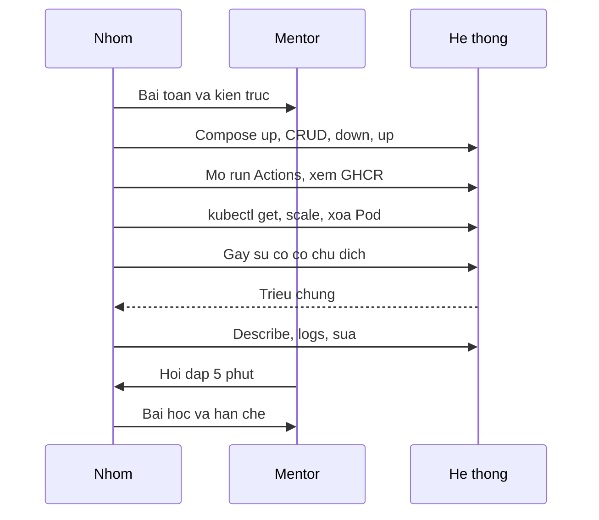

# Kịch bản mentor – Buổi 32: Final Demo & Review

::: warning Dành cho mentor
Trang này dành cho người dạy; học viên không cần đọc. Bài học viên: [Buổi 32 – Final Demo & Review](../../labs/week-16/session-32.md). Slide: [Slide buổi 32](../../slides/08-capstone/session-32.md). Đáp án: [Walkthrough tuần 16](../walkthroughs/week-16.md). Chấm bài: [Chấm bài tuần 16](../grading/week-16.md).
:::

> **Tóm tắt:** Kịch bản dạy buổi 32: lịch các nhóm, demo mẫu của mentor, sự cố do mentor chọn, câu hỏi cho lớp và ghi chú giảng viên theo từng slide. Nội dung chuyển nguyên văn từ bài lab và slide cũ.

## Khung thời gian buổi

Mỗi buổi 120 phút: 15' ôn tập, 30' kiến thức và demo, 60' thực hành, 15' review. Buổi thứ hai của tuần dồn vào thực hành, thử thách L2 và review bài làm.

Lab 60 phút này gồm các lượt demo của từng nhóm. Với 4 nhóm, mỗi nhóm có khoảng 15 phút (10 demo, 5 hỏi đáp). Với 5 nhóm, lịch trong [Milestones](../../assignments/capstone/milestones.md) dành 75 phút cho demo; nếu đông hơn, chia hai phòng với hai mentor. Phần chuẩn bị trạng thái sạch diễn ra trong 15 phút đầu của buổi (thay cho phần ôn tập). Các nhóm không đang demo đóng vai reviewer.

Cấu trúc một lượt demo 10 phút và 5 phút hỏi đáp (phân bổ phút khớp bảng phút trong [demo-guide](../../assignments/capstone/demo-guide.md)): kiến trúc 1, Git 1,5, Compose 1,5, CI/CD 1,5, Kubernetes 2, sự cố 1,5, bài học 1; sau đó hỏi đáp 5 phút và bài học, hạn chế của nhóm.



Phân bổ gợi ý theo ghi chú slide: mở buổi 2 phút, vấn đề thực tế 2 phút, demo tốt và kém 2 phút, bảo vệ kỹ thuật 2 phút, bằng chứng 2 phút, luồng commit tới người dùng 2 phút, ba phần demo mẫu của mentor 3 phút mỗi phần (khoảng 10 phút tổng cho lượt mẫu), lab chuẩn bị và preflight 15 phút đầu buổi, hỏi đáp và peer review 10 phút ở cuối.

## Demo của mentor

Mentor demo một lượt mẫu bằng starter-project (hoặc repo mẫu của mentor) trong khoảng 10 phút để lớp thấy nhịp độ. Giả định đang ở thư mục gốc repo, đã có file `.env` với `DB_PASSWORD` và `WEB_PORT`.

**Bước 1. Trạng thái sạch rồi chạy Compose**

```bash
docker compose up -d --build
docker compose ps
curl -s http://localhost:3000/health
```

Kết quả mong đợi (rút gọn): ba service `frontend`, `backend`, `postgres` ở trạng thái `running`, `postgres` là `healthy`; lệnh `curl` trả về JSON báo trạng thái ok.

Câu hỏi cho lớp: "Backend gọi PostgreSQL bằng tên gì, vì sao tên đó phân giải được?" (Đáp: `postgres`, DNS nội bộ của network `club-network`.)

**Bước 2. Chứng minh dữ liệu bền**

```bash
docker compose down
docker compose up -d
curl -s http://localhost:3000/api/members
```

Kết quả mong đợi: danh sách thành viên vẫn còn vì volume `postgres-data` không bị xóa.

Câu hỏi cho lớp: "Nếu tôi chạy `docker compose down -v` thì sao?" (Đáp: volume bị xóa, dữ liệu mất, `init.sql` chạy lại lần sau.)

**Bước 3. Kubernetes: scale và tự phục hồi**

```bash
kubectl get pods -n club
kubectl scale deployment club-api -n club --replicas=3
kubectl rollout status deployment/club-api -n club
kubectl scale deployment club-api -n club --replicas=2
kubectl delete pod -n club -l app=club-api --wait=false
kubectl get pods -n club -w
```

Kết quả mong đợi: sau scale thấy 3 Pod `club-api` `Running`; sau khi xóa Pod, các Pod mới xuất hiện và về `Running`. Dừng `-w` bằng Ctrl+C.

Câu hỏi cho lớp: "Ai tạo ra Pod mới? Nếu tôi xóa Deployment thay vì Pod thì sao?" (Đáp: ReplicaSet do Deployment quản lý.)

**Bước 4. Sự cố có chủ đích: sai tag image**

```bash
kubectl set image deployment/club-api api=club-api:does-not-exist -n club
kubectl get pods -n club
kubectl describe pod -n club -l app=club-api
kubectl rollout undo deployment/club-api -n club
```

Kết quả mong đợi: Pod mới ở `ErrImagePull` rồi `ImagePullBackOff`, Pod cũ vẫn phục vụ nhờ rolling update; phần Events của `describe` có thông báo không kéo được image. Sau `rollout undo`, mọi Pod về `Running`.

Câu hỏi cho lớp: "Vì sao người dùng chưa thấy lỗi?" và "Làm sao biết tên container `api` mà không đoán?" (Đáp: `kubectl get deployment club-api -n club -o jsonpath='{.spec.template.spec.containers[*].name}'`.)

Sau demo, mentor nhận xét theo ba mục: điều làm tốt, rủi ro chính, một việc nên làm tiếp, đúng như sẽ làm với các nhóm.

## Sự cố do mentor chọn

Mentor chọn một trong các sự cố dưới đây cho mỗi nhóm; nhóm không được biết trước. Mentor chuẩn bị lệnh gây lỗi sẵn.

| Sự cố do mentor chọn | Cách gây | Hướng xử lý |
| --- | --- | --- |
| Sai tag image | `kubectl set image` với tag không tồn tại | `describe pod`, events, `rollout undo` |
| Sai mật khẩu DB | Sửa giá trị trong Secret rồi `rollout restart` backend | Pod mới `0/1`; `kubectl logs` của Pod mới (Pod cũ vẫn phục vụ), so sánh Secret và biến môi trường |
| Readiness fail | Sửa đường dẫn probe sai | `describe pod`, `kubectl get endpoints backend -n club` (thiếu Pod mới) |

Với sai mật khẩu, nhắc nhóm xem log của Pod mới chứ không phải Pod cũ. Quá 2 phút chưa xong thì chuyển sang video dự phòng và giải thích. Bảng chẩn đoán nhanh và mục tiêu dưới 2 phút mỗi sự cố nằm ở [Walkthrough tuần 16](../walkthroughs/week-16.md).

## Câu hỏi mentor nên hỏi lớp

- Nếu mai CLB giao dự án này cho khóa sau, họ cần gì để tiếp quản? (dẫn vào ý "bằng chứng thay cho lời kể")
- Backend gọi PostgreSQL bằng tên gì, vì sao phân giải được? Nếu chạy `down -v` thì sao?
- Ai tạo ra Pod mới? Nếu xóa Deployment thay vì Pod thì sao?
- Vì sao người dùng chưa thấy lỗi khi rolling update gặp tag sai? Làm sao biết tên container `api` mà không đoán?
- Image trên kind đến từ đâu? (hỏi một thành viên bất kỳ; nhắc: trên kind của lab, image có thể nạp bằng `kind load docker-image`)
- Dữ liệu nằm trong container hay trong volume? (cho tình huống `down -v`)
- Hỏi đáp kỹ thuật 5 phút: khác nhau giữa liveness và readiness; `down` và `down -v`; Secret có thực sự bí mật không. Ví dụ câu hỏi "vì sao": "Image cuối chứa gì và không chứa gì, vì sao chọn vậy?" Danh sách đầy đủ ở mục 6 của [demo-guide](../../assignments/capstone/demo-guide.md).

Hỏi đáp kỹ thuật: mentor hỏi theo bài làm, chỉ định thành viên trả lời. Nhóm trả lời theo ba bước: kết luận, lý do, bằng chứng (lệnh hoặc file). Mentor hỏi vì sao thay vì hỏi là gì: không hỏi "Dockerfile của em có multi-stage không" mà hỏi "image cuối cùng chứa gì và không chứa gì, vì sao bạn chọn vậy". Mentor có thể chỉ định bất kỳ thành viên nào trả lời bất kỳ phần nào.

## Ghi chú giảng viên theo từng slide

Nguyên văn từ phần "Ghi chú giảng viên" của [Slide buổi 32](../../slides/08-capstone/session-32.md).

**Slide 1: Mục tiêu buổi học.** Mở buổi trong 2 phút. Công bố thứ tự các nhóm và lịch: 10 phút demo, 5 phút hỏi đáp mỗi nhóm. Nhóm không demo đóng vai reviewer.

**Slide 2: Vấn đề thực tế - bàn giao hệ thống.** Nói 2 phút. Câu hỏi: nếu mai CLB giao dự án này cho khóa sau, họ cần gì để tiếp quản? Dẫn vào ý "bằng chứng thay cho lời kể".

**Slide 3: Demo tốt và demo kém.** 2 phút. Nhấn mạnh dòng cuối: mentor đánh giá cao nhóm xử lý lỗi bình tĩnh hơn nhóm không bao giờ lỗi.

**Slide 4: Bảo vệ kỹ thuật và bằng chứng.** Ví dụ câu hỏi: "Image cuối chứa gì và không chứa gì, vì sao chọn vậy?" Danh sách câu hỏi đầy đủ ở mục 6 của demo-guide. 2 phút.

**Slide 5: Phát biểu và bằng chứng tương ứng.** Mỗi dòng là một điểm rubric. Yêu cầu nhóm chuẩn bị sẵn tab hoặc lệnh cho từng dòng. 2 phút.

**Slide 6: Luồng từ commit tới người dùng.** Đây là đường đi cần kể trong demo. Hỏi một thành viên bất kỳ: "image trên kind đến từ đâu?" Nhắc: trên kind của lab, image có thể nạp bằng `kind load docker-image`. 2 phút.

**Slide 7: Kịch bản 10 phút.** Phân bổ phút: kiến trúc 1, Git 1,5, Compose 1,5, CI/CD 1,5, Kubernetes 2, sự cố 1,5, bài học 1. Khớp bảng phút trong demo-guide.

**Slide 8: Demo mentor 1 - Compose và dữ liệu bền.** Hỏi lớp: "Backend gọi PostgreSQL bằng tên gì, vì sao phân giải được?" (Đáp: `postgres`, DNS nội bộ của network `club-network`.) Tiếp: "Nếu chạy `down -v` thì sao?" 3 phút.

**Slide 9: Demo mentor 2 - scale và tự phục hồi.** Hỏi: "Ai tạo ra Pod mới? Nếu xóa Deployment thay vì Pod thì sao?" (Đáp: ReplicaSet do Deployment quản lý.) 3 phút.

**Slide 10: Demo mentor 3 - sự cố sai tag image.** Hỏi: "Vì sao người dùng chưa thấy lỗi?" và "Làm sao biết tên container `api` mà không đoán?" Đáp: `kubectl get deployment club-api -n club -o jsonpath='{.spec.template.spec.containers[*].name}'`. Sau demo, nhận xét mẫu theo ba mục: điều tốt, rủi ro chính, một việc nên làm tiếp.

**Slide 11: Lab Phần 1 - chuẩn bị trạng thái sạch.** 15 phút đầu buổi thay cho phần ôn tập. Đi quanh các nhóm kiểm tra context. Lỗi hay gặp: `kubectl` trỏ nhầm cluster, dùng `kubectl config use-context` để sửa.

**Slide 12: Lab Phần 1 - preflight cổng và Docker.** Mỗi nhóm thống nhất trạng thái xuất phát. Namespace `club` có thể báo `NotFound` đúng với lựa chọn (a). 5 phút.

**Slide 13: Lab Phần 1 - phân vai và dự phòng.** Cho nhóm 3 phút chia vai. Nhắc: mentor có thể chỉ định bất kỳ ai trả lời bất kỳ phần nào, nên phân vai không có nghĩa chỉ hiểu phần của mình.

**Slide 14: Lab Phần 2 - demo trực tiếp 10 phút.** Bấm giờ từng nhóm và giơ thẻ nhắc còn 2 phút. Với 4 nhóm, mỗi nhóm khoảng 15 phút kể cả hỏi đáp; đông hơn thì chia hai phòng.

**Slide 15: Sự cố do mentor chọn.** Mentor chuẩn bị lệnh gây lỗi sẵn. Với sai mật khẩu, nhắc nhóm xem log của Pod mới chứ không phải Pod cũ. Quá 2 phút chưa xong thì chuyển sang video dự phòng và giải thích.

**Slide 16: Lab Phần 3 và 4 - hỏi đáp, peer review.** Nhận xét tốt nêu hành vi quan sát được, không đánh giá con người. Ví dụ tốt: "Bạn A mở PR số 12 sửa probe". Ví dụ kém: "Bạn A làm việc không tích cực". 10 phút.

**Slide 17: Phá lỗi và debug - mất dữ liệu trước demo.** So với scenario-04. Đây là tình huống sai lầm dễ xảy ra nhất. Câu hỏi cho lớp: dữ liệu nằm trong container hay trong volume? 3 phút.

**Slide 18: Lỗi thường gặp khi demo.** Cho các nhóm đọc bảng trong lúc chờ lượt. Nhấn mạnh: không sửa vội trên `main` ngay trước demo.

**Slide 19: Challenge (L2) - failure injection tự chọn.** Tên `postgres-0` giả định StatefulSet tên `postgres`, lấy tên thật từ `kubectl get pods`. Đề xuất cụ thể như "thêm quét lỗ hổng image vào CI, fail khi có Critical" tốt hơn "cải thiện bảo mật".

**Slide 20: Recap.** Kết thúc khóa học: cảm ơn các nhóm, thu feedback về khóa học (đưa vào đề xuất cải tiến). Nhắc không commit `.env`, password hay Secret thật trong bài nộp.

## Lưu ý riêng cho người dạy

- Demo mẫu 10 phút của mentor dùng starter-project; chạy thử trước buổi để không vấp chính các lỗi đã nêu cho học viên (cổng 8080 bận, sai context).
- Nếu một lệnh bất ngờ lỗi trước mặt mentor, đánh giá theo quy trình: nói to điều thấy, đọc log và events, nêu giả thuyết, kiểm chứng. Quá 2 phút chưa xong thì nhóm phải nói rõ và chuyển sang video dự phòng; không xóa sạch làm lại mà không giải thích nguyên nhân.
- Peer review chỉ mentor đọc và dùng để quy điểm nhóm về điểm cá nhân; nhắc học viên không đưa vào repo công khai. Nhận xét của mentor được học viên chép vào mục "Có thể cải thiện gì" của `report.md`.
- Tiêu chí liên quan trong [Rubric Capstone](../../curriculum/capstone-rubric.md): 7 (Troubleshooting) và 10 (Demo và technical defense).
