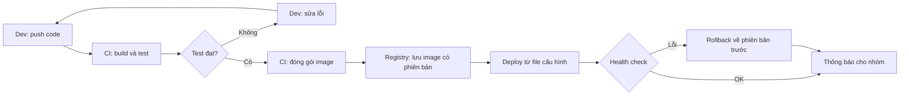

# Walkthrough tuần 1 – DevOps Workflow và môi trường phát triển

::: warning Dành cho mentor và học viên đã nộp bài
Trang này là đáp án đối chiếu: mentor dùng để chấm, học viên chỉ mở sau khi đã nộp bài của mình.
:::

> **Tóm tắt:** Hướng dẫn giải Buổi 01 (vẽ workflow triển khai, tìm điểm nghẽn) và Buổi 02 (WSL2, Git, SSH, check-env.sh), kèm đáp án bài tập tuần 1 và hướng dẫn chấm cho mentor.

## Cách dùng tài liệu này

Tài liệu được công bố sau khi tuần 1 kết thúc. Hãy tự làm bài lab và bài tập trước, rồi mới đối chiếu. Mục đích là so sánh cách nghĩ của bạn với cách nghĩ trong lời giải, không phải để chép.

- Phần "Đáp án L1" cho thấy kết quả cần đạt và các lệnh quan trọng. Output của bạn có thể khác về số phiên bản, tên người dùng, mã commit.
- Phần "Lời giải L2" giải thích vì sao chọn cách đó. Thường có nhiều cách đúng; nếu cách của bạn khác nhưng thỏa tiêu chí hoàn thành thì vẫn đạt.
- Ví dụ trong tài liệu dùng dữ liệu mẫu. Bài nộp của bạn phải có số liệu, sơ đồ và log của riêng bạn; mentor sẽ hỏi vấn đáp để kiểm tra.
- Các bước chạm tới máy thật của bạn (WSL, GitHub, BIOS) không thể trả lời bằng "đáp án chung". Tài liệu chỉ nêu kết quả cần thấy và cách chẩn đoán.

Bài lab liên quan: [Buổi 01](../../labs/week-01/session-01.md), [Buổi 02](../../labs/week-01/session-02.md). Bài tập tuần: [Bài tập tuần 1](../../assignments/weekly/week-01.md).

### Buổi 01 – DevOps Introduction

#### Đáp án L1

Mục tiêu của buổi là nhìn một quy trình như chuỗi bước "ai làm, nhận gì, tạo ra gì", rồi tìm bước đau nhất.

**Chuẩn bị.** Sau khi clone repo trống và tạo thư mục, `ls lab-01` in `evidence  screenshots  source`. Hai lệnh `git config` không có `--global` chỉ áp dụng cho repo này.

**Phần 1 – `steps.md`.** Một bảng mẫu đạt yêu cầu (đủ 6 cột theo bài tập, 9 dòng):

```markdown
| Bước | Ai làm | Đầu vào | Đầu ra | Rủi ro | Tự động hóa được không |
| --- | --- | --- | --- | --- | --- |
| 1. Viết code | Dev | Yêu cầu từ ban chủ nhiệm | Source code trên laptop | Code chỉ chạy trên máy của Dev | Không, đây là việc sáng tạo |
| 2. Commit | Dev | Source code | Commit trong Git | Quên commit file cấu hình, lịch sử mơ hồ | Một phần: pre-commit hook |
| 3. Build | Dev | Source code, dependency | Thư mục build | Build trên máy có Node.js khác bản với server | Có: build trong CI |
| 4. Test | Dev | Bản build | Kết quả pass hoặc fail | Quên chạy test, chỉ test bằng mắt | Có: CI chạy test mỗi lần push |
| 5. Đóng gói | Dev | Bản build | File nén gửi đi | Thiếu file, nén nhầm cả node_modules | Có: đóng gói thành image |
| 6. Gửi lên server | Dev | File nén | File nằm trên server | Gửi nhầm phiên bản cũ qua chat | Có: đẩy lên registry |
| 7. Cấu hình biến môi trường | Ops | Tài liệu miệng, DB_PASSWORD | Biến môi trường trên server | Quên đặt DB_PASSWORD, app không kết nối được database | Có: file .env.example và compose |
| 8. Chạy ứng dụng | Ops | File đã giải nén, biến môi trường | Process Node.js đang chạy | Chạy sai lệnh hoặc sai phiên bản Node.js | Có: deploy từ file cấu hình |
| 9. Kiểm tra health | Ops | Ứng dụng đang chạy | Kết quả của health check | Chỉ kiểm tra bằng cách mở trình duyệt, bỏ sót lỗi database | Có: health check tự động |
```

Kiểm tra số dòng: `grep -c '^|' lab-01/source/steps.md` in `11` (9 dòng bước cộng dòng tiêu đề và dòng phân cách). Nếu bạn viết đúng 9 bước mà thấy `9` là bạn đã thiếu dòng.

**Phần 2 – sơ đồ thủ công.** Dùng đúng đoạn trong bài lab. Sơ đồ có 9 nút (A đến I) và một vòng lặp lỗi từ "Hỏi lại dev" về "Cài dependency". Mọi nhãn nằm trong nháy kép. Sơ đồ phải xem được trên mermaid.live; ảnh chụp chỉ lấy phần sơ đồ.

**Phần 3 – ba điểm nghẽn.** Chọn theo bốn dấu hiệu của bài lab. Ví dụ truy ngược về `steps.md`:

```markdown
# Ba điểm nghẽn

1. Bước 7 (cấu hình biến môi trường): phụ thuộc trí nhớ của một người. Giải pháp: file .env.example nằm trong Git và compose.yaml đòi DB_PASSWORD.
2. Bước 3 (build trên server): dễ sai khi làm tay vì lệch phiên bản Node.js. Giải pháp: build image trong CI, mọi nơi chạy cùng một image.
3. Bước 6 (gửi file qua chat): chờ người khác và dễ nhầm phiên bản. Giải pháp: registry lưu image có phiên bản.
```

**Phần 4 – workflow tự động.** Sơ đồ mẫu, đã thay ba điểm nghẽn bằng bước tự động và thêm hai bước tự bổ sung (rollback, thông báo):



**Phần 5 – bằng chứng.** Chạy lại khối lệnh ở Phần 5 sau khi đã viết xong README và report, để `ls -R` phản ánh trạng thái cuối. Kiểm tra bằng `cat lab-01/evidence/command-output.txt` rằng file không rỗng. Số dòng `.mmd` của bạn sẽ khác bài mẫu.

**Commit.** `git push -u origin HEAD` đẩy nhánh hiện tại và đặt upstream. Nếu bị hỏi đăng nhập, dùng Git Credential Manager, không dán token vào file nào.

**Checklist L1, câu cuối.** Khác biệt Continuous Delivery và Continuous Deployment: ở Delivery, bản đã qua test luôn sẵn sàng nhưng bước phát hành cuối do người bấm duyệt; ở Deployment, bản qua test được triển khai tự động. Với CLB giai đoạn đầu, Delivery an toàn hơn vì chưa có đủ test để tin tưởng hoàn toàn.

#### Lời giải L2

Đề bài: đề xuất workflow cho một dự án CLB thật. Cách tiếp cận nên đi theo thứ tự này:

1. Đo trước, đề xuất sau. Ghi lại lần deploy gần nhất theo từng phút (chuẩn bị, gửi file, cài, chạy, sửa lỗi). Bước tốn nhiều phút nhất là ứng viên điểm nghẽn.
2. Mỗi điểm nghẽn có một con số và nói rõ cách ước lượng ("tự đo lần deploy hôm thứ Ba", "đếm số lần nhóm hỏi lại về token trong chat tuần trước").
3. Chọn giải pháp nhỏ nhất giải quyết được vấn đề. Một workflow chạy test mỗi lần push đã đáng giá hơn việc nói tới Kubernetes.
4. Tra `curriculum/syllabus.md` để ghi đúng buổi dạy công cụ (Docker ở giai đoạn Docker, GitHub Actions ở giai đoạn CI/CD). Không ghi công cụ chưa có trong khóa.
5. Nêu rủi ro của chính tự động hóa (pipeline hỏng thì ai sửa, secret nằm trong CI) và gắn tên người chịu trách nhiệm.
6. Hai chỉ số đo, ví dụ thời gian từ commit đến bản mới chạy được và số lần deploy phải làm lại. Nói rõ lấy số từ đâu (lịch sử commit, log CI).

Ví dụ rút gọn cho ứng dụng điểm danh:

| Điểm nghẽn | Số liệu và cách ước lượng | Tự động hóa | Dạy ở |
| --- | --- | --- | --- |
| Deploy tay qua SSH | 15 phút, 2 lần mỗi tuần, tự bấm giờ lần gần nhất | Đóng gói bằng container, deploy một lệnh | Giai đoạn Docker |
| Lỗi chỉ biết khi người dùng báo | 1 lỗi mỗi tuần, đếm từ nhóm chat | CI chạy test mỗi lần push | Giai đoạn CI/CD |
| Token nằm trên máy một người | Mất máy là ngừng dịch vụ | Biến môi trường, không commit secret | Giai đoạn Docker và Compose |

Có nhiều cách đúng: bạn có thể chọn điểm nghẽn khác miễn là có số liệu và cách đo. Cách sai phổ biến là liệt kê công cụ mà không chỉ ra đau ở đâu.

#### Lời giải phần Phá lỗi và debug

**Tình huống 1 – sơ đồ Mermaid không hiển thị.**

Cây điều tra:

1. Triệu chứng: mermaid.live báo "Syntax error in text". Ghi lại số dòng.
2. Thu hẹp: xóa lần lượt các dòng gần vị trí lỗi cho tới khi sơ đồ vẽ được. Dòng cuối cùng làm hỏng là thủ phạm.
3. Soi ký tự đặc biệt trong nhãn: ngoặc tròn, ngoặc vuông, dấu hai chấm.
4. Nguyên nhân gốc: ngoặc là ký hiệu hình dạng của nút trong cú pháp Mermaid. Nhãn `F[Ops: chạy (production) ứng dụng]` làm bộ phân tích hiểu sai cấu trúc.

Sửa: đặt nhãn trong nháy kép.

```text
    E --> F["Ops: chạy (production) ứng dụng"]
```

Phòng tránh: luôn đặt nhãn trong nháy kép, xem trước trước khi commit, giữ sơ đồ trong Git để quay lại bản đang chạy được.

**Tình huống 2 – đúng trên giấy, sai ngoài thực tế.** Bạn cùng bàn dừng lại hỏi "chạy bằng lệnh nào, Node bản mấy, mật khẩu database ở đâu". Mỗi câu hỏi là một thông tin ngầm chưa được viết ra (tribal knowledge). Cây điều tra: ghi lại mọi câu hỏi, phân loại (lệnh, phiên bản, secret, thứ tự), rồi đưa từng câu trả lời vào file nằm trong Git (README, `compose.yaml`, `.env.example`). Đó là bước đầu của IaC.

#### Những hiểu lầm hay gặp

- "DevOps là Docker và Kubernetes": đó là công cụ. Cốt lõi là cộng tác, tự động hóa, đo lường, phản hồi.
- "DevOps là một người làm hết": vai trò DevOps Engineer có thật, nhưng DevOps là cách làm việc của cả đội.
- Nhầm Delivery với Deployment: khác nhau ở chỗ có người duyệt bước cuối hay không, không phải ở chỗ có tự động hay không.
- Vẽ sơ đồ chỉ có hộp và mũi tên, không ghi ai làm. Sơ đồ như vậy che mất khoảng trống chứ không làm lộ ra.
- Chọn công cụ trước khi nêu điểm nghẽn.
- Tính chi phí sai đơn vị: 15 lần mỗi ngày nhân 10 phút nhân 5 ngày là 750 phút, tức 12,5 giờ mỗi tuần (chia 60, không phải chia 100).

### Buổi 02 – Development Environment

#### Đáp án L1

**Phần 1 – cài WSL2.** Trong PowerShell chạy bằng quyền Administrator: `wsl --install -d Ubuntu-24.04`, khởi động lại máy, tạo user Linux. Kiểm tra bằng:

```powershell
wsl --list --verbose
```

Kết quả cần thấy (tên distro có thể khác nếu `wsl --list --online` đưa ra tên khác):

```text
  NAME            STATE           VERSION
* Ubuntu-24.04    Running         2
```

Nếu VERSION là 1: `wsl --set-version Ubuntu-24.04 2`. Trong Ubuntu, `lsb_release -a` phải hiện `Ubuntu 24.04.x LTS`.

**Phần 2 – thư mục và VS Code.** `pwd` trong `~/devops-labs/lab-02` phải in `/home/TEN_BAN/devops-labs/lab-02`, không bắt đầu bằng `/mnt/c`. `code .` mở VS Code với nhãn "WSL: Ubuntu-24.04" ở góc dưới trái. Trong terminal tích hợp, `uname -a` chứa `microsoft-standard-WSL2`; đó là cách chứng minh terminal đang chạy trong Linux.

**Phần 3 – Git và SSH.** Lệnh cấu hình Git theo bài lab. Điểm cần hiểu: `core.autocrlf input` đổi CRLF thành LF khi commit, tránh lỗi `\r: command not found` cho script. Tạo key bằng `ssh-keygen -t ed25519 -C "email"`, nạp vào agent bằng `ssh-add`, dán nội dung file `.pub` (chỉ file `.pub`) lên GitHub. `ssh -T git@github.com` phải in dòng "Hi TEN_GITHUB! You've successfully authenticated, but GitHub does not provide shell access." Lệnh này thoát với mã 1, đó là bình thường.

Remote phải dùng SSH:

```bash
git remote -v
```

```text
origin  git@github.com:TEN_GITHUB/devops-labs.git (fetch)
origin  git@github.com:TEN_GITHUB/devops-labs.git (push)
```

**Phần 4 – `check-env.sh`.** Dùng đúng script trong bài lab. Chạy và lấy mã thoát đúng cách:

```bash
cd ~/devops-labs/lab-02
./source/check-env.sh > evidence/command-output.txt 2>&1
code=$?
echo "exit code: $code" >> evidence/command-output.txt
cat evidence/command-output.txt
```

Tuần 1, chưa cài Docker nên dòng `THIEU docker     chua cai` và `exit code: 1` là trạng thái đúng. Sau Buổi 07 (cài Docker) mã thoát phải thành 0. Điểm mấu chốt: `$?` phải đọc ngay sau lệnh chạy script; nếu viết `./check-env.sh | tee log` rồi đọc `$?` thì đó là mã thoát của `tee` (luôn 0) và log ghi sai.

Phần xác minh còn lại nối thêm vào evidence:

```bash
{ lsb_release -a; uname -r; git --version; ssh -T git@github.com; } >> evidence/command-output.txt 2>&1
```

Dòng `wsl --list --verbose` phải dán tay từ PowerShell vì nó chạy ngoài Ubuntu. Đây là ngoại lệ duy nhất cho nguyên tắc "log không gõ tay"; mentor sẽ hỏi vấn đáp để kiểm tra.

#### Lời giải L2

**Thử thách 1 – script kiểm tra đầy đủ.** Cách tiếp cận: mở rộng hàm `check` để đếm thay vì chỉ đặt cờ, thêm kiểm tra quyền key, và để kiểm chứng an toàn thì cho phép đổi đường dẫn key bằng biến môi trường (tránh phải đổi quyền key thật đang dùng để push):

```bash
#!/usr/bin/env bash
set -u
missing=0
check() {
  if command -v "$2" >/dev/null 2>&1; then
    printf 'OK    %-8s %s\n' "$1" "$($2 "${3:---version}" 2>&1 | head -n 1)"
  else
    printf 'THIEU %-8s\n' "$1"; missing=$((missing+1))
  fi
}
check git git; check curl curl; check ssh ssh -V
check node node; check npm npm; check make make
key="${KEY_FILE:-$HOME/.ssh/id_ed25519}"
if [ -f "$key" ]; then
  perm=$(stat -c '%a' "$key")
  if [ "$perm" != "600" ]; then
    echo "LOI: quyen $key la $perm, can 600"; missing=$((missing+1))
  else
    echo "OK    quyen key 600"
  fi
fi
echo "Tong ket: $missing van de"
[ "$missing" -eq 0 ] || exit 1
```

Kiểm chứng: tạo key thử nghiệm (`ssh-keygen -t ed25519 -f /tmp/test_key -N ""`), chạy `KEY_FILE=/tmp/test_key ./check-env-full.sh` ở trạng thái 600, rồi `chmod 644 /tmp/test_key` và chạy lại: phải in `LOI: quyen ... la 644, can 600`, tăng số vấn đề và thoát mã 1. Khôi phục bằng `chmod 600 /tmp/test_key` rồi xóa key thử nghiệm. Vì sao dùng `stat -c '%a'`: cho giá trị quyền dạng số, dễ so sánh. Lưu ý `stat` trên `/mnt/c` không phản ánh quyền Linux thật, một lý do nữa để để key trong `~/.ssh`.

**Thử thách 2 – dotfiles chạy lặp an toàn.** Cách tiếp cận: để alias trong file riêng (`bash_aliases`, Ubuntu mặc định nạp `~/.bash_aliases` từ `.bashrc`), `install.sh` tạo symlink và chỉ làm việc khi cần:

```bash
#!/usr/bin/env bash
set -eu
dir="$(cd "$(dirname "$0")" && pwd)"
src="$dir/bash_aliases"
target="$HOME/.bash_aliases"
if [ -L "$target" ] && [ "$(readlink "$target")" = "$src" ]; then
  echo "da ton tai: $target"
  exit 0
fi
if [ -e "$target" ] || [ -L "$target" ]; then
  bak="$target.bak.$(date +%Y%m%d%H%M%S)"
  mv "$target" "$bak"
  echo "da sao luu: $bak"
fi
ln -s "$src" "$target"
echo "da tao symlink: $target -> $src"
```

Lần chạy đầu: sao lưu file cũ (nếu có) rồi tạo symlink. Lần hai: in `da ton tai`, không làm gì, nên không nhân đôi nội dung. Lý do tách file thay vì `cat >> ~/.bashrc`: ghi nối vào `.bashrc` sẽ nhân đôi mỗi lần chạy. Cách khác: dùng `grep -q` kiểm tra khối đã có trước khi ghi nối.

**Thử thách 3 – giải thích bằng lời.** Ý chính cần có: `~` là ext4 nên nhanh với nhiều file nhỏ (`npm install`, `git status`), `chmod` hoạt động đúng, ít lỗi xuống dòng; `/mnt/c` đi qua lớp 9P nên chậm và quyền file không đúng nghĩa Linux. Với SSH: private key ở lại máy, GitHub chỉ giữ public key và thử thách máy bạn; ssh-agent giữ key đã mở khóa nên không gõ lại passphrase; không có mật khẩu nào bay qua mạng và key có thể thu hồi riêng từng máy.

#### Lời giải phần Phá lỗi và debug

**Tình huống – quyền file key quá rộng.**

Bước phá: `ssh-add -D` (gỡ key khỏi agent, nếu không agent vẫn dùng bản đã nạp và bạn không thấy lỗi), `chmod 644 ~/.ssh/id_ed25519`, `ssh -T git@github.com`.

Cây điều tra:

1. Đọc thông báo: "Permissions 0644 ... are too open" và "This private key will be ignored".
2. `ls -l ~/.ssh` xem quyền thực tế.
3. `ssh -vT git@github.com` xem SSH thử key nào và vì sao bỏ qua.
4. Loại trừ khả năng key nằm trong `/mnt/c` (chmod không có tác dụng như Linux).
5. Nguyên nhân gốc: SSH từ chối private key mà người khác trong hệ thống đọc được, vì đó là rủi ro bảo mật. Lỗi cuối `Permission denied (publickey)` chỉ là hệ quả.

Sửa:

```bash
chmod 700 ~/.ssh
chmod 600 ~/.ssh/id_ed25519
ssh-add ~/.ssh/id_ed25519
ssh -T git@github.com
```

Phòng tránh: tạo key trong `~/.ssh` của WSL, đưa kiểm tra quyền vào `check-env.sh`.

**Tình huống bổ sung – ảo hóa chưa bật.** Lỗi `0x80370102`: mở Task Manager, tab Performance, CPU, đọc dòng Virtualization. Nếu Disabled, vào BIOS/UEFI bật Intel VT-x hoặc AMD SVM, lưu và khởi động lại. Nếu đã bật mà vẫn lỗi, kiểm tra Virtual Machine Platform đã bật chưa.

#### Những hiểu lầm hay gặp

- Để mã nguồn trong `/mnt/c` vì "dễ mở bằng Explorer". Cách đúng: để trong `~`, cần xem từ Windows thì mở `\\wsl$\Ubuntu\home\TEN_BAN`.
- Dán private key (file không đuôi) lên GitHub hoặc commit nó vào repo. Chỉ file `.pub` được chia sẻ.
- Tưởng mã thoát 1 của `ssh -T` là lỗi. GitHub không cấp shell nên luôn thoát 1; điều cần xem là dòng "successfully authenticated".
- Đọc `$?` sau `| tee` và ghi log `exit code: 0` sai.
- Nhầm terminal, shell, bash: terminal là cửa sổ, shell là chương trình đọc lệnh, bash là một loại shell.
- Quên `apt update` trước `apt install`, hoặc nghĩ `apt update` là nâng cấp phần mềm (nó chỉ làm mới danh sách gói).

### Bài tập tuần

#### Gợi ý lời giải nhiệm vụ L1

**Nhiệm vụ 1.** Dùng bảng mẫu ở Buổi 01. Chỗ hay thiếu: cột Rủi ro phải nêu lỗi cụ thể ("quên đặt DB_PASSWORD nên backend không kết nối được PostgreSQL"), không ghi chung chung như "dễ sai". Tám bước bắt buộc: commit, build, test, đóng gói, gửi lên server, cấu hình biến môi trường, chạy ứng dụng, kiểm tra `/health`. Bằng chứng: `grep -c '^|' lab-01/source/steps.md` (số đếm gồm cả dòng tiêu đề và phân cách).

**Nhiệm vụ 2.** Tên nút có tiền tố `Dev:` hoặc `Ops:`; có vòng lặp lỗi; đúng 3 điểm nghẽn. Mỗi điểm nghẽn ghi số bước trong `steps.md`, dấu hiệu (một trong bốn dấu hiệu) và hướng tự động hóa. Điểm nghẽn không truy ngược được về bảng là lỗi bị trừ.

**Nhiệm vụ 3.** Bảng ánh xạ trong `report.md`, ví dụ:

| Điểm nghẽn (số bước) | Nút thay thế trong sơ đồ mới | Vì sao |
| --- | --- | --- |
| Cấu hình biến môi trường (bước 7) | Deploy từ file cấu hình | Cấu hình nằm trong file `.env.example` và Compose, không nằm trong trí nhớ |
| Build trên server (bước 3) | CI: build và test, CI: đóng gói image | Mọi nơi chạy cùng một image |
| Gửi file qua chat (bước 6) | Registry: lưu image có phiên bản | Artifact bất biến, có phiên bản |

Bước tự bổ sung (rollback hoặc thông báo) phải kèm lý do: rollback vì health check lỗi cần đường lui nhanh; thông báo vì nhóm cần biết phiên bản nào đang chạy.

**Nhiệm vụ 4.** Evidence cần có đủ sáu thứ: `wsl --list --verbose` (dán tay), `pwd`, `lsb_release -a`, `git config --global --list` (có `core.autocrlf=input`), `git remote -v`, `ssh -T git@github.com`. Một cách gom evidence:

```bash
{
  echo "### Nhiem vu 4 - vi tri lam viec"; pwd; realpath ~/devops-labs
  echo "### lsb_release"; lsb_release -a
  echo "### git config"; git config --global --list
  echo "### remote"; git -C ~/devops-labs remote -v
  echo "### ssh"; ssh -T git@github.com
} >> ~/devops-labs/lab-02/evidence/command-output.txt 2>&1
```

**Nhiệm vụ 5.** Script như bài lab. Thêm vào evidence kết quả `ls -l` và `file` của script: `file` không được báo "CRLF line terminators", `ls -l` có `x`. Giải thích trong `report.md` rằng `exit code: 1` do chưa cài Docker là trạng thái dự kiến và sẽ thành 0 sau Buổi 07.

Quét secret trước khi nộp (kết quả mong đợi: không in dòng nào):

```bash
cd ~/devops-labs
git ls-files | grep -E '(^|/)(id_ed25519|id_rsa|\.env)$'
grep -rIl "BEGIN OPENSSH PRIVATE KEY" . --exclude-dir=.git
```

#### Gợi ý lời giải nhiệm vụ L2

Thử thách A, B, C tương ứng lời giải L2 của Buổi 01 (đề xuất workflow) và Buổi 02 (script đầy đủ, dotfiles). Điểm riêng của bài tập: Thử thách B yêu cầu evidence gồm hai lần chạy (đúng và cố tình sai) trong cùng một log, dùng key thử nghiệm chứ không đổi quyền key thật, và ghi cách khôi phục. Thử thách C yêu cầu evidence hai lần chạy liên tiếp cùng `ls -l` của các symlink.

#### Đáp án 5 câu hỏi kiểm tra

1. DevOps không phải công cụ vì công cụ chỉ là phương tiện; không phải chức danh vì nó là văn hóa cộng tác, tự động hóa, đo lường, phản hồi của cả đội. Ví dụ: ở CLB, người viết code cũng tham gia viết `compose.yaml` và đọc log khi lỗi, thay vì ném code cho người giữ server.
2. Delivery: bản qua test luôn sẵn sàng, bước phát hành cuối do người duyệt. Deployment: bản qua test tự triển khai. Giai đoạn đầu chọn Delivery vì bộ test còn mỏng, cần người xác nhận trước khi tới người dùng.
3. 12 lần x 8 phút = 96 phút mỗi ngày; x 5 ngày = 480 phút, tức 8 giờ mỗi tuần. Tự động hóa bước deploy trước vì lặp nhiều nhất và tốn thời gian nhất.
4. Mã nguồn nằm ở `~` (ext4) nhanh và đúng quyền. Hậu quả nếu để ở `/mnt/c`: `npm install` và `git status` chậm hẳn vì đi qua lớp 9P với hàng chục nghìn file nhỏ; quyền file và xuống dòng sai, ví dụ script có CRLF gây lỗi `\r: command not found` hoặc `chmod 600` cho key không có tác dụng nên SSH từ chối key.
5. Ba điểm kiểm tra theo thứ tự: (1) đã dán đúng public key (`cat ~/.ssh/id_ed25519.pub`) lên GitHub chưa; (2) key đã nạp vào agent chưa (`ssh-add -l`, nếu không có thì `ssh-add ~/.ssh/id_ed25519`); (3) `ssh -vT git@github.com` xem key nào được thử, và `ls -l ~/.ssh/id_ed25519` xem quyền có đúng `-rw-------` không.

### Hướng dẫn chấm cho mentor

Dùng barem trong [bài tập tuần 1](../../assignments/weekly/week-01.md). Bảng dưới là gợi ý cách kiểm chứng nhanh bằng evidence và vấn đáp.

| Tiêu chí | Bằng chứng cần thấy trong evidence | Dấu hiệu bài chép hoặc không hiểu | Câu hỏi vấn đáp |
| --- | --- | --- | --- |
| steps.md (15 điểm) | Số dòng bảng đếm bằng grep từ 11 trở lên; đủ 6 cột; tám bước bắt buộc; rủi ro cụ thể | Rủi ro giống hệt bài lab hoặc bạn khác; ô ghi "tùy"; số cột không đủ | "Chọn một dòng và cho biết rủi ro đó từng xảy ra với bạn chưa?" "Vì sao bước này do Ops làm mà không phải Dev?" |
| Sơ đồ thủ công và điểm nghẽn (15 điểm) | File .mmd có vòng lặp lỗi, nhãn trong nháy kép; bottlenecks.md ghi số bước | Điểm nghẽn không khớp số bước; nhiều hơn hoặc ít hơn 3; sơ đồ khác bảng | "Điểm nghẽn bạn chọn thuộc dấu hiệu nào trong bốn dấu hiệu?" "Nếu bỏ vòng lặp lỗi, sơ đồ che mất điều gì?" |
| Sơ đồ tự động hóa (15 điểm) | Có CI build và test, cổng kiểm thử, registry có phiên bản, deploy từ cấu hình, health check, bước tự bổ sung; bảng ánh xạ trong report.md | Chỉ liệt kê công cụ; thiếu nhánh "không đạt"; bước bổ sung không có lý do | "Nếu health check lỗi thì điều gì xảy ra trong sơ đồ của bạn?" "Điểm nghẽn số 2 được giải quyết ở nút nào?" |
| Môi trường (20 điểm) | `wsl --list --verbose` VERSION 2; `pwd` hoặc `realpath` bắt đầu bằng `/home`; `core.autocrlf=input`; remote dạng `git@github.com:`; dòng "successfully authenticated" | Output có username GitHub không khớp tài khoản; không có `pwd`; remote HTTPS; nội dung dán từ máy khác | "Mở terminal và cho tôi xem bạn đang ở filesystem nào." "Vì sao `ssh -T` thoát mã 1 mà vẫn là thành công?" |
| check-env.sh (15 điểm) | Có `exit code:` đúng với trạng thái máy; `file` không báo CRLF; `ls -l` có `x` | Log ghi `exit code: 0` trong khi có dòng THIEU; log do gõ tay | "Vì sao đọc `$?` sau `tee` là sai?" "Vì sao `ssh` cần cờ `-V` mà không phải `--version`?" |
| README, report (10 điểm) | Đủ 7 câu; câu 1 đến 5 trả lời bằng lời riêng; ghi mức L1 hoặc L2 | Câu trả lời giống nguyên văn đề bài hoặc tài liệu | Chọn một câu kiểm tra và yêu cầu giải thích lại bằng ví dụ khác |
| Kỷ luật repo (5 điểm) | Lệnh quét secret không in dòng nào; không có file `.env`; commit message rõ nghĩa | Có private key, token, ảnh lộ thông tin cá nhân | "Làm sao bạn chắc không có secret trong repo?" |
| Quy trình nộp (5 điểm) | PR có hai nhận xét cụ thể của người review | Review chỉ ghi "OK"; push thẳng vào `main` | "Reviewer đã bắt được lỗi gì và bạn sửa thế nào?" |

Lưu ý chấm:

- Evidence do máy sinh ra có đặc điểm nhất quán: cùng tên máy, cùng phiên bản, thời gian hợp lý. Hai bài có output trùng từng ký tự (kể cả tên người dùng) gần như chắc chắn là chép.
- Bài chấp nhận trường hợp docker thiếu: mã thoát 1 là đúng ở tuần này. Trừ điểm khi mã thoát 0 mà log vẫn có `THIEU`.
- Điểm L2 chỉ cộng khi L1 đạt từ 60. Với Thử thách B, kiểm tra evidence có hai lần chạy và dùng key thử nghiệm.
- Ảnh chụp chỉ bổ trợ; bài chỉ có ảnh mà thiếu log text nhận 0 cho tiêu chí đó.

### Bổ sung sau khi cải tổ bài học

Phần này bổ sung các ý đã được chuyển ra khỏi bài học viên, để không mất nội dung.

**Ví dụ L2 Buổi 01 thứ hai (bot Discord của CLB).** Đây là ví dụ rút gọn từng nằm trong bài lab, cùng cách tiếp cận với ví dụ ứng dụng điểm danh ở trên:

| Điểm nghẽn | Số liệu ước lượng | Tự động hóa | Học ở |
| --- | --- | --- | --- |
| Deploy tay qua SSH | 15 phút, 2 lần mỗi tuần | Đóng gói bằng container, deploy bằng một lệnh | Giai đoạn Docker |
| Không có test, lỗi phát hiện khi người dùng báo | 1 lỗi mỗi tuần | CI chạy test mỗi lần push | Giai đoạn CI/CD |
| Cấu hình token nằm trong máy một người | Mất token là ngừng bot | Biến môi trường, không commit secret | Giai đoạn Docker, Compose |

Chỉ số đo: thời gian từ commit đến bot chạy bản mới, số lần deploy phải làm lại. Rủi ro: pipeline hỏng thì cả nhóm không phát hành được, cần ít nhất 2 người biết sửa.

**Bản `check-env.sh` rút gọn tự viết (Buổi 02, thử thách L2).** Bài lab cũ yêu cầu mọi học viên tự viết script; nay L1 chạy `resources/check-env.sh` có sẵn và tự viết là L2. Bản rút gọn và giải thích `set -u`, `chmod +x`, cờ `-V` của `ssh` nằm ở [Buổi 02 – Thử thách thêm](../../labs/week-01/session-02-challenge.md). Lời giải L2 ở trên (có `KEY_FILE`) vẫn là đáp án tham khảo cho Thử thách 1.

**Phá lỗi quyền key: dùng khóa thử.** Bài học viên giờ tạo khóa thử rồi phá quyền của nó, thay vì `ssh-add -D` và `chmod 644` lên khóa thật. Cách làm tương đương và an toàn hơn:

```bash
ssh-keygen -t ed25519 -f ~/.ssh/test_key -N "" -C "test-only"
chmod 644 ~/.ssh/test_key
ssh -o IdentitiesOnly=yes -i ~/.ssh/test_key -T git@github.com
chmod 600 ~/.ssh/test_key
```

`IdentitiesOnly=yes` buộc SSH chỉ thử khóa chỉ định và bỏ qua khóa trong agent, nên không cần `ssh-add -D`. Cây điều tra giữ nguyên như mô tả ở phần "Tình huống – quyền file key quá rộng". Khi chấm Thử thách B, kiểm tra học viên dùng khóa thử và dọn `test_key` xong.
